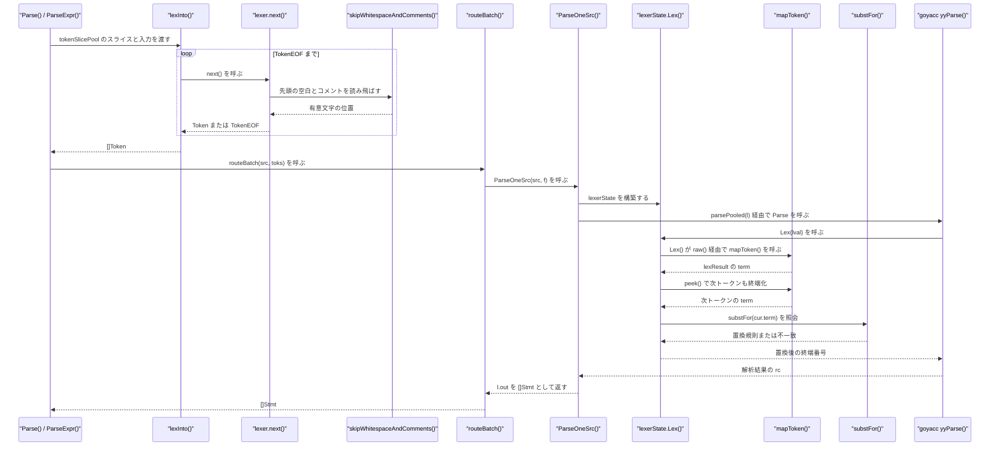
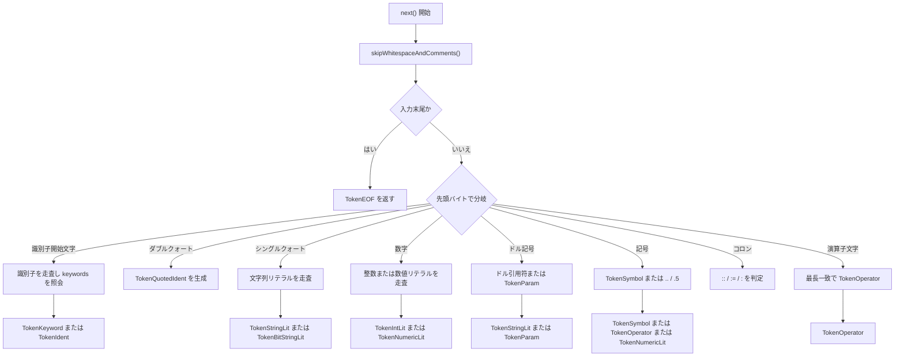

# 字句解析とトークン

<details>
<summary>関連ソースファイル</summary>

- [`internal/parser/base_yylex.go`](https://github.com/ryogrid/goopg/blob/19856410e8d497d59787e1ab35a2febb3f5953d6/internal/parser/base_yylex.go)
- [`internal/parser/keywords.go`](https://github.com/ryogrid/goopg/blob/19856410e8d497d59787e1ab35a2febb3f5953d6/internal/parser/keywords.go)
- [`internal/parser/keywords_gen.go`](https://github.com/ryogrid/goopg/blob/19856410e8d497d59787e1ab35a2febb3f5953d6/internal/parser/keywords_gen.go)
- [`internal/parser/lexer.go`](https://github.com/ryogrid/goopg/blob/19856410e8d497d59787e1ab35a2febb3f5953d6/internal/parser/lexer.go)
- [`internal/parser/op.go`](https://github.com/ryogrid/goopg/blob/19856410e8d497d59787e1ab35a2febb3f5953d6/internal/parser/op.go)
- [`internal/parser/parser_pool.go`](https://github.com/ryogrid/goopg/blob/19856410e8d497d59787e1ab35a2febb3f5953d6/internal/parser/parser_pool.go)
- [`internal/parser/sqlkeywords/keywords.go`](https://github.com/ryogrid/goopg/blob/19856410e8d497d59787e1ab35a2febb3f5953d6/internal/parser/sqlkeywords/keywords.go)
- [`internal/parser/support.go`](https://github.com/ryogrid/goopg/blob/19856410e8d497d59787e1ab35a2febb3f5953d6/internal/parser/support.go)
- [`internal/parser/token.go`](https://github.com/ryogrid/goopg/blob/19856410e8d497d59787e1ab35a2febb3f5953d6/internal/parser/token.go)
- [`internal/parser/tokennums_gen.go`](https://github.com/ryogrid/goopg/blob/19856410e8d497d59787e1ab35a2febb3f5953d6/internal/parser/tokennums_gen.go)
- [`internal/parser/adapter.go`](https://github.com/ryogrid/goopg/blob/19856410e8d497d59787e1ab35a2febb3f5953d6/internal/parser/adapter.go)
- [`internal/parser/dispatch.go`](https://github.com/ryogrid/goopg/blob/19856410e8d497d59787e1ab35a2febb3f5953d6/internal/parser/dispatch.go)
- [`internal/parser/parser.go`](https://github.com/ryogrid/goopg/blob/19856410e8d497d59787e1ab35a2febb3f5953d6/internal/parser/parser.go)
- [`internal/parser/tables.go`](https://github.com/ryogrid/goopg/blob/19856410e8d497d59787e1ab35a2febb3f5953d6/internal/parser/tables.go)
- [`internal/parser/select.go`](https://github.com/ryogrid/goopg/blob/19856410e8d497d59787e1ab35a2febb3f5953d6/internal/parser/select.go)

</details>

SQL 文字列をバイト単位で走査し、キーワード・識別子・各種リテラル・演算子を `Token` の列に変換する層である。字句解析器は入力全体を一度に走査し、末尾に必ず `TokenEOF` を付けて返す。その後 `parser` パッケージ内のアダプタが各 `Token` を goyacc の終端番号へ写像し、`base_yylex.go` の先読み置換を適用してから LALR 文法へ渡す。字句解析そのものはステートマシンを共有せず、1 回の `Parse` 呼び出しごとに独立した `lexer` 値を作る。親セクションは [4 SQL パーサー](../4-SQL-Parser.md) である。

## 責務

- 空白・改行とコメントの読み飛ばし。`--` 行コメントと、PostgreSQL と同じく入れ子を許す `/* ... */` ブロックコメントを処理する。`path:internal/parser/lexer.go:skipWhitespaceAndComments`
- 非引用識別子の走査と小文字化、および `keywords` マップによるキーワード判定。`path:internal/parser/lexer.go:next`、`path:internal/parser/token.go:keywords`
- 引用識別子 `"..."`（`""` を 1 個の `"` にする）と、大文字小文字を保存する `TokenQuotedIdent` の生成。`path:internal/parser/lexer.go:next`
- 数値リテラルの走査。10 進整数、`0b`/`0o`/`0x` 接頭辞、`_` 区切り、小数部、指数部、先頭 `.` 形式、`..` レンジとの切り分け。
- 文字列リテラルの走査。通常の `'...'`、`E'...'`、`U&'...'`、`B'...'`/`X'...'`、`$$...$$`/`$tag$...$tag$`、および PostgreSQL の改行をまたぐ文字列連結。
- 演算子の最長一致走査。`{op_chars}` の連続を切り出し、コメント開始位置と末尾の `+`/`-` を後処理する。`path:internal/parser/lexer.go:isOpRunChar`
- バイト位置 `Token.Pos` の付与。位置は元の SQL 文字列に対する絶対オフセットであり、エラー報告の `Position` にそのまま使われる。
- `Token` から goyacc 終端への変換、型付きリテラルと `CHECK (...)` 本体の折り畳み、`base_yylex` の 1 トークン先読み置換。`path:internal/parser/adapter.go:mapToken`、`path:internal/parser/adapter.go:next`、`path:internal/parser/base_yylex.go:initSubstRules`
- 演算子文字列から `OpCode` への変換と、キーワードの文法カテゴリ（予約語かどうか）の提供。`path:internal/parser/op.go:ParseBinaryOp`、`path:internal/parser/keywords.go:IsColNameKeyword`

## 処理フロー

通常の SQL 実行経路では `Parse` がトークンスライスを確保し、`lexInto` が `lexer.next` を `TokenEOF` まで繰り返す。得られたトークン列はステートメント分割とルーティングを経て、goyacc 側では `lexerState.Lex` が 1 終端ずつ供給する。



1. `Parse(input)` は `tokenSlicePool.Get()` で `[]Token` の背後の配列を取り、`lexInto((*sp)[:0], input)` に渡す。`lexInto` は `&lexer{src: input}` を作り、`next()` の結果を追記し続ける。`TokenEOF` を追記した時点で戻る。`path:internal/parser/parser.go:Parse`、`path:internal/parser/lexer.go:lexInto`
2. `lexer.next()` はまず `skipWhitespaceAndComments()` を呼ぶ。ここで `--` は改行まで、`/* ... */` は深さカウンタで入れ子を数え、深さが 0 に戻らないまま入力が尽きたら `LexError` を返す。`path:internal/parser/lexer.go:next`
3. 先頭バイトで分岐する。識別子開始文字なら識別子を走査して小文字化し、`keywords` に載っていれば `TokenKeyword`、なければ `TokenIdent` を返す。`E'`・`B'`・`X'`・`U&'`/`U&"` は識別子走査の直後に専用スキャナへ分岐する。
4. 数字なら整数・数値リテラル、`$` ならドル引用符か `TokenParam`、`"` なら引用識別子、`'` なら文字列リテラル、`,` `;` `(` `)` `.` `*` `[` `]` なら記号、`:` なら `::`/`:=`/`:`、それ以外の演算子文字なら最長一致の `TokenOperator` を返す。`path:internal/parser/lexer.go:next`
5. `Parse` は得たトークン列を `routeBatch` に渡す。`routeBatch` は `SplitStatements(toks)` でフラグメントに分け、ルーティング対象なら `ParseOneSrc(src, f)` を呼ぶ。`ParseOneSrc` は `lexerState{toks: toks, src: src}` を作り、`parsePooled(l)` を実行する。ルーティング対象外のフラグメントは `parseOneLegacyFragment` に送られ、同じトークン列を手書きパーサーが読む。`path:internal/parser/adapter.go:ParseOneSrc`、`path:internal/parser/parser_pool.go:parsePooled`、`path:internal/parser/dispatch.go:parseOneLegacyFragment`
6. goyacc は終端が欲しいたびに `lexerState.Lex` を呼ぶ。`Lex` は `next()` → `raw()` → `mapToken()` の順で `lexResult` を得て、`lval.str`・`lval.ival`・`lval.p` を設定する。`next()` はその後に `substFor(cur.term)` を引き、次トークンがフォロワー集合に含まれる場合だけ `WITH_LA` などの終端へ差し替える。`path:internal/parser/adapter.go:Lex`、`path:internal/parser/adapter.go:next`、`path:internal/parser/base_yylex.go:substFor`。終端を受け取った後の文ディスパッチは [4.2 文法と文ディスパッチ](4.2-Grammar-and-Dispatch.md) で扱う。
7. `parsePooled` は `sync.Pool` から `yyParserImpl` を取り出して `Parse(yylex)` を呼び、戻り値の前に `lval`・`char`・スタックをクリアしてプールへ返す。`path:internal/parser/parser_pool.go:parsePooled`

字句解析器だけを使う入口として `Lex(input string) ([]Token, error)` がある。これは `lexInto(nil, input)` を呼ぶだけの薄いラッパーで、PL/pgSQL パーサーなど `parser.Parse` を通さない呼び出し元が利用する。`path:internal/parser/lexer.go:Lex`

## 主要ファイル

| ファイル | 役割 |
| --- | --- |
| `internal/parser/lexer.go` | `Lex`/`lexInto` と `lexer.next`、文字列・数値・演算子の各スキャナ。`path:internal/parser/lexer.go:next` |
| `internal/parser/token.go` | `TokenKind`、`Keyword` 定数、`keywords` マップ、`Token` 構造体。`path:internal/parser/token.go:Token` |
| `internal/parser/keywords.go` | `KeywordCategory` と `keywordCategory` マップ、`IsColNameKeyword`。`path:internal/parser/keywords.go:IsColNameKeyword` |
| `internal/parser/keywords_gen.go` | `kwlist.h` から生成した 494 行の `keywordDefs`。`path:internal/parser/keywords_gen.go:keywordDefs` |
| `internal/parser/tokennums_gen.go` | goyacc の終端名から終端番号への 525 エントリの表。`path:internal/parser/tokennums_gen.go:genTokenNums` |
| `internal/parser/adapter.go` | `Token` → 終端番号の写像、型付きリテラルと `CHECK` 本体の折り畳み、`lexerState.Lex`。`path:internal/parser/adapter.go:mapToken` |
| `internal/parser/base_yylex.go` | `WITH_LA`/`NOT_LA` などの 1 トークン先読み置換規則。`path:internal/parser/base_yylex.go:initSubstRules` |
| `internal/parser/tables.go` | `keywordDefs`・`genTokenNums`・字句解析器の文字列を init 時に結合する。`path:internal/parser/tables.go:keywordTerm` |
| `internal/parser/op.go` | `OpCode` と演算子文字列との相互変換。`path:internal/parser/op.go:OpCode` |
| `internal/parser/parser_pool.go` | `yyParserImpl` の `sync.Pool` と `parsePooled`。`path:internal/parser/parser_pool.go:parsePooled` |
| `internal/parser/parser.go` | `Parse`/`ParseExpr` と `tokenSlicePool`、`lexInto` の呼び出し。`path:internal/parser/parser.go:Parse` |
| `internal/parser/dispatch.go` | `SplitStatements` によるフラグメント分割と、goyacc／手書きパーサーの振り分け。`path:internal/parser/dispatch.go:routeBatch` |
| `internal/parser/support.go` | 文法アクションからトークン列を読む補助関数。`path:internal/parser/support.go:tokenJoinLower` |
| `internal/parser/sqlkeywords/keywords.go` | 識別子を引用すべきキーワード集合と `QuoteIdentifier`。`path:internal/parser/sqlkeywords/keywords.go:QuoteIdentifier` |
| `internal/parser/select.go` | 整数リテラルの基数解釈と int64 オーバーフロー時のテキスト化。`path:internal/parser/select.go:parseIntLiteral` |

## 公開 API / エントリポイント

```go
func Lex(input string) ([]Token, error)
func IsColNameKeyword(kw Keyword) bool
func ParseUnaryOp(s string) OpCode
func ParseBinaryOp(s string) OpCode
func (o OpCode) String() string
func (o OpCode) IsBoolean() bool
func (o OpCode) IsComparison() bool
func IsReservedForQuoting(s string) bool
func QuoteIdentifier(s string) string
```

- `Lex` は入力全体を走査し、`TokenEOF` 終端のスライスを返す。エラー時は `nil, error` を返し、途中までのトークン列は返さない。`path:internal/parser/lexer.go:Lex`
- `IsColNameKeyword` は、キーワードを引用なしの識別子として受け付けられるかを返す。`KwCatReserved` 以外は `true`、`keywordCategory` に未登録のキーワードは安全側で `false`。`path:internal/parser/keywords.go:IsColNameKeyword`
- `ParseUnaryOp` は `-`・`+`・`NOT` を、`ParseBinaryOp` は算術・比較・論理・パターン・正規表現・ビット・幾何・JSON の演算子文字列を `OpCode` にする。未知の文字列は `OpUnknown`。`path:internal/parser/op.go:ParseBinaryOp`
- `OpCode.String` は SQL 面上の正規形を返し、`!=` は `<>` に正規化される。`path:internal/parser/op.go:String`
- `QuoteIdentifier` は PostgreSQL の `quote_identifier()` 相当。小文字 ASCII の識別子で、かつ `IsReservedForQuoting` が偽のときだけ引用符なしで返す。`path:internal/parser/sqlkeywords/keywords.go:QuoteIdentifier`
- パッケージ内部の `lexerState.Lex(lval *yySymType) int` が goyacc の `yyLexer` 実装である。`path:internal/parser/adapter.go:Lex`

## 主要データ構造

### `TokenKind` — トークンの分類

`path:internal/parser/token.go:TokenKind`

```go
// TokenKind classifies a lexer token.
type TokenKind int

const (
	TokenEOF TokenKind = iota
	TokenIdent
	TokenQuotedIdent
	TokenIntLit
	// TokenNumericLit covers decimal and scientific-notation literals
	// (`1.5`, `1e10`, `0.5e-3`). v0 stores the literal verbatim — the
	// parser emits a NumericConst that the executor encodes as a
	// varlen text payload for NUMERIC columns. Real arithmetic on
	// NUMERIC waits on the type system.
	TokenNumericLit
	TokenStringLit
	// TokenBitStringLit covers both bit-string (B'...') and hex-string
	// (X'...') literals (PG SQL99 bit-type literal syntax; scan.l's
	// xbstart/xhstart, gram.y AexprConst BCONST/XCONST). Value carries a
	// leading marker byte ('b' or 'x', mirroring scan.l's own convention
	// of prefixing addlitchar('b'|'x', ...) onto the buffer) followed by
	// the raw, unvalidated source digits — decodeBitStringLit in select.go
	// validates and decodes it. M0134-0092.
	TokenBitStringLit
	TokenParam // $N
	TokenSymbol
	TokenOperator
	TokenKeyword
)
```

`TokenEOF` がゼロ値である点が重要で、`lexInto` はこの値を見て走査を止める。`TokenKeyword` だけが `Token.Keyword` を意味のある値にし、他の種類では `Keyword` はゼロ値のままである。`TokenBitStringLit` はビット列と 16 進列を同じ種類で表し、区別は `Value` の先頭 1 バイト（`'b'` または `'x'`）に持たせる。

### `Token` — 字句解析器の出力

`path:internal/parser/token.go:Token`

```go
// Token is one lexer output. Value is the source bytes (lower-cased
// for keywords/idents, raw payload for literals). Pos is the byte
// offset in the original input.
type Token struct {
	Kind    TokenKind
	Keyword Keyword // populated when Kind == TokenKeyword
	Value   string
	Pos     int
}
```

不変条件は次のとおり。

- `Kind == TokenKeyword` のときだけ `Keyword` が設定される。`Value` は小文字化済みのキーワード文字列で、`Keyword` の文字列値と一致する。
- `TokenIdent` の `Value` は小文字化済み、`TokenQuotedIdent` の `Value` は `""` を `"` に戻しただけで大文字小文字を保存した値である。
- リテラルの `Value` はデコード済みの内容（文字列）またはソース表記（数値）で、`Pos` はトークンの先頭バイトを指す。文字列連結が起きた場合も `Pos` は最初の断片の開始位置のままである。
- `TokenParam.Value` は `$` を含まない数字列である。

### `Keyword` — 字句解析器が認識するキーワード

`path:internal/parser/token.go:Keyword`

```go
// Keyword carves out the subset of identifiers the parser treats as
// keywords. v0 only enumerates the ones the phase-1 statements need;
// each new statement family adds its own. Mirrors upstream's
// kwlist.h subset.
type Keyword string
```

`Keyword` は文字列型で、定数の値はすべて小文字のキーワード表記である（例: `KwSelect Keyword = "select"`）。`keywords` マップはこの 150 個のキーワードだけを小文字文字列から `Keyword` へ引き当て、字句解析器はこのマップに載っている語だけを `TokenKeyword` として返す。`path:internal/parser/token.go:keywords`

この 150 語の集合と、後述する生成済みの 494 語の集合は一致しない。字句解析器が `TokenKeyword` を付けるかどうかは 150 語のマップで決まり、goyacc 側の終端解決は 494 語の `keywordDefs` で行われる。そのため「手書きパーサーがキーワードとして特別扱いする語」と「文法が終端として持つ語」は独立に決まる。

### `KeywordCategory` — 識別子として使えるかの分類

`path:internal/parser/keywords.go:KeywordCategory`

```go
// KeywordCategory classifies a keyword's role in the grammar, matching the
// four-way split from upstream's kwlist.h. The classification governs whether
// a keyword may appear unquoted as an identifier (column name, table name,
// alias, etc.) in positions where the parser would otherwise accept an ident.
//
// Upstream reference: postgres/src/include/parser/kwlist.h
type KeywordCategory int

const (
	// KwCatReserved keywords conflict structurally with the grammar and must
	// always be double-quoted when used as identifiers. Examples: SELECT,
	// FROM, WHERE, AND, OR, NULL, TRUE, FALSE.
	KwCatReserved KeywordCategory = iota

	// KwCatTypeFunc keywords are reserved only in type-name and
	// function-name positions; they can appear as column names and table
	// aliases. Examples: LIKE, ILIKE, VERBOSE, JOIN variants, BINARY.
	KwCatTypeFunc

	// KwCatColName keywords are usable as column names and table names but
	// are restricted in a handful of other contexts. Examples: VALUES,
	// EXISTS, BETWEEN, ROW, TIME.
	KwCatColName

	// KwCatUnreserved keywords may appear as identifiers in any context.
	// Examples: BEGIN, COMMIT, INDEX, KEY, FUNCTION, LANGUAGE, PARTITION.
	KwCatUnreserved
)
```

`keywordCategory` は `Keyword` から `KeywordCategory` へのマップで、`IsColNameKeyword` は「`KwCatReserved` でない」ことを「引用なし識別子として使える」と解釈する。マップに存在しないキーワードは予約語扱いになり、将来 `Keyword` を追加して分類を忘れた場合に、黙って識別子として受理されることを防ぐ。`path:internal/parser/keywords.go:keywordCategory`

### `keywordDef` — 生成された kwlist の 1 行

`path:internal/parser/keywords_gen.go:keywordDef`

```go
// keywordDef is one transcribed kwlist.h row. Token holds the TERMINAL NAME
// (e.g. "BEGIN_P"); the lexer adapter resolves it to goyacc-assigned number
// via yyToknames at init time — never edit numbers by hand here.
type keywordDef struct {
	Text     string
	Token    string
	Category KwCategory
	Label    KeywordLabel
}
```

`Text` は小文字のキーワード、`Token` は `BEGIN_P` のような終端名、`Category` は 4 分類、`Label` は `BARE_LABEL`/`AS_LABEL` の別を表す。数値は持たず、`tables.go` の init で `nameToNum[d.Token]` を引いて `keywordTokenNum` と `keywordTerm` を作る。このため文法を再生成して終端番号が変わっても、生成ファイルを書き換える必要がない。`path:internal/parser/tables.go:init`

### `substRule` — base_yylex の先読み置換規則

`path:internal/parser/base_yylex.go:substRule`

```go
type substRule struct {
	cur       int // base terminal (e.g. WITH)
	subst     int // terminal substituted when a follower matches (WITH_LA)
	followers map[int]bool
}
```

`cur` が現在の終端、`subst` が置換後の終端、`followers` が置換を発動させる次終端の集合である。`substFor` は `substRules` を線形に走査し、`cur == r.cur` かつ `cur != r.subst` の規則だけを返す。`cur == subst` の除外は、置換後の終端を再入力したときに同じ規則が無限に適用されるのを防ぐ。`path:internal/parser/base_yylex.go:substFor`

### `OpCode` — 演算子の型付きディスパッチキー

`path:internal/parser/op.go:OpCode`

```go
// OpCode is the typed dispatch key for UnaryOp / BinaryOp.
// Replaces the historical `Op string` field — switching on
// OpCode produces a jump-table dispatch, eliminating the
// per-row string-compare cost the M0072-final pprof flagged
// on Q5 (`evalBinary` 8.78 % flat / 29.20 % cum CPU).
//
// The zero value (OpUnknown) is reserved for the unset /
// parse-error state; all valid expressions carry a non-zero
// OpCode.
//
// See `docs/design/0073-0003-opcode-int-enum.md`.
type OpCode int8
```

ゼロ値 `OpUnknown` は「未設定または解析エラー」を表し、有効な式は必ず非ゼロの `OpCode` を持つ。`OpNe` は `<>` と `!=` の両方を 1 つの値にまとめ、`String()` では `<>` を返す。`OpAnd`/`OpOr` は `IsBoolean`、`OpEq`〜`OpNe` は `IsComparison` で判定できる。式ノード内での実際の使われ方は [4.3 AST と式の構造](4.3-AST-and-Expressions.md) を参照。`path:internal/parser/op.go:OpCode`

### `lexResult` — 終端番号と意味値の運搬

`path:internal/parser/adapter.go:lexResult`

```go
// lexResult is one mapped terminal plus its semantic values and position.
type lexResult struct {
	term int
	str  string
	ival int
	pos  int
	text string // original-case source text
}
```

`term` が goyacc に返す終端番号、`str` が文字列の意味値、`ival` が整数の意味値、`pos` が絶対バイト位置、`text` がエラー表示用の元の表記である。`mapToken` は `Token.Kind` ごとにこの 5 フィールドを埋め、`Lex` が `lval.str`・`lval.ival`・`lval.p` に転写する。`path:internal/parser/adapter.go:mapToken`

### `lexer` — 走査位置を持つ状態

`path:internal/parser/lexer.go:lexer`

```go
type lexer struct {
	src string
	pos int
}
```

`src` は走査対象の全体、`pos` は次に読むバイト位置である。`peek()` と `peekAt(off)` は `pos` を進めずにバイトを返し、入力末尾では `0` を返す。`pos` は通常は単調増加だが、ドル引用符の開始判定に失敗したとき（`l.pos = tagStart`）、指数部が成立しなかったとき（`l.pos = save`）、文字列連結の先読みが成立しなかったとき（`l.pos = save`）、`UESCAPE` の先読みが一致しなかったとき（`l.pos = save`）に限って巻き戻る。`path:internal/parser/lexer.go:peek`

## 内部構造

### 2 つのキーワード表

字句解析器の `keywords` は 150 語、生成された `keywordDefs` は 494 語である。`mapToken` は `TokenIdent` と `TokenKeyword` の両方について `keywordTerm[lower]` を引くため、字句解析器が `TokenIdent` とした語でも、494 語のいずれかなら文法のキーワード終端に写像される。逆に手書きパーサー（[4.4 手書き DDL・DML パーサー](4.4-Handwritten-DDL-DML.md)）は `Token.Kind` と `Token.Keyword`、`IsColNameKeyword` を見るため、150 語の側の分類が効く。`path:internal/parser/adapter.go:mapToken`、`path:internal/parser/token.go:keywords`

`keywordDefs` の `Token` 名は `BEGIN_P` のように PostgreSQL の `kwlist.h` の終端名をそのまま使う。`tables.go` の init は `genTokenNums` を `nameToNum` にコピーし、`keywordDefs` の各 `Token` を解決して `keywordTerm` を作る。文法に存在しない終端名は `unresolved` に記録される。`path:internal/parser/tables.go:init`

### `next()` の分岐



`E` の分岐順序には意味がある。`*` は記号ケースで先に消費されるため、演算子ケースの先頭文字にはならない。`isOpRunChar` 自体は `*` を含むので、`~*`・`!~*`・`#>>` の 2 文字目以降では `*` が吸収される。`path:internal/parser/lexer.go:isOpRunChar`

### 文字列リテラルの走査

- 通常の `'...'` は `scanPlainQuoteInto` が担当する。`''` は 1 個の `'` になり、閉じ引用符が見つからなければ「unterminated string literal」を返す。
- 閉じ引用符の後、`tryQuoteContinuation` が空白・`--` コメントだけを読み飛ばし、その間に 1 個以上の改行があり、次の有意文字が `'` なら連結を続行する。改行のない `'a' 'b'` は連結しない。ブロックコメント `/* */` はこのギャップに含まれないため、連結は成立しない。`path:internal/parser/lexer.go:tryQuoteContinuation`
- `E'...'` は `scanEscapeQuoteInto` がバックスラッシュを解釈する。`\n`・`\t`・`\r`・`\b`・`\f`・`\v`、1〜3 桁の八進、1〜2 桁の `\x`、4 桁の `\u`、8 桁の `\U`、`\'`、`\\` を扱う。未知のエスケープはバックスラッシュごとそのまま残す。`path:internal/parser/lexer.go:scanEscapeQuoteInto`
- `\u`/`\U` が UTF-16 の上位サロゲートを表した場合、直後のエスケープが下位サロゲートであることを要求する。単独の下位サロゲート、不正な桁数、`0x10FFFF` 超の値は `SyntaxError`（SQLSTATE 42601 または 22025）になる。`path:internal/parser/lexer.go:scanEscapeQuoteInto`
- `U&'...'`/`U&"..."` はまず本文を未デコードのまま取り出し、閉じ引用符の後ろに `UESCAPE '<char>'` があるかを字句解析器自身が先読みする。既定のエスケープ文字は `\`。4 桁 `XXXX` と、`+` 付き 6 桁 `+XXXXXX` の広い形式を扱う。`UESCAPE` の文字は 16 進数字・`+`・引用符・空白であってはならない。`path:internal/parser/lexer.go:lexUnicodeEscapeQuote`、`path:internal/parser/lexer.go:decodeUnicodeEscapes`
- `B'...'` と `X'...'` は `lexBitOrHexString` が担当し、`Value` の先頭に `'b'` または `'x'` のマーカーを置いて本文をそのまま格納する。数字の妥当性は字句解析時には検査せず、後段の `decodeBitStringLit` に委ねる。`path:internal/parser/lexer.go:lexBitOrHexString`
- `$$body$$` と `$tag$body$tag$` はタグを識別子文字（`$` を除く）として読み、開始タグと同じ文字列で閉じる。空タグも許す。閉じタグが見つからなければ「unterminated dollar-quoted string」を返す。開始タグが成立しない場合は `tagStart` まで巻き戻し、`$N` パラメータとして再走査する。`path:internal/parser/lexer.go:next`

### 数値リテラルの走査

- `0b`/`0B` は 2 進、`0o`/`0O` は 8 進、`0x`/`0X` は 16 進。各接頭辞の後に有効数字が 1 個もなければ「invalid binary integer」「invalid octal integer」「invalid hexadecimal integer」を返す。
- 10 進の整数部・小数部・指数部では `_` を区切りとして許すが、末尾の `_` と連続する `__` は「trailing junk after numeric literal」になる。`checkUnderscoreJunk` が範囲 `[rStart, rEnd)` を調べる。`path:internal/parser/lexer.go:next`
- `.` の後ろが数字なら `.5` のような数値リテラルになる。`.` の後ろがもう 1 つの `.` なら `..` 演算子を優先し、`1..10` は `1`、`..`、`10` に分かれる。
- `1000.` のように小数点で終わる表記は数値リテラルとして有効である。一方、`1_000._5` は小数部が空とみなされ、`_5` が識別子開始文字として残るため「trailing junk」になる。
- 指数部は `e`/`E` の後に符号と数字を要求する。数字が 1 個も続かなければ `save` まで巻き戻し、`1e` を指数として消費しない。
- 数値の直後に識別子文字が続く場合（`123abc`、`0.0e1a`）は、残りを読み進めてから「trailing junk after numeric literal at or near ...」を返す。
- 字句解析器は整数を常に `TokenIntLit` として返し、int64 に収まるかどうかは判定しない。判定はアダプタの `parseIntLiteral` が行い、収まらなければ `FCONST` として再配信する。`path:internal/parser/select.go:parseIntLiteral`

### 演算子の最長一致

`isOpRunChar` は `~ ! @ # ^ & | ? + - * / % < > =` と `` ` `` を演算子文字として扱う。`next()` はこの集合の連続を貪欲に切り出した後、次の順で後処理する。

1. 連続の中に `/*` または `--` があれば、最初に現れた位置で切る。演算子の途中からコメントが始まる場合に、コメント開始文字を演算子名へ混入させないためである。
2. 末尾が `+` または `-` で、かつそれより前の文字に `~ ! @ # ^ & |`・`` ` ``・`?`・`%` が 1 つも含まれない場合、末尾の `+`/`-` を削る。`=-` は 2 個の演算子に分かれ、`?-` は 1 個の演算子のまま残る。
3. 残った長さが 64 以上なら「operator too long」を返す。PostgreSQL の `NAMEDATALEN` に合わせて 63 バイトを許容上限とし、切り詰めではなくエラーにする。

`path:internal/parser/lexer.go:isOpRunChar`

`TokenOperator` はアダプタで終端へ変換される。`namedOperator` に載る `::`・`..`・`:=`・`=>`・`<=`・`>=`・`<>`・`!=` は専用の名前付き終端へ、`scanSelfChars`（`,()[].;:+-*/%^<>=`）に含まれる 1 文字は ASCII コードの終端へ、それ以外は汎用の `Op` 終端へ送られる。`path:internal/parser/tables.go:namedOperator`、`path:internal/parser/adapter.go:mapToken`

### base_yylex の先読み置換

`initSubstRules` は次の組を登録する。

| 現在の終端 | 置換後 | フォロワー |
| --- | --- | --- |
| `FORMAT` | `FORMAT_LA` | `JSON` |
| `VALUES` | `VALUES_LA` | `(` |
| `NOT` | `NOT_LA` | `BETWEEN`・`IN_P`・`LIKE`・`ILIKE`・`SIMILAR` |
| `NULLS_P` | `NULLS_LA` | `FIRST_P`・`LAST_P` |
| `WITH` | `WITH_LA` | `TIME`・`ORDINALITY` |
| `WITHOUT` | `WITHOUT_LA` | `TIME` |

`initSubstRules` は、現在の終端または置換後の終端が文法にまだ宣言されていなければ、その規則をスキップする。フォロワーは解決できたものだけを集合に入れ、`(` のように名前付き定数を持たない 1 文字終端は、goyacc の契約に従って ASCII コードをフォロワー番号として使う。`path:internal/parser/base_yylex.go:initSubstRules`

`NOT` のフォロワー集合に `EXISTS` が入っていない点は意図的である。`NOT EXISTS (...)` を `NOT_LA` にしてしまうと、`NOT_LA` を受け付ける `BETWEEN`/`IN`/`LIKE` 系の規則に一致せず、`NOT EXISTS` が構文エラーになる。`path:internal/parser/base_yylex.go:initSubstRules`

### アダプタ側の折り畳み

`lexerState.next` は `mapToken` の結果に対して 2 種類の合成を行う。

- 型付きリテラル: `knownTypeNames` に載る型名の直後が文字列リテラルなら、両者を 1 個の `TYPEDLIT` 終端に畳む。`char(20) 'x'` のように typmod を挟む場合は `peekCharTypmodLit` が `( ICONST ) SCONST` を消費する。`path:internal/parser/adapter.go:next`
- `CHECK ( ... )` の本体: `CHECK` の直後が `(` で、直前が `WITH` でない場合、対応する `)` までをトークンのまま読み飛ばして `CHECKBODY` 終端にする。`WITH CHECK ( ... )` は `CREATE POLICY` の行フィルタなので折り畳まない。`path:internal/parser/adapter.go:next`

`lexerState` には `pushed bool` と `pushedR lexResult` という 1 トークン押し戻し用のフィールドがあるが、本番コードでこれらを設定する箇所は現時点では存在しない。`next` は `pushed` が真なら `pushedR` を返す分岐だけを持つ。`path:internal/parser/adapter.go:next`

## エッジケースと不変条件

- **エラー時は部分結果を返さない。** `lexInto` は途中まで `dst` に追記していても、`next()` がエラーを返した時点で `nil, err` を返す。`Parse` はその場合に `tokenSlicePool` へスライスを返し、呼び出し元へは `nil, err` を渡す。`path:internal/parser/lexer.go:lexInto`、`path:internal/parser/parser.go:Parse`
- **エラーの型が 2 種類ある。** 未終端コメント、未終端文字列、不正な数値などは `*LexError`（`Pos` と `Message`）で返る。一方、`U&'...'` の `UESCAPE` 検証やサロゲート検証は `*SyntaxError` を返し、SQLSTATE 42601/22025 を設定する。`path:internal/parser/lexer.go:LexError`
- **ブロックコメントは入れ子。** `/* a /* b */ c */` は 1 個のコメントとして扱われる。深さが 0 に戻らないまま入力が尽きると、コメント開始位置を指す「unterminated block comment」になる。`path:internal/parser/lexer.go:skipWhitespaceAndComments`
- **文字列連結の条件は改行。** `'a' 'b'` は同一行なので 2 個の `TokenStringLit` のまま、`'a'\n'b'` は 1 個に連結される。`--` コメントはギャップに含められるが、`/* */` は含められない。`path:internal/parser/lexer.go:tryQuoteContinuation`
- **パラメータ番号の上限。** `$N` の数字列が 10 桁を超えるか、10 桁で `"2147483647"` より大きい場合は「parameter number too large」になる。`$1a` のような識別子文字の後続は「trailing junk after parameter」になる。`path:internal/parser/lexer.go:next`
- **演算子長は 64 バイト以上を拒否する。** `nchars >= 64` で「operator too long」となり、許容される最長は 63 バイトである。これは PostgreSQL の `NAMEDATALEN` に対応する。`path:internal/parser/lexer.go:next`
- **終端番号の規約。** `mapToken` は `TokenEOF` とスライス末尾で `term: 0` を返す。goyacc の `yylex1` は 0 以下を `$end` に変換する。正の数を返すと ASCII コードとして誤解されるため、EOF では必ず 0 を返す。`path:internal/parser/adapter.go:mapToken`
- **整数のオーバーフローは字句解析ではエラーにしない。** `TokenIntLit` のまま返し、アダプタが `parseIntLiteral` の失敗を見て `FCONST` に切り替える。`9223372036854775808` のような値は切り捨てず、10 進テキストとして `NumericConst` 側へ渡る。`path:internal/parser/select.go:intLiteralOverflowText`
- **ビット列と 16 進列の終端は `BCONST` に寄せる。** 字句解析器は `'b'`/`'x'` のマーカーを `Value` に持たせるが、goyacc 側の `mapToken` はどちらも `BCONST` として返す。ソースコメントにも情報が非可逆であると明記されており、区別が必要な場合は `Value` のマーカーを後段で見る。`path:internal/parser/adapter.go:mapToken`
- **`isIdentStart` はバイト単位。** ASCII の `_`・英字に加えて、`0x80` 以上のバイトを `unicode.IsLetter(rune(c))` で判定する。UTF-8 のマルチバイト文字をルーン単位でデコードしているわけではないため、非 ASCII 識別子の受理はバイト値に依存する。`path:internal/parser/lexer.go:isIdentStart`
- **字句解析器の状態は呼び出しごとに独立。** `keywords`・`keywordCategory`・`keywordDefs`・`genTokenNums` は init 後に読み取り専用、`substRules` は init 時に一度だけ構築される。`tokenSlicePool` と `parserPool` は `sync.Pool` で共有されるが、各 `Parse` は自分のスライスと `yyParserImpl` を排他的に使う。`parserPool` は返却前に `lval`・`char`・スタックをクリアし、前の文の AST への参照をプール内に残さない。`path:internal/parser/parser_pool.go:parserPool`
- **キーワード分類のフォールバック。** `keywordCategory` にない `Keyword` は `IsColNameKeyword` が `false` を返す。新しいキーワードを `token.go` に追加したのに分類を忘れると、その語は引用なし識別子として使えなくなる（安全側の失敗）。`path:internal/parser/keywords.go:IsColNameKeyword`
- **識別子の引用規則は字句解析とは別。** `sqlkeywords` は executor と catalog の両方から使えるように切り出されたリーフパッケージで、`QuoteIdentifier` は小文字 ASCII の安全な識別子でも、`reservedQuoteKeywords` に載る非 UNRESERVED キーワードなら二重引用符を付ける。`path:internal/parser/sqlkeywords/keywords.go:reservedQuoteKeywords`
- **文法アクションは生のトークン列も読む。** `tokenJoinLower` は 2 つの絶対位置の間の `Token.Value` を空白で連結し、文字列リテラル以外を小文字化する。`CHECK` 本体や生成列の式テキストを、再パースせずに元トークンから復元する用途である。`path:internal/parser/support.go:tokenJoinLower`

Sources:

- `internal/parser/base_yylex.go`
- `internal/parser/keywords.go`
- `internal/parser/keywords_gen.go`
- `internal/parser/lexer.go`
- `internal/parser/op.go`
- `internal/parser/parser_pool.go`
- `internal/parser/sqlkeywords/keywords.go`
- `internal/parser/support.go`
- `internal/parser/token.go`
- `internal/parser/tokennums_gen.go`
- `internal/parser/adapter.go`
- `internal/parser/dispatch.go`
- `internal/parser/parser.go`
- `internal/parser/tables.go`
- `internal/parser/select.go`

<sub>Generated by deepwiki-4myself from `goopg` @ `19856410e`</sub>
