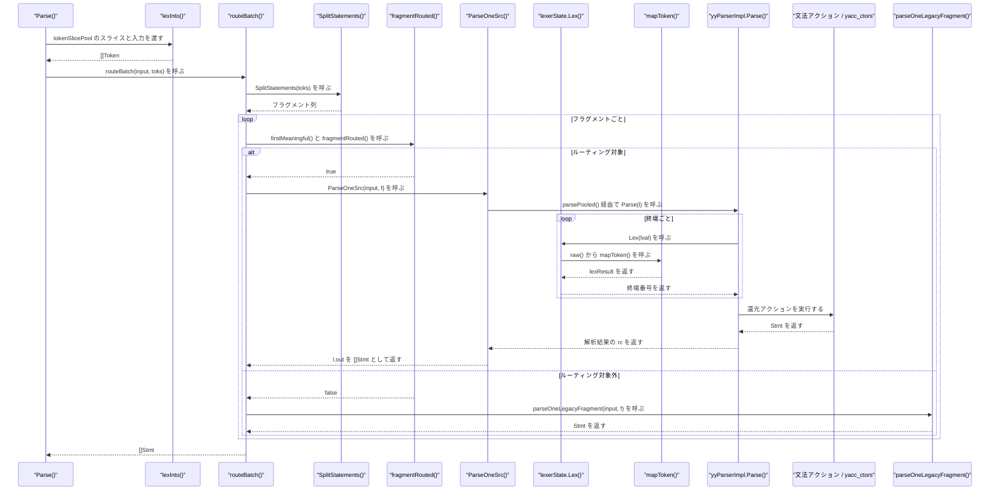
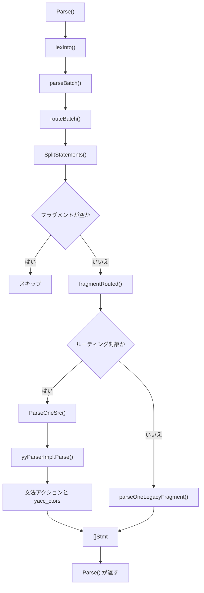

# 文法と文ディスパッチ

<details>
<summary>関連ソースファイル</summary>

- [`grammar/goopg_ext.y`](https://github.com/ryogrid/goopg/blob/19856410e8d497d59787e1ab35a2febb3f5953d6/grammar/goopg_ext.y)
- [`grammar/pg_grammar.y`](https://github.com/ryogrid/goopg/blob/19856410e8d497d59787e1ab35a2febb3f5953d6/grammar/pg_grammar.y)
- [`grammar/tokens_gen.y`](https://github.com/ryogrid/goopg/blob/19856410e8d497d59787e1ab35a2febb3f5953d6/grammar/tokens_gen.y)
- [`internal/parser/adapter.go`](https://github.com/ryogrid/goopg/blob/19856410e8d497d59787e1ab35a2febb3f5953d6/internal/parser/adapter.go)
- [`internal/parser/base_yylex.go`](https://github.com/ryogrid/goopg/blob/19856410e8d497d59787e1ab35a2febb3f5953d6/internal/parser/base_yylex.go)
- [`internal/parser/dispatch.go`](https://github.com/ryogrid/goopg/blob/19856410e8d497d59787e1ab35a2febb3f5953d6/internal/parser/dispatch.go)
- [`internal/parser/parser.go`](https://github.com/ryogrid/goopg/blob/19856410e8d497d59787e1ab35a2febb3f5953d6/internal/parser/parser.go)
- [`internal/parser/token.go`](https://github.com/ryogrid/goopg/blob/19856410e8d497d59787e1ab35a2febb3f5953d6/internal/parser/token.go)
- [`internal/parser/yacc_ctors.go`](https://github.com/ryogrid/goopg/blob/19856410e8d497d59787e1ab35a2febb3f5953d6/internal/parser/yacc_ctors.go)
- [`internal/parser/yacc_parser.go`](https://github.com/ryogrid/goopg/blob/19856410e8d497d59787e1ab35a2febb3f5953d6/internal/parser/yacc_parser.go)
- [`internal/parser/support.go`](https://github.com/ryogrid/goopg/blob/19856410e8d497d59787e1ab35a2febb3f5953d6/internal/parser/support.go)
- [`internal/parser/parser_pool.go`](https://github.com/ryogrid/goopg/blob/19856410e8d497d59787e1ab35a2febb3f5953d6/internal/parser/parser_pool.go)

</details>

PostgreSQL 18.3 の `gram.y` を goyacc へ移植した LALR 文法と、その文法を使うか既存の手書きパーサーを使うかを文ごとに決めるディスパッチャである。文法側は SELECT・式・INSERT/UPDATE/DELETE の中核を `grammar/pg_grammar.y` に、DDL・ユーティリティ文を `grammar/goopg_ext.y` に持ち、字句解析器が返す `Token` をアダプタが終端番号へ変換して `yyParserImpl.Parse` に渡す。ディスパッチャ側は `SplitStatements` でバッチを文単位に割り、各フラグメントの先頭語（必要なら 2 語目以降も）を見て goyacc 経路と `parseOneLegacyFragment` 経路を振り分ける。[4.1 字句解析とトークン](4.1-Lexer.md) の続きとして、ここでは終端から AST が組み上がるまでを扱う。親セクションは [4 SQL パーサー](../4-SQL-Parser.md) である。

## 責務

- `grammar/tokens_gen.y` のキーワード終端、`grammar/pg_grammar.y` の非キーワード終端・優先順位・型宣言、`grammar/goopg_ext.y` の文規則を 1 つの goyacc 文法として成立させる。`path:grammar/pg_grammar.y:root`、`path:grammar/goopg_ext.y:create_table_stmt`
- `Token` を goyacc の終端番号へ変換する。キーワード・識別子・文字列・整数・数値・パラメータ・演算子・記号を個別に扱い、名前付き終端と 1 文字終端を区別する。`path:internal/parser/adapter.go:mapToken`
- 型付きリテラル（`date '...'` など）を `TYPEDLIT` に、`CHECK (...)` の本体を `CHECKBODY` に折り畳む。文法が式として解釈できない互換形を 1 終端にまとめる処理である。`path:internal/parser/adapter.go:next`
- `WITH`・`NOT`・`VALUES` などの直後を 1 トークン先読みし、`WITH_LA`・`NOT_LA`・`VALUES_LA` へ差し替える。`path:internal/parser/base_yylex.go:initSubstRules`
- バッチをトップレベルの `;` で文フラグメントに分割する。括弧内の `;`、`CREATE FUNCTION ... BEGIN ATOMIC ... END` の本体、`CASE ... END` を区切りとして扱わない。`path:internal/parser/dispatch.go:SplitStatements`
- 文ごとに goyacc と手書きパーサーのどちらが所有するかを決める。`WITH` の後ろ、`EXPLAIN` の内側、`COMMENT ON` の対象種別、`CREATE`/`ALTER`/`DROP` の 2 語目、`ALTER TABLE` のアクション列まで検査する。`path:internal/parser/dispatch.go:fragmentRouted`
- 文法アクションから `New*` コンストラクタを呼び、位置 `pos` を持つ AST ノードを組み立てる。`path:internal/parser/yacc_ctors.go:NewSelectStmt`
- 構文エラーを `SyntaxError` として最初の 1 件だけ保持し、`ParseOneSrc` から `routeBatch` 経由で呼び出し元へ返す。`path:internal/parser/adapter.go:Error`

## 処理フロー

`Parse` は字句解析済みのトークン列を `routeBatch` に渡し、`routeBatch` はフラグメントごとに goyacc か手書きパーサーかを選ぶ。goyacc 経路では `lexerState.Lex` が終端を供給し、還元アクションが `yacc_ctors.go` のコンストラクタで AST を作る。



1. `Parse(input)` は `parseBatch(input, true, ...)` を呼ぶ。`parseBatch` は `tokenSlicePool` から `[]Token` を取り、`lexInto` で入力全体をトークン化する。エラー時はプールへ返して即座に失敗する。`path:internal/parser/parser.go:Parse`
2. `parseBatch` は `useYacc` が真なら `routeBatch(input, toks)` を呼ぶ。`routeBatch` が `handled=false` を返すのはフラグメントが 1 つもない空バッチ（入力が空、または `;` だけ）だけで、それ以外は必ず `handled=true` で戻る。`path:internal/parser/dispatch.go:routeBatch`
3. `routeBatch` はまず `SplitStatements(toks)` を呼ぶ。`SplitStatements` はトップレベルの `;` を区切りにし、区切りの `;` 自体はフラグメントに残す。空のフラグメント（`;;` の 2 個目など）は作らない。`path:internal/parser/dispatch.go:SplitStatements`
4. 各フラグメントについて `firstMeaningful` で先頭の意味あるトークン（`TokenEOF` と孤立した `;` を除く）を取り、`fragmentRouted` に渡す。先頭が `WITH`、`EXPLAIN`、`COMMENT`、`COPY`、`CREATE`/`ALTER`/`DROP` の場合は専用の判定関数へ分岐する。`path:internal/parser/dispatch.go:fragmentRouted`
5. ルーティング対象なら `ParseOneSrc(src, f)` を呼ぶ。`ParseOneSrc` は `lexerState{toks: f, src: src}` を作り、`lastPos` と `fragEnd` を設定し、`parsePooled(l)` を実行する。`path:internal/parser/adapter.go:ParseOneSrc`
6. `parsePooled` は `sync.Pool` から `yyParserImpl` を取り出し、`Parse(yylex)` を呼ぶ。生成された `yyParserImpl.Parse` は `yylex1` を通して `lexerState.Lex` から終端を受け取り、LALR のアクション／還元表（`yyPact`・`yyAct`・`yyChk`・`yyDef` など）で遷移する。`path:internal/parser/parser_pool.go:parsePooled`、`path:internal/parser/yacc_parser.go:yyParserImpl.Parse`
7. 文法の `root` は空入力なら `out = nil`、`stmt_list` があれば `out = $1` を実行する。`stmt_list` は `stmt` を `topLevelSelect` に通して `[]Stmt` を組み立て、`;` の連続や末尾の `;` も受け付ける。`path:grammar/pg_grammar.y:root`、`path:internal/parser/support.go:topLevelSelect`
8. ルーティング対象外なら `parseOneLegacyFragment(src, f)` が `parser{tokens: f, idx: 0, src: src}` を作り、`parseStatement` を 1 回呼ぶ。末尾の `;` を消費した後に `TokenEOF` 以外が残っていれば構文エラーになる。手書きパーサー側の文解析は [4.4 手書き DDL・DML パーサー](4.4-Handwritten-DDL-DML.md) を参照。`path:internal/parser/dispatch.go:parseOneLegacyFragment`
9. `routeBatch` は全フラグメントの `[]Stmt` を連結して返す。途中のフラグメントでエラーが出た場合は、その時点で `nil, true, err` を返し、後続のフラグメントは処理しない。`path:internal/parser/dispatch.go:routeBatch`

`ParseExpr` は `routeExpr` を使う別経路である。式のトークン列の先頭に合成した `SELECT` トークン（`Pos` は元の先頭から 7 バイト前）を置き、`ParseOne` で 1 ターゲットの `SelectStmt` として解析する。`From`・`Where`・`WindowClause`・`SetOp`・`ValuesRows`・`OrderBy`・`GroupBy`・`Having` のいずれかが残っていれば「unexpected trailing tokens after expression」を返す。`path:internal/parser/dispatch.go:routeExpr`



## 主要ファイル

| ファイル | 役割 |
| --- | --- |
| `grammar/tokens_gen.y` | `kwlist.h` から生成した 494 個のキーワード `%token <str>` 宣言。`path:grammar/tokens_gen.y:ABORT_P` |
| `grammar/pg_grammar.y` | `%start root`、優先順位、`root`/`stmt`/`stmt_list`、SELECT・式・INSERT/UPDATE/DELETE の規則。`path:grammar/pg_grammar.y:root` |
| `grammar/goopg_ext.y` | CREATE TABLE をはじめとする DDL・トランザクション・ユーティリティ文の規則。`path:grammar/goopg_ext.y:create_table_stmt` |
| `internal/parser/adapter.go` | `lexerState`、`Lex`/`next`、`mapToken`、型付きリテラルと `CHECKBODY` の折り畳み。`path:internal/parser/adapter.go:mapToken` |
| `internal/parser/base_yylex.go` | `WITH_LA`・`NOT_LA`・`VALUES_LA` などの先読み置換規則。`path:internal/parser/base_yylex.go:initSubstRules` |
| `internal/parser/dispatch.go` | `SplitStatements`、`routeBatch`、`fragmentRouted`、各ルーティングゲート、`parseOneLegacyFragment`。`path:internal/parser/dispatch.go:routeBatch` |
| `internal/parser/parser.go` | `Parse`/`ParseExpr`、`tokenSlicePool`、`SyntaxError`、手書きパーサーの `parser` 状態。`path:internal/parser/parser.go:Parse` |
| `internal/parser/token.go` | `Token` と `TokenKind`。アダプタの入力形式。`path:internal/parser/token.go:Token` |
| `internal/parser/yacc_ctors.go` | 文法アクション用の `New*` AST コンストラクタ。`path:internal/parser/yacc_ctors.go:NewSelectStmt` |
| `internal/parser/yacc_parser.go` | goyacc が生成した `yySymType`、終端定数、LALR 表、`yyParserImpl.Parse`。`path:internal/parser/yacc_parser.go:yySymType` |
| `internal/parser/support.go` | `topLevelSelect`、`intoWrap`、文法アクションから呼ばれる補助関数。`path:internal/parser/support.go:topLevelSelect` |
| `internal/parser/parser_pool.go` | `yyParserImpl` の `sync.Pool` と `parsePooled`。`path:internal/parser/parser_pool.go:parsePooled` |

## 公開 API / エントリポイント

```go
func Parse(input string, mc ...*mmgr.Context) ([]Stmt, error)
func ParseExpr(input string, mc ...*mmgr.Context) (Expr, error)
func SplitStatements(toks []Token) [][]Token
func (l *lexerState) Lex(lval *yySymType) int
func (l *lexerState) Error(msg string)
```

- `Parse` はバッチ全体の唯一の入口である。非空バッチは `routeBatch` が文ごとに goyacc か手書きパーサーへ振り分ける。`path:internal/parser/parser.go:Parse`
- `ParseExpr` は単一式を `routeExpr` 経由で解析する。PL/pgSQL の式など、文ではなく式だけを渡す呼び出し元が使う。`path:internal/parser/parser.go:ParseExpr`
- `SplitStatements` は `[]Token` をトップレベルの `;` で分割する。`;` を含むフラグメントを返すため、呼び出し側は末尾の `;` を前提にできる。`path:internal/parser/dispatch.go:SplitStatements`
- `Lex` と `Error` は goyacc の `yyLexer` インタフェース実装である。`Lex` は次終端を返し、`Error` は生成パーサーからの構文エラーを受け取る。`path:internal/parser/yacc_parser.go:yyLexer`
- パッケージ内部の `ParseOneSrc` はソース文字列を保持したまま 1 フラグメントを解析する。`ParseOne` はソースを持たない式・文の解析に使う。`path:internal/parser/adapter.go:ParseOneSrc`

## 主要データ構造

### `yySymType` — 文法の意味値

`path:internal/parser/yacc_parser.go:yySymType`

```go
type yySymType struct {
	yys     int
	str     string // IDENT / SCONST / keyword text / Op value ...
	ival    int    // ICONST / PARAM numbers
	i64     int64  // signed integer literals in option lists
	b       bool   // set_quantifier ALL flag etc
	p       int    // byte position threading (see select_pos helper)
	stmt    Stmt   // single-statement productions
	stmts   []Stmt // statement lists (root)
	expr    Expr   // expression productions
	targets []ResTarget
	rt      ResTarget
	rvar    RangeVar
	rvars   []RangeVar
	sortbys []SortBy
	sortby  SortBy
	joins   []JoinExpr
	fexpr   FromExpr
	fexprs  []FromExpr
	jspec   *joinSpec
	exprs   []Expr
	tfr     *TableFuncRef
	rfes    []RowsFromEntry
	vrows   [][]Expr
	ctes    []*CommonTableExpr
	withc   *WithClause
	rfe     RowsFromEntry
	strs    []string // identifier lists
	qn      qname    // dotted-name carrier (support.go)
	node    any      // multi-value carriers like distinctInfo
	wd      *WindowDef
	fr      *WindowFrame
	ct      castType
	isrc    *insSrc
	onames  []ObjectName
	fargs   []FunctionArg
	ivq     ivQual
	lrels   []LockTableRelation
	lrel    LockTableRelation
	mwc     *MergeWhenClause
	mwcs    []*MergeWhenClause
	tflds   []TypeField
	tfld    TypeField
	nodes   []any
	copts   []CopyOption
	telems  []*tableElem
	copt    CopyOption
	fitems  []DropFunctionItem
	ctt     *ctTail
	wp      [2]string
	oc      *OnConflictClause
	oct     *OnConflictTarget
	ualist  []UpdateAssign
	ua      UpdateAssign
	nwd     NamedWindowDef
	nwds    []NamedWindowDef
	list    []any // heterogeneous lists, mirroring PG's untyped List
}
```

`yySymType` は goyacc の `%union` から生成された「全メンバーの和」であり、C の union のようにメモリを共有しない。`str` はキーワード文字列・`SCONST`・`Op` の値、`ival` は `ICONST`/`PARAM`、`p` はバイト位置、`stmt`/`stmts` は文と文リスト、`expr`/`exprs` は式、`node`/`list` は異種の値を運ぶための汎用フィールドである。`%type <stmts> root stmt_list` のように宣言された非終端だけが対応するフィールドを読み書きし、宣言と異なるフィールドを読むとゼロ値になる。`path:grammar/pg_grammar.y:root`、`path:grammar/pg_grammar.y:stmt`

`yySymType` は 56 フィールドを持ち、16 スロットの `stack` と `lval` を合わせた `yyParserImpl` は 26,664 バイトになる。`%type` の付け替えは生成コードのサイズと `parserPool` のゼロ埋めコストに直結する。`path:internal/parser/parser_pool.go:parserPool`

### `yyParserImpl` — LALR の状態スタック

`path:internal/parser/yacc_parser.go:yyParserImpl`

```go
type yyParserImpl struct {
	lval  yySymType
	stack [yyInitialStackSize]yySymType
	char  int
}
```

`lval` は直近の `Lex` が設定した意味値、`stack` は状態番号 `yys` と意味値を持つ固定長配列、`char` は先読み中の字句解析器の戻り値（`-1` は先読みなし）である。`yyInitialStackSize` は 16 で、`Parse` はスタックが不足すると長さを 2 倍にした新しいスライスへコピーする。`path:internal/parser/yacc_parser.go:yyInitialStackSize`、`path:internal/parser/yacc_parser.go:yyParserImpl.Parse`

### `lexerState` — アダプタの状態

`path:internal/parser/adapter.go:lexerState`

```go
// lexerState implements the goyacc yyLexer interface over a pre-split token
// subslice. Absolute byte positions are preserved end to end.
type lexerState struct {
	src       string // original SQL text (ParseOneSrc); "" = span capture off
	spanStart int
	toks []Token // this statement's tokens (absolute Pos)
	i    int            // next raw index into toks

	out []Stmt       // filled by the start production
	err *SyntaxError // first error wins

	lastText string // original-case source text, for error wording
	prevText string // text of the token before lastText
	lastPos  int    // absolute Pos of last returned token
	fragEnd  int    // exclusive end offset of fragment's last real token; trailing ';' excluded
	endMark  int    // optional explicit span end (>=0); set by with_data_kw
	genSpanEnd int  // span end for a generated-column expression: the ')' position

	// lastIntervalNode / lastIntervalRaw remember the most recent
	// `INTERVAL SCONST` reduction so `AT TIME ZONE INTERVAL '...'` can recover
	// the literal's RAW body. Legacy deliberately degrades that zone to a plain
	// StringConst (select.go:2442: "the standard interval parser only handles
	// day/month/year units, so INTERVAL '00:00' / '-10:00' fall through here as
	// strings"), and the body is not recoverable from the IntervalLit node.
	// A single slot is enough, and is exact: the check is POINTER identity
	// against the zone expression, so `AT TIME ZONE 'UTC' + interval '1 day'`
	// — whose zone is a BinaryOp, not the interval node — correctly does not
	// match.
	lastIntervalNode Expr
	lastIntervalRaw  string
	// lastIntervalLitPos is the SCONST's own offset: the degraded zone is a
	// StringConst anchored at the LITERAL, while the IntervalLit it replaces
	// is anchored at the INTERVAL keyword.
	lastIntervalLitPos int

	// intoFor maps a simple_select's SelectStmt to the `SELECT ... INTO name`
	// target recorded for it. Keyed by POINTER rather than kept in a single
	// slot because the INTO clause is parsed BEFORE the FROM list, so an outer
	// select's target is already recorded when an inner subquery reduces.
	intoFor map[*SelectStmt]*intoTarget
	prevPos  int    // absolute Pos of the token before that (mid-rule pos capture)

	// base_yylex one-token pushback (base_yylex.go)
	pushed  bool
	pushedR lexResult
}
```

`src` は元の SQL テキストで、`ParseOneSrc` のときだけ設定され、`CHECK` 本体などの生スパン切り出しに使う。`spanStart` は `markSpanStart` が記録するスパン開始位置、`toks` は 1 文のトークン列、`i` は次に読む生トークンの添字である。`Lex` は `next()` の結果を `lval` に写し、`lastText`・`prevText`・`lastPos`・`prevPos` を更新する。`out` は `root` アクションだけが設定する最終結果、`err` は最初のエラーを保持するスロットで、後続のエラーで上書きしない。`fragEnd`・`endMark`・`genSpanEnd` は `CHECK` 本体や生成列の式テキストを切り出すための終端位置、`intoFor` は `SELECT ... INTO` の対象を `*SelectStmt` のポインタで引くマップである。`pushed`/`pushedR` は 1 トークン押し戻し用だが、本番コードで設定する箇所は現時点では存在しない。`path:internal/parser/adapter.go:Lex`

### `parser` — 手書きパーサーの状態

`path:internal/parser/parser.go:parser`

```go
type parser struct {
	tokens []Token
	idx    int
	// src holds the original input string, used to capture raw source spans
	// (e.g. the verbatim view body for pg_get_viewdef). Token.Pos values are
	// byte offsets into this string.
	src string
	// selectIntoErrMsg is non-empty when SELECT … INTO is forbidden in the
	// current parse context (cursor, subquery, view body, INSERT SELECT).
	// parseSelect emits a SyntaxError with this message when INTO is seen.
	// selectIntoNoPos suppresses the FieldPosition field (for contexts where
	// PG does not emit a caret, e.g. CREATE VIEW).
	selectIntoErrMsg string
	selectIntoNoPos  bool
	// selectIntoCopyStop: when true, parseSelect stops *before* consuming
	// INTO (returning a partial SelectStmt). parseCopy uses this to detect
	// the deprecated `SELECT … INTO …` form and flag CopyStmt.SelectInto so
	// planCopy can emit the PG-compatible "COPY (SELECT INTO) is not
	// supported" error. M0097-0024.
	selectIntoCopyStop bool
}
```

`tokens` と `idx` がトークン列と現在位置、`src` が元の SQL テキストである。`cur()` は範囲外を `TokenEOF` として返し、`peek(off)` も同様に EOF を返すため、末尾判定を添字計算なしで書ける。`selectIntoErrMsg`・`selectIntoNoPos`・`selectIntoCopyStop` は `SELECT ... INTO` の文脈依存の扱いを制御する。`path:internal/parser/parser.go:parser`、`path:internal/parser/parser.go:cur`

### `SyntaxError` — 構文エラーの運搬

`path:internal/parser/parser.go:SyntaxError`

```go
// SyntaxError is the parser's structured error. Message mirrors
// upstream's `syntax error at or near "TOKEN"` shape so psql users
// can reason about it.
type SyntaxError struct {
	Pos     int
	Message string
	// Raw suppresses the "syntax error at or near …" wrapper: Error() returns
	// Message verbatim. Used for semantic errors caught during parsing (e.g.
	// "SELECT … INTO is not allowed here") that have their own wording.
	Raw bool
	// Code overrides the SQLSTATE the wire layer reports for this error.
	// Empty means the parser default, 42601 (syntax_error). PG's grammar
	// raises a handful of non-42601 errors from inside a production — e.g.
	// opt_float's precision checks are ERRCODE_INVALID_PARAMETER_VALUE
	// (22023) — and those cases set this so goopg reports the same code.
	// Kept as a bare string so internal/parser stays free of an sqlstate
	// import.
	Code string
	// Hint carries an optional HINT wire field alongside Code, for the same
	// kind of non-syntax error raised during parsing (e.g. SIMILAR TO's
	// parse-time constant-fold rejecting a >1-char ESCAPE string with
	// 22025/"Escape string must be empty or one character."). Empty means no
	// HINT field. M0134-0070.
	Hint string
}
```

`Pos` はトークンの絶対バイト位置、`Message` は `Error()` が `syntax error at or near "..."` に包む元テキスト、`Raw` が真なら `Message` をそのまま返す。`Code` は SQLSTATE の上書き、`Hint` は HINT フィールド用である。`Error()` は `Raw` でない場合に `Pos` を `(byte N)` として付けるため、字句解析器の `Token.Pos` とそのまま整合する。`path:internal/parser/parser.go:SyntaxError`

## 内部構造

### 文法の構成と開始記号

`grammar/tokens_gen.y` は `kwlist.h` から生成され、494 個のキーワードをすべて `%token <str>` として宣言する。キーワードの意味値は `str` に入るため、文法アクションは `$1` でキーワード文字列をそのまま受け取れる。`path:grammar/tokens_gen.y:ABORT_P`

`grammar/pg_grammar.y` は `%start root` で始まり、非キーワード終端（`IDENT`・`ICONST`・`SCONST`・`Op`・`TYPECAST` など）、合成終端 `TYPEDLIT`/`VALUES_LA`/`CHECKBODY`、優先順位、そして `root`・`stmt`・`stmt_list` を宣言する。`%type <stmts> root stmt_list` と `%type <stmt> stmt ...` の対応が、`yySymType` のどのフィールドを使うかを決める。`path:grammar/pg_grammar.y:root`

`stmt` は `explainable_stmt` と `analyze_stmt` に分かれている。裸の `EXPLAIN` の内側は `explainable_stmt` であり、`ANALYZE` 文を内側に置けない。一方、括弧付きオプション形式の `EXPLAIN '(' explain_opt_list ')' stmt` は `stmt` を取る。これは `EXPLAIN ANALYZE t` の `ANALYZE` をオプションとして消費する PostgreSQL の読みと一致させるためで、`stmt` を共有すると文キーワードごとに shift/reduce 衝突が発生する。`path:grammar/pg_grammar.y:stmt`

`stmt_list` は `stmt`、`stmt_list ';' stmt`、`stmt_list ';'` の 3 択である。各 `stmt` は `topLevelSelect` を通り、トップレベルの WITH なしの SELECT/INSERT/UPDATE/DELETE だけ `pos` を 0 に落とす。入れ子のクエリは先頭キーワードの位置を保持する。`path:grammar/pg_grammar.y:stmt_list`、`path:internal/parser/support.go:topLevelSelect`

`grammar/goopg_ext.y` は CREATE TABLE、CREATE INDEX、ALTER TABLE、CREATE VIEW、CREATE FUNCTION、トランザクション、VACUUM、REINDEX、MERGE、COMMENT などの文規則を追加する。中核の SELECT と式、INSERT/UPDATE/DELETE は `pg_grammar.y` にあり、DDL・ユーティリティ文は `goopg_ext.y` にある。`path:grammar/goopg_ext.y:create_table_stmt`、`path:grammar/pg_grammar.y:insert_stmt`、`path:grammar/pg_grammar.y:update_stmt`、`path:grammar/pg_grammar.y:delete_stmt`

### 文ディスパッチの判定

`SplitStatements` は次の状態を追跡する。

- 括弧の深さ `depth`。深さが 0 の `;` だけを文区切りにする。`CREATE RULE r AS ON INSERT TO t DO INSTEAD (DELETE FROM t; DELETE FROM t)` の内側の `;` は 1 文の一部である。`path:internal/parser/dispatch.go:SplitStatements`
- `BEGIN ATOMIC ... END` の本体。`begin` の次が `atomic` なら `atomic=true` とし、本体内の `;` を区切りにしない。`CASE ... END` は `caseDepth` で数え、本体の `END` と CASE の `END` を区別する。`path:internal/parser/dispatch.go:SplitStatements`
- 区切りの `;` はフラグメントに含める。これにより goyacc は `EOF` ではなく `;` の位置で構文エラーを報告でき、`stmt_list` の `';'` 選択肢とも一致する。`path:internal/parser/dispatch.go:SplitStatements`

`fragmentRouted` の分岐は次のとおり。

| 先頭の形 | 判定 | ルーティング条件 |
| --- | --- | --- |
| `WITH` | `withFollowerRouted` | 括弧の外側に現れる主クエリのキーワードが `routedStmts` にある |
| `EXPLAIN` | `explainInnerRouted` | `ANALYZE`/`VERBOSE` と括弧付きオプションを飛ばした内側がルーティング対象 |
| `COMMENT` | `commentRouted` | `ON` の後ろの対象種別が `commentKinds` にある |
| `COPY` | `copyRouted` | 括弧内に `SELECT ... INTO ...` がない |
| `CREATE`/`ALTER`/`DROP` | `secondKeywordRouted` | 2 語目が `routedCreatePairs` にあり、追加ゲートも通る |
| その他の語 | `routedStmts` | 先頭語がマップにある |
| `(` | `routedStmts["select"]` | SELECT 相当として扱う |

`routedStmts` は EXPLAIN、SELECT・INSERT・UPDATE・DELETE・TRUNCATE の DML、BEGIN/START/COMMIT/ROLLBACK/ABORT/END/SET/SHOW/RESET のトランザクション、REFRESH/CALL/SAVEPOINT/RELEASE/CHECKPOINT/DISCARD/DEALLOCATE/PREPARE/EXECUTE/CLOSE/DECLARE/FETCH/MOVE/ANALYZE/ANALYSE/VACUUM/REINDEX/CLUSTER/LOCK/MERGE/DO/COMMENT/COPY/LISTEN/NOTIFY/UNLISTEN/TABLE/VALUES を列挙する。ただし WITH/EXPLAIN/COMMENT/COPY/CREATE/ALTER/DROP は先に専用ゲートを通る。`path:internal/parser/dispatch.go:routedStmts`

`routedCreatePairs` は `CREATE`・`ALTER`・`DROP` の 2 語目を許可する。たとえば `CREATE` は table/index/view/materialized/function/procedure/type/domain/sequence/trigger/constraint/extension/policy/event/access、`ALTER` は table/function/procedure/routine/schema/sequence/type/domain/index/view/materialized/event/system、`DROP` はそれらに加えて database/statistics/collation/server/conversion/text/aggregate/operator/cast/transform/rule/publication/subscription/tablespace/language を持つ。`path:internal/parser/dispatch.go:routedCreatePairs`

`secondKeywordRouted` は 2 語目を探す前に `OR`/`REPLACE`、`UNIQUE`（INDEX 用）、`TEMP`/`TEMPORARY`/`UNLOGGED` を読み飛ばす。`TEMP` を伴う場合は table/view/sequence 以外をルーティングしない。`path:internal/parser/dispatch.go:secondKeywordRouted`

`ALTER TABLE` は `alterTableActionsRouted` がカンマ区切りの全アクションを `splitTopLevelCommas` で分割し、1 つでも `alterActionRouted` が認識しないアクションがあれば文全体を手書きパーサーへ送る。`ADD COLUMN`・`DROP COLUMN`・`ALTER COLUMN TYPE`・`SET DEFAULT`・`DROP NOT NULL`・`RENAME`・`VALIDATE CONSTRAINT`・`ATTACH/DETACH PARTITION` などが対象で、`ADD GENERATED` は `alterActionRouted` が明示的に拒否する。`path:internal/parser/dispatch.go:alterTableActionsRouted`、`path:internal/parser/dispatch.go:alterActionRouted`

`COMMENT ON` は `commentKinds` と文法の `comment_target` の選択肢を一致させている。`ALTER DOMAIN` は `SET`/`DROP`/`ADD`/`RENAME`/`OWNER` の各アクションを見て、`SET` では `SET NOT NULL` と `SET DEFAULT` の 2 形だけを許可する。`ALTER INDEX` は `ALTER`/`SET`/`ATTACH`/`RENAME` だけ、`ALTER VIEW` は `RENAME`/`OWNER`/`SET`/`RESET`/`ALTER` だけを通す。`ALTER MATERIALIZED VIEW` は `SET SCHEMA` の 1 形だけが実際の AST を持つため、それ以外は手書きパーサーに残す。`path:internal/parser/dispatch.go:commentRouted`、`path:internal/parser/dispatch.go:alterDomainRouted`、`path:internal/parser/dispatch.go:alterIndexRouted`、`path:internal/parser/dispatch.go:alterViewRouted`、`path:internal/parser/dispatch.go:alterMatviewRouted`

### アダプタと終端番号

`mapToken` は `Token.Kind` ごとに終端を返す。`TokenKeyword` と `TokenIdent` はどちらも `keywordTerm[lower]` を引き、該当しなければ `IDENT` になる。引用識別子は `IDENT`、文字列は `SCONST`、整数は `parseIntLiteral` が成功すれば `ICONST`、失敗すれば `FCONST`、数値は `FCONST`、ビット列は `BCONST`、パラメータは `PARAM` である。`path:internal/parser/adapter.go:mapToken`

演算子は `namedOperator` の `::`/`..`/`:=`/`=>`/`<=`/`>=`/`<>`/`!=` を専用終端へ、`scanSelfChars` の 1 文字を ASCII コードへ、それ以外を `Op` へ送る。記号 `, ; ( ) . [ ] *` は ASCII コードの終端になる。`path:internal/parser/adapter.go:mapToken`、`path:internal/parser/token.go:TokenKind`

生成された `yylex1` は `Lex` の戻り値を次のように解釈する。

- 0 以下は `yyTok1[0]`（`$end`）に変換する。
- `yyTok1` の長さ未満の値は `yyTok1[char]` を引いて 1 文字終端（未定義なら `$unk`）に変換する。
- `yyPrivate`（57344）以上の値は `yyTok2[char-yyPrivate]` で名前付き終端に変換する。
- どの表にもない値は `yyTok2[1]`（`$unk`）になる。

`TYPEDLIT` は 57346、`VALUES_LA` は 57347、`CHECKBODY` は 57348、キーワードは 57349 以降、`Op` は 57850、`UMINUS` は 57865 である。`path:internal/parser/yacc_parser.go:yylex1`

`base_yylex.go` の置換は `Lex` の直前ではなく `next()` の中で行われる。`substFor(cur.term)` が規則を返し、`l.peek().term` がフォロワー集合に含まれるときだけ `WITH_LA` などへ差し替える。`NOT` のフォロワーに `EXISTS` を含めない点は、`NOT EXISTS` を `NOT_LA` にして文法の `BETWEEN`/`IN`/`LIKE` 系の規則に閉じ込めないための措置である。`path:internal/parser/adapter.go:next`、`path:internal/parser/base_yylex.go:initSubstRules`

### AST の組み立て

文法アクションは `yacc_ctors.go` の `New*` 関数を呼ぶ。最初の引数は生成物の先頭トークンのバイト位置で、残りの引数は AST ノードの公開フィールドに対応する。`path:internal/parser/yacc_ctors.go:NewSelectStmt`

```go
func NewInsertStmt(pos int, target RangeVar, columns []string, rows [][]Expr) *InsertStmt
func NewUpdateStmt(pos int, target RangeVar, set []UpdateAssign, from []RangeVar, where Expr) *UpdateStmt
func NewDeleteStmt(pos int, target RangeVar, using []RangeVar, where Expr) *DeleteStmt
func NewExplainStmt(pos int, opts ExplainOptions, inner Stmt) *ExplainStmt
```

`insert_core` の基本形は `$<p>1`（`INSERT` の位置）を `NewInsertStmt` に渡し、`WITH` 付きの形は `$<p>2` を使う。`update_core` は `$<p>1` を `NewUpdateStmt` に、`delete_core` は `$<p>1` を `NewDeleteStmt` に渡す。`EXPLAIN` は `$<p>1` を `NewExplainStmt` に渡し、内側の `stmt` を `Inner` に格納する。`path:grammar/pg_grammar.y:insert_stmt`、`path:grammar/pg_grammar.y:update_stmt`、`path:grammar/pg_grammar.y:delete_stmt`、`path:grammar/pg_grammar.y:explainable_stmt`

`NewRangeTableSample` のように、文法側で正規化を行うコンストラクタもある。メソッド名を `strings.ToLower` で小文字化してから AST に格納するため、`SYSTEM` と `system` が同じ名前として扱われる。`path:internal/parser/yacc_ctors.go:NewRangeTableSample`

生成されるノードの形と式の構造は [4.3 AST と式の構造](4.3-AST-and-Expressions.md)、生成後の名前解決と型解決は [4.5 アナライザと型解決](4.5-Analyzer.md) で扱う。

## エッジケースと不変条件

- **一度ルーティングした文は手書きパーサーへフォールバックしない。** `routeBatch` は `fragmentRouted` が真なら `ParseOneSrc` を呼び、そのエラーをそのまま返す。goyacc が未対応の構文を 42601 にしても、手書きパーサーで再試行することはない。`path:internal/parser/dispatch.go:routeBatch`
- **空バッチだけが `handled=false`。** `SplitStatements` がフラグメントを 1 つも返さない場合だけ `routeBatch` は `nil, false, nil` を返し、`parseBatch` の手書きループが空の `[]Stmt` を返す。`path:internal/parser/dispatch.go:routeBatch`、`path:internal/parser/parser.go:parseBatch`
- **文区切りの `;` はフラグメントに残す。** `SplitStatements` は `toks[start:i+1]` を返すため、末尾の `;` が含まれる。`parseOneLegacyFragment` は解析後に `;` を 1 個消費し、それでも `TokenEOF` でなければエラーにする。`path:internal/parser/dispatch.go:SplitStatements`、`path:internal/parser/dispatch.go:parseOneLegacyFragment`
- **`BEGIN ATOMIC` と `CASE` の `END` を混同しない。** `SplitStatements` の `caseDepth` は `BEGIN ATOMIC` 本体内でのみ増減し、本体の `END` で `atomic` を解除する。これがないと `CREATE FUNCTION ... BEGIN ATOMIC ... END` の途中で文が分割される。`path:internal/parser/dispatch.go:SplitStatements`
- **`WITH` の CTE 名を後続クエリと誤認しない。** `withFollowerRouted` は深さ 0 のキーワードだけを見て、`AS` の直前や `(` の直前にある語を CTE 名として読み飛ばす。`routedStmts[kw]` が偽で次のトークンが `AS`/`(` なら CTE 名とみなすガードが入っている。`path:internal/parser/dispatch.go:withFollowerRouted`
- **`EXPLAIN` の内側だけをルーティングする。** `explainInnerRouted` は `ANALYZE`/`ANALYSE`/`VERBOSE` と括弧付きオプション列を飛ばし、残りを `fragmentRouted` に再帰的に渡す。内側が未対応なら `EXPLAIN` 全体を手書きパーサーへ送る。`path:internal/parser/dispatch.go:explainInnerRouted`
- **`CREATE TEMP` は table/view/sequence だけ。** `secondKeywordRouted` は `TEMP`/`TEMPORARY`/`UNLOGGED` を修飾子として読み飛ばすが、2 語目が table/view/sequence 以外ならルーティングしない。`path:internal/parser/dispatch.go:secondKeywordRouted`
- **`ALTER TABLE` は全アクションが揃って初めてルーティングする。** 1 つのアクションでも `alterActionRouted` が拒否すれば、その文全体が手書きパーサーに残る。`ADD GENERATED` は `alterActionRouted` が明示的に拒否する。`path:internal/parser/dispatch.go:alterTableActionsRouted`
- **`COPY` の `SELECT INTO` は手書きパーサーに残す。** `copyRouted` は括弧内の `INTO` を見つけると偽を返す。手書きパーサーは `SELECT ... INTO` を途中で止めて `CopyStmt.SelectInto` を立てるが、文法は構築済みクエリを切り詰められないためである。`path:internal/parser/dispatch.go:copyRouted`
- **`CREATE FUNCTION`/`PROCEDURE` の 2 形式はルーティングしない。** `createRoutineRouted` は `TRANSFORM` と `BEGIN ATOMIC` を検出すると偽を返す。前者は手書きパーサーが明示的に拒否する形、後者は本体をトークン走査で扱う形だからである。`path:internal/parser/dispatch.go:createRoutineRouted`
- **`COMMENT ON` の対象一覧は文法と同期する。** `commentKinds` に載る種別だけをルーティングし、文法の `comment_target` を広げるときは両方を同時に更新する必要がある。`path:internal/parser/dispatch.go:commentKinds`
- **`yySymType` のゼロ埋めは必須。** goyacc は ε 還元で `$1` をスタックの 1 つ上のスロットから読むため、プールから再利用した `yyParserImpl` に前の文の値が残っていると、別の AST ノードを指す `Stmt` が生成され得る。`parsePooled` は返却前に `lval`・`char`・スタックをクリアする。`path:internal/parser/parser_pool.go:parsePooled`
- **トークンスライスの所有権は `parseBatch` にある。** `routeBatch` が `handled=false` を返した場合、`parseBatch` は `tokenSlicePool.Put` をせずに手書きループへ進み、手書きループが各終了経路でプールへ返す。ルーティング中に早期 `Put` すると、別の `lexInto` が同じ背後の配列を再利用してトークンが壊れる。`path:internal/parser/parser.go:parseBatch`
- **エラーは最初の 1 件を保持する。** `lexerState.Error` は `l.err` が既に非 nil なら何もせず、`lastText` が空なら「syntax error at end of input」を作る。文法アクションが意味エラーを出す場合は `raise` を使い、`Raw` と `Code`/`Hint` を指定できる。`path:internal/parser/adapter.go:Error`、`path:internal/parser/adapter.go:raise`
- **`ParseExpr` は 1 ターゲット・句なしを要求する。** `routeExpr` は合成 `SELECT` で式を包み、`From`・`Where`・`WindowClause`・`SetOp`・`ValuesRows`・`OrderBy`・`GroupBy`・`Having` が残る形を拒否する。`1 + 2; garbage` のような入力は式として受理しない。`path:internal/parser/dispatch.go:routeExpr`
- **位置は文法アクションで明示的に運ぶ。** 文法アクションは `$<p>N` で対象トークンのバイト位置を取り、`New*` コンストラクタへ渡す。`topLevelSelect` のゼロ化や `CHECK` 本体の開始位置はこの値に依存するため、`insert_core`・`update_core`・`delete_core` は先頭キーワードの `$<p>1` を使う。`path:grammar/pg_grammar.y:insert_stmt`

Sources:

- `grammar/goopg_ext.y`
- `grammar/pg_grammar.y`
- `grammar/tokens_gen.y`
- `internal/parser/adapter.go`
- `internal/parser/base_yylex.go`
- `internal/parser/dispatch.go`
- `internal/parser/parser.go`
- `internal/parser/token.go`
- `internal/parser/yacc_ctors.go`
- `internal/parser/yacc_parser.go`
- `internal/parser/support.go`
- `internal/parser/parser_pool.go`

<sub>Generated by deepwiki-4myself from `goopg` @ `19856410e`</sub>
