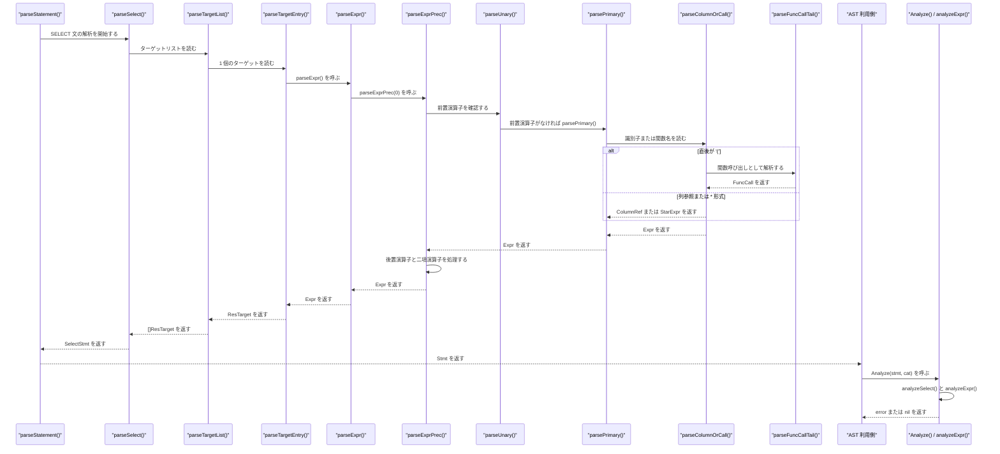
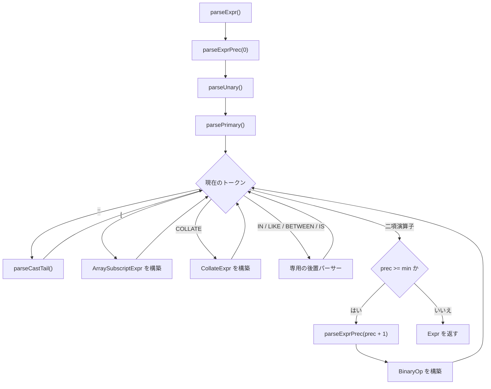

# AST と式の構造

<details>
<summary>関連ソースファイル</summary>

- [`internal/parser/analyzer/analyzer.go`](https://github.com/ryogrid/goopg/blob/19856410e8d497d59787e1ab35a2febb3f5953d6/internal/parser/analyzer/analyzer.go)
- [`internal/parser/ast.go`](https://github.com/ryogrid/goopg/blob/19856410e8d497d59787e1ab35a2febb3f5953d6/internal/parser/ast.go)
- [`internal/parser/dml.go`](https://github.com/ryogrid/goopg/blob/19856410e8d497d59787e1ab35a2febb3f5953d6/internal/parser/dml.go)
- [`internal/parser/expr.go`](https://github.com/ryogrid/goopg/blob/19856410e8d497d59787e1ab35a2febb3f5953d6/internal/parser/expr.go)
- [`internal/parser/function.go`](https://github.com/ryogrid/goopg/blob/19856410e8d497d59787e1ab35a2febb3f5953d6/internal/parser/function.go)
- [`internal/parser/interval.go`](https://github.com/ryogrid/goopg/blob/19856410e8d497d59787e1ab35a2febb3f5953d6/internal/parser/interval.go)
- [`internal/parser/keywords.go`](https://github.com/ryogrid/goopg/blob/19856410e8d497d59787e1ab35a2febb3f5953d6/internal/parser/keywords.go)
- [`internal/parser/op.go`](https://github.com/ryogrid/goopg/blob/19856410e8d497d59787e1ab35a2febb3f5953d6/internal/parser/op.go)
- [`internal/parser/parser.go`](https://github.com/ryogrid/goopg/blob/19856410e8d497d59787e1ab35a2febb3f5953d6/internal/parser/parser.go)
- [`internal/parser/select.go`](https://github.com/ryogrid/goopg/blob/19856410e8d497d59787e1ab35a2febb3f5953d6/internal/parser/select.go)
- [`internal/parser/set_args.go`](https://github.com/ryogrid/goopg/blob/19856410e8d497d59787e1ab35a2febb3f5953d6/internal/parser/set_args.go)
- [`internal/parser/tables.go`](https://github.com/ryogrid/goopg/blob/19856410e8d497d59787e1ab35a2febb3f5953d6/internal/parser/tables.go)
- [`internal/parser/with.go`](https://github.com/ryogrid/goopg/blob/19856410e8d497d59787e1ab35a2febb3f5953d6/internal/parser/with.go)
- [`internal/parser/yacc_ctors.go`](https://github.com/ryogrid/goopg/blob/19856410e8d497d59787e1ab35a2febb3f5953d6/internal/parser/yacc_ctors.go)

</details>

SQL 文を表す `Stmt` ノードと、式を表す `Expr` ノードの集合、およびそれらを組み立てる再帰下降パーサーである。`ast.go` が SELECT・INSERT・UPDATE・DELETE・DDL の文ノードを定義し、`expr.go` が定数・列参照・二項演算・関数呼び出し・CASE・IN・サブクエリなどの式ノードを定義する。`select.go` の `parseSelect` が SELECT の構文要素を順に読み、`parseExpr` 以下の Pratt パーサーが式を優先順位どおりに組み立てる。`dml.go` と `with.go` が DML と CTE を担当し、`interval.go` が INTERVAL 本文の数値・単位・ISO 8601 形式を解釈する。出来上がった AST は `analyzer` パッケージの `Analyze` と `analyzeExpr` が列名・型を解決する。親セクションは [4 SQL パーサー](../4-SQL-Parser.md)、字句解析は [4.1 字句解析とトークン](4.1-Lexer.md) を参照。

## 責務

- AST の共通契約を定義する。すべてのノードは `Node.Pos()` を持ち、文は `Stmt`、式は `Expr` のマーカーメソッドで区別される。`path:internal/parser/ast.go:Node`、`path:internal/parser/expr.go:Expr`
- SELECT の `SelectStmt` を組み立てる。`parseSelect` がターゲットリスト、FROM/JOIN、WHERE、GROUP BY/HAVING、WINDOW、ORDER BY/LIMIT/OFFSET、集合演算、ロック句を順に解析する。`path:internal/parser/select.go:parseSelect`
- 式を優先順位付きで解析する。`parseExprPrec` が `parseUnary` → `parsePrimary` の結果に後置演算子と二項演算子を適用する。`path:internal/parser/select.go:parseExprPrec`
- 定数・列参照・関数呼び出し・CASE・IN/ANY/ALL・LIKE/SIMILAR TO・サブクエリ・配列添字を個別の式ノードにする。`path:internal/parser/expr.go:BinaryOp`、`path:internal/parser/expr.go:FuncCall`
- INSERT/UPDATE/DELETE の行ソース、代入リスト、ON CONFLICT、RETURNING を解析する。`path:internal/parser/dml.go:parseInsert`、`path:internal/parser/dml.go:parseUpdate`、`path:internal/parser/dml.go:parseDelete`
- WITH 句の `WithClause` と `CommonTableExpr` を作り、SELECT/INSERT/UPDATE/DELETE の `With` フィールドに付ける。`path:internal/parser/with.go:parseWithClause`
- INTERVAL リテラルの本文を月・日・マイクロ秒に分解する。`ParseIntervalBody` と `ParseIntervalBodyWithDefault` が単位付き・ISO 8601 の両形式を扱う。`path:internal/parser/interval.go:ParseIntervalBody`
- CREATE FUNCTION/PROCEDURE の引数と本体、CALL の引数を AST にする。`path:internal/parser/function.go:parseFunctionArgList`、`path:internal/parser/function.go:parseFunctionBody`
- SET の値リストを式 AST ではなく `misc.SetArg` の型付き要素として読み取る。`path:internal/parser/set_args.go:scanSetArgs`
- キーワードを列名・テーブル名として受理できるかを `IsColNameKeyword` で判定する。`path:internal/parser/keywords.go:IsColNameKeyword`
- AST を名前解決・型解決に渡す。`Analyze` が文型で分岐し、`analyzeExpr` が各 `Expr` の型を返す。`path:internal/parser/analyzer/analyzer.go:Analyze`、`path:internal/parser/analyzer/analyzer.go:analyzeExpr`

## 処理フロー

手書きパーサーでは `parseStatement` が文の先頭キーワードで `parseSelect` や `parseInsert` を選び、SELECT ではターゲットリストから `parseExpr` へ入る。文レベルの分岐は [4.4 手書き DDL・DML パーサー](4.4-Handwritten-DDL-DML.md) を参照。式は `parseExprPrec` の優先順位ループで組み立てられ、最後に `Analyze` が AST を走査して型を付ける。goyacc 経路も同じ `Stmt`/`Expr` ノードを `yacc_ctors.go` のコンストラクタで作るため、ここで示す構造は両方に共通する（[4.2 文法と文ディスパッチ](4.2-Grammar-and-Dispatch.md)）。



1. `parseSelect` は先頭が `WITH` なら `parseStatementWithCTE` へ、`VALUES` なら `parseValuesSelect` へ、`TABLE` なら `SELECT * FROM` 相当の `SelectStmt` を組み立てる経路へ分岐する。通常の `SELECT` では `SelectStmt{pos: SELECT の位置}` を作る。`path:internal/parser/select.go:parseSelect`
2. `parseTargetList` は `parseTargetEntry` をカンマ区切りで呼ぶ。`parseTargetEntry` は裸の `*` を `StarExpr` にし、それ以外は `parseExpr` の結果を `ResTarget{pos, Expr}` に入れ、`AS alias` または暗黙の別名を `Alias` に記録する。`path:internal/parser/select.go:parseTargetList`、`path:internal/parser/select.go:parseTargetEntry`
3. `parseExpr` は `parseExprPrec(0)` に委譲する。`parseExprPrec` はまず `parseUnary` を呼び、前置の `-`・`+`・`NOT`・`~` を `UnaryOp` にし、それ以外は `parsePrimary` へ進む。`path:internal/parser/select.go:parseExpr`
4. `parsePrimary` は整数・数値・文字列・ビット列・パラメータ・NULL/TRUE/FALSE・CASE・EXISTS・括弧式・サブクエリ・行コンストラクタを処理する。識別子は `tryTypedLiteral` を試した後、`parseColumnOrCall` へ渡す。`path:internal/parser/select.go:parsePrimary`
5. `parseColumnOrCall` は `a`・`t.a`・`s.t.a` の最大 3 部を `ColumnRef` にし、`t.*`/`s.t.*` を `StarExpr` にする。直後が `(` なら `parseFuncCallTail` が引数・`DISTINCT`・`*`・`ORDER BY`・`VARIADIC` を読み、`maybeWindowTail` が `FILTER`/`WITHIN GROUP`/`OVER` を付ける。`path:internal/parser/select.go:parseColumnOrCall`、`path:internal/parser/select.go:parseFuncCallTail`
6. `parseExprPrec` の後置処理は `::`（`parseCastTail`）、`[`（`ArraySubscriptExpr`）、`COLLATE`（`CollateExpr`）、`IN`/`LIKE`/`ILIKE`/`BETWEEN`/`IS` を扱う。その後 `peekBinaryOp` で二項演算子と優先順位を引き、`prec >= min` なら右辺を `parseExprPrec(prec+1)` で解析して `BinaryOp` を作る。`path:internal/parser/select.go:parseExprPrec`、`path:internal/parser/select.go:peekBinaryOp`
7. `parseSelect` はターゲットの後に `INTO`、FROM、WHERE、GROUP BY、HAVING、WINDOW、ORDER BY、LIMIT/OFFSET/FETCH、集合演算、`FOR UPDATE`/`FOR SHARE` を順に読む。`FROM` は `parseFromList` が `FromExpr` と平坦化した `[]RangeVar` の両方を返し、JOIN は `JoinExpr` として `FromExpr.Joins` に入る。`path:internal/parser/select.go:parseFromList`、`path:internal/parser/select.go:parseJoinClause`
8. `parseInsert` は `INSERT INTO target [(cols)]` の後、`VALUES`・`SELECT`・`DEFAULT VALUES` を判別して `Rows`・`Select`・`DefaultValues` のいずれかを設定する。`ON CONFLICT` は `OnConflictClause`、`RETURNING` は `[]ResTarget` になる。`path:internal/parser/dml.go:parseInsert`
9. `parseUpdate` は `SET` の代入リストを `UpdateAssign` にし、`FROM`・`WHERE`（`CURRENT OF` を含む）・`RETURNING` を読む。`parseDelete` は `USING`・`WHERE`・`RETURNING` を読む。`path:internal/parser/dml.go:parseUpdate`、`path:internal/parser/dml.go:parseDelete`
10. `Analyze` は `*SelectStmt`・`*InsertStmt`・`*UpdateStmt`・`*DeleteStmt` を各解析関数へ渡し、それ以外の DDL はそのまま通過させる。`analyzeExpr` は式ノードの型スイッチで `catalog.Type` を返す。`path:internal/parser/analyzer/analyzer.go:Analyze`

式の優先順位ループを個別に見ると、後置演算子と二項演算子の適用順が分かる。



## 主要ファイル

| ファイル | 役割 |
| --- | --- |
| `internal/parser/ast.go` | `Node`/`Stmt`/`ObjectName`、SELECT・DML・DDL の文ノード、`SelectStmt`、`RangeVar`、`ResTarget`。`path:internal/parser/ast.go:SelectStmt` |
| `internal/parser/expr.go` | `Expr` と式ノード一式、`BinaryOp`/`UnaryOp`/`FuncCall`/`CaseExpr`/`IntervalLit`、ビット列デコードと負リテラル表示。`path:internal/parser/expr.go:Expr` |
| `internal/parser/select.go` | SELECT と式の再帰下降パーサー。Pratt 優先順位、関数呼び出し、型付きリテラル、CASE/IN/BETWEEN、集合演算。`path:internal/parser/select.go:parseExprPrec` |
| `internal/parser/parser.go` | `parseStatement` の文ディスパッチ、`parseStatementWithCTE`、手書きパーサーの `parser` 状態。`path:internal/parser/parser.go:parseStatement` |
| `internal/parser/dml.go` | INSERT/UPDATE/DELETE、VALUES 行、ON CONFLICT、RETURNING、`DEFAULT` マーカー。`path:internal/parser/dml.go:parseInsert` |
| `internal/parser/with.go` | `WITH [RECURSIVE]`、CTE 本体、`WithClause`/`CommonTableExpr` の組み立て。`path:internal/parser/with.go:parseWithClause` |
| `internal/parser/interval.go` | INTERVAL 本文の単位付き・ISO 8601 解析、フィールド衝突検査。`path:internal/parser/interval.go:ParseIntervalBody` |
| `internal/parser/function.go` | CREATE FUNCTION/PROCEDURE、引数モード・既定値、本体、CALL の AST 組み立て。`path:internal/parser/function.go:parseFunctionArgList` |
| `internal/parser/analyzer/analyzer.go` | AST の名前解決・型解決。`Analyze`、`analyzeSelect`、`analyzeExpr`、`AnalyzeError`。`path:internal/parser/analyzer/analyzer.go:Analyze` |
| `internal/parser/keywords.go` | `KeywordCategory` と `IsColNameKeyword`。キーワードを列名・別名として使えるかの判定。`path:internal/parser/keywords.go:IsColNameKeyword` |
| `internal/parser/set_args.go` | SET 値リストを `misc.SetArg` へ変換する `scanSetArgs` と `ParseSetArgList`。`path:internal/parser/set_args.go:scanSetArgs` |
| `internal/parser/tables.go` | 終端名・キーワード・演算子の解決表。両パーサーの AST 構築が共有する。`path:internal/parser/tables.go:namedOperator` |

## 公開 API / エントリポイント

```go
func Analyze(stmt parser.Stmt, cat catalog.Catalog) error
func ParseIntervalBody(body string) (months, days int32, micros int64, ok bool)
func ParseIntervalBodyWithDefault(body, defaultUnit string) (months, days int32, micros int64, ok bool)
func ParseIntervalMagnitude(s string) (val int64, fval float64, ok bool)
func ParseSetArgList(text string) ([]misc.SetArg, bool)
func TimeZoneSetValue(zone string) (value string, reset, ok bool, err error)
func RewriteIndirectionStarTargets(s *SelectStmt, onAggregate func(pos int) error) error
func IsNoParenFuncName(name string) bool
```

- `Analyze` は文ノードを型スイッチで振り分け、SELECT/DML だけを解析する。DDL はここでは通過し、DDL 実行側が処理する。`path:internal/parser/analyzer/analyzer.go:Analyze`
- `ParseIntervalBody` は既定単位を秒として INTERVAL 本文を月・日・マイクロ秒に分解する。`ParseIntervalBodyWithDefault` は typmod の下限フィールドを既定単位として渡せる。`path:internal/parser/interval.go:ParseIntervalBody`、`path:internal/parser/interval.go:ParseIntervalBodyWithDefault`
- `ParseIntervalMagnitude` は `"1.5"` を整数部 `1` と小数部 `0.5` に分ける。`path:internal/parser/interval.go:ParseIntervalMagnitude`
- `ParseSetArgList` は SET の値リストを `misc.SetArg` に変換する。単独の `DEFAULT` は `ok=false` になり、呼び出し側がリセットとして扱う。`path:internal/parser/set_args.go:ParseSetArgList`
- `TimeZoneSetValue` は `SET TIME ZONE` の値を既存の `SetStmt` 経路で正規化する。`path:internal/parser/set_args.go:TimeZoneSetValue`
- `RewriteIndirectionStarTargets` は `(srf(...)).*` を FROM 句の集合返却関数参照へ書き換える。`path:internal/parser/select.go:RewriteIndirectionStarTargets`
- `IsNoParenFuncName` は `CURRENT_TIMESTAMP` などの括弧なし関数名かを返す。`path:internal/parser/select.go:IsNoParenFuncName`

## 主要データ構造

### `Node` と `Stmt` — AST の共通契約

`path:internal/parser/ast.go:Node`

```go
// Node is implemented by every AST node. Pos returns the byte offset
// of the node's first token, used by error messages.
type Node interface {
	Pos() int
}

// Stmt is implemented by every top-level SQL statement.
type Stmt interface {
	Node
	stmtNode()
}
```

`Node` は `Pos() int` だけを要求する。`Stmt` は `Node` を埋め込み、外部パッケージが文でない型を文として扱えないように `stmtNode()` を追加する。`pos` フィールド自体は非公開で、パーサー本体と `yacc_ctors.go` の `New*` コンストラクタが設定する。`path:internal/parser/ast.go:Stmt`、`path:internal/parser/yacc_ctors.go:NewSelectStmt`

### `Expr` — 式ノードの契約

`path:internal/parser/expr.go:Expr`

```go
// Expr is implemented by every expression-tree node.
type Expr interface {
	Node
	exprNode()
}
```

`Expr` は `Node` に `exprNode()` を加える。文と式は別のマーカーメソッドを持つため、`Stmt` を式の位置に渡すことはコンパイル時に防がれる。式ノードの具体的な型は `expr.go` に列挙され、定数・参照・演算・関数・サブクエリ・ウィンドウの各ファミリに分かれる。

### `ObjectName` — 修飾名

`path:internal/parser/ast.go:ObjectName`

```go
// ObjectName is a (possibly schema-qualified) relation/object name.
// "schema.table" or just "table". Quoted parts retain their case.
type ObjectName struct {
	pos    int
	Schema string // empty when unqualified
	Name   string
}
```

`Schema` が空なら非修飾名、非空なら `schema.name` を表す。`String()` は引用符を付けずに `Schema + "." + Name` を返す。関数名・キャスト型・DDL の対象名がこの型を使う。`path:internal/parser/ast.go:ObjectName`

### `SelectStmt` — SELECT の中心ノード

`path:internal/parser/ast.go:SelectStmt`

```go
type SelectStmt struct {
	pos      int
	With     *WithClause
	Distinct bool
	// DistinctOn holds the expression list from DISTINCT ON (expr [, ...]).
	// When non-nil, s.Distinct is also true. The planner resolves these
	// expressions to surface unknown-column errors. M0097-regress.
	DistinctOn []Expr
	Targets    []ResTarget
	// From keeps a flattened range-var list for v0 planner
	// compatibility.
	From []RangeVar
	// FromExprs preserves explicit JOIN structure.
	FromExprs []FromExpr
	Where     Expr // nil when absent
	GroupBy   []Expr
	Having    Expr
	OrderBy   []SortBy
	Limit     Expr // nil when absent; integer expression in v0
	Offset    Expr // nil when absent
	// WithTies is true when `FETCH FIRST n ROWS WITH TIES` was used.
	// M0097-0042: returns additional rows tied on the ORDER BY key.
	WithTies bool
	SetOp    *SetOpClause
	// Parenthesized is set when EVERYTHING this SelectStmt holds — its
	// target list, its SetOp chain and its own ORDER BY / LIMIT / OFFSET —
	// was written inside one pair of parentheses, with nothing appended
	// after the closing ')'. Two consumers rely on it: the parser's
	// lift-from-right-branch rule (a parenthesised branch keeps its own
	// sort/limit, M0097-0042) and the planner, which stops flattening at
	// such a branch because the user grouped it explicitly.
	//
	// When text DOES follow the ')', the parser builds a grouping node
	// instead (see SetOpOperand) and this flag stays false on it.
	Parenthesized bool
	// SetOpOperand makes this SelectStmt a GROUPING node: it stands for the
	// parenthesised set-op operand `( SetOpOperand )` and has no Targets /
	// From / Where of its own. Its value IS the operand's value; its own
	// SetOp / OrderBy / Limit / Offset slots carry whatever was written
	// AFTER the closing ')'.
	//
	// This is what makes goopg's set-op AST a TREE rather than a linked
	// list. PostgreSQL needs no flag at all here: `select_with_parens` is a
	// leaf operand of `select_clause` in gram.y, so a set-operator, ORDER BY
	// or LIMIT written after the ')' necessarily attaches to a node ABOVE the
	// parenthesised query and transformSetOperationStmt()
	// (postgres/src/backend/parser/analyze.c) always receives a proper tree.
	// goopg used to append that trailing text into the parenthesised query's
	// OWN chain and then describe the damage with three annotations —
	// ParenBranches (M0125-0006), InnerSegmentCount (M0097-0044) and
	// InnerSortLimit (M0125-0017). Two PG behaviours were unreachable that
	// way, because head branch and whole compound shared one OrderBy/Limit
	// slot: `(A ORDER BY 1 LIMIT 2) UNION ALL (C) ORDER BY 1 DESC` lost the
	// outer sort, and `((A ORDER BY 1 LIMIT 2) UNION ALL C) LIMIT 1` lost the
	// inner LIMIT. A grouping node gives each its own node, and all three
	// annotations are retired. M0125-0020.
	SetOpOperand *SelectStmt
	// Locking holds parsed `FOR UPDATE / FOR SHARE [OF …]
	// [NOWAIT | SKIP LOCKED]` clauses (M0021-0001). Empty for
	// every pre-M0021 SELECT — preserves byte-for-byte
	// invariance across the existing parser/planner test suite.
	Locking []*LockingClause
	// ValuesRows is set when this SelectStmt represents a bare
	// `VALUES (r1), (r2), ...` statement (used as a subquery source
	// in FROM, e.g. `FROM (VALUES ...) t(col)`). When set, Targets
	// and From are empty. M0097-0003.
	ValuesRows [][]Expr
	// WindowClause holds the named window definitions from a trailing
	// `WINDOW name AS (...), ...` clause (M0020 named-window slice).
	// Referenced from a FuncCall's `OVER name` tail via WindowDef.RefName;
	// the analyzer resolves the reference by copying the matching
	// definition's PartitionBy/OrderBy into the referencing WindowDef.
	WindowClause []NamedWindowDef
	// GroupingSets is non-nil when the GROUP BY clause used GROUPING
	// SETS / ROLLUP / CUBE. GroupBy still holds the flattened union of
	// every expression referenced by any generated set (so pre-existing
	// consumers — analyzer resolution, FOR UPDATE's "not allowed with
	// GROUP BY" check, positional GROUP BY — keep working unmodified);
	// GroupingSets carries the actual expanded set list, which the planner
	// lowers into a single grouping-sets Aggregate node (M0125-0048; it
	// used to rewrite it into a UNION ALL of plain-GROUP-BY branches).
	// M0122-0004.
	GroupingSets *GroupingSetsSpec
}
```

主要フィールドの関係は次のとおり。

- `With` は先頭の WITH 句、`Targets` は SELECT リスト、`From`/`FromExprs` は FROM 句である。`From` は JOIN を平坦化した互換用リスト、`FromExprs` は JOIN の親子関係を保つ明示的なリストで、両方が同じ FROM を表す。`path:internal/parser/select.go:parseFromList`
- `Where`・`Having`・`Limit`・`Offset` は省略時に nil、`GroupBy` と `OrderBy` は省略時に nil（長さ 0）である。
- `DistinctOn` は `DISTINCT ON (expr, ...)` の式リストを保持し、通常の `Distinct` とは別に扱われる。`parseSelect` は DISTINCT ON のとき `Distinct` を真にせず、`DistinctOn` 側で重複排除のキーを表す（構造体コメントは `Distinct` も真になるとするが、実装は `Distinct` を立てない）。
- `ValuesRows` が設定された `SelectStmt` は `VALUES (...)` そのもので、`Targets` と `From` は空になる。`SetOpOperand` が設定されたノードは括弧で囲まれた集合演算のオペランドを表し、自身の `Targets`/`From`/`Where` を持たず、`SetOp`/`OrderBy`/`Limit`/`Offset` だけが閉じ括弧の後ろの要素を表す。`Parenthesized` は「全体が 1 対の括弧で閉じられている」ことを示す。`path:internal/parser/select.go:parseParenthesisedSelectStmt`
- `GroupingSets` が非 nil のとき、`GroupBy` は全集合の式を平坦化した和集合を保持する。既存の解析・プランナ経路を壊さずに GROUPING SETS/ROLLUP/CUBE を表現するための不変条件である。`path:internal/parser/select.go:parseGroupByElems`
- `Locking` は `FOR UPDATE`/`FOR SHARE` の句を順序どおりに保持する。集合演算の分岐には付与できない（解析器が拒否する）。`path:internal/parser/analyzer/analyzer.go:analyzeLockingClauses`

### `ResTarget` — SELECT リストの 1 要素

`path:internal/parser/ast.go:ResTarget`

```go
// ResTarget is one entry in a SELECT target list: `expr [AS alias]`.
type ResTarget struct {
	pos   int
	Alias string // empty when no AS clause
	Expr  Expr
}
```

`Expr` は式、`Alias` は `AS` の後ろまたは暗黙の別名である。`*` は `Expr` が `StarExpr` の `ResTarget` として表される。`path:internal/parser/select.go:parseTargetEntry`

### `RangeVar` — FROM の関係参照

`path:internal/parser/ast.go:RangeVar`

```go
// RangeVar is a relation reference appearing in a FROM clause:
// `[schema.]table [AS alias]`. Subquery is non-nil when the
// FROM item is a derived table — `(SELECT …) AS alias`. In that
// case Name is empty and the parsed inner SELECT lives in
// Subquery; the alias is required (matches upstream).
type RangeVar struct {
	pos       int
	Schema    string
	Name      string
	Alias     string   // empty when no AS clause
	Columns   []string // optional column-alias list: (SELECT …) AS t (c1, c2)
	Subquery  *SelectStmt
	TableFunc *TableFuncRef // M0096-0006: table-valued function (e.g. generate_series)
	Only      bool          // FROM ONLY tablename — skip inheritance children
	Lateral   bool          // the LATERAL keyword was written before this item; it may
	// reference earlier FROM items, which is what makes a FROM
	// permutation unsafe (planner/joinorder.go, M0125-0034)
	GroupedJoinUnaliased bool // synthetic unaliased parenthesized JOIN; R104

	// TableSample carries a TABLESAMPLE clause written on this FROM item
	// (M0134-0175). Upstream models this as a separate RangeTableSample node
	// that WRAPS the relation (gram.y:13616 `relation_expr opt_alias_clause
	// tablesample_clause`); goopg's FROM item is a flat RangeVar value, so
	// the sample descriptor hangs off the RangeVar instead. Nil when the
	// item carries no TABLESAMPLE clause.
	TableSample *RangeTableSample
}
```

`Subquery` が非 nil のときは派生テーブルで、`Name` は空、`Alias` は必須である。`TableFunc` は `generate_series` などのテーブル関数、`Only` は `FROM ONLY`、`Lateral` は LATERAL の有無、`TableSample` は TABLESAMPLE 句を表す。`GroupedJoinUnaliased` は括弧付き JOIN を合成した `RangeVar` であることを示す。`path:internal/parser/select.go:parseRangeVar`

### `InsertStmt` — INSERT の AST

`path:internal/parser/ast.go:InsertStmt`

```go
type InsertStmt struct {
	pos     int
	With    *WithClause
	Target  RangeVar
	Columns []string    // empty when no column list — INSERT defaults to declared order
	Rows    [][]Expr    // each row is a parenthesised tuple; nil when Select != nil or DefaultValues
	Select  *SelectStmt // INSERT … SELECT support (M0096-0006); nil when Rows != nil
	// DefaultValues is true for `INSERT INTO t DEFAULT VALUES` — the
	// all-defaults form. Mutually exclusive with Rows/Select; Rows stays
	// nil at parse time. The planner expands this into a single row of
	// DefaultMarkers sized to the target's insertable columns. M0103-0007
	// rung 17.
	DefaultValues bool
	OnConflict    *OnConflictClause
	Returning     []ResTarget
}
```

`Rows`・`Select`・`DefaultValues` は排他的である。`Rows` の各要素は 1 行分の式リストで、`DEFAULT` は `DefaultMarker` として入る。`OnConflict` は競合解決、`Returning` は RETURNING のターゲットリストを保持する。`path:internal/parser/dml.go:parseInsert`、`path:internal/parser/dml.go:parseValuesRow`

### `UpdateStmt` と `DeleteStmt`

`path:internal/parser/ast.go:UpdateStmt`

```go
type UpdateStmt struct {
	pos       int
	With      *WithClause
	Target    RangeVar
	Set       []UpdateAssign
	From      []RangeVar // FROM-clause tables (nil when absent). M0097-0065.
	Where     Expr       // nil when absent
	CurrentOf string     // cursor name for WHERE CURRENT OF cursor. M0097-0069.
	Returning []ResTarget
}
```

`Set` の各 `UpdateAssign` は単一列 `col = expr` か複数列 `(c1, c2) = (...)` を表す。

`path:internal/parser/ast.go:UpdateAssign`

```go
type UpdateAssign struct {
	pos            int
	Column         string   // single-column form: "col = expr"
	TableQualifier string   // non-empty when user wrote "table.col = expr" (illegal; rejected in semantic layer)
	Columns        []string // multi-column form: "(c1, c2, …) = (e1, e2, …)"
	Expr           Expr     // RHS: single expr, or *RowExpr for multi-column form
}
```

単一列では `Column` と `Expr`、複数列では `Columns` と `Expr`（`*RowExpr`）を使う。`TableQualifier` は `table.col = ...` と書かれた場合の修飾子で、意味解析で拒否される。`Where` と `CurrentOf` は排他的で、`WHERE CURRENT OF cursor` のときは `CurrentOf` が設定され `Where` は nil になる。`path:internal/parser/dml.go:parseAssign`

`path:internal/parser/ast.go:DeleteStmt`

```go
type DeleteStmt struct {
	pos       int
	With      *WithClause
	Target    RangeVar
	Using     []RangeVar // USING-clause tables (nil when absent). M0097-0076.
	Where     Expr       // nil when absent
	CurrentOf string     // cursor name for WHERE CURRENT OF cursor. M0097-0069.
	Returning []ResTarget
}
```

`Using` は DELETE の USING 句、`CurrentOf` は positioned delete のカーソル名である。`UpdateStmt` と同じく `Where` と `CurrentOf` は排他的である。`path:internal/parser/dml.go:parseDelete`

### `BinaryOp` — 二項演算

`path:internal/parser/expr.go:BinaryOp`

```go
type BinaryOp struct {
	pos   int
	Op    OpCode
	Left  Expr
	Right Expr
}
```

`Op` は `op.go` の `OpCode` で、算術・比較・論理・LIKE・正規表現・ビット・幾何・JSON を表す。`Left` と `Right` は評価順に保持され、`pos` は演算子トークンの位置である。`OpNe` は `<>` と `!=` の両方を同じ値にまとめる。`path:internal/parser/expr.go:BinaryOp`、`path:internal/parser/op.go:OpCode`

### `FuncCall` — 関数呼び出し

`path:internal/parser/expr.go:FuncCall`

```go
type FuncCall struct {
	pos      int
	Name     ObjectName
	Args     []Expr
	Star     bool // count(*)-style star argument
	Distinct bool // DISTINCT inside the arg list
	Over     *WindowDef
	// Filter is the optional FILTER (WHERE condition) clause (M0097-0007).
	// Non-nil only for aggregate function calls with FILTER.
	Filter Expr
	// OrderBy is the optional ORDER BY within the aggregate argument list
	// (M0097-0007), e.g. string_agg(x, ',' ORDER BY x).
	OrderBy []SortBy
	// WithinGroup holds the sort list from `WITHIN GROUP (ORDER BY ...)`.
	// Non-nil only for ordered-set aggregate functions (percentile_cont,
	// percentile_disc, rank, dense_rank, mode). M0097-0035.
	WithinGroup []SortBy
	// WithinGroupPos is the byte offset of the `within` keyword of the
	// WITHIN GROUP clause, or 0 when absent. PG reports the caret for
	// "cannot use multiple ORDER BY clauses with WITHIN GROUP" at this
	// keyword (gram.y func_expr: parser_errposition(@2)); the funcall head
	// is wrong. M0134-0001 P3b.
	WithinGroupPos int
	// Variadic is a parallel slice to Args. When Variadic[i] is true, the i-th
	// argument was prefixed with the VARIADIC keyword (M0103-0008 probe-
	// survival: libpqrcv fetch_table_list emits
	// `pg_get_publication_tables(VARIADIC array_agg(...))`). The flag is
	// recorded but treated as a no-op marker by callees that expect an array
	// argument; the actual spread-to-varargs semantics is deferred until a
	// caller needs it.
	Variadic []bool
}
```

`Name` は修飾名、`Args` は位置引数、`Star` は `count(*)`、`Distinct` は引数リスト内の DISTINCT である。`Variadic` は `Args` と同じ長さの並列スライスで、`Variadic[i]` が真なら `Args[i]` に VARIADIC が付いていたことを示す。`Filter` は集約の FILTER、`OrderBy` は集約引数内の ORDER BY、`WithinGroup` は順序集合集約の WITHIN GROUP である。`path:internal/parser/select.go:parseFuncCallTail`、`path:internal/parser/select.go:maybeWindowTail`

### `IntervalLit` — INTERVAL リテラル

`path:internal/parser/expr.go:IntervalLit`

```go
type IntervalLit struct {
	pos   int
	Value string // verbatim numeric body of the literal (e.g. "90")
	Unit  string // lower-cased singular unit: "day"/"month"/"year"/"hour"/...

	// Qualified marks the trailing-qualifier form `interval 'N' <unit>`
	// (Form 1), where the unit is an SQL interval typmod field that
	// truncates the value to that field's granularity — e.g.
	// `interval '1.5' hour` = 01:00:00. The embedded-string form
	// `interval '1.5 hours'` (Form 2) carries no typmod (Qualified=false)
	// and keeps the fractional remainder (01:30:00). See the executor's
	// evalIntervalLit / truncIntervalToUnit.
	Qualified bool

	// HasPrec/Prec carry an explicit fractional-seconds precision from a
	// SECOND(p) typmod field (`interval '1.23456789' second(2)` → 00:00:01.23,
	// `interval '5' minute to second(3)`). Set only when the trailing qualifier
	// ends in SECOND with a parenthesised precision; the executor rounds the
	// micros to 10^(6-p) via AdjustIntervalForTypmod (postgres timestamp.c).
	// unimplemented_feat #5(d-iv, interval typmod range/precision grammar).
	HasPrec bool
	Prec    int

	// PreComputed marks a multi-field / HH:MM:SS embedded body
	// (`interval '1 day 05:00:00'`, `interval '1 year 2 mons 3 days'`) that
	// tryTypedLiteral decoded via ParseIntervalBody (unimplemented_feat
	// #5(b)). When set, PreMonths/PreDays/PreMicros hold the final interval
	// components and Value/Unit/Qualified are unused.
	PreComputed bool
	PreMonths   int32
	PreDays     int32
	PreMicros   int64
}
```

`PreComputed` が真のときは `PreMonths`/`PreDays`/`PreMicros` だけが有効で、`Value`/`Unit`/`Qualified` は使わない。`PreComputed` でない場合は `Value` と `Unit` が本文と単位を表し、`Qualified` が末尾の typmod 修飾子の有無、`HasPrec`/`Prec` が `SECOND(p)` の精度を表す。`path:internal/parser/select.go:tryTypedLiteral`、`path:internal/parser/interval.go:ParseIntervalBody`

### `CaseExpr` — CASE 式

`path:internal/parser/expr.go:CaseExpr`

```go
type CaseExpr struct {
	pos     int
	Operand Expr // nil for the searched form
	Whens   []CaseWhen
	Else    Expr // nil if ELSE omitted
}
```

`Operand` が nil なら searched CASE、非 nil なら simple CASE である。`Whens` は 1 個以上必要で、`Else` は ELSE を省略したとき nil になる。`CaseWhen` は `When`/`Then` の 2 フィールドだけを持つ。`path:internal/parser/select.go:parseCaseExpr`

## 内部構造

### 優先順位付きの式解析

`select.go` の Pratt パーサーは、優先順位を定数で表す。`precOr=1`、`precAnd=2`、`precNot=3`、`precIs=4`、`precCompare=5`、`precBitOr=5`、`precBitXor=5`、`precBitAnd=6`、`precBitShift=6`、`precConcat=6`、`precJSON=6`、`precAddSub=7`、`precMulDiv=8`、`precPow=9`、`precUnary=10` である。`path:internal/parser/select.go:precOr`

`parseUnary` は前置 `-`/`+`/`~` を `precUnary` で、`NOT` を `precNot` で解析する。`parsePrimary` は定数・パラメータ・括弧式・サブクエリ・CASE・EXISTS・型付きリテラル・列参照・関数呼び出しを葉として返す。`path:internal/parser/select.go:parseUnary`、`path:internal/parser/select.go:parsePrimary`

`parseExprPrec` のループは、まず `::`・`[]`・`COLLATE` の後置形を処理する。次に `IN`/`LIKE`/`ILIKE`/`BETWEEN`/`IS` を比較優先順位で処理し、最後に `peekBinaryOp` の結果を使って `prec >= min` の二項演算子を左結合で畳む。右辺には `prec+1` を渡すため、同じ優先順位の演算子は左から順に結合する。`path:internal/parser/select.go:parseExprPrec`

### BETWEEN と LIKE の脱糖

`BETWEEN` は専用ノードを作らず、`low`/`high` を `precAnd+1` で解析した後、`expr >= low AND expr <= high` の `BinaryOp` に展開する。`SYMMETRIC` は `low`/`high` を入れ替えた 2 つの範囲の OR、`NOT BETWEEN` は全体の `UnaryOp{OpNot}` になる。`path:internal/parser/select.go:parseBetweenTail`

`LIKE`/`ILIKE` は通常の `BinaryOp{OpLike/OpILike}` だが、`ESCAPE` がある場合は右辺を `LikeEscapePattern{Pattern, Escape}` で包む。`SIMILAR TO` はパターンとエスケープがリテラルなら正規表現の `BinaryOp` に定数畳み込みし、そうでなければ `SimilarToPattern` を残す。`path:internal/parser/select.go:wrapLikeEscape`、`path:internal/parser/select.go:buildSimilarTo`

`IN` は `InExpr{Operand, Negated, Subquery, List}` を作る。`Subquery` と `List` はどちらか一方だけが非 nil になる。`ANY`/`SOME`/`ALL` は同じ `InExpr` に `AnyOp`/`AllOp`/`Quantified` を設定して表す。`path:internal/parser/select.go:parseInTail`、`path:internal/parser/select.go:parseAnyTail`

### 型付きリテラルと INTERVAL

`parsePrimary` は識別子の直後が文字列リテラルのとき `tryTypedLiteral` を試す。`date`・`timestamp`・`timestamptz`・`time`・`timetz`、数値型、`text`/`varchar`/`char`/`bpchar`、幾何型、`json`/`jsonb`、`txid_snapshot`/`pg_snapshot` などが対象で、成功すると `TypedStringLit{Type, Value}` を返す。`char(N) 'x'` の typmod は読み飛ばされ、値には反映されない。`path:internal/parser/select.go:tryTypedLiteral`

`interval` は専用の `IntervalLit` を作る。`interval (p) '...'` の先頭精度、`interval 'N' unit` の末尾修飾子、`interval 'N unit'` の埋め込み単位、複数フィールドや `HH:MM:SS` を含む本文を扱う。複数フィールド本文は `ParseIntervalBody` が月・日・マイクロ秒に分解し、`PreComputed` に格納する。`path:internal/parser/select.go:tryTypedLiteral`、`path:internal/parser/interval.go:ParseIntervalBody`

`ParseIntervalBodyWithDefault` は末尾の単位なし数値をどの単位として解釈するかを `defaultUnit` で決める。典型的には typmod の下限フィールド（`HOUR TO MINUTE` なら `minute`）を渡す。ISO 8601 の `P...` 形式は `decodeISO8601Interval` が担当する。`path:internal/parser/interval.go:ParseIntervalBodyWithDefault`、`path:internal/parser/interval.go:decodeISO8601Interval`

### SELECT の構築

`parseSelect` は `SelectStmt` を作り、次の順で任意句を埋める。

1. `DISTINCT` / `DISTINCT ON (...)` を `Distinct`/`DistinctOn` に記録する。
2. `parseTargetList` で `Targets` を作る。ターゲットが空の `SELECT FROM t` も許す。
3. `INTO` があれば `selectIntoTable` に記録し、最後に `CreateTableStmt{SelectSource: s}` へ包む。文脈によって禁止される場合は `selectIntoErrMsg` がエラーになる。
4. `FROM` は `parseFromList` で `FromExprs` と `From` の両方を作る。
5. `WHERE`、`GROUP BY`、`HAVING`、`WINDOW`、`ORDER BY`、LIMIT/OFFSET/FETCH を順に読む。
6. `parseSetOpClause` で `UNION`/`INTERSECT`/`EXCEPT` を読み、右辺が括弧付きでなければ末尾の ORDER BY/LIMIT/OFFSET を外側の `SelectStmt` へ持ち上げる。
7. `FOR UPDATE`/`FOR SHARE` のロック句を `Locking` に追加する。

`path:internal/parser/select.go:parseSelect`

`FROM` の `parseFromList` は各 `FromExpr` と、その `Base`/`Joins` を平坦化した `[]RangeVar` を返す。`parseJoinClause` は `NATURAL`、`INNER`/`LEFT`/`RIGHT`/`FULL`/`CROSS`、`ON`/`USING` を読み、`JoinExpr{Type, Natural, Right, On, Using}` を作る。`path:internal/parser/select.go:parseJoinClause`

### DML と CTE

`parseInsert` は `INSERT INTO` の後、`(` の先が `SELECT`/`VALUES`/`WITH`/`TABLE` なら列リストではなく問い合わせ源と判断する。`nextIsParenQuerySource` がこの判別を行う。`DEFAULT VALUES` は `DefaultValues`、`VALUES` は `Rows`、`SELECT` は `Select` に入る。`parseValuesRow` はセルが `DEFAULT` のとき `DefaultMarker` を作る。`path:internal/parser/dml.go:nextIsParenQuerySource`、`path:internal/parser/dml.go:parseValuesRow`

`parseUpdate` の `parseAssign` は単一列と複数列の両方を扱う。複数列 `(c1, c2) = (e1, e2)` は `UpdateAssign.Columns` と `Expr: *RowExpr` で表す。`DEFAULT` は `DefaultMarker` になる。`parseDelete` は `USING` を `Using`、`WHERE CURRENT OF` を `CurrentOf` に記録する。`path:internal/parser/dml.go:parseAssign`

`parseWithClause` は `WITH [RECURSIVE]` の後、`parseCTE` をカンマ区切りで呼ぶ。`parseCTE` は名前・列別名・`AS`・`MATERIALIZED`/`NOT MATERIALIZED`・括弧本体を読み、本体が SELECT なら `Query`、INSERT/UPDATE/DELETE/MERGE なら `DMLBody` に入れる。`parseSelectWithCTE` などのラッパーが結果の `With` を設定する。`path:internal/parser/with.go:parseCTE`、`path:internal/parser/with.go:parseSelectWithCTE`

### 関数と SET 値

`function.go` の `parseCreateFunctionTail` は `CREATE [OR REPLACE] FUNCTION` の本体を読み、`parseFunctionArgList`/`parseFunctionArg`/`parseArgNameAndType` が引数のモード・名前・型・既定値を `FunctionArg` にする。`parseFunctionBody` はドル引用符を含む本体文字列を取り出す。`path:internal/parser/function.go:parseCreateFunctionTail`、`path:internal/parser/function.go:parseFunctionArg`

`set_args.go` は SET の値を式 AST にしない。`scanSetArgs` が整数（int32 に収まるもの）を `SetArgInteger`、それ以外の数値を `SetArgFloat`、文字列・識別子・キーワードを `SetArgString` として読み、`ParseSetArgList` が全体を検証する。`TimeZoneSetValue` は `SET TIME ZONE` の値を既存の `SetStmt` 経路で処理する。`path:internal/parser/set_args.go:scanSetArgs`

### AST の利用側

`analyzer` は AST を書き換えず、`Analyze` の型スイッチで SELECT/DML を選び、`analyzeExpr` の型スイッチで各 `Expr` の型を返す。リテラルは `IntegerConst`→`int8`、`NumericConst`→`numeric`、`StringConst`→`unknown`、`TypedStringLit`→指定型、`IntervalLit`→`interval` のように対応する。`ColumnRef` は `scope` の列定義を引いて `catalog.Type` を返す。`path:internal/parser/analyzer/analyzer.go:analyzeExpr`。スコープ構築・列解決・型強制の詳細は [4.5 アナライザと型解決](4.5-Analyzer.md) で扱う。

### 式ノードのその他の形

| ノード | 主なフィールド | 用途 |
| --- | --- | --- |
| `IntegerConst` | `Value int64` | 整数リテラル。`path:internal/parser/expr.go:IntegerConst` |
| `NumericConst` | `Value string` | 小数・指数表記を原文のまま保持。`path:internal/parser/expr.go:NumericConst` |
| `StringConst` | `Value string` | 文字列リテラルとビット列のデコード結果。`path:internal/parser/expr.go:StringConst` |
| `TypedStringLit` | `Type`, `Value` | `date '...'` などの型付きリテラル。`path:internal/parser/expr.go:TypedStringLit` |
| `ColumnRef` | `Schema`, `Table`, `Column` | 1〜3 部の列参照。`path:internal/parser/expr.go:ColumnRef` |
| `StarExpr` | `Schema`, `Table` | `*`/`t.*`/`s.t.*`。`path:internal/parser/expr.go:StarExpr` |
| `RowExpr` | `Elems []Expr` | `(a, b, c)` の行コンストラクタ。`path:internal/parser/expr.go:RowExpr` |
| `CastExpr` | `Operand`, `Type`, `Typmods` | `expr::type`。`path:internal/parser/expr.go:CastExpr` |
| `InExpr` | `Operand`, `Negated`, `Subquery`, `List`, `AnyOp`, `AllOp` | IN/ANY/ALL。`path:internal/parser/expr.go:InExpr` |
| `ExistsExpr` | `Negated`, `Subquery` | EXISTS/NOT EXISTS。`path:internal/parser/expr.go:ExistsExpr` |
| `IsNullExpr` | `Operand`, `Negated` | IS [NOT] NULL。`path:internal/parser/expr.go:IsNullExpr` |
| `IsBoolExpr` | `Operand`, `TestTrue`, `TestFalse`, `Negated` | IS [NOT] TRUE/FALSE/UNKNOWN。`path:internal/parser/expr.go:IsBoolExpr` |
| `IsDistinctFromExpr` | `Left`, `Right`, `Negated` | IS [NOT] DISTINCT FROM。`path:internal/parser/expr.go:IsDistinctFromExpr` |
| `SubqueryExpr` | `Inner *SelectStmt` | スカラーサブクエリ。`path:internal/parser/expr.go:SubqueryExpr` |
| `ArraySubscriptExpr` | `Base`, `Index`, `IsSlice`, `Upper` | `a[i]`/`a[l:u]`。`path:internal/parser/expr.go:ArraySubscriptExpr` |
| `ArrayConstructorExpr` | `Elements` | `ARRAY[...]`。`path:internal/parser/expr.go:ArrayConstructorExpr` |
| `ArraySubqueryExpr` | `Inner` | `ARRAY(SELECT ...)`。`path:internal/parser/expr.go:ArraySubqueryExpr` |

## エッジケースと不変条件

- **`InExpr` の `Subquery` と `List` は排他。** `parseInTail` はサブクエリ形式なら `Subquery`、値リスト形式なら `List` のどちらかだけを設定する。`AnyOp` は `op ANY|SOME|ALL (...)` の演算子、`AllOp` は ALL の AND 意味論、`Quantified` は量化形式であることを示す。`path:internal/parser/select.go:parseInTail`
- **`LIKE ... ESCAPE` の右辺は専用ノード。** `LikeEscapePattern` は `OpLike`/`OpNotLike`/`OpILike`/`OpNotILike` の `BinaryOp.Right` にだけ現れる。通常の LIKE はパターン式をそのまま `Right` に入れる。`path:internal/parser/expr.go:LikeEscapePattern`
- **`SIMILAR TO` はリテラルなら正規表現に畳み込む。** `buildSimilarTo` はパターンと ESCAPE がリテラルなら `OpRegexMatch`/`OpRegexNoMatch` の `BinaryOp` を作り、非リテラルなら `SimilarToPattern` を残す。`path:internal/parser/select.go:buildSimilarTo`
- **`CASE` は WHEN が 1 個以上必要。** `parseCaseExpr` は `WHEN` が一度も現れなければエラーにし、`ELSE` は省略可能である。`path:internal/parser/select.go:parseCaseExpr`
- **`INSERT` の 3 つの行ソースは排他。** `Rows`、`Select`、`DefaultValues` のいずれかだけが設定される。`DEFAULT` は `DefaultMarker` として `Rows` に入り、プランナが対象列の既定式に置き換える。`path:internal/parser/dml.go:parseInsert`、`path:internal/parser/ast.go:InsertStmt`
- **`SELECT ... INTO` はトップレベルだけ。** `parseSelect` は `selectIntoErrMsg` が設定された文脈（サブクエリ、ビュー、INSERT の SELECT など）で INTO を見つけると `SyntaxError` を返す。トップレベルでは `CreateTableStmt{SelectSource: s}` に包む。`path:internal/parser/select.go:parseSelect`
- **`RangeVar.Subquery` と `Name` は排他。** 派生テーブルでは `Subquery` が非 nil、`Name` は空、`Alias` は必須である。テーブル関数は `TableFunc`、通常の関係は `Schema`/`Name` を使う。`path:internal/parser/ast.go:RangeVar`
- **`SetOpOperand` と `Parenthesized` は集合演算の木構造を保つ。** 閉じ括弧の後に ORDER BY/LIMIT が続く場合は `SetOpOperand` を持つグループ化ノードを作り、全体が括弧で閉じられている場合は `Parenthesized` を立てる。これにより `(A ORDER BY 1 LIMIT 2) UNION ALL (C) ORDER BY 1 DESC` の内側と外側のソートを取り違えない。`path:internal/parser/select.go:parseParenthesisedSelectStmt`
- **`GroupingSets` は `GroupBy` の平坦化と共存する。** `GroupingSets` が非 nil でも `GroupBy` は全集合の式の和集合を保持する。既存の GROUP BY 消費者を変更せずに GROUPING SETS/ROLLUP/CUBE を追加するための不変条件である。`path:internal/parser/select.go:parseGroupByElems`
- **`FuncCall.Variadic` は `Args` と並列。** `Variadic[i]` は `Args[i]` に VARIADIC が付いていたかを示す。`VARIADIC array[...]` は要素を `Args` に展開し、各要素に対応する `Variadic` を真にする。`path:internal/parser/select.go:parseFuncCallTail`
- **`IntervalLit` の `PreComputed` は他の表現を無効化する。** `PreComputed` が真なら `Value`/`Unit`/`Qualified` は使わず、`PreMonths`/`PreDays`/`PreMicros` だけを読む。`interval '1.5' hour` の typmod 切り捨てと `interval '1.5 hours'` の保持は `Qualified` で区別する。`path:internal/parser/expr.go:IntervalLit`
- **INTERVAL のフィールド衝突は解析時に拒否する。** `intervalFieldMask` と `imAllSecs`/`imTime` が、`interval '1 h 2 h'` や `interval '1 h 05:00:00'` のような重複フィールドを検出する。`path:internal/parser/interval.go:intervalFieldMask`
- **`ParseSetArgList` は単独の `DEFAULT` を値として扱わない。** 先頭が `DEFAULT` の場合は `ok=false` を返し、呼び出し側がリセットとして処理する。整数は int32 に収まるものだけ `SetArgInteger` になり、それ以外は `SetArgFloat` になる。`path:internal/parser/set_args.go:ParseSetArgList`、`path:internal/parser/set_args.go:numericSetArg`
- **キーワードは列名として使える場合がある。** `parseIdent` と `parsePrimary` は `IsColNameKeyword` が真のキーワードを識別子として受理する。予約語は引用が必要で、`keywordCategory` にない語は安全側で拒否される。`path:internal/parser/keywords.go:IsColNameKeyword`、`path:internal/parser/parser.go:parseIdent`、`path:internal/parser/select.go:parsePrimary`
- **式ノードの `pos` は非公開。** すべてのノードは `Pos()` を実装するが、位置はパーサー本体または `yacc_ctors.go` の `New*` が設定する。エラー報告は `Pos()` のバイト位置を使う。`path:internal/parser/ast.go:Node`

Sources:

- `internal/parser/analyzer/analyzer.go`
- `internal/parser/ast.go`
- `internal/parser/dml.go`
- `internal/parser/expr.go`
- `internal/parser/function.go`
- `internal/parser/interval.go`
- `internal/parser/keywords.go`
- `internal/parser/op.go`
- `internal/parser/parser.go`
- `internal/parser/select.go`
- `internal/parser/set_args.go`
- `internal/parser/tables.go`
- `internal/parser/with.go`
- `internal/parser/yacc_ctors.go`

<sub>Generated by deepwiki-4myself from `goopg` @ `19856410e`</sub>
