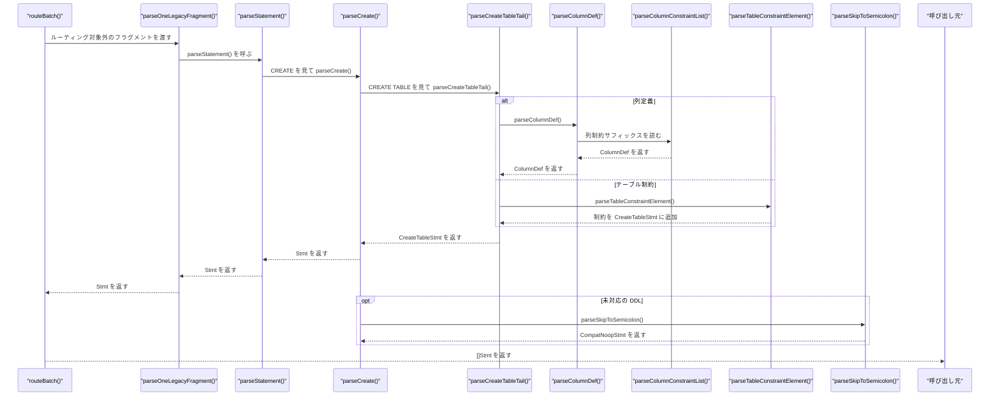
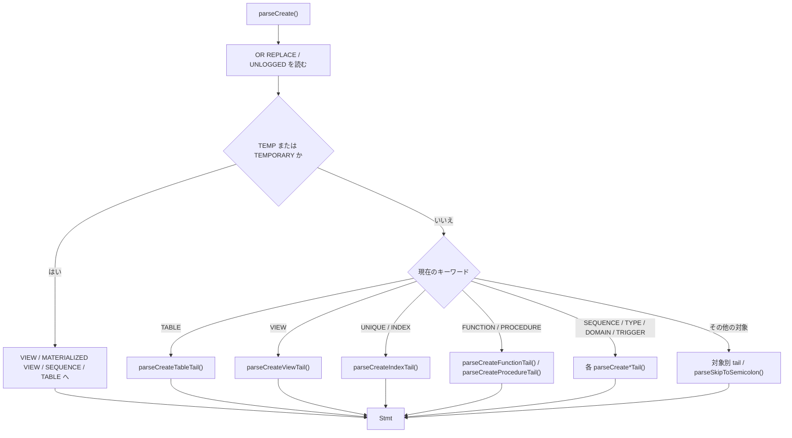

# 手書き DDL・DML パーサー

<details>
<summary>関連ソースファイル</summary>

- [`internal/parser/ast.go`](https://github.com/ryogrid/goopg/blob/19856410e8d497d59787e1ab35a2febb3f5953d6/internal/parser/ast.go)
- [`internal/parser/copy.go`](https://github.com/ryogrid/goopg/blob/19856410e8d497d59787e1ab35a2febb3f5953d6/internal/parser/copy.go)
- [`internal/parser/ddl.go`](https://github.com/ryogrid/goopg/blob/19856410e8d497d59787e1ab35a2febb3f5953d6/internal/parser/ddl.go)
- [`internal/parser/dispatch.go`](https://github.com/ryogrid/goopg/blob/19856410e8d497d59787e1ab35a2febb3f5953d6/internal/parser/dispatch.go)
- [`internal/parser/dml.go`](https://github.com/ryogrid/goopg/blob/19856410e8d497d59787e1ab35a2febb3f5953d6/internal/parser/dml.go)
- [`internal/parser/interval.go`](https://github.com/ryogrid/goopg/blob/19856410e8d497d59787e1ab35a2febb3f5953d6/internal/parser/interval.go)
- [`internal/parser/op.go`](https://github.com/ryogrid/goopg/blob/19856410e8d497d59787e1ab35a2febb3f5953d6/internal/parser/op.go)
- [`internal/parser/parser.go`](https://github.com/ryogrid/goopg/blob/19856410e8d497d59787e1ab35a2febb3f5953d6/internal/parser/parser.go)
- [`internal/parser/set_args.go`](https://github.com/ryogrid/goopg/blob/19856410e8d497d59787e1ab35a2febb3f5953d6/internal/parser/set_args.go)
- [`internal/parser/support.go`](https://github.com/ryogrid/goopg/blob/19856410e8d497d59787e1ab35a2febb3f5953d6/internal/parser/support.go)
- [`internal/parser/with.go`](https://github.com/ryogrid/goopg/blob/19856410e8d497d59787e1ab35a2febb3f5953d6/internal/parser/with.go)

</details>

LALR 文法へ移行しきれていない SQL 文を、トークン列を直接読む再帰下降パーサーで処理する層である。`parseStatement` が先頭キーワードで `parseCreate`・`parseDrop`・`parseAlter`・`parseCopy` などを選び、各 `parseXxxTail` が `ast.go` の DDL ノードを組み立てる。対応が間に合っていない DDL は `parseSkipToSemicolon` で文末まで読み飛ばし、`CompatNoopStmt` として成功させる。DML の `parseInsert`・`parseUpdate`・`parseDelete` もここに残っているが、トップレベルの INSERT/UPDATE/DELETE は [4.2 文法と文ディスパッチ](4.2-Grammar-and-Dispatch.md) のルーティングで LALR 文法が所有する。手書き DML が実際に使われるのは `COPY (...) TO` の内側クエリなど、ルーティング対象外の経路である。親セクションは [4 SQL パーサー](../4-SQL-Parser.md)。トークン列は [4.1 字句解析とトークン](4.1-Lexer.md)、AST の式構造は [4.3 AST と式の構造](4.3-AST-and-Expressions.md)、解析後の名前解決・型解決は [4.5 アナライザと型解決](4.5-Analyzer.md) を参照。

## 責務

- 文の先頭キーワードによるディスパッチ。`CREATE`/`DROP`/`ALTER`/`COPY`/`EXPLAIN`/`WITH`/`CALL` と、`start`・`discard`・`fetch`・`close`・`refresh`・`grant`・`comment`・`security`・`lock`・`listen`・`notify`・`unlisten` などの識別子先導文を振り分ける。`path:internal/parser/parser.go:parseStatement`
- CREATE の対象種別判定。`OR REPLACE`、`UNLOGGED`、`TEMP`/`TEMPORARY`、`TABLE`/`VIEW`/`INDEX`/`FUNCTION`/`PROCEDURE`/`TRIGGER`/`TYPE`/`DOMAIN`/`SEQUENCE`/`PUBLICATION`/`SUBSCRIPTION` などを分岐する。`path:internal/parser/ddl.go:parseCreate`
- CREATE TABLE の本体解析。列定義、テーブル制約、`LIKE`、`INHERITS`、`PARTITION BY`、`PARTITION OF`、`WITH`、`TABLESPACE`、`ON COMMIT`、CTAS を扱う。`path:internal/parser/ddl.go:parseCreateTableTail`
- 列定義と列制約。型名・typmod・配列、`NOT NULL`、`PRIMARY KEY`、`UNIQUE`、`DEFAULT`、`CHECK`、`REFERENCES`、`GENERATED`、`IDENTITY`、`COLLATE`、`COMPRESSION`、`STORAGE`、`OPTIONS` を `ColumnDef` に集約する。`path:internal/parser/ddl.go:parseColumnDef`、`path:internal/parser/ddl.go:parseColumnConstraintList`
- テーブル制約。`PRIMARY KEY`、`UNIQUE`、`CHECK`、`FOREIGN KEY`、`EXCLUDE`、`CONSTRAINT name ...` を `CreateTableStmt` の各フィールドへ振り分ける。`path:internal/parser/ddl.go:parseTableConstraintElement`
- DROP の対象種別と `IF EXISTS`、名前リスト、`CASCADE`/`RESTRICT` の解析。`path:internal/parser/ddl.go:parseDrop`、`path:internal/parser/ddl.go:parseDropTail`
- ALTER の対象種別と `ALTER TABLE` のアクション列。`ADD COLUMN`、`DROP COLUMN`、`ALTER COLUMN`、`ADD CONSTRAINT`、`ATTACH/DETACH PARTITION` などを `AlterTableAction` にする。`path:internal/parser/ddl.go:parseAlter`、`path:internal/parser/ddl.go:parseAlterTableAction`
- COPY の表形式・問い合わせ形式、`FROM`/`TO`、`STDIN`/`STDOUT`/`PROGRAM`/ファイル、現行形式と旧形式のオプション列。`path:internal/parser/copy.go:parseCopy`
- DML の行ソース・代入リスト・ON CONFLICT・RETURNING。`path:internal/parser/dml.go:parseInsert`、`path:internal/parser/dml.go:parseUpdate`、`path:internal/parser/dml.go:parseDelete`
- 未対応 DDL の互換処理。トークンを `;` まで読み飛ばし、`CompatNoopStmt` にタグや対象名を記録する。`path:internal/parser/ddl.go:parseSkipToSemicolon`
- SET 値の型付き読み取り。`scanSetArgs` が整数・浮動小数・文字列を `misc.SetArg` に分類する。`path:internal/parser/set_args.go:scanSetArgs`

## 処理フロー

ルーティング対象外のフラグメントは `parseOneLegacyFragment` から `parseStatement` に入る。以下は `CREATE TABLE` が列定義を読む経路である。





1. `routeBatch` は `fragmentRouted` が偽のフラグメントを `parseOneLegacyFragment` に渡す。`parseOneLegacyFragment` は `parser{tokens: frag, idx: 0, src: src}` を作り、`parseStatement` を 1 回呼ぶ。`path:internal/parser/dispatch.go:parseOneLegacyFragment`
2. `parseStatement` は先頭が `TokenSymbol` の `(` なら `parseParenthesisedSelectStmt`、キーワードなら `KwSelect`/`KwTable`/`KwValues`→`parseSelect`、`KwCreate`→`parseCreate`、`KwDrop`→`parseDrop`、`KwAlter`→`parseAlter`、`KwCopy`→`parseCopy`、`KwExplain`→`parseExplain`、`KwWith`→`parseStatementWithCTE`、`KwCall`→`parseCallStatement` に分岐する。`path:internal/parser/parser.go:parseStatement`
3. キーワードでない識別子先導の文は `identLedStatement` に落ちる。`start` は BEGIN の別名、`discard` はモード付き `DiscardStmt`、`fetch`/`move`/`close` はカーソル操作、`refresh` はマテリアライズドビューの更新、`listen`/`notify`/`unlisten` は通知、`lock` は `LockTableStmt` になる。`grant`/`revoke`・`comment`・`security` は `CompatNoopStmt` を含む互換経路で処理する。`path:internal/parser/parser.go:parseStatement`
4. `parseCreate` は先頭の `CREATE` の後、`UNLOGGED`、`OR REPLACE`、`GLOBAL`/`LOCAL`、`TEMP`/`TEMPORARY` を読み、対象キーワードで `parseCreateTableTail`・`parseCreateViewTail`・`parseCreateIndexTail`・`parseCreateFunctionTail`・`parseCreateProcedureTail`・`parseCreateTriggerTail`・`parseCreateSequenceTail`・`parseCreateType`・`parseCreateDomain` などへ分岐する。`path:internal/parser/ddl.go:parseCreate`
5. `parseCreateTableTail` は `IF NOT EXISTS` と名前を読み、`(` の後が CTAS の列別名リストかを投機的に判定する。`AS SELECT`/`AS EXECUTE` なら CTAS、`OF type_name` なら typed table、`PARTITION OF` ならパーティション子、通常の `(` なら列定義・テーブル制約・`LIKE` のループに入る。`path:internal/parser/ddl.go:parseCreateTableTail`
6. 列定義は `parseColumnDef` が名前と型を読み、`parseColumnConstraintList` が `NOT NULL`・`PRIMARY KEY`・`UNIQUE`・`DEFAULT`・`CHECK`・`REFERENCES`・`GENERATED`・`IDENTITY` などのサフィックスを `ColumnDef` に反映する。複数の `NOT NULL` は `colNotNullOccurrence` に記録し、`resolveColumnNotNull` が名前・`NO INHERIT` の衝突を検査する。`path:internal/parser/ddl.go:parseColumnDef`、`path:internal/parser/ddl.go:resolveColumnNotNull`
7. テーブル制約は `parseTableConstraintElement` が `PRIMARY KEY`/`UNIQUE`/`CHECK`/`FOREIGN KEY`/`EXCLUDE`/`CONSTRAINT` を判定し、`CreateTableStmt` の `PrimaryKey`・`TableUniques`・`TableChecks`・`TableForeignKeys`・`NamedConstraints` などへ追加する。`path:internal/parser/ddl.go:parseTableConstraintElement`
8. 通常の本体の後は `INHERITS`、`PARTITION BY`、`USING`、`WITH (...)`、`TABLESPACE`、`ON COMMIT` を直接読み、空列リストや typed table の経路では `consumeCreateTableSuffix` が同じ後続句を処理する。パーティション子の `FOR VALUES` は `parsePartitionBoundValues` が `FROM`/`TO`/`IN`/`DEFAULT` の各式を読む。`path:internal/parser/ddl.go:consumeCreateTableSuffix`、`path:internal/parser/ddl.go:parsePartitionBoundValues`
9. `parseCreateIndexTail` は `CONCURRENTLY`、任意の索引名、`ON`、`USING`、列リスト、`INCLUDE`、`WITH`、`WHERE` を読み、`CreateIndexStmt` の `Columns`/`ColExprs`/`ColOrders`/`IncludeColumns`/`Fillfactor` を埋める。`path:internal/parser/ddl.go:parseCreateIndexTail`
10. DROP は `parseDrop` が対象キーワードごとに `DropTableStmt`・`DropIndexStmt`・`DropViewStmt`・`DropPublicationStmt`・`DropSubscriptionStmt` などを作る。`parseDropTail` が `IF EXISTS`、名前リスト、`CASCADE`/`RESTRICT` を共通処理する。`path:internal/parser/ddl.go:parseDrop`
11. ALTER は `parseAlter` が `TABLESPACE`・`DEFAULT PRIVILEGES`・`TEXT SEARCH`・公開/購読などを先に分岐し、`ALTER TABLE` は `parseAlterTableAction` をカンマ区切りで繰り返す。`path:internal/parser/ddl.go:parseAlter`
12. COPY は `parseCopy` が表形式と `(query)` 形式を分け、`parseCopyInnerQuery` が内側の SELECT/INSERT/UPDATE/DELETE を解析する。`parseCopyEndpoint`、`parseCopyOptionList`、`parseCopyLegacyTrail` が方向・出力先・オプションを読む。`path:internal/parser/copy.go:parseCopy`

## 主要ファイル

| ファイル | 役割 |
| --- | --- |
| `internal/parser/ddl.go` | CREATE/DROP/ALTER の巨大な手書きディスパッチと各対象種別の `parseCreate*Tail`/`parseAlter*Tail`。`path:internal/parser/ddl.go:parseCreate` |
| `internal/parser/copy.go` | COPY の表形式・問い合わせ形式、エンドポイント、現行/旧形式オプション。`path:internal/parser/copy.go:parseCopy` |
| `internal/parser/dml.go` | INSERT/UPDATE/DELETE の行ソース、ON CONFLICT、RETURNING。`path:internal/parser/dml.go:parseInsert` |
| `internal/parser/parser.go` | `parseStatement` の文ディスパッチ、文脈フラグ、カーソル・GRANT・COMMENT などの互換処理。`path:internal/parser/parser.go:parseStatement` |
| `internal/parser/with.go` | CTE 付き DML を `parseInsertWithCTE`/`parseUpdateWithCTE`/`parseDeleteWithCTE` で手書き DML に橋渡しする。`path:internal/parser/with.go:parseInsertWithCTE` |
| `internal/parser/dispatch.go` | ルーティングと `parseOneLegacyFragment`。手書きパーサーが呼ばれる入口。`path:internal/parser/dispatch.go:parseOneLegacyFragment` |
| `internal/parser/ast.go` | `CreateTableStmt`、`ColumnDef`、`AlterTableAction`、`CompatNoopStmt`、`CopyStmt` などの AST 型。`path:internal/parser/ast.go:CreateTableStmt` |
| `internal/parser/support.go` | 文法アクション用のキャリア型（`tableElem`・`ctTail`・`insSrc` など）と共有変換関数。手書き DDL は AST を直接組み立てる。`path:internal/parser/support.go:tableElem` |
| `internal/parser/set_args.go` | SET 値リストの `misc.SetArg` 変換。`path:internal/parser/set_args.go:scanSetArgs` |
| `internal/parser/interval.go` | DEFAULT や式に現れる INTERVAL 本文の解析。`path:internal/parser/interval.go:ParseIntervalBody` |
| `internal/parser/op.go` | 式・索引式が使う `OpCode`。`path:internal/parser/op.go:OpCode` |

## 公開 API / エントリポイント

```go
func Parse(input string, mc ...*mmgr.Context) ([]Stmt, error)
func ParseExpr(input string, mc ...*mmgr.Context) (Expr, error)
func SplitStatements(toks []Token) [][]Token
func ParseSetArgList(text string) ([]misc.SetArg, bool)
func TimeZoneSetValue(zone string) (value string, reset, ok bool, err error)
```

- `Parse` はバッチ全体の入口で、非空バッチを `routeBatch` に渡す。手書き DDL は `routeBatch` が対象外と判定したフラグメントだけに使われる。`path:internal/parser/parser.go:Parse`
- `ParseExpr` は式だけを解析する。DDL の DEFAULT 式や索引式と同じ `parseExpr` を使う。`path:internal/parser/parser.go:ParseExpr`
- `SplitStatements` は `;` で文を分割する。手書きパーサーの `parseOneLegacyFragment` はこのフラグメントを受け取る。`path:internal/parser/dispatch.go:SplitStatements`
- `ParseSetArgList` は SET 値リストを `misc.SetArg` に変換する。単独の `DEFAULT` は `ok=false` になる。`path:internal/parser/set_args.go:ParseSetArgList`
- `TimeZoneSetValue` は `SET TIME ZONE` の値を既存の `SetStmt` 経路で正規化する。`path:internal/parser/set_args.go:TimeZoneSetValue`

## 主要データ構造

### `parser` — 手書きパーサーの状態

`path:internal/parser/parser.go:parser`

```go
type parser struct {
	tokens []Token
	idx    int
	// src holds the original input string, used to capture raw source spans
	// (e.g. the verbatim view body for pg_get_viewdef). Token.Pos values are
	// byte offsets into this string.
	src string
	// selectIntoErrMsg is non-empty when SELECT … INTO is forbidden in the
	// current parse context (cursor, subquery, view body, INSERT SELECT).
	// parseSelect emits a SyntaxError with this message when INTO is seen.
	// selectIntoNoPos suppresses the FieldPosition field (for contexts where
	// PG does not emit a caret, e.g. CREATE VIEW).
	selectIntoErrMsg string
	selectIntoNoPos  bool
	// selectIntoCopyStop: when true, parseSelect stops *before* consuming
	// INTO (returning a partial SelectStmt). parseCopy uses this to detect
	// the deprecated `SELECT … INTO …` form and flag CopyStmt.SelectInto so
	// planCopy can emit the PG-compatible "COPY (SELECT INTO) is not
	// supported" error. M0097-0024.
	selectIntoCopyStop bool
}
```

`tokens` は 1 文のトークン列、`idx` は次に読む位置、`src` は元の SQL テキストである。`cur()`/`peek(off)` は範囲外を `TokenEOF` として返し、`advance()` は現在のトークンを返して `idx` を進める。`selectIntoErrMsg`/`selectIntoNoPos` は `SELECT ... INTO` の文脈依存エラー、`selectIntoCopyStop` は COPY の内側 SELECT を INTO の手前で止めるためのフラグである。`path:internal/parser/parser.go:cur`

### `CopyStmt` — COPY の AST

`path:internal/parser/ast.go:CopyStmt`

```go
type CopyStmt struct {
	pos       int
	Direction CopyDirection
	Table     ObjectName  // empty when Query is set
	Columns   []string    // empty when no column list
	Query     *SelectStmt // populated for COPY (SELECT …) TO …
	QueryDML  Stmt        // populated for COPY (INSERT/UPDATE/DELETE … RETURNING) TO …
	// SelectInto is set when the inner query is the deprecated
	// `SELECT … INTO …` form. PostgreSQL's grammar accepts it inside
	// COPY (...) but DoCopy rejects it; planCopy emits the matching
	// "COPY (SELECT INTO) is not supported" (0A000). M0097-0024.
	SelectInto bool
	Endpoint   CopyEndpoint
	Filename   string // filename or program command, when applicable
	Options    []CopyOption
}
```

`Table` は表形式、`Query` は SELECT 形式、`QueryDML` は INSERT/UPDATE/DELETE 形式で、3 つのうち 1 つだけが有効である。`Columns` は表形式の列リスト、`SelectInto` は COPY 内の `SELECT ... INTO` を検出した印、`Endpoint`/`Filename` は `STDIN`/`STDOUT`/`PROGRAM`/ファイル、`Options` は WITH オプション列である。`path:internal/parser/copy.go:parseCopy`

### `CopyOption` — COPY オプション

`path:internal/parser/ast.go:CopyOption`

```go
type CopyOption struct {
	pos   int
	Name  string
	Value string
	Bool  bool
	Star  bool
	Cols  []string
}
```

`Name` は小文字化されたオプション名、`Value` は文字列・数値・識別子の値、`Bool` は値なしフラグ、`Star` は `*`、`Cols` は `FORCE_QUOTE`/`FORCE_NOT_NULL`/`FORCE_NULL` の列リストである。現行形式と旧形式のどちらもこの型に正規化される。`path:internal/parser/copy.go:parseCopyOption`

### `CreateTableStmt` — CREATE TABLE の AST

`path:internal/parser/ast.go:CreateTableStmt`

```go
type CreateTableStmt struct {
	pos         int
	IfNotExists bool
	Unlogged    bool
	Temporary   bool // SET when CREATE TEMP TABLE is used. M0097-0003.
	Name        ObjectName
	Columns     []ColumnDef
	// PrimaryKey holds the column names from a table-level
	// `PRIMARY KEY (a, b)` clause. Inline-on-column primary keys live
	// on ColumnDef.Primary instead.
	PrimaryKey []string
	// With carries the option list from `WITH (k = v, …)`. We keep it
	// as a string→string map; the analyzer interprets known options
	// (fillfactor, autovacuum_*, …) and rejects the rest.
	With     map[string]string
	WithOIDS bool // true when WITH OIDS or WITH (oids[=true]) is present
	// PartitionBy is non-nil when `PARTITION BY {LIST|RANGE|HASH} (col, …)` is present.
	// M0096-0007.
	PartitionBy *PartitionByClause
	// PartitionOf is non-nil for `CREATE TABLE child PARTITION OF parent FOR VALUES …`.
	// M0096-0007.
	PartitionOf *PartitionOfClause
	// Inherits lists the parent table names from `INHERITS (parent, …)`.
	// M0096-0009 will use these; for now the field is populated so the
	// syntax is accepted and the executor can create the child table.
	Inherits []ObjectName
	// OfType is non-nil for a typed table `CREATE TABLE name OF type_name`.
	// The table's columns are derived from the named composite type and
	// pg_class.reloftype is set to the type's OID, so pg_dump re-emits the
	// `OF type_name` form (suppressing the column list). DU-002 slice 374.
	OfType *ObjectName
	// OfTypeColumnOptions holds per-column constraint overrides from the
	// optional `( column_name WITH OPTIONS column_constraint [ ... ] [, ...] )`
	// list that may follow `OF type_name`. Each entry's Name matches a field
	// of the composite type named by OfType; Type is left zero since the
	// column's type is derived from the composite field, not redeclared here.
	// Table-level constraints in that same list (PRIMARY KEY/UNIQUE/CHECK/
	// FOREIGN KEY/CONSTRAINT) are rejected at parse time — not yet supported.
	// DU-002 slice 374 follow-up.
	OfTypeColumnOptions []ColumnDef
	// ColumnAliases holds the optional column-name list from
	// `CREATE TABLE name (col1, col2, …) AS SELECT …`. When non-nil its
	// length must not exceed the number of columns the SELECT returns; alias
	// names replace the derived column names left-to-right; remaining columns
	// keep their SELECT-derived names. M0097-0020.
	ColumnAliases []string
	// SelectSource is non-nil for `CREATE TABLE name AS SELECT …` (CTAS).
	// The table is created with columns derived from the SELECT result. M0096-0008.
	SelectSource *SelectStmt
	// ExecuteSource is non-nil for `CREATE TABLE name AS EXECUTE name(params)`.
	ExecuteSource *ExecuteStmt
	// WithNoData is true for `CREATE TABLE … AS … WITH NO DATA`.
	WithNoData bool
	// TableChecks holds raw SQL expressions from table-level CHECK constraints.
	// M0097-0014.
	TableChecks []string
	// TableCheckNoInherit is parallel to TableChecks: entry i is true when the
	// anonymous table-level CHECK at TableChecks[i] carries NO INHERIT. Tracked
	// per-check (not just the aggregate TableHasNoInheritCheck) so an anonymous
	// `CHECK (...) NO INHERIT` re-emits its suffix through pg_get_constraintdef
	// on dump. DU-002 slice 128.
	TableCheckNoInherit []bool
	// TableCheckNotEnforced is parallel to TableChecks: entry i is true when
	// the anonymous table-level CHECK at TableChecks[i] carries a
	// `NOT ENFORCED` trailer (PG18 conenforced='f'). DU-002 slice 430.
	TableCheckNotEnforced []bool
	// TableNamedChecks holds explicitly named table-level CHECK constraints,
	// e.g. `CONSTRAINT check_a CHECK (a > 0)`. M0097-0023.
	TableNamedChecks []PartitionCheckConstraint
	// TableUniques holds column-name lists from table-level UNIQUE (col1, col2)
	// constraints. Each entry is the list of columns for one UNIQUE clause.
	// Anonymous constraints only; named ones are in NamedConstraints. M0097-0028.
	TableUniques [][]string
	// TableUniqueIncludes holds the INCLUDE covering columns parallel to
	// TableUniques: TableUniqueIncludes[i] is the include list for TableUniques[i].
	// May be shorter than TableUniques if trailing entries have no INCLUDE. M0097-0023.
	TableUniqueIncludes [][]string
	// TableUniqueNullsNotDistinct is parallel to TableUniques:
	// TableUniqueNullsNotDistinct[i] is true when TableUniques[i] was declared
	// `UNIQUE NULLS NOT DISTINCT (…)` (PostgreSQL 15+). May be shorter than
	// TableUniques if trailing entries use the default NULLS DISTINCT.
	// DU-002 slice 135.
	TableUniqueNullsNotDistinct []bool
	// TableUniqueDeferrable / TableUniqueInitiallyDeferred are parallel to
	// TableUniques: entry [i] is true when TableUniques[i] was declared
	// `DEFERRABLE` / `DEFERRABLE INITIALLY DEFERRED`. May be shorter than
	// TableUniques when trailing entries use the NOT DEFERRABLE default.
	// pg_get_constraintdef re-emits the clause so pg_dump round-trips it.
	// DU-002 slice 139.
	TableUniqueDeferrable        []bool
	TableUniqueInitiallyDeferred []bool
	// PrimaryKeyInclude holds the INCLUDE covering columns for an anonymous
	// table-level PRIMARY KEY constraint. M0097-0023.
	PrimaryKeyInclude []string
	// PrimaryKeyDeferrable / PrimaryKeyInitiallyDeferred capture a `[NOT]
	// DEFERRABLE [INITIALLY DEFERRED | INITIALLY IMMEDIATE]` trailer on an
	// anonymous table-level PRIMARY KEY constraint (`PRIMARY KEY (a) DEFERRABLE
	// INITIALLY DEFERRED`). They thread onto the backing catalog.Index so
	// pg_get_constraintdef / pg_dump re-emit the clause and pg_constraint emits
	// condeferrable/condeferred. INITIALLY DEFERRED implies DEFERRABLE; IMMEDIATE
	// is the default (both false). Dump-fidelity only. DU-002 slice 142.
	PrimaryKeyDeferrable        bool
	PrimaryKeyInitiallyDeferred bool
	// NamedConstraints holds explicitly named UNIQUE/PRIMARY KEY/EXCLUDE constraints,
	// which may carry INCLUDE covering columns. The parser places named constraints
	// here so the executor can use the constraint name as the index name. M0097-0023.
	NamedConstraints []TableConstraintDef
	// TableExclusions holds anonymous EXCLUDE USING constraints (no CONSTRAINT name).
	// Named ones are folded into NamedConstraints. M0097-0023.
	TableExclusions []TableConstraintDef
	// TableForeignKeys holds table-level FOREIGN KEY constraints (both anonymous
	// and CONSTRAINT-named), e.g. `FOREIGN KEY (a, b) REFERENCES t (x, y)`. The
	// inline-on-column REFERENCES sibling lives on ColumnDef instead. DU-002 slice 53.
	TableForeignKeys []TableForeignKeyDef
	// TableHasNoInheritCheck is true when any table-level CHECK constraint carries
	// NO INHERIT. Partitioned tables reject such constraints. M0097-0023.
	TableHasNoInheritCheck bool
	// TableNotNullNames/TableNotNullCols/TableNotNullNoInherit hold table-level
	// NOT NULL constraints — `[CONSTRAINT name] NOT NULL colname [NO INHERIT]`
	// written as a *table* constraint element (parse_utilcmd.c:1071-1078),
	// distinct from a column-level NOT NULL (which lives on ColumnDef's
	// NotNullNoInherit/NotNullConstraintName/NotNullExplicit). Parallel slices
	// mirroring TableChecks/TableCheckNoInherit; TableNotNullNames[i] is ""
	// for the anonymous `NOT NULL col [NO INHERIT]` form. The executor merges
	// these against each column's own NOT NULL entry (heap.c:
	// AddRelationNotNullConstraints) to detect conflicting names/NO INHERIT
	// declarations. M0134-0005k.
	TableNotNullNames     []string
	TableNotNullCols      []string
	TableNotNullNoInherit []bool
	// LikeTables holds the source table names from LIKE clauses.
	// `CREATE TABLE t (LIKE src INCLUDING DEFAULTS)` copies src's columns. M0097-0069.
	// Deprecated: use BodyOrder for positional interleaving.
	LikeTables []ObjectName
	// BodyOrder tracks the order of explicit columns and LIKE clauses in the
	// CREATE TABLE body so the executor can interleave columns correctly.
	// Each element is either a column name (for explicit columns) or
	// "@@LIKE:schema.table" (for LIKE source_table clauses). M0097-0069.
	BodyOrder []string
	// ForeignServer holds the SERVER name from
	// `CREATE FOREIGN TABLE name (cols) SERVER srv [OPTIONS (...)]`. Empty for
	// an ordinary (non-foreign) table. DU-002 slice 417.
	ForeignServer string
	// ForeignOptions holds the table-level OPTIONS as "name=value" elements —
	// the on-disk pg_foreign_table.ftoptions text[] representation pg_dump's
	// getTables reads via pg_options_to_table. DU-002 slice 417.
	ForeignOptions []string
	// Tablespace holds the name from an optional `TABLESPACE name` clause.
	// Empty means unspecified (the table lands in the database's default
	// tablespace). M0122-0007.
	Tablespace string
	// OnCommit holds the action from an `ON COMMIT {PRESERVE ROWS|DELETE ROWS|DROP}`
	// clause on a CREATE [TEMP] TABLE. The zero value ("" — no clause, or
	// PRESERVE ROWS) is the default no-op; DELETE ROWS and DROP are captured so
	// the executor can register the end-of-transaction action (M0134-0072). The
	// non-temp guard (42P16) and the commit-time pass live in the executor.
	OnCommit string
}
```

主要フィールドの関係:

- `Columns` は通常の列定義、`PrimaryKey` はテーブルレベルの `PRIMARY KEY (a, b)`、`NamedConstraints` は名前付きの PK/UNIQUE/EXCLUDE、`TableUniques` は匿名 UNIQUE、`TableForeignKeys` はテーブルレベル FK である。インラインの PK/UNIQUE/FK は `ColumnDef` 側にあり、テーブルレベルと混在しうる。`path:internal/parser/ddl.go:parseTableConstraintElement`
- `TableUniques`/`TableUniqueIncludes`/`TableUniqueNullsNotDistinct`/`TableUniqueDeferrable` は並列スライスで、末尾の要素がデフォルトの場合には短くなりうる。`TableCheckNoInherit`/`TableCheckNotEnforced` も `TableChecks` と並列である。`path:internal/parser/ast.go:CreateTableStmt`
- `SelectSource` は CTAS、`ExecuteSource` は `CREATE TABLE ... AS EXECUTE`、`WithNoData` は CTAS の `WITH NO DATA` を表す。`PartitionBy` と `PartitionOf` は同時に設定されない。`OfType` は typed table でのみ設定される。`path:internal/parser/ddl.go:parseCreateTableTail`
- `BodyOrder` は明示列名または `"@@LIKE:schema.table"` を並べ、`Columns` と `LikeTables` の位置関係を復元する。`LikeTables` は互換用で、現在の位置情報は `BodyOrder` が持つ。`path:internal/parser/ast.go:CreateTableStmt`
- `ForeignServer`/`ForeignOptions` は `CREATE FOREIGN TABLE ... SERVER ... OPTIONS (...)`、`TableHasNoInheritCheck` は `CHECK ... NO INHERIT` の有無、`TableNotNullNames`/`TableNotNullCols`/`TableNotNullNoInherit` はテーブルレベルの `NOT NULL col` 制約を保持する。`path:internal/parser/ast.go:CreateTableStmt`

### `ColumnDef` — 列定義

`path:internal/parser/ast.go:ColumnDef`

```go
type ColumnDef struct {
	pos     int
	Name    string
	Type    ColumnType
	NotNull bool
	Primary bool // inline `PRIMARY KEY` constraint
	Unique  bool // inline `UNIQUE` constraint
	// UniqueNullsNotDistinct is true when an inline column UNIQUE was declared
	// `UNIQUE NULLS NOT DISTINCT` (PostgreSQL 15+). It is threaded into
	// catalog.Index.NullsNotDistinct so pg_get_constraintdef re-emits the
	// clause. Only meaningful when Unique is true. DU-002 slice 136.
	UniqueNullsNotDistinct bool
	// UniqueConstraintName is the explicit constraint name from an inline named
	// column UNIQUE (`a int CONSTRAINT myname UNIQUE`). Empty for the anonymous
	// form, in which case the backing index name is auto-generated
	// (`tbl_col_key`). Only meaningful when Unique is true. DU-002 slice 137.
	UniqueConstraintName string
	// UniqueDeferrable / UniqueInitiallyDeferred capture a `[NOT] DEFERRABLE
	// [INITIALLY DEFERRED | INITIALLY IMMEDIATE]` trailer on an inline column
	// UNIQUE constraint (`a int UNIQUE DEFERRABLE INITIALLY DEFERRED`). They
	// thread onto the backing catalog.Index so pg_get_constraintdef / pg_dump
	// re-emit the clause and pg_constraint emits condeferrable/condeferred.
	// INITIALLY DEFERRED implies DEFERRABLE; IMMEDIATE is the default (both
	// false). Only meaningful when Unique is true. Dump-fidelity only — deferred
	// CHECKING is not implemented (constraints enforced per-row). DU-002 slice 141.
	UniqueDeferrable        bool
	UniqueInitiallyDeferred bool
	// PrimaryDeferrable / PrimaryInitiallyDeferred capture a `[NOT] DEFERRABLE
	// [INITIALLY DEFERRED | INITIALLY IMMEDIATE]` trailer on an inline column
	// PRIMARY KEY constraint (`a int PRIMARY KEY DEFERRABLE INITIALLY DEFERRED`).
	// They thread onto the backing catalog.Index so pg_get_constraintdef / pg_dump
	// re-emit the clause and pg_constraint emits condeferrable/condeferred.
	// INITIALLY DEFERRED implies DEFERRABLE; IMMEDIATE is the default (both
	// false). Only meaningful when Primary is true. Dump-fidelity only — deferred
	// CHECKING is not implemented (constraints enforced per-row). DU-002 slice 142.
	PrimaryDeferrable        bool
	PrimaryInitiallyDeferred bool
	// GeneratedAlways is true for `GENERATED ALWAYS AS (expr) STORED` columns.
	// M0096-0008.
	GeneratedAlways bool
	// GeneratedExpr holds the raw SQL expression text (without surrounding parens)
	// for a generated column. Empty for ordinary columns.
	GeneratedExpr string
	// GeneratedVirtual is true when the generated column is declared VIRTUAL
	// (explicitly, or implicitly via the bare `GENERATED ALWAYS AS (expr)` form,
	// whose PG18 default is VIRTUAL); false for an explicit STORED. M0110-0001
	// (DU-002 slice 194).
	GeneratedVirtual bool
	// IdentityColumn is true for `GENERATED [ALWAYS|BY DEFAULT] AS IDENTITY` columns.
	// The sequence is registered during CREATE TABLE; INSERT uses nextval() as default.
	IdentityColumn bool
	// IdentityAlways is true when the identity generation is ALWAYS (vs BY DEFAULT).
	// ALWAYS means user-provided values are rejected; BY DEFAULT allows them.
	IdentityAlways bool
	// IdentityStart is the START WITH value from the sequence options clause, or 0
	// to use the type-default start (1 for ascending sequences). M0097-0024.
	IdentityStart int64
	// IdentityIncrement/Min/Max/Cache hold the remaining sequence options from an
	// identity column's `(sequence_options)` clause (nil = not given → type/PG
	// default). IdentityCycle records the CYCLE flag. These thread to the backing
	// sequence so pg_dump's `ADD GENERATED ... AS IDENTITY (...)` round-trips the
	// non-default options (INCREMENT BY, MINVALUE, MAXVALUE, CACHE, CYCLE), not
	// just START WITH. DU-002 (pg_dump 002–010).
	IdentityIncrement *int64
	IdentityMin       *int64
	IdentityMax       *int64
	IdentityCache     *int64
	IdentityCycle     bool

	// DefaultExpr holds the parsed AST of the column's DEFAULT clause when
	// one was given (`col INT DEFAULT 0`). nil for columns without a DEFAULT.
	// M0103-0007 rung 13.
	DefaultExpr Expr

	// FK fields — populated when the column has an inline REFERENCES clause.
	// M0096-0011.
	RefTable            ObjectName
	RefColumns          []string // empty = use parent PK
	OnDelete            FKAction
	OnUpdate            FKAction
	// OnDeleteSetCols restricts an `ON DELETE SET NULL|DEFAULT` action to a
	// subset of the FK's referencing columns (PG15 confdelsetcols). Empty = all
	// columns. DU-002 slice 311.
	OnDeleteSetCols     []string
	FKDeferrable        bool
	FKInitiallyDeferred bool
	// FKMatchFull is true for an inline `REFERENCES … MATCH FULL` clause. MATCH
	// SIMPLE (the default) and the unimplemented MATCH PARTIAL leave it false.
	// Threaded into catalog.ForeignKey so pg_constraint.confmatchtype='f' and
	// pg_get_constraintdef re-emit ` MATCH FULL`. DU-002 slice 309.
	FKMatchFull bool
	// FKNotValid/FKNotEnforced mirror AlterTableAction's NotValid/FKNotEnforced
	// for an inline `REFERENCES … NOT VALID` / `NOT ENFORCED` trailer at
	// CREATE TABLE time (PG18 for NOT ENFORCED). DU-002 slice 432.
	FKNotValid    bool
	FKNotEnforced bool

	// CheckExpr holds the raw SQL expression for an inline CHECK constraint.
	// M0097-0014.
	CheckExpr string
	// CheckConstraintName holds the user-given name when the inline CHECK is
	// written with an explicit `CONSTRAINT <name>` prefix
	// (`a int CONSTRAINT myname CHECK (a > 0)`). Empty for the anonymous form,
	// in which case the constraint is auto-named (<table>_<col>_check). Only
	// meaningful when CheckExpr is non-empty. M0134-0002 slice S02.
	CheckConstraintName string
	// NotNullNoInherit is true when the NOT NULL constraint carries NO INHERIT
	// (PG18: `c int NOT NULL NO INHERIT`). goopg v0 tracks the flag to emit
	// the partitioned-table error for LIKE INCLUDING ALL. M0097-0023.
	NotNullNoInherit bool
	// NotNullConstraintName holds the user-given name when the inline NOT NULL is
	// written with an explicit `CONSTRAINT <name>` prefix
	// (`c int CONSTRAINT myname NOT NULL [NO INHERIT]`). When this differs from
	// PG's auto-name (<table>_<col>_not_null), pg_dump re-emits the inline
	// `CONSTRAINT <name> NOT NULL` form rather than a bare `NOT NULL`. Empty for
	// the common unnamed case. DU-002 slice 273.
	NotNullConstraintName string
	// NotNullExplicit is true when the column carries at least one literal
	// column-level `NOT NULL` (or `CONSTRAINT name NOT NULL`) clause — as
	// opposed to NotNull being true only because of an implied source
	// (PRIMARY KEY, SERIAL, IDENTITY) with no literal NOT NULL keyword.
	// parseColumnConstraintList resolves stacked column-level NOT NULL
	// clauses (PG's parse_utilcmd.c:transformColumnDefinition algorithm) into
	// this single flag plus NotNullConstraintName/NotNullNoInherit; the
	// executor's table-level merge (heap.c:AddRelationNotNullConstraints)
	// needs to distinguish an explicit occurrence from a merely-implied one
	// when building its per-column entry list. M0134-0005k.
	NotNullExplicit bool
	// CheckNoInherit is true when the inline CHECK constraint carries NO INHERIT.
	// Stored so LIKE INCLUDING ALL can error on partitioned tables. M0097-0023.
	CheckNoInherit bool
	// CheckNotEnforced is true when the inline CHECK constraint carries a
	// `NOT ENFORCED` trailer (PG18 conenforced='f'). pg_get_constraintdef
	// appends a trailing ` NOT ENFORCED` for such a constraint (taking
	// precedence over NOT VALID in the rendered text — PG considers validated
	// status irrelevant once a constraint isn't enforced). DU-002 slice 430.
	CheckNotEnforced bool
	// Compression is the per-column TOAST compression method from an inline
	// `COMPRESSION <method>` clause (`col text COMPRESSION lz4`) — "pglz" or
	// "lz4". Empty when no method was written. Threaded onto catalog.Column.
	// Compression purely so the column round-trips through pg_dump (goopg does
	// not actually TOAST/compress). DU-002 slice 183.
	Compression string
	// Storage is the per-column storage mode from an inline `STORAGE <mode>`
	// clause (`col text STORAGE plain`) — "plain", "external", "extended", or
	// "main". Empty when no clause was written. Threaded onto
	// catalog.Column.Storage so the synthesized pg_attribute row reports
	// attstorage and pg_dump re-emits a SET STORAGE clause when it differs
	// from the type default (goopg does not actually TOAST). The requested
	// mode is validated against the type's intrinsic storage at CREATE TABLE
	// time (GetAttributeStorage, tablecmds.c:22082-22112). M0134-0002 C2
	// slice 9.
	Storage string
	// Collation is the collation name from an inline `COLLATE <name>` clause
	// (`col text COLLATE "C"`). Empty when none was written. Stored as the bare
	// (last-component, unquoted) collation name — e.g. "C", "POSIX", "ucs_basic".
	// Threaded onto catalog.Column.Collation so the synthesized pg_attribute
	// row reports the chosen attcollation and pg_dump re-emits the COLLATE
	// clause. goopg does not actually collate; this is recorded purely for
	// pg_dump round-trip fidelity. DU-002 slice 188.
	Collation string
	// FDWOptions holds the raw `name value` pairs from a per-column
	// `OPTIONS ( name 'value', … )` clause on a CREATE FOREIGN TABLE column
	// (`c1 int OPTIONS (column_name 'col1')`), each normalized to
	// "name=value" (matching scanFDWOptionsList's existing table/server-level
	// output format). Threaded onto catalog.Column.FDWOptions so the
	// synthesized pg_attribute row reports attfdwoptions and pg_dump re-emits
	// `ALTER FOREIGN TABLE ONLY ... ALTER COLUMN ... OPTIONS (...)`. Empty for
	// every non-foreign-table column. DU-002 slice 418.
	FDWOptions []string
}
```

`Type` が列の型と typmod、`NotNull`/`Primary`/`Unique` が基本制約、`DefaultExpr` が既定式である。`Unique*` は `Unique` が真のときだけ、`Primary*` は `Primary` が真のときだけ意味を持つ。`RefTable` 以下の FK フィールドは `REFERENCES` がある場合だけ設定され、`CheckExpr`/`CheckConstraintName` は CHECK の生テキストと名前を保持する。`IdentityIncrement` などのポインタは nil が「既定値」を意味する。`path:internal/parser/ddl.go:parseColumnConstraintList`

### `AlterTableAction` — ALTER TABLE の 1 アクション

`AlterTableActionKind` はアクションの種類を表す enum である。

`path:internal/parser/ast.go:AlterTableActionKind`

```go
type AlterTableActionKind int
```

代表的な値は `AlterTableAddColumn`、`AlterTableAddPrimaryKey`、`AlterTableAddUnique`、`AlterTableAddCheck`、`AlterTableAddForeignKey`、`AlterTableAddExclude`、`AlterTableDropColumn`、`AlterTableDropConstraint`、`AlterTableAlterColumnType`、`AlterTableRenameTable`、`AlterTableRenameColumn`、`AlterTableAttachPartition`、`AlterTableDetachPartition`、`AlterTableSetDefault`、`AlterTableSetNotNull`、`AlterTableEnableDisableRule` である。`path:internal/parser/ast.go:AlterTableActionKind`

`path:internal/parser/ast.go:AlterTableAction`

```go
type AlterTableAction struct {
	pos            int
	Kind           AlterTableActionKind
	ConstraintName string    // optional, ADD CONSTRAINT name PRIMARY KEY …
	Columns        []string  // populated for AddPrimaryKey + AddForeignKey (local cols)
	IncludeColumns []string  // non-key covering columns from INCLUDE (…) for PK/UNIQUE
	Column         ColumnDef // populated for AddColumn

	// Foreign-key extras (only populated for AddForeignKey).
	RefTable   ObjectName
	RefColumns []string
	Deferrable        bool     // true if `DEFERRABLE`; false (default) if NOT DEFERRABLE or omitted
	InitiallyDeferred bool     // true if `INITIALLY DEFERRED` (implies Deferrable); DU-002
	NullsNotDistinct  bool     // true if `NULLS NOT DISTINCT` for UNIQUE constraint; DU-002
	OnDelete          FKAction // referential action for ON DELETE (default NO ACTION)
	OnUpdate   FKAction // referential action for ON UPDATE (default NO ACTION)
	// OnDeleteSetCols restricts an `ON DELETE SET NULL|DEFAULT` action to a
	// subset of Columns (PG15 confdelsetcols); empty = all columns. DU-002 slice 311.
	OnDeleteSetCols []string
	NotValid        bool // true if `NOT VALID` (skip validation of existing rows)
	MatchFull       bool // true if `MATCH FULL`; MATCH SIMPLE (default) leaves it false. DU-002 slice 309.
	// FKNotEnforced is true for `ADD CONSTRAINT ... FOREIGN KEY (...)
	// REFERENCES ... NOT ENFORCED` (PG18 conenforced='f'); mirrors
	// CheckNotEnforced for the FK constraint form — pg_get_constraintdef gives
	// it precedence over NOT VALID in the rendered text. DU-002 slice 431.
	FKNotEnforced bool

	// AttachPartitionOf is populated for AlterTableAttachPartition.
	// It holds the child table name and partition bounds. M0096-0007.
	AttachPartitionOf *PartitionOfClause
	// Restrict is set for AlterTableDropConstraint: true means RESTRICT
	// (default — error if dependents exist), false means CASCADE.
	Restrict bool

	// NewName is populated for AlterTableRenameTable and AlterTableRenameColumn.
	// Holds the new relation or column name. M0097-regress.
	NewName string
	// OldColumnName is populated for AlterTableRenameColumn and holds the
	// existing column name to be renamed. M0097-regress.
	OldColumnName string
	// OldConstraintName is populated for AlterTableRenameConstraint and holds
	// the existing constraint name to be renamed (ConstraintName is reserved for
	// "ADD CONSTRAINT name"). M0134-0002 C2.
	OldConstraintName string

	// InheritParent is populated for AlterTableInherit and AlterTableNoInherit.
	// Holds the parent table name. M0097-0048.
	InheritParent ObjectName
	// OfType is populated for AlterTableAddOf (`ALTER TABLE t OF type_name`)
	// and holds the composite type name. Value type, mirrors InheritParent;
	// empty for AlterTableDropOf. M0134-0002 C2 slice 11.
	OfType ObjectName

	// CheckExpr is the raw SQL expression for AlterTableAddCheck.
	CheckExpr string
	// CheckNotEnforced is true for `ADD CONSTRAINT ... CHECK (...) NOT ENFORCED`
	// (PG18 conenforced='f'); pg_get_constraintdef re-emits the trailing
	// ` NOT ENFORCED` and takes precedence over NOT VALID in the rendered
	// text. DU-002 slice 430.
	CheckNotEnforced bool

	// NewType is the target column type for AlterTableAlterColumnType.
	// M0097-0022.
	NewType ColumnType
	// ColumnName is the column being modified for AlterTableAlterColumnType.
	// M0097-0022.
	ColumnName string
	// StorageType is the storage strategy for AlterTableSetStorage.
	// Values: "plain", "main", "external", "extended". M0097-0023.
	StorageType string
	// CompressionType is the TOAST compression method for AlterTableSetCompression.
	// Values: "pglz", "lz4". DU-002 slice 183.
	CompressionType string
	// ReplicaIdentityMode is the single-char relreplident code for
	// AlterTableReplicaIdentity: 'd' (DEFAULT), 'f' (FULL), 'n' (NOTHING),
	// 'i' (USING INDEX). ReplicaIdentityIndex names the index for the 'i' form.
	// DU-002 slice 305.
	ReplicaIdentityMode  string
	ReplicaIdentityIndex string
	// ClusterIndexName is the index named in `CLUSTER ON index_name` for
	// AlterTableClusterOn. DU-002 slice 321.
	ClusterIndexName string
	// TablespaceName is the target tablespace for AlterTableSetTablespace
	// (`SET TABLESPACE name`, table or index). M0122-0007.
	TablespaceName string
	// AccessMethodName is the target access method for AlterTableSetAccessMethod
	// (`SET ACCESS METHOD name`). DU-002: pg_dump emits this for partitioned
	// tables whose relam differs from the default.
	AccessMethodName string
	// DefaultExpr is the parsed DEFAULT expression for AlterTableSetDefault
	// (`ALTER COLUMN name SET DEFAULT expr`). Nil for AlterTableDropDefault.
	// DU-002 slice 269.
	DefaultExpr Expr
	// UsingExpr is the parsed USING expression for AlterTableAlterColumnType
	// (`ALTER COLUMN name TYPE t USING expr`); nil when no USING clause is
	// present. The executor evaluates it per-row against the OLD row and
	// coerces the result to the target type. M0134-0002 C2 slice 5.
	UsingExpr Expr
	// SetOptions holds the per-column attribute options captured from
	// `ALTER COLUMN name SET (opt=value, …)` for AlterTableAlterColumnSet, each
	// entry normalized to PG's stored `name=value` form (e.g. "n_distinct=0.5").
	// Recorded on catalog.Column.Options so pg_dump re-emits the clause via
	// pg_attribute.attoptions. DU-002 slice 185. Also holds the bare option
	// names to clear for AlterTableAlterColumnReset (`ALTER COLUMN name RESET
	// (opt, …)`).
	SetOptions []string
	// With holds the table-level storage parameters for AlterTableSetReloptions
	// (name→value) and the option names for AlterTableResetReloptions (names as
	// keys, empty values). Parsed by parseWithOptions. M0118-0001.
	With map[string]string
	// NoInherit is set for AlterTableAddNotNull when the constraint carries a
	// `NO INHERIT` trailer (contype='n', connoinherit='t'). DU-002 slice 271.
	NoInherit bool
	// IfExists is set for `ADD COLUMN IF NOT EXISTS ...` (gram.y opt_if_not_exists,
	// postgres/src/backend/parser/gram.y:6661). When the column already exists,
	// PG emits NOTICE `column "c" of relation "r" already exists, skipping` and
	// skips instead of raising 42701 (check_for_column_name_collision,
	// postgres/src/backend/commands/tablecmds.c:7677-7684). M0134-0002 C2.
	IfExists bool
	// ChildIndexName is populated for AlterIndexAttachPartition and holds
	// the name of the child index to attach. M0097-0023.
	ChildIndexName string
	// DetachPartitionChild is populated for AlterTableDetachPartition and
	// holds the child table name. M0097-0028.
	DetachPartitionChild ObjectName
	// DetachConcurrently records the `CONCURRENTLY` trailer on
	// `DETACH PARTITION child CONCURRENTLY` (PG14+). The trailer follows the
	// child name; it is recorded here so the (deferred) two-phase concurrent
	// detach semantics can branch on it. The executor currently performs a
	// synchronous detach regardless. M0118-0008.
	DetachConcurrently bool

	// RuleName is the target rule name for AlterTableEnableDisableRule
	// (`{ENABLE|DISABLE} [REPLICA|ALWAYS] RULE name`). DU-002 slice 325.
	RuleName string
	// RuleEnabledState is the pg_rewrite.ev_enabled char set by
	// AlterTableEnableDisableRule: 'O' (ENABLE / origin), 'D' (DISABLE),
	// 'R' (ENABLE REPLICA), 'A' (ENABLE ALWAYS). DU-002 slice 325.
	RuleEnabledState byte
	// FDWOptionChanges holds the verb-tagged OPTIONS (...) list for
	// AlterTableAlterColumnOptions (`ALTER FOREIGN TABLE ... ALTER COLUMN
	// col OPTIONS (...)`, ColumnName names the target column) and for
	// AlterTableSetForeignOptions (`ALTER FOREIGN TABLE ... OPTIONS (...)`,
	// table-level, ColumnName unused). DU-002 slice 419/420.
	FDWOptionChanges []FDWOptionChange

	// ExclusionOp is the per-column operator for AlterTableAddExclude
	// (e.g. "=", "&&", "~=~"). DU-002.
	ExclusionOp string
	// ExclusionMethod is the index access method for AlterTableAddExclude
	// (e.g. "btree", "gist", "spgist"). DU-002.
	ExclusionMethod string
	// ExclusionWhere is the optional WHERE predicate for a partial EXCLUDE
	// constraint. nil when absent. DU-002.
	ExclusionWhere Expr

	// AlterConstraint* fields are populated for AlterTableAlterConstraint
	// (`ALTER CONSTRAINT name ...`); ConstraintName holds the target
	// constraint. Each Has* flag records whether that attribute class was
	// actually named in the trailer (mirroring ATAlterConstraint's own
	// alterDeferrability/alterEnforceability bits) so the executor only
	// touches the attribute(s) the statement mentioned, leaving the rest of
	// the constraint's state untouched — `ALTER CONSTRAINT c NOT ENFORCED`
	// alone must not also reset deferrability. DU-002 slice 433.
	AlterConstraintDeferrable        bool
	AlterConstraintInitiallyDeferred bool
	AlterConstraintHasDeferrability  bool
	AlterConstraintEnforced          bool
	AlterConstraintHasEnforceability bool
	// AlterConstraintNoInherit/AlterConstraintHasInheritability carry the
	// `INHERIT` / `NO INHERIT` trailer of ALTER CONSTRAINT (PG18
	// CONSTRAINT_NOTNULL-only toggle, tablecmds.c
	// ATExecAlterConstrInheritability): AlterConstraintHasInheritability
	// records whether the statement named this attribute class at all
	// (bare INHERIT is its own grammar production, gram.y:2686-2699; NO
	// INHERIT is part of ConstraintAttributeSpec, gram.y:6249) —
	// AlterConstraintNoInherit is true for NO INHERIT, false for INHERIT.
	// M0134-0005 S05.
	AlterConstraintNoInherit         bool
	AlterConstraintHasInheritability bool

	// UsingIndexName is populated for `ADD [CONSTRAINT name] PRIMARY KEY|UNIQUE
	// USING INDEX idxname` (AlterTableAddPrimaryKey/AlterTableAddUnique with
	// Columns left empty): the existing unique index to adopt as the
	// constraint's backing index. tablecmds.c:ATExecAddIndexConstraint.
	// M0134-0005x.
	UsingIndexName string
}
```

`Kind` がアクションの種類を決め、他のフィールドはその種類に応じてだけ有効になる。`ADD COLUMN` は `Column`、`ADD PRIMARY KEY`/`ADD UNIQUE` は `Columns` と `IncludeColumns`、`ADD FOREIGN KEY` は `RefTable`/`RefColumns`/`OnDelete`/`OnUpdate`、`ATTACH PARTITION` は `AttachPartitionOf`、`DETACH PARTITION` は `DetachPartitionChild`/`DetachConcurrently`、`RENAME` は `NewName`/`OldColumnName`、`ALTER COLUMN TYPE` は `NewType`/`ColumnName`/`UsingExpr`、`SET DEFAULT` は `DefaultExpr`、`SET/RESET (options)` は `SetOptions`、`SET/RESET (reloptions)` は `With`、`ENABLE/DISABLE RULE` は `RuleName`/`RuleEnabledState`、外部表の `OPTIONS` は `FDWOptionChanges` を使う。`path:internal/parser/ddl.go:parseAlterTableAction`

### `CompatNoopStmt` — 互換スタブ

`path:internal/parser/ast.go:CompatNoopStmt`

`CompatNoopStmt` は未実装 DDL を「構文としては受理し、実行時には何もしない」形で返す型である。`Tag` は `CommandComplete` のタグ、`ObjType`/`ObjName`/`ArgTypes` は互換レジストリの識別子、`SecurityLabelProvider`・`DatabaseACL`/`TableACL`・`TypeACL`/`AttrACL`/`ParameterACLChange` は GRANT/REVOKE の ACL 変更、`Options` は外部オブジェクトの OPTIONS を保持する。`parseSkipToSemicolon` は `;` か `EOF` まで読み飛ばしてこの型を返す。`path:internal/parser/ddl.go:parseSkipToSemicolon`

## 内部構造

### CREATE の分岐と互換スタブ

`parseCreate` は最初に `UNLOGGED`、`OR REPLACE`、`GLOBAL`/`LOCAL`、`TEMP`/`TEMPORARY` を読み、`CREATE TEMP` の後は `VIEW`・`MATERIALIZED VIEW`・`SEQUENCE`・`TABLE` だけを特別扱いする。`CREATE TEMP <その他>` はテーブル経路に落ちないよう、`TEMP` の分岐で対象を確認してから各 tail へ進む。`path:internal/parser/ddl.go:parseCreate`

`OR REPLACE` は VIEW/recursive VIEW では有効だが、TABLE/INDEX/FUNCTION などでは `SyntaxError` になる。`UNLOGGED` も VIEW/INDEX/FUNCTION/PROCEDURE では拒否される。`path:internal/parser/ddl.go:parseCreate`

対象が手書き実装を持たない場合は `parseSkipToSemicolon` を使う。例えば `CREATE OPERATOR` の一部、未対応の TEXT SEARCH 形態、古い互換構文などは `CompatNoopStmt` になり、`GRANT`/`REVOKE` は ACL 変更を `CompatNoopStmt` のフィールドに詰める。`path:internal/parser/ddl.go:parseSkipToSemicolon`

### CREATE TABLE の投機的解析

`parseCreateTableTail` は `(` の後を CTAS の列別名リストと仮定して読み、`AS` が続かなければ `p.idx = savedIdx` で巻き戻して通常の列定義に戻る。`WITH (...)` の後も同様に `AS` の有無を投機的に判定する。`path:internal/parser/ddl.go:parseCreateTableTail`

列リストのループは、まず `parseTableConstraintElement` を試す。これが `matched=true` を返せばテーブル制約、`false` なら `LIKE`、`NOT NULL col` の継承用宣言、通常の `parseColumnDef` の順に処理する。`path:internal/parser/ddl.go:parseTableConstraintElement`

`parseColumnConstraintList` は列の後ろの制約を順に読み、`NOT NULL` の出現を `colNotNullOccurrence` に貯める。最後に `resolveColumnNotNull` が、`PRIMARY KEY`・`IDENTITY`・`SERIAL` と `NO INHERIT` の組み合わせ、複数の `NOT NULL` の名前衝突を検査し、必要なら SQLSTATE 42601 の `SyntaxError` を返す。`path:internal/parser/ddl.go:resolveColumnNotNull`

### DROP と ALTER

`parseDrop` は `DROP TABLE`/`INDEX`/`VIEW`/`FUNCTION`/`PROCEDURE`/`TRIGGER` を実ノードにし、`DROP TYPE`/`DOMAIN`/`RULE`/`POLICY`/`TABLESPACE`/`DATABASE` などを個別の tail で処理する。共通の `parseDropTail` が `IF EXISTS`、名前リスト、`CASCADE`/`RESTRICT` を読む。`path:internal/parser/ddl.go:parseDrop`、`path:internal/parser/ddl.go:parseDropTail`

`parseAlter` は `TABLESPACE`、`DEFAULT PRIVILEGES`、`TEXT SEARCH`、`PUBLICATION`/`SUBSCRIPTION` などを先に分岐し、`ALTER TABLE` では `parseAlterTableAction` をカンマ区切りで繰り返す。各アクションは `AlterTableActionKind` と付随フィールドの組み合わせで表される。`path:internal/parser/ddl.go:parseAlter`、`path:internal/parser/ddl.go:parseAlterTableAction`

### DML の位置づけ

`parseStatement` のキーワード switch には `KwInsert`/`KwUpdate`/`KwDelete` がなく、トップレベルの DML は手書きパーサーでは処理しない。DML の `parseInsert`/`parseUpdate`/`parseDelete` は `parseCopyInnerQuery` が `COPY (INSERT/UPDATE/DELETE ... RETURNING) TO ...` の内側を読むときと、`parseStatementWithCTE` の CTE 付き DML 経路で使われる。`path:internal/parser/copy.go:parseCopyInnerQuery`、`path:internal/parser/with.go:parseInsertWithCTE`

`parseInsert` は `INSERT INTO` の後、`(` の先が `SELECT`/`VALUES`/`WITH`/`TABLE` なら列リストではなく問い合わせ源と判断する。`nextIsParenQuerySource` がこの判別を担う。`DEFAULT VALUES` は `DefaultValues`、`VALUES` は `Rows`、`SELECT` は `Select` に入り、`parseValuesRow` はセルが `DEFAULT` のとき `DefaultMarker` を返す。`path:internal/parser/dml.go:nextIsParenQuerySource`、`path:internal/parser/dml.go:parseValuesRow`

`parseUpdate` の `parseAssign` は単一列と複数列の代入を扱い、`DEFAULT` を `DefaultMarker` にする。`parseDelete` は `USING` と `WHERE CURRENT OF` を読む。`path:internal/parser/dml.go:parseAssign`

### COPY

`parseCopy` は `(` で始まる問い合わせ形式と、表名で始まる表形式を分ける。問い合わせ形式は `parseCopyInnerQuery` が SELECT/VALUES/TABLE/WITH と INSERT/UPDATE/DELETE を解析し、`CopyStmt.Query` または `QueryDML` に入れる。問い合わせ形式は `TO` のみで、`FROM` はエラーになる。`path:internal/parser/copy.go:parseCopy`

`parseCopyEndpoint` は `STDIN`・`STDOUT`・`PROGRAM 'cmd'`・文字列ファイル名を読み、方向と矛盾する端点（`COPY ... FROM STDOUT` など）を拒否する。`parseCopyOptionList` は現行の `WITH (option, ...)`、`parseCopyLegacyTrail` は旧形式の `CSV HEADER FORCE QUOTE ...` を同じ `CopyOption` に正規化する。`path:internal/parser/copy.go:parseCopyEndpoint`、`path:internal/parser/copy.go:parseCopyOptionList`

### SET 値と共有ヘルパー

`set_args.go` は SET の値を式 AST にせず、`scanSetArgs` で `misc.SetArg` の列にする。整数は int32 に収まるものだけ `SetArgInteger`、それ以外の数値は `SetArgFloat`、文字列・識別子・キーワードは `SetArgString` である。`ParseSetArgList` は単独の `DEFAULT` を値として扱わず、呼び出し側がリセットとして処理する。`path:internal/parser/set_args.go:scanSetArgs`

`support.go` の `tableElem`・`ctTail`・`insSrc` は goyacc の文規則が使うキャリア型であり、手書き DDL パーサーはこれらを経由せず `CreateTableStmt`/`ColumnDef`/`AlterTableAction` を直接組み立てる。両パーサーが同じ AST を共有するため、`CreateTableStmt` の並列スライスや `ColumnDef` のフィールド意味は文法側と一致させておく必要がある。`path:internal/parser/support.go:tableElem`

### 式と INTERVAL の再利用

DDL の `DEFAULT` 式、`CHECK` 式、索引式、パーティション境界式は、[4.3 AST と式の構造](4.3-AST-and-Expressions.md) の `parseExpr` をそのまま使う。INTERVAL 本文は `interval.go` の `ParseIntervalBody` が月・日・マイクロ秒に分解し、`IntervalLit` の `PreComputed` に渡す。`path:internal/parser/interval.go:ParseIntervalBody`

## エッジケースと不変条件

- **未対応 DDL は失敗させず互換スタブにする。** `parseSkipToSemicolon` は `;` または EOF までトークンを読み飛ばし、`CompatNoopStmt{pos, Tag: "CREATE"}` などを返す。呼び出し側が `ObjType`/`ObjName` を補う場合もある。`path:internal/parser/ddl.go:parseSkipToSemicolon`
- **`CREATE TEMP` の対象を限定する。** `parseCreate` は `TEMP`/`TEMPORARY` の後、`VIEW`・`MATERIALIZED VIEW`・`SEQUENCE`・`TABLE` を特別扱いし、それ以外はテーブル経路に落とさない。`path:internal/parser/ddl.go:parseCreate`
- **`OR REPLACE` と `UNLOGGED` の組み合わせを検証する。** TABLE/INDEX/FUNCTION/PROCEDURE などで `OR REPLACE` を拒否し、VIEW/INDEX/FUNCTION/PROCEDURE で `UNLOGGED` を拒否する。`path:internal/parser/ddl.go:parseCreate`
- **CREATE TABLE の投機的読み取りは `p.idx` を復元する。** CTAS の列別名リストや `WITH (...)` の後続が `AS` でなければ、保存した `savedIdx` に戻って通常の列定義として再解析する。`path:internal/parser/ddl.go:parseCreateTableTail`
- **カラム制約の `NOT NULL` は出現順に解決する。** `parseColumnConstraintList` は `colNotNullOccurrence` を集め、`resolveColumnNotNull` が `PRIMARY KEY`/`IDENTITY`/`SERIAL` と `NO INHERIT` の衝突、複数の明示名の衝突を 42601 で拒否する。`path:internal/parser/ddl.go:resolveColumnNotNull`
- **`CREATE TABLE ... PARTITION OF` は列定義ではなく境界を読む。** `FOR VALUES FROM (...) TO (...)`, `IN (...)`, `DEFAULT`, `WITH (MODULUS ..., REMAINDER ...)` を `PartitionOfClause` に入れ、列の UNIQUE/NOT NULL/DEFAULT 上書きだけを個別に拾う。`path:internal/parser/ddl.go:parseCreateTableTail`
- **`DROP` の `IF EXISTS` と `CASCADE`/`RESTRICT` は共通処理。** `parseDropTail` が `IfExists`、`[]ObjectName`、`DropBehavior` を返し、各対象種別のノードに詰める。`path:internal/parser/ddl.go:parseDropTail`
- **`ALTER TABLE` はアクションごとに必要なフィールドだけを使う。** `AlterTableAction.Kind` が `AddColumn` なら `Column`、`AddPrimaryKey`/`AddUnique` なら `Columns`、`AttachPartition` なら `AttachPartitionOf`、`Rename` なら `NewName`/`OldColumnName` を読む。`path:internal/parser/ddl.go:parseAlterTableAction`
- **`COPY (query)` は `TO` 専用。** `parseCopy` は問い合わせ形式で `TO` 以外を受け付けると `errSyntaxAtCur` を返す。`SELECT ... INTO` は `SelectInto` を立てて残りを読み飛ばし、実行時に 0A000 を出させる。`path:internal/parser/copy.go:parseCopy`
- **`COPY` の端点は方向と一致しなければならない。** `parseCopyEndpoint` は `STDIN` を `COPY FROM`、`STDOUT` を `COPY TO` に限定する。`path:internal/parser/copy.go:parseCopyEndpoint`
- **手書き DML は COPY の内側などに限定される。** トップレベルの INSERT/UPDATE/DELETE は `routedStmts` で LALR 文法へ送られる。`parseInsert`/`parseUpdate`/`parseDelete` は `parseCopyInnerQuery` と CTE 経路で使う。`path:internal/parser/dispatch.go:routedStmts`
- **INSERT の行ソースは 1 つだけ。** `Rows`・`Select`・`DefaultValues` のいずれかだけが有効で、`DEFAULT` は `DefaultMarker` として `Rows` に入る。`path:internal/parser/dml.go:parseInsert`
- **SET 値は式 AST にしない。** `ParseSetArgList` は整数 int32 境界で `SetArgInteger`/`SetArgFloat` を分け、単独 `DEFAULT` を `ok=false` で返す。`path:internal/parser/set_args.go:ParseSetArgList`
- **カラム型の typmod と配列は `ColumnType` に集約する。** `parseColumnType` は型名・スキーマ・`(N[,M])`・`[]` を読み、`parseMultiWordTypeName` と `parseTimeZoneQualifierAfterArgs` が `double precision`・`timestamp with time zone` などの複数語型を処理する。`path:internal/parser/ddl.go:parseColumnType`

Sources:

- `internal/parser/ast.go`
- `internal/parser/copy.go`
- `internal/parser/ddl.go`
- `internal/parser/dispatch.go`
- `internal/parser/dml.go`
- `internal/parser/interval.go`
- `internal/parser/op.go`
- `internal/parser/parser.go`
- `internal/parser/set_args.go`
- `internal/parser/support.go`
- `internal/parser/with.go`

<sub>Generated by deepwiki-4myself from `goopg` @ `19856410e`</sub>
