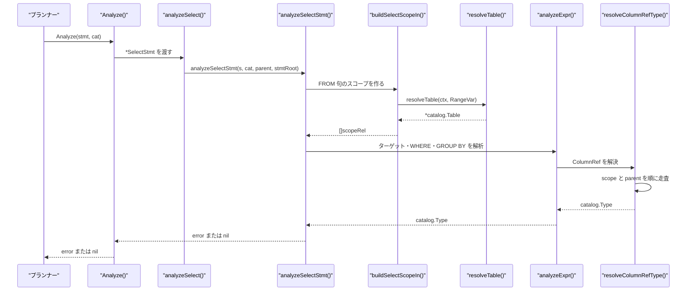
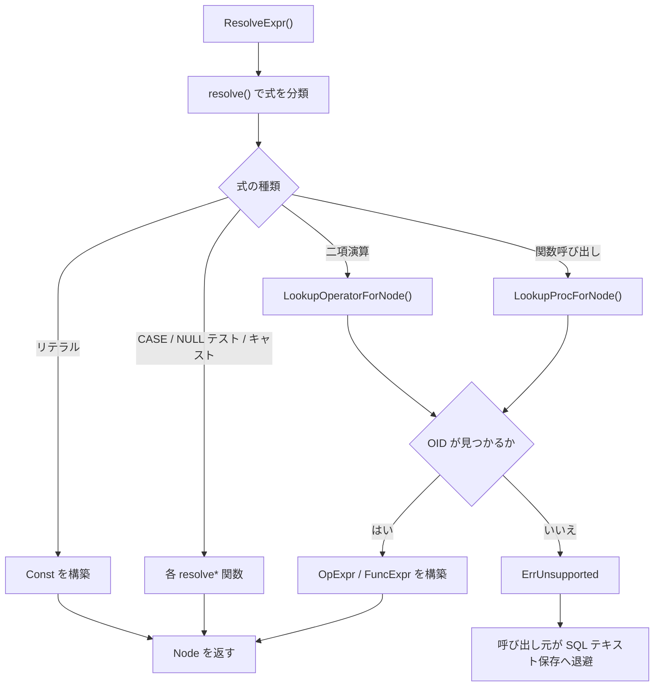

# アナライザと型解決

<details>
<summary>関連ソースファイル</summary>

- [`internal/catalog/catalog.go`](https://github.com/ryogrid/goopg/blob/19856410e8d497d59787e1ab35a2febb3f5953d6/internal/catalog/catalog.go)
- [`internal/nodes/ir.go`](https://github.com/ryogrid/goopg/blob/19856410e8d497d59787e1ab35a2febb3f5953d6/internal/nodes/ir.go)
- [`internal/nodes/ir_query.go`](https://github.com/ryogrid/goopg/blob/19856410e8d497d59787e1ab35a2febb3f5953d6/internal/nodes/ir_query.go)
- [`internal/nodes/resolver_expr.go`](https://github.com/ryogrid/goopg/blob/19856410e8d497d59787e1ab35a2febb3f5953d6/internal/nodes/resolver_expr.go)
- [`internal/nodes/resolver_query.go`](https://github.com/ryogrid/goopg/blob/19856410e8d497d59787e1ab35a2febb3f5953d6/internal/nodes/resolver_query.go)
- [`internal/parser/analyzer/analyzer.go`](https://github.com/ryogrid/goopg/blob/19856410e8d497d59787e1ab35a2febb3f5953d6/internal/parser/analyzer/analyzer.go)
- [`internal/parser/analyzer/coerce.go`](https://github.com/ryogrid/goopg/blob/19856410e8d497d59787e1ab35a2febb3f5953d6/internal/parser/analyzer/coerce.go)
- [`internal/parser/ast.go`](https://github.com/ryogrid/goopg/blob/19856410e8d497d59787e1ab35a2febb3f5953d6/internal/parser/ast.go)
- [`internal/parser/expr.go`](https://github.com/ryogrid/goopg/blob/19856410e8d497d59787e1ab35a2febb3f5953d6/internal/parser/expr.go)
- [`internal/parser/function.go`](https://github.com/ryogrid/goopg/blob/19856410e8d497d59787e1ab35a2febb3f5953d6/internal/parser/function.go)
- [`internal/parser/parser.go`](https://github.com/ryogrid/goopg/blob/19856410e8d497d59787e1ab35a2febb3f5953d6/internal/parser/parser.go)
- [`internal/parser/sqlkeywords/keywords.go`](https://github.com/ryogrid/goopg/blob/19856410e8d497d59787e1ab35a2febb3f5953d6/internal/parser/sqlkeywords/keywords.go)
- [`internal/catalog/pg_node_oid_lookup.go`](https://github.com/ryogrid/goopg/blob/19856410e8d497d59787e1ab35a2febb3f5953d6/internal/catalog/pg_node_oid_lookup.go)

</details>

パース済みの AST を名前解決・型解決し、実行可能な意味情報を付ける層である。`internal/parser/analyzer` の `Analyze` は SELECT/INSERT/UPDATE/DELETE を対象に、FROM 句の表参照、列参照、式の型、LIMIT/OFFSET、JOIN、CTE、ウィンドウ関数、ON CONFLICT の `excluded` などを検査する。もう一方の `internal/nodes` は、カタログに PostgreSQL 互換の `pg_node_tree` として保存する式・ビューを解決する。こちらは `ResolveExpr`/`ResolveViewQuery` が AST を OID 付きの `Const`/`FuncExpr`/`OpExpr`/`Query` へ変換し、対応不能なら `ErrUnsupported` を返して SQL テキスト保存へ退避する。両者は目的が異なるため、実行時の型検査とカタログ保存用の canonical IR 生成を分けて扱う。親セクションは [4 SQL パーサー](../4-SQL-Parser.md)。入力となる AST は [4.3 AST と式の構造](4.3-AST-and-Expressions.md)、字句解析は [4.1 字句解析とトークン](4.1-Lexer.md)、文ディスパッチは [4.2 文法と文ディスパッチ](4.2-Grammar-and-Dispatch.md)、手書き DDL/DML は [4.4 手書き DDL・DML パーサー](4.4-Handwritten-DDL-DML.md) を参照。

## 責務

- 文型ごとの解析入口。`Analyze` が `*SelectStmt`・`*InsertStmt`・`*UpdateStmt`・`*DeleteStmt` を各解析関数へ振り分け、DDL はそのまま通過させる。`path:internal/parser/analyzer/analyzer.go:Analyze`
- SELECT の解析。`analyzeSelect` → `analyzeSelectStmt` が WITH/CTE、FROM のスコープ、ターゲット、WHERE、GROUP BY、HAVING、ORDER BY、LIMIT/OFFSET、ロック句を順に検査する。`path:internal/parser/analyzer/analyzer.go:analyzeSelectStmt`
- FROM 句の名前解決。`buildSelectScopeIn` が `resolveTable` で実表・CTE・派生テーブル・テーブル関数を `[]scopeRel` にし、`applyRangeVarColumnAliases` が列別名を適用する。`path:internal/parser/analyzer/analyzer.go:buildSelectScopeIn`
- 列参照の解決。`resolveColumnRefType` がローカルスコープから親スコープへ辿り、修飾名の曖昧さ、`JOIN USING` の隠し列、`tableoid`/`ctid`、`excluded` 疑似表を処理する。`path:internal/parser/analyzer/analyzer.go:resolveColumnRefType`
- 式の型付け。`analyzeExpr` が定数・列参照・キャスト・単項/二項演算・関数呼び出し・CASE・IN/EXISTS・配列添字などを `catalog.Type` に変換する。`path:internal/parser/analyzer/analyzer.go:analyzeExpr`
- 数値・文字列・日時の型昇格。`PromoteNumericType`/`PromoteStringType`/`PromoteTimestampType` が型ラティスに従って共通型を選ぶ。`path:internal/parser/analyzer/coerce.go:PromoteNumericType`
- DML の意味検査。INSERT の列数・代入可能性、UPDATE の SET 対象列、DELETE の USING、ON CONFLICT の競合対象を検査する。`path:internal/parser/analyzer/analyzer.go:analyzeInsert`
- CTE とサブクエリ。`analyzeWith` が CTE 名の重複、再帰 CTE、データ変更 CTE のトップレベル制限を検査し、`synthesizeSubqueryTable` が派生テーブルの列を合成する。`path:internal/parser/analyzer/analyzer.go:analyzeWith`
- canonical IR の生成。`ResolveExpr` が DEFAULT/統計式を、`ResolveViewQuery` がビュー定義を PostgreSQL 互換の IR にする。`path:internal/nodes/resolver_expr.go:ResolveExpr`、`path:internal/nodes/resolver_query.go:ResolveViewQuery`
- IR 用の OID 解決。`LookupOperatorForNode` が演算子名と左右の型 OID から `pg_operator` 行を、`LookupProcForNode` が関数名と引数型 OID から `funcid` を引く。`path:internal/catalog/pg_node_oid_lookup.go:LookupOperatorForNode`

## 処理フロー

実行系では、パーサーが返した `Stmt` をプランナーが `Analyze` に渡す。SELECT ではスコープを構築してから、各句の式を `analyzeExpr` で型付けする。



1. プランナーは `Analyze(stmt, cat)` を呼ぶ。`Analyze` の型スイッチは SELECT/DML だけを各解析関数へ送り、DDL は `return nil` で通過させる。DDL の意味検査は DDL 実行側が担う。`path:internal/parser/analyzer/analyzer.go:Analyze`
2. `analyzeSelect` は `outerScopeOf(cat)` で外側スコープを取り、`analyzeSelectStmt` に `stmtRoot` を渡す。トップレベル判定はデータ変更 CTE の可否に使われる。`path:internal/parser/analyzer/analyzer.go:analyzeSelect`
3. `analyzeSelectStmt` はまず `SetOpOperand` を持つグループ化ノードを再帰し、集合演算なら右辺・左辺を順に解析する。通常の SELECT では `scope{parent, cat}` を作り、`With` があれば `analyzeWith` で CTE を登録する。`path:internal/parser/analyzer/analyzer.go:analyzeSelectStmt`
4. `buildSelectScopeIn` は `FromExprs` の各要素を処理する。実表は `resolveTable` → `lookupTable` が `Catalog.LookupTable` を引き、CTE はスコープチェーンの `ctes` を先に探す。派生テーブルは `synthesizeSubqueryTable` が内側 SELECT を解析して合成テーブルにする。`path:internal/parser/analyzer/analyzer.go:buildSelectScopeIn`、`path:internal/parser/analyzer/analyzer.go:resolveTable`
5. スコープができると、`resolveNamedWindowRefs`、`analyzeTargets`、`analyzeWhere`、GROUP BY、HAVING、ORDER BY、LIMIT/OFFSET、`analyzeLockingClauses` の順に検査する。HAVING は boolean、LIMIT/OFFSET は整数でなければ 42804 になる。`path:internal/parser/analyzer/analyzer.go:analyzeTargets`
6. `analyzeExpr` は式ノードの型スイッチである。`IntegerConst`→`int8`、`NumericConst`→`numeric`、`StringConst`→`unknown`、`TypedStringLit`→指定型、`IntervalLit`→`interval`、`ColumnRef`→`resolveColumnRefType`、`BinaryOp`→演算子別の型計算、`FuncCall`→関数別の戻り型、`CaseExpr`→`analyzeCaseExpr` という対応を取る。`path:internal/parser/analyzer/analyzer.go:analyzeExpr`
7. 列参照は `resolveColumnRefType` が `ctx` から `parent` へスコープチェーンを辿る。修飾名は一致する `scopeRel` を探し、複数一致なら 42702、見つからなければ 42P01/42703 を返す。非修飾名は `qualifiedOnly` の疑似表を除外し、`usingHidden` の列を飛ばす。`path:internal/parser/analyzer/analyzer.go:resolveColumnRefType`
8. DML では `analyzeInsert` が対象表と列を解決し、`Rows` の各行の要素数と `isAssignable` を検査する。`analyzeUpdate` は SET の各列と式、`analyzeDelete` は USING と RETURNING を検査する。`path:internal/parser/analyzer/analyzer.go:analyzeInsert`、`path:internal/parser/analyzer/analyzer.go:analyzeUpdate`、`path:internal/parser/analyzer/analyzer.go:analyzeDelete`
9. canonical IR 側は別経路である。`ResolveExpr` は AST を再帰的に `resolve` へ渡し、整数・数値・文字列・NULL テスト・CASE・キャスト・二項演算・関数呼び出しを `nodes.Node` にする。演算子は `LookupOperatorForNode`、関数は `LookupProcForNode` と `ProcResultType` で OID を解決する。`path:internal/nodes/resolver_expr.go:resolve`、`path:internal/nodes/resolver_expr.go:buildOpExpr`
10. `ResolveViewQuery` は単一の基底テーブルだけを対象に、`FROM` の `RangeVar`、ターゲット式、WHERE を `Query`/`RangeTblEntry`/`TargetEntry` へ変換する。JOIN、サブクエリ、GROUP BY、ORDER BY、LIMIT、DISTINCT、集合演算、CTE、ウィンドウ、別名付き FROM、裸の `*` は `ErrUnsupported` になる。`path:internal/nodes/resolver_query.go:ResolveViewQuery`

canonical IR の解決は、対応する OID が見つからない場合に「部分的に書く」のではなく、式全体を諦める。



## 主要ファイル

| ファイル | 役割 |
| --- | --- |
| `internal/parser/analyzer/analyzer.go` | `Analyze`、スコープ、列解決、式の型付け、DML/CTE/ウィンドウ検査。`path:internal/parser/analyzer/analyzer.go:Analyze` |
| `internal/parser/analyzer/coerce.go` | 数値・文字列・日時の型ラティスと昇格関数。`path:internal/parser/analyzer/coerce.go:PromoteNumericType` |
| `internal/catalog/catalog.go` | `Catalog`、`Table`、`Column`、`Type` と OID・カタログ参照。`path:internal/catalog/catalog.go:Catalog` |
| `internal/catalog/pg_node_oid_lookup.go` | canonical IR 用の演算子・関数 OID 前向き索引。`path:internal/catalog/pg_node_oid_lookup.go:LookupOperatorForNode` |
| `internal/nodes/ir.go` | `Node`、`Const`、`FuncExpr`、`OpExpr`、`Query` などの canonical IR 型。`path:internal/nodes/ir.go:Node` |
| `internal/nodes/ir_query.go` | `Query`、`RangeTblEntry`、`Var`、`TargetEntry` などクエリ IR。`path:internal/nodes/ir_query.go:Query` |
| `internal/nodes/resolver_expr.go` | AST → スカラー IR の `ResolveExpr`/`ResolveForColumn` と OID 解決。`path:internal/nodes/resolver_expr.go:ResolveExpr` |
| `internal/nodes/resolver_query.go` | ビュー SELECT → `Query` の `ResolveViewQuery` と `RelationResolver`。`path:internal/nodes/resolver_query.go:ResolveViewQuery` |
| `internal/parser/ast.go` | 解析対象の文ノードと `SelectStmt`。`path:internal/parser/ast.go:SelectStmt` |
| `internal/parser/expr.go` | 解析対象の式ノード。`path:internal/parser/expr.go:Expr` |
| `internal/parser/function.go` | CREATE FUNCTION/PROCEDURE の AST 構築。アナライザは DDL として通過させる。`path:internal/parser/function.go:parseFunctionArgList` |
| `internal/parser/parser.go` | `SyntaxError` とパース入口。アナライザ入力の出所。`path:internal/parser/parser.go:SyntaxError` |
| `internal/parser/sqlkeywords/keywords.go` | カタログの名前レンダリングが使う予約語判定と `QuoteIdentifier`。`path:internal/parser/sqlkeywords/keywords.go:IsReservedForQuoting` |

## 公開 API / エントリポイント

```go
func Analyze(stmt parser.Stmt, cat catalog.Catalog) error
func NewOuterScope(cat catalog.Catalog, rels []OuterRelation, parent *OuterScope) *OuterScope
func SetOuterScope(cat catalog.Catalog, parent *OuterScope) func()
func ExprHasSRF(e parser.Expr, cat catalog.Catalog) bool
func ResolveExpr(e parser.Expr, targetType uint32) (Node, error)
func ResolveForColumn(e parser.Expr, targetType uint32) (Node, bool)
func ResolveForColumnTypmod(e parser.Expr, targetType uint32, targetTypmod int32) (Node, bool)
func ResolveViewQuery(sel *parser.SelectStmt, r RelationResolver) (*Query, error)
func NumericCoercePrecedence(typeName string) int
func PromoteNumericType(l, r catalog.Type) catalog.Type
func PromoteStringType(l, r catalog.Type) catalog.Type
func PromoteTimestampType(l, r catalog.Type) catalog.Type
```

- `Analyze` は文の意味解析の唯一の入口である。成功時は nil、失敗時は `*AnalyzeError` を返す。`path:internal/parser/analyzer/analyzer.go:Analyze`
- `NewOuterScope`/`SetOuterScope` は相関サブクエリ用の外側スコープを、カタログごとの `OuterScopeCarrier` スロットに設定する。`SetOuterScope` の戻り値を defer して元に戻す。`path:internal/parser/analyzer/analyzer.go:SetOuterScope`
- `ExprHasSRF` は式に集合返却関数が含まれるかを判定する。LIMIT/OFFSET の拒否検査などで使う。`path:internal/parser/analyzer/analyzer.go:ExprHasSRF`
- `ResolveExpr` は canonical IR を返し、非対応式なら `ErrUnsupported` を返す。`ResolveForColumn` は式の最上位型が対象列の型と完全一致するときだけ IR を返す。`path:internal/nodes/resolver_expr.go:ResolveForColumn`
- `ResolveViewQuery` は対応可能な単一基底テーブル SELECT だけを `*Query` にし、それ以外は `ErrUnsupported` を返す。`path:internal/nodes/resolver_query.go:ResolveViewQuery`
- `PromoteNumericType` などはアナライザの型ラティスを公開する。`path:internal/parser/analyzer/coerce.go:PromoteNumericType`

## 主要データ構造

### `AnalyzeError` — アナライザのエラー

`path:internal/parser/analyzer/analyzer.go:AnalyzeError`

```go
type AnalyzeError struct {
	Pos     int
	Code    string
	Message string
	Hint    string // optional hint; propagated to PlanError.Hint by toPlanError. M0097-0004.
}
```

`Pos` は AST ノードのバイト位置、`Code` は SQLSTATE、`Message` はエラー本文、`Hint` は HINT フィールドである。`Error()` はコードがあれば `CODE: message (byte N)`、なければ `analyzer error: message (byte N)` を返す。アナライザは最初のエラーで処理を止める。`path:internal/parser/analyzer/analyzer.go:AnalyzeError`

### `scope` — 名前解決のスコープ

`path:internal/parser/analyzer/analyzer.go:scope`

```go
type scope struct {
	rels []scopeRel
	// parent is the lexical-scope parent for correlated
	// subqueries — set when analyzing a subquery's inner
	// SELECT so column refs that don't resolve locally walk
	// up. nil for the top-level SELECT.
	parent *scope
	// cat is the catalog. Threaded via the scope so the
	// SubqueryExpr / ExistsExpr / InExpr handlers can recurse
	// into analyzeSelectWithParent without re-piping cat as a
	// separate parameter through every helper.
	cat catalog.Catalog
	// ctes maps CTE name → synthetic *catalog.Table built from
	// the inner SELECT's target list. Populated by analyzeWith
	// when a statement carries a WITH clause; consulted by
	// resolveTable before falling through to the catalog. The
	// scope chain is walked head-first so an inner WITH shadows
	// an outer-scope CTE of the same name (mirrors PostgreSQL).
	// nil for pre-M0016 callers — every existing test path goes
	// straight through to lookupTable. See M0016-0001.
	ctes map[string]*catalog.Table
}
```

`rels` は現在の FROM 句の範囲変数、`parent` は相関サブクエリ用の外側スコープ、`cat` はカタログ、`ctes` は CTE 名から合成テーブルへのマップである。`resolveColumnRefType` は `ctx` → `parent` の順に `rels` を探し、見つかった最初のスコープで型を返す。`ctes` は `resolveTable` がカタログより先に参照するため、内側の WITH が外側の同名 CTE を隠す。`path:internal/parser/analyzer/analyzer.go:scope`

### `scopeRel` — FROM 句の 1 関係

`path:internal/parser/analyzer/analyzer.go:scopeRel`

```go
type scopeRel struct {
	table *catalog.Table
	alias string
	// qualifiedOnly hides this rel from the unqualified
	// column-resolution path. Used by ON CONFLICT DO UPDATE
	// (M0017-0001 step 2) to wire `excluded` into the scope as a
	// pseudo-table without creating a bare-`col` ambiguity with
	// the target table — `excluded.col` resolves only via the
	// fully-qualified path. Mirrors upstream's name-resolution
	// rule for the EXCLUDED pseudo-relation.
	qualifiedOnly bool
	// blockOriginalName, when set alongside an alias, causes a
	// deferred error when the underlying table name is used as a
	// qualifier — only the alias is valid. The error is deferred
	// (not immediate) so a qualifiedOnly binding with the same name
	// (e.g. the excluded pseudo-table) can still match first.
	blockOriginalName bool
	// usingHidden lists column names hidden from unqualified lookup
	// because they appear in a JOIN USING clause. The left table's
	// copy of these columns is canonical. M0097-0003.
	usingHidden []string
}
```

`qualifiedOnly` の関係は非修飾列解決から除外され、`表名.列` の完全修飾でのみ一致する。`blockOriginalName` は別名を付けた表の元名を使ったときにエラーを遅延させ、`excluded` のような疑似表を先に照合させる。`usingHidden` は JOIN USING の右側で重複する列を非修飾解決から隠す。`path:internal/parser/analyzer/analyzer.go:resolveColumnRefTypeAt`

### `OuterScopeCarrier` — 文ごとの外側スコープ

`path:internal/parser/analyzer/analyzer.go:OuterScopeCarrier`

```go
type OuterScopeCarrier interface {
	AnalyzerOuterScopeSlot() *any
}
```

プランナーの `stmtCatalog` が実装するインタフェースで、文ごとの `any` スロットに `*OuterScope` の実体を入れる。かつてパッケージ変数だったため並行プランニングで競合した経緯があり、現在は文ごとのカタログラッパーに保持する。`outerScopeSlot` はラッパーを最大 16 段まで剥がしてスロットを探す。`path:internal/parser/analyzer/analyzer.go:outerScopeSlot`

### `catalog.Type` — 型名と typmod

`path:internal/catalog/catalog.go:Type`

```go
type Type struct {
	Name string
	Args []int64
	// IsArray is true for a column declared with the SQL `[]` array suffix
	// (e.g. `tags text[]`). Name still holds the element type ("text"); the
	// array-ness is tracked separately so the runtime evaluator keeps using
	// the element type while catalog builders (pg_attribute.atttypid →
	// _text/_int4/…) and pg_dump's format_type render the array type.
	// DU-002 slice 62.
	IsArray bool
}
```

`Name` は型名、`Args` は `numeric(10,2)` などの typmod、`IsArray` は配列型かどうかである。配列型でも `Name` は要素型を保持し、`IsArray` が真になる。アナライザの `analyzeExpr` はこの型を返し、`isNumericLike`/`isStringLike`/`isTimestampLike` などが型名とフラグを見て分類する。`path:internal/parser/analyzer/analyzer.go:analyzeExpr`

### `catalog.Column` と `catalog.Table`

`path:internal/catalog/catalog.go:Column`

`Column` は `Name`・`Type`・`NotNull`・`Ordinal`・`GeneratedExpr`・`DefaultExpr`・`Dropped`・`Inherited` などを持つ。アナライザが主に使うのは `Name`（列解決）、`Type`（式の型付け・代入可能性）、`Ordinal`（位置参照）、`Dropped`（削除列を不可視にする）、`Inherited`（継承列）である。`path:internal/catalog/catalog.go:Column`

`path:internal/catalog/catalog.go:Table`

`Table` は `Schema`・`Name`・`Columns []Column`・`OID`・`View *parser.SelectStmt`・`ViewColumnAliases`・`IsDMLCTE` などを持つ。`resolveTable`/`lookupTable` は `Catalog.LookupTable` でこの型を取得し、`Column` のリストをスコープに入れる。ビューは `View` の AST を持ち、派生テーブルの列合成にも使われる。`path:internal/catalog/catalog.go:Table`

### canonical IR の `Node` と `Const`

`path:internal/nodes/ir.go:Node`

```go
type Node interface {
	nodeTag() string
}
```

`Node` は `pg_node_tree` の IR ノードが実装する内部インタフェースで、`nodeTag()` が `CONST`・`FUNCEXPR`・`OPEXPR` などのタグを返す。`path:internal/nodes/ir.go:Node`

`path:internal/nodes/ir.go:Const`

```go
type Const struct {
	ConstType   uint32 // consttype  (type OID)
	ConstTypmod int32  // consttypmod
	ConstCollid uint32 // constcollid (collation OID; 100 = default for text)
	ConstLen    int32  // constlen    (typlen; -1 for varlena)
	ConstByval  bool   // constbyval
	ConstIsNull bool   // constisnull
	Location    int32  // location    (parse location; -1 when normalized)
	Datum       []byte // constvalue wire bytes (see comment above)
}
```

`ConstType` は型 OID、`Datum` は値の wire bytes、`ConstIsNull` が真なら `Datum` は無視される。`ConstByval`/`ConstLen` は PostgreSQL の by-value/by-reference 表現を再現する。`path:internal/nodes/ir.go:Const`

### `FuncExpr` と `OpExpr`

`path:internal/nodes/ir.go:FuncExpr`

```go
type FuncExpr struct {
	Funcid         uint32 // funcid
	Funcresulttype uint32 // funcresulttype
	Funcretset     bool   // funcretset
	Funcvariadic   bool   // funcvariadic
	Funcformat     int32  // funcformat (CoercionForm enum)
	Funccollid     uint32 // funccollid
	Inputcollid    uint32 // inputcollid
	Args           []Node // args
	Location       int32  // location
}
```

`Funcid` は `pg_proc.oid`、`Funcresulttype` は戻り型 OID、`Args` は引数の IR ノード、`Funcformat` は明示呼び出し（0）や暗黙キャスト（2）を表す。`path:internal/nodes/ir.go:FuncExpr`

`path:internal/nodes/ir.go:OpExpr`

```go
type OpExpr struct {
	Opno         uint32 // opno
	Opfuncid     uint32 // opfuncid
	Opresulttype uint32 // opresulttype
	Opretset     bool   // opretset
	Opcollid     uint32 // opcollid
	Inputcollid  uint32 // inputcollid
	Args         []Node // args
	Location     int32  // location
}
```

`Opno` は `pg_operator.oid`、`Opfuncid` は演算子の実装関数、`Opresulttype` は結果型 OID である。`buildOpExpr` は `LookupOperatorForNode(spelling, lType, rType)` が返す行からこれらを埋め、見つからなければ `ErrUnsupported` を返す。`path:internal/nodes/resolver_expr.go:buildOpExpr`

### `Query` と `Var` — ビュー IR

`path:internal/nodes/ir_query.go:Query`

```go
type Query struct {
	CommandType  int32  // commandType (1 = CMD_SELECT)
	Rtable       []Node // rtable (RangeTblEntry list)
	RtePermInfos []Node // rteperminfos (RTEPermissionInfo list)
	Jointree     Node   // jointree (*FromExpr)
	TargetList   []Node // targetList (TargetEntry list)
}
```

`Query` はビュー rewrite 用のクエリ IR で、`CommandType=1`（SELECT）、RTE のリスト、権限情報、`FROM` の `FromExpr`、ターゲットリストを保持する。`ResolveViewQuery` は単一基底テーブルの SELECT だけをこの形にする。`path:internal/nodes/ir_query.go:Query`

`path:internal/nodes/ir_query.go:Var`

```go
type Var struct {
	Varno            int32     // varno (range-table index)
	Varattno         int32     // varattno (attribute number)
	Vartype          uint32    // vartype (type OID)
	Vartypmod        int32     // vartypmod
	Varcollid        uint32    // varcollid (collation OID)
	Varnullingrels   Bitmapset // varnullingrels
	Varlevelsup      int32     // varlevelsup
	Varreturningtype int32     // varreturningtype (VarReturningType enum)
	Varnosyn         int32     // varnosyn
	Varattnosyn      int32     // varattnosyn
	Location         int32     // location
}
```

`Var` は範囲表の列参照で、`Varno`/`Varattno` が RTE と属性番号、`Vartype`/`Vartypmod`/`Varcollid` が型情報である。単一テーブルビューの `varlevelsup` は 0、`varnullingrels` は空になる。`path:internal/nodes/ir_query.go:Var`

### `ColumnInfo` / `RelationInfo` — IR 解決の入力

`path:internal/nodes/resolver_query.go:ColumnInfo`

```go
type ColumnInfo struct {
	Name      string
	Attno     int32
	TypeOID   uint32
	Typmod    int32
	Collation uint32
}
```

`Attno` は 1 始まりの `pg_attribute.attnum`、`TypeOID` は型 OID、`Collation` は非照合型なら 0、照合可能型なら既定照合の OID 100 である。`path:internal/nodes/resolver_query.go:ColumnInfo`

`path:internal/nodes/resolver_query.go:RelationInfo`

```go
type RelationInfo struct {
	Relid   uint32
	Relname string
	Relkind byte // 'r', 'v', 'm', 'p', …
	Columns []ColumnInfo
}
```

`Relid` は `pg_class.oid`、`Relname` は RTE の `eref` 名、`Relkind` は `'r'`/`'v'`/`'m'`/`'p'` など、`Columns` は属性番号順の全列である。`RelationResolver` は `LookupRelation(schema, name)` でこの情報を返す。`path:internal/nodes/resolver_query.go:RelationResolver`

## 内部構造

### スコープチェーンと名前解決

`analyzeSelectStmt` は SELECT ごとに `scope` を作り、`parent` に外側のスコープを入れる。`buildSelectScopeIn` は `FromExprs` の `Base` と各 `JoinExpr.Right` を `scopeRel` にし、派生テーブルは `synthesizeSubqueryTable` で内側 SELECT のターゲット列から合成テーブルを作る。LATERAL の場合は左側の `rels` を内側スコープに渡す。`path:internal/parser/analyzer/analyzer.go:buildSelectScopeIn`

`resolveColumnRefType` はローカルから親へ順に `resolveColumnRefTypeAt` を呼ぶ。修飾名は `scopeRelMatches` で一致する関係を集め、2 つ以上なら 42702、0 個なら `errorMissingRTE`（42P01）を返す。非修飾名は `qualifiedOnly` を除外し、`usingHidden` の列を飛ばし、2 つ以上見つかれば 42702 にする。見つからない場合は `wholeRowTypeAt` によるテーブル全体参照を試し、最後に 42703 と近い列名のヒントを返す。`path:internal/parser/analyzer/analyzer.go:resolveColumnRefType`

`<rel>.tableoid` は `oid`、`<rel>.ctid` は `tid` として解決される。`excluded` のような `qualifiedOnly` の疑似表では `ctid` を許可しない。DML CTE の合成テーブルは列を持たないため、任意の列参照を `unknown` として受理し、実行時に CTE の実列から型を決める。`path:internal/parser/analyzer/analyzer.go:resolveColumnRefTypeAt`

### 型ラティス

`coerce.go` の数値ラティスは `int2`→`int4`→`int8`→`numeric`→`float4`→`float8` である。`PromoteNumericType` は `unknown` を相手側に従わせ、両方が数値なら上位の型を返す。`PromoteStringType` は文字列系を `text` に寄せ、`PromoteTimestampType` は `date`→`timestamp`→`timestamptz` の順で広い型を選ぶ。`path:internal/parser/analyzer/coerce.go:NumericCoercePrecedence`

`analyzeExpr` の比較は `isComparable` が担当する。`unknown` は任意の型と比較可能で、数値同士・文字列同士・真偽値同士・日時同士、文字列と日時、OID ファミリと数値、ユーザー型と文字列なども比較可能にする。代入は `isAssignable` が担当し、`unknown` は任意の型に代入可能、数値は数値ラティス、文字列は文字列系、日時は日時系という規則で判定する。`path:internal/parser/analyzer/analyzer.go:isComparable`、`path:internal/parser/analyzer/analyzer.go:isAssignable`

### 演算子と関数

`BinaryOp` の解析は演算子ごとに分岐する。`AND`/`OR` は両辺 boolean を要求し `bool` を返す。比較演算子は `isComparable` が偽なら 42804 を返す。算術は数値のほか、`timestamp/date ± interval`、`interval ± interval`、`interval * / numeric`、`date ± integer`、`date - date`、`pg_lsn` 演算を個別に扱う。`||` は配列・jsonb・文字列を扱い、LIKE/ILIKE は文字列または bytea の組を要求する。`path:internal/parser/analyzer/analyzer.go:analyzeExpr`

`FuncCall` は `OVER` があれば `analyzeWindowFuncCall` へ行く。通常の関数は引数を解析した後、`count` は `int8`、`sum` は引数の数値型、`current_date` は `date` を返す。それ以外の関数は `unknown` を返し、実際の戻り型は実行時の関数実装に委ねる。`path:internal/parser/analyzer/analyzer.go:analyzeWindowFuncCall`

### DML と CTE

`analyzeInsert` は `InsertStmt.Select` があれば内側 SELECT を解析し、`Rows` があれば `resolveInsertTargetColumns` で対象列を決め、各行の要素数と `isAssignable` を検査する。`OnConflict` は `analyzeOnConflict` が対象列・制約・`excluded` 疑似表を検査する。`path:internal/parser/analyzer/analyzer.go:analyzeInsert`

`analyzeUpdate` は対象表と FROM の関係をスコープに入れ、`UpdateAssign` の単一列/複数列を検査する。`analyzeDelete` は USING をスコープに追加し、WHERE と RETURNING を解析する。`path:internal/parser/analyzer/analyzer.go:analyzeUpdate`

`analyzeWith` は CTE 名の重複を 42710、データ変更 CTE がトップレベル以外にある場合を 0A000 で拒否する。再帰 CTE は `analyzeRecursiveCTE` がアンカーを解析して列を登録し、再帰メンバーを自己参照可能な状態で解析する。`path:internal/parser/analyzer/analyzer.go:analyzeWith`、`path:internal/parser/analyzer/analyzer.go:analyzeRecursiveCTE`

### ウィンドウと集合返却関数

`resolveNamedWindowRefs` は `OVER window_name` の参照を `WindowClause` の定義で解決し、`mergeWindowDef` が SQL:2008 の上書き規則を検査する。`validateWindowFrame` はフレームの境界順序、`RANGE`/`GROUPS` の制限、`ORDER BY` の有無を検査する。`exprHasWindowFunc` は WHERE/GROUP BY/HAVING でウィンドウ関数を禁止するために使う。`path:internal/parser/analyzer/analyzer.go:resolveNamedWindowRefs`、`path:internal/parser/analyzer/analyzer.go:validateWindowFrame`

`exprHasSRF`/`ExprHasSRF` は式に集合返却関数が含まれるかを判定する。LIMIT/OFFSET では整数型チェックより先に SRF を拒否し、PostgreSQL と同じ 0A000 を返す。`path:internal/parser/analyzer/analyzer.go:exprHasSRF`

### canonical IR の解決

`ResolveExpr` は `resolve` の型スイッチで AST を IR にする。整数は `fitsInt4` で `int4`/`int8` を選び、数値は `numeric`、文字列は目的型が `text` なら `text`、それ以外は `foldStringLiteralConst` が入力関数で定数化できる型だけ受理する。`NULL` テスト・真偽テスト・CASE・キャスト・`IS DISTINCT FROM`・単項/二項演算・関数呼び出しが対象である。`path:internal/nodes/resolver_expr.go:resolve`

`ResolveForColumn` は `resolve` の結果の型が対象列の型と完全一致するときだけ IR を返す。`ResolveForColumnTypmod` はさらに `numeric`/`varchar`/`bpchar`/`timestamp`/`time`/`timestamptz`/`bit`/`varbit`/`timetz` の typmod を反映するため、必要なら `FuncExpr` の長さ強制や `RelabelType` を被せる。型が一致しなければ `(nil, false)` を返し、呼び出し側は SQL テキスト保存に退避する。`path:internal/nodes/resolver_expr.go:ResolveForColumnTypmod`

`ResolveViewQuery` は `rejectUnsupportedClauses` で WITH/DISTINCT/GROUP BY/HAVING/ORDER BY/LIMIT/OFFSET/集合演算/VALUES/ウィンドウ/GROUPING SETS/ロック/`SetOpOperand` を拒否し、FROM が単一の基底テーブルであることを確認する。`RelationResolver.LookupRelation` で `RelationInfo` を取得し、`queryScope` が列名から `Var` を作る。`selectedCols` は参照した属性番号を `selectedColsBias=7` だけバイアスしてビットマップにする。`path:internal/nodes/resolver_query.go:ResolveViewQuery`

### OID 索引とフォールバック

`LookupOperatorForNode` は `PGOperatorAllEntries` から二項演算子だけを `(name, leftOID, rightOID)` で索引化し、`LookupProcForNode` は `pgProcNamesByOID` と引数型名から `(name, argOIDs)` の索引を作る。どちらも `sync.Once` で遅延構築され、見つからない場合は `ErrUnsupported` の原因になる。`path:internal/catalog/pg_node_oid_lookup.go:LookupOperatorForNode`、`path:internal/catalog/pg_node_oid_lookup.go:LookupProcForNode`

`ResolveExpr`/`ResolveViewQuery` は部分的な IR を返さない。対応できない式が 1 つでもあれば全体を `ErrUnsupported` にし、呼び出し側が SQL テキストを保存する。これは PostgreSQL の standby が `nodeToString` の完全な式を期待するためで、途中までの木を保存すると評価時に壊れる。`path:internal/nodes/resolver_expr.go:ErrUnsupported`

### 名前の引用と表示

`catalog` の型名・識別子レンダリングは `sqlkeywords.IsReservedForQuoting` を使い、予約語や大文字を含む名前を二重引用符で囲む。`QuoteIdentifier` は同じパッケージが提供する PostgreSQL `quote_identifier()` 相当の公開引用関数である。アナライザのエラーは `pgDisplayTypeName` で `timestamp with time zone` などの表示名に変換する。`path:internal/parser/sqlkeywords/keywords.go:IsReservedForQuoting`、`path:internal/parser/sqlkeywords/keywords.go:QuoteIdentifier`、`path:internal/parser/analyzer/analyzer.go:pgDisplayTypeName`

## エッジケースと不変条件

- **アナライザは AST を書き換えない。** `Analyze` は検査と型付けだけを行い、`SelectStmt` や `Expr` の構造を変更しない。型情報は戻り値の `catalog.Type` として呼び出し側に渡される。`path:internal/parser/analyzer/analyzer.go:Analyze`
- **DDL はアナライザを通らない。** `Analyze` の default 分岐は DDL を `return nil` で通過させる。CREATE TABLE の制約や型の意味検査は DDL 実行側が行う。`path:internal/parser/analyzer/analyzer.go:Analyze`
- **列が見つからない場合は 42703、関係が見つからない場合は 42P01。** 修飾名で関係が一致しなければ `errorMissingRTE`、非修飾名で列がなければ 42703 と近い列名のヒントを返す。`path:internal/parser/analyzer/analyzer.go:resolveColumnRefType`
- **修飾名の曖昧さは 42702。** 同じ名前の `scopeRel` が複数ある場合や、非修飾列が複数の関係に存在する場合は 42702 で拒否する。`path:internal/parser/analyzer/analyzer.go:resolveColumnRefTypeAt`
- **`excluded` は非修飾解決から隠す。** `qualifiedOnly` の疑似表は `excluded.col` の完全修飾でのみ一致し、`col` だけでは対象表の列と衝突しない。`path:internal/parser/analyzer/analyzer.go:scopeRel`
- **JOIN USING の右側の重複列は隠す。** `usingHidden` に列名がある関係は非修飾列解決からスキップされ、左側の列が優先される。`path:internal/parser/analyzer/analyzer.go:resolveColumnRefTypeAt`
- **LIMIT/OFFSET は整数、HAVING は boolean。** 型が違えば 42804 を返す。LIMIT/OFFSET では SRF を先に拒否し、0A000 を返す。`path:internal/parser/analyzer/analyzer.go:analyzeSelectStmt`
- **集合演算のロックは禁止。** `FOR UPDATE`/`FOR SHARE` が集合演算の分岐にあると 0A000 になる。`path:internal/parser/analyzer/analyzer.go:analyzeSelectStmt`
- **INSERT の行数・型を検査する。** 各行の要素数が対象列数と違えば 42601、`isAssignable` が偽なら 42804 を返す。`path:internal/parser/analyzer/analyzer.go:analyzeInsert`
- **ON CONFLICT DO UPDATE は競合対象が必要。** 対象がない `DO UPDATE` は 42601 とヒントを返す。`path:internal/parser/analyzer/analyzer.go:analyzeOnConflict`
- **データ変更 CTE はトップレベルだけ。** `analyzeWith` は `stmtRoot` が偽のデータ変更 CTE を 0A000 で拒否する。`path:internal/parser/analyzer/analyzer.go:analyzeWith`
- **外側スコープは文ごとに保持する。** `OuterScopeCarrier` のスロットを使い、`SetOuterScope` の戻り値で必ず元に戻す。パッケージ変数ではないため、並行セッション間でスコープが混ざらない。`path:internal/parser/analyzer/analyzer.go:SetOuterScope`
- **IR は all-or-nothing。** `ResolveExpr`/`ResolveViewQuery` は対応できない部分が 1 つでもあれば `ErrUnsupported` を返し、部分的な `Node` を返さない。呼び出し側は SQL テキスト保存に切り替える。`path:internal/nodes/resolver_expr.go:ResolveExpr`
- **`ResolveForColumn` は型の完全一致を要求する。** `int4` の式を `numeric` 列に保存するような場合は `(nil, false)` になり、typo ではなく型不一致として扱う。`path:internal/nodes/resolver_expr.go:ResolveForColumn`
- **IR の `Var` は `selectedColsBias=7` でバイアスする。** `selectedCols` の属性番号は `-FirstLowInvalidHeapAttributeNumber` 分だけずらされ、システム列の負の attno を非負のビットマップメンバーに写す。`path:internal/nodes/resolver_query.go:selectedColsBias`
- **IR の `Const` は NULL のとき `Datum` を無視する。** `ConstIsNull` が真なら `Datum` は使わず、by-value/by-reference の表現は `ConstByval`/`ConstLen` で決まる。`path:internal/nodes/ir.go:Const`
- **ビュー IR は単一基底テーブルだけ。** JOIN、サブクエリ、GROUP BY/HAVING/ORDER BY/LIMIT、DISTINCT、集合演算、CTE、ウィンドウ、別名付き FROM、裸の `*` は `ErrUnsupported` になる。`path:internal/nodes/resolver_query.go:rejectUnsupportedClauses`
- **`ResolveExpr` の数値リテラルは int4 境界で型が変わる。** `fitsInt4` が `math.MinInt32`〜`math.MaxInt32` を判定し、収まれば `int4`、超えれば `int8` になる。`path:internal/nodes/resolver_expr.go:fitsInt4`
- **文字列リテラルの IR 化は入力関数に依存する。** `foldStringLiteralConst` が対象型の入力関数で決定的に定数化できる場合だけ Const にし、TimeZone 依存の timestamptz や非 10 進整数表記などは `ErrUnsupported` に落とす。`path:internal/nodes/resolver_expr.go:foldStringLiteralConst`
- **OID 索引は遅延構築される。** `LookupOperatorForNode`/`LookupProcForNode` は `sync.Once` で索引を作るため、初回呼び出しだけコストがかかる。索引にない演算子・関数は `ErrUnsupported` の原因になる。`path:internal/catalog/pg_node_oid_lookup.go:LookupProcForNode`

Sources:

- `internal/catalog/catalog.go`
- `internal/nodes/ir.go`
- `internal/nodes/ir_query.go`
- `internal/nodes/resolver_expr.go`
- `internal/nodes/resolver_query.go`
- `internal/parser/analyzer/analyzer.go`
- `internal/parser/analyzer/coerce.go`
- `internal/parser/ast.go`
- `internal/parser/expr.go`
- `internal/parser/function.go`
- `internal/parser/parser.go`
- `internal/parser/sqlkeywords/keywords.go`
- `internal/catalog/pg_node_oid_lookup.go`

<sub>Generated by deepwiki-4myself from `goopg` @ `19856410e`</sub>
