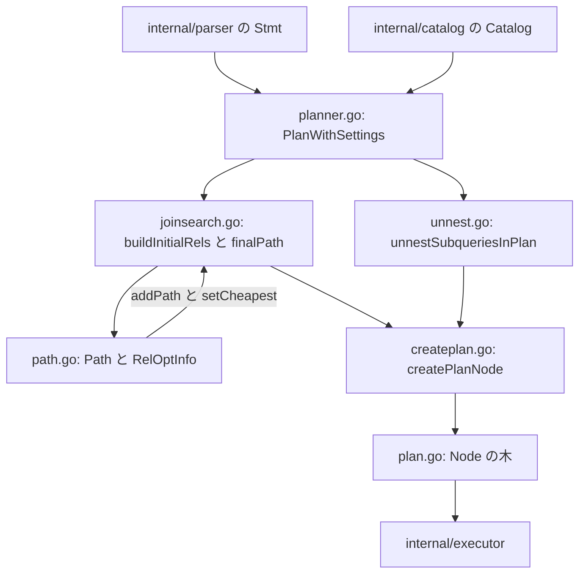

# クエリプランナー

<details>
<summary>関連ソースファイル</summary>

- [`internal/optimizer/createplan.go`](https://github.com/ryogrid/goopg/blob/19856410e8d497d59787e1ab35a2febb3f5953d6/internal/optimizer/createplan.go)
- [`internal/optimizer/joinsearch.go`](https://github.com/ryogrid/goopg/blob/19856410e8d497d59787e1ab35a2febb3f5953d6/internal/optimizer/joinsearch.go)
- [`internal/optimizer/path.go`](https://github.com/ryogrid/goopg/blob/19856410e8d497d59787e1ab35a2febb3f5953d6/internal/optimizer/path.go)
- [`internal/optimizer/plan.go`](https://github.com/ryogrid/goopg/blob/19856410e8d497d59787e1ab35a2febb3f5953d6/internal/optimizer/plan.go)
- [`internal/optimizer/planner.go`](https://github.com/ryogrid/goopg/blob/19856410e8d497d59787e1ab35a2febb3f5953d6/internal/optimizer/planner.go)
- [`internal/optimizer/unnest.go`](https://github.com/ryogrid/goopg/blob/19856410e8d497d59787e1ab35a2febb3f5953d6/internal/optimizer/unnest.go)

</details>

`internal/optimizer` は、パーサーが返した `parser.Stmt` とカタログ `catalog.Catalog` を受け取り、実行エンジンが解釈する `Node` の木を返すサブシステムである。入力は SQL の構文木と名前解決に必要なカタログ情報、出力は `*SeqScan`・`*IndexScan`・`*Join`・`*Aggregate`・`*Sort` などの実行ノードからなる計画木である。計画は大きく 3 段に分かれる。第 1 に、アナライザによる名前・型解決と、サブリンク・CTE・派生テーブル・外側結合の正規化。第 2 に、候補 `Path` の生成とコスト付きの結合順探索。第 3 に、勝者の `Path` を `Node` へ翻訳し、探索境界の列順をバインディング順へ戻す変換である。このページはサブシステム全体の地図であり、各段の詳細は子ページに譲る。

## コンポーネント

- **プランナー全体像** — `PlanWithSettings` から `planSelectWithSettings`、`tryJoinSearch`、`createPlan` までの制御の流れと、文型ごとのディスパッチを扱う。[5.1 プランナー全体像](5-Query-Planner/5.1-Planner-Overview.md)
- **パスとコストモデル** — `Path`/`RelOptInfo`/`Cost`、PostgreSQL 単位のコスト関数、`addPath` の支配判定、`setCheapest`、LIMIT 分数、幅の窄化を扱う。[5.2 パスとコストモデル](5-Query-Planner/5.2-Path-and-Cost.md)
- **結合順序探索** — `searchCtx` のレベル列挙、`SpecialJoinInfo` の合法性、Hash/Merge/NLI の各アーム、GEQO、探索境界の座標復元を扱う。[5.3 結合順序探索](5-Query-Planner/5.3-Join-Search.md)
- **サブクエリの非相関化** — EXISTS/IN の SEMI/ANTI 化、EXISTS→ANY、派生テーブル・CTE の引き上げ、条件押し込み、SubqueryScan 除去を扱う。[5.4 サブクエリの非相関化](5-Query-Planner/5.4-Subquery-Unnesting.md)
- **集約・ウィンドウ・上位リレーション** — `UpperRelKind` のレジストリ、GROUP BY/ROLLUP/Mixed 集約、DISTINCT、ウィンドウ、UNION/INTERSECT/EXCEPT、ORDER BY の候補生成を扱う。[5.5 集約・ウィンドウ・上位リレーション](5-Query-Planner/5.5-Aggregate-and-Window.md)
- **並列クエリの計画** — 基底関係の `ConsiderParallel`、部分スキャン、`Gather`/`GatherMerge`、集約・ソートの分割、サブリンクの並列化を扱う。[5.6 並列クエリの計画](5-Query-Planner/5.6-Parallel-Planning.md)
- **パスからプランへの変換** — `createPlanNode` の種別ディスパッチ、結合の共通プロローグ、スキャンの再構築、探索ルートの `Project`、SubPlan lower を扱う。[5.7 パスからプランへの変換](5-Query-Planner/5.7-Plan-Creation.md)
- **統計と選択度推定** — MCV・ヒストグラム・null 率・ndistinct、等価類、拡張統計、結合キーの証明、LIKE と部分インデックス述語を扱う。[5.8 統計と選択度推定](5-Query-Planner/5.8-Statistics-and-Selectivity.md)

## サブシステム図

計画の入口は `parser` から `planner.go` へ入り、サブリンクの書き換え（`unnest.go`）と結合探索（`joinsearch.go`）を経て、`path.go` の `Path` 語彙で候補を比較し、`createplan.go` が `plan.go` の `Node` へ翻訳する。最上位の正規化や上位 rel は子ページで扱うが、この図は中心のデータの流れだけを示す。



## データフロー

1. **文の受理とスコープの確立**: `PlanWithSettings` が `DefaultPlannerSettings` またはセッション設定を受け取り、`planWithRtableSize` が `withPlanState` で文単位のスコープを包み、`planStmtWithSettings` へ渡す。SELECT 以外の文型はここで DML/DDL の計画関数へ分岐する (`path:internal/optimizer/planner.go:PlanWithSettings`)。
2. **SELECT の解析と FROM の計画**: `planStmtWithSettings` は `analyzer.Analyze` の後、`planSelectWithSettings` に進む。`planSelectWithSettings` は `planFromClause` で FROM 項目を `Node` と `rangeBinding` に落とし、派生テーブルや CTE の引き上げ、外側結合の削減、WHERE サブリンクの引き上げを行う (`path:internal/optimizer/planner.go:planSelectWithSettings`, `path:internal/optimizer/planner.go:planFromClause`)。
3. **サブリンクの非相関化**: プラン後段の `unnestSubqueriesInPlan` が `Filter` ごとに IN/EXISTS の引き上げを試み、相関を等値ペアと残余に分解して SEMI/ANTI 結合にする。変換できない形は SubPlan のまま残る (`path:internal/optimizer/unnest.go:unnestSubqueriesInPlan`)。
4. **レベル 1 の構築**: 結合探索は `buildInitialRels` から始まる。FROM 項目ごとに `RelOptInfo` を作り、relid `1<<i`、`baseLeaf`、`baseOffset`、行数、幅を記録し、初期の `PathPrebuilt` を `addPath` する (`path:internal/optimizer/joinsearch.go:buildInitialRels`)。
5. **結合順の列挙と最安選択**: レベルの列挙が終わると、`setCheapest` が `CheapestTotal`/`CheapestStartup` を決め、`finalPath` が LIMIT 分数を反映した勝者を返す。`addPath`/`comparePaths`/`setCheapest` の支配判定は `path.go` が持つ (`path:internal/optimizer/joinsearch.go:finalPath`, `path:internal/optimizer/path.go:addPath`)。
6. **Node への翻訳**: `createPlanNode` が `Path.Kind` で分岐し、スキャン・結合・ソート・集約・Gather の各アームが子 `Path` を再帰構築する。各アームは `outputLayout` で子の列座標を連結し、条件を merged 座標へ写す (`path:internal/optimizer/createplan.go:createPlanNode`)。
7. **探索境界の復元と後処理**: `createPlanAtSearchRootRange` が探索木をバインディング順の `Project` に包み、`Plan` の末尾で `lowerSubPlanParams` や `fillJoinHashKeys`、境界検査が走る。最終的な `Node` の木が `executor.BuildFastIterator` へ渡る (`path:internal/optimizer/createplan.go:createPlan`)。
8. **実行側の語彙**: 出力の `Node` は `Pos()` と `Output()` だけを契約とし、親は子の `Output()` を読んで自分のスキーマを組み立てる。この契約がプランナーとエグゼキュータの境界である (`path:internal/optimizer/plan.go:Node`)。

## 共有データ型

### `Node` / `Schema` / `SchemaColumn`

計画木の全ノードが実装する最小の契約と、行スキーマの語彙である。`path:internal/optimizer/plan.go:Node`

```go
// Node is implemented by every plan-tree node. Pos is the byte offset
// of the originating SQL token; Output is the row schema this node
// emits to its parent.
type Node interface {
	Pos() int
	Output() Schema
}

// Schema is the ordered set of columns a plan node produces. Each
// column has an output name and a typed source.
type Schema []SchemaColumn

// SchemaColumn is one entry in a plan node's output schema.
//
// SourceTableIdx (M0071-0009) identifies which FROM-clause range
// binding produced this column. The binder assigns 1..N (one per
// base-table FROM-binding within a single planning scope) when
// the column originates from a base-table scan. Zero (the Go
// zero-value) means "unknown / derived" — used for Project
// targets that aren't pure ColumnRef pass-throughs, aggregate
// outputs, computed expressions, and subquery-derived columns.
// Used by `findColumnIndexByNameAndSource` and `predRebind` to
// disambiguate self-joins (e.g. Q21's three lineitem aliases
// l1/l2/l3 sharing `l_suppkey`) when MHJ OID-sorts the schema
// and Name-only disambiguation fails.
type SchemaColumn struct {
	Name           string
	Type           catalog.Type
	SourceTableIdx int16
	// Resjunk marks a column that rides the row for an enclosing operator's
	// use but is not part of the user-visible output — PostgreSQL's resjunk
	// targetlist mark. Today only the rowmark ctid columns injected by
	// wireRowMarkCtidColumns carry it; LockRows strips resjunk positions from
	// its output and whole-row dedup (distinctOp) excludes them from the
	// dedup key. M0143-0009.
	Resjunk bool
}
```

`Pos` は SQL トークンのバイト位置で、エラー報告に使う。`Output` は子から親へ渡す列の並びで、位置そのものが参照の座標になる。`SchemaColumn.Name` は診断と名前ベースの再基準化に使われ、空のことがある。`SourceTableIdx` は FROM バインディングの識別子で、自己結合の同名別名を区別する。`Resjunk` はユーザー可視でない列（行ロック用の ctid など）を示す。

### `Cost`

すべての候補 `Path` を比較する 2 軸の通貨である。`path:internal/optimizer/path.go:Cost`

```go
// Cost is PG's two-number cost, in PG's units (seq_page_cost = 1.0, design ch. 02
// §3). Startup is the cost expended before the first row emerges; Total is the
// cost to return all rows. A cheaper-total path can lose to a cheaper-startup one
// under a LIMIT, which is why both axes are carried (design ch. 07 §1.2).
type Cost struct {
	Startup float64
	Total   float64
}
```

`Startup` は最初の行が出るまでのコスト、`Total` は全行を返すコストである。LIMIT があると起動コストの安いパスが勝つため、両方を保持する。すべてのコスト関数はこの単位（`seq_page_cost = 1.0`）で価格付けされる。

### `Path`

「どうやって行を作るか」の候補である。`path:internal/optimizer/path.go:Path`

| フィールド | 保持するもの |
| --- | --- |
| `Kind PathKind` | 物理演算子の種別。`createPlanNode` の分岐キー。 |
| `Rel *RelOptInfo` | このパスが属する関係。`Rows` とスキーマの出所。 |
| `Cost Cost` / `Rows float64` | 起動・総コストと、このパス自身の行数。 |
| `Pathkeys []PathKey` | このパスが保証する順序。 |
| `DisabledNodes int` | `enable_*` で無効化されたノード数。コストより先に支配判定へ効く。 |
| `RequiredOuter RelSet` | パラメータ化パスが依存する外側リレーション集合。 |
| `Children []*Path` | 入力パス。`createPlanNode` の再帰対象。 |
| `HashKeys` / `Residual []*restrictInfo` | 結合キー等値と残余述語。 |
| `Jointype parser.JoinType` / `SJInfo *SpecialJoinInfo` | このパスが実行する結合種別と特殊結合情報。 |
| `AggStrategy` / `Agg` / `Distinct` / `Window` / `SetOp` | 上位ノードの仕様。種別ごとに使う。 |
| `node Node` | `PathPrebuilt` が包む実行ノード。 |

不変条件は「コストは子から計算済みで、`addPath` はそれを変更しない」こと、そして「`Jointype` や `AggStrategy` などの正当性属性はコスト比較の次元に混ぜない」ことである。完全な定義は [5.2 パスとコストモデル](5-Query-Planner/5.2-Path-and-Cost.md) に譲る。

### `RelOptInfo`

基底関係または結合関係 1 つと、その候補パス群である。`path:internal/optimizer/path.go:RelOptInfo`

| フィールド | 保持するもの |
| --- | --- |
| `Relids RelSet` | この関係を構成する基底リレーションのビット集合。 |
| `Rows float64` / `Width int` | 関係全体の行数と 1 行あたりバイト幅。 |
| `NCols int` | 1 行の列数。ハッシュ entry のサイズ計算に使う。 |
| `Pathlist []*Path` | `addPath` が維持する直列候補。 |
| `PartialPathlist []*Path` | 並列候補。総コスト昇順。 |
| `CheapestTotal` / `CheapestStartup` | `setCheapest` が選ぶ無パラメータの最安。 |
| `CheapestParameterized []*Path` | パラメータ化パスの生存者。 |
| `ConsiderStartup` / `ConsiderParallel` | 起動コスト比較と部分パス生成の可否。 |
| `baseLeaf Node` / `baseOffset int` | レベル 1 のときの葉ノードと、探索前の先頭座標。 |
| `memberRels` / `publishedMembers` | 結合関係を構成する基底関係と、行を公開する関係。 |

`Rows` は関係の基数の単一の正典で、探索中に再推定しない。`baseLeaf` と `baseOffset` はレベル 1 でのみ設定され、探索境界の座標写像の土台になる。

<details>
<summary>Path と RelOptInfo の完全定義</summary>

`path:internal/optimizer/path.go:Path`

```go
type Path struct {
	Kind PathKind

	// paramAppend is a PathParamAppend's member carrier (paramappend.go).
	paramAppend *paramAppendInfo
	// paramSink is set, only while a nested loop lowers a parameterised join
	// inner (createNestLoopParamJoinPlan, M0146-0049d3), on every
	// parameterised path of that inner; createPlanNode records each
	// parameterised index probe it builds there so the loop can bind its
	// keys — PG's create_plan-time curOuterRels.
	paramSink *[]paramProbeNode
	// mergeJoinMaterial marks a PathMaterial that is create_mergejoin_plan's
	// make_material over an elected materialize_inner (mergeMaterialInner),
	// not a MaterialPath: PG plans that inner under the join's own flags, so
	// it gets no CP_SMALL_TLIST (Materialize.mergeJoinInner).
	mergeJoinMaterial bool
	// ParamFilter is a parameterised hash join's ppi clauses that no input
	// enforces — get_joinrel_parampathinfo's equivalence-class clause between
	// the required-outer rel and the probe side (M0146-0135). Applied as a
	// Join Filter once the binding nested loop rebinds the required-outer
	// operand (createNestLoopParamJoinPlan).
	ParamFilter []paramFilterClause

	// Jointype is the join this path PERFORMS — PG's `JoinPath.jointype`
	// (pathnodes.h:2119: "JoinPath is used to represent all types of join
	// nodes", with `JoinType jointype` on the node itself). PG has no
	// PathSemi/PathAnti kind either: NestPath/MergePath/HashPath each carry
	// the jointype, and `add_paths_to_joinrel` (joinpath.c:124) is passed one
	// per call.
	//
	// C-03a (docs/design/planner-c03-jointype-search/DESIGN.md §4): the field
	// lands INERT. `parser.JoinInner` is the zero value
	// (internal/parser/ast.go:727, pinned by TestPathJointypeDefaultsToInner),
	// so every path that does not set it — every scan path, every Sort /
	// Agg / Gather wrapper, every path built by a test fixture — reads as an
	// inner join and behaves exactly as before. Only C-03b makes a producer
	// stamp anything else, and only C-03c lets it reach `Join.Type`.
	//
	// The carrier is the PATH, never the `RelOptInfo`: a relset-keyed
	// singleton (findRel/addRel, first-writer-wins) cannot hold one jointype,
	// because different pairs spanning one relset can match different SJIs and
	// the rel's jointype would become arrival-order dependent. Mixed-jointype
	// pathlists coexist on one rel, exactly as in PG.
	//
	// Must-avoid list (the sibling precedent is Target/NCols below): jointype
	// is a CORRECTNESS attribute decided by legality, not a cost dimension, so
	// it stays out of `comparePathCostsFuzzily`, `comparePaths` and
	// `comparePathCosts` — costs alone decide dominance, and `setCheapest`
	// inherits that rule. Any cross-jointype pruning question belongs to C-04,
	// with the enumeration that produces it.
	Jointype parser.JoinType

	// SJInfo carries the Semi/Anti join's SpecialJoinInfo from the DP search
	// through to the *Join node createNestLoopPlan/createHashJoinPlan build
	// (M0142-0008a-3i-plumbing-c16, design doc §51.1). unnestExistsExpr's
	// direct construction path already stamps Join.SJInfo itself; this field
	// is the missing carrier for the SEPARATE case where the search
	// reorders/rebuilds the Semi/Anti join as part of a *Path (join_paths.go)
	// rather than reusing the syntactic Join node verbatim — without it, the
	// rebuilt Join loses its SJInfo and extractSearchLeaves's SynLefthand/
	// MinLefthand rebuild (joinsearchseam.go) has nothing to write into.
	SJInfo *SpecialJoinInfo

	// AggStrategy is the aggregation this path PERFORMS — PG's
	// `AggPath.aggstrategy`, set per path by `add_paths_to_grouping_rel`
	// (planner.c:7114). Same carrier rule as Jointype above: the PATH, never
	// the `RelOptInfo`, because sorted and hashed candidates coexist on one
	// GROUP_AGG rel and the rel cannot hold one strategy.
	//
	// C-15 (docs/design/planner-p4-grouping-paths/DESIGN.md §3.1): the field
	// lands with its first producer. `AggStrategyHashed` is the zero value
	// (`plan.go:1356`), so every path that does not set it — every non-agg
	// path, every test fixture — reads as hashed and behaves exactly as
	// before. Unordered (non-grouped) aggregates also carry Hashed: today
	// they keep the zero value with the plain "Aggregate" label, and the
	// producer preserves that mapping (no Plain enum value exists).
	//
	// Same must-avoid list as Jointype: strategy is decided by the producer,
	// costs alone decide dominance.
	AggStrategy AggStrategy

	// Agg is the aggregate SPEC a PathAgg performs — the `*Aggregate`
	// `buildAggregateStage` built (GroupExprs, Aggs, GroupingSets, Mode,
	// Passthrough, GroupingMasks, GroupKeyOrder, pos, schema), whose Child
	// the arm replaces with the built input and whose Strategy it sets from
	// AggStrategy. One spec per candidate: the Sort-driven variants share
	// the built spec, the index-driven variant carries the narrowed clone
	// (`buildIndexOrderedScan` remaps to narrowed positions). nil for every
	// other kind; `createAggPlan` panics on a PathAgg without one, the same
	// way `createSortPlan` panics on a Sort without pathkeys.
	Agg *Aggregate

	// Distinct is the DISTINCT spec a PathDistinct performs — the
	// `*Distinct` built at the wrapper site (pos, schema), whose Child the
	// arm replaces with the built input. Shared by both candidates
	// (hashed, unique); unlike AggStrategy's copy problem there is
	// nothing per-variant to carry, because the input-child difference
	// already rides in Children[0]. nil for every other kind.
	Distinct *Distinct

	// Unique switches a PathDistinct's emitted node kind: false emits
	// `*Distinct` (hash dedup), true emits `DistinctOn` with all-output-
	// columns keys (streaming adjacent dedup over the producer-stacked
	// Sort). Set only by the unique arm, read only by `createDistinctPlan`
	// (C-16b). Never pruned on: costs alone decide, exactly as for every
	// other path attribute above.
	Unique bool

	// UniqueKeyCols is a PathUnique's dedup key: positions into
	// Children[0]'s eventual built `Node.Output()` (validated against
	// `SpecialJoinInfo.SemiRhsExprs` by `createUniquePath` at Path-build
	// time — see its doc comment for why this requires Children[0] to be a
	// `PathPrebuilt` today). `createUniquePlan` passes it straight to the
	// emitted `*DistinctOn.KeyCols`. nil for every other kind.
	UniqueKeyCols []int
	// UniqueHashed selects create_unique_path's UNIQUE_PATH_HASH: Children[0]
	// is the unsorted subpath and the lowering emits a hashed *DistinctOn.
	UniqueHashed bool
	// UniqueExprs, when set, are the uniq exprs in problem-space (binding)
	// coordinates — a pulled base-relation RHS (M0146-0005dk). The lowering
	// resolves them through the built child's layout into the DistinctOn's
	// key positions, and UniqueKeyCols is then ignored.
	UniqueExprs []Expr

	// Window is the window SPEC a PathWindow evaluates — the `*WindowAgg`
	// `buildWindowStage` built for one spec group (PartitionBy, OrderBy,
	// Funcs, Frame, pos, schema), whose Child the arm replaces with the
	// built input. nil for every other kind; `createWindowPlan` panics on a
	// PathWindow without one, as `createAggPlan` does for PathAgg. C-18.
	Window *WindowAgg

	// SetOp is the set-operation SPEC a PathSetOp performs — the `*SetOp`
	// the `applySetOp` fold built (Op, All, pos), whose Left/Right the arm
	// replaces with the two built inputs. nil for every other kind. C-18.
	SetOp *SetOp

	// SetOpLeftNonPartial / SetOpRightNonPartial mark which of a
	// PathSetOp's two children is a CLAIMED-WHOLE (non-partial) branch —
	// PG's `pa_nonpartial_subpaths` member (allpaths.c:1588-1627,
	// M0140-0006c-3). The mixed partial Append picks, per branch, the
	// cheaper of the branch's cheapest partial path and its cheapest
	// parallel-safe total path; a branch whose pick is the non-partial one
	// is claimed and run whole by ONE participant rather than split by
	// block. Positional: the flags apply to Children[0] (left) and
	// Children[1] (right) respectively.
	//
	// The zero value (both false) is the status-quo reading — "no branch
	// is claimed-whole" — so the serial SetOp path (addSetOpPaths) and the
	// pure-partial path (both branches partial) need no stamp, and every
	// pre-existing reader keeps its meaning. `createSetOpPlan` copies the
	// pair onto the emitted `*SetOp` node, where the plan-tree walks
	// (stampParallelScan / drivingScan) and the executor's claim wiring
	// (attachAll's *setOp arm) read them. Only the mixed arm's producer
	// sets them.
	SetOpLeftNonPartial  bool
	SetOpRightNonPartial bool

	// PresortedCount is a PathIncrementalSort's presorted-prefix width —
	// `addIncrementalSortPaths`' own `nCommon` (incrementalsortpaths.go),
	// stashed here at Path-build time rather than re-derived at
	// `createPlanNode` time (M0141-S7-exec-b sizing note: stash vs
	// re-derive via `pathkeysCountContainedIn` against the winning
	// candidate's ordering — stashing was chosen because the candidate that
	// wins `setCheapest` is not guaranteed to still expose the SAME
	// `SearchCandidateKeys` entry this path was built against, while the
	// value computed here is exact by construction). `createIncrementalSortPlan`
	// copies it verbatim onto `IncrementalSort.PresortedCount`. Zero for
	// every other kind.
	PresortedCount int

	Rel *RelOptInfo

	Cost Cost

	// Rows is THIS path's row count, which is the rel's row count for an
	// ordinary path and the per-outer-row count for a parameterised one. It is
	// PG's `path->rows`, and for a parameterised path PG sets it from
	// `param_info->ppi_rows` (`create_index_path`, pathnode.c) — so Rows is
	// goopg's `ppiRows` carrier, not a second field (leftdeep-joins 03 §9
	// rule 3). This is the one structured exception to 04 §2's "rows once per
	// RelOptInfo": `Rel.Rows` stays canonical for the relation as a whole, and
	// each parameterisation carries its own count beside it.
	//
	// Consequence for costing, and the reason §9 says NLI costing is otherwise
	// garbage: a join's cost primitives must read the CHILD PATH's Rows, never
	// `child.Rel.Rows`. An index path parameterised by the outer produces a
	// handful of rows per probe; charging the rel's full post-filter count for
	// it would price an NLI as if it re-scanned the whole inner every time.
	Rows float64

	// Pathkeys is the ordering this path guarantees (design ch. 04). Empty in
	// C0/C1 for every path until sort / ordered-scan / merge paths exist.
	Pathkeys []PathKey

	// ParallelSafe / ParallelWorkers describe parallel eligibility. Workers > 0
	// only for partial paths (design ch. 08 §2).
	ParallelSafe bool

	// ParallelAware is PG's `path->parallel_aware` ("engage parallel-aware
	// logic?", pathnodes.h) — C-19f. It says this node's OPERATOR behaves
	// differently when several participants run it, as opposed to merely being
	// safe to run inside one of them (`ParallelSafe`) or being a per-worker
	// slice of a relation (`ParallelWorkers`).
	//
	// Set today by `addPartialHashJoinPath` and by nothing else. goopg's
	// meaning of "parallel-aware hash join" is not upstream's: PG sets the flag
	// only for `Parallel Hash` (a partial inner built cooperatively in DSM),
	// while every hash join inside a goopg Gather's partial subtree is treated
	// specially by the executor — `HasShareableHashJoin` selects it,
	// `prebuildSharedHashJoins` runs its build ONCE in the leader, and each
	// participant adopts the published table. See
	// docs/design/planner-c19f-parallel-hashjoin/DESIGN.md §5.
	//
	// It reaches `createPlan` as a fail-closed ASSERTION rather than as a node
	// field: the executor derives its parallel behaviour by walking the BUILT
	// tree, so there is nothing for a flag to carry — what the flag buys is
	// `createHashJoinPlan` refusing to build a node it has just declared
	// parallel-aware when the executor's own `hashJoinIsPartialCapable` would
	// decline to run it that way.
	//
	// Declared between the two `ParallelSafe`/`ParallelWorkers` fields rather
	// than after them so the two bools share one padding word: this struct is
	// allocated thousands of times per join search, and appending the bool
	// after the int would have grown it from 336 to 344 bytes for one bit.
	ParallelAware bool
	// ParallelHash: this PathHashJoin is PG's `parallel_hash = true` variant
	// (try_partial_hashjoin_path, joinpath.c:1290-1297) — Children[1], the
	// build side, is itself a PARTIAL path whose share each participant
	// builds into one shared table. createHashJoinPlan carries it to
	// Join.ParallelHash. M0146-0002.
	ParallelHash bool

	ParallelWorkers int

	// NCols / AvgVarBytes describe what THIS PATH emits, when that is narrower
	// than its relation — PG's `pathtarget` at the granularity goopg needs for
	// executor hash sizing.
	//
	// R121 widened that reading: with cost-input narrowing (narrowcostinputs.go), a base-rel
	// scan path carries the columns the STATEMENT needs, which is not
	// literally what the path emits — goopg's SeqScan does not project, and
	// neither does its Sort. The figures are a COST currency, and the safe
	// direction is what licenses the gap: the keep-sets nest as
	// joinKeepSet ⊆ buildKeepSet ⊆ neededKeepSet, so the planner-narrowed row
	// is always a SUPERSET of the row the executor's own narrowing
	// (narrowoutput.go) will actually build. It can over-charge, never
	// under-size a real hash build. OutputWidth is the separate emitted byte width for
	// planner-only PG packed-tuple geometry. Zero values mean "not narrowed";
	// read them through pathNCols/pathAvgVarBytes/pathWidth, never directly, so
	// the fallback to the rel's figures stays in one place.
	NCols       int
	AvgVarBytes float64
	OutputWidth int

	// Target / TargetKnown is the scan's emitted-column list — take2 P4-01
	// Slice 1 (planner-p4-01-target DESIGN, "Slice 1"): the ordered
	// emitted-column list computed from NeededCols at path-creation time,
	// extending the landed NCols/AvgVarBytes pair toward a column list. SCAN
	// paths only (PathSeqScan/PathIndexScan); unset on every other kind.
	//
	// Stored in EMITTED-SCHEMA order — ascending leaf-output positions, the
	// shape `neededKeepSet` returns — so Slice 2's ascending checks pass
	// without guard loosening. This once read "NEVER applied: no createPlan
	// change, no cost change"; both halves have since expired. Slice 2 wired
	// `buildKeepSet` into narrowBuildInput/narrowMergeInput, so Target DOES
	// reach createPlan, and R121 narrows COST inputs — though through
	// NCols/AvgVarBytes/OutputWidth, not through this field, which still has
	// exactly one production reader (buildKeepSet) and still feeds no cost. TargetKnown false means "unknown": the
	// collector declined (NeededColsKnown false) or the rel carries no leaf
	// schema, and no narrowing may be attempted. It is NOT the same as an
	// empty list.
	//
	// Must-avoid list: comparePaths dims (Target stays out), cost readers
	// (pathNCols/pathAvgVarBytes read NCols/AvgVarBytes only), DPPATH format,
	// EXPLAIN output, any Path equality/golden.
	Target      []int
	TargetKnown bool

	// DisabledNodes reproduces PG 18's path->disabled_nodes (the count of
	// enable_*-disabled nodes below this path). It is assigned by the join
	// producers (P2-05), the Sort producer (B-17a) and the scan producers
	// (B-17d) via disabledNodesFor, and read before any cost by the dominance
	// order, so adding a further enable_* later is a data change at the
	// producer, not a code change to the comparison.
	DisabledNodes int

	// RequiredOuter is the set of outer relations a parameterized path depends on
	// (the minimal analogue of PG's ParamPathInfo, design ch. 03 §3.1). Empty for
	// every ordinary path; non-empty only for an NLI inner index path (C3).
	RequiredOuter RelSet

	// HashKeys / Residual are this join path's qual placement (leftdeep-joins
	// 03 §5.4): the equality clauses the operator KEYS on, and the clauses it
	// must evaluate per tuple. Both are nil for a non-join path. They are
	// decided once, here in path generation, rather than by a post-hoc pass —
	// which is what lets the placement be COSTED (a qual deferred to a higher
	// join is a qual evaluated on more tuples) instead of being invisible to
	// the search.
	//
	// Only a keyed operator (hash, and merge since P5.4c-i) fills HashKeys; a
	// plain nested loop keys on nothing and carries every clause in Residual.
	// For a merge join the list is ORDERED: clauses are grouped by the sort key
	// they serve, in the path's own pathkey order (`joinpathsmerge.go`).
	// P5.5's createPlan reads the pair to emit the executor Join's key
	// expressions and its residual predicate.
	HashKeys []*restrictInfo
	Residual []*restrictInfo

	// IndexInfo / IndexScanDir are `IndexPath.indexinfo` and
	// `IndexPath.indexscandir` (pathnodes.h:1845/1849), the two facts
	// `create_indexscan_plan` needs to re-emit the scan the search chose. They
	// are set on a `PathIndexScan` and on nothing else: `IndexInfo` is nil and
	// `IndexScanDir` is `NoMovementScanDirection` — the zero value — for every
	// other kind, which is why the flat struct can carry them without a second
	// discriminator. Both are filled through `indexPathOrdering`
	// (pathindexcarrier.go, M0127-P5.5-a) so the direction can never disagree
	// with `Pathkeys`. P5.5's createPlan arm reads them.
	//
	// IndexClauses is `IndexPath.indexclauses` (pathnodes.h:1846): the quals
	// pushed INTO the probe, in INDEX-COLUMN order — the order PG's own list is
	// in (indxpath.c:1042) and the order goopg's executor needs, since
	// `IndexScan.Keys[i]` binds `Index.Columns[i]` positionally. Empty on the
	// unparameterised ordered path, which is pathnodes.h:1817's "an empty list
	// implies a full index scan" rather than an omission. Built only by
	// `indexPathClauses` (pathindexclauses.go, M0127-P5.5-b), which is what
	// makes the ordering structural. P5.5's createPlan arm reads it to build
	// `Keys` and to drop the pushed clauses from the node's filter quals.
	IndexInfo    *catalog.Index
	IndexScanDir ScanDirection
	IndexClauses []indexPathClause

	// IndexSkipPrefix is the count of LEADING index columns left unbound
	// before the run IndexClauses binds — PG18's btree skip-scan
	// (M0146-0005v): clause i of the list probes Columns[IndexSkipPrefix+i]
	// and the executor enumerates the skipped prefix's distinct values. 0
	// means the list is PG's `amoptionalkey` leading prefix as before.
	IndexSkipPrefix int

	// IndexOnly marks this path as PG's T_IndexOnlyScan rather than
	// T_IndexScan (`create_index_path`'s `indexonly` argument). PG carries the
	// distinction on the pathtype of the SAME IndexPath struct rather than in
	// a separate node, and so does this. IndexOnlyCovered is the column list
	// the scan emits, in INDEX-COLUMN order — a subset of the table's columns,
	// which is what makes the node narrower than the leaf it replaces;
	// `baseRelLayout` re-bases it by name (M0134-0187).
	IndexOnly        bool
	IndexOnlyCovered []catalog.Column

	// MemoizeInfo is the `MemoizePath`-only payload (M0127-P5.4b-ii-b-2): the
	// entry-count estimate `cost_memoize_rescan` computed on the way to the
	// rescan cost, and that rescan cost itself. It is nil for every other kind,
	// and a non-nil one is what makes `PathMemoize` self-describing — the two
	// numbers are produced together from one set of statistics, so carrying them
	// as one pointer is what stops an entry estimate from being paired with a
	// cost that was computed from a different ndistinct.
	MemoizeInfo *memoizePathInfo

	// BitmapSelectivity is the estimated fraction of the relation's rows that
	// the bitmap tree (index/and/or) admits from the index side, before heap
	// access and recheck. It is PG's `indexselectivity` on an IndexPath and
	// `bitmapselectivity` on BitmapAnd/BitmapOr. Zero for non-bitmap paths.
	// Set by costBitmapIndexScan for leaves and costBitmapAnd/costBitmapOr
	// for combinators.
	BitmapSelectivity float64

	// PartialPredicate is the resolved planner expression for a partial
	// index's WHERE predicate (PG's indpred). It is nil when the index is not
	// partial and nil when the prover has proven the predicate is implied by
	// the query quals (future — the prover does not yet exist). When non-nil,
	// createBitmapHeapScanPlan appends it to BitmapQual so the executor
	// rechecks it against every heap tuple. Only meaningful on
	// PathBitmapIndexScan leaves (M0129-S5.4).
	PartialPredicate Expr

	Children []*Path

	// OuterRelids/InnerRelids are the two input relsets this join path was
	// built from, in Children order (Children[0]'s rel, Children[1]'s rel).
	// R53 slice 1: DPPATH partition attribution. The `addPathsToJoinrel`
	// partition a path prices is otherwise unrecoverable downstream — the
	// joinrel is the UNION, and Children carry no relsets — so the
	// constructors stamp it here and `tracePath` renders it. Trace-only
	// provenance: no planner code reads these fields, and they are zero on
	// every non-join path. For hash joins Children[1] is the BUILD side
	// (Children[0] the probe), so Inner names the hashed input.
	OuterRelids RelSet
	InnerRelids RelSet

	// node is the executor Node a PathPrebuilt wraps. nil for every other kind.
	node Node
}
```

`path:internal/optimizer/path.go:RelOptInfo`

```go
type RelOptInfo struct {
	// pathkeyClass, when set, reports whether two pathkey expressions belong
	// to the same equivalence class of this rel's search — PG's canonical
	// pathkeys (make_canonical_pathkey) make `ORDER BY a.x` and `ORDER BY b.y`
	// one pathkey once `a.x = b.y` merged them. Only set on a join rel whose
	// problem has no null-extending special join (restrictInfoList.ecReduce),
	// where every row carries equal values in all of a class's members.
	// M0146-0185.
	pathkeyClass func(a, b Expr) bool
	// ecWant is the search's EXPLAIN orientation of its equivalence-class
	// equalities (orientECJoinClauses), recorded on the search's own upper
	// rel so a candidate rebuilt from this rel's paths after the seam
	// (searchedBoundaryRebuild) prints its clauses as the committed tree
	// does (M0146-0042a). nil elsewhere.
	ecWant ecOrientation
	// pricedPushedDown: this joinrel's clause list carried the problem's
	// pushed-down WHERE restrictions, so its rows and every path's cost
	// already include them (M0146-0224).
	pricedPushedDown bool
	Relids RelSet
	Rows   float64
	Width  int

	// NCols is how many COLUMNS a row of this relation carries. It sits beside
	// Width (which is bytes) because goopg has two different width models and
	// they answer two different questions: Width feeds the page math PG feeds
	// with `pathtarget->width`, while NCols feeds `hashsize.Choose`, whose
	// per-row footprint is `48·columns` because a goopg hash entry is a []Datum
	// and not a packed MinimalTuple. Deriving one from the other is not
	// possible and guessing is not safe — see hashJoinInputs.innerCols.
	//
	// Set by the two production constructors (`buildInitialRels` from the
	// leaf's schema, `makeJoinRel` as the sum over the two inputs, which is
	// what the executor's Join concatenates). Zero on a rel built by a test
	// that does not care, which `relNCols` reads as "unknown".
	NCols int

	// NeededCols / NeededColsKnown carry the statement's needed-column set down
	// to createPlan time, where `Path.Rel` is the only route to it:
	// `createPlanNode` is a free function with no searchCtx, threading a
	// parameter through every arm is churn, and a package global is what the
	// P2-A review rejected for reading another session's state. So it travels
	// as DATA on the rel, the way NCols and AvgVarBytes already do.
	//
	// take2 P4-01 rev 10 step 1. Nothing reads these yet — the consumer is the
	// build-side narrowing in `joinInputsFor`, which landed in a later slice
	// (unconditional since M0147-0040). Added first, and separately, so that
	// commit changes one thing.
	//
	// NeededColsKnown false means "no information": the collector declined the
	// statement, and no narrowing may be attempted. It is NOT the same as an
	// empty set.
	NeededCols      map[string]bool
	NeededColsKnown bool

	// OutputCols / OutputColsKnown carry the statement's ABOVE-TREE
	// needed-column set (outputColumnNames, pathindexonlyneed.go): the
	// names read by consumers above the scan/join tree rather than by
	// tree-internal quals. Take2 P4-01 Slice 3 (planner-p4-01-target
	// DESIGN, "Slice 3+"): the union needed above the tree from which
	// per-joinrel keep-sets derive (F1).
	//
	// Like NeededCols it is a statement property travelling by reference,
	// stamped by the search alongside NeededCols — but ONLY on problems
	// eligible for parent-aware narrowing (the statement-top problem with
	// no pinned spine above it; subproblems and spine prefixes keep the
	// zero value, and the derivation declines there by construction).
	// OutputColsKnown false, or a nil map, means "no information": narrow
	// nothing beyond the statement-wide set.
	OutputCols      map[string]bool
	OutputColsKnown bool

	// JoinKeep / JoinKeepKnown is this rel's DERIVED joinrel tlist (F1):
	// the column names the built node for this rel must still emit when
	// consumed as a hash-join build side — the union of the above-tree
	// set, the ancestor join quals and the parent join's own quals,
	// intersected with what this rel supplies. Stamped by the
	// deriveJoinKeeps pre-pass over the CHOSEN tree (narrowoutput.go),
	// never by a parent onto a shared path: rels are per-relset singletons
	// with one position in the chosen tree, while paths are shared across
	// candidate parents via CheapestTotal. JoinKeepKnown false, or a nil
	// map, means "no derivation": fall back to the Slice-2 arms.
	JoinKeep      map[string]bool
	JoinKeepKnown bool

	// AvgVarBytes is the average total variable-width payload per row, in
	// bytes — the sum of the per-column average widths (ColumnStats.AvgWidth)
	// across every column of this relation. It feeds `hashsize.EntryBytes` as
	// the `avgVarBytes` parameter, replacing the hardcoded zero that under-
	// counted text-heavy builds. Set alongside NCols by the same two
	// constructors; absent (zero) on a rel whose columns have never been
	// ANALYZEd, and zero for every fixed-width relation — both are correct.
	// M0128-P3.1.
	AvgVarBytes float64

	// ColVarBytes is the same statistic BEFORE it is summed: column name →
	// that column's ColumnStats.AvgWidth. It exists because AvgVarBytes is
	// the whole relation's payload while a hash join's build side retains
	// only the columns `narrowBuildInput` keeps (narrowoutput.go), so the
	// two disagree by every dropped column's width — on TPC-H Q9's `orders`
	// build, 74 B/row of a 194 B/row modelled entry against 120 B/row
	// measured. `buildAvgVarBytes` (createplanjoin.go) re-sums this over the
	// schema the build actually emits. nil means "no per-column statistics":
	// callers fall back to AvgVarBytes, which OVER-states rather than
	// under-states the entry.
	//
	// Set alongside AvgVarBytes by the same two constructors; a join rel's
	// map is the union of its inputs'. Read it through colVarBytes(): a join
	// rel's union is formed on first read (colVarFrom), not when the search
	// builds the rel.
	ColVarBytes map[string]float64
	// colVarFrom are the inputs a join rel's ColVarBytes unions — the first
	// pair that built it, the inner left nil when the join publishes its
	// outer alone — pending until colVarBytes() first reads it. GEQO builds
	// every joinrel of ~500 tours and nothing reads the union until plan
	// creation or the upper rels: TPC-DS Q64 spent 8.5 % of its planning
	// in the eager map copies (M0122-0012 C16d).
	colVarFrom    [2]*RelOptInfo
	colVarPending bool

	Pathlist        []*Path
	PartialPathlist []*Path

	// SearchCandidates is the SEARCH rel's own Pathlist (`searchedRelOf(input)
	// .Pathlist`), carried onto the ORDERED rel by `createOrderedPaths`
	// (M0141-S2b-2a, upperordered.go) so a later consumer does not need to
	// re-derive `searchedRelOf` itself. It travels as DATA on the rel, the
	// way NeededCols/OutputCols already do (same P2-A rationale: no spare
	// parameter down `createOrderedPaths`/`addOrderedPaths` for one list one
	// future consumer reads).
	//
	// Read by `addOrderedPaths`' `is_sorted` arm (M0146-0027): upstream's
	// `create_ordered_paths` offers every input_rel->pathlist path that
	// already satisfies the ordering (planner.c:5342-5345), which is how an
	// ordering-carrying runner-up — a merge join, a gather.merge.sort —
	// reaches the ordered rel instead of losing to cheapest-total. The
	// S2b-2 scoping recon's "cannot move a plan" finding held only for
	// sort-WRAPPING every candidate (`costSortRun`'s constant charge can
	// never reorder a contest); the already-sorted arm adds no sort and so
	// moves plans exactly where an ordered runner-up exists. nil when
	// `input` is not a searched-tree root, or the search published no
	// Pathlist.
	SearchCandidates []*Path

	// SearchCandidateKeys is SearchCandidates[i].Pathkeys re-earned against
	// this rel's own published schema, one entry per SearchCandidates entry
	// (M0141-S2b-2b, upperorderedinput.go's `validatedSearchCandidateKeys`).
	// Every candidate in a search rel's Pathlist carries its Pathkeys in the
	// SEARCH's inner coordinate space — the same reason `stampSearchPathkeys`
	// re-validates the single WINNING path's claim instead of trusting it
	// (upperorderedinput.go's file header, rule 1) applies identically to
	// every OTHER candidate the search never crowned. This generalizes that
	// same rule from "the one winner" to "every candidate", which S2b-2c's
	// Incremental Sort tournament needs before it can trust any non-seed
	// candidate's ordering claim.
	//
	// Read by `addOrderedPaths`' `is_sorted` arm (M0146-0027) — the
	// containment test for the offer above is run on THESE keys, never on
	// the candidate's own search-space claim. nil when SearchCandidates is
	// nil; an individual entry is nil when that candidate's own Pathkeys
	// validate to nothing (no ordering claim survives, same truncation rule
	// as the winner's).
	SearchCandidateKeys [][]PathKey
	// SearchCandidateClasses is the searched rel's equivalence classes
	// (its usefulKeys), so the ORDERED rel compares SearchCandidateKeys and
	// the seed's ordering with sortPathkeys the way PG's canonical pathkeys
	// do (M0146-0134). nil wherever the candidates are not a searched rel's
	// (electOrderedGrouping's aggregate candidates): syntactic comparison.
	SearchCandidateClasses *pathkeyUsefulness

	// BoundaryFill is the hole-filler closure this rel's boundary publication
	// was stamped with (`createPlanAtSearchRootRange`'s `fill` parameter,
	// built at relfromjoinlist.go's joinlistRel site). It answers whether a
	// binding coordinate the searched path's emission dropped may be PADDED
	// — a typed NULL at a slot the statement provably never reads — and is
	// the same license the committed subtree's publication ran under.
	// `searchedBoundaryRebuild` replays it when offering a non-winning
	// searched path as an upper stage's input (M0146-0027): without it every
	// candidate whose narrowed leaf dropped a below-only column declines the
	// rebuild, while the committed winner — whose own emission ran under the
	// license — would have carried the same hole. nil for a boundary that
	// published with no filler.
	BoundaryFill func(int) (SchemaColumn, bool)

	// LeftBranchRel / RightBranchRel are the search's own RelOptInfo for a
	// SETOP rel's two UNION ALL branches (`searchedRelOf(setOpNode.Left)` /
	// `searchedRelOf(setOpNode.Right)`), carried onto this rel by
	// `createSetOpPaths` (M0140-0006a, windowsetoppaths.go) so a later
	// consumer does not need to re-derive `searchedRelOf` itself — the same
	// rationale as SearchCandidates above, applied to the SetOp's two-input
	// shape instead of the ORDERED rel's single input.
	//
	// Nothing reads this yet, and that is the slice's gate: M0140-0006b's
	// partial-Append producer seeds PartialPathlist from
	// LeftBranchRel/RightBranchRel.PartialPathlist, but until that producer
	// exists these fields are visibility only and cannot move a plan — the
	// SETOP rel still gets exactly the one candidate `addSetOpPaths` always
	// offered. nil when the corresponding branch is not a searched-tree
	// root (e.g. it collapsed to a legacy-built Aggregate/Sort/Values shape
	// the search never reached, or the branch's own statement had too few
	// relations for the search to run at all).
	LeftBranchRel  *RelOptInfo
	RightBranchRel *RelOptInfo

	// ConsiderParallel is PG's `RelOptInfo.consider_parallel`
	// (pathnodes.h:911): whether it is worth generating partial paths for
	// this rel at all — the relation can be read by a worker (not temp, not
	// a virtual catalog), and its restriction quals and outputs are
	// parallel-safe. C-19a (take3 08 §8, `set_rel_consider_parallel`,
	// allpaths.c:589): set per base rel by `setBaseRelConsiderParallel`
	// (considerparallel.go) and propagated to a join rel in `makeJoinRel` as
	// "both inputs and the join's own clauses" (build_join_rel,
	// relnode.c:842).
	//
	// false is the zero value and the safe one: a rel that never went
	// through the step gets no partial paths and marks every path it owns
	// parallel-unsafe, exactly as `build_simple_rel` initialises it
	// (relnode.c:213 "might get changed later").
	ConsiderParallel bool

	CheapestTotal   *Path
	CheapestStartup *Path

	// CheapestUnique is PG's `RelOptInfo.cheapest_unique_path`
	// (pathnodes.h:967): the cached, at-most-once-built result of
	// `createUniquePath` (M0142-0008c-1) — a dedup of this rel's
	// `CheapestTotal` keyed by a SEMI join's correlation columns
	// (`SpecialJoinInfo.SemiRhsExprs`), letting `joinIsLegal`'s
	// `unique_ified` admission arm (M0142-0008c-2, not yet wired) join the
	// unique-ified RHS with any LHS rather than only its syntactic
	// `MinRighthand`. nil until `createUniquePath` succeeds; also nil,
	// permanently, when the rel cannot be unique-ified
	// (`!SemiCanBtree && !SemiCanHash`, or no correlation columns) — PG
	// re-derives that failure every call rather than caching it (a Go
	// sentinel would need a tri-state), which is cheap: the guard clauses
	// short-circuit before any Path is built.
	CheapestUnique *Path

	// ConsiderStartup / ConsiderParamStartup are PG's per-rel
	// `consider_startup` / `consider_param_startup` (pathnodes.h:889-890), and
	// they are the SAME fact `tuple_fraction` is: `build_simple_rel`
	// (relnode.c:211) and `build_join_rel` (:707) set both from
	// `root->tuple_fraction > 0`, so "is a fast-start plan interesting here"
	// is decided once, for the whole query, by whether a LIMIT was asked for.
	//
	// They exist because a startup-cheap path is only worth KEEPING when
	// something will later select on startup. `compare_path_costs_fuzzily`
	// enforces exactly that (pathnode.c:178-183): a path that loses on total
	// cost may not survive on good startup cost alone unless the relevant flag
	// is set. Without the flag goopg kept every such path — harmless for the
	// chosen plan, since selection was by total cost, but it is not PG's
	// pathlist, and P5.7-b's fractional selection is precisely the consumer
	// that makes the difference visible.
	//
	// ConsiderParamStartup stays false: PG sets it per base rel in
	// `set_base_rel_consider_startup` (allpaths.c:247) from the outer-join
	// `SpecialJoinInfo` list, and 03 §4.4's pin keeps special joins out of the
	// search entirely, so nothing can set it truthfully yet (ledger row
	// 2026-08-05).
	ConsiderStartup      bool
	ConsiderParamStartup bool

	// CheapestParameterized is PG's `cheapest_parameterized_paths`
	// (pathnode.c:255): every parameterised path that survived the addPath
	// tournament, with the cheapest UNparameterised path (if any) prepended —
	// PG's callers find that inclusion more convenient, and the NLI arm of
	// P5.4b-ii reads exactly this list. Empty until parameterised paths exist.
	CheapestParameterized []*Path

	// rangeTblEntry is the search's range-table entry for this rel — PG's
	// `RangeTblEntry` reduced to what the search reads (C-20h/P6-07, take3
	// 08 §9; C-20b's recommended shape). It is EMBEDDED by value, so
	// `rel.baseLeaf` and `rel.baseOffset` keep working through Go's field
	// promotion and no consumer moves; what it buys is that the two fields
	// stop being loose members of a 30-field struct and become the named
	// thing they have always been — the entry `Var.varno` would address.
	//
	// The rest of P6-07 — giving `ColumnRef` a `(varno, attno)` address so
	// that a `setrefs` pass, not each producer, computes positions — is NOT
	// landed here and is ledgered (`take3-C-20h-var-migration`). Until it is,
	// `baseOffset` remains the position half of the coordinate map and the
	// boundary assertions in `createplanroot.go` remain the detector for the
	// wrong-answer class that arrangement admits.
	rangeTblEntry
}
```

</details>

## 主要な設計判断

- **Path の世界と Node の世界を分ける。** 探索は `Path` の候補集合で行い、勝者だけを `createPlanNode` で `Node` に翻訳する。コスト比較と実行ノードの組み立てが混ざらない。
- **コストは PostgreSQL 単位の絶対値。** `seq_page_cost = 1.0` を基準に、スキャン・結合・ソート・Gather を同じ通貨で比較する。相対順位だけでは並列化の判断ができない。
- **支配判定はファジー比較。** `addPath` は 1% 以内のコスト差を同等とみなし、pathkeys・並列安全性・要求外側 relids・行数でタイブレークする。これで実行間の計画のぶれを抑える。
- **探索の失敗は文の失敗ではない。** 探索が受理できない形や列挙エラーは、元の構文順の木へフォールバックする。FULL 結合や入れ子の外側結合など、探索が正しく扱えない形は直列のまま計画される。
- **座標は 2 つある。** 探索前のバインディング座標と、探索が選んだ列順（`outputLayout`）である。探索ルートで `Project` を挿入してバインディング順へ戻すため、上位の式は書き換えずに済む。
- **統計は任意で、ない場合は安全側へ倒す。** MCV やヒストグラムがない場合は既定の選択度に退避し、`reliable=false` として区別する。誤った統計を信じるより、既定値で計画する方が安全である。
- **上位 rel は探索の外にある。** 集約・ウィンドウ・DISTINCT・ORDER BY・集合演算は `createGroupingPaths` などの producer が個別に候補を比較する。探索の `searchCtx` とはレジストリを共有しない。
- **パス生成とプラン生成は対称でなければならない。** 同じ判断を producer と consumer の 2 か所で行う場合（インデックス列順、NLI の葉、Gather の駆動スキャンなど）、両者は同じ述語を使う。片方だけを直すと、コストされた計画と実行される計画がずれる。

Sources:

- `internal/optimizer/createplan.go`
- `internal/optimizer/joinsearch.go`
- `internal/optimizer/path.go`
- `internal/optimizer/plan.go`
- `internal/optimizer/planner.go`
- `internal/optimizer/unnest.go`

<sub>Generated by deepwiki-4myself from `goopg` @ `19856410e`</sub>
