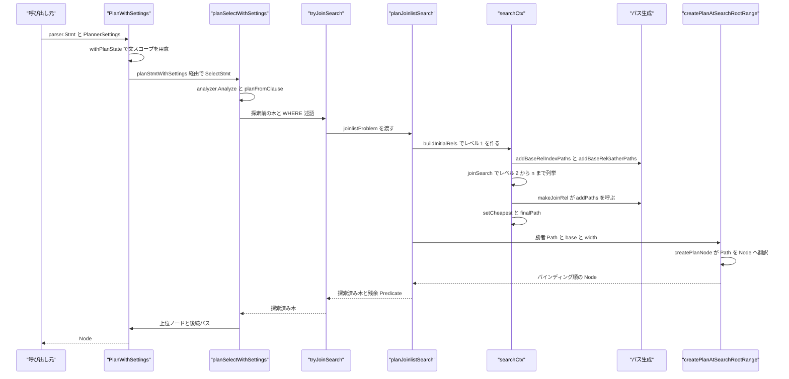

# プランナー全体像

<details>
<summary>関連ソースファイル</summary>

- [`internal/optimizer/createplan.go`](https://github.com/ryogrid/goopg/blob/19856410e8d497d59787e1ab35a2febb3f5953d6/internal/optimizer/createplan.go)
- [`internal/optimizer/flaglabels.go`](https://github.com/ryogrid/goopg/blob/19856410e8d497d59787e1ab35a2febb3f5953d6/internal/optimizer/flaglabels.go)
- [`internal/optimizer/joinsearch.go`](https://github.com/ryogrid/goopg/blob/19856410e8d497d59787e1ab35a2febb3f5953d6/internal/optimizer/joinsearch.go)
- [`internal/optimizer/path.go`](https://github.com/ryogrid/goopg/blob/19856410e8d497d59787e1ab35a2febb3f5953d6/internal/optimizer/path.go)
- [`internal/optimizer/pathgen.go`](https://github.com/ryogrid/goopg/blob/19856410e8d497d59787e1ab35a2febb3f5953d6/internal/optimizer/pathgen.go)
- [`internal/optimizer/plan.go`](https://github.com/ryogrid/goopg/blob/19856410e8d497d59787e1ab35a2febb3f5953d6/internal/optimizer/plan.go)
- [`internal/optimizer/planner.go`](https://github.com/ryogrid/goopg/blob/19856410e8d497d59787e1ab35a2febb3f5953d6/internal/optimizer/planner.go)
- [`internal/optimizer/plannersettings.go`](https://github.com/ryogrid/goopg/blob/19856410e8d497d59787e1ab35a2febb3f5953d6/internal/optimizer/plannersettings.go)
- [`internal/optimizer/planstate.go`](https://github.com/ryogrid/goopg/blob/19856410e8d497d59787e1ab35a2febb3f5953d6/internal/optimizer/planstate.go)
- [`internal/optimizer/rangetable.go`](https://github.com/ryogrid/goopg/blob/19856410e8d497d59787e1ab35a2febb3f5953d6/internal/optimizer/rangetable.go)
- [`internal/parser/ast.go`](https://github.com/ryogrid/goopg/blob/19856410e8d497d59787e1ab35a2febb3f5953d6/internal/parser/ast.go)

</details>

`internal/optimizer` は、パーサーが返した `parser.Stmt` を実行エンジンが解釈できる `Node` の木へ変換する層である。中心にあるのは 2 つの世界の分離だ。1 つは「どうやって行を作るか」を候補 `Path` の集合として表す世界で、`RelOptInfo` ごとに `addPath` が候補を刈り込み、`setCheapest` が最安を選ぶ。もう 1 つは「実際にどの演算子をどの順で並べるか」を表す `Node` の世界で、`createPlan` が選ばれた `Path` を `SeqScan`/`IndexScan`/`Join` などの実行ノードへ翻訳する。PostgreSQL の `query_planner` と `create_plan` に相当するこの 2 段構えを、goopg は `internal/optimizer` パッケージ内の `Path` ベースの探索と `plan.go` の既存 `Node` 型の間で実現している。親セクションは [5 クエリプランナー](../5-Query-Planner.md)。個々の論点は、[5.2 パスとコストモデル](5.2-Path-and-Cost.md)、[5.3 結合順探索](5.3-Join-Search.md)、[5.7 パスからプランへの変換](5.7-Plan-Creation.md)、[5.8 統計と選択度推定](5.8-Statistics-and-Selectivity.md) で詳しく扱う。

## 責務

- 文全体の計画入口。`Plan` が `DefaultPlannerSettings()` を補って `PlanWithSettings` を呼び、`PlanWithSettings` が `planWithRtableSize` へ渡す。`path:internal/optimizer/planner.go:PlanWithSettings`
- 文型ごとの振り分け。`planStmtWithSettings` が `*parser.SelectStmt` を `planSelectWithSettings` へ、INSERT/UPDATE/DELETE/MERGE をそれぞれの計画関数へ渡し、DDL は実行時処理に委ねる。`path:internal/optimizer/planner.go:planStmtWithSettings`
- 1 文ごとの動的スコープの保持。`withPlanState` が `catalog.Catalog` を `stmtCatalog` で包み、WITH 句・親スコープ・アナライザの外側スコープ・GROUP_AGG rel の記録を文単位で隔離する。`path:internal/optimizer/planstate.go:withPlanState`
- FROM 句の計画と結合順探索の起動。`planFromClause` が FROM 項目を `Node` と `rangeBinding` に落とし、`tryJoinSearch` が探索可能な形なら PG 型の join search に渡す。`path:internal/optimizer/joinsearchseam.go:tryJoinSearch`
- 結合順の列挙。`searchCtx` が `joinrels[lev]` と `relMap` を保ち、`joinSearch` がレベル 2..n を `joinSearchOneLevel` で埋める。`path:internal/optimizer/joinsearchlevel.go:joinSearch`
- パスの生成と刈り込み。`generateScanPaths` が SeqScan 候補を作り、`addPath` が `comparePaths` に基づく支配判定で `RelOptInfo.Pathlist` を維持する。`path:internal/optimizer/path.go:addPath`
- 最安パスの決定。`setCheapest` が無パラメータの `CheapestStartup`/`CheapestTotal` とパラメータ化パス一覧を求め、`finalPath` が LIMIT の `tupleFraction` を反映した 1 本を返す。`path:internal/optimizer/joinsearch.go:finalPath`
- Path から Node への翻訳。`createPlanNode` が `PathKind` で分岐し、各アームが対応する実行ノードを組み立て、`stampPlanCost` が勝者のコストをノードに刻む。`path:internal/optimizer/createplan.go:createPlanNode`
- 探索境界の座標復元。`createPlanAtSearchRootRange` が探索木をバインディング順に並べ直す `Project` を必要時に挿入し、列 identity を `assertBoundaryColumnIdentity` で検査する。`path:internal/optimizer/createplanroot.go:createPlanAtSearchRootRange`
- セッション設定の受け渡し。`PlannerSettings` がコスト GUC と `enable_*` を 1 文分の値として持ち、`costParams()` が内部通貨へ変換する。`path:internal/optimizer/plannersettings.go:PlannerSettings`
- 計画結果を左右する環境変数の来歴管理。`FlagProvenanceTable` が未設定時の解決済み既定値を表として返し、`RenderFlagProvenanceEnv` がベンチ用のシェル片を生成する。`path:internal/optimizer/flaglabels.go:FlagProvenanceTable`

## 処理フロー

`planWithRtableSize` はまず `withPlanState(cat)` で文スコープを用意し、その直下で文型を見て `ParallelStatementOK` を絞り込む。SELECT はこのフラグをそのまま保ち、EXPLAIN も外側では落とさない。EXPLAIN は内側の文を同じ設定で再帰計画し、その再帰が内側の文型をもう一度判定するため、透過的に扱っても SELECT 以外が並列化されることはない。その後 `planStmtWithSettings` が `SelectStmt` を `planSelectWithSettings` へ渡す。`planSelectWithSettings` は FROM 句を `planFromClause` で計画し、WHERE があれば `Filter` を被せ、`pullUpSublinksIntoJointree` で WHERE 内サブリンクを結合木へ引き上げる。続いて `ctx.setQueryPathkeys(s)` と `neededColumnNames`/`outputColumnNames` でクエリ全体の順序要求と必要列集合を確定させ、`tryJoinSearch(f.Child, f.Predicate, ctx, cat)` を呼ぶ。

`tryJoinSearch` は `tryPGShapedJoinSearch` を試し、`used == false` なら元の木と述語をそのまま返す。これが「探索しなかった場合は構文順にフォールバックする」という規則である。`tryPGShapedJoinSearch` は `nrels` が 1 以上 `maxSearchRels` 以下で、joinlist が空でないことを確認したうえで、`planJoinlistSearch` に `joinlistProblem` を渡す。`planJoinlistSearch` は `validateJoinlistProblem` で `bindings`/`scans`/`relInfos`/`leafSpans` の長さと窓の整合を検査し、`makeRelFromJoinlist` を再帰的に呼ぶ。1 項目だけの joinlist は通常は生の葉を返すが、探索全体の入口でその葉が再構築可能（`scanLeafFor` が成功し `info.table` を持つ）なら `searchOneProblem` を呼び直し、seq/index/index-only の候補を比較させる。

`searchOneProblem` は項目ごとの `leafSpan` から `buildInitialRels` を呼び、レベル 1 の `RelOptInfo` を FROM 順に作る。ここで relid `1<<i`、`baseLeaf`、`baseOffset` が同時に記録される。続いて `setBaseRelConsiderParallel`、`addBaseRelPartialPaths`、`addBaseRelIndexPaths`、`addBaseRelGatherPaths` が基底リレーションの候補を追加する。結合順の本体は `joinSearch` で、レベル 2 から `nrels` まで `joinSearchOneLevel` を回し、各レベルの全ペアを出し切った後に `setCheapest` を呼ぶ。GEQO が有効で項目数が `geqoThreshold` 以上なら、`joinSearch` の代わりに `geqoSearch` が呼ばれる。最後に `finalPath` が勝者を選び、`createPlanAtSearchRootRange(p, base, width, fill)` が探索木を `Node` へ変換してバインディング順に公開する。

探索が返した `Node` と残余述語は `planSelectWithSettings` に戻り、上位の Project/Filter/Sort/Aggregate などが組み立てられる。文全体の計画が終わると `planWithRtableSize` の末尾で `pushQualsThroughSingleRefCTEs`、`pushAppendRelRestrictions`、`dropPartialIndexImpliedQuals`、`rewriteExistsToAny`、`lowerSubPlanParams`、`applyUpperNarrowing`、`fillJoinHashKeys`、`assertSearchedBoundariesIntact` などが順に走る。とくに `assertSearchedBoundariesIntact` は、探索境界の座標対応が後続の書き換えで壊れていないかを最終木に対して検査する。



探索後の上位構築と後処理の関係は、座標系の切り替えとして捉えると理解しやすい。探索木の内部は探索独自の列順を持ち、境界の `Project` だけがバインディング座標へ戻す。

```mermaid
flowchart LR
    AST["parser.SelectStmt"] --> PS["planSelectWithSettings"]
    PS --> PRE["探索前の Join/Filter 木（バインディング座標）"]
    PRE --> SEAM["tryJoinSearch"]
    SEAM --> SEARCH["searchCtx によるパス探索"]
    SEARCH --> WIN["finalPath() の Path"]
    WIN --> CP["createPlanAtSearchRootRange"]
    CP --> TREE["探索済み Node 木（探索座標）"]
    TREE --> PROJ["binding 順 Project（必要時）"]
    PROJ --> UPPER["上位 Project/Filter/Sort/Aggregate"]
```



## 主要ファイル

| ファイル | 役割 |
| --- | --- |
| `internal/optimizer/planner.go` | `Plan`/`PlanWithSettings` の入口、文型ディスパッチ、SELECT の FROM/WHERE 計画、末尾の書き換えパス群。`path:internal/optimizer/planner.go:planSelectWithSettings` |
| `internal/optimizer/plan.go` | `Node`/`Schema`/`SchemaColumn`/`Expr` と実行ノード型の定義。プランナーとエグゼキュータの契約。`path:internal/optimizer/plan.go:Node` |
| `internal/optimizer/path.go` | `Cost`/`Path`/`RelOptInfo`/`addPath`/`setCheapest`/`comparePaths`。パス支配判定と最安選択の基盤。`path:internal/optimizer/path.go:addPath` |
| `internal/optimizer/pathgen.go` | SeqScan と Hash/NestLoop のパス生成プリミティブ。`addHashJoinPath` は片方向分だけを作る。`path:internal/optimizer/pathgen.go:addHashJoinPath` |
| `internal/optimizer/joinsearch.go` | `searchCtx` の定義、`newSearchCtx`、`buildInitialRels`、`finalPath`。 |
| `internal/optimizer/joinsearchlevel.go` | `joinSearch` と `joinSearchOneLevel`、`makeJoinRel`。レベル単位の列挙。`path:internal/optimizer/joinsearchlevel.go:joinSearch` |
| `internal/optimizer/relfromjoinlist.go` | `planJoinlistSearch`、`makeRelFromJoinlist`、`searchOneProblem`。joinlist の再帰と 1 問題の実行。`path:internal/optimizer/relfromjoinlist.go:planJoinlistSearch` |
| `internal/optimizer/joinsearchseam.go` | `tryJoinSearch`/`tryPGShapedJoinSearch`。探索の受理判定、残余述語の算出、座標再基準化。`path:internal/optimizer/joinsearchseam.go:tryPGShapedJoinSearch` |
| `internal/optimizer/createplan.go` | `createPlan`/`createPlanNode`/`createPlanNodeUnpriced`。`PathKind` ごとの翻訳ディスパッチ。`path:internal/optimizer/createplan.go:createPlanNodeUnpriced` |
| `internal/optimizer/createplanroot.go` | `createPlanAtSearchRootRange`、`boundaryMap`、境界 Project。探索座標からバインディング座標への復元。`path:internal/optimizer/createplanroot.go:createPlanAtSearchRootRange` |
| `internal/optimizer/plannersettings.go` | `PlannerSettings` と `DefaultPlannerSettings`、`costParams()` 変換。`path:internal/optimizer/plannersettings.go:costParams` |
| `internal/optimizer/planstate.go` | 文単位の `planState`、`stmtCatalog`、`withPlanState`、`planStateOf`。 |
| `internal/optimizer/rangetable.go` | `boundaryRangeTable` と `assertBoundaryColumnIdentity`。列 identity の独立検査。`path:internal/optimizer/rangetable.go:assertBoundaryColumnIdentity` |
| `internal/optimizer/flaglabels.go` | `FlagProvenance`、`FlagProvenanceTable`、`RenderFlagProvenanceEnv`。 |
| `internal/parser/ast.go` | 入力側の `JoinType`/`JoinExpr`/`SelectStmt` など。プランナーが消費する AST の定義。`path:internal/parser/ast.go:JoinType` |

## 公開 API / エントリポイント

パッケージ外から呼ばれる入口は次のとおり。`Plan` は設定を既定値で補う薄いラッパーで、セッション設定を持つ呼び出し元は `PlanWithSettings` を使う。

```go
func Plan(stmt parser.Stmt, cat catalog.Catalog) (Node, error)
func PlanWithSettings(stmt parser.Stmt, cat catalog.Catalog, plannerSet PlannerSettings) (Node, error)
func PlanSchemaOnly(s *parser.SelectStmt, cat catalog.Catalog) (Node, error)
func ResolveIndexPredicate(predicate parser.Expr, tbl *catalog.Table) (Expr, error)
func DefaultPlannerSettings() PlannerSettings
func FlagProvenanceTable() []FlagProvenance
func RenderFlagProvenanceEnv() string
```

`PlanSchemaOnly` は CREATE MATERIALIZED VIEW WITH NO DATA 用で、定数畳み込みの実行時エラー（ゼロ除算など）を抑止しつつスキーマだけを得る。`ResolveIndexPredicate` は部分インデックスの述語を、セッションを持たない DDL 文脈で `DefaultPlannerSettings()` のコスト設定を使って解決する。

パッケージ内部の主要な継ぎ目は次のとおり。外部から直接呼ぶものではないが、処理の流れを追う際の実質的な入口になる。

```go
func tryJoinSearch(node Node, pred Expr, ctx *resolveContext, cat catalog.Catalog) (Node, Expr)
func planJoinlistSearch(jl joinlist, prob *joinlistProblem) (Node, *RelOptInfo, error)
func createPlanAtSearchRootRange(p *Path, base, width int, fill func(int) (SchemaColumn, bool)) Node
func (s *searchCtx) joinSearch(clauses *restrictInfoList, b joinRelBuilder) (*RelOptInfo, error)
func (s *searchCtx) finalPath() (*Path, error)
```

## 主要データ構造

### `Node` / `Schema` / `SchemaColumn`

プランナーの出力そのものを定義する型である。すべての実行ノードは `Pos` と `Output` だけを要求され、親は子の `Output()` を読んで自分のスキーマを組み立てる。

`path:internal/optimizer/plan.go:Node`

```go
// Node is implemented by every plan-tree node. Pos is the byte offset
// of the originating SQL token; Output is the row schema this node
// emits to its parent.
type Node interface {
	Pos() int
	Output() Schema
}

// Schema is the ordered set of columns a plan node produces. Each
// column has an output name and a typed source.
type Schema []SchemaColumn

// SchemaColumn is one entry in a plan node's output schema.
//
// SourceTableIdx (M0071-0009) identifies which FROM-clause range
// binding produced this column. The binder assigns 1..N (one per
// base-table FROM-binding within a single planning scope) when
// the column originates from a base-table scan. Zero (the Go
// zero-value) means "unknown / derived" — used for Project
// targets that aren't pure ColumnRef pass-throughs, aggregate
// outputs, computed expressions, and subquery-derived columns.
// Used by `findColumnIndexByNameAndSource` and `predRebind` to
// disambiguate self-joins (e.g. Q21's three lineitem aliases
// l1/l2/l3 sharing `l_suppkey`) when MHJ OID-sorts the schema
// and Name-only disambiguation fails.
type SchemaColumn struct {
	Name           string
	Type           catalog.Type
	SourceTableIdx int16
	// Resjunk marks a column that rides the row for an enclosing operator's
	// use but is not part of the user-visible output — PostgreSQL's resjunk
	// targetlist mark. Today only the rowmark ctid columns injected by
	// wireRowMarkCtidColumns carry it; LockRows strips resjunk positions from
	// its output and whole-row dedup (distinctOp) excludes them from the
	// dedup key. M0143-0009.
	Resjunk bool
}
```

`Name` は診断と名前ベースの再基準化に使われ、空のことがある。`Type` は実行時の値型、`SourceTableIdx` は自己結合の同名別名を区別するための範囲表識別子で、0 は「不明・派生」を意味する。`Resjunk` はユーザー可視出力ではない列（行ロック用の ctid など）を示し、`LockRows` が出力から外す。不変条件として、`Schema` の並びは親が参照する位置そのものであり、探索境界の前後でこの並びを勝手に変えてはならない。

### `Cost`

PostgreSQL と同じ 2 軸のコストである。LIMIT があると起動コストの小さいパスが勝つため、両方を保持する。

`path:internal/optimizer/path.go:Cost`

```go
// Cost is PG's two-number cost, in PG's units (seq_page_cost = 1.0, design ch. 02
// §3). Startup is the cost expended before the first row emerges; Total is the
// cost to return all rows. A cheaper-total path can lose to a cheaper-startup one
// under a LIMIT, which is why both axes are carried (design ch. 07 §1.2).
type Cost struct {
	Startup float64
	Total   float64
}
```

### `Path`

1 つの関係を生成する方法を表す。数千個が探索中に確保されるため、種別ごとの情報は狭いペイロードに分かれ、`Kind` で解釈する。`path:internal/optimizer/path.go:Path`

| フィールド | 保持するもの |
| --- | --- |
| `Kind PathKind` | 物理演算子の種別。`createPlan` の分岐キー。`PathPrebuilt`/`PathSeqScan`/`PathIndexScan`/`PathHashJoin`/`PathMergeJoin`/`PathNestLoop`/`PathSort`/`PathAgg` など。 |
| `Rel *RelOptInfo` | このパスが属する関係。`Rows` の正典とスキーマ情報の入手元。 |
| `Cost Cost` | 起動・総コスト。 |
| `Rows float64` | このパス自身の行数。パラメータ化パスでは外側 1 行あたりの inner 行数であり、`Rel.Rows` と異なりうる。 |
| `Pathkeys []PathKey` | このパスが保証する順序。空なら順序なし。 |
| `DisabledNodes int` | `enable_*` で無効化されたノード数。コストより先に支配判定へ効く。 |
| `RequiredOuter RelSet` | パラメータ化パスが依存する外側リレーション集合。0 なら通常パス。 |
| `Children []*Path` | 入力パス。`createPlan` の再帰の対象。 |
| `OuterRelids` / `InnerRelids RelSet` | 結合パスの 2 入力。`Children[0]` が外側、`Children[1]` が内側（ハッシュ結合では build 側）。 |
| `HashKeys` / `Residual []*restrictInfo` | 結合キー等値と残余述語。パス生成時に確定し、コスト計算に反映される。 |
| `Jointype parser.JoinType` | このパスが実行する結合種別。`parser.JoinInner` がゼロ値。 |
| `SJInfo *SpecialJoinInfo` | SEMI/ANTI の特殊結合情報。木の再構築時に引き継ぐ。 |
| `AggStrategy AggStrategy` / `Agg *Aggregate` | 集約パスの戦略と仕様。 |
| `paramSink *[]paramProbeNode` | パラメータ化インデックス探査を、それを束縛するネストループへ通知するための記録先。 |
| `node Node` | `PathPrebuilt` が包む実行ノード。他の種別では nil。 |

不変条件は「コストは子から計算済みで、`addPath` はそれを変更しない」こと、そして「`Path` の属性（`Jointype`/`AggStrategy`/`Target` など）は正当性の属性であり、コスト比較の次元には入れない」ことである。`comparePathCostsFuzzily`/`comparePaths`/`comparePathCosts` はコストと `disabled_nodes`、pathkeys、パラメータ化だけを見る。

### `RelOptInfo`

基底関係または結合関係 1 つと、その候補パス群を表す。`Rows` は関係の基数の単一の正典であり、探索中に再推定しない。`path:internal/optimizer/path.go:RelOptInfo`

| フィールド | 保持するもの |
| --- | --- |
| `Relids RelSet` | この関係を構成する基底リレーションのビット集合。 |
| `Rows float64` / `Width int` | 関係全体の行数と 1 行あたりバイト幅。 |
| `NCols int` | 1 行の列数。`Width` とは別モデルで、ハッシュサイズ計算に使う。 |
| `Pathlist []*Path` | `addPath` が維持する直列候補。 |
| `PartialPathlist []*Path` | 並列候補。総コスト昇順。 |
| `CheapestTotal` / `CheapestStartup` | `setCheapest` が選ぶ無パラメータの最安総コスト・最安起動コスト。 |
| `CheapestParameterized []*Path` | パラメータ化パスの生存者。先頭に無パラメータ最安が前置される。 |
| `ConsiderStartup` / `ConsiderParamStartup` | 起動コストを比較次元に含めるか。LIMIT の有無に由来する。 |
| `ConsiderParallel bool` | 部分パスを生成する価値があるか。 |
| `baseLeaf Node` | レベル 1 のとき、探索前パイプラインが渡した葉ノード。 |
| `baseOffset int` | レベル 1 のとき、その葉の列が探索前に置かれていた先頭座標。 |
| `memberRels` / `publishedMembers` | 結合関係を構成する基底関係と、実際に行を公開する関係。 |
| `NeededCols` / `OutputCols` / `JoinKeep` | 文全体の必要列、上位で必要な列、この結合関係が build 側として保持すべき列。 |

不変条件は次の 3 つである。第 1 に、`Rows` は関係ごとに 1 回だけ計算され、全てのパスが同じ値を使う。第 2 に、`baseLeaf` と `baseOffset` はレベル 1 の関係でだけ同時に設定され、結合関係ではゼロ値である。第 3 に、`CheapestTotal` はパラメータ化パスを選ばない。`setCheapest` は `RequiredOuter != 0` のパスを別リストへ回し、無パラメータの最安が存在しない場合に限り `bestParam` を `CheapestTotal` に格上げする。両型の宣言全体は長いため、次の折りたたみに原文のまま収録する。

<details>
<summary>Path と RelOptInfo の完全定義</summary>

`path:internal/optimizer/path.go:Path`

```go
type Path struct {
	Kind PathKind

	// paramAppend is a PathParamAppend's member carrier (paramappend.go).
	paramAppend *paramAppendInfo
	// paramSink is set, only while a nested loop lowers a parameterised join
	// inner (createNestLoopParamJoinPlan, M0146-0049d3), on every
	// parameterised path of that inner; createPlanNode records each
	// parameterised index probe it builds there so the loop can bind its
	// keys — PG's create_plan-time curOuterRels.
	paramSink *[]paramProbeNode
	// mergeJoinMaterial marks a PathMaterial that is create_mergejoin_plan's
	// make_material over an elected materialize_inner (mergeMaterialInner),
	// not a MaterialPath: PG plans that inner under the join's own flags, so
	// it gets no CP_SMALL_TLIST (Materialize.mergeJoinInner).
	mergeJoinMaterial bool
	// ParamFilter is a parameterised hash join's ppi clauses that no input
	// enforces — get_joinrel_parampathinfo's equivalence-class clause between
	// the required-outer rel and the probe side (M0146-0135). Applied as a
	// Join Filter once the binding nested loop rebinds the required-outer
	// operand (createNestLoopParamJoinPlan).
	ParamFilter []paramFilterClause

	// Jointype is the join this path PERFORMS — PG's `JoinPath.jointype`
	// (pathnodes.h:2119: "JoinPath is used to represent all types of join
	// nodes", with `JoinType jointype` on the node itself). PG has no
	// PathSemi/PathAnti kind either: NestPath/MergePath/HashPath each carry
	// the jointype, and `add_paths_to_joinrel` (joinpath.c:124) is passed one
	// per call.
	//
	// C-03a (docs/design/planner-c03-jointype-search/DESIGN.md §4): the field
	// lands INERT. `parser.JoinInner` is the zero value
	// (internal/parser/ast.go:727, pinned by TestPathJointypeDefaultsToInner),
	// so every path that does not set it — every scan path, every Sort /
	// Agg / Gather wrapper, every path built by a test fixture — reads as an
	// inner join and behaves exactly as before. Only C-03b makes a producer
	// stamp anything else, and only C-03c lets it reach `Join.Type`.
	//
	// The carrier is the PATH, never the `RelOptInfo`: a relset-keyed
	// singleton (findRel/addRel, first-writer-wins) cannot hold one jointype,
	// because different pairs spanning one relset can match different SJIs and
	// the rel's jointype would become arrival-order dependent. Mixed-jointype
	// pathlists coexist on one rel, exactly as in PG.
	//
	// Must-avoid list (the sibling precedent is Target/NCols below): jointype
	// is a CORRECTNESS attribute decided by legality, not a cost dimension, so
	// it stays out of `comparePathCostsFuzzily`, `comparePaths` and
	// `comparePathCosts` — costs alone decide dominance, and `setCheapest`
	// inherits that rule. Any cross-jointype pruning question belongs to C-04,
	// with the enumeration that produces it.
	Jointype parser.JoinType

	// SJInfo carries the Semi/Anti join's SpecialJoinInfo from the DP search
	// through to the *Join node createNestLoopPlan/createHashJoinPlan build
	// (M0142-0008a-3i-plumbing-c16, design doc §51.1). unnestExistsExpr's
	// direct construction path already stamps Join.SJInfo itself; this field
	// is the missing carrier for the SEPARATE case where the search
	// reorders/rebuilds the Semi/Anti join as part of a *Path (join_paths.go)
	// rather than reusing the syntactic Join node verbatim — without it, the
	// rebuilt Join loses its SJInfo and extractSearchLeaves's SynLefthand/
	// MinLefthand rebuild (joinsearchseam.go) has nothing to write into.
	SJInfo *SpecialJoinInfo

	// AggStrategy is the aggregation this path PERFORMS — PG's
	// `AggPath.aggstrategy`, set per path by `add_paths_to_grouping_rel`
	// (planner.c:7114). Same carrier rule as Jointype above: the PATH, never
	// the `RelOptInfo`, because sorted and hashed candidates coexist on one
	// GROUP_AGG rel and the rel cannot hold one strategy.
	//
	// C-15 (docs/design/planner-p4-grouping-paths/DESIGN.md §3.1): the field
	// lands with its first producer. `AggStrategyHashed` is the zero value
	// (`plan.go:1356`), so every path that does not set it — every non-agg
	// path, every test fixture — reads as hashed and behaves exactly as
	// before. Unordered (non-grouped) aggregates also carry Hashed: today
	// they keep the zero value with the plain "Aggregate" label, and the
	// producer preserves that mapping (no Plain enum value exists).
	//
	// Same must-avoid list as Jointype: strategy is decided by the producer,
	// costs alone decide dominance.
	AggStrategy AggStrategy

	// Agg is the aggregate SPEC a PathAgg performs — the `*Aggregate`
	// `buildAggregateStage` built (GroupExprs, Aggs, GroupingSets, Mode,
	// Passthrough, GroupingMasks, GroupKeyOrder, pos, schema), whose Child
	// the arm replaces with the built input and whose Strategy it sets from
	// AggStrategy. One spec per candidate: the Sort-driven variants share
	// the built spec, the index-driven variant carries the narrowed clone
	// (`buildIndexOrderedScan` remaps to narrowed positions). nil for every
	// other kind; `createAggPlan` panics on a PathAgg without one, the same
	// way `createSortPlan` panics on a Sort without pathkeys.
	Agg *Aggregate

	// Distinct is the DISTINCT spec a PathDistinct performs — the
	// `*Distinct` built at the wrapper site (pos, schema), whose Child the
	// arm replaces with the built input. Shared by both candidates
	// (hashed, unique); unlike AggStrategy's copy problem there is
	// nothing per-variant to carry, because the input-child difference
	// already rides in Children[0]. nil for every other kind.
	Distinct *Distinct

	// Unique switches a PathDistinct's emitted node kind: false emits
	// `*Distinct` (hash dedup), true emits `DistinctOn` with all-output-
	// columns keys (streaming adjacent dedup over the producer-stacked
	// Sort). Set only by the unique arm, read only by `createDistinctPlan`
	// (C-16b). Never pruned on: costs alone decide, exactly as for every
	// other path attribute above.
	Unique bool

	// UniqueKeyCols is a PathUnique's dedup key: positions into
	// Children[0]'s eventual built `Node.Output()` (validated against
	// `SpecialJoinInfo.SemiRhsExprs` by `createUniquePath` at Path-build
	// time — see its doc comment for why this requires Children[0] to be a
	// `PathPrebuilt` today). `createUniquePlan` passes it straight to the
	// emitted `*DistinctOn.KeyCols`. nil for every other kind.
	UniqueKeyCols []int
	// UniqueHashed selects create_unique_path's UNIQUE_PATH_HASH: Children[0]
	// is the unsorted subpath and the lowering emits a hashed *DistinctOn.
	UniqueHashed bool
	// UniqueExprs, when set, are the uniq exprs in problem-space (binding)
	// coordinates — a pulled base-relation RHS (M0146-0005dk). The lowering
	// resolves them through the built child's layout into the DistinctOn's
	// key positions, and UniqueKeyCols is then ignored.
	UniqueExprs []Expr

	// Window is the window SPEC a PathWindow evaluates — the `*WindowAgg`
	// `buildWindowStage` built for one spec group (PartitionBy, OrderBy,
	// Funcs, Frame, pos, schema), whose Child the arm replaces with the
	// built input. nil for every other kind; `createWindowPlan` panics on a
	// PathWindow without one, as `createAggPlan` does for PathAgg. C-18.
	Window *WindowAgg

	// SetOp is the set-operation SPEC a PathSetOp performs — the `*SetOp`
	// the `applySetOp` fold built (Op, All, pos), whose Left/Right the arm
	// replaces with the two built inputs. nil for every other kind. C-18.
	SetOp *SetOp

	// SetOpLeftNonPartial / SetOpRightNonPartial mark which of a
	// PathSetOp's two children is a CLAIMED-WHOLE (non-partial) branch —
	// PG's `pa_nonpartial_subpaths` member (allpaths.c:1588-1627,
	// M0140-0006c-3). The mixed partial Append picks, per branch, the
	// cheaper of the branch's cheapest partial path and its cheapest
	// parallel-safe total path; a branch whose pick is the non-partial one
	// is claimed and run whole by ONE participant rather than split by
	// block. Positional: the flags apply to Children[0] (left) and
	// Children[1] (right) respectively.
	//
	// The zero value (both false) is the status-quo reading — "no branch
	// is claimed-whole" — so the serial SetOp path (addSetOpPaths) and the
	// pure-partial path (both branches partial) need no stamp, and every
	// pre-existing reader keeps its meaning. `createSetOpPlan` copies the
	// pair onto the emitted `*SetOp` node, where the plan-tree walks
	// (stampParallelScan / drivingScan) and the executor's claim wiring
	// (attachAll's *setOp arm) read them. Only the mixed arm's producer
	// sets them.
	SetOpLeftNonPartial  bool
	SetOpRightNonPartial bool

	// PresortedCount is a PathIncrementalSort's presorted-prefix width —
	// `addIncrementalSortPaths`' own `nCommon` (incrementalsortpaths.go),
	// stashed here at Path-build time rather than re-derived at
	// `createPlanNode` time (M0141-S7-exec-b sizing note: stash vs
	// re-derive via `pathkeysCountContainedIn` against the winning
	// candidate's ordering — stashing was chosen because the candidate that
	// wins `setCheapest` is not guaranteed to still expose the SAME
	// `SearchCandidateKeys` entry this path was built against, while the
	// value computed here is exact by construction). `createIncrementalSortPlan`
	// copies it verbatim onto `IncrementalSort.PresortedCount`. Zero for
	// every other kind.
	PresortedCount int

	Rel *RelOptInfo

	Cost Cost

	// Rows is THIS path's row count, which is the rel's row count for an
	// ordinary path and the per-outer-row count for a parameterised one. It is
	// PG's `path->rows`, and for a parameterised path PG sets it from
	// `param_info->ppi_rows` (`create_index_path`, pathnode.c) — so Rows is
	// goopg's `ppiRows` carrier, not a second field (leftdeep-joins 03 §9
	// rule 3). This is the one structured exception to 04 §2's "rows once per
	// RelOptInfo": `Rel.Rows` stays canonical for the relation as a whole, and
	// each parameterisation carries its own count beside it.
	//
	// Consequence for costing, and the reason §9 says NLI costing is otherwise
	// garbage: a join's cost primitives must read the CHILD PATH's Rows, never
	// `child.Rel.Rows`. An index path parameterised by the outer produces a
	// handful of rows per probe; charging the rel's full post-filter count for
	// it would price an NLI as if it re-scanned the whole inner every time.
	Rows float64

	// Pathkeys is the ordering this path guarantees (design ch. 04). Empty in
	// C0/C1 for every path until sort / ordered-scan / merge paths exist.
	Pathkeys []PathKey

	// ParallelSafe / ParallelWorkers describe parallel eligibility. Workers > 0
	// only for partial paths (design ch. 08 §2).
	ParallelSafe bool

	// ParallelAware is PG's `path->parallel_aware` ("engage parallel-aware
	// logic?", pathnodes.h) — C-19f. It says this node's OPERATOR behaves
	// differently when several participants run it, as opposed to merely being
	// safe to run inside one of them (`ParallelSafe`) or being a per-worker
	// slice of a relation (`ParallelWorkers`).
	//
	// Set today by `addPartialHashJoinPath` and by nothing else. goopg's
	// meaning of "parallel-aware hash join" is not upstream's: PG sets the flag
	// only for `Parallel Hash` (a partial inner built cooperatively in DSM),
	// while every hash join inside a goopg Gather's partial subtree is treated
	// specially by the executor — `HasShareableHashJoin` selects it,
	// `prebuildSharedHashJoins` runs its build ONCE in the leader, and each
	// participant adopts the published table. See
	// docs/design/planner-c19f-parallel-hashjoin/DESIGN.md §5.
	//
	// It reaches `createPlan` as a fail-closed ASSERTION rather than as a node
	// field: the executor derives its parallel behaviour by walking the BUILT
	// tree, so there is nothing for a flag to carry — what the flag buys is
	// `createHashJoinPlan` refusing to build a node it has just declared
	// parallel-aware when the executor's own `hashJoinIsPartialCapable` would
	// decline to run it that way.
	//
	// Declared between the two `ParallelSafe`/`ParallelWorkers` fields rather
	// than after them so the two bools share one padding word: this struct is
	// allocated thousands of times per join search, and appending the bool
	// after the int would have grown it from 336 to 344 bytes for one bit.
	ParallelAware bool
	// ParallelHash: this PathHashJoin is PG's `parallel_hash = true` variant
	// (try_partial_hashjoin_path, joinpath.c:1290-1297) — Children[1], the
	// build side, is itself a PARTIAL path whose share each participant
	// builds into one shared table. createHashJoinPlan carries it to
	// Join.ParallelHash. M0146-0002.
	ParallelHash bool

	ParallelWorkers int

	// NCols / AvgVarBytes describe what THIS PATH emits, when that is narrower
	// than its relation — PG's `pathtarget` at the granularity goopg needs for
	// executor hash sizing.
	//
	// R121 widened that reading: with cost-input narrowing (narrowcostinputs.go), a base-rel
	// scan path carries the columns the STATEMENT needs, which is not
	// literally what the path emits — goopg's SeqScan does not project, and
	// neither does its Sort. The figures are a COST currency, and the safe
	// direction is what licenses the gap: the keep-sets nest as
	// joinKeepSet ⊆ buildKeepSet ⊆ neededKeepSet, so the planner-narrowed row
	// is always a SUPERSET of the row the executor's own narrowing
	// (narrowoutput.go) will actually build. It can over-charge, never
	// under-size a real hash build. OutputWidth is the separate emitted byte width for
	// planner-only PG packed-tuple geometry. Zero values mean "not narrowed";
	// read them through pathNCols/pathAvgVarBytes/pathWidth, never directly, so
	// the fallback to the rel's figures stays in one place.
	NCols       int
	AvgVarBytes float64
	OutputWidth int

	// Target / TargetKnown is the scan's emitted-column list — take2 P4-01
	// Slice 1 (planner-p4-01-target DESIGN, "Slice 1"): the ordered
	// emitted-column list computed from NeededCols at path-creation time,
	// extending the landed NCols/AvgVarBytes pair toward a column list. SCAN
	// paths only (PathSeqScan/PathIndexScan); unset on every other kind.
	//
	// Stored in EMITTED-SCHEMA order — ascending leaf-output positions, the
	// shape `neededKeepSet` returns — so Slice 2's ascending checks pass
	// without guard loosening. This once read "NEVER applied: no createPlan
	// change, no cost change"; both halves have since expired. Slice 2 wired
	// `buildKeepSet` into narrowBuildInput/narrowMergeInput, so Target DOES
	// reach createPlan, and R121 narrows COST inputs — though through
	// NCols/AvgVarBytes/OutputWidth, not through this field, which still has
	// exactly one production reader (buildKeepSet) and still feeds no cost. TargetKnown false means "unknown": the
	// collector declined (NeededColsKnown false) or the rel carries no leaf
	// schema, and no narrowing may be attempted. It is NOT the same as an
	// empty list.
	//
	// Must-avoid list: comparePaths dims (Target stays out), cost readers
	// (pathNCols/pathAvgVarBytes read NCols/AvgVarBytes only), DPPATH format,
	// EXPLAIN output, any Path equality/golden.
	Target      []int
	TargetKnown bool

	// DisabledNodes reproduces PG 18's path->disabled_nodes (the count of
	// enable_*-disabled nodes below this path). It is assigned by the join
	// producers (P2-05), the Sort producer (B-17a) and the scan producers
	// (B-17d) via disabledNodesFor, and read before any cost by the dominance
	// order, so adding a further enable_* later is a data change at the
	// producer, not a code change to the comparison.
	DisabledNodes int

	// RequiredOuter is the set of outer relations a parameterized path depends on
	// (the minimal analogue of PG's ParamPathInfo, design ch. 03 §3.1). Empty for
	// every ordinary path; non-empty only for an NLI inner index path (C3).
	RequiredOuter RelSet

	// HashKeys / Residual are this join path's qual placement (leftdeep-joins
	// 03 §5.4): the equality clauses the operator KEYS on, and the clauses it
	// must evaluate per tuple. Both are nil for a non-join path. They are
	// decided once, here in path generation, rather than by a post-hoc pass —
	// which is what lets the placement be COSTED (a qual deferred to a higher
	// join is a qual evaluated on more tuples) instead of being invisible to
	// the search.
	//
	// Only a keyed operator (hash, and merge since P5.4c-i) fills HashKeys; a
	// plain nested loop keys on nothing and carries every clause in Residual.
	// For a merge join the list is ORDERED: clauses are grouped by the sort key
	// they serve, in the path's own pathkey order (`joinpathsmerge.go`).
	// P5.5's createPlan reads the pair to emit the executor Join's key
	// expressions and its residual predicate.
	HashKeys []*restrictInfo
	Residual []*restrictInfo

	// IndexInfo / IndexScanDir are `IndexPath.indexinfo` and
	// `IndexPath.indexscandir` (pathnodes.h:1845/1849), the two facts
	// `create_indexscan_plan` needs to re-emit the scan the search chose. They
	// are set on a `PathIndexScan` and on nothing else: `IndexInfo` is nil and
	// `IndexScanDir` is `NoMovementScanDirection` — the zero value — for every
	// other kind, which is why the flat struct can carry them without a second
	// discriminator. Both are filled through `indexPathOrdering`
	// (pathindexcarrier.go, M0127-P5.5-a) so the direction can never disagree
	// with `Pathkeys`. P5.5's createPlan arm reads them.
	//
	// IndexClauses is `IndexPath.indexclauses` (pathnodes.h:1846): the quals
	// pushed INTO the probe, in INDEX-COLUMN order — the order PG's own list is
	// in (indxpath.c:1042) and the order goopg's executor needs, since
	// `IndexScan.Keys[i]` binds `Index.Columns[i]` positionally. Empty on the
	// unparameterised ordered path, which is pathnodes.h:1817's "an empty list
	// implies a full index scan" rather than an omission. Built only by
	// `indexPathClauses` (pathindexclauses.go, M0127-P5.5-b), which is what
	// makes the ordering structural. P5.5's createPlan arm reads it to build
	// `Keys` and to drop the pushed clauses from the node's filter quals.
	IndexInfo    *catalog.Index
	IndexScanDir ScanDirection
	IndexClauses []indexPathClause

	// IndexSkipPrefix is the count of LEADING index columns left unbound
	// before the run IndexClauses binds — PG18's btree skip-scan
	// (M0146-0005v): clause i of the list probes Columns[IndexSkipPrefix+i]
	// and the executor enumerates the skipped prefix's distinct values. 0
	// means the list is PG's `amoptionalkey` leading prefix as before.
	IndexSkipPrefix int

	// IndexOnly marks this path as PG's T_IndexOnlyScan rather than
	// T_IndexScan (`create_index_path`'s `indexonly` argument). PG carries the
	// distinction on the pathtype of the SAME IndexPath struct rather than in
	// a separate node, and so does this. IndexOnlyCovered is the column list
	// the scan emits, in INDEX-COLUMN order — a subset of the table's columns,
	// which is what makes the node narrower than the leaf it replaces;
	// `baseRelLayout` re-bases it by name (M0134-0187).
	IndexOnly        bool
	IndexOnlyCovered []catalog.Column

	// MemoizeInfo is the `MemoizePath`-only payload (M0127-P5.4b-ii-b-2): the
	// entry-count estimate `cost_memoize_rescan` computed on the way to the
	// rescan cost, and that rescan cost itself. It is nil for every other kind,
	// and a non-nil one is what makes `PathMemoize` self-describing — the two
	// numbers are produced together from one set of statistics, so carrying them
	// as one pointer is what stops an entry estimate from being paired with a
	// cost that was computed from a different ndistinct.
	MemoizeInfo *memoizePathInfo

	// BitmapSelectivity is the estimated fraction of the relation's rows that
	// the bitmap tree (index/and/or) admits from the index side, before heap
	// access and recheck. It is PG's `indexselectivity` on an IndexPath and
	// `bitmapselectivity` on BitmapAnd/BitmapOr. Zero for non-bitmap paths.
	// Set by costBitmapIndexScan for leaves and costBitmapAnd/costBitmapOr
	// for combinators.
	BitmapSelectivity float64

	// PartialPredicate is the resolved planner expression for a partial
	// index's WHERE predicate (PG's indpred). It is nil when the index is not
	// partial and nil when the prover has proven the predicate is implied by
	// the query quals (future — the prover does not yet exist). When non-nil,
	// createBitmapHeapScanPlan appends it to BitmapQual so the executor
	// rechecks it against every heap tuple. Only meaningful on
	// PathBitmapIndexScan leaves (M0129-S5.4).
	PartialPredicate Expr

	Children []*Path

	// OuterRelids/InnerRelids are the two input relsets this join path was
	// built from, in Children order (Children[0]'s rel, Children[1]'s rel).
	// R53 slice 1: DPPATH partition attribution. The `addPathsToJoinrel`
	// partition a path prices is otherwise unrecoverable downstream — the
	// joinrel is the UNION, and Children carry no relsets — so the
	// constructors stamp it here and `tracePath` renders it. Trace-only
	// provenance: no planner code reads these fields, and they are zero on
	// every non-join path. For hash joins Children[1] is the BUILD side
	// (Children[0] the probe), so Inner names the hashed input.
	OuterRelids RelSet
	InnerRelids RelSet

	// node is the executor Node a PathPrebuilt wraps. nil for every other kind.
	node Node
}
```

`path:internal/optimizer/path.go:RelOptInfo`

```go
type RelOptInfo struct {
	// pathkeyClass, when set, reports whether two pathkey expressions belong
	// to the same equivalence class of this rel's search — PG's canonical
	// pathkeys (make_canonical_pathkey) make `ORDER BY a.x` and `ORDER BY b.y`
	// one pathkey once `a.x = b.y` merged them. Only set on a join rel whose
	// problem has no null-extending special join (restrictInfoList.ecReduce),
	// where every row carries equal values in all of a class's members.
	// M0146-0185.
	pathkeyClass func(a, b Expr) bool
	// ecWant is the search's EXPLAIN orientation of its equivalence-class
	// equalities (orientECJoinClauses), recorded on the search's own upper
	// rel so a candidate rebuilt from this rel's paths after the seam
	// (searchedBoundaryRebuild) prints its clauses as the committed tree
	// does (M0146-0042a). nil elsewhere.
	ecWant ecOrientation
	// pricedPushedDown: this joinrel's clause list carried the problem's
	// pushed-down WHERE restrictions, so its rows and every path's cost
	// already include them (M0146-0224).
	pricedPushedDown bool
	Relids RelSet
	Rows   float64
	Width  int

	// NCols is how many COLUMNS a row of this relation carries. It sits beside
	// Width (which is bytes) because goopg has two different width models and
	// they answer two different questions: Width feeds the page math PG feeds
	// with `pathtarget->width`, while NCols feeds `hashsize.Choose`, whose
	// per-row footprint is `48·columns` because a goopg hash entry is a []Datum
	// and not a packed MinimalTuple. Deriving one from the other is not
	// possible and guessing is not safe — see hashJoinInputs.innerCols.
	//
	// Set by the two production constructors (`buildInitialRels` from the
	// leaf's schema, `makeJoinRel` as the sum over the two inputs, which is
	// what the executor's Join concatenates). Zero on a rel built by a test
	// that does not care, which `relNCols` reads as "unknown".
	NCols int

	// NeededCols / NeededColsKnown carry the statement's needed-column set down
	// to createPlan time, where `Path.Rel` is the only route to it:
	// `createPlanNode` is a free function with no searchCtx, threading a
	// parameter through every arm is churn, and a package global is what the
	// P2-A review rejected for reading another session's state. So it travels
	// as DATA on the rel, the way NCols and AvgVarBytes already do.
	//
	// take2 P4-01 rev 10 step 1. Nothing reads these yet — the consumer is the
	// build-side narrowing in `joinInputsFor`, which landed in a later slice
	// (unconditional since M0147-0040). Added first, and separately, so that
	// commit changes one thing.
	//
	// NeededColsKnown false means "no information": the collector declined the
	// statement, and no narrowing may be attempted. It is NOT the same as an
	// empty set.
	NeededCols      map[string]bool
	NeededColsKnown bool

	// OutputCols / OutputColsKnown carry the statement's ABOVE-TREE
	// needed-column set (outputColumnNames, pathindexonlyneed.go): the
	// names read by consumers above the scan/join tree rather than by
	// tree-internal quals. Take2 P4-01 Slice 3 (planner-p4-01-target
	// DESIGN, "Slice 3+"): the union needed above the tree from which
	// per-joinrel keep-sets derive (F1).
	//
	// Like NeededCols it is a statement property travelling by reference,
	// stamped by the search alongside NeededCols — but ONLY on problems
	// eligible for parent-aware narrowing (the statement-top problem with
	// no pinned spine above it; subproblems and spine prefixes keep the
	// zero value, and the derivation declines there by construction).
	// OutputColsKnown false, or a nil map, means "no information": narrow
	// nothing beyond the statement-wide set.
	OutputCols      map[string]bool
	OutputColsKnown bool

	// JoinKeep / JoinKeepKnown is this rel's DERIVED joinrel tlist (F1):
	// the column names the built node for this rel must still emit when
	// consumed as a hash-join build side — the union of the above-tree
	// set, the ancestor join quals and the parent join's own quals,
	// intersected with what this rel supplies. Stamped by the
	// deriveJoinKeeps pre-pass over the CHOSEN tree (narrowoutput.go),
	// never by a parent onto a shared path: rels are per-relset singletons
	// with one position in the chosen tree, while paths are shared across
	// candidate parents via CheapestTotal. JoinKeepKnown false, or a nil
	// map, means "no derivation": fall back to the Slice-2 arms.
	JoinKeep      map[string]bool
	JoinKeepKnown bool

	// AvgVarBytes is the average total variable-width payload per row, in
	// bytes — the sum of the per-column average widths (ColumnStats.AvgWidth)
	// across every column of this relation. It feeds `hashsize.EntryBytes` as
	// the `avgVarBytes` parameter, replacing the hardcoded zero that under-
	// counted text-heavy builds. Set alongside NCols by the same two
	// constructors; absent (zero) on a rel whose columns have never been
	// ANALYZEd, and zero for every fixed-width relation — both are correct.
	// M0128-P3.1.
	AvgVarBytes float64

	// ColVarBytes is the same statistic BEFORE it is summed: column name →
	// that column's ColumnStats.AvgWidth. It exists because AvgVarBytes is
	// the whole relation's payload while a hash join's build side retains
	// only the columns `narrowBuildInput` keeps (narrowoutput.go), so the
	// two disagree by every dropped column's width — on TPC-H Q9's `orders`
	// build, 74 B/row of a 194 B/row modelled entry against 120 B/row
	// measured. `buildAvgVarBytes` (createplanjoin.go) re-sums this over the
	// schema the build actually emits. nil means "no per-column statistics":
	// callers fall back to AvgVarBytes, which OVER-states rather than
	// under-states the entry.
	//
	// Set alongside AvgVarBytes by the same two constructors; a join rel's
	// map is the union of its inputs'. Read it through colVarBytes(): a join
	// rel's union is formed on first read (colVarFrom), not when the search
	// builds the rel.
	ColVarBytes map[string]float64
	// colVarFrom are the inputs a join rel's ColVarBytes unions — the first
	// pair that built it, the inner left nil when the join publishes its
	// outer alone — pending until colVarBytes() first reads it. GEQO builds
	// every joinrel of ~500 tours and nothing reads the union until plan
	// creation or the upper rels: TPC-DS Q64 spent 8.5 % of its planning
	// in the eager map copies (M0122-0012 C16d).
	colVarFrom    [2]*RelOptInfo
	colVarPending bool

	Pathlist        []*Path
	PartialPathlist []*Path

	// SearchCandidates is the SEARCH rel's own Pathlist (`searchedRelOf(input)
	// .Pathlist`), carried onto the ORDERED rel by `createOrderedPaths`
	// (M0141-S2b-2a, upperordered.go) so a later consumer does not need to
	// re-derive `searchedRelOf` itself. It travels as DATA on the rel, the
	// way NeededCols/OutputCols already do (same P2-A rationale: no spare
	// parameter down `createOrderedPaths`/`addOrderedPaths` for one list one
	// future consumer reads).
	//
	// Read by `addOrderedPaths`' `is_sorted` arm (M0146-0027): upstream's
	// `create_ordered_paths` offers every input_rel->pathlist path that
	// already satisfies the ordering (planner.c:5342-5345), which is how an
	// ordering-carrying runner-up — a merge join, a gather.merge.sort —
	// reaches the ordered rel instead of losing to cheapest-total. The
	// S2b-2 scoping recon's "cannot move a plan" finding held only for
	// sort-WRAPPING every candidate (`costSortRun`'s constant charge can
	// never reorder a contest); the already-sorted arm adds no sort and so
	// moves plans exactly where an ordered runner-up exists. nil when
	// `input` is not a searched-tree root, or the search published no
	// Pathlist.
	SearchCandidates []*Path

	// SearchCandidateKeys is SearchCandidates[i].Pathkeys re-earned against
	// this rel's own published schema, one entry per SearchCandidates entry
	// (M0141-S2b-2b, upperorderedinput.go's `validatedSearchCandidateKeys`).
	// Every candidate in a search rel's Pathlist carries its Pathkeys in the
	// SEARCH's inner coordinate space — the same reason `stampSearchPathkeys`
	// re-validates the single WINNING path's claim instead of trusting it
	// (upperorderedinput.go's file header, rule 1) applies identically to
	// every OTHER candidate the search never crowned. This generalizes that
	// same rule from "the one winner" to "every candidate", which S2b-2c's
	// Incremental Sort tournament needs before it can trust any non-seed
	// candidate's ordering claim.
	//
	// Read by `addOrderedPaths`' `is_sorted` arm (M0146-0027) — the
	// containment test for the offer above is run on THESE keys, never on
	// the candidate's own search-space claim. nil when SearchCandidates is
	// nil; an individual entry is nil when that candidate's own Pathkeys
	// validate to nothing (no ordering claim survives, same truncation rule
	// as the winner's).
	SearchCandidateKeys [][]PathKey
	// SearchCandidateClasses is the searched rel's equivalence classes
	// (its usefulKeys), so the ORDERED rel compares SearchCandidateKeys and
	// the seed's ordering with sortPathkeys the way PG's canonical pathkeys
	// do (M0146-0134). nil wherever the candidates are not a searched rel's
	// (electOrderedGrouping's aggregate candidates): syntactic comparison.
	SearchCandidateClasses *pathkeyUsefulness

	// BoundaryFill is the hole-filler closure this rel's boundary publication
	// was stamped with (`createPlanAtSearchRootRange`'s `fill` parameter,
	// built at relfromjoinlist.go's joinlistRel site). It answers whether a
	// binding coordinate the searched path's emission dropped may be PADDED
	// — a typed NULL at a slot the statement provably never reads — and is
	// the same license the committed subtree's publication ran under.
	// `searchedBoundaryRebuild` replays it when offering a non-winning
	// searched path as an upper stage's input (M0146-0027): without it every
	// candidate whose narrowed leaf dropped a below-only column declines the
	// rebuild, while the committed winner — whose own emission ran under the
	// license — would have carried the same hole. nil for a boundary that
	// published with no filler.
	BoundaryFill func(int) (SchemaColumn, bool)

	// LeftBranchRel / RightBranchRel are the search's own RelOptInfo for a
	// SETOP rel's two UNION ALL branches (`searchedRelOf(setOpNode.Left)` /
	// `searchedRelOf(setOpNode.Right)`), carried onto this rel by
	// `createSetOpPaths` (M0140-0006a, windowsetoppaths.go) so a later
	// consumer does not need to re-derive `searchedRelOf` itself — the same
	// rationale as SearchCandidates above, applied to the SetOp's two-input
	// shape instead of the ORDERED rel's single input.
	//
	// Nothing reads this yet, and that is the slice's gate: M0140-0006b's
	// partial-Append producer seeds PartialPathlist from
	// LeftBranchRel/RightBranchRel.PartialPathlist, but until that producer
	// exists these fields are visibility only and cannot move a plan — the
	// SETOP rel still gets exactly the one candidate `addSetOpPaths` always
	// offered. nil when the corresponding branch is not a searched-tree
	// root (e.g. it collapsed to a legacy-built Aggregate/Sort/Values shape
	// the search never reached, or the branch's own statement had too few
	// relations for the search to run at all).
	LeftBranchRel  *RelOptInfo
	RightBranchRel *RelOptInfo

	// ConsiderParallel is PG's `RelOptInfo.consider_parallel`
	// (pathnodes.h:911): whether it is worth generating partial paths for
	// this rel at all — the relation can be read by a worker (not temp, not
	// a virtual catalog), and its restriction quals and outputs are
	// parallel-safe. C-19a (take3 08 §8, `set_rel_consider_parallel`,
	// allpaths.c:589): set per base rel by `setBaseRelConsiderParallel`
	// (considerparallel.go) and propagated to a join rel in `makeJoinRel` as
	// "both inputs and the join's own clauses" (build_join_rel,
	// relnode.c:842).
	//
	// false is the zero value and the safe one: a rel that never went
	// through the step gets no partial paths and marks every path it owns
	// parallel-unsafe, exactly as `build_simple_rel` initialises it
	// (relnode.c:213 "might get changed later").
	ConsiderParallel bool

	CheapestTotal   *Path
	CheapestStartup *Path

	// CheapestUnique is PG's `RelOptInfo.cheapest_unique_path`
	// (pathnodes.h:967): the cached, at-most-once-built result of
	// `createUniquePath` (M0142-0008c-1) — a dedup of this rel's
	// `CheapestTotal` keyed by a SEMI join's correlation columns
	// (`SpecialJoinInfo.SemiRhsExprs`), letting `joinIsLegal`'s
	// `unique_ified` admission arm (M0142-0008c-2, not yet wired) join the
	// unique-ified RHS with any LHS rather than only its syntactic
	// `MinRighthand`. nil until `createUniquePath` succeeds; also nil,
	// permanently, when the rel cannot be unique-ified
	// (`!SemiCanBtree && !SemiCanHash`, or no correlation columns) — PG
	// re-derives that failure every call rather than caching it (a Go
	// sentinel would need a tri-state), which is cheap: the guard clauses
	// short-circuit before any Path is built.
	CheapestUnique *Path

	// ConsiderStartup / ConsiderParamStartup are PG's per-rel
	// `consider_startup` / `consider_param_startup` (pathnodes.h:889-890), and
	// they are the SAME fact `tuple_fraction` is: `build_simple_rel`
	// (relnode.c:211) and `build_join_rel` (:707) set both from
	// `root->tuple_fraction > 0`, so "is a fast-start plan interesting here"
	// is decided once, for the whole query, by whether a LIMIT was asked for.
	//
	// They exist because a startup-cheap path is only worth KEEPING when
	// something will later select on startup. `compare_path_costs_fuzzily`
	// enforces exactly that (pathnode.c:178-183): a path that loses on total
	// cost may not survive on good startup cost alone unless the relevant flag
	// is set. Without the flag goopg kept every such path — harmless for the
	// chosen plan, since selection was by total cost, but it is not PG's
	// pathlist, and P5.7-b's fractional selection is precisely the consumer
	// that makes the difference visible.
	//
	// ConsiderParamStartup stays false: PG sets it per base rel in
	// `set_base_rel_consider_startup` (allpaths.c:247) from the outer-join
	// `SpecialJoinInfo` list, and 03 §4.4's pin keeps special joins out of the
	// search entirely, so nothing can set it truthfully yet (ledger row
	// 2026-08-05).
	ConsiderStartup      bool
	ConsiderParamStartup bool

	// CheapestParameterized is PG's `cheapest_parameterized_paths`
	// (pathnode.c:255): every parameterised path that survived the addPath
	// tournament, with the cheapest UNparameterised path (if any) prepended —
	// PG's callers find that inclusion more convenient, and the NLI arm of
	// P5.4b-ii reads exactly this list. Empty until parameterised paths exist.
	CheapestParameterized []*Path

	// rangeTblEntry is the search's range-table entry for this rel — PG's
	// `RangeTblEntry` reduced to what the search reads (C-20h/P6-07, take3
	// 08 §9; C-20b's recommended shape). It is EMBEDDED by value, so
	// `rel.baseLeaf` and `rel.baseOffset` keep working through Go's field
	// promotion and no consumer moves; what it buys is that the two fields
	// stop being loose members of a 30-field struct and become the named
	// thing they have always been — the entry `Var.varno` would address.
	//
	// The rest of P6-07 — giving `ColumnRef` a `(varno, attno)` address so
	// that a `setrefs` pass, not each producer, computes positions — is NOT
	// landed here and is ledgered (`take3-C-20h-var-migration`). Until it is,
	// `baseOffset` remains the position half of the coordinate map and the
	// boundary assertions in `createplanroot.go` remain the detector for the
	// wrong-answer class that arrangement admits.
	rangeTblEntry
}
```

</details>

### `searchCtx`

1 つの結合問題の作業状態で、PG の `PlannerInfo` のうち探索が読む部分だけを持つ。`path:internal/optimizer/joinsearch.go:searchCtx`

| フィールド | 保持するもの |
| --- | --- |
| `joinrels [][]*RelOptInfo` | `joinrels[lev]` は基底関係をちょうど `lev` 個含む関係のリスト。インデックス 0 は未使用。 |
| `relMap map[RelSet]*RelOptInfo` | relset から関係への逆引き。`makeJoinRel` の find-or-create を成立させる。 |
| `nrels int` | この問題の基底関係数。レベル 1..nrels を探索する。 |
| `cp costParams` | 全パスを価格付けする通貨。 |
| `tupleFraction float64` | LIMIT による取得割合。0 は全行。 |
| `builder joinRelBuilder` | `sizeJoinRel` と `addPaths` を提供する協働者。nil は拒否される。 |
| `clauses *restrictInfoList` | 結合節の帳簿。`joinSearch` が設定する。 |
| `queryPathkeys` / `groupPathkeys` / `distinctPathkeys` | 文が要求する順序・グループ化・DISTINCT の pathkeys。 |
| `neededCols` / `outputCols` | 文全体の必要列と上位必要列。 |
| `joinInfoList []*SpecialJoinInfo` | 特殊結合の一覧。`joinIsLegal`/`joinOrderRestricted` が読む。 |
| `parallelModeOK bool` / `cat catalog.Catalog` | 並列可否と、条件（qual）の安全性を解決するためのカタログ。 |
| `trace *searchTrace` | 列挙来歴の記録。`GOOPG_PGSHAPED_DP_TRACE=1` のときだけ非 nil。 |

不変条件として、`addRel` は relset のビット数からレベルを導出し、空 relset・重複 relset・範囲外レベルをエラーにする。これにより `joinrels` と `relMap` が同じ関係を別レベルに置くことがない。また `joinSearch` はレベルごとに全ペアを出し切ってから `setCheapest` を呼ぶ。途中で最安を確定すると、後から同じ relset に届く安いパスを取り逃すためである。

### `PlannerSettings`

1 文分のプランナ設定で、PG の `PlannerGlobal` に相当する。`path:internal/optimizer/plannersettings.go:PlannerSettings`

| フィールド群 | 保持するもの |
| --- | --- |
| `SeqPageCost` / `RandomPageCost` / `CPUTupleCost` / `CPUIndexTupleCost` / `CPUOperatorCost` | コストモデルの基本定数。 |
| `ParallelSetupCost` / `ParallelTupleCost` | 並列起動・転送のコスト。 |
| `EffectiveCacheSize` | ブロック単位。GUC は KB 単位なので充填時に変換が必要。 |
| `WorkMem int64` | バイト単位。ハッシュ予算は `WorkMem * HashMemMultiplier`。 |
| `EnableHashJoin` / `EnableMergeJoin` / `EnableNestLoop` / `EnableSort` / `EnableSeqScan` / `EnableIndexScan` / `EnableBitmapScan` / `EnableGatherMerge` | 手法の無効化フラグ。生成を止めず `DisabledNodes` を加算する。 |
| `EnableParallelHash` / `EnableMaterial` | 生成自体を止めるゲート。 |
| `EnableHashAgg` / `EnablePresortedAggregate` / `EnableMemoize` | 集約・キャッシュの方式選択。 |
| `Geqo` / `GeqoThreshold` / `GeqoEffort` / `GeqoPoolSize` / `GeqoGenerations` / `GeqoSelectionBias` / `GeqoSeed` | GEQO の有効化と調整値。 |
| `MaxParallelWorkersPerGather` / `MinParallelTableScanSize` / `MinParallelIndexScanSize` / `ParallelLeaderParticipation` | 並列ワーカ数と部分スキャンの閾値。閾値はブロック単位。 |
| `ParallelStatementOK` | 文の形が並列安全か。既定は false で、SELECT と EXPLAIN の内側だけが真を保つ。 |
| `appendrelMember` / `appendrelLabel` / `scalarSublinkBody` | 内部スコープ用の非公開フラグ。セッション境界ではない。 |

重要な不変条件は「ゼロ値をそのまま使ってはならない」ことである。`EnableHashJoin` などの bool はゼロ値が false、つまり「無効」を意味するため、手で `PlannerSettings` を組む場合は必ず `DefaultPlannerSettings()` から始める。`DefaultPlannerSettings` は定数を二重定義せず、`defaultCostParams()` が返す値をそのまま採用する。ただし `WorkMem` だけは例外で、`cp.workMem`（すでに倍率が適用済み）ではなく生の `hashsize.DefaultMemLimitBytes` を入れる。`HashMemMultiplier` の適用は `costParams()` に任せるため、ここで `cp.workMem` を使うと倍率が二重に掛かる。

### `planState`

1 つのトップレベル文の動的スコープである。以前はパッケージグローバルだった WITH 句・親スコープ・アナライザの外側スコープを、文ごとの `stmtCatalog` に載せ替えた。`path:internal/optimizer/planstate.go:planState`

```go
type planState struct {
	// ctes is the WITH list in scope (formerly the package-level planCTEs):
	// nil when no WITH clause is in scope.
	ctes map[string]*plannedCTE
	// parent is the outer resolveContext the next nested sub-SELECT's
	// top-level context is seeded with (formerly planParent).
	parent *resolveContext
	// analyzerOuterScope is the analyzer's lexical-scope slot
	// (analyzer.OuterScopeCarrier) — formerly the analyzer's package-level
	// outerScope.
	analyzerOuterScope any
	// groupedRels keeps each scope's GROUP_AGG rel past its own planning,
	// keyed by the Aggregate createGroupingPaths wrote the winner onto
	// (M0146-0231). PG's set_subquery_pathlist reads the subquery's final
	// rel's whole pathlist; an enclosing join search reads this record to
	// offer a derived leaf the same surviving paths.
	groupedRels map[*Aggregate]groupedRelRecord
}

// groupedRelRecord is one scope's GROUP_AGG rel and the path that won it.
type groupedRelRecord struct {
	rel  *RelOptInfo
	best *Path
}
```

`withPlanState` は既に `planState` を持つカタログ（ラッパーの下も含む）ならそれをそのまま返す。したがってビュー本体や EXPLAIN の内側文のような再入計画は同じ文のスコープを共有する。`planStateOf` は `Unwrap()` を最大 16 回たどって `stmtCatalog` を探す。この上限は壊れたラッパー鎖での無限ループを防ぐためのものである。

### `outputLayout`

探索木の出力列を、探索前のバインディング座標へ戻す対応表である。`layout[i]` が出力列 `i` のバインディング座標になる。`path:internal/optimizer/createplanjoin.go:outputLayout`

```go
// outputLayout maps an emitted node's output columns back to the pre-search
// binding coordinates the search's clauses are written in: `layout[i]` is the
// binding index of output column `i`.
//
// A nil layout means "these coordinates are not known", which is a real and
// legitimate state, not an error: the C0 bridge (`createPlanFromDPChoice`)
// wraps an already-built DP subtree in a `PathPrebuilt` over an empty
// `RelOptInfo`, and that subtree's columns were placed by the integer DP's own
// layout machinery, which this map has no relationship to. It is only a fault
// when a JOIN arm meets it, because a join is the first thing that must
// translate a clause — hence the panic there rather than here.
type outputLayout []int
```

`bindingIndex()` はこの逆写像を作るが、同じバインディング座標が 2 つの出力列に現れたら panic する。1 つの基底関係が結合の両側から到達したことを意味し、列挙器の非交差規則に反するためである。`baseRelLayout` はレベル 1 の関係について `baseOffset` から連続した座標を割り当てるが、index-only scan のように列が狭まる場合は名前で位置を復元する。

### `FlagProvenance`

ベンチマークの成果物に刻む「未設定時の既定値」の 1 行である。`path:internal/optimizer/flaglabels.go:FlagProvenance`

```go
// FlagProvenance is one row of the table: an env var whose value shapes plans,
// and the label an artefact carries when that var is UNSET.
type FlagProvenance struct {
	// Env is the environment variable name, e.g. "GOOPG_PGSHAPED_DP".
	Env string
	// Unset is what the gate stamps when the variable is not exported. It
	// spells the RESOLVED default — `unset(on)`, `unset(off)`, `unset(2)` —
	// so the line is a positive statement about the binary rather than a
	// note that the operator typed nothing.
	Unset string
	// Retired marks a variable no code reads any more. The gate stamps the
	// retirement instead of the environment, so a later loop cannot A/B a
	// variable the binary cannot see. The row is kept rather than deleted
	// because dropping it would make older artefacts that DO carry the
	// variable look like this version of the gate produced them.
	Retired bool
}
```

`Unset` は既定値を手書きした文字列ではなく、`flagResolvedState` の解決関数を空文字列に対して呼んだ結果である。既定値を反転したのにラベルを直し忘れる事故（実際に 2 回起きた）を、生成ファイルと Go 側の既定値の突き合わせで検出できるようにするための設計である。`scripts/planner-flags.env` は `RenderFlagProvenanceEnv` の出力と一致していなければならない。

## 内部構造

このパッケージの理解を難しくしているのは、同じ「列」でも座標系が 3 つあることだ。

1. **バインディング座標**: 探索前の FROM 項目の連結順。`rangeBinding.offset` と `RelOptInfo.baseOffset` がこれを表し、`resolveContext` に載った述語・上位の Project/Filter はすべてこの座標で書かれている。
2. **探索座標**: コストで選ばれた列順。`Path` の `Children` と `outputLayout` がこれを表す。結合アームは自分の子の `outputLayout` を連結して、自分の残余述語を自分の結合行へ再基準化する。
3. **実行ノードの座標**: `Node.Output()` が実際に公開する列順。`createPlanAtSearchRootRange` は最後に `boundaryMap` で 1 と 2 の対応を検査し、必要なら `Project` を挿入して 1 の順に戻す。

この 3 層があるため、`createPlan` の join アームは「子の `Path` を再帰的に構築する」「子の layout を連結する」「結合条件を連結後の行へ写す」という順序を守る必要がある。`createPlanNodeUnpriced` の `PathPrebuilt` アームだけは layout が nil になりうる。これは C0 のブリッジ（`createPlanFromDPChoice`）が既存の DP 部分木をそのまま包むためで、join アームがこれを受け取ると panic する。探索由来の本番経路では `buildInitialRels` が必ず `baseOffset` を記録するので、探索ルートで layout が nil になることはない。

もう 1 つの特徴は、探索の失敗が文の失敗にならないことだ。`tryPGShapedJoinSearch` は受理条件を満たさない場合や `planJoinlistSearch` がエラーを返した場合に `used=false` を返し、`tryJoinSearch` が元の木と述語をそのまま返す。これにより FULL 結合や入れ子の外側結合など、探索が正しく扱えない形は構文順の計画へ安全に退避する。`maxSearchRels = 32` を超える問題も同じ経路で退避する。

`createPlan` の分岐は「未対応の種別を黙って誤構築しない」という方針で書かれている。`PathMemoize` には意図的にアームがなく、ネストループの内側以外に現れたら panic する。goopg の実行器では Memoize を独立ノードではなく `NestedLoopIndexJoin.InnerMemo` として表すため、単独で構築するとキャッシュが黙って落ちるからである。同様に未知の `PathKind` は `panic` し、`PathBitmapHeapScan` の構築失敗も panic に変わっている（以前は nil ノードを返して後段で分かりにくいエラーになっていた）。

観測性のための仕組みも内部構造の一部である。`searchTrace` は `GOOPG_PGSHAPED_DP_TRACE=1` のときだけ有効になり、どのペアが提示され、どのパスが採用されたかを記録する。`flaglabels.go` は計画を左右する環境変数の一覧と未設定時ラベルを生成し、`scripts/planner-flags.env` はその出力と一致していなければならない。パス採用の記録は `tracePath` が `pathlistVerdict` とともに残す。

## エッジケースと不変条件

- **探索の上限**: `maxSearchRels = 32`。`RelSet` は `uint32` で 1 ビット 1 関係、`newSearchCtx` は `nrels < 1` または `nrels > 32` をエラーにする。`tryPGShapedJoinSearch` はこの範囲外の問題を探索せず構文順へフォールバックする。`path:internal/optimizer/joinsearch.go:maxSearchRels`
- **レベル表の整合**: `addRel` は空 relset、重複 relset、`nrels` を超えるレベルをエラーにする。`finalRel` は最終レベルにちょうど 1 個の関係があることを要求し、0 個でも 2 個以上でもエラーを返す。`path:internal/optimizer/joinsearch.go:finalRel`
- **空のパスリスト**: `joinSearch` は各レベルの終了時に `Pathlist` が空の関係をエラーにする。`setCheapest` 自身は空リストで全フィールドを nil のまま返し、失敗は呼び出し側で報告される。`path:internal/optimizer/joinsearchlevel.go:joinSearch`
- **探索前の入力検査**: `validateJoinlistProblem` は `bindings`/`scans`/`relInfos`/`leafSpans` の長さが一致しない場合や、窓が単調でない場合に計画を拒否する。座標計算の前提が崩れたまま進むと、正しい行数で隣の関係の値を返す誤りになるためである。
- **受理されない結合形**: FULL 結合、外側結合の nullable 側に入れ子になった外側結合、INNER の `ON` が下の外側結合の nullable 側へ届く形、LATERAL 項目、オフセットが連結と一致しない形は探索から降りる。`path:internal/optimizer/joinsearchseam.go:tryPGShapedJoinSearch`
- **pad 依存の残余**: 境界で列を落とした（typed NULL を詰めた）座標を残余述語が読む場合、`searchedResidualHitsPad` が検出して構文順へフォールバックする。NULL を読んで誤った結果を返すより、探索を諦める方が安全である。`path:internal/optimizer/joinsearchseam.go:tryPGShapedJoinSearch`
- **探索ルートの panic 条件**: `createPlanAtSearchRootRange` は `p == nil`、`width <= 0`、`base < 0`、layout 不明、layout 長と出力長の不一致で panic する。これらはいずれも生産側のバグであり、黙って計画を返すと列順の分からない行が上位へ流れる。`path:internal/optimizer/createplanroot.go:createPlanAtSearchRootRange`
- **列 identity の検査**: `boundaryMap` は layout がバインディング連結の置換であること（穴・重複・範囲外がないこと）を検査するが、どの列がどの座標にいるかは分からない。`assertBoundaryColumnIdentity` が範囲表と突き合わせ、名前が空・範囲表に無い・2 つの葉が同じ座標を主張する、のいずれかでは判定を放棄する。`path:internal/optimizer/rangetable.go:assertBoundaryColumnIdentity`
- **無効化フラグの意味**: `enable_seqscan` などを false にしてもパス生成は止まらず、`DisabledNodes` が 1 増えるだけである。`comparePathCostsFuzzily` は `disabled_nodes` を最優先で比較するため、強く避けるが「その計画しかない」場合は計画できる。`path:internal/optimizer/path.go:disabledNodesFor`
- **コストのファジー比較**: `stdFuzzFactor = 1.01`。1% 以内の差は同等とみなし、コスト以外の次元（pathkeys、パラメータ化、並列安全性）で決着する。実行ごとの計画のぶれを抑えるための機構である。`path:internal/optimizer/path.go:stdFuzzFactor`
- **`PlannerSettings` のゼロ値**: bool のゼロ値は「無効」なので、`PlannerSettings{}` を直接使ってはならない。`DefaultPlannerSettings()` から始める。`MaxParallelWorkersPerGather == 0` は「並列パスなし」を意味し、これも安全な既定値である。
- **単位の罠**: `EffectiveCacheSize` はブロック単位、`WorkMem` はバイト単位、`MinParallelTableScanSize` と `MinParallelIndexScanSize` もブロック単位。GUC の登録単位（KB）とは異なるため、セッションから充填する側が変換する責任を持つ。`path:internal/optimizer/plannersettings.go:costParams`
- **GEQO の既定値**: `GeqoEffort` の既定は 5。探索時に 1 未満なら 5 に補正される。`GeqoPoolSize` と `GeqoGenerations` の 0 は「effort や pool size から導出する」という PG の意味を持つ。`path:internal/optimizer/relfromjoinlist.go:searchOneProblem`
- **文スコープの分離**: `planState` はパッケージグローバルではなく `stmtCatalog` に載る。これにより 2 セッションが同時に計画しても WITH 句や親スコープが混ざらない。`planStateOf` のラッパー探索は 16 段で打ち切られる。`path:internal/optimizer/planstate.go:planStateOf`
- **`PathMemoize` の禁止位置**: `createPlanNodeUnpriced` はネストループ内側以外の `PathMemoize` を panic で拒否する。goopg の Memoize は `NestedLoopIndexJoin.InnerMemo` としてのみ存在し、独立ノードを持たない。`path:internal/optimizer/createplan.go:createPlanNodeUnpriced`

Sources:

- `internal/optimizer/createplan.go`
- `internal/optimizer/flaglabels.go`
- `internal/optimizer/joinsearch.go`
- `internal/optimizer/path.go`
- `internal/optimizer/pathgen.go`
- `internal/optimizer/plan.go`
- `internal/optimizer/planner.go`
- `internal/optimizer/plannersettings.go`
- `internal/optimizer/planstate.go`
- `internal/optimizer/rangetable.go`
- `internal/parser/ast.go`

<sub>Generated by deepwiki-4myself from `goopg` @ `19856410e`</sub>
