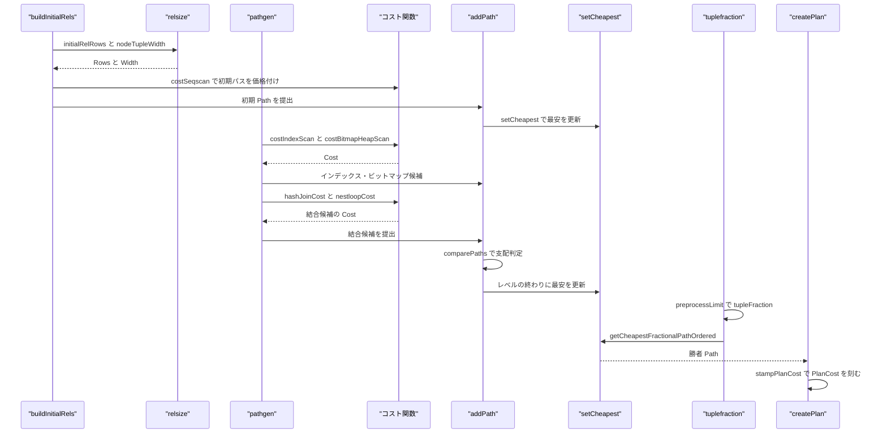
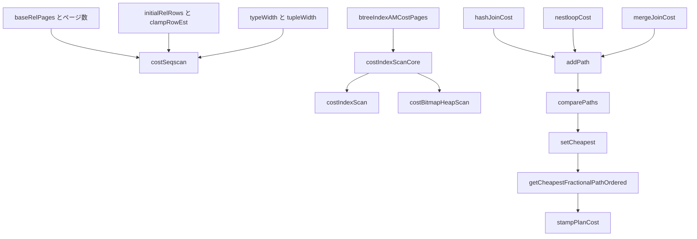

# パスとコストモデル

<details>
<summary>関連ソースファイル</summary>

- [`internal/optimizer/cost_funcs.go`](https://github.com/ryogrid/goopg/blob/19856410e8d497d59787e1ab35a2febb3f5953d6/internal/optimizer/cost_funcs.go)
- [`internal/optimizer/costbitmap.go`](https://github.com/ryogrid/goopg/blob/19856410e8d497d59787e1ab35a2febb3f5953d6/internal/optimizer/costbitmap.go)
- [`internal/optimizer/costindex.go`](https://github.com/ryogrid/goopg/blob/19856410e8d497d59787e1ab35a2febb3f5953d6/internal/optimizer/costindex.go)
- [`internal/optimizer/entrywidth.go`](https://github.com/ryogrid/goopg/blob/19856410e8d497d59787e1ab35a2febb3f5953d6/internal/optimizer/entrywidth.go)
- [`internal/optimizer/narrowcostinputs.go`](https://github.com/ryogrid/goopg/blob/19856410e8d497d59787e1ab35a2febb3f5953d6/internal/optimizer/narrowcostinputs.go)
- [`internal/optimizer/path.go`](https://github.com/ryogrid/goopg/blob/19856410e8d497d59787e1ab35a2febb3f5953d6/internal/optimizer/path.go)
- [`internal/optimizer/pathgen.go`](https://github.com/ryogrid/goopg/blob/19856410e8d497d59787e1ab35a2febb3f5953d6/internal/optimizer/pathgen.go)
- [`internal/optimizer/pathtrace.go`](https://github.com/ryogrid/goopg/blob/19856410e8d497d59787e1ab35a2febb3f5953d6/internal/optimizer/pathtrace.go)
- [`internal/optimizer/plancost.go`](https://github.com/ryogrid/goopg/blob/19856410e8d497d59787e1ab35a2febb3f5953d6/internal/optimizer/plancost.go)
- [`internal/optimizer/relsize.go`](https://github.com/ryogrid/goopg/blob/19856410e8d497d59787e1ab35a2febb3f5953d6/internal/optimizer/relsize.go)
- [`internal/optimizer/tuplefraction.go`](https://github.com/ryogrid/goopg/blob/19856410e8d497d59787e1ab35a2febb3f5953d6/internal/optimizer/tuplefraction.go)

</details>

このコンポーネントは、結合順探索が比較するすべての候補 `Path` に PostgreSQL と同じ単位の絶対コストを与え、どの候補を残すか・どれが最安かを決める。具体的には、基底関係の行数と幅を統計またはブロック数から推定し（`relsize.go`）、SeqScan・IndexScan・BitmapScan・Hash/Merge/NestLoop 結合・Sort・集約・Gather の各コスト関数で `Cost{Startup, Total}` を計算し（`cost_funcs.go`、`costindex.go`、`costbitmap.go`）、`addPath` の支配判定と `setCheapest` の最安選択で `RelOptInfo.Pathlist` を刈り込む（`path.go`）。LIMIT がある場合は `tupleFraction` を介して起動コストの安いパスを選び（`tuplefraction.go`）、必要列だけに絞った幅でコスト入力を窄め（`narrowcostinputs.go`、`entrywidth.go`）、最後に勝者の数値を `PlanCost` として実行ノードへ刻む（`plancost.go`）。親セクションは [5 クエリプランナー](../5-Query-Planner.md)。全体の流れは [5.1 プランナー全体像](5.1-Planner-Overview.md)、列挙そのものは [5.3 結合順序探索](5.3-Join-Search.md)、Path から Node への翻訳は [5.7 パスからプランへの変換](5.7-Plan-Creation.md) を参照。

## 責務

- PostgreSQL 単位の絶対コスト定数の保持。`costParams` が `seq_page_cost = 1.0` を基準に、ページ I/O・CPU・並列・キャッシュ・work_mem を 1 つの通貨にまとめる。`path:internal/optimizer/cost_funcs.go:costParams`
- 既定値の一元化。`defaultCostParams` が PG 18 の起動値を返し、`effective_cache_size` は 8 kB ブロック単位、ハッシュ予算は `hashsize.HashMemLimit` で `work_mem × hash_mem_multiplier` として計算する。`path:internal/optimizer/cost_funcs.go:defaultCostParams`
- 順次スキャンの価格付け。`costSeqscan` がページ数×`seq_page_cost` とタプル数×CPU を足し、`costParallelSeqscan` がワーカーあたりの CPU だけを `getParallelDivisor` で割る。`path:internal/optimizer/cost_funcs.go:costSeqscan`
- インデックススキャンの価格付け。`costIndexScanCore` が B-tree AM コスト、Mackert-Lohman のヒープページ数、相関による max/min I/O の補間、qpqual の CPU を合成する。`path:internal/optimizer/costindex.go:costIndexScanCore`
- ビットマップスキャンの価格付け。`costBitmapIndexScan` がインデックス側だけを、`costBitmapHeapScan` がページ単位のランダム/順次補間とヒープ CPU を、`computeBitmapPages` が distinct ページ数を見積もる。`path:internal/optimizer/costbitmap.go:costBitmapHeapScan`
- 結合方式ごとの価格付け。`hashJoinCost` は build を起動コストに、probe とバケット走査を実行コストに置き、`nestloopCost` は外側行ごとの再スキャンを、`mergeJoinCost` はマージ走査と materialize の選択を価格付けする。`path:internal/optimizer/cost_funcs.go:hashJoinCost`
- ソート・集約・Gather の価格付け。`costSortRunWithWidth` がメモリ/有界/ディスクの 3 分岐を選び、`costAggClause` が SORTED/HASHED の差を起動コストに畳み、`gatherCost`/`gatherMergeCost` が並列転送を加算する。`path:internal/optimizer/cost_funcs.go:costSortRunWithWidth`
- 関係サイズと幅の推定。`estimateRelSize` が live ブロック数とタプル幅から行数を出し、`typeWidth`/`tupleWidth`/`tableDataWidth` が 1 行のバイト幅を出す。`path:internal/optimizer/relsize.go:estimateRelSize`
- パスの支配判定。`comparePaths` がコスト・pathkeys・並列安全性・要求外側 relids の 4 次元で支配関係を決め、`addPath` が新規候補の採用と既存候補の追い出しを行う。`path:internal/optimizer/path.go:comparePaths`
- 最安パスの選択。`setCheapest` が無パラメータの `CheapestStartup`/`CheapestTotal` とパラメータ化一覧を求め、`getCheapestFractionalPathOrdered` が LIMIT 下の勝者を選ぶ。`path:internal/optimizer/tuplefraction.go:getCheapestFractionalPathOrdered`
- LIMIT の分数化。`preprocessLimit` が LIMIT/OFFSET を絶対行数または割合の `tupleFraction` に変換する。`path:internal/optimizer/tuplefraction.go:preprocessLimit`
- コスト入力の窄化。`relNarrowedWidths` が基底関係の必要列だけの `NCols`/`AvgVarBytes`/`OutputWidth` を計算し、`narrowJoinWidths` が結合パスへ伝播する。`path:internal/optimizer/narrowcostinputs.go:relNarrowedWidths`
- EXPLAIN 用のコスト注記。`stampPlanCost` が勝者 `Path` の `Cost`/`Rows`/幅/無効化状態を `PlanCost` としてノードに埋め込む。`path:internal/optimizer/plancost.go:stampPlanCost`
- パス来歴の記録。`tracePath` が `GOOPG_PGSHAPED_DP_TRACE=1` のとき、producer・relids・kind・rows・startup・total・verdict を `DPPATH` 行として stderr に出す。`path:internal/optimizer/pathtrace.go:tracePath`

## 処理フロー

基底関係のサイズ決めから始まる。`buildInitialRels` は FROM 項目ごとに `initialRelRows` を呼び、基底テーブルなら `baseRelInfo.filteredRows` を、サブクエリや CTE なら `EstimateRows` を、既に探索済みの部分木ならその `RelOptInfo.Rows` を採用する。幅は `nodeTupleWidth` が `tupleWidth` 経由で `typeWidth` を合計して求める。ここで `clampRowEst` が行数を有限・1 以上・整数に丸める。初期パス `newPrebuiltPath` には `baseSeqScanCostInputs` が `cost_seqscan` の入力（ページ数・制限前タプル数・条件演算子数）を渡し、`costSeqscan` の結果が `Path.Cost` に入る。CTE スキャンやサブプランの葉は `costKeptCTEScanLeaf`/`costSubplanLeaf` で別の価格になる。最後に `addPath` と `setCheapest` が走る。

次に `searchOneProblem` が基底リレーションの追加プロデューサを動かす。`addBaseRelPartialPaths` は `costParallelSeqscan` で部分 SeqScan を、`addBaseRelIndexPaths` は `costIndexScan`/`costPartialIndexScan` でインデックス候補を、`costBitmapIndexScan` と `costBitmapHeapScan` でビットマップ候補を作る。`addBaseRelGatherPaths` は `gatherCost`/`gatherMergeCost` で部分パスを直列パスと比較する。各プロデューサはパスを作る前に `addPathPrecheck` で「既存候補に支配されないか」を安価に確認し、通ったものだけを `addPath` に渡す。`addPath` は `narrowJoinWidths` で結合幅を伝播した後、`addToPathlist` が `comparePaths` で既存候補との支配関係を判定する。

結合レベルでは `makeJoinRel` が `joinRelBuilder` 経由で `addPathsToJoinrel` を呼び、`addHashJoinPath` は `hashJoinInitialCost` で事前判定してから `hashJoinCost` で本計算する。`addNestLoopPathFor` は `nestloopCost` に子パスの `Rows`（パラメータ化 inner では 1 probe あたりの行数）と `pathRescanCost` を渡し、`addMaterialNestLoopPath` は Material 化した inner を別候補として並べる。`mergeJoinCost` はマージ走査の選択度と materialize の要否を同時に返す。各レベルを出し切った後、`joinSearch` が `generateUsefulGatherPaths` を呼んでから `setCheapest` を実行する。

LIMIT がある文では、探索の前に `Limit` ノードの `Limit`/`Offset` が `tupleFraction` へ変換される。その変換を行う `preprocessLimit` は、両境界を `limitClauseEstimate` で評価し、定数でない上限を `unestimatableLimitFraction = 0.10` に落とす。探索の最後で `finalPath` が `getCheapestFractionalPathOrdered` を呼び、`CheapestTotal` を暫定勝者として `startup + fraction × (total - startup)` が改善する候補だけを採用する。ORDER BY がある場合は、要求 pathkeys を満たさない候補をこの比較から除外する。こうして選ばれた `Path` が `createPlanAtSearchRootRange` に渡り、`createPlanNode` の末尾で `stampPlanCost` が `PlanCost` を刻む。



コスト計算の依存関係は次のとおり。行数・幅の推定がすべてのコスト関数の入力になり、結合コストは子パスのコストを入力にするため、下から上へ積み上がる。



## 主要ファイル

| ファイル | 役割 |
| --- | --- |
| `internal/optimizer/cost_funcs.go` | `costParams`/`defaultCostParams`、SeqScan・Hash/Merge/NestLoop 結合・Sort・集約・Gather のコスト関数。`path:internal/optimizer/cost_funcs.go:costParams` |
| `internal/optimizer/costindex.go` | `indexScanInputs`、`costIndexScan`、`costIndexScanCore`、`btreeIndexAMCostPages`、`indexPagesFetched`、相関統計の処理。`path:internal/optimizer/costindex.go:costIndexScan` |
| `internal/optimizer/costbitmap.go` | `costBitmapIndexScan`、`costBitmapHeapScan`、`computeBitmapPages`、`costBitmapAndCost`/`costBitmapOrCost`。`path:internal/optimizer/costbitmap.go:costBitmapHeapScan` |
| `internal/optimizer/path.go` | `Cost`/`Path`/`RelOptInfo`、`addPath`/`addToPathlist`/`comparePaths`/`setCheapest`、`pathNCols`/`pathWidth`。`path:internal/optimizer/path.go:addPath` |
| `internal/optimizer/pathgen.go` | スキャン・結合パスの生成。`generateScanPaths`、`addHashJoinPath`、`addNestLoopPath`/`addMaterialNestLoopPath`。`path:internal/optimizer/pathgen.go:addHashJoinPath` |
| `internal/optimizer/relsize.go` | ページ・行数・タプル幅の推定。`estimateRelSize`、`typeWidth`、`tupleWidth`、`tableDataWidth`、`clampRowEst`。`path:internal/optimizer/relsize.go:estimateRelSize` |
| `internal/optimizer/tuplefraction.go` | `preprocessLimit`、`limitEstimates`、`compareFractionalPathCosts`、`getCheapestFractionalPathOrdered`。`path:internal/optimizer/tuplefraction.go:preprocessLimit` |
| `internal/optimizer/narrowcostinputs.go` | `narrowedWidths`、`relNarrowedWidths`、`narrowBaseRelCostWidths`、`narrowJoinWidths`。必要列だけの幅でコスト入力を窄める。`path:internal/optimizer/narrowcostinputs.go:narrowedWidths` |
| `internal/optimizer/entrywidth.go` | ハッシュ build の可変幅ペイロード。`buildAvgVarBytes`、`tableColVarBytes`、`unionColVarBytes`。`path:internal/optimizer/entrywidth.go:buildAvgVarBytes` |
| `internal/optimizer/plancost.go` | `PlanCost`、`stampPlanCost`、`PlanCostCarrier`、`DeriveLegacyDisplayCost`。EXPLAIN 用の数値。`path:internal/optimizer/plancost.go:stampPlanCost` |
| `internal/optimizer/pathtrace.go` | `DPPATH` のパス来歴出力。`tracePath`、`formatPathLine`。`path:internal/optimizer/pathtrace.go:tracePath` |

## 公開 API / エントリポイント

コストモデルの大半はパッケージ内部の関数で、探索とパス生成から呼ばれる。外部へ公開されているのは EXPLAIN と表示に必要な型・関数だけである。

```go
func TupleWidth(cols []SchemaColumn) int
func DeriveLegacyDisplayCost(n Node, rows int64) PlanCost
```

`PlanCost` と `PlanCostCarrier` は EXPLAIN 側が読む型で、完全な定義は「主要データ構造」に示す。

内部の主要な入口は次のとおり。価格計算の関数は `costParams` を共有して同じ通貨の `Cost` を返し、選択・記帳の関数はその結果を比較・保存する。

```go
func costSeqscan(cp costParams, relPages int64, relTuples float64, numQualOps float64) Cost
func costIndexScan(cp costParams, in indexScanInputs) Cost
func costBitmapHeapScan(cp costParams, indexCost Cost, pagesFetched, tuplesFetched, T, numQualOps float64) Cost
func hashJoinCost(cp costParams, in hashJoinInputs) Cost
func nestloopCost(cp costParams, outer, inner Cost, outerRows, innerRows, innerRescanStartup, innerRescanTotal float64) Cost
func mergeJoinCost(cp costParams, outer, inner Cost, outerRows, innerRows, outputRows float64, sel mergeScanSel, mi mergeInner) (Cost, bool)
func addPath(rel *RelOptInfo, newPath *Path, producer string)
func setCheapest(rel *RelOptInfo)
func preprocessLimit(lim *Limit, tupleFraction float64) (float64, limitEstimates)
func getCheapestFractionalPathOrdered(rel *RelOptInfo, tupleFraction float64, queryPathkeys []PathKey) *Path
func stampPlanCost(n Node, p *Path)
```

## 主要データ構造

### `Cost`

すべての価格の共通形である。起動コストと総コストの 2 軸を持ち、LIMIT 下では起動コストが選択に効く。

`path:internal/optimizer/path.go:Cost`

```go
// Cost is PG's two-number cost, in PG's units (seq_page_cost = 1.0, design ch. 02
// §3). Startup is the cost expended before the first row emerges; Total is the
// cost to return all rows. A cheaper-total path can lose to a cheaper-startup one
// under a LIMIT, which is why both axes are carried (design ch. 07 §1.2).
type Cost struct {
	Startup float64
	Total   float64
}
```

### `costParams`

コストモデルが読む GUC 一式である。価格・キャッシュ予算・メモリ予算・手法トグル・GEQO 設定・並列設定が 1 つの値にまとまり、パス生成時に全関数へ渡される。`path:internal/optimizer/cost_funcs.go:costParams`

| フィールド群 | 保持するもの |
| --- | --- |
| `seqPageCost` / `randomPageCost` | 順次・ランダムページの単価。既定は 1.0 と 4.0。 |
| `cpuTupleCost` / `cpuIndexTupleCost` / `cpuOperatorCost` | タプル処理・インデックスタプル・演算子 1 回の CPU 単価。既定は 0.01 / 0.005 / 0.0025。 |
| `parallelSetupCost` / `parallelTupleCost` | Gather の起動費とワーカー間転送の単価。既定は 1000.0 / 0.1。 |
| `effectiveCacheSize` | `effective_cache_size` をページ数で持つ。Mackert-Lohman のキャッシュ按分に使う。 |
| `workMem` | 1 つのハッシュ build が使えるバイト数。`work_mem × hash_mem_multiplier`。 |
| `enable*` | `enable_hashjoin` などの手法トグル。false でもパスは生成され、`DisabledNodes` が加算される。`enableMaterial` と `enableParallelHash` だけは生成ゲート。 |
| `geqo` / `geqoThreshold` / `geqoEffort` / `geqoPoolSize` / `geqoGenerations` / `geqoBias` / `geqoSeed` | GEQO の有効化と調整値。 |
| `maxParallelWorkersPerGather` / `minParallelTableScanBlocks` / `minParallelIndexScanBlocks` / `parallelLeaderParticipation` | 並列ワーカー数と部分スキャンの閾値（ブロック単位）。 |
| `otherMemberRel` | UNION ALL appendrel のメンバーを表す。`compute_parallel_worker` のサイズ判定を緩める。 |

不変条件は「すべての価格が同じ絶対単位である」ことだ。`costParams` のどの項も省略可能な相対値ではなく、他のノードと直接比較できる。`defaultCostParams` は PG 18 の起動値を持ち、`effective_cache_size` だけは 4 GB を 8 kB ブロックで割った 524288 ページになる。`enable*` のゼロ値は false、つまり無効なので、`costParams` を手で組むときは `defaultCostParams()` から始める。

### `indexScanInputs`

`cost_index` が必要とする GUC 以外の入力をまとめた構造体である。`relTuples` は制限前のタプル数であり、`Path.Rows` の事後フィルタ行数とは異なる点が重要である。

`path:internal/optimizer/costindex.go:indexScanInputs`

| フィールド | 保持するもの |
| --- | --- |
| `relPages` / `relTuples` | 関係のページ数と制限前タプル数。 |
| `indexPages` / `indexTuples` / `treeHeight` | インデックスのページ数・タプル数・木の高さ。 |
| `selectivity` | インデックス条件が通すヒープの割合。 |
| `uniqueEqualityOnAllKeys` | 全キーに等値条件がある一意インデックスのクランプ。 |
| `correlation` | インデックス列とヒープの物理相関。max/min I/O の補間に使う。 |
| `totalTablePages` | クエリ内の全基底関係のページ数。キャッシュ按分の分母。 |
| `loopCount` | このスキャンが再実行される回数。パラメータ化パスでは外側行数。 |
| `indexOnly` / `allVisFrac` | index-only scan と可視率。ヒープページ数の補正に使う。 |
| `numQualOps` | インデックス条件で満たされない残余条件の演算子数。 |
| `numSAScans` / `numIndexQuals` / `boundSelectivity` | ScalarArrayOp の走査回数、インデックス条件数、インデックス側の選択度。 |

### `hashJoinInputs`

`initial_cost_hashjoin` と `final_cost_hashjoin` の引数を 1 つにまとめた構造体である。`Hash` 結合のコストは build 側の起動費と probe 側の実行費に分かれ、バケット走査とスピル I/O が加わる。

`path:internal/optimizer/cost_funcs.go:hashJoinInputs`

| フィールド | 保持するもの |
| --- | --- |
| `outer` / `inner Cost` | 2 入力のコスト。 |
| `outerRows` / `innerRows` | 子パス自身の行数。パラメータ化 inner では 1 probe あたり。 |
| `outputRows` | 結合結果の行数。 |
| `numHashClauses` | ハッシュキー節の数。 |
| `hashQualCost` / `qualPerTuple` | ハッシュ節と非ハッシュ節の 1 タプルあたり演算子コスト。 |
| `outerCols` / `innerCols` | 行の列数。goopg のハッシュ entry は `48 × 列数` で見積もる。 |
| `innerBucketSize` | 1 バケットに入る inner の割合。0 は統計なしとしてバケット走査を省略。 |
| `final` | inner-unique / semi / anti の判定入力。 |
| `outerWidth` / `innerWidth` | PG 形式のパック済みタプル幅。仮想バケットの計算に使う。 |
| `outerAvgVarBytes` / `innerAvgVarBytes` | 可変幅ペイロードの平均。`hashsize.EntryBytes` に渡す。 |
| `parallelHash` / `innerRowsTotal` / `parallelWorkers` | Parallel Hash の結合予算と参加者数。 |

### `relSizeInputs`

`table_block_relation_estimate_size` の引数を写した構造体である。統計がある場合はその密度を、ない場合はタプル幅から密度を導く。

`path:internal/optimizer/relsize.go:relSizeInputs`

| フィールド | 保持するもの |
| --- | --- |
| `curpages` | live なブロック数。負値は不明。 |
| `relpages` / `reltuples` | ANALYZE/VACUUM が保持するページ数と行数。 |
| `analyzed` | 統計が存在するか。 |
| `hasSubclass` | 継承親・パーティション親か。10 ページ床を免除する。 |
| `fillfactor` | テーブルの fillfactor。0 は 100 と解釈。 |
| `dataWidth` | タプルオーバーヘッドを含まない列幅の合計。 |

コスト関数が受け取る入力構造体の宣言全体は長いため、次の折りたたみに原文のまま収録する。

<details>
<summary>コスト入力構造体の完全定義</summary>

`path:internal/optimizer/cost_funcs.go:costParams`

```go
type costParams struct {
	seqPageCost       float64
	randomPageCost    float64
	cpuTupleCost      float64
	cpuIndexTupleCost float64
	cpuOperatorCost   float64
	parallelSetupCost float64
	parallelTupleCost float64

	// effectiveCacheSize is the `effective_cache_size` GUC in PAGES, which is
	// the unit PG's own variable carries (`effective_cache_size` is declared
	// `int` and set from a GUC with GUC_UNIT_BLOCKS, cost.h:33). It is not a
	// per-tuple or per-page price like the fields above — it is the cache
	// budget the Mackert-Lohman formula pro-rates between the relations of a
	// query (`index_pages_fetched`, costsize.c:906), so it belongs to the same
	// struct only because it is a planner GUC the index cost model reads.
	// M0127-P5.4c-ii-b.
	effectiveCacheSize float64

	// workMem is the in-memory budget one hash build may occupy, in BYTES —
	// the `work_mem` GUC, and the fourth argument `hashJoinCost` hands
	// `hashsize.Choose`. It is a budget rather than a price, so like
	// effectiveCacheSize it belongs to this struct only because a cost
	// function reads it.
	//
	// The default is `hashsize.DefaultMemLimitBytes`, which is the SAME
	// fallback the executor applies when a session has no work_mem set
	// (`hashsize.EffectiveMemLimit`, called from `joinOp.buildGeometry`). The
	// two must agree or the planner prices a geometry the executor will not
	// build — the whole reason the sizing lives in a shared leaf package.
	// The per-session value does not reach the planner yet: cost time has no
	// session in scope (the same gap `ParallelSettings` exists to bridge for
	// the parallel post-pass). Deferral ledger 2026-08-05 M0127-P5.7-a.
	workMem int64

	// enable* are PG's planner-method GUCs (take2 P2-05, B-17a/B-17d). True
	// means the method is enabled; a disabled method still PRODUCES its path
	// and increments Path.DisabledNodes, as PG 18 does.
	enableHashJoin  bool
	// enableParallelHash: enable_parallel_hash, a generation gate for the
	// `parallel_hash = true` partial hash join (M0146-0002).
	enableParallelHash bool
	enableMergeJoin bool
	enableNestLoop  bool
	// enableSort is `enable_sort` (B-17a): cost_sort's own flag on top of the
	// input's count (costsize.c:2144). The Sort producer is sortPathFor.
	enableSort   bool
	// enableIncrementalSort is `enable_incremental_sort`: create_ordered_paths
	// gives a partially presorted input an Incremental Sort only when on
	// (planner.c). M0146-0005bp.
	enableIncrementalSort bool
	enableMemoize bool
	// enableMaterial is `enable_material`, a GENERATION gate in PG: the
	// matpath is never created when it is off (joinpath.c:1897, :2135 —
	// unlike the counted toggles above, the producer skips, and cost_material
	// counts the disabled node only for paths admitted another way).
	enableMaterial bool
	// enableSeqScan / enableIndexScan / enableBitmapScan are `enable_seqscan`
	// / `enable_indexscan` / `enable_bitmapscan` (B-17d): cost_seqscan's,
	// cost_index's and cost_bitmap_heap_scan's own flags (costsize.c:295, 560,
	// 1023). The scan producers always generate the path and count, exactly
	// as the join producers do since P2-05.
	enableSeqScan    bool
	enableIndexScan  bool
	enableBitmapScan bool
	// enableGatherMerge is `enable_gathermerge` (C-19d): cost_gather_merge's
	// own flag (costsize.c:536, `path->path.disabled_nodes = input_disabled_
	// nodes + (enable_gathermerge ? 0 : 1)`). It is the COUNTING form of
	// `ParallelSettings.DisableGatherMerge`, whose comment asked for exactly
	// this conversion once P5-04 landed real GatherMerge paths. `cost_gather`
	// has no flag upstream, so there is no enableGather beside it.
	enableGatherMerge bool
	geqo            bool
	geqoThreshold   int
	geqoEffort      int
	geqoPoolSize    int
	geqoGenerations int
	geqoBias        float64
	geqoSeed        float64

	// maxParallelWorkersPerGather / minParallelTableScanBlocks /
	// minParallelIndexScanBlocks / parallelLeaderParticipation are the
	// parallel GUCs the path model reads (C-19a/b/c; see PlannerSettings for
	// the unit and zero-value rules). `compute_parallel_worker` reads the
	// first three (the index threshold from C-19c's partial index paths),
	// `get_parallel_divisor` the last.
	maxParallelWorkersPerGather int
	minParallelTableScanBlocks  int64
	minParallelIndexScanBlocks  int64
	parallelLeaderParticipation bool

	// otherMemberRel marks the costParams of a search whose one relation is
	// a UNION ALL appendrel member pulled up into the parent query
	// (RELOPT_OTHER_MEMBER_REL, pull_up_simple_union_all): compute_parallel_worker
	// applies its size cutoffs to RELOPT_BASEREL only, because a small member
	// "may well pay off" combined with its siblings (M0146-0132).
	otherMemberRel bool
}
```

`path:internal/optimizer/costindex.go:indexScanInputs`

```go
type indexScanInputs struct {
	relPages    int64   // baserel->pages
	relTuples   float64 // baserel->tuples, pre-restriction
	indexPages  float64 // index->pages
	indexTuples float64 // index->tuples
	treeHeight  int     // index->tree_height
	// selectivity is `indexSelectivity`: the fraction of the heap the index
	// quals admit. 1.0 for an ordering-only scan, which is the only kind this
	// slice generates (the search's clause list holds join clauses, and a
	// clause used as an index qual would make the path parameterised).
	selectivity float64

	// uniqueEqualityOnAllKeys is `btcostestimate`'s unique-index clamp
	// (selfuncs.c): a UNIQUE index with an equality qual on EVERY key column
	// matches at most one tuple, whatever the selectivity arithmetic says.
	// take2 P2-09.
	uniqueEqualityOnAllKeys bool
	// correlation is `indexCorrelation` — see indexCorrelationFor for why it
	// is 0 for every index goopg has today.
	correlation float64
	// totalTablePages is `root->total_table_pages`: the pages of every base
	// relation in the query, which is what the cache budget is pro-rated
	// between.
	totalTablePages float64
	// loopCount is `cost_index`'s parameter of the same name: how many times
	// this scan is expected to be RE-executed, which for a parameterised path
	// is the row count of the outer relations supplying its parameter
	// (`get_loop_count`, indxpath.c:3266). 0 or 1 means a single execution —
	// with one R59-noted exception: at numSAScans > 1, 0 keeps the legacy
	// serial page cost (numScans = 0) while 1 takes the Mackert-Lohman arm,
	// so the two are NOT interchangeable there. No producer sets numSAScans
	// > 1 yet (P2-09b owns it); unifying the 0-convention belongs to that
	// round, which can adjudicate it against PG's SAOP pessimism with a real
	// producer in hand.
	//
	// It exists so the returned cost stays "one execution": PG pro-rates the
	// amortised total back down by `loopCount` for exactly that reason, which
	// is what lets the join arm keep multiplying by the outer row count without
	// double-counting.
	loopCount float64

	// indexOnly / allVisFrac are `cost_index`'s `indexonly` argument and
	// `baserel->allvisfrac`. See `heapPagesAfterVM`. Zero values give exactly
	// the pre-existing behaviour, so every caller that does not set them is
	// costing a plain index scan as before.
	indexOnly  bool
	allVisFrac float64

	// numQualOps is `cost_index`'s qpqual count: restriction conjuncts NOT
	// satisfied as index quals, charged per heap tuple fetched
	// (`cpu_tuple_cost + qpqual`, costsize.c:822-830). The seq-scan rival
	// charges the identical term per tuple scanned (`costSeqscan`), so the
	// two sides of one addPath comparison use one currency for the qual.
	// Ordered/index-only producers pass every local conjunct (selectivity
	// 1.0: no clause is an index qual there); bitmap/parameterised
	// producers pass local conjuncts minus index-satisfied ones. 0 keeps
	// the pre-R1 price exactly. R1 (plan-parity-fix-take2).
	numQualOps float64

	// numSAScans is PG's `num_sa_scans`: the number of index descents a
	// ScalarArrayOp (`col = ANY (consts)`) or skip-array scan performs —
	// the product of the array lengths over the scan's SAOP quals
	// (`genericcostestimate`, selfuncs.c:7086-7103) times the distinct
	// count of each procedurally generated skip column
	// (`btcostestimate`, selfuncs.c:7391-7577). 0 (unset) or 1 means a
	// single descent and reproduces the pre-existing cost exactly.
	numSAScans float64

	// numIndexQuals is `list_length(indexQuals)` — the quals the index scan
	// itself evaluates, one per clause the probe binds (a range's lower and
	// upper bound are two). genericcostestimate charges `cpu_operator_cost`
	// for each of them on every index tuple visited (`qual_op_cost`,
	// selfuncs.c). 0 is a full-index scan with no index quals.
	numIndexQuals float64

	// boundSelectivity is the selectivity of `indexBoundQuals` alone —
	// the quals PG counts toward `numIndexTuples`, which are a SUBSET of
	// the `indexQuals` that drive `indexSelectivity` (the heap-side
	// fraction). They differ exactly when `btcostestimate` declines to
	// add a clause's quals to the bound set — the skip-array reverts
	// (selfuncs.c:7464-7573): a default ndistinct or a descent estimate
	// past `index->pages` makes PG drop the column's quals from the
	// bound list, so the index side is priced over the WHOLE index even
	// though the heap side still filters by the qual. <= 0 means "same
	// as selectivity", which is every non-skip producer's contract.
	boundSelectivity float64
}
```

`path:internal/optimizer/cost_funcs.go:hashJoinInputs`

```go
type hashJoinInputs struct {
	// outer / inner are the two input paths' costs; outerRows / innerRows are
	// those paths' OWN row counts (`outer_path->rows` / `inner_path->rows`,
	// costsize.c:4170-4171), which for a parameterised inner is the per-probe
	// count and not the rel's total. See Path.Rows.
	outer, inner         Cost
	outerRows, innerRows float64

	// outputRows is the join's result cardinality (PG's `hashjointuples`).
	outputRows float64

	// numHashClauses is `list_length(hashclauses)`: one cpu_operator_cost per
	// clause is charged per input row on both sides.
	numHashClauses int

	// hashQualCost is final_cost_hashjoin's `hash_qual_cost.per_tuple`:
	// cost_qual_eval over the hash clauses (hashClausesPerTuple), which the
	// bucket walk pays per comparison. A key that is an expression
	// (`(a - 53) = b`) costs its operators too (M0146-0116). Zero falls back
	// to one cpu_operator_cost per clause.
	hashQualCost float64

	// qualPerTuple is final_cost_hashjoin's `qp_qual_cost.per_tuple`: the
	// join's non-hash quals (joinQualPerTuple, correlated SubPlans priced per
	// call). PG charges it with cpu_tuple_cost on hashjointuples — the
	// matched outer rows of an inner-unique / semi / anti join, the hash
	// clauses' approx_tuple_count otherwise — not on the join's output rows
	// (M0146-0012a slice C: TPC-H Q17's correlated Join Filter pays 10 calls
	// in PG, not one per output row).
	qualPerTuple float64

	// outerCols / innerCols are the COLUMN COUNTS of the two sides' rows.
	//
	// PG passes `pathtarget->width` in bytes here, because a PG hash entry is a
	// packed MinimalTuple whose size follows the byte width. goopg's is a
	// `[]Datum` of 48-byte structs, so its size follows the COLUMN COUNT — and
	// the executor's own call (`joinOp.buildGeometry`) passes exactly
	// `len(schema)`. Passing anything else here (a byte width, say) would size
	// the same build differently on the two sides of the sibling-path rule and
	// reintroduce the divergence `internal/hashsize` exists to prevent: a cost
	// model that believes a build fits and an executor that spills.
	//
	// Zero means "unknown", and prices the join as never spilling — the
	// pre-P5.7 behaviour. `relNCols` is the production source and never
	// returns zero for a rel the search built.
	outerCols, innerCols int

	// outerAvgVarBytes / innerAvgVarBytes are the average total variable-width
	// payload per row of each side — the `avgVarBytes` parameter of
	// innerBucketSize is `innerbucketsize` from estimate_hash_bucket_stats:
	// the share of the inner relation in one bucket. Zero means "no usable
	// statistic" and suppresses the bucket-walk term entirely. take2 P2-11.
	innerBucketSize float64

	// final carries the fail-closed INNER-only evidence that selects the
	// inner-unique branch of final_cost_hashjoin. Its zero value preserves the
	// existing non-unique bucket-walk result exactly.
	final hashJoinFinalCostInput

	// outerWidth / innerWidth are emitted PG-style byte widths. R91 feeds the
	// inner one to planner-private virtual buckets. R108's default-off
	// experiment additionally uses both only for PG's planner page-size spill
	// price; neither field can affect Goopg executor map sizing.
	outerWidth, innerWidth int

	// `hashsize.Choose`. Populated from RelOptInfo.AvgVarBytes; zero when no
	// ANALYZE stats exist (correct for fixed-width relations). M0128-P3.1.
	outerAvgVarBytes, innerAvgVarBytes float64

	// parallelHash is initial_cost_hashjoin's `parallel_hash` (costsize.c:4165):
	// innerRows is then the PER-PARTICIPANT count of a partial inner, and only
	// the table geometry uses the total (inner_path_rows_total = rows ×
	// get_parallel_divisor, :4209-4210) under the combined budget
	// (ExecChooseHashTableSize's try_combined_hash_mem: hash_mem ×
	// (parallel_workers + 1), nodeHash.c:699-707). Every CPU term keeps the
	// per-participant rows, as PG's does. M0146-0002.
	parallelHash    bool
	innerRowsTotal  float64
	parallelWorkers int
}
```

`path:internal/optimizer/relsize.go:relSizeInputs`

```go
type relSizeInputs struct {
	// curpages is the LIVE block count — upstream's
	// `curpages = RelationGetNumberOfBlocks(rel)`, not pg_class.relpages.
	// Negative means "unknown"; callers get (0, 0) back.
	curpages int64
	// relpages / reltuples are the ANALYZE/VACUUM-maintained counters,
	// catalog.TableStats.Pages / .RowCount.
	relpages  int64
	reltuples int64
	// analyzed is the inverse of upstream's `reltuples < 0` sentinel. See
	// catalog.TableStats.Analyzed for why goopg carries it as a flag.
	analyzed bool
	// hasSubclass is pg_class.relhassubclass. Upstream skips the 10-page
	// floor for inheritance parents: "Totally empty parent tables are quite
	// common, so we should be willing to believe that they are empty."
	hasSubclass bool
	// fillfactor is the table's reloption; 0 (unset) means
	// heapDefaultFillfactor. Only the statistics-less branch consults it —
	// the density branch accounts for it implicitly via real relpages.
	fillfactor int
	// dataWidth is upstream's get_rel_data_width(rel, attr_widths): the sum
	// of the relation's per-attribute average widths, WITHOUT the per-tuple
	// overhead, which this function adds.
	dataWidth int
}
```

</details>

### `narrowedWidths`

基底関係のパスに適用する窄化後の幅 3 つ組である。`ok == false` は「この関係は窄化しない」を意味し、その関係の全パスが関係全体の幅へフォールバックする。

`path:internal/optimizer/narrowcostinputs.go:narrowedWidths`

```go
// narrowedWidths is the width triple a base rel's paths may carry, or a
// decline. `ok == false` means "this rel narrows nothing" and every path of it
// must be left at the relation-wide fallback (rule 3).
type narrowedWidths struct {
	ncols       int
	avgVarBytes float64
	outputWidth int
	ok          bool
}
```

`ncols` はハッシュ entry の列数、`avgVarBytes` は可変幅ペイロード、`outputWidth` は PG 形式のバイト幅である。3 つは常に同時に設定される。片方だけ窄化されたパスがあると、`addPath` が異なる通貨で計算されたコストを比較し、窄化しやすい形へ系統的に偏るためである。

### `PlanCost`

探索が求めた数値を実行ノードに載せるための型である。`CostSet` が「0 で価格付けされた」のか「一度も価格付けされていない」のかを区別する。

`path:internal/optimizer/plancost.go:PlanCost`

```go
type PlanCost struct {
	// StartupCost is the cost expended before the first row can be returned.
	StartupCost float64
	// TotalCost is the cost to return all rows.
	TotalCost float64
	// PlanRows is the estimated row count of THIS node.
	PlanRows float64
	// PlanWidth is the estimated average row width in bytes.
	PlanWidth int
	// CostSet distinguishes "priced at zero" from "never priced". Without it
	// a node the search did not produce is indistinguishable from a free one,
	// and the renderer cannot tell which nodes need the legacy derivation.
	CostSet bool
	// PerWorker marks figures that are ONE participant's share: the node was
	// stamped from a partial path (ParallelWorkers > 0), whose rows and cost
	// are per worker by construction (cost_seqscan's parallel arm).
	// perWorkerDisplayRows reads it so a scan already priced per worker is
	// not divided a second time (M0141-S2b-16).
	PerWorker bool
	// Disabled is PG's plan_is_disabled (explain.c): the node's own
	// disabled_nodes exceed the sum over its children — an enable_* GUC
	// turned THIS node off, not something below it. EXPLAIN prints
	// `Disabled: true` for it (M0148-0001f).
	Disabled bool
}
```

`PlanRows` はノード自身の行数、`PlanWidth` は `tupleWidth` によるバイト幅、`PerWorker` は部分パスのワーカーあたり値、`Disabled` はこのノード自身が `enable_*` で無効化されたことを示す。`CostSet` が false のノードは探索由来ではないため、`DeriveLegacyDisplayCost` が別途概算する。

### `limitEstimates`

`preprocess_limit` の 2 つの出力を表す。0 は節なし、正値は見積もり、-1 は「存在するが推定不能」である。

`path:internal/optimizer/tuplefraction.go:limitEstimates`

```go
type limitEstimates struct {
	count  int64
	offset int64
}
```

## 内部構造

このコストモデルの特徴は、**絶対単位**と**複数の幅通貨**、そして**窄化の安全方向**である。

第 1 に、すべてのコストは `seq_page_cost = 1.0` を基準にした絶対値である。並列化の判断は `parallel_setup_cost` という絶対値との比較になるため、相対順位だけでは足りない。`costSeqscan`、`costIndexScan`、`hashJoinCost`、`gatherCost` の結果はそのまま加算・比較できる。

第 2 に、幅には 3 つの表現がある。`RelOptInfo.Width` と `Path.OutputWidth` は PG のパック済みタプル幅（バイト）で、仮想バケットやページ計算に使う。`Path.NCols` は goopg のハッシュ entry が `[]Datum` であることに由来する列数で、`hashsize.EntryBytes(ncols, avgVarBytes) = 48·ncols + 24 + avgVarBytes` の第 1 項になる。`Path.AvgVarBytes` は可変幅ペイロードの合計である。`pathNCols`/`pathAvgVarBytes`/`pathWidth` は、パス側に値があればそれを、なければ関係全体の値を使ってフォールバックする。

第 3 に、窄化は常に「多めに残す」方向へ失敗する。`NeededCols` は名前集合で、ある関係のために必要な名前が他の同名列にも適用されるため、実際より多くの列を残す。`relNarrowedColumns` は `NeededColsKnown == false`、keep-set が空、`ColVarBytes` に載らない列がある、といった場合は関係全体を窄化しない。`AvgVarBytes` が非ゼロなのに列別マップがない場合も拒否する。これは「統計は存在するが帰属できない」状態であり、ゼロを足すとハッシュ build を過小評価するからである。

第 4 に、`addPath` の比較には 2 種類ある。`comparePathCostsFuzzily` は `stdFuzzFactor = 1.01` で 1% 以内を同等とみなし、`comparePaths` が pathkeys・並列安全性・要求外側 relids・行数でタイブレークする。`setCheapest` は `comparePathCosts` の厳密比較を使い、完全に等しいコストでは pathkeys の良さ、次に追加順で決める。`comparePaths` の全次元一致（PATHKEYS_EQUAL）だけは `1.0000000001` の極小ファズで再比較し、浮動小数の丸めで計画がぶれないようにしている。

第 5 に、LIMIT の `tupleFraction` は overloaded である。1 以上は絶対行数、0 と 1 の間は結果の割合、0 は全行を意味する。`preprocessLimit` は LIMIT と OFFSET のうち小さい方を採り、絶対値と割合が混在する場合は絶対値を小さいとみなす。`getCheapestFractionalPath` は絶対値を `CheapestTotal.Rows` で割って割合に直し、`startup + fraction × (total - startup)` で比較する。ORDER BY がある `getCheapestFractionalPathOrdered` では、要求 pathkeys を満たさない候補を比較から外す。ソートが必要な候補の起動コストは、文が実際に支払うコストではないからである。

第 6 に、`PlanCost` は `createPlan` の単一の出口で刻まれる。`stampPlanCost` は `p.Cost` と `p.Rows` をそのまま書き、`PlanWidth` だけは `TupleWidth(n.Output())` で再計算する。`PathPrebuilt` の場合は以前の `Disabled` を引き継ぐ。探索が作らなかった上位ノードは `CostSet == false` のまま残り、`DeriveLegacyDisplayCost` が「監査用の概算」として別に価格付けする。この関数は計画には使われない。

## エッジケースと不変条件

- **行数のクランプ**: `clampRowEst` は NaN と `1e100` 超を `maximumRowCount = 1e100` に、1 以下を 1 に、それ以外を `math.RoundToEven` で整数に丸める。0 行の関係を作らないことで、その上の結合が無料になるのを防ぐ。`path:internal/optimizer/relsize.go:clampRowEst`
- **未分析テーブルの下限**: `estimateRelSize` は live ページ数が 10 未満で未分析かつ継承親でない場合、ページ数を `neverAnalyzedMinPages = 10` に引き上げる。継承親は「空の親は珍しくない」ため免除される。`curpages < 0` は不明として `(0, 0)` を返す。`path:internal/optimizer/relsize.go:estimateRelSize`
- **整数除算の維持**: 統計のない関係の密度は `(usableBytesPerBlock × fillfactor / 100) / tupleWidth` を整数で計算する。浮動小数にすると小さな関係で PG の計画とずれるため、意図的に切り捨てる。`path:internal/optimizer/relsize.go:estimateRelSize`
- **相関の既定値**: `indexCorrelationFor` は先頭列に相関統計がなければ 0 を返し、`costIndexScanCore` は `max_IO_cost`（完全にランダム）を選ぶ。統計がある場合だけ `correlation²` で max/min を補間する。`path:internal/optimizer/costindex.go:costIndexScanCore`
- **一意インデックスのクランプ**: `uniqueEqualityOnAllKeys` が真なら、選択度の掛け算が 1 を超えても `numIndexTuples` を 1 に固定する。複数列の等値でも範囲スキャンとして価格付けされるのを防ぐ。`path:internal/optimizer/costindex.go:btreeIndexAMCostPages`
- **ビットマップのページ単価**: `costBitmapHeapScan` は `pagesFetched >= 2` かつ `T > 0` のときだけ `random_page_cost` から `seq_page_cost` へ `sqrt(pagesFetched/T)` で補間する。1 ページだけの取得はランダム単価のままにする。`path:internal/optimizer/costbitmap.go:costBitmapHeapScan`
- **ソートの最小タプル数**: `costSortRunWithWidth` は入力行数を 2 未満でも 2 として扱う。`log(0)` を避け、行数が 1 に潰れた見積もりでもソートを無料にしないためである。`path:internal/optimizer/cost_funcs.go:costSortRunWithWidth`
- **ハッシュのスピル判定**: `hashJoinBatchCost` は `hashsize.Choose` の `NBatch > 1` のときだけバッチ I/O を課す。単一バッチなら追加コストは 0 で、`workMem` に収まる build と収まらない build を区別する。Parallel Hash では `workMem × (workers + 1)` の結合予算を使う。`path:internal/optimizer/cost_funcs.go:hashJoinBatchCost`
- **NestLoop の ntuples**: `nestloopCost` は `max(outerRows,1) × max(innerRows,1)` を「処理する組」として `cpu_tuple_cost` を課す。出力行数に課すと、出力が小さいカルテシアン結合が見かけ上無料になる。`path:internal/optimizer/cost_funcs.go:nestloopCost`
- **Merge の materialize 選択**: `mergeJoinCost` は `skipMarkRestore` でない場合に再スキャン量を見積もり、`enableMaterial` とコスト比較、mark/restore 非対応、ソート済み inner が `workMem` を超える場合に Material を選ぶ。`path:internal/optimizer/cost_funcs.go:mergeJoinCost`
- **並列除数**: `getParallelDivisor` はリーダー参加時に `1 - 0.3×workers` を加算する。結果は d(1)=1.7、d(2)=2.4、d(3)=3.1、d(w≥4)=w になる。Gather の行数も同じ除数で戻す。`path:internal/optimizer/cost_funcs.go:getParallelDivisor`
- **窄化の拒否条件**: `relNarrowedColumns` はテスト用の `narrowCostInputsForceOff`、`baseLeaf` 不在、`scanPathTarget` の失敗、空 keep-set、`ColVarBytes` の欠落で `ok=false` を返す。空 keep-set は「0 列に窄化」を表現できないため拒否する。`path:internal/optimizer/narrowcostinputs.go:relNarrowedColumns`
- **index-only の例外**: `narrowBaseRelCostWidths` は `p.NCols > 0` のパスを窄化しない。index-only scan はインデックスが覆う列だけの、より狭い実際の出力スキーマを持つため、コスト通貨の窄化と混ぜてはならない。`path:internal/optimizer/narrowcostinputs.go:narrowBaseRelCostWidths`
- **LIMIT の推定不能**: `unestimatableLimitFraction = 0.10`。LIMIT または OFFSET が定数でない場合、結果の 10% を取得すると仮定する。`limitEstimates` の -1 はこの分岐を起動する。`path:internal/optimizer/tuplefraction.go:unestimatableLimitFraction`
- **分数比較の縮退**: `compareFractionalPathCosts` は `fraction <= 0` または `>= 1` のとき、通常の総コスト比較 `comparePathCosts(p1, p2, totalCost)` に落ちる。絶対行数をそのまま渡しても壊れない。`path:internal/optimizer/tuplefraction.go:compareFractionalPathCosts`
- **パラメータ化パスの除外**: `setCheapest` と `getCheapestFractionalPath` は `RequiredOuter != 0` のパスを最安の座標から外す。外側関係なしには行を生成できず、その関係を代表できないためである。`path:internal/optimizer/path.go:setCheapest`
- **無効化ノードの優先**: `comparePathCostsFuzzily`、`comparePathCosts`、`compareFractionalPathCosts` のいずれも、`DisabledNodes` が異なる場合はコストより先に少ない方を勝ちとする。`enable_*` は禁止ではなく強い選好として働く。`path:internal/optimizer/path.go:comparePathCostsFuzzily`
- **幅の未知をゼロにしない**: `buildAvgVarBytes` は保持列の統計が見つからない場合、関係全体の `AvgVarBytes` に退避する。0 を足すとハッシュ entry を過小評価し、メモリに収まらない build を収まると誤認するためである。`path:internal/optimizer/entrywidth.go:buildAvgVarBytes`
- **名前の小文字化**: `ColVarBytes` は小文字キーで保持される一方、`neededKeepSet` は大文字小文字を区別して照合する。`relNarrowedColumns` は `strings.ToLower` で変換してから引く。`path:internal/optimizer/narrowcostinputs.go:relNarrowedColumns`
- **来歴出力の精度**: `DPPATH` は `%g` で startup/total を出力する。2 桁丸めでは Q9 の僅差を「同点」と誤読したため、姉妹チャネル `DPTRACE` と同じ精度に合わせている。`path:internal/optimizer/pathtrace.go:formatPathLine`

Sources:

- `internal/optimizer/cost_funcs.go`
- `internal/optimizer/costbitmap.go`
- `internal/optimizer/costindex.go`
- `internal/optimizer/entrywidth.go`
- `internal/optimizer/narrowcostinputs.go`
- `internal/optimizer/path.go`
- `internal/optimizer/pathgen.go`
- `internal/optimizer/pathtrace.go`
- `internal/optimizer/plancost.go`
- `internal/optimizer/relsize.go`
- `internal/optimizer/tuplefraction.go`

<sub>Generated by deepwiki-4myself from `goopg` @ `19856410e`</sub>
