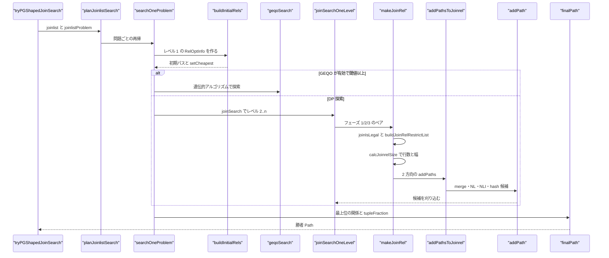
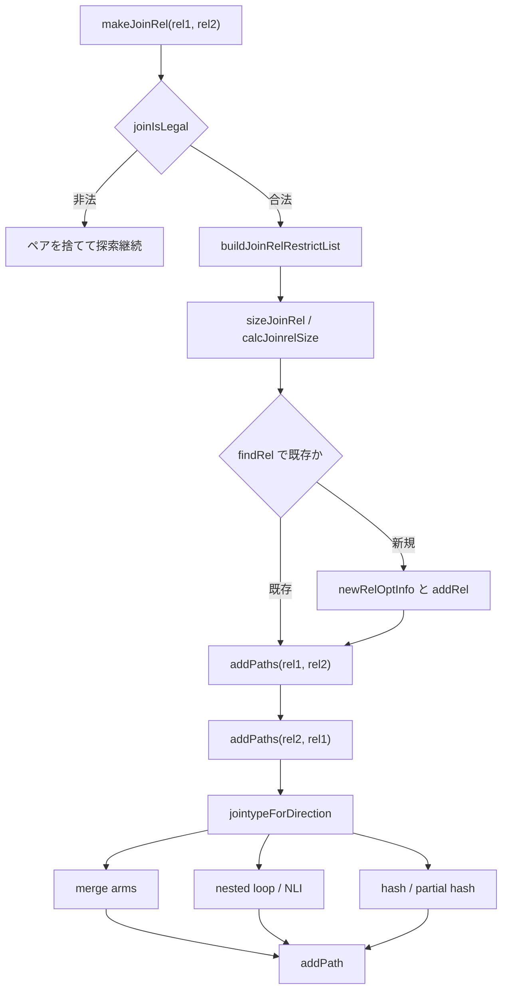

# 結合順序探索

<details>
<summary>関連ソースファイル</summary>

- [`internal/optimizer/geqo.go`](https://github.com/ryogrid/goopg/blob/19856410e8d497d59787e1ab35a2febb3f5953d6/internal/optimizer/geqo.go)
- [`internal/optimizer/join_exec_keys.go`](https://github.com/ryogrid/goopg/blob/19856410e8d497d59787e1ab35a2febb3f5953d6/internal/optimizer/join_exec_keys.go)
- [`internal/optimizer/join_hashkey.go`](https://github.com/ryogrid/goopg/blob/19856410e8d497d59787e1ab35a2febb3f5953d6/internal/optimizer/join_hashkey.go)
- [`internal/optimizer/joincost.go`](https://github.com/ryogrid/goopg/blob/19856410e8d497d59787e1ab35a2febb3f5953d6/internal/optimizer/joincost.go)
- [`internal/optimizer/joinlayout.go`](https://github.com/ryogrid/goopg/blob/19856410e8d497d59787e1ab35a2febb3f5953d6/internal/optimizer/joinlayout.go)
- [`internal/optimizer/joinpaths.go`](https://github.com/ryogrid/goopg/blob/19856410e8d497d59787e1ab35a2febb3f5953d6/internal/optimizer/joinpaths.go)
- [`internal/optimizer/joinpathsmemoize.go`](https://github.com/ryogrid/goopg/blob/19856410e8d497d59787e1ab35a2febb3f5953d6/internal/optimizer/joinpathsmemoize.go)
- [`internal/optimizer/joinpathsmerge.go`](https://github.com/ryogrid/goopg/blob/19856410e8d497d59787e1ab35a2febb3f5953d6/internal/optimizer/joinpathsmerge.go)
- [`internal/optimizer/joinpathsmergeouter.go`](https://github.com/ryogrid/goopg/blob/19856410e8d497d59787e1ab35a2febb3f5953d6/internal/optimizer/joinpathsmergeouter.go)
- [`internal/optimizer/joinpathsnli.go`](https://github.com/ryogrid/goopg/blob/19856410e8d497d59787e1ab35a2febb3f5953d6/internal/optimizer/joinpathsnli.go)
- [`internal/optimizer/joinrelsize.go`](https://github.com/ryogrid/goopg/blob/19856410e8d497d59787e1ab35a2febb3f5953d6/internal/optimizer/joinrelsize.go)
- [`internal/optimizer/joinrestrict.go`](https://github.com/ryogrid/goopg/blob/19856410e8d497d59787e1ab35a2febb3f5953d6/internal/optimizer/joinrestrict.go)
- [`internal/optimizer/joinsearch.go`](https://github.com/ryogrid/goopg/blob/19856410e8d497d59787e1ab35a2febb3f5953d6/internal/optimizer/joinsearch.go)
- [`internal/optimizer/joinsearchlevel.go`](https://github.com/ryogrid/goopg/blob/19856410e8d497d59787e1ab35a2febb3f5953d6/internal/optimizer/joinsearchlevel.go)
- [`internal/optimizer/joinsearchseam.go`](https://github.com/ryogrid/goopg/blob/19856410e8d497d59787e1ab35a2febb3f5953d6/internal/optimizer/joinsearchseam.go)
- [`internal/optimizer/joinsearchtrace.go`](https://github.com/ryogrid/goopg/blob/19856410e8d497d59787e1ab35a2febb3f5953d6/internal/optimizer/joinsearchtrace.go)
- [`internal/optimizer/joinselectivity.go`](https://github.com/ryogrid/goopg/blob/19856410e8d497d59787e1ab35a2febb3f5953d6/internal/optimizer/joinselectivity.go)
- [`internal/optimizer/reduce_outer_joins.go`](https://github.com/ryogrid/goopg/blob/19856410e8d497d59787e1ab35a2febb3f5953d6/internal/optimizer/reduce_outer_joins.go)
- [`internal/optimizer/reduce_unique_semijoins.go`](https://github.com/ryogrid/goopg/blob/19856410e8d497d59787e1ab35a2febb3f5953d6/internal/optimizer/reduce_unique_semijoins.go)
- [`internal/optimizer/searchedtree.go`](https://github.com/ryogrid/goopg/blob/19856410e8d497d59787e1ab35a2febb3f5953d6/internal/optimizer/searchedtree.go)
- [`internal/optimizer/specialjoin.go`](https://github.com/ryogrid/goopg/blob/19856410e8d497d59787e1ab35a2febb3f5953d6/internal/optimizer/specialjoin.go)

</details>

このコンポーネントは、FROM 句の結合木を「どの順序で・どの方式で結合するか」の探索問題に変換し、PostgreSQL と同じレベル単位の動的計画法（DP）で候補を列挙する。`searchCtx` が `joinrels[lev]` と `relMap` に各 relset の `RelOptInfo` を保持し、`joinSearchOneLevel` がフェーズ 1（左/右深い結合）、フェーズ 2（bushy）、フェーズ 3（最後の手段の直積）の順にペアを作り、`makeJoinRel` が `SpecialJoinInfo` の合法性検査、制限節の分配、行数・幅の見積もり、両方向のパス生成を行う。各方向では `addPathsToJoinrel` が merge・nested loop・NLI・Material・partial・hash の各アームを、PG と同じ順序で `addPath` に提出する。結合が大きい場合は `geqoSearch` が遺伝的アルゴリズムに切り替わる。外側結合の削減（`reduceOuterJoins`）と一意 SEMI 結合の削減（`pulledSemiRhsIsUnique`）が探索前の正規化を担い、探索結果の座標復元と代替候補の再構築は `searchedtree.go` が受け持つ。親セクションは [5 クエリプランナー](../5-Query-Planner.md)。全体像は [5.1 プランナー全体像](5.1-Planner-Overview.md)、コスト関数は [5.2 パスとコストモデル](5.2-Path-and-Cost.md)、探索後の変換は [5.7 パスからプランへの変換](5.7-Plan-Creation.md)、統計は [5.8 統計と選択度推定](5.8-Statistics-and-Selectivity.md) を参照。

## 責務

- 結合問題の受理判定。`tryPGShapedJoinSearch` が joinlist の範囲、リーフ数、オフセットの連続性、LATERAL や FULL の有無を検査し、探索できない形は構文順へフォールバックする。`path:internal/optimizer/joinsearchseam.go:tryPGShapedJoinSearch`
- レベル 1 の構築。`buildInitialRels` が FROM 項目ごとに `RelOptInfo` を作り、relid `1<<i`、`baseLeaf`、`baseOffset`、行数、幅、`NCols`、`AvgVarBytes` を記録する。`path:internal/optimizer/joinsearch.go:buildInitialRels`
- レベル単位の列挙。`joinSearch` がレベル 2..n を回し、各レベルで `joinSearchOneLevel` の 3 フェーズを実行した後、`generateUsefulGatherPaths` と `setCheapest` を呼ぶ。`path:internal/optimizer/joinsearchlevel.go:joinSearch`
- 特殊結合の合法性。`joinIsLegal` が `SpecialJoinInfo` の MinLefthand/MinRighthand と入力 relset の包含を検査し、LEFT の RHS への結合、SEMI の一意化、複数 SJI の競合を判定する。`path:internal/optimizer/joinsearchlevel.go:joinIsLegal`
- 制限節の分配。`buildJoinRelRestrictList` が「この結合で計算可能で、まだ下で適用されていない」節を選び、外側結合の nullable 側のフィルタ節もここで取り込む。`path:internal/optimizer/joinrestrict.go:buildJoinRelRestrictList`
- 結合関係のサイズ決め。`calcJoinrelSize` が INNER/LEFT/RIGHT/FULL/SEMI/ANTI の各アームで行数を計算し、`joinPublishesInner` が SEMI/ANTI の LHS のみ公開を保証する。`path:internal/optimizer/joinrelsize.go:calcJoinrelSize`
- キー・残余節の分割。`splitJoinClauses` が `clause_sides_match_join` に従ってハッシュ/マージキーと残余を分け、`isKeyableFor` が両オペランドの relset を検査する。`path:internal/optimizer/joinpaths.go:splitJoinClauses`
- 結合方向ごとの jointype 決定。`jointypeForDirection` が SJI の LHS/RHS と入力の向きから実行可能な結合種別と一意化対象を返し、逆向きの RIGHT SEMI/ANTI は `rightSemiAntiForDirection` が別建てで扱う。`path:internal/optimizer/joinpaths.go:jointypeForDirection`
- merge 結合の生成。`mergeKeyGroups` が等値節を外側キー単位にまとめ、`sortInnerAndOuter` と `matchUnsortedOuterMerge` が明示ソート版と既順序版の両方を提出する。`path:internal/optimizer/joinpathsmerge.go:mergeKeyGroups`
- NLI（インデックス・ネストループ）の生成。`addNLIPaths` が `CheapestParameterized` の各 inner を外側パスと組み合わせ、`paramSourceRelsForProblem` が `param_source_rels` を導出する。`path:internal/optimizer/joinpathsnli.go:addNLIPaths`
- Memoize の適格判定。`getMemoizePath` が `enableMemoize`、外側行数 2 以上、裸の列キー、ndistinct を検査し、`costMemoizeRescan` で再スキャンコストを見積もる。`path:internal/optimizer/joinpathsmemoize.go:getMemoizePath`
- 外側結合の削減。`reduceOuterJoins` が WHERE/ON の厳密述語と `IS NULL` から LEFT→INNER、LEFT→ANTI、RIGHT→LEFT の降格を決める。`path:internal/optimizer/reduce_outer_joins.go:reduceOuterJoins`
- 一意 SEMI 結合の削減。`pulledSemiRhsIsUnique` が RHS が単一関係で一意キーに覆われる場合に SEMI を通常の INNER として扱えると証明する。`path:internal/optimizer/reduce_unique_semijoins.go:pulledSemiRhsIsUnique`
- 大規模問題の GEQO。`geqoSearch` がプール生成、選択、ERX 交叉、評価、最良ツアーの木構築を行う。`path:internal/optimizer/geqo.go:geqoSearch`
- 来歴の記録。`searchTrace` がペアの提示・拒否・コスト・並列 admission を記録し、`emit` が `DPTRACE` 行をまとめて出す。`path:internal/optimizer/joinsearchtrace.go:searchTrace`
- 探索済み木の再利用。`searchedBoundaryRebuild` が個別の探索パスを、コミット済みのスキーマと同じバインディング順の `Node` に再構築する。`path:internal/optimizer/searchedtree.go:searchedBoundaryRebuild`

## 処理フロー

探索の入口は `tryPGShapedJoinSearch` である。`resolveContext.joinlist` と探索前の CROSS/INNER 連鎖を受け取り、リーフ数とバインディングのオフセットが一致することを確認する。`nrels` が 1 以上 `maxSearchRels` 以下で、joinlist の葉範囲が `[0, nprefix)` に収まる場合だけ受理し、`planJoinlistSearch` に `joinlistProblem` を渡す。`planJoinlistSearch` は `validateJoinlistProblem` で `bindings`/`scans`/`relInfos`/`leafSpans` の長さと単調性を検査し、`makeRelFromJoinlist` を再帰的に呼ぶ。各問題は `searchOneProblem` で実行され、`buildInitialRels` がレベル 1 を作る。

`searchOneProblem` はまず `buildRestrictInfosExcluding` で結合節のリストを作る。単一関係の条件は葉ノードに押し込まれているため、ここには 2 つ以上の FROM 項目を参照する節だけが入る。続いて `sjInfosInItemSpace` が SJI の relid を問題空間へ写し、`buildInitialRels` が基底リレーションを作る。基底パスを出し切った後、`prob.cp.geqo && len(items) >= prob.cp.geqoThreshold` なら `geqoSearch` が、そうでなければ `joinSearch` が呼ばれる。

`joinSearch` は `b == nil` とレベル 1 の個数不一致をエラーにし、`s.clauses` と `s.builder` を設定する。レベル 2 から `nrels` まで、`joinSearchOneLevel` がフェーズ 1（`lev-1` 個の関係と初期関係を、結合節か順序制約でつながる組だけ結合）、フェーズ 2（`k` 個と `lev-k` 個の bushy 結合、`2 ≤ k ≤ lev-2`）、フェーズ 3（レベルが空なら節制約を外して初期関係と総当たり）を実行する。各ペアは `makeJoinRel` に渡される。

`makeJoinRel` はまず `joinIsLegal` で SJI 制約を検査する。非法なペアはエラーではなく「そのペアを捨てる」 (`nil, nil`) として扱い、探索は続行する。合法なら `reversed` に従って入力の向きを直し、`buildJoinRelRestrictList` でこの結合の制限節を組み立てる。`findRel` で既存の関係を探し、なければ `sizeJoinRel` → `calcJoinrelSize` で行数と幅を確定して `newRelOptInfo` を作り、`memberRels`/`publishedMembers`/`NCols`/`AvgVarBytes`/`colVarFrom`/`ConsiderStartup`/`ConsiderParallel` を設定して `addRel` する。最後に `builder.addPaths` を `(rel1, rel2)` と `(rel2, rel1)` の 2 回呼ぶ。

`addPathsToJoinrel` は両入力に `CheapestTotal` があることを要求し、`rightSemiAntiForDirection` が成立すれば RIGHT SEMI/ANTI の hash パスを先に出す。続いて `jointypeForDirection` でこの方向の結合種別と一意化対象を決め、`addPathsForJointype` に渡す。`addPathsForJointype` は一意化がある場合は jointype を INNER に落とし、`semiAntiJoinFactorsFor` で SEMI/ANTI の一致率を計算し、`paramSourceRelsForProblem` で `param_source_rels` を求める。外側が内側にパラメータ化されている方向は即座に拒否し、内側が外側にパラメータ化されている場合は hash と通常 NL をスキップして NLI アームに任せる。

アームの順序は `addPath` のファジー同点時の勝者を決めるため、PG の順序がそのまま守られる。まず `sortInnerAndOuter`（明示ソート merge）、`matchUnsortedOuterMerge`（既順序 merge）、`matchUnsortedOuterMergePartial`（部分 merge）が走り、次に `addNestLoopPath`、`addNLIPaths`、`addMaterialNestLoopPath`、`addPartialNestLoopPaths` が続く。最後に `addHashJoinPath` と `addPartialHashJoinPath` が出る。`addNLIPaths` は `inner.CheapestParameterized` の各 inner について、`nestloopResidualClauses` で probe が実際に適用する節を除いた残余を作り、裸の inner と `getMemoizePath` の返すキャッシュ版を同じ `addPath` に並べる。

各レベルの全ペアを出し切ると、`joinSearch` は関係ごとに `generateUsefulGatherPaths` を呼んでから `setCheapest` を実行し、`trace.cost` に勝者と 2 番手を記録する。全レベルが終わると `finalRel` が最上位の 1 個の関係を返し、`finalPath` が `rootPathOf` 経由で勝者パスを選ぶ。`tryPGShapedJoinSearch` は探索木と残余述語を返し、残余が境界のパディング列を読む場合は構文順へフォールバックする。



`makeJoinRel` の内部判断は、合法性・サイズ・パス生成の 3 段に分かれている。



## 主要ファイル

| ファイル | 役割 |
| --- | --- |
| `internal/optimizer/joinsearch.go` | `searchCtx` の定義、`newSearchCtx`、`buildInitialRels`、`finalRel`/`finalPath`。探索の状態とレベル 1。`path:internal/optimizer/joinsearch.go:searchCtx` |
| `internal/optimizer/joinsearchlevel.go` | `joinSearch`、`joinSearchOneLevel`、`makeJoinRel`、`joinIsLegal`、`joinRelBuilder`。列挙と合法性。`path:internal/optimizer/joinsearchlevel.go:joinSearchOneLevel` |
| `internal/optimizer/joinsearchseam.go` | `tryJoinSearch`/`tryPGShapedJoinSearch`。受理判定、残余述語の算出、座標再基準化。`path:internal/optimizer/joinsearchseam.go:tryPGShapedJoinSearch` |
| `internal/optimizer/joinrestrict.go` | `restrictInfo`/`restrictInfoList`、`buildRestrictInfos`、`clausesFor`、`buildJoinRelRestrictList`。節の分配。`path:internal/optimizer/joinrestrict.go:buildJoinRelRestrictList` |
| `internal/optimizer/joinrelsize.go` | `searchJoinRelBuilder`、`calcJoinrelSize`、`superkeyJoinSelectivity`、`joinPublishesInner`。結合関係のサイズ。`path:internal/optimizer/joinrelsize.go:calcJoinrelSize` |
| `internal/optimizer/joinpaths.go` | `addPathsToJoinrel`、`addPathsForJointype`、`splitJoinClauses`、`jointypeForDirection`。アームの順序と方向決定。`path:internal/optimizer/joinpaths.go:addPathsToJoinrel` |
| `internal/optimizer/joinpathsmerge.go` | `mergeKeyGroups`、`sortInnerAndOuter`、`tryMergeJoinPath`、`buildJoinPathkeys`。merge 結合。`path:internal/optimizer/joinpathsmerge.go:mergeKeyGroups` |
| `internal/optimizer/joinpathsmergeouter.go` | `matchUnsortedOuterMerge`、`findMergeClausesForOuterPathkeys`、`trimMergeClausesForInnerPathkeys`。既順序 merge。`path:internal/optimizer/joinpathsmergeouter.go:matchUnsortedOuterMerge` |
| `internal/optimizer/joinpathsnli.go` | `addNLIPaths`、`paramSourceRelsForProblem`、`nestloopResidualClauses`、`allowStarSchemaJoin`。パラメータ化 NL。`path:internal/optimizer/joinpathsnli.go:addNLIPaths` |
| `internal/optimizer/joinpathsmemoize.go` | `getMemoizePath`、`costMemoizeRescan`、`memoizeCacheKeys`、`pathRescanCost`。Memoize の適格判定と再スキャン。`path:internal/optimizer/joinpathsmemoize.go:getMemoizePath` |
| `internal/optimizer/joinselectivity.go` | `joinVarStats`、`examineJoinVar`、`eqJoinSelectivityExt`、`joinClauseSelectivity`、`mergeJoinScanSel`。結合選択度。`path:internal/optimizer/joinselectivity.go:eqJoinSelectivityExt` |
| `internal/optimizer/specialjoin.go` | `SpecialJoinInfo`、`makeSpecialJoinInfo`、`sjiQualRelids`、`joinIsLegal` の入力。外側/SEMI/ANTI の性質。`path:internal/optimizer/specialjoin.go:SpecialJoinInfo` |
| `internal/optimizer/reduce_outer_joins.go` | `reduceOuterJoins`、`demotedForPlan`、`applyDemotion`。LEFT→INNER/ANTI、RIGHT→LEFT。`path:internal/optimizer/reduce_outer_joins.go:reduceOuterJoins` |
| `internal/optimizer/reduce_unique_semijoins.go` | `pulledSemiRhsIsUnique`、`columnsCover`。一意 RHS の SEMI 削減。`path:internal/optimizer/reduce_unique_semijoins.go:pulledSemiRhsIsUnique` |
| `internal/optimizer/geqo.go` | `geqoSearch`、`poolSize`、`numberGenerations`、`gimmeTree`、`mergeClump`、ERX 交叉。`path:internal/optimizer/geqo.go:geqoSearch` |
| `internal/optimizer/joinsearchtrace.go` | `searchTrace`、`tracePair`、`traceCost`、`emit`。`DPTRACE` の来歴。`path:internal/optimizer/joinsearchtrace.go:searchTrace` |
| `internal/optimizer/searchedtree.go` | `searchedBoundaryRebuild`、`markSearchedTree`、`assertSearchedTreeNeedsNoReconcile`。探索木の境界再構築。`path:internal/optimizer/searchedtree.go:searchedBoundaryRebuild` |
| `internal/optimizer/joinlayout.go` | `reconcileNLILayout`、`reresolveJoinByName`、`findColumnIndexByNameAndSource`。レイアウト再解決。`path:internal/optimizer/joinlayout.go:reconcileNLILayout` |
| `internal/optimizer/join_exec_keys.go` | `JoinExecKeys`、`ExecHashKeyPlan`、`ExecMergeKeyPlan`。実行時のキー/残余分割。`path:internal/optimizer/join_exec_keys.go:ExecHashKeyPlan` |
| `internal/optimizer/join_hashkey.go` | `HashKeysAreInt64`、`HashKeysTakeInt64Lane`、`mergedKeyColumn`。ハッシュキーの型判定。`path:internal/optimizer/join_hashkey.go:HashKeysTakeInt64Lane` |
| `internal/optimizer/joincost.go` | `chooseInnerJoinAlgo` と単位行コスト。探索が作らなかった木の INNER 結合方式を選ぶ。探索由来の結合は `joinpaths.go` が価格付けする。`path:internal/optimizer/joincost.go:chooseInnerJoinAlgo` |

## 公開 API / エントリポイント

結合探索の本体はパッケージ内部で、`planSelect` から `tryJoinSearch` を経由して呼ばれる。外部へ公開されているのは GEQO のプロセス設定だけである。

```go
func SetGeqoEnabled(on bool)
func SetGeqoThreshold(n int64)
func GeqoEnabled() bool
func GeqoThreshold() int
```

内部の主要な入口は次のとおり。`joinSearch` はレベル 1 が構築済みであることを要求し、`addPathsToJoinrel` は両入力の `CheapestTotal` を要求する。

```go
func (s *searchCtx) joinSearch(clauses *restrictInfoList, b joinRelBuilder) (*RelOptInfo, error)
func (s *searchCtx) joinSearchOneLevel(lev int) error
func (s *searchCtx) makeJoinRel(rel1, rel2 *RelOptInfo) (*RelOptInfo, error)
func addPathsToJoinrel(s *searchCtx, joinrel, outer, inner *RelOptInfo, clauses []*restrictInfo, cp costParams, sjinfo *SpecialJoinInfo) error
func geqoSearch(s *searchCtx, builder joinRelBuilder, effort int) (*Path, error)
func reduceOuterJoins(from []parser.FromExpr, where parser.Expr, cat catalog.Catalog)
func demotedForPlan(item parser.FromExpr, where parser.Expr, cat catalog.Catalog) (parser.FromExpr, map[string]bool)
func pulledSemiRhsIsUnique(pb *jtPulledBody, rhs RelSet, spanning []Expr, spans []leafSpan, cat catalog.Catalog) bool
func searchedBoundaryRebuild(p *Path, exemplar Schema) Node
```

## 主要データ構造

### `searchCtx`

1 つの結合問題の作業状態で、PG の `PlannerInfo` のうち探索が読む部分を持つ。`path:internal/optimizer/joinsearch.go:searchCtx`

| フィールド | 保持するもの |
| --- | --- |
| `joinrels [][]*RelOptInfo` | `joinrels[lev]` は基底関係をちょうど `lev` 個含む関係。0 番は未使用。 |
| `relMap map[RelSet]*RelOptInfo` | relset から関係への逆引き。find-or-create の土台。 |
| `nrels int` | 基底関係数。レベル 1..nrels を探索する。 |
| `cp costParams` | 全パスを価格付けする通貨。 |
| `tupleFraction float64` | LIMIT の取得割合。0 は全行。 |
| `builder joinRelBuilder` | `sizeJoinRel` と `addPaths` の協働者。nil は拒否される。 |
| `clauses *restrictInfoList` | この問題の結合節一覧。 |
| `joinInfoList []*SpecialJoinInfo` | 外側/SEMI/ANTI の制約。合法性検査が読む。 |
| `relInfos []baseRelInfo` | 初期関係ごとの表・統計・フィルタ情報。 |
| `problemItems []joinlistRel` / `itemSpans []leafSpan` | 問題の項目と、そのバインディング窓。 |
| `queryPathkeys` / `groupPathkeys` / `distinctPathkeys` | 文が要求する順序・グループ化・DISTINCT。 |
| `neededCols` / `outputCols` / `outputEligible` | 必要列、上位必要列、窄化の適用可否。 |
| `parallelModeOK` / `cat` | 並列可否と、条件の安全性を解くカタログ。 |
| `trace *searchTrace` | 列挙来歴。`GOOPG_PGSHAPED_DP_TRACE` がなければ nil。 |

不変条件として、`addRel` は relset のビット数からレベルを導出し、空・重複・範囲外をエラーにする。`joinrels` と `relMap` は同じ relset を別レベルに置かない。`joinSearch` はレベルごとに全ペアを出し切ってから `setCheapest` を呼ぶ。これは、後から同じ relset に届く安いパスを取り逃さないためである。

<details>
<summary>searchCtx の完全定義</summary>

`path:internal/optimizer/joinsearch.go:searchCtx`

```go
type searchCtx struct {
	// exprKeys memoises exprIdentityKey by expression node for the whole
	// search; every rel's pathkeyUsefulness shares it (M0122-0012 slice 42).
	// The search is single-goroutine and the clause and pathkey expressions
	// it keys are not mutated in place during it.
	exprKeys map[Expr]cachedKey
	// ecIdx is the search's equivalence-class index for pathkeyUsefulness
	// (classIndex): built once per clause list and shared by every rel and
	// every GEQO tour, like exprKeys (M0122-0012 slice 78).
	ecIdx *classIndex
	// narrowColsMemo / attrNeededMemo memoise joinrelNarrowedWidths' pure
	// inputs for the whole search: a member rel's kept columns, and the
	// above-tree NAME set per relids. GEQO rebuilds every joinrel on each of
	// its ~500 tours (TPC-DS Q64), and PG reads attr_needed computed once per
	// base rel (build_joinrel_tlist, relnode.c) rather than re-deriving it per
	// joinrel. attrNeededMemo is valid for attrMemoList at attrMemoLen
	// clauses only (M0122-0012 C16a).
	narrowColsMemo map[*RelOptInfo]narrowColsEntry
	attrNeededMemo map[RelSet]attrNeededEntry
	attrMemoList   *restrictInfoList
	attrMemoLen    int
	// innerUniqueMemo memoises innerRelProvenUnique for the search, like
	// PG's innerrel_is_unique caching its verdicts in unique_for_rels /
	// non_unique_for_rels (analyzejoins.c): GEQO re-asks the same pairs on
	// every tour (M0122-0012 C16b).
	innerUniqueMemo map[innerUniqueKey][]innerUniqueEntry
	// usefulMemo memoises pathkeyUsefulnessFor per joinrel relids: its
	// fields read only the relids, the clause list and the query's
	// ordering/grouping/distinct pathkeys, and GEQO rebuilds the same joinrel
	// on every tour (M0122-0012 C16c). usefulMemoOwner records the inputs it
	// was filled for; any change resets it.
	usefulMemo      map[RelSet]*pathkeyUsefulness
	usefulMemoOwner usefulMemoOwner
	// geqoEvalSeq / geqoProbe: the M0146-0214 GEQO trace (geqo.go) — the
	// search's evaluation counter, and whether this evaluation context's join
	// rels are traced. Trace-only; zero unless GOOPG_GEQO_TRACE is set.
	geqoEvalSeq int
	geqoProbe   bool
	// orClauseSelDivisor: see joinlistProblem.orClauseSelDivisor.
	orClauseSelDivisor map[Expr]float64
	// semiDerivedRHS is the union of the SEMI join RHS relations (item
	// coordinates) that M0146-0127's derived equalities read; a
	// parameterised inner that needs one of them may sit only under an
	// outer path that kept its columns (paramOuterKeepsRHS).
	semiDerivedRHS RelSet

	// joinrels is PG's `root->join_rel_level`: `joinrels[lev]` holds every
	// RelOptInfo whose relset has exactly `lev` base rels. Index 0 is unused
	// (PG's array is 1-based) and `joinrels[1]` is the initial rels, in FROM
	// order. Level order is significant: phase 1 pairs `joinrels[lev-1]` with
	// `joinrels[1]`, phase 2 pairs `joinrels[k]` with `joinrels[lev-k]`, and
	// phase 2's mirror-image rule (joinrels.c:174-177) indexes INTO the level
	// list, so entries must never be reordered once appended.
	joinrels [][]*RelOptInfo

	// relMap is the relset -> rel lookup that sits beside the level lists —
	// PG's `join_rel_hash` (relnode.c). Base rels are registered here too, so
	// a singleton relset resolves through the same door as a composite one.
	// This is what makes `makeJoinRel` (P5.3) a find-or-create rather than an
	// unconditional allocation: the same joinrel is reached from every pair
	// of subsets that spans it, and every such pair must add its paths to ONE
	// rel or add_path cannot prune across them.
	relMap map[RelSet]*RelOptInfo

	// nrels is the number of base relations in this join problem; the search
	// runs levels 2..nrels and the final rel is the sole entry at nrels.
	nrels int

	// cp is the cost currency every path in this search is priced in (04 §1).
	cp costParams

	// tupleFraction is PG's `root->tuple_fraction` (pathnodes.h:341): how much
	// of the result will actually be fetched, in upstream's overloaded
	// encoding — 0 for all rows, (0,1) for a fraction, >= 1 for an absolute
	// count. `preprocessLimit` (tuplefraction.go) derives it from the `*Limit`
	// above the join and `buildInitialRels` records it here.
	//
	// It is on the CONTEXT rather than on each rel because it is a property of
	// the query, not of a relation: every rel the search creates copies it into
	// its own `ConsiderStartup`, exactly as `build_simple_rel` /
	// `build_join_rel` do (relnode.c:211/707), and `finalPath` reads it once at
	// the root. Zero is the "fetch everything" default, which is the regime
	// every search ran in before M0127-P5.7-b.
	tupleFraction float64

	// rootCheapestTotal makes finalPath (and GEQO's root) hand up the final
	// rel's CheapestTotal instead of the fractional pick: an aggregate stage
	// above consumes every row, and PG applies the fraction only at
	// final_rel (M0146-0150; resolveContext.rootCheapestTotal).
	rootCheapestTotal bool

	// relInfos is the per-initial-rel estimate `buildInitialRels` was handed,
	// kept because the parameterised index paths of P5.4b-ii-a need each base
	// rel's `catalog.Table` and cannot be built until the clause list exists
	// (pathparamindex.go). Index i corresponds to `joinrels[1][i]`, which is
	// FROM order — the same correspondence `buildInitialRels` established when
	// it derived relid `1<<i` from position i.
	relInfos []baseRelInfo

	// clauses is the join-clause bookkeeping the enumerator gates on — PG's
	// per-rel `joininfo` lists, flattened (joinrestrict.go:91). nil is legal
	// and means "no join qual anywhere", which phase 1's clauseless branch
	// handles; every predicate on it is nil-safe. Set by `joinSearch`.
	clauses *restrictInfoList
	// pushedDown / pushedDownRelids are the WHERE conjuncts delayed above
	// the outer joins they read and the joinrel that completes those joins:
	// the whole problem (M0146-0224, tryJoinSearch). Set on the root problem
	// only; that joinrel's clause list carries them as pushed-down
	// restrictions.
	pushedDown       []*restrictInfo
	pushedDownRelids RelSet

	// builder is the sizing-and-costing collaborator `makeJoinRel` calls —
	// P5.6's calcJoinrelSize and P5.4's add_paths_to_joinrel
	// (joinsearchlevel.go:36). Set by `joinSearch`, which refuses a nil one.
	builder joinRelBuilder

	// trace is the enumeration-provenance record (M0127-P5.9-l-ii,
	// joinsearchtrace.go) — nil unless `GOOPG_PGSHAPED_DP_TRACE=1`, and read
	// only through its own nil-safe methods. It answers the one question the
	// chosen plan cannot: whether a pairing PG chose was ever OFFERED here.
	trace *searchTrace

	// tracePhase is which `join_search_one_level` pass is currently
	// enumerating, so `makeJoinRel` can record a pair's provenance without
	// being handed a phase argument it would otherwise ignore. Meaningless
	// while `trace` is nil.
	tracePhase int

	// joinInfoList is root->join_info_list: every SpecialJoinInfo built during
	// jointree deconstruction, in bottom-up order. Consumed by join_is_legal
	// (joinIsLegal), joinOrderRestricted, and hasJoinRestriction. nil means
	// "no special joins" — a simple inner-join-only FROM clause — which is
	// the fast path equivalent of an empty list. M0128-P1.2.
	joinInfoList []*SpecialJoinInfo

	// problemItems is the FROM-item run this problem searches, in order:
	// item i owns relid 1<<i. Stamped by searchOneProblem beside the
	// clause list; read by the C-08 param_source_rels derivation, which
	// must remap statement-global SJI hands into this problem's frame
	// (an item is NOT always statement leaf lo+i — see the remap rule).
	// Nil in hand-built test contexts → the derivation yields 0 (legacy).
	problemItems []joinlistRel

	// itemSpans is the same item-coordinate binding window list
	// `buildRestrictInfos` resolved `prob.conjuncts` against: itemSpans[i]
	// is item i's `[lo,hi)` span of statement binding coordinates, which is
	// the input `relidsOfExpr` needs to attribute an expression's ColumnRefs
	// to item bits. Stamped beside `problemItems` in `searchOneProblem`; nil
	// in hand-built contexts, where consumers decline (nil-spans
	// `relidsOfExpr` answers not-ok). Read by `usefulPathkeysForRelation`
	// (gatherpaths.go) for `relation_can_be_sorted_early`'s computable-from-
	// reltarget test — M0146-0027.
	itemSpans []leafSpan

	// queryPathkeys is `PlannerInfo.query_pathkeys` (C-07/P3-06,
	// querypathkeys.go): the ordering the STATEMENT wants from this level,
	// derived once by `standard_qp_callback` before the first rel exists and
	// carried here for the same reason `tupleFraction` is — it is a property
	// of the query, not of a relation. Read by `hasUsefulPathkeys`. Empty
	// means "no special ordering requested", which is upstream's NIL.
	queryPathkeys []PathKey
	// groupPathkeys / distinctPathkeys are `root->group_pathkeys` and
	// `distinct_pathkeys` (M0146-0223), read by truncate_useless_pathkeys'
	// grouping and distinct arms (pathkeys_useful.go).
	groupPathkeys    []PathKey
	distinctPathkeys []PathKey

	// neededCols / neededColsKnown are PG's `reltarget` + `attr_needed` for
	// this statement, by COLUMN NAME — see pathindexonlyneed.go for the
	// direction of the approximation. `neededColsKnown == false` means
	// "assume every column is needed", which is what the pre-index-only
	// planner assumed unconditionally. Consumed by `addIndexOnlyPaths`.
	neededCols      map[string]bool
	neededColsKnown bool

	// outputCols / outputColsKnown are the statement's ABOVE-TREE
	// needed-column set (outputColumnNames), the union needed above the
	// scan/join tree. Take2 P4-01 Slice 3: per-joinrel keep-sets derive
	// from it. outputEligible folds the positional gates (statement-top
	// problem, no pinned spine above, no outer-scope reads): only an
	// eligible problem stamps the set onto its rels, so the derivation
	// declines everywhere else by construction.
	outputCols      map[string]bool
	outputColsKnown bool
	outputEligible  bool
	// queryTopRelids is root->all_query_rels when this problem's final rel
	// is the query's topmost scan/join rel, else 0. PG gathers partial paths
	// on every joinrel EXCEPT that one inside the join search (merge_clump,
	// standard_join_search) and gathers it later, in
	// apply_scanjoin_target_to_paths.
	queryTopRelids RelSet

	// parallelModeOK is `root->glob->parallelModeOK` for this search
	// (considerparallel.go); cat is the catalog the qual-safety walk resolves
	// user routines through. Both are set by `setBaseRelConsiderParallel`,
	// the C-19a protocol step; a search that skips the step (every direct
	// test caller) keeps the zero values — no rel considers parallel, no
	// partial path exists — which is the pre-C-19 regime exactly.
	parallelModeOK bool
	cat            catalog.Catalog
}
```

</details>

### `SpecialJoinInfo`

外側結合・SEMI/ANTI の制約を表す。`makeSpecialJoinInfoScoped` が結合木の分解時に作り、`joinIsLegal` と `joinOrderRestricted` が読む。`path:internal/optimizer/specialjoin.go:SpecialJoinInfo`

```go
type SpecialJoinInfo struct {
	MinLefthand  RelSet // base+OJ relids in minimum LHS for join
	MinRighthand RelSet // base+OJ relids in minimum RHS for join
	SynLefthand  RelSet // base+OJ relids syntactically within LHS
	SynRighthand RelSet // base+OJ relids syntactically within RHS
	Jointype     parser.JoinType
	Ojrelid      int // outer join's RT index; 0 if none (SEMI/ANTI, or no RT entry yet)

	// commute_above_l/r and commute_below_l/r replace PG≤15's delay_upper_joins
	// flag (removed upstream in PG 18). They record which lower/higher outer
	// joins this one can commute with, discovered bottom-up during
	// make_outerjoininfo's ordered scan of the already-built join_info_list.
	CommuteAboveL RelSet // commuting OJs above this one, if LHS
	CommuteAboveR RelSet // commuting OJs above this one, if RHS
	CommuteBelowL RelSet // commuting OJs in this one's LHS
	CommuteBelowR RelSet // commuting OJs in this one's RHS

	LhsStrict bool // join clause is strict for some LHS rel
	// NullAware marks an ANTI link built from `x NOT IN (subquery)`
	// (inUnnestSJInfo): its three-valued NULL semantics live in the
	// executor's probe-side short-circuits (Join.NullAware), so the link may
	// only be performed with the LHS probing — never as JOIN_RIGHT_ANTI
	// (M0146-0005dj).
	NullAware bool

	// Semi/anti fields — meaningful only for JOIN_SEMI; populated later (P1.4).
	SemiCanBtree bool        // true if semi_operators are all btree
	SemiCanHash  bool        // true if semi_operators are all hash
	SemiOperators []uint32   // OIDs of equality join operators
	SemiRhsExprs  []Expr     // righthand-side expressions of these ops

	// SemiRhsProblemSpace marks SemiRhsExprs written in the join problem's
	// column space (a pulled sublink body, jointreepullup.go) rather than in
	// the RHS node's own output (the legacy unnest's atomic RHS).
	// createUniquePath maps them through the RHS rel's baseOffset.
	SemiRhsProblemSpace bool
	// SemiRhsDistinct records that the RHS is a pulled ANY_subquery whose
	// sub-select `query_is_distinct_for` its one output column
	// (M0145-0008ab). PG asks that of the rel's subquery RTE inside
	// create_unique_path (postgres/src/backend/optimizer/util/
	// pathnode.c:1955-1975); goopg's rel carries no parse tree, so the
	// pull-up answers it and records it here.
	SemiRhsDistinct bool
}
```

`MinLefthand`/`MinRighthand` は結合を実行できる最小の左右集合、`SynLefthand`/`SynRighthand` は構文上の左右集合である。`LhsStrict` は LHS の厳密述語があることを示し、LEFT の RHS への結合を許す条件になる。`NullAware` は `NOT IN` の NULL 三値論理を実行器の probe 側で扱うため、RIGHT ANTI への変換を禁止する。`SemiCanBtree`/`SemiCanHash` と `SemiRhsExprs` は SEMI の一意化・結合キーに使う。

### `restrictInfo` と `restrictInfoList`

`restrictInfo` は探索が扱う 1 つの条件で、PG の `RestrictInfo` をこの探索が必要とする範囲に縮めたものである。`path:internal/optimizer/joinrestrict.go:restrictInfo`

| フィールド | 保持するもの |
| --- | --- |
| `clause Expr` | 条件そのもの。 |
| `relids RelSet` | 条件が参照する全基底関係。2 個以上なら結合節。 |
| `leftKey`/`rightKey`, `leftRelids`/`rightRelids` | 等値結合の左右オペランドと、その relset。 |
| `isEquijoin bool` | 両オペランドが片側ずつで計算できる等値結合か。 |
| `subplanKey bool` | オペランドに SubPlan を含むか。hash 専用。 |
| `opLeftRelids`/`opRightRelids` | 比較演算子一般の左右 relset。 |
| `ojHeld bool` | 外側結合の ON のうち preserved 側だけを読む節か。 |
| `inferred bool` | 等価類から合成された節か。 |
| `ecID int` | 等価類の ID。`noEquivClass` は所属なし。 |
| `normSelec`/`normSelecValid` | 正規結合の選択度キャッシュ。 |
| `scanSel`/`scanSelValid` | merge の開始・終了選択度キャッシュ。 |
| `onlyBesideRel RelSet` | SEMI の RHS など、特定の関係の隣でだけ適用できる節か。 |
| `pushedDown bool` | 外側結合の後で適用する遅延 WHERE 節か。 |

`path:internal/optimizer/joinrestrict.go:restrictInfoList`

```go
type restrictInfoList struct {
	all []*restrictInfo

	// nclasses is the number of equivalence classes discovered; ecIDs are
	// dense in [0, nclasses).
	nclasses int

	// ecMembers is each class's `ec_members` list in PG's order: the
	// order `process_equivalence` (equivclass.c) adds members while it
	// walks the equalities in qual order — a new pair opens a class, a
	// new member appends, and a merge appends the right operand's class
	// after the left's. `generate_join_implied_equalities_normal` picks
	// its clause by this order (M0146-0022).
	ecMembers map[int][]columnIdent
	// ecPairs holds every member pair some clause in the list equates.
	ecPairs map[[2]columnIdent]bool
	// ecReduce enables reduceEquivClassJoinClauses. The search sets it
	// only for a problem with no special joins: an outer join's nullable
	// member is not equal to its class-mates once null-extended, so
	// "each side's members are already equal" does not hold there.
	ecReduce bool
	// flips caches reduceEquivClassJoinClauses' outer = inner copies of
	// clauses written inner = outer, so a clause keeps one identity
	// across the joinrel pairs that choose it (PG's ec_derives reuse).
	flips map[*restrictInfo]*restrictInfo
}
```

`all` は条件の安定した順序を保つ。`ecMembers`/`ecPairs` は等価類のメンバー順と既知の等値ペアを保持し、`reduceEquivClassJoinClauses` が 1 クラス 1 節に縮約するときに使う。`ecReduce` は外側結合を含む問題では false になる。null 拡張されたメンバーはクラスメートと等しくならないからである。`flips` は `inner = outer` の向きを入れ替えたコピーをキャッシュし、同じ節がペアごとに別 Identity にならないようにする。

### `joinRelBuilder`

探索の列挙とサイズ・パス生成を分離するインターフェースである。`makeJoinRel` はこれだけを通してサイズとパスを得る。`path:internal/optimizer/joinsearchlevel.go:joinRelBuilder`

```go
type joinRelBuilder interface {
	// sizeJoinRel returns the joinrel's cardinality and tuple width. Called
	// exactly ONCE per relset, from the first pair that reaches it: PG
	// computes the size inside `build_join_rel` on the create path only
	// (relnode.c), and every later pair spanning the same relset reuses it.
	// That is load-bearing rather than an optimisation — `add_path` compares
	// paths within one rel, and two pairs that disagreed about `rows` would
	// make those comparisons meaningless. `clauses` is the joinrel's own
	// restriction list (PG's `build_joinrel_restrictlist` output).
	//
	// `sjinfo` is what `joinIsLegal` matched for the FIRST pair to reach this
	// relset, post-`reversed` swap — so `outer` covers its LHS. C-04a passes
	// it for the outer-join row FLOOR only (see `applyOuterJoinRowFloor`); the
	// full `calc_joinrel_size_estimate` jointype switch is C-05. It is named
	// in the interface rather than smuggled through the builder because a
	// relset's size is fixed once and every path in the rel is compared
	// against it.
	sizeJoinRel(outer, inner *RelOptInfo, clauses []*restrictInfo, sjinfo *SpecialJoinInfo) (rows float64, width int)

	// addPaths is `add_paths_to_joinrel` for ONE direction: it must treat
	// `outer` as the outer (probe/driving) side and `inner` as the inner
	// (build/inner-scan) side, and add every path it finds to `joinrel` via
	// `addPath`. makeJoinRel calls it twice per pair, once per direction.
	//
	// `sjinfo` is the SpecialJoinInfo `joinIsLegal` matched for this pair, nil
	// for a plain inner join, and it is passed POST-`reversed`-swap, so the
	// caller's `outer` on the first of the two calls is the side that covers
	// the SJI's LHS. C-03b passes it because legality of a given direction is
	// an ORIENTATION question, not a jointype question — PG's
	// `populate_joinrel_with_paths` gives its two calls different jointypes for
	// exactly this reason (joinrels.c:932-939). See jointypeForDirection.
	addPaths(joinrel, outer, inner *RelOptInfo, clauses []*restrictInfo, sjinfo *SpecialJoinInfo) error
}
```

`sizeJoinRel` は relset ごとに 1 回だけ呼ばれ、同じ relset に後から到達するペアはその結果を再利用する。`addPaths` は 1 方向分だけを担当し、`makeJoinRel` が 2 回呼ぶ。この分離により、列挙の正しさをコストモデルから独立に検証できる。

### `mergeKeyGroup`

merge 結合がソートに使うキーの組である。`path:internal/optimizer/joinpathsmerge.go:mergeKeyGroup`

```go
type mergeKeyGroup struct {
	outerKey PathKey
	innerKey PathKey
	clauses  []*restrictInfo
}
```

`outerKey` は外側で計算できる式、`innerKey` は内側の対応式である。同じ外側キーに複数の節がぶら下がることがあり、`clauses` がそれを保持する。`mergeKeyGroups` は等価類 ID と式の一致でグループをまとめ、`indexOfOuterKey` で重複キーを防ぐ。

### `searchTrace`

1 つの結合問題の来歴である。`path:internal/optimizer/joinsearchtrace.go:searchTrace`

```go
type searchTrace struct {
	// names[i] is the relation the relid bit `1<<i` stands for: the FROM
	// item's ALIAS when it has one, else its catalog name. That is
	// `estimateaudit.leafRel`'s rule verbatim (parity.go:381) and it has to
	// be, or Q7's `nation n1` / `nation n2` collapse into one member on this
	// side and stay distinct on the plan side.
	names []string

	pairs    []tracePair
	declined []tracePair
	costs    []traceCost
	// R54 Step-0's admission records (admit/baseCP/gather above), rendered
	// after the cost lines in one problem's block.
	cpAdmits []traceCP
	gathers  []traceGather
	appendrs []traceAppendRel
	// R54 Step-1's veto records (pveto below), rendered after the gather
	// lines in one problem's block.
	pvetos []tracePVeto
	top    RelSet
	failed string
}
```

`names` は relid のビット位置から FROM 項目名への対応で、サブ問題では位置的な代替名になる。`pairs` は提示されたペア、`declined` は拒否されたペア、`costs` は各 relset の勝者と 2 番手、`cpAdmits`/`gathers`/`appendrs`/`pvetos` は並列 admission と veto の記録である。`emit` はこれらを `DPTRACE` 行にまとめ、失敗した探索でも出す。

### `JoinExecKeys`

ハッシュ結合の実行時キーと残余の分割である。プランの `HashKeys` は「使える等値ペア全部」だが、実行器がキーに畳めるのは `datumKey` の等値と `=` が一致する型だけである。`path:internal/optimizer/join_exec_keys.go:JoinExecKeys`

```go
type JoinExecKeys struct {
	// Keys are the pairs the executor hashes on, in plan order. Keys[0] is
	// always the join's existing (LeftKey, RightKey) — P2.2 does not change
	// which pair leads, only how many follow it.
	Keys []JoinKeyPair

	// Residual is the conjunction the executor must still evaluate per hash
	// match. It is Predicate minus the conjuncts of the hash-safe pairs.
	Residual Expr

	// Int64Keys reports that every pair in Keys is int-typed on both sides,
	// so the executor may use its fixed-width int64 encoding instead of
	// per-column datumKey strings.
	Int64Keys bool
}
```

`Keys[0]` は既存の `(LeftKey, RightKey)` を必ず残す。`NullAware` の `NOT IN` は単一キーのままにする。型が解決できないペアはキーに畳まず、残余に残す。`Int64Keys` が真なら実行器は固定幅の int64 経路を使える。`ExecMergeKeyPlan` も同じ `HashKeys` から merge 用のキー/残余を導く。

### GEQO の `Chromosome` と `Pool`

遺伝的アルゴリズムの個体と集団である。`path:internal/optimizer/geqo.go:Chromosome`

```go
// Chromosome is one individual in the GA population: a permutation of Gene
// values (the join order) and its fitness (cheapest path cost).
type Chromosome struct {
	string []Gene
	worth  float64
}

// Pool is the GA population, sorted by ascending worth (lower cost = fitter).
type Pool struct {
	data         []Chromosome
	size         int
	stringLength int
}
```

`string` は 1 始まりの関係番号の順列、`worth` はその順序で構築した結合木の最安総コストである。`Pool.data` は `worth` 昇順に保たれ、`Pool.data[0]` が最良ツアーになる。`size` は個体数、`stringLength` は関係数で、全個体が同じ長さの遺伝子列を持つ。

### `memoizePathInfo`

Memoize パスだけが持つペイロードである。`path:internal/optimizer/joinpathsmemoize.go:memoizePathInfo`

```go
type memoizePathInfo struct {
	// estEntries is `MemoizePath.est_entries`: the hash-table size the executor
	// should start at, `min(ndistinct, estCacheEntries)`. It becomes
	// `Memoize.EstEntries` at `createPlan` time.
	estEntries int64
	// rescan is `cost_rescan`'s answer for this node: what ONE re-execution of
	// the cached inner costs, which is the number `nestloopCost` charges per
	// outer row. It is NOT the path's own `Cost` — that stays the subpath's,
	// exactly as `create_memoize_path` sets it (pathnode.c:1697-1698), because
	// the FIRST execution is a guaranteed miss and costs the full probe.
	rescan Cost
}
```

`estEntries` と `rescan` は同じ `costMemoizeRescan` 呼び出しから出る。別々の ndistinct で計算すると、コストモデルが価格付けしていないキャッシュを実行器が作ることになるため、1 つのポインタにまとめている。

## 内部構造

この探索の核心は **relset の格子** と **アームの順序** である。

relset は `uint32` のビット集合で、FROM 項目 `i` に relid `1<<i` を割り当てる。`maxSearchRels = 32` なので、1 つの問題は最大 32 関係である。`joinrels[lev]` はビット数 `lev` の関係を保持し、フェーズ 1 が `(lev-1, 1)`、フェーズ 2 が `(k, lev-k)` の分割を列挙する。同じ relset には必ず 1 つの `RelOptInfo` だけを作る。`relMap` の find-or-create がこれを保証し、最初に到達したペアの `sizeJoinRel` が行数を固定する。行数は relset のプロパティであり、後から別のペアが違う行数を持ち込むと `addPath` の比較が意味を失うからである。

`joinIsLegal` は SJI の制約を検査する。各 SJI について、RHS と重なるか、joinrelids が RHS に完全に含まれるか、SJI がどちらかの入力内で完結しているかを見る。LEFT の RHS への結合は、その結合自身が LEFT で `LhsStrict` を持つ場合だけ許される。SEMI は RHS が一意化可能なら通常の INNER として扱える。複数の SJI が同じペアに一致したらエラーにし、そのペアを捨てる。非法なペアは `makeJoinRel` が `nil, nil` を返して探索を続ける。探索全体を失敗させないのは、失敗時には構文順へフォールバックする契約だからである。

`restrictInfoList` はフラットな節リストである。`hasRelevantJoinClause` は「この 2 つを結合する動機があるか」を見るだけのゲートで、`required_relids` が両側に重なれば真になる。一方 `clausesFor`/`buildJoinRelRestrictList` は「この結合で実際に適用できるか」を見る配置テストで、`required_relids` が結合 relset の部分集合で、かつ両側に触れることを要求する。この 2 つは別物であり、前者だけで配置すると 3 関係の節を早すぎる結合で評価してしまう。等価類は `ecID` でまとめられ、1 クラスにつき 1 節だけが選択度に寄与する。

サイズ決めは `superkeyJoinSelectivity` が FK/一意キーの証明を試み、`joinQualsOnly` で遅延 WHERE 節を除き、`joinClauseSelectivityForJoin` で残余節の選択度を掛ける。INNER は `outer.Rows * inner.Rows * fkselec * jselec` を `rowsBound` でクランプし、LEFT/RIGHT/FULL は保存側の行数で床を作り、SEMI は外側行数に一致率を掛け、ANTI は `1 - fkselec*jselec` を掛ける。SEMI/ANTI は内側の行数を積に含めない。`joinPublishesInner` が false のとき幅と `NCols` は LHS だけになる。

アームの順序は結果を変える。`addPath` はファジー同点で既存候補を残すため、先に提出されたアームが勝つ。goopg は PG の `add_paths_to_joinrel` と同じく、`sort_inner_and_outer` → `match_unsorted_outer`（merge と NL）→ `consider_parallel_nestloop` → `hash_inner_and_outer` の順に出す。`addNLIPaths` は `inner.CheapestParameterized` を走査し、`param_source_rels` に要求されないパラメータ化は `allowStarSchemaJoin` の星型例外を除いて捨てる。goopg はパラメータ化された結合結果の `ppi_rows` を持たないため、`req != 0` の候補はさらに捨てる。`nestloopResidualClauses` は probe が実際に適用する節だけを残余から除く。goopg のインデックススキャンには残余条件を置くフィールドがないため、PG のように movability だけで落とすと条件が消えるからである。

GEQO は `nrels` が `geqoThreshold` 以上で `geqo` が有効なときに DP を置き換える。`poolSize` は `2^(nrels+1)` を `10*effort` から `50*effort` の間にクランプし、`numberGenerations` は設定が 0 ならプールサイズを使う。各個体は `gimmeTree` で遺伝子順のツアーから結合木に変換され、`freshEvalCtx` が毎回新しい `joinrels`/`relMap` を作る。これにより前のツアーの結合関係が次の評価に混ざらない。交叉は ERX（edge recombination）で、`gimmeEdgeTable`/`gimmeTour` が親 2 つの辺集合から子の順列を作る。評価が `math.MaxFloat64` の個体は無効で、初期プールで有効な個体が 1 つも作れないまま 10000 回失敗すると `geqoSearch` はエラーを返す。

探索の外側では、`reduceOuterJoins` が WHERE と ON の厳密述語から外側結合を INNER に落とす。RIGHT は最初の結合に限り LEFT へ反転し、FULL も右側だけが制約されるなら LEFT へ落とす。LEFT→ANTI は列粒度で判定する。`WHERE b.y IS NULL` と `ON a.id = b.id` は別の列を読むため、表粒度で判定すると誤って ANTI にしてしまう。`demotedForPlan` は反転を含まないコピーに INNER/ANTI の判定だけを移植する。反転はバインディングの座標を変えるため、計画用の木には持ち込まない。

探索結果の再利用は `searchedtree.go` が担う。`searchedBoundaryRebuild` は個別の探索パスを `createPlanNode` で構築し、`boundaryMap` が要求するバインディング順の置換を満たすか事前に検査する。満たさない場合や panic した場合は `nil` を返し、コミット済みの計画を壊さない。

## エッジケースと不変条件

- **探索の上限**: `maxSearchRels = 32`。`RelSet` は `uint32` で 1 ビット 1 関係、`newSearchCtx` は `nrels < 1` または `nrels > 32` をエラーにする。`tryPGShapedJoinSearch` は範囲外を探索せず構文順へフォールバックする。`path:internal/optimizer/joinsearch.go:maxSearchRels`
- **レベル 1 の不一致**: `joinSearch` は `len(levelRels(1)) != nrels` をエラーにする。初期関係が欠けたまま列挙すると、最終レベルに到達できない。`path:internal/optimizer/joinsearchlevel.go:joinSearch`
- **空レベルの救済**: フェーズ 1/2 でレベルが空なら、フェーズ 3 が節制約を外して `makeRelsByClauselessJoins` を全 `prev` に対して実行する。それでも空なら `joinSearchOneLevel` はエラーを返す。`path:internal/optimizer/joinsearchlevel.go:joinSearchOneLevel`
- **非法ペアの扱い**: `joinIsLegal` が複数の SJI に一致した場合や外側結合制約に違反した場合はエラーを返すが、`makeJoinRel` はそれを「このペアを捨てる」に変換して探索を続ける。エラーは呼び出し元へ伝播しない。`path:internal/optimizer/joinsearchlevel.go:makeJoinRel`
- **重複 relset**: `addRel` は空 relset、既登録の relset、`nrels` を超えるレベルをエラーにする。同じ relset に 2 つの `RelOptInfo` があると `addPath` の刈り込みが分裂する。`path:internal/optimizer/joinsearch.go:addRel`
- **最終レベルの一意性**: `finalRel` は最上位レベルにちょうど 1 個の関係があることを要求し、0 個でも 2 個以上でもエラーを返す。`path:internal/optimizer/joinsearch.go:finalRel`
- **失敗時のフォールバック**: `tryPGShapedJoinSearch` は `planJoinlistSearch` がエラーを返すか `searched == nil` なら `used=false` を返し、元の木と述語をそのまま返す。探索の失敗は文の失敗にならない。`path:internal/optimizer/joinsearchseam.go:tryPGShapedJoinSearch`
- **RIGHT のネストループ禁止**: `nestJoinOK` は `JoinRight`/`JoinRightAnti`/`JoinRightSemi`/`JoinFull` を拒否する。RIGHT の nullable 側を外側にしたネストループは、保存側の未一致行を出せないためである。`path:internal/optimizer/joinpaths.go:nestJoinOK`
- **SEMI/ANTI の merge 禁止**: `addPathsForJointype` は `mergeDeclined` を `JoinSemi`/`JoinAnti` で真にし、merge アームを丸ごと飛ばす。goopg の merge 実行器には早期終了・重複排除の腕がない。hash は許可される。`path:internal/optimizer/joinpaths.go:addPathsForJointype`
- **一意化の demotion**: `uniq != uniqueSideNone` のとき jointype は `JoinInner` に落ちる。一意化された側を通常の INNER として扱うのは PG の `create_unique_path` 後の形と同じである。`path:internal/optimizer/joinpaths.go:addPathsForJointype`
- **`param_source_rels` の不足**: `addNLIPaths` は `req != 0 && !relsOverlap(req, paramSrc)` の候補を捨てる。星型スキーマでは `allowStarSchemaJoin` が「外側が parameter の一部だけを供給する」場合を例外にする。`path:internal/optimizer/joinpathsnli.go:addNLIPaths`
- **パラメータ化結果の拒否**: goopg はパラメータ化された結合結果の行数 (`ppi_rows`) を持たないため、`req != 0` の NLI 候補を捨てる。PG の星型例外をそのまま通すと、結合関係の基数を発明することになる。`path:internal/optimizer/joinpathsnli.go:addNLIPaths`
- **Memoize の門**: `getMemoizePath` は `enableMemoize`、外側関係の行数 2 以上、裸の列キー、ndistinct の解決を要求する。`NullAware` の結合は単一キーのままにする。最初の実行は必ずミスなので、パスの `Cost` は子のコストのままである。`path:internal/optimizer/joinpathsmemoize.go:getMemoizePath`
- **merge の出力順序**: `buildJoinPathkeysRule` は FULL と RIGHT で `nil` を返す。null 拡張された行は外側の順序に収まらないため、順序を主張すると ORDER BY の Sort を誤って削除する。`path:internal/optimizer/joinpathsmerge.go:buildJoinPathkeysRule`
- **merge キーの向き**: `mergeKeyGroups` は `ri.leftRelids ⊆ outer` で外側オペランドを決める。同じ節でもペアが変われば向きが変わるため、向きは節に保存せずペアごとに再計算する。`path:internal/optimizer/joinpathsmerge.go:mergeKeyGroups`
- **MERGE の行数**: `tryMergeJoinPath` は `joinrel.Rows` ではなく `mergeTuplesFor(mergeClauses)` を使う。merge が使う節は等値節の一部であり、残余が後から行を絞るため、出力行数で課金すると残余の選択度の分だけ過小評価になる。`path:internal/optimizer/joinpathsmerge.go:tryMergeJoinPath`
- **LEFT→ANTI の粒度**: `applyDemotion` は `accumulatedFNCols` と `localNNCols` を列キーで比較する。表粒度で比較すると、`WHERE b.y IS NULL` と `ON a.id = b.id` が別列であるにもかかわらず ANTI に落ちる。`path:internal/optimizer/reduce_outer_joins.go:applyDemotion`
- **RIGHT→LEFT の限界**: `applyDemotion` が反転できるのは最初の結合だけである。深い RIGHT はネストした AST を必要とし、goopg のフラットな `FromExpr` では表現できない。`path:internal/optimizer/reduce_outer_joins.go:applyDemotion`
- **一意 SEMI の証明失敗**: `pulledSemiRhsIsUnique` は RHS が単一リーフでない、等値節が裸の同型列でない、一意キーが全列を覆わない、のいずれかで false を返す。false は SEMI を残すだけで、誤った INNER にはしない。`path:internal/optimizer/reduce_unique_semijoins.go:pulledSemiRhsIsUnique`
- **GEQO のプール**: `poolSize` は `2^(nrels+1)` を `10*effort` から `50*effort` にクランプする。`numberGenerations` は設定が 0 ならプールサイズを返す。`randomInitPool` は有効な個体ができず 10000 回失敗すると false を返す。`path:internal/optimizer/geqo.go:poolSize`
- **GEQO の評価分離**: `freshEvalCtx` は `joinrels`/`relMap` を新しく作り、式キー・等価類・窄化/一意性/有用キーのメモを共有する。前のツアーの結合関係が次の評価に混ざると、古いパスのコストを読むことになる。`path:internal/optimizer/geqo.go:freshEvalCtx`
- **再構築の失敗**: `searchedBoundaryRebuild` は `boundaryMap` の穴 panic や `assertSearchedTreeNeedsNoReconcile` の不一致を `recover` で受け、`nil` を返す。コミット済みの計画はそのまま残る。`path:internal/optimizer/searchedtree.go:searchedBoundaryRebuild`
- **実行キーの保守性**: `ExecHashKeyPlan` は `Keys[0]` を無条件に残し、`NullAware` は単一キー、型未解決のペアは残余に残す。これらは性能だけを犠牲にし、誤ったキー畳み込みを避ける。`path:internal/optimizer/join_exec_keys.go:ExecHashKeyPlan`

Sources:

- `internal/optimizer/geqo.go`
- `internal/optimizer/join_exec_keys.go`
- `internal/optimizer/join_hashkey.go`
- `internal/optimizer/joincost.go`
- `internal/optimizer/joinlayout.go`
- `internal/optimizer/joinpaths.go`
- `internal/optimizer/joinpathsmemoize.go`
- `internal/optimizer/joinpathsmerge.go`
- `internal/optimizer/joinpathsmergeouter.go`
- `internal/optimizer/joinpathsnli.go`
- `internal/optimizer/joinrelsize.go`
- `internal/optimizer/joinrestrict.go`
- `internal/optimizer/joinsearch.go`
- `internal/optimizer/joinsearchlevel.go`
- `internal/optimizer/joinsearchseam.go`
- `internal/optimizer/joinsearchtrace.go`
- `internal/optimizer/joinselectivity.go`
- `internal/optimizer/reduce_outer_joins.go`
- `internal/optimizer/reduce_unique_semijoins.go`
- `internal/optimizer/searchedtree.go`
- `internal/optimizer/specialjoin.go`

<sub>Generated by deepwiki-4myself from `goopg` @ `19856410e`</sub>
