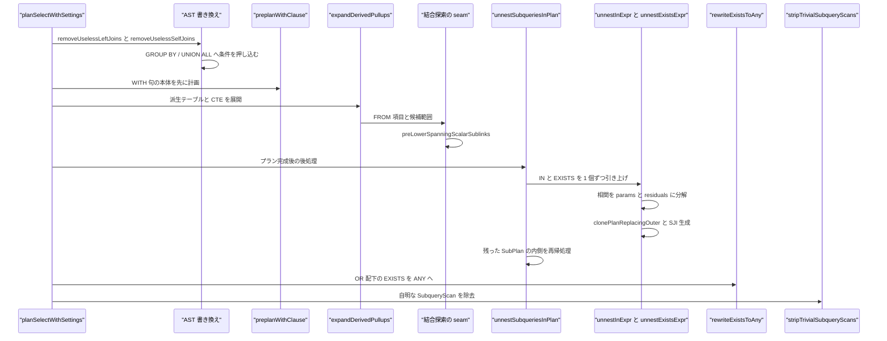
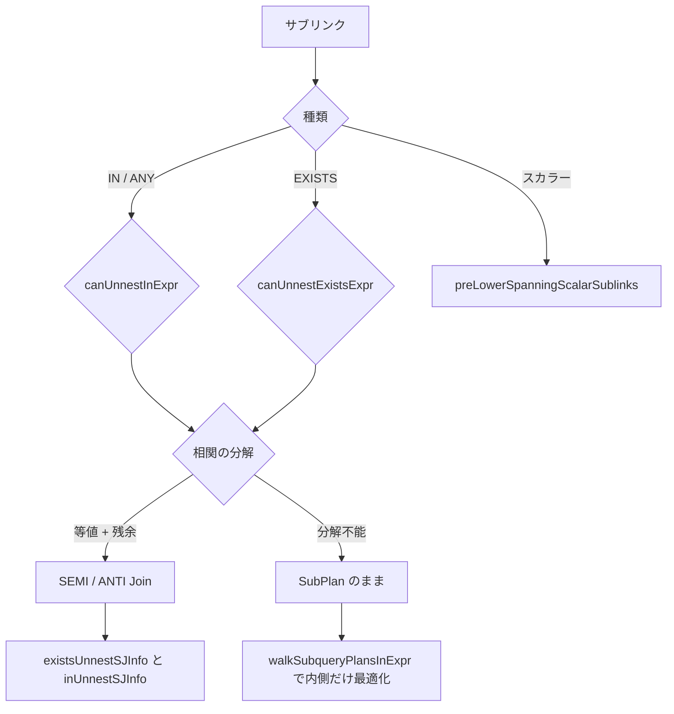

# サブクエリの非相関化

<details>
<summary>関連ソースファイル</summary>

- [`internal/optimizer/appendrel_pushdown.go`](https://github.com/ryogrid/goopg/blob/19856410e8d497d59787e1ab35a2febb3f5953d6/internal/optimizer/appendrel_pushdown.go)
- [`internal/optimizer/cte_inline_pushdown.go`](https://github.com/ryogrid/goopg/blob/19856410e8d497d59787e1ab35a2febb3f5953d6/internal/optimizer/cte_inline_pushdown.go)
- [`internal/optimizer/ctepullup.go`](https://github.com/ryogrid/goopg/blob/19856410e8d497d59787e1ab35a2febb3f5953d6/internal/optimizer/ctepullup.go)
- [`internal/optimizer/derivedpullup.go`](https://github.com/ryogrid/goopg/blob/19856410e8d497d59787e1ab35a2febb3f5953d6/internal/optimizer/derivedpullup.go)
- [`internal/optimizer/exists_to_any.go`](https://github.com/ryogrid/goopg/blob/19856410e8d497d59787e1ab35a2febb3f5953d6/internal/optimizer/exists_to_any.go)
- [`internal/optimizer/pulledsublink.go`](https://github.com/ryogrid/goopg/blob/19856410e8d497d59787e1ab35a2febb3f5953d6/internal/optimizer/pulledsublink.go)
- [`internal/optimizer/remove_self_joins.go`](https://github.com/ryogrid/goopg/blob/19856410e8d497d59787e1ab35a2febb3f5953d6/internal/optimizer/remove_self_joins.go)
- [`internal/optimizer/remove_useless_joins.go`](https://github.com/ryogrid/goopg/blob/19856410e8d497d59787e1ab35a2febb3f5953d6/internal/optimizer/remove_useless_joins.go)
- [`internal/optimizer/semiecderive.go`](https://github.com/ryogrid/goopg/blob/19856410e8d497d59787e1ab35a2febb3f5953d6/internal/optimizer/semiecderive.go)
- [`internal/optimizer/sublinkjoinclause.go`](https://github.com/ryogrid/goopg/blob/19856410e8d497d59787e1ab35a2febb3f5953d6/internal/optimizer/sublinkjoinclause.go)
- [`internal/optimizer/sublinkpullup.go`](https://github.com/ryogrid/goopg/blob/19856410e8d497d59787e1ab35a2febb3f5953d6/internal/optimizer/sublinkpullup.go)
- [`internal/optimizer/subquerypushdown.go`](https://github.com/ryogrid/goopg/blob/19856410e8d497d59787e1ab35a2febb3f5953d6/internal/optimizer/subquerypushdown.go)
- [`internal/optimizer/subquerypushqual_ast.go`](https://github.com/ryogrid/goopg/blob/19856410e8d497d59787e1ab35a2febb3f5953d6/internal/optimizer/subquerypushqual_ast.go)
- [`internal/optimizer/subquerypushqual_unionall.go`](https://github.com/ryogrid/goopg/blob/19856410e8d497d59787e1ab35a2febb3f5953d6/internal/optimizer/subquerypushqual_unionall.go)
- [`internal/optimizer/subqueryscan_strip.go`](https://github.com/ryogrid/goopg/blob/19856410e8d497d59787e1ab35a2febb3f5953d6/internal/optimizer/subqueryscan_strip.go)
- [`internal/optimizer/unnest.go`](https://github.com/ryogrid/goopg/blob/19856410e8d497d59787e1ab35a2febb3f5953d6/internal/optimizer/unnest.go)
- [`internal/optimizer/with.go`](https://github.com/ryogrid/goopg/blob/19856410e8d497d59787e1ab35a2febb3f5953d6/internal/optimizer/with.go)

</details>

このコンポーネントは、クエリの中に閉じているサブクエリ・CTE・派生テーブル・継承/パーティション展開を、外側の結合木へ引き上げたり、外側の条件を内側へ押し込んだり、逆に「引き上げない」と決めて SubPlan のまま残したりする一連の書き換えである。中心は `unnest.go` の相関解析で、EXISTS と IN/ANY の相関を「外側列と内側列の等値ペア（params）」と「外側列を含む非等値の残余（residuals）」に分解し、`Join` の SEMI/ANTI へ変換する。変換できない形は SubPlan のまま残し、外側の `Filter` と内側プランを個別に最適化する。これに加えて、`derivedpullup.go` の派生テーブル引き上げ、`ctepullup.go`/`cte_inline_pushdown.go`/`with.go` の CTE インラインと条件押し込み、`subquerypushqual_ast.go`/`subquerypushqual_unionall.go` の GROUP BY / UNION ALL への条件押し込み、`subqueryscan_strip.go` の自明な SubqueryScan 除去、`remove_self_joins.go`/`remove_useless_joins.go` の不要結合除去が連携する。外側結合の削減は [5.3 結合順序探索](5.3-Join-Search.md) が扱う。親セクションは [5 クエリプランナー](../5-Query-Planner.md)。全体像は [5.1 プランナー全体像](5.1-Planner-Overview.md)、探索への引き渡しは [5.3 結合順序探索](5.3-Join-Search.md)、Path 変換は [5.7 パスからプランへの変換](5.7-Plan-Creation.md) を参照。

## 責務

- IN/ANY サブクエリの非相関化。`unnestInExpr` が相関を等値ペアと残余に分解し、`clonePlanReplacingOuter` で外側参照を内側の列に置き換え、SEMI 結合を構築する（`NOT IN` は上位ゲートで拒否）。`path:internal/optimizer/unnest.go:unnestInExpr`
- EXISTS サブクエリの非相関化。`unnestExistsExpr` が EXISTS 本体を複製して外側参照を除去し、`existsUnnestSJInfo` で SEMI/ANTI の `SpecialJoinInfo` を作る。`path:internal/optimizer/unnest.go:unnestExistsExpr`
- 非相関 IN の簡約。`unnestNonCorrelatedInExpr` が外側参照のない IN を、IN の左オペランドをキーにした SEMI 結合へ変換する。`path:internal/optimizer/unnest.go:unnestNonCorrelatedInExpr`
- 相関の分解と安全性検査。`collectUnnestParamsAndResiduals` が Filter のトップレベル連言から等値ペアと持ち上げ可能な残余を集め、`residualExprLiftable` が書き換え可能な式だけを許す。`path:internal/optimizer/unnest.go:collectUnnestParamsAndResiduals`
- プラン全体の走査。`unnestSubqueriesInPlan` が `Filter` ごとに IN と EXISTS を繰り返し引き上げ、残った SubPlan の内側プランを `walkSubqueryPlansInExpr` で再帰的に最適化する。`path:internal/optimizer/unnest.go:unnestSubqueriesInPlan`
- OR 配下の EXISTS→ANY 変換。`rewriteExistsToAnyQual` が OR の枝にある相関 EXISTS を非相関の `InExpr` へ変換する。`path:internal/optimizer/exists_to_any.go:rewriteExistsToAnyQual`
- スカラーサブリンクの前置変換。`preLowerSpanningScalarSublinks` が複数関係にまたがる相関スカラーサブリンクを、`lowerSubPlanParams` の前に problem 空間の式へ置き換える。`path:internal/optimizer/sublinkjoinclause.go:preLowerSpanningScalarSublinks`
- 引き上げ済みサブリンクの再基準化。`keptRebase`/`rebaseQualKeptSubplans` が、引き上げた本体に残る入れ子 SubPlan の外側参照を祖先スコープの座標へ写す。`path:internal/optimizer/pulledsublink.go:rebaseQualKeptSubplans`
- 派生テーブルの引き上げ。`expandDerivedPullups` が単純な派生テーブルを本体の FROM 項目へ展開し、`derivedPullupCandidate` に範囲を記録する。`path:internal/optimizer/derivedpullup.go:expandDerivedPullups`
- CTE のインライン。`cteAsDerivedItem` が単一参照または `NOT MATERIALIZED` の複数参照 CTE を派生テーブルとして提示し、`inlinesEachReference` が各参照でのインラインを決める。`path:internal/optimizer/ctepullup.go:cteAsDerivedItem`
- CTE 本体への条件押し込み。`pushQualsThroughSingleRefCTEs`/`pushFilterQualsThroughCTEScan` が単一参照 CTE の外側条件を本体へ複製する。`path:internal/optimizer/cte_inline_pushdown.go:pushQualsThroughSingleRefCTEs`
- GROUP BY サブクエリへの条件押し込み。`pushWhereQualsIntoGroupedItems` が外側 WHERE を GROUP BY のキー列を経由して内側の FROM 項目へ押し込む。`path:internal/optimizer/subquerypushqual_ast.go:pushWhereQualsIntoGroupedItems`
- UNION ALL サブクエリへの条件押し込み。`pushWhereQualsIntoUnionAllItems` が各メンバーへ条件を複製し、偽になったメンバーを落とす。`path:internal/optimizer/subquerypushqual_unionall.go:pushWhereQualsIntoUnionAllItems`
- 継承/パーティションの条件押し込み。`pushAppendRelRestrictions` が Append 上の Filter を各メンバーのスキャンへ移す。`path:internal/optimizer/appendrel_pushdown.go:pushAppendRelRestrictions`
- 自明な SubqueryScan の除去。`stripTrivialSubqueryScans` が消費側の tlist 規約に応じて、列順が恒等な `SubqueryScan` を外す。`path:internal/optimizer/subqueryscan_strip.go:stripTrivialSubqueryScans`
- 不要な自己結合の除去。`removeUselessSelfJoins` が同一表の 2 つの別名を一意キーで畳める場合に片方を消す。`path:internal/optimizer/remove_self_joins.go:removeUselessSelfJoins`
- 不要な LEFT JOIN の除去。`removeUselessLeftJoins` が右側の列を誰も読まず、ON が右側の一意キーと同型列の等値だけの場合に LEFT JOIN を消す。`path:internal/optimizer/remove_useless_joins.go:removeUselessLeftJoins`
- SEMI 結合由来の等値の導出。`semiRHSImpliedEqualities` が SEMI の RHS と外側の間で推移的に成り立つ等値を生成する。`path:internal/optimizer/semiecderive.go:semiRHSImpliedEqualities`

## 処理フロー

書き換えは「AST の段階」と「プランの段階」に分かれる。AST の段階では、`planSelectWithSettings` が `preplanWithClause` で WITH 句の本体を先に計画し、`removeUselessLeftJoins`、`removeUselessSelfJoins`、`pushWhereQualsIntoGroupedItems`、`pushWhereQualsIntoUnionAllItems` を順に適用する。`removeUselessLeftJoins` は右側の列が外で読まれず、ON が右側の一意キーを覆う同型列の等値だけなら LEFT JOIN を落とす。`removeUselessSelfJoins` は同一表の 2 別名を一意キーで畳める場合に片方を消す。`pushWhereQualsIntoGroupedItems` は GROUP BY のキー列を経由して外側 WHERE を内側の FROM 項目へ押し込み、`pushWhereQualsIntoUnionAllItems` は UNION ALL の各メンバーへ条件を複製する。

FROM 句の計画では `planFromClause` が `expandDerivedPullups` を呼ぶ。単純な派生テーブル（集約・DISTINCT・LIMIT・集合演算・WITH・ロックを持たず、FROM が素の表だけのもの）は、本体の FROM 項目に展開され、`derivedPullupCandidate` に元の別名と列対応が記録される。INNER JOIN の連鎖に派生テーブルが混ざる場合は `splitInnerJoinChainForPullup` がカンマ FROM に分解し、ON 句を外側の条件へ移す。CTE 参照は `cteAsDerivedItem` が同じ形の派生テーブルに変換する。展開後、WHERE と ON の厳密述語に基づく外側結合の削減が行われる（詳細は [5.3 結合順序探索](5.3-Join-Search.md)）。探索の直前には `preLowerSpanningScalarSublinks` が、複数関係にまたがる相関スカラーサブリンクを problem 空間の式へ置き換える。

プランが組み上がると、`planSelectWithSettings` の後段で `unnestSubqueriesInPlan` が走る。これは `Filter` を見つけるたびに、まず `unnestInExpr` のループを回し、次に `unnestExistsExpr` のループを回す。各ループは 1 回に 1 つのサブリンクを書き換え、`countSublinksInExpr` が減らなくなったら止まる。この「減らなければ止める」ガードは、将来の不整合を無限ループではなく「最適化されないだけの正しい計画」に変えるためのものである。IN と EXISTS を出し切った後、`walkSubqueryPlansInExpr` が残った SubPlan の内側プランを再帰的に `unnestSubqueriesInPlan` へ通し、最後に `pushConjunctsBelowSemiAnti` が SEMI/ANTI 連鎖の下へサブリンクを含まない連言を沈める。

`unnestInExpr` はまず `canUnnestInExpr` で受理を判定する。IN がトップレベル連言（または単一 NOT の下）にあり、`InExpr` が素の等値形で、`NOT IN` でなく、入れ子の IN もすべて展開可能であることが条件である。相関がある場合は `collectUnnestParamsAndResiduals` で等値ペアと残余を取り出し、`clonePlanReplacingOuter` で外側参照を内側の列へ置き換える。残余は `stripOuterRefConjuncts` で内側から除去し、後で結合の Predicate に載せる。`planHasOuterRefRemaining` が残っていれば、未結合の外側参照を作らないよう引き上げを中止する。結合キーは相関ペアの先頭、相関がない場合は IN の左オペランドである。単純な本体は `decomposeFlatBodyTree` で葉と条件に分解でき、右オペランドを本体のターゲット式へ置き換えられる。

`unnestExistsExpr` も同じ分解を使う。`canUnnestExistsExpr` は非相関 EXISTS を拒否し、本体の形（集約・DISTINCT・LIMIT など）と入れ子プランの複製可能性を検査する。`collectUnnestParamsAndResiduals` が空なら引き上げない。等値ペアの 2 個目以降は Predicate 上の等値連言として残し、`clonePlanReplacingOuter` の後に `stripOuterRefConjuncts` と `stripPositiveConstLimits` を適用する。内側の Project がキー列を含まない場合は剥がし、キー列の名前と位置が内側スキーマに一致することを確認する。最後に `existsUnnestSJInfo` で `SpecialJoinInfo` を作り、SEMI/ANTI の Join に付ける。

文全体の計画が終わると、`Plan` の末尾で `pushQualsThroughSingleRefCTEs`、`pushAppendRelRestrictions`、`rewriteExistsToAny`、`lowerSubPlanParams`、`stripTrivialSubqueryScans` が順に走る。`rewriteExistsToAny` は OR の枝にある相関 EXISTS だけを `InExpr` に変換する。トップレベル連言の EXISTS は `unnestExistsExpr` の SEMI/ANTI の方が良いため、ここでは触らない。`stripTrivialSubqueryScans` は、派生テーブルの登録（`derivedSubtrees`）があるか、インライン CTE のラッパーが強制された場合だけ動く。



相関サブリンクの運命は、分解できるかどうかで分かれる。



## 主要ファイル

| ファイル | 役割 |
| --- | --- |
| `internal/optimizer/unnest.go` | `unnestSubqueriesInPlan`、`unnestInExpr`、`unnestExistsExpr`、`collectUnnestParamsAndResiduals`、`existsUnnestSJInfo`。非相関化の本体。`path:internal/optimizer/unnest.go:unnestSubqueriesInPlan` |
| `internal/optimizer/exists_to_any.go` | `rewriteExistsToAny`、`rewriteExistsToAnyQual`、`existsToAny`。OR 配下の EXISTS を ANY へ。`path:internal/optimizer/exists_to_any.go:rewriteExistsToAny` |
| `internal/optimizer/pulledsublink.go` | `keptRebase`、`rebaseQualKeptSubplans`、`keptScopeArgs`。引き上げ後に残る SubPlan の再基準化。`path:internal/optimizer/pulledsublink.go:rebaseQualKeptSubplans` |
| `internal/optimizer/sublinkjoinclause.go` | `preLowerSpanningScalarSublinks`、`sublinkArgsNameBaseRelations`。複数関係スカラーサブリンクの前置変換。`path:internal/optimizer/sublinkjoinclause.go:preLowerSpanningScalarSublinks` |
| `internal/optimizer/sublinkpullup.go` | `sublinkBodyIsSimple`、`sublinkBodyFromIsFlat`、`decomposeFlatBodyTree`。本体を葉と条件に分解する。`path:internal/optimizer/sublinkpullup.go:sublinkBodyIsSimple` |
| `internal/optimizer/derivedpullup.go` | `expandDerivedPullups`、`derivedPullupCandidate`、`resolvePulledDerived`、`splitInnerJoinChainForPullup`。派生テーブル引き上げ。`path:internal/optimizer/derivedpullup.go:expandDerivedPullups` |
| `internal/optimizer/ctepullup.go` | `countCTEReferences`、`cteAsDerivedItem`、`takeBackPulledBodyRefs`。CTE を派生テーブルとして提示する。`path:internal/optimizer/ctepullup.go:cteAsDerivedItem` |
| `internal/optimizer/with.go` | `plannedCTE`、`preplanWithClause`、`planRecursiveCTE`。CTE 本体の先行計画。`path:internal/optimizer/with.go:preplanWithClause` |
| `internal/optimizer/cte_inline_pushdown.go` | `pushQualsThroughSingleRefCTEs`、`pushFilterQualsThroughCTEScan`、`pushConjunctIntoCTEBodyTraced`。CTE 本体への条件押し込み。`path:internal/optimizer/cte_inline_pushdown.go:pushQualsThroughSingleRefCTEs` |
| `internal/optimizer/subquerypushqual_ast.go` | `pushWhereQualsIntoGroupedItems`、`pushQualItem`、`pushQualEq`。GROUP BY サブクエリへの条件押し込み。`path:internal/optimizer/subquerypushqual_ast.go:pushWhereQualsIntoGroupedItems` |
| `internal/optimizer/subquerypushqual_unionall.go` | `pushWhereQualsIntoUnionAllItems`、`unionAllPushItem`、`pushUnionAllConjunct`。UNION ALL メンバーへの条件押し込み。`path:internal/optimizer/subquerypushqual_unionall.go:pushWhereQualsIntoUnionAllItems` |
| `internal/optimizer/subquerypushdown.go` | `subqueryLeafAggTarget`、`subqueryLeafRebase`、`pushQualsIntoSubqueryLeaf`。集約サブクエリへの HAVING 押し込み。`path:internal/optimizer/subquerypushdown.go:pushQualsIntoSubqueryLeaf` |
| `internal/optimizer/subqueryscan_strip.go` | `stripTrivialSubqueryScans`、`stripSublinkBodies`、`wrapInlinedCTEScans`。自明な SubqueryScan の除去。`path:internal/optimizer/subqueryscan_strip.go:stripTrivialSubqueryScans` |
| `internal/optimizer/appendrel_pushdown.go` | `pushAppendRelRestrictions`、`appendRelMembers`、`pushFilterIntoAppendRelMembers`。継承/パーティションへの条件押し込み。`path:internal/optimizer/appendrel_pushdown.go:pushAppendRelRestrictions` |
| `internal/optimizer/remove_self_joins.go` | `removeUselessSelfJoins`、`rewriteSelfJoin`、`selfJoinUniqueKeyCovered`。自己結合の除去。`path:internal/optimizer/remove_self_joins.go:removeUselessSelfJoins` |
| `internal/optimizer/remove_useless_joins.go` | `removeUselessLeftJoins`、`leftJoinIsRemovable`。不要 LEFT JOIN の除去。`path:internal/optimizer/remove_useless_joins.go:removeUselessLeftJoins` |
| `internal/optimizer/semiecderive.go` | `semiRHSImpliedEqualities`、`pathKeepsRels`、`paramOuterKeepsRHS`。SEMI 由来の等値導出。`path:internal/optimizer/semiecderive.go:semiRHSImpliedEqualities` |

## 公開 API / エントリポイント

大半はパッケージ内部の書き換え関数で、`Plan`/`planSelectWithSettings` から呼ばれる。外部へ公開されているのは、テスト用の有効化スイッチだけである。

```go
func SetSubqueryUnnestEnabled(on bool)
func SetExistsToAnyEnabled(on bool)
```

内部の主要な入口は次のとおり。AST 系は `*parser.SelectStmt` を受け取って書き換え後の AST を返し、プラン系は `Node` を受け取って書き換え後の `Node` を返す。

```go
func unnestSubqueriesInPlan(node Node) Node
func unnestInExpr(in *InExpr, outer Node) (Node, error)
func unnestExistsExpr(ex *ExistsExpr, outer Node) (Node, error)
func rewriteExistsToAny(root Node) Node
func preLowerSpanningScalarSublinks(conjuncts []Expr, spans []leafSpan, ctx *resolveContext)
func expandDerivedPullups(s *parser.SelectStmt, mode derivedPullupMode, cat catalog.Catalog) ([]parser.FromExpr, []*derivedPullupCandidate, []parser.Expr)
func preplanWithClause(with *parser.WithClause, owner *parser.SelectStmt, cat catalog.Catalog, ps PlannerSettings, scope *rtableScope) (restore func(), dmlPlans []dmlCTEPlan, err error)
func pushQualsThroughSingleRefCTEs(n Node)
func pushWhereQualsIntoGroupedItems(s *parser.SelectStmt, cat catalog.Catalog) *parser.SelectStmt
func pushWhereQualsIntoUnionAllItems(s *parser.SelectStmt, cat catalog.Catalog, scope *rtableScope) *parser.SelectStmt
func pushAppendRelRestrictions(root Node)
func stripTrivialSubqueryScans(root Node, derived []Node, force bool) Node
func removeUselessSelfJoins(s *parser.SelectStmt, cat catalog.Catalog) *parser.SelectStmt
func removeUselessLeftJoins(s *parser.SelectStmt, cat catalog.Catalog) *parser.SelectStmt
```

## 主要データ構造

### `existsUnnestPlan`

EXISTS/IN/スカラーの引き上げで共有する分解結果である。`Params` がハッシュ/マージのキーになる等値ペア、`Residuals` が結合の Predicate に載せる非等値条件である。`path:internal/optimizer/unnest.go:existsUnnestPlan`

```go
type existsUnnestPlan struct {
	Params    []unnestParam
	Residuals []Expr
}
```

`unnestParam` は `OuterRef`（外側の `OuterColumnRef`）、`SubCol`（対応する内側の `ColumnRef`）、`Aliases`（同じ外側列を指す別名）を持つ。`Params` の各要素は 1 つの外側列と 1 つの内側列を結ぶ。`Residuals` は外側列を含むが等値ペアにできない条件で、`residualExprLiftable` が許可した式だけが入る。両方とも空なら引き上げは成立しない。

### `pulledDerivedRel` と `derivedPullupCandidate`

`pulledDerivedRel` は引き上げ後の派生テーブルを親の名前解決から見た形である。`path:internal/optimizer/derivedpullup.go:pulledDerivedRel`

```go
type pulledDerivedRel struct {
	alias string
	names []string
	// cols is each output's resolved body expression, parent coordinates.
	// A reference receives its own deep copy (pulledDerivedRef).
	cols []Expr
	// firstBinding is the index of the body's first leaf binding in the
	// parent's bindings: `SELECT *` emits the derived columns there, in
	// FROM order.
	firstBinding int
	body         *parser.SelectStmt
}
```

`alias` は親から見た名前、`names` は出力列名、`cols` は各出力の本体式（親座標）、`firstBinding` は本体の最初の葉バインディングが親のバインディング列のどこに始まるか、`body` は元の SELECT である。参照のたびに `pulledDerivedRef` が `cols` の深いコピーを返すため、同じ派生列を複数箇所で読んでも式ノードを共有しない。

`derivedPullupCandidate` は引き上げ候補の範囲を記録する。`path:internal/optimizer/derivedpullup.go:derivedPullupCandidate`

```go
type derivedPullupCandidate struct {
	alias string
	// columns is the item's column-alias list (`AS x(c1, c2)`), naming the
	// first len(columns) outputs; nil when absent (M0146-0028g).
	columns []string
	// lateral marks a LATERAL item of the statement's own FROM list
	// (M0146-0028h): its body resolves with the items to its left as the
	// enclosing scope, and those references become plain columns.
	lateral bool
	body    *parser.SelectStmt
	itemLo  int // first expanded item of the body
	itemHi  int // one past the last
	bindLo  int
	bindHi  int
	// cte is set when the item was a reference to an inlinable CTE,
	// presented as its body (M0146-0007e, ctepullup.go).
	cte *plannedCTE
	// parent is the pulled body whose FROM list held this item (nil for an
	// item of the statement's own FROM list), and depth its nesting level.
	// pull_up_simple_subquery flattens the subquery's own simple subqueries
	// before splicing it, so a pulled body's FROM items are expanded in
	// turn (M0146-0007i): its items' ranges nest inside the parent's.
	parent *derivedPullupCandidate
	depth  int
}
```

`itemLo`/`itemHi` は展開後の FROM 項目の範囲、`bindLo`/`bindHi` はバインディングの範囲、`parent`/`depth` は入れ子の関係を表す。`cte` が非 nil なら、この候補は CTE 参照を派生テーブルとして提示したものである。不変条件は「`itemLo <= itemHi` かつ子候補の範囲が親の範囲に含まれる」ことで、`resolvePulledDerived` がこの範囲を使って列参照を解決する。

### `pushQualItem` と `pushQualEq`

GROUP BY サブクエリへの条件押し込みで、FROM の各位置と等値の端点を表す。`path:internal/optimizer/subquerypushqual_ast.go:pushQualItem`

```go
type pushQualItem struct {
	rv       parser.RangeVar
	alias    string
	names    map[string]int // lower-cased exposed name → count
	namesOK  bool
	nullable bool
	body     *parser.SelectStmt // grouped body a qual may be pushed into
	cte      *plannedCTE
	chain    int // FROM item index
	chainPos int // 0 = Base, k = Joins[k-1].Right
	pushed   []parser.Expr
}
```

`names` は小文字化した公開名列とその出現数で、非修飾列の解決に使う。`namesOK=false` は名前を列挙できない項目で、非修飾列の押し込みを拒否する。`nullable` は RIGHT/FULL の下や LEFT の nullable 側にある項目で、WHERE をその項目単独の制限として押し込めない。`chain`/`chainPos` は FROM 項目内の位置、`pushed` は実際に押し込んだ条件である。

`path:internal/optimizer/subquerypushqual_ast.go:pushQualEq`

```go
type pushQualEq struct {
	a, b *parser.ColumnRef
	// leftNullable is the flat position of the nullable side when the
	// equality is a LEFT join's ON clause, else -1.
	leftNullable int
	// Resolved endpoints (flat position + lower-cased column); ok is false
	// when either side does not resolve to exactly one FROM position.
	apos, bpos int
	acol, bcol string
	ok         bool
	// expr is the ON conjunct itself, and chain/join locate its JoinExpr
	// (FromExprs[chain].Joins[join]); set for a LEFT join's ON equality.
	expr        parser.Expr
	chain, join int
}
```

`ok=false` の等値は、どちらかの端点がちょうど 1 つの FROM 位置に解決できないもので、押し込みの根拠に使わない。`leftNullable` は LEFT JOIN の ON 等値で nullable 側の位置を持ち、そこを経由する押し込みを禁じる。

### `unionAllPushItem`

UNION ALL の appendrel 項目を表す。`path:internal/optimizer/subquerypushqual_unionall.go:unionAllPushItem`

```go
type unionAllPushItem struct {
	names   []string             // the union's output column names, lower-cased
	members []*parser.SelectStmt // the flat member list, in order
	// targets is each member's target list with `*` expanded over its
	// FROM tables, one entry per union column.
	targets [][]parser.ResTarget
	pushed  [][]parser.Expr // per member, the substituted conjuncts
	dropped []bool          // per member, folded to FALSE/NULL
	moved   []parser.Expr   // the WHERE conjuncts this item took
}
```

`names` は UNION の出力列名、`members` は平坦なメンバー列、`targets` は `*` を展開した各メンバーのターゲット、`pushed` はメンバーごとの置換済み条件、`dropped` は条件が恒偽になって落ちたメンバー、`moved` はこの項目が引き受けた WHERE 条件である。全メンバーが `dropped` になる押し込みは行わず、条件を外側の WHERE に戻す。

### `keptRebase`

引き上げた本体に残った SubPlan の外側参照を、祖先スコープの座標へ写すための文脈である。`path:internal/optimizer/pulledsublink.go:keptRebase`

```go
type keptRebase struct {
	pb            *jtPulledBody
	pullSpans     []leafSpan
	emittingTotal int
	ctx           *resolveContext
	allSpans      []leafSpan
	bodyBase      func(*jtPulledBody) (int, bool)
	why           string
}
```

`pb` は引き上げ対象の本体、`pullSpans` は本体の葉スパン、`emittingTotal` は外側スコープの幅、`allSpans` は祖先を含む全スパン、`bodyBase` は祖先本体の開始座標を返す。`why` は拒否理由を記録する。`escapeArg` が `OuterColumnRef` の `Level` と `hops` から、本体・祖先本体・外側スコープのどれを指すかを決める。深すぎる参照は `kept-deep-ref` として拒否する。

### `selfJoinItem` と `appendRelMember`

自己結合除去の 1 項目と、継承 Append の 1 メンバーである。

`path:internal/optimizer/remove_self_joins.go:selfJoinItem`

```go
type selfJoinItem struct {
	ci, k int
	rv    parser.RangeVar
	qual  string // lower-cased, for matching
	orig  string // as written, for the rewrite
	join  *parser.JoinExpr
	tbl   *catalog.Table
}
```

`ci` は `FromExprs` の添字、`k` は `Base` なら -1、`Joins[k]` なら k、`qual` は小文字化した別名、`orig` は書かれたままの別名、`join` はその JoinExpr、`tbl` は解決した表である。`tbl` が同じで `qual` が一意な 2 項目だけが自己結合の候補になる。

`path:internal/optimizer/appendrel_pushdown.go:appendRelMember`

```go
type appendRelMember struct {
	attach *Project
	scan   *SeqScan
	path   []*Project
}
```

`attach` は条件を付ける Project、`scan` はその下の SeqScan、`path` は外側から内側への Project 列である。`appendRelMembers` は `Project(tableoid) → Project(remap) → SeqScan` の形だけを受け付け、それ以外では `ok=false` を返す。

### `plannedCTE`

CTE 1 つ分のプランナ側レコードである。`path:internal/optimizer/with.go:plannedCTE`

| フィールド | 保持するもの |
| --- | --- |
| `name` / `body` / `schema` / `table` | CTE 名、計画済み本体、出力スキーマ、下流の `rangeBinding` が必要とする合成表。 |
| `isDML` | INSERT/UPDATE/DELETE/MERGE の CTE か。 |
| `refs` / `astRefs` | 計画時の参照数と AST 上の参照数。 |
| `inlineEligible` / `needsScan` | インライン可能な SELECT 本体か、インライン後も SubqueryScan が必要か。 |
| `bodyRefDeltas` / `pulledUp` | 本体計画中に増えた他 CTE 参照の差分と、引き上げ済みフラグ。 |
| `query` / `aliasColumns` | 参照サイトでの引き上げに使う元の SELECT と列別名。 |
| `materialized` / `volatile` / `selectOwned` | MATERIALIZED 指定、揮発関数の有無、SELECT 所有か。 |
| `declScope` / `eachRef` | 本体が名前解決するスコープと、複数参照でも各参照でインラインするか。 |
| `declSeq` / `declPos` / `synth` | 宣言順、宣言位置、合成統計。 |

不変条件は「`isDML` または再帰 CTE はインラインしない」「`materialized == "materialized"` はインラインしない」「`astRefs` は過大評価側にしかずれない」ことである。`countCTEReferences` は名前の遮蔽を引かず、深すぎる AST では大きな値を返す。いずれも引き上げを断る方向に働く。

<details>
<summary>plannedCTE の完全定義</summary>

`path:internal/optimizer/with.go:plannedCTE`

```go
type plannedCTE struct {
	name   string
	body   Node
	schema Schema
	table  *catalog.Table
	isDML  bool // data-modifying CTE; body is an INSERT/UPDATE/DELETE/MERGE plan
	// refs counts the CTEScan nodes planned against this entry, i.e. how
	// many times the statement references this CTE. Incremented at the
	// single consumption site (planScanRangeVar), so sublink-subquery
	// references are counted too. Final once the whole statement is
	// planned, which is why pushQualsThroughSingleRefCTEs reads it only
	// from Plan()'s tail. M0125-0035 CTE-body arm.
	refs int
	// inlineEligible marks a plain non-recursive SELECT body — the only
	// kind whose Child a qual may descend into when refs==1. DML bodies
	// (side effects run once, rows replayed) and recursive bodies
	// (WorkTableScan protocol) never qualify.
	inlineEligible bool
	// needsScan: once inlined, is the body a subquery PG's pull-up
	// refuses (is_simple_subquery false and not a simple UNION ALL)? Such
	// a reference stays an RTE_SUBQUERY and plans as a SubqueryScan
	// (wrapInlinedCTEScans), which setrefs keeps unless trivial.
	needsScan bool
	// astRefs is parse analysis' cterefcount: how many times the statement
	// that owns the WITH names this CTE as a relation, counted from the AST
	// before planning (countCTEReferences; shadowing declines — only an
	// overcount). refs above is final only after planning, and the
	// reference-site pull-up (M0146-0007e) must decide while the FROM list
	// is being planned.
	astRefs int
	// bodyRefDeltas records how many references to OTHER CTEs planning this
	// body at the WITH added. When the reference site pulls the body up
	// (M0146-0007e), the preplanned body is never run and the parent
	// re-plans those references, so the deltas are taken back once
	// (pulledUp) — otherwise a CTE the body read once would look doubly
	// referenced and lose its own inlining.
	bodyRefDeltas map[*plannedCTE]int
	pulledUp      bool
	// query and aliasColumns are the CTE's written body and column-alias
	// list, kept for the reference-site pull-up (cteAsDerivedItem).
	query        *parser.SelectStmt
	aliasColumns []string
	// materialized is the declaration's MATERIALIZED / NOT MATERIALIZED
	// keyword ("" when absent), volatile whether the planned body calls a
	// volatile function, and selectOwned whether the WITH belongs to a
	// SELECT (PG's cmdType == CMD_SELECT). Together with refs they are
	// SS_process_ctes' inline_cte gate — see inlinable. M0146-0007.
	materialized string
	volatile     bool
	selectOwned  bool
	// declScope is the CTE-name scope the body was declared in: the outer
	// statements' entries and this WITH list's earlier siblings, but not
	// this CTE or a later sibling. A body re-planned at a reference site
	// (inlinesEachReference) resolves its names here, as PG's body
	// resolves them at the WITH's own level.
	declScope map[string]*plannedCTE
	// eachRef is inline_cte for `NOT MATERIALIZED` on a multiply-referenced
	// CTE — see inlinesEachReference. Computed when the entry is created,
	// so a later sibling's body already inlines its references.
	eachRef bool
	// declSeq orders CTEs by WITH-list declaration (left to right, and an
	// enclosing statement's list after any list declared inside a body it
	// planned first). EXPLAIN reads it through CTEScan.DeclSeq to print the
	// `CTE <name>` sections in PG's order: upstream walks the top plan
	// node's subplan list, which is built in declaration order
	// (`SS_process_ctes`, optimizer/plan/subselect.c). M0125-0049.
	declSeq int
	// declPos is the source offset of the declaring parser.CommonTableExpr.
	// Together with name it identifies the DECLARATION — see
	// CTEScan.DeclKey, which is what the executor keys its materialization
	// buffer by. M0125-0050.
	declPos int
	// synth memoizes this CTE's synthesized output statistics
	// (cte_stats_synthesis.go), computed on first consumer access.
	//
	// M0145-0009 slice 1. The B-06 design specifies a registry keyed by
	// `DeclKey()` (`declPos:name`) living on the planning context. The entry
	// POINTER is a strictly stronger identity than that key and has exactly
	// the lifetime the design asks for — per-`Plan()` call, dangling never,
	// because the body is planned inside the same call and every consumer
	// reaches its entry through `CTEScan.cte`. So the map is unnecessary
	// here: the thing the key would look up is already in hand. Keep the
	// design's constraints even so — one synthesis per CTE (both sides of a
	// multi-reference CTE must agree, as they do through one entry), and a
	// miss yields today's defaults rather than a guess.
	synth     *cteOutputStats
	synthDone bool
}
```

</details>

## 内部構造

このコンポーネントの設計は、**AST を書き換える段階**と**プランを書き換える段階**を分けることにある。AST 段階の書き換えは、結合の除去・条件の押し込み・派生テーブルの展開のように、まだ座標が確定していない構造に向く。プラン段階の書き換えは、`Filter` の Predicate と `Join` の Predicate が確定した後で、SubPlan を SEMI/ANTI に置き換える作業に向く。両者を混ぜると、SubPlan の `.Plan` が読む `OuterColumnRef` の Level と、外側の `ColumnRef.Index` の座標が食い違う。

相関の分解は `collectUnnestParamsAndResiduals` が担う。内側プランの `Filter` を歩き、各連言が `OuterColumnRef = ColumnRef` の形なら `unnestParam` に、外側列を含む非等値なら `residuals` に入れる。等値ペアにならなかった外側参照が 1 つでも残れば、そのサブリンクは引き上げない。残余は `residualExprLiftable` の許可リスト（列参照、定数、二項演算、単項演算、関数呼び出し）に収まる必要がある。`CaseExpr` や入れ子サブリンクを含む残余は、書き換え器のデフォルト枝を通って古いインデックスのまま評価される危険があるため拒否する。また `Level > 1` の参照は祖父母スコープを指すので、即時の外側スキーマで書き換えてはならない。

インデックスキーに畳まれた相関も拾う。`harvestIndexKeyParams` が `IndexScan` のキー等値から `unnestParam` を作る。これにより TPC-H Q4 の `l_orderkey = o_orderkey` のように、Filter ではなくインデックス probe に相関が埋まっている EXISTS も非相関化できる。残余の `l_commitdate < l_receiptdate` は Filter から取り、SEMI 結合の Predicate に載せる。

座標の管理は慎重である。`clonePlanReplacingOuter` は外側参照を内側の列へ置き換えるが、残った残余は `stripOuterRefConjuncts` で内側から消す。結合のキーは `outerWidth` を境にした merged 座標（外側 ++ 内側）で表し、内部結合の子の座標とは別である。`unnestKeepingWidth` は、結合の入力に対して引き上げを行った場合に元の列が先頭に残ることを確認し、増えた列を `projectToBindingOrder` で投影して幅を保つ。これをしないと、右入力の列オフセットがずれて上位の結合が誤った列を読む。

SEMI/ANTI の `SpecialJoinInfo` は `existsUnnestSJInfo` と `inUnnestSJInfo` が作る。どちらも合成 relset `{1}`/`{2}` を使い、seam が実リーフのビットへ振り直す。`SemiRhsExprs` は `createUniquePath` が RHS の一意性を検査するときに使うため、`SourceTableIdx` を本体の remap 分だけずらして子の `Output()` と一致させる。`NullAware` は `NOT IN` の三値論理を実行器の probe 側で扱うために立ち、RIGHT ANTI への変換を禁止する。

CTE は「単一参照なら本体をインラインする」のが基本である。`cteAsDerivedItem` は `astRefs == 1`、`inlineEligible`、`selectOwned`、`materialized != "materialized"`、非揮発、非 DML を条件に、CTE 参照を `Subquery` を持つ `RangeVar` に書き換える。複数参照でも `NOT MATERIALIZED` なら `inlinesEachReference` が各参照でのインラインを許す。再帰 CTE と DML CTE は `preplanWithClause` が別経路で計画し、インラインしない。単一参照 CTE の外側条件は `pushQualsThroughSingleRefCTEs` が本体へ複製する。複製なので、押し込みに失敗しても元の Filter が残り、条件が消えることはない。

派生テーブルの引き上げは `parentFromAdmitsDerivedPullup` と `simpleDerivedPullupBody` の二段ゲートで決まる。親はロックや GROUPING SETS を持たず、子は集合演算・WITH・GROUP BY・HAVING・ORDER BY・DISTINCT・LIMIT・OFFSET・ロック・VALUES を持たず、FROM が素の表だけである必要がある。深さは `maxDerivedPullupDepth = 8` で制限される。`SELECT *` は `expandPullupBodyStars` が実列に展開し、列別名は `derivedPullupCandidate.columns` が先頭から適用する。LATERAL 項目は親の FROM 項目を外側スコープとして解決し、その参照を通常の列に変換する。

不要結合の除去は証明が必要である。`removeUselessLeftJoins` は右側の列が外で読まれず、ON が右側の一意キーを覆う同型列の等値だけで、右側が副問い合わせ・LATERAL・TABLESAMPLE・列別名を持たない場合だけ LEFT JOIN を消す。`removeUselessSelfJoins` は同一表の 2 別名について、結合条件が一意キーを覆い、他の条件が片方の別名だけを読む場合に片方を消す。どちらも証明できない場合は元の AST をそのまま返す。

`stripTrivialSubqueryScans` は単に「子が恒等なら剥がす」のではない。消費側の tlist 規約（`CP_EXACT_TLIST` か physical tlist か）によって、SubqueryScan の tlist が「必要な列を最初に必要になった順」になるか「サブクエリの全出力を attno 順」になるかが変わる。Join/Aggregate/ProjectSet の下では physical tlist になり、条件がなければ無条件に剥がせる。Sort/Limit の下では exact/small tlist になり、消費が恒等かどうかを見る。この区別が、PG が `Subquery Scan` を残す場所と消す場所を一致させる。

## エッジケースと不変条件

- **入れ子 IN の深さ上限**: `maxNestedInUnnestDepth = 4`。`canUnnestInExprDepth` はこれを超えると偽を返す。深い入れ子で `walkPlanExprs` がレベルのたびに二次走査するのを防ぐ。`path:internal/optimizer/unnest.go:maxNestedInUnnestDepth`
- **派生テーブルの深さ上限**: `maxDerivedPullupDepth = 8`。`expandDerivedPullups` はこれを超える本体を展開しない。`path:internal/optimizer/derivedpullup.go:maxDerivedPullupDepth`
- **自己結合除去の反復上限**: `removeUselessSelfJoins` は最大 16 回まで `removeOneSelfJoin` を繰り返す。1 回の書き換えで別の自己結合が現れることがあるためである。`path:internal/optimizer/remove_self_joins.go:removeUselessSelfJoins`
- **CTE 参照カウントの過大評価**: `countCTEReferences` は深さ 96 を超えると `1 << 20` を返し、名前の遮蔽も引かない。どちらも参照数を多く見積もり、インラインを断る方向にだけ働く。`path:internal/optimizer/ctepullup.go:countCTEReferences`
- **トップレベル連言の要求**: `inExprTopConjunct` は IN がトップレベル連言か、単一 NOT の下にある場合だけ受理する。OR の枝にある IN を SEMI 結合にすると、他の枝を失って意味が変わる。`path:internal/optimizer/unnest.go:inExprTopConjunct`
- **NOT IN の拒否**: `canUnnestInExprDepth` は `in.Negated` を拒否する。`NOT IN` は `<> ALL` であり、PG も ANY/EXISTS だけを引き上げる。goopg は SubPlan として残す。`path:internal/optimizer/unnest.go:canUnnestInExprDepth`
- **非相関 IN の単一列出力**: `isUnnestableNonCorrelatedIn` は内側プランの出力がちょうど 1 列であることを要求する。2 列以上だと SEMI/ANTI の結合形が崩れる。`path:internal/optimizer/unnest.go:isUnnestableNonCorrelatedIn`
- **相関オペランドの一致**: `correlatedInOperandSafeToUnnest` は、IN の左オペランドが相関ペアの外側列と一致することを要求する。一致しない場合、相関ペアをキーにすると元の `operand IN (...)` と違う意味になる。`path:internal/optimizer/unnest.go:correlatedInOperandSafeToUnnest`
- **外側参照の残存**: `unnestInExpr`/`unnestExistsExpr` は `planHasOuterRefRemaining` が真なら引き上げを中止する。未結合の外側参照を持つ結合を作ると実行時に解決できない。`path:internal/optimizer/unnest.go:planHasOuterRefRemaining`
- **EXISTS 本体の形**: `canUnnestExistsExpr` は非相関 EXISTS と、集約・DISTINCT・LIMIT などを持つ本体を拒否する。`existsBodySafeForPullup` が本体の条件を検査する。`path:internal/optimizer/unnest.go:canUnnestExistsExpr`
- **入れ子プランの複製可能性**: `canUnnestExistsExpr` は本体に入れ子 SubPlan がある場合、`planCloneSupported` で全ノードを複製できることを要求する。複製できない場合は `clonePlanVerbatimOrShare` がポインタを共有し、F7 のエイリアシング事故になる。`path:internal/optimizer/unnest.go:planCloneSupported`
- **OR 配下だけの EXISTS→ANY**: `rewriteExistsToAnyQual` は `underOr` が真のときだけ変換する。トップレベル連言の EXISTS は `unnestExistsExpr` の SEMI/ANTI に任せる。`path:internal/optimizer/exists_to_any.go:rewriteExistsToAnyQual`
- **EXISTS 本体の単純さ**: `existsToAny` は `existsBodySpineSimple` を要求し、Aggregate/Distinct/Sort/Limit を持つ本体を拒否する。値集合が変わる可能性があるためである。`path:internal/optimizer/exists_to_any.go:existsToAny`
- **スカラーサブリンクの前置変換**: `preLowerSpanningScalarSublinks` は `ctx.pulledDerived` または `jtPullup.nLeaves` が非ゼロなら何もしない。引き上げ済みの座標では、前置変換の前提が崩れる。`path:internal/optimizer/sublinkjoinclause.go:preLowerSpanningScalarSublinks`
- **CTE インラインのゲート**: `cteAsDerivedItem` は `astRefs == 1` または `inlinesEachReference`、`inlineEligible`、`selectOwned`、`materialized != "materialized"`、非揮発、非 DML、列別名なし、本体内の名前が宣言どおり解決することを要求する。`path:internal/optimizer/ctepullup.go:cteAsDerivedItem`
- **条件押し込みの失敗時**: `pushFilterQualsThroughCTEScan` は条件を本体へ複製し、元の Filter からは消さない。押し込みに失敗した場合は複製が使われず、元の条件がそのまま残る。`path:internal/optimizer/cte_inline_pushdown.go:pushFilterQualsThroughCTEScan`
- **UNION ALL の全滅回避**: `pushWhereQualsIntoUnionAllItems` は全メンバーが偽になった union の押し込みを取り消し、条件を外側 WHERE に戻す。`path:internal/optimizer/subquerypushqual_unionall.go:pushWhereQualsIntoUnionAllItems`
- **パーティション条件押し込みの保留**: `pushAppendRelRestrictions` は `LockRows`/`Update`/`Delete`/`Merge` を含む計画では何もしない。EvalPlanQual の再検査がスキャン上の条件を読むため、条件をメンバーへ移すと再検査が空になる。`path:internal/optimizer/appendrel_pushdown.go:planTakesRowMarksOrModifies`
- **自己結合除去の一意キー**: `selfJoinUniqueKeyCovered` は即時・非部分・非遅延の UNIQUE インデックスで、全キー列が結合条件に現れることを要求する。部分インデックスや式インデックスは使わない。`path:internal/optimizer/remove_self_joins.go:selfJoinUniqueKeyCovered`
- **LEFT JOIN 除去の型一致**: `leftJoinIsRemovable` は ON の等値が同じ型の列同士であることを要求する。異種型の `=` は一意性の証明に使えない。`path:internal/optimizer/remove_useless_joins.go:leftJoinIsRemovable`
- **SEMI 由来等値の限定**: `semiRHSImpliedEqualities` は単一関係の SEMI RHS だけを対象にし、nullable 側に触れる等値は生成しない。外側結合の null 拡張された列はクラスメートと等しくならない。`path:internal/optimizer/semiecderive.go:semiRHSImpliedEqualities`
- **SubqueryScan 除去の tlist 依存**: `stripTrivialSubqueryScans` は `derivedSubtrees` が空で `force=false` なら何もしない。また Join/Aggregate の下では physical tlist、Sort/Limit の下では exact tlist として恒等性を判定する。`path:internal/optimizer/subqueryscan_strip.go:stripTrivialSubqueryScans`

Sources:

- `internal/optimizer/appendrel_pushdown.go`
- `internal/optimizer/cte_inline_pushdown.go`
- `internal/optimizer/ctepullup.go`
- `internal/optimizer/derivedpullup.go`
- `internal/optimizer/exists_to_any.go`
- `internal/optimizer/pulledsublink.go`
- `internal/optimizer/remove_self_joins.go`
- `internal/optimizer/remove_useless_joins.go`
- `internal/optimizer/semiecderive.go`
- `internal/optimizer/sublinkjoinclause.go`
- `internal/optimizer/sublinkpullup.go`
- `internal/optimizer/subquerypushdown.go`
- `internal/optimizer/subquerypushqual_ast.go`
- `internal/optimizer/subquerypushqual_unionall.go`
- `internal/optimizer/subqueryscan_strip.go`
- `internal/optimizer/unnest.go`
- `internal/optimizer/with.go`

<sub>Generated by deepwiki-4myself from `goopg` @ `19856410e`</sub>
