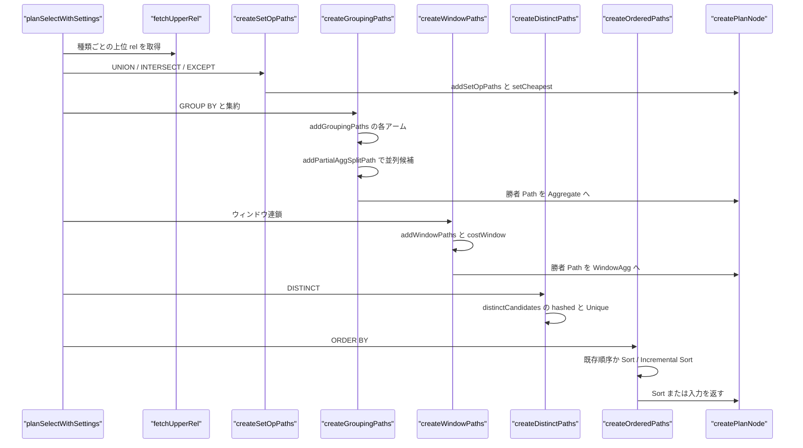
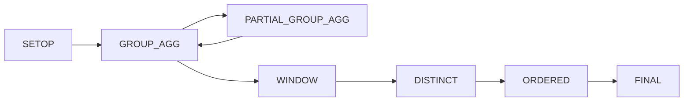

# 集約・ウィンドウ・上位リレーション

<details>
<summary>関連ソースファイル</summary>

- [`internal/optimizer/aggclausecosts.go`](https://github.com/ryogrid/goopg/blob/19856410e8d497d59787e1ab35a2febb3f5953d6/internal/optimizer/aggclausecosts.go)
- [`internal/optimizer/distinctpaths.go`](https://github.com/ryogrid/goopg/blob/19856410e8d497d59787e1ab35a2febb3f5953d6/internal/optimizer/distinctpaths.go)
- [`internal/optimizer/dummy_setop.go`](https://github.com/ryogrid/goopg/blob/19856410e8d497d59787e1ab35a2febb3f5953d6/internal/optimizer/dummy_setop.go)
- [`internal/optimizer/groupagg_hashagg.go`](https://github.com/ryogrid/goopg/blob/19856410e8d497d59787e1ab35a2febb3f5953d6/internal/optimizer/groupagg_hashagg.go)
- [`internal/optimizer/groupagg_indexorder.go`](https://github.com/ryogrid/goopg/blob/19856410e8d497d59787e1ab35a2febb3f5953d6/internal/optimizer/groupagg_indexorder.go)
- [`internal/optimizer/groupagg_presorted.go`](https://github.com/ryogrid/goopg/blob/19856410e8d497d59787e1ab35a2febb3f5953d6/internal/optimizer/groupagg_presorted.go)
- [`internal/optimizer/groupclause.go`](https://github.com/ryogrid/goopg/blob/19856410e8d497d59787e1ab35a2febb3f5953d6/internal/optimizer/groupclause.go)
- [`internal/optimizer/groupingpaths.go`](https://github.com/ryogrid/goopg/blob/19856410e8d497d59787e1ab35a2febb3f5953d6/internal/optimizer/groupingpaths.go)
- [`internal/optimizer/groupingsets.go`](https://github.com/ryogrid/goopg/blob/19856410e8d497d59787e1ab35a2febb3f5953d6/internal/optimizer/groupingsets.go)
- [`internal/optimizer/groupingsets_rollups.go`](https://github.com/ryogrid/goopg/blob/19856410e8d497d59787e1ab35a2febb3f5953d6/internal/optimizer/groupingsets_rollups.go)
- [`internal/optimizer/groupingsets_sorted.go`](https://github.com/ryogrid/goopg/blob/19856410e8d497d59787e1ab35a2febb3f5953d6/internal/optimizer/groupingsets_sorted.go)
- [`internal/optimizer/partialaggpaths.go`](https://github.com/ryogrid/goopg/blob/19856410e8d497d59787e1ab35a2febb3f5953d6/internal/optimizer/partialaggpaths.go)
- [`internal/optimizer/partialaggupper.go`](https://github.com/ryogrid/goopg/blob/19856410e8d497d59787e1ab35a2febb3f5953d6/internal/optimizer/partialaggupper.go)
- [`internal/optimizer/setopbranchrel.go`](https://github.com/ryogrid/goopg/blob/19856410e8d497d59787e1ab35a2febb3f5953d6/internal/optimizer/setopbranchrel.go)
- [`internal/optimizer/upperordered.go`](https://github.com/ryogrid/goopg/blob/19856410e8d497d59787e1ab35a2febb3f5953d6/internal/optimizer/upperordered.go)
- [`internal/optimizer/upperordereddistinct.go`](https://github.com/ryogrid/goopg/blob/19856410e8d497d59787e1ab35a2febb3f5953d6/internal/optimizer/upperordereddistinct.go)
- [`internal/optimizer/upperorderedgrouping.go`](https://github.com/ryogrid/goopg/blob/19856410e8d497d59787e1ab35a2febb3f5953d6/internal/optimizer/upperorderedgrouping.go)
- [`internal/optimizer/upperrel.go`](https://github.com/ryogrid/goopg/blob/19856410e8d497d59787e1ab35a2febb3f5953d6/internal/optimizer/upperrel.go)
- [`internal/optimizer/window_order.go`](https://github.com/ryogrid/goopg/blob/19856410e8d497d59787e1ab35a2febb3f5953d6/internal/optimizer/window_order.go)
- [`internal/optimizer/windowsetoppaths.go`](https://github.com/ryogrid/goopg/blob/19856410e8d497d59787e1ab35a2febb3f5953d6/internal/optimizer/windowsetoppaths.go)

</details>

このコンポーネントは、スキャン/結合の探索より上にある GROUP BY・集約・GROUPING SETS/ROLLUP・ウィンドウ関数・DISTINCT・UNION/INTERSECT/EXCEPT・ORDER BY を、PostgreSQL と同じ「上位リレーション（upper rel）」のパイプラインとして計画する。`upperrel.go` の `upperRels` が `UPPERREL_SETOP` から `UPPERREL_FINAL` までの種類ごとに `RelOptInfo` を保持し、`fetchUpperRel` が find-or-create を行う。各段の producer は、入力の `Node` から種（seed）パスを作り、その段で可能な候補（sorted/hashed/index-ordered/rollup/Mixed/partial split など）を `addPath` に並べ、`setCheapest` と `getCheapestFractionalPath` で勝者を選び、`createPlanNode` で実行ノードに戻す。集約のコストは `aggclausecosts.go` の `aggClauseCosts` が split モード（Simple/Partial/Finalize）ごとに算出し、`costAggClause` がその値を入力行数・グループ数に掛ける。`partialaggupper.go` は `Finalize -> Gather -> Partial` の並列集約を同じ GROUP_AGG rel 上の候補として価格付けする。親セクションは [5 クエリプランナー](../5-Query-Planner.md)。土台は [5.1 プランナー全体像](5.1-Planner-Overview.md)、コストは [5.2 パスとコストモデル](5.2-Path-and-Cost.md)、並列は [5.6 並列クエリの計画](5.6-Parallel-Planning.md)、ノード変換は [5.7 パスからプランへの変換](5.7-Plan-Creation.md) を参照。

## 責務

- 上位リレーションの登録と取得。`fetchUpperRel` が `(kind, relids)` で find-or-create し、`newUpperRelForNode` が SETOP のようにノードごとに別の rel を作る。`path:internal/optimizer/upperrel.go:fetchUpperRel`
- 集約パスの生成。`createGroupingPaths` が GROUP_AGG rel を作り、`addGroupingPaths` が PLAIN/SORTED/index-ordered/Merge Append/検索候補/rollup/Mixed/HASHED の各候補を提出する。`path:internal/optimizer/groupingpaths.go:createGroupingPaths`
- 集約関数コストの算出。`aggClauseCosts` が `get_agg_clause_costs` を移植し、遷移関数・直列化・逆直列化・最終関数を split モードごとに数える。`path:internal/optimizer/aggclausecosts.go:aggClauseCosts`
- グループ化キーの正規化。`buildGroupClause` が GROUP BY の式を `GroupClauseKey` にし、`processedGroupOrder` が ORDER BY に合わせたキー順を返す。`path:internal/optimizer/groupclause.go:buildGroupClause`
- GROUPING SETS/ROLLUP の展開。`prepareGroupingSets` が集合をスロットに変換し、`ExtractGroupingRollups` が集合を rollup の連鎖に分ける。`path:internal/optimizer/groupingsets.go:prepareGroupingSets`
- ソート済み rollup の候補生成。`rollupSortKeys` と `costSortedRollups` が 1 回のソートで複数集合を処理する候補を価格付けし、`mixedGroupingRollups` がハッシュとソートの混合を選ぶ。`path:internal/optimizer/groupingsets_sorted.go:costSortedRollups`
- 並列集約の候補生成。`addPartialAggSplitPath` が `Finalize -> Gather -> Partial` を作り、`addPartialGroupOnlyPath` などが Partial 側の代替を並べる。`path:internal/optimizer/partialaggupper.go:addPartialAggSplitPath`
- 部分集約の判定。`createPartialGroupingPaths` が split と no-split の 2 候補を比較し、`splitWins` が `CheapestTotal` で勝敗を返す。`path:internal/optimizer/partialaggpaths.go:createPartialGroupingPaths`
- DISTINCT パスの生成。`createDistinctPaths` が hashed と Unique-over-Sort の 2 候補を作り、`distinctCandidates` が価格付けする。`path:internal/optimizer/distinctpaths.go:createDistinctPaths`
- ウィンドウパスの生成。`createWindowPaths` がウィンドウ連鎖を 1 本の `PathWindow` にまとめ、`addWindowPaths` が各段のソート/Incremental Sort を価格付けする。`path:internal/optimizer/windowsetoppaths.go:createWindowPaths`
- ウィンドウ定義の順序付け。`orderWindowDefsLikePG` が `select_active_windows` と同じ安定ソートで、下位の WindowAgg から順に並べる。`path:internal/optimizer/window_order.go:orderWindowDefsLikePG`
- 集合演算パスの生成。`createSetOpPaths` が SETOP rel を作り、`addSetOpPaths`/`addSortedSetOpPath` が streaming/sorted の候補を、`addPartialSetOpPath` が部分ブランチを扱う。`path:internal/optimizer/windowsetoppaths.go:createSetOpPaths`
- UNION DISTINCT のパス生成。`createUnionDistinctPaths` が UNION ALL 連鎖を 1 つの Append とみなし、hashed と Sort->Unique を比較する。`path:internal/optimizer/windowsetoppaths.go:createUnionDistinctPaths`
- ORDER BY のパス生成。`createOrderedPaths` が ORDERED rel を作り、`addOrderedPaths` が入力の既存順序を使うか Sort/Incremental Sort を積む。`path:internal/optimizer/upperordered.go:createOrderedPaths`
- 集約/ DISTINCT の ORDER BY 選挙。`electOrderedGrouping`/`electOrderedDistinct` が GROUP_AGG/DISTINCT rel の生存候補を ORDERED rel 上で再比較する。`path:internal/optimizer/upperorderedgrouping.go:electOrderedGrouping`
- SETOP ブランチ rel の伝播。`stampSetOpBranchRel`/`setOpBranchRelOf` が連鎖する集合演算の各リンクに SETOP rel を載せる。`path:internal/optimizer/setopbranchrel.go:stampSetOpBranchRel`
- ダミー UNION ALL メンバーの除去。`pruneDummyUnionAllArms` が子のない `Result`（恒偽）を Append から落とす。`path:internal/optimizer/dummy_setop.go:pruneDummyUnionAllArms`

## 処理フロー

`planSelectWithSettings` は文の上側（ORDER BY、DISTINCT、集約、ウィンドウ、集合演算）を下から順に組み立てる。まず `createSetOpPaths` が UNION/INTERSECT/EXCEPT の各リンクを処理し、`fetchUpperRel(u, UpperSetOp, ...)` ではなく `newUpperRelForNode` でリンクごとの rel を作る。`addSetOpPaths` が左右の seed から streaming と sorted の候補を出し、`addPartialSetOpPath` が各ブランチの `PartialPathlist` から Parallel Append の候補を出す。`setCheapest` の後、`getCheapestFractionalPath` が勝者を選び、`createPlanNode` が `*SetOp` または `*Gather` を返す。

集約があると `createGroupingPaths` が呼ばれる。`aggNode.Mode != AggModeSimple` の場合は何もせずノードを返す。Simple の場合は `fetchUpperRel(u, UpperGroupAgg, 0, tupleFraction)` で GROUP_AGG rel を取得し、`sizeGroupingRelFromAgg` で行数と幅を設定する。入力 `Node` から `newPrebuiltPath` の seed を作り、`upperInputPathCost` で入力コストを写し、検索由来なら `searchedJoinInputRelOf` の行数を使う。`addGroupingPaths` は PLAIN（GROUP BY なし）なら hashed 1 グループの候補を 1 つ出し、GROUP BY ありなら SORTED 系（group keys、presorted keys、Incremental Sort、検索候補、Merge Append、index-ordered）を先に、HASHED を後に出す。GROUPING SETS では sorted rollup と Mixed の候補も加わる。`addPartialAggSplitPath` が並列候補を同じ rel に出し、`setCheapest` の後 `createPlanNode` で `*Aggregate` を得て、`*aggNode = *built` で呼び出し元のノードへ書き戻す。

ウィンドウがあると `createWindowPaths` が `fetchUpperRel(u, UpperWindow, ...)` を作り、`sizeWindowRelFromNode` で行数（入力と同じ）と幅を設定する。`addWindowPaths` はウィンドウ連鎖を下から 1 段ずつ処理し、各段の PARTITION BY + ORDER BY が入力の pathkeys に含まれるならソートを省き、部分的に含まれるなら Incremental Sort を積み、含まれないならフルソートを積む。goopg の `windowOp` は入力全体をソートしてから出力するため、`costWindow` はソートをこのノードの起動コストに含める。勝者は `createPlanNode` で `*WindowAgg` になり、連鎖の最上位が返る。

DISTINCT があると `createDistinctPaths` が `fetchUpperRel(u, UpperDistinct, ...)` を作り、`sizeDistinctRelFromNode` で `estimateDistinctRows` の行数を設定する。`distinctCandidates` は hashed（`PathDistinct`）と Unique-over-Sort（`Distinct.Unique`）の 2 候補を作り、`addDistinctPaths` が hashed を先に、Unique を後に提出する。並列候補は `addPartialDistinctPaths` が `PartialUnique` マーカー付きで出す。`setCheapest` の後、勝者の種別に応じて `*Distinct` か `*DistinctOn` を返す。

ORDER BY があると `createOrderedPaths` が `fetchUpperRel(u, UpperOrdered, ...)` を作り、`sizeUpperRelFromNode` で入力の行数と幅を設定する。`addOrderedPaths` は入力の pathkeys が要求を満たせばそのまま、そうでなければ `sortPathForBounded` で Sort を積む。検索由来の入力なら `searchedRelOf` の `Pathlist` を `SearchCandidates` に写し、`validatedSearchCandidateKeys` で各候補の順序主張を検証してから `addOrderedPaths` に渡す。集約や DISTINCT の直後に ORDER BY がある場合、`electOrderedGrouping`/`electOrderedDistinct` が下位 rel の生存候補を ORDERED rel 上で再比較し、ソートを省ける候補を選ぶ。



上位リレーションのパイプラインは、下流の rel の pathlist を上流の rel が読む形で進む。



## 主要ファイル

| ファイル | 役割 |
| --- | --- |
| `internal/optimizer/upperrel.go` | `UpperRelKind`、`upperRels`、`fetchUpperRel`、`newUpperRelForNode`、`sizeUpperRelFromNode`。上位 rel の登録。`path:internal/optimizer/upperrel.go:fetchUpperRel` |
| `internal/optimizer/groupingpaths.go` | `createGroupingPaths`、`addGroupingPaths`、`groupingHashable`、`presortedAggSelection`、`indexOrderedAggInput`。集約候補の本体。`path:internal/optimizer/groupingpaths.go:addGroupingPaths` |
| `internal/optimizer/aggclausecosts.go` | `aggSplit`、`aggCosts`、`aggClauseCosts`、`legacyAggCosts`。集約関数のコスト。`path:internal/optimizer/aggclausecosts.go:aggClauseCosts` |
| `internal/optimizer/groupclause.go` | `processedGroupOrder`、`buildGroupClause`、`groupClauseKeys`、`transportGroupSortKeys`。GROUP BY キーの正規化。`path:internal/optimizer/groupclause.go:buildGroupClause` |
| `internal/optimizer/groupingsets.go` | `prepareGroupingSets`、`groupingSetIndices`、`groupingCallMasks`。GROUPING SETS/ROLLUP の展開。`path:internal/optimizer/groupingsets.go:prepareGroupingSets` |
| `internal/optimizer/groupingsets_rollups.go` | `GroupingRollup`、`ExtractGroupingRollups`、`extractRollupSets`、`reorderGroupingSets`。rollup 連鎖。`path:internal/optimizer/groupingsets_rollups.go:ExtractGroupingRollups` |
| `internal/optimizer/groupingsets_sorted.go` | `RollupChainOrder`、`rollupSortKeys`、`costSortedRollups`、`mixedGroupingRollups`、`costMixedRollups`。ソート済み/Mixed rollup。`path:internal/optimizer/groupingsets_sorted.go:costSortedRollups` |
| `internal/optimizer/partialaggpaths.go` | `partialAggTournament`、`createPartialGroupingPaths`、`splitWins`、`partialAggSplitPays`。部分集約の比較。`path:internal/optimizer/partialaggpaths.go:createPartialGroupingPaths` |
| `internal/optimizer/partialaggupper.go` | `addPartialAggSplitPath`、`addPartialGroupOnlyPath`、`addPartialAggSortedSplitArm`、`upperSplitWorkers`。並列集約の上位候補。`path:internal/optimizer/partialaggupper.go:addPartialAggSplitPath` |
| `internal/optimizer/distinctpaths.go` | `createDistinctPaths`、`distinctCandidates`、`addDistinctPaths`、`addPartialDistinctPaths`。DISTINCT の候補。`path:internal/optimizer/distinctpaths.go:createDistinctPaths` |
| `internal/optimizer/windowsetoppaths.go` | `createWindowPaths`、`addWindowPaths`、`costWindow`、`createSetOpPaths`、`createUnionDistinctPaths`。ウィンドウと集合演算。`path:internal/optimizer/windowsetoppaths.go:createWindowPaths` |
| `internal/optimizer/window_order.go` | `windowSortItem`、`orderWindowDefsLikePG`、`commonPrefixCmp`。ウィンドウ定義の順序。`path:internal/optimizer/window_order.go:orderWindowDefsLikePG` |
| `internal/optimizer/upperordered.go` | `createOrderedPaths`、`addOrderedPaths`、`upperOrderedCandidateProducer`。ORDER BY の候補。`path:internal/optimizer/upperordered.go:createOrderedPaths` |
| `internal/optimizer/upperorderedgrouping.go` | `electOrderedGrouping`、`groupingEmissionPathkeys`、`applyHavingQualsToOffer`。集約の ORDER BY 選挙。`path:internal/optimizer/upperorderedgrouping.go:electOrderedGrouping` |
| `internal/optimizer/upperordereddistinct.go` | `electOrderedDistinct`、`distinctEmissionPathkeys`。DISTINCT の ORDER BY 選挙。`path:internal/optimizer/upperordereddistinct.go:electOrderedDistinct` |
| `internal/optimizer/setopbranchrel.go` | `setOpBranchTag`、`stampSetOpBranchRel`、`setOpBranchRelOf`。SETOP ブランチ rel の伝播。`path:internal/optimizer/setopbranchrel.go:stampSetOpBranchRel` |
| `internal/optimizer/dummy_setop.go` | `pruneDummyUnionAllArms`、`isDummyRelNode`、`renameSetOpMember`。ダミー UNION ALL の除去。`path:internal/optimizer/dummy_setop.go:pruneDummyUnionAllArms` |
| `internal/optimizer/groupagg_hashagg.go` | `HashAggEnabled`、`SetHashAggEnabled`。ハッシュ集約の有効化。`path:internal/optimizer/groupagg_hashagg.go:HashAggEnabled` |
| `internal/optimizer/groupagg_presorted.go` | `PresortedAggEnabled`、`SetPresortedAggEnabled`、`presortedAggVolatileBuiltins`。presorted 集約の有効化。`path:internal/optimizer/groupagg_presorted.go:PresortedAggEnabled` |
| `internal/optimizer/groupagg_indexorder.go` | `buildIndexOrderedScan`、`tableColumnByName`。インデックス順入力の構築。`path:internal/optimizer/groupagg_indexorder.go:buildIndexOrderedScan` |

## 公開 API / エントリポイント

上位 rel の producer はパッケージ内部で、`planSelectWithSettings` から呼ばれる。外部へ公開されているのは集約方式の有効化スイッチと `UpperRelKind` である。

```go
func HashAggEnabled() bool
func SetHashAggEnabled(on bool)
func PresortedAggEnabled() bool
func SetPresortedAggEnabled(on bool)
type UpperRelKind int
```

内部の主要な入口は次のとおり。いずれも上位 rel を取得し、候補を `addPath` して `setCheapest` した後、`createPlanNode` でノードに戻す。

```go
func fetchUpperRel(u *upperRels, kind UpperRelKind, relids RelSet, tupleFraction float64) *RelOptInfo
func newUpperRelForNode(u *upperRels, kind UpperRelKind, tupleFraction float64) *RelOptInfo
func createGroupingPaths(u *upperRels, aggNode *Aggregate, having Expr, cat catalog.Catalog, ps PlannerSettings, tupleFraction float64) (Node, error)
func createWindowPaths(u *upperRels, windows []*WindowAgg, input Node, ps PlannerSettings, tupleFraction float64, chainKeep [][]int, relKeep []int) (Node, error)
func createDistinctPaths(u *upperRels, distinctNode *Distinct, cat catalog.Catalog, ps PlannerSettings, tupleFraction float64) (Node, error)
func createSetOpPaths(u *upperRels, setOpNode *SetOp, ps PlannerSettings, tupleFraction float64) (Node, error)
func createUnionDistinctPaths(u *upperRels, distinctNode *Distinct, leaves []Node, ps PlannerSettings, tupleFraction float64) (Node, error)
func createOrderedPaths(u *upperRels, input Node, keys []SortKey, pos int, cp costParams, tupleFraction float64, limitTuples float64, narrowKeep []int) Node
func electOrderedGrouping(u *upperRels, agg *aggregateSurface, node Node, keys []SortKey, stmtPos int, cp costParams, tupleFraction, limitTuples float64, narrowKeep []int) (Node, bool)
func electOrderedDistinct(u *upperRels, distinctNode *Distinct, keys []SortKey, stmtPos int, cp costParams, tupleFraction, limitTuples float64) (Node, bool)
```

## 主要データ構造

### `UpperRelKind`

上位 rel の種類である。PG の `UpperRelationKind` と同じ順序で、`UpperFinal` が最後でなければならない。`path:internal/optimizer/upperrel.go:UpperRelKind`

```go
type UpperRelKind int

const (
	UpperSetOp           UpperRelKind = iota // result of UNION/INTERSECT/EXCEPT, if any
	UpperPartialGroupAgg                     // result of partial grouping/aggregation, if any
	UpperGroupAgg                            // result of grouping/aggregation, if any
	UpperWindow                              // result of window functions, if any
	UpperPartialDistinct                     // result of partial "SELECT DISTINCT", if any
	UpperDistinct                            // result of "SELECT DISTINCT", if any
	UpperOrdered                             // result of ORDER BY, if any
	UpperFinal                               // result of any remaining top-level actions
	// UpperFinal must stay the last entry: it sizes `upperRels`
	// (pathnodes.h:80 "NB: UPPERREL_FINAL must be last enum entry").
)
```

`UpperSetOp` は集合演算、`UpperPartialGroupAgg`/`UpperGroupAgg` は部分/最終集約、`UpperWindow` はウィンドウ、`UpperPartialDistinct`/`UpperDistinct` は DISTINCT、`UpperOrdered` は ORDER BY、`UpperFinal` は残りの最上位処理を表す。並びは PG の enum と一致し、`upperRelKindNames` が EXPLAIN やトレース用の名前を与える。

### `upperRels`

1 つの計画スコープの上位 rel レジストリである。`path:internal/optimizer/upperrel.go:upperRels`

```go
type upperRels struct {
	rels [UpperFinal + 1][]*RelOptInfo
	// cat is the statement's catalog, for the sizes the upper rels' parallel
	// worker counts are computed from (relations and indexes are sized where
	// the catalog places them, as get_relation_info does). nil in unit
	// fixtures, which then use the default-database lookup.
	cat catalog.Catalog
}
```

`rels[kind]` はその種類の rel のリストで、`fetchUpperRel` が `Relids` の線形探索で find-or-create する。`cat` は並列ワーカー数を見積もるための文カタログである。不変条件は「上位 rel は `searchCtx.relMap` や `joinrels` に入らない」ことである。入ると `makeJoinRel` の find-or-create や `finalRel` の一意性を壊す。`upperRels` は `searchCtx` へのポインタを一切持たないため、この不変条件は構造的に守られる。

### `aggSplit` と `aggCosts`

集約の分割モードと、そのモードで課金する 1 行/1 グループあたりのコストである。`path:internal/optimizer/aggclausecosts.go:aggSplit`

```go
type aggSplit int

const (
	// aggSplitSimple is AGGSPLIT_SIMPLE: transfn per row, finalfn per group.
	aggSplitSimple aggSplit = iota
	// aggSplitInitialSerial is AGGSPLIT_INITIAL_SERIAL, the Partial
	// Aggregate: transfn per row, serialfn per group, the finalfn skipped.
	aggSplitInitialSerial
	// aggSplitFinalDeserial is AGGSPLIT_FINAL_DESERIAL, the Finalize
	// Aggregate: combinefn plus deserialfn per row, finalfn per group.
	aggSplitFinalDeserial
)
```

`path:internal/optimizer/aggclausecosts.go:aggCosts`

```go
type aggCosts struct {
	transPerTuple, finalPerGroup float64
}
```

`aggSplitSimple` は通常の集約、`aggSplitInitialSerial` は Partial Aggregate、`aggSplitFinalDeserial` は Finalize Aggregate を表す。`transPerTuple` は入力行ごとの遷移コスト、`finalPerGroup` はグループごとの最終化コストである。不変条件は「`aggClauseCosts` が返す 2 値は同じ split モードの support function から計算される」ことで、Partial と Finalize を混ぜた見積もりを作らない。

### `GroupingRollup`

GROUPING SETS を rollup の連鎖として表したものである。`path:internal/optimizer/groupingsets_rollups.go:GroupingRollup`

```go
type GroupingRollup struct {
	Order []int
	Sets  []int
}
```

`Order` はグループ化列の並び（`GroupExprs` のスロット番号、最大集合の列順）、`Sets` は `Aggregate.GroupingSets` への添字で、最大集合を先頭にする。`Sets[k]` は `Order[:len(GroupingSets[Sets[k]])]` でグループ化する。不変条件は「`Sets` の各集合が `Order` の前置になる」ことで、1 回のソートで連続的に集約できる。

### `processedGroupItem`

GROUP BY の各項目に ORDER BY の方向を写したものである。`path:internal/optimizer/groupclause.go:processedGroupItem`

```go
type processedGroupItem struct {
	idx        int
	desc       bool
	nullsFirst bool
}
```

`idx` は `groupItems` の添字、`desc`/`nullsFirst` は対応する ORDER BY 項目の方向である。`processedGroupOrder` はまず各 GROUP BY 項目が最初に現れる ORDER BY 項目の方向を写し、次に ORDER BY の前置と一致する GROUP BY 項目を先頭へ並べる。デフォルト（書かれた順、すべて ASC NULLS LAST）なら nil を返す。

### `partialAggTournament`

並列集約の split と no-split の 2 候補を保持する。`path:internal/optimizer/partialaggpaths.go:partialAggTournament`

```go
type partialAggTournament struct {
	grouped *RelOptInfo
	partial *RelOptInfo

	split   *Path // Finalize over Gather over Partial
	noSplit *Path // Simple aggregate over Gather over the whole input

	splitFiled   bool
	noSplitFiled bool

	// The estimates the verdict turns on, exposed for tests and for the
	// arithmetic in DESIGN §3.4.
	divisor       float64
	inputRows     float64
	finalGroups   float64
	partialGroups float64
	crossedRows   float64 // compute_gather_rows: clamp(partialGroups * divisor), the group-states that cross
}
```

`split` は `Finalize -> Gather -> Partial`、`noSplit` は入力全体を Gather した上での通常集約である。`splitFiled`/`noSplitFiled` は `addToPathlist` の支配判定を生き残ったかを示し、生成されたかどうかは `split`/`noSplit` の非 nil で判断する。`divisor` は並列除数、`crossedRows` はワーカー境界を越えるグループ状態数である。`splitWins` は `grouped.CheapestTotal == split` で勝敗を返す。

### `setOpBranchTag`

連鎖する集合演算の各リンクに SETOP rel を載せるためのタグである。`path:internal/optimizer/setopbranchrel.go:setOpBranchTag`

```go
type setOpBranchTag struct {
	setOpRel *RelOptInfo
}

func (t *setOpBranchTag) setSetOpBranchRel(rel *RelOptInfo) { t.setOpRel = rel }
func (t *setOpBranchTag) setOpBranchRel() *RelOptInfo       { return t.setOpRel }
```

`setOpRel` はそのリンクの SETOP rel である。`*SetOp` や `*Gather` に埋め込むと `setOpBranchRelNode` を実装し、`stampSetOpBranchRel` が rel を載せる。`setOpBranchRelOf` はノードを最大 32 段たどり、最初に見つかった carrier の rel を返す。これにより 3 段以上の UNION ALL 連鎖でも上位リンクが下位の partial path を読める。

### `windowSortItem`

ウィンドウ定義の共通接頭辞比較に使う 1 項目である。`path:internal/optimizer/window_order.go:windowSortItem`

```go
type windowSortItem struct {
	ref        int  // tleSortGroupRef
	desc       bool // sortop: the `>` operator of a type outranks its `<`
	nullsFirst bool
}
```

`ref` は `tleSortGroupRef` に相当する式の登録番号、`desc` は降順か、`nullsFirst` は NULLS FIRST かである。`orderWindowDefsLikePG` はこの 3 つを `commonPrefixCmp` で比較し、ウィンドウを安定ソートする。ref が大きいもの、DESC、NULLS FIRST の順に先になり、共通接頭辞では項目数の多いウィンドウが先になる。

## 内部構造

上位 rel の設計は、**producer の定型**と**候補の順序**でできている。すべての producer は「`fetchUpperRel` で rel を取得 → `size...RelFromNode` で行数・幅・`NCols`・`AvgVarBytes` を設定 → seed パスを作る → アームごとに `addPath` → `setCheapest` → `getCheapestFractionalPath` → `createPlanNode`」という同じ形を取る。`size...` を飛ばすと `NCols == 0` になり、`costSortRun` が「幅不明」としてソートのディスク I/O を課さなくなる。これは PG の `set_pathtarget_cost_width` を飛ばすのと同じ誤りである。

集約の候補は `addGroupingPaths` が順序込みで出す。GROUP BY なし（PLAIN）は hashed 1 グループの 1 候補だけである。GROUP BY ありは、まず SORTED 系を出す。group keys でソートする候補、presorted aggregate のキーでソートする候補、入力が部分的に並んでいる場合の Incremental Sort、検索由来の既順序候補、UNION ALL の Merge Append、index-ordered scan が続く。その後で sorted rollup / Mixed rollup、最後に HASHED を出す。この順序は `addPath` のファジー同点で先着が勝つため、PG の `add_paths_to_grouping_rel` の順序（sorted が hash より先）をそのまま守っている。`enable_hashagg = off` は HASHED を削除せず `DisabledNodes` を加算する。

集約コストは `costAggClause` が `aggCosts` を入力行数とグループ数に掛ける。SORTED は入力の起動コストをそのまま使い、入力行ごとの遷移とグループ化比較、グループごとの最終化を足す。HASHED は入力の総コストを起動コストにし、入力行ごとの遷移とハッシュ計算、グループごとの最終化を足す。`aggClauseCosts` は `pg_aggregate`/`pg_proc` の `procost` を引き、同じ引数の集約呼び出しは 1 つの遷移状態を共有する。解決できないユーザ定義集約は旧来の「1 呼び出し 1 単位」に退避する。

GROUPING SETS は `prepareGroupingSets` が集合をスロットに変換し、`ExtractGroupingRollups` が「各集合が次の集合の前置になる」連鎖に分ける。1 本の rollup なら `rollupSortKeys` で 1 回のソート順を決め、`costSortedRollups` が最長集合の列数と全集合のグループ数で価格付けする。複数 rollup や CUBE では `mixedGroupingRollups` がナップサックでハッシュする集合とソートする集合を分け、`costMixedRollups` が MixedAggregate のコストを出す。順序付き集約（DISTINCT/ORDER BY/WITHIN GROUP）があるとハッシュできないため、sorted rollup が唯一の候補になる。

並列集約は `partialaggupper.go` が GROUP_AGG rel に `PathFinalizeAgg` を積む。`addPartialAggSplitPath` は `Finalize -> Gather -> Partial` の形を作り、`addPartialGroupOnlyPath` は Partial を省いた「Gather の上で通常集約」の候補を作る。`upperSplitWorkers` が入力のスキャン/結合からワーカー数を決め、`addPartialAggSortedSplitArm` がソート済み入力の分割を、`addPartialAggSortedInputArm` が入力の順序を利用する形を扱う。`partialAggSplitPays` が「分割が割に合うか」を判定し、`MaxParallelWorkersPerGather <= 0` や相関入力では何も出さない。

DISTINCT は `distinctCandidates` が hashed と Unique-over-Sort の 2 候補を作る。hashed は入力の総コストを起動コストにし、`costAgg(AggStrategyHashed)` で全列をグループキーとして価格付けする。Unique は全列（または DISTINCT のキー）でソートし、`uniquePathCost` で隣接重複排除を価格付けする。`addDistinctPaths` は hashed を先に、Unique を後に出す。`distinctOutputSatisfiesOrder` は `*Distinct` の出力が「全列 ASC NULLS LAST」の前置である場合だけ、外側の Sort を省略できると判定する。DESC や NULLS FIRST、非 ColumnRef のキーは拒否する。

ウィンドウは `addWindowPaths` が連鎖を下から処理する。各段の PARTITION BY + ORDER BY が入力の pathkeys に完全に含まれるならソートを省き、部分的に含まれるなら `costIncrementalSort` の式で Incremental Sort を価格付けし、含まれないなら `costSortRun` でフルソートを価格付けする。goopg の `windowOp` は入力を全部ソートしてから出力するため、`costWindow` の起動コストは入力の総コスト＋ソートになる。`orderWindowDefsLikePG` がウィンドウ定義を PG と同じ順に並べ、下位の WindowAgg から積む。

集合演算は `createSetOpPaths` が 1 リンクを処理する。`swapIntersectInputs` で INTERSECT の入力を正規化し、左右の seed から `addSetOpPaths` が streaming と sorted の候補を作る。UNION ALL の連鎖は `pruneDummyUnionAllArms` が恒偽のメンバーを落とし、1 つだけ残れば Append を外す。UNION DISTINCT は `createUnionDistinctPaths` が連鎖全体を 1 つの Append とみなし、`addUnionDistinctPaths` で hashed と Sort->Unique を比較する。`setopbranchrel.go` のタグが各リンクの rel を次段へ渡すため、3 段以上の連鎖でも partial path が正しく積み上がる。

ORDER BY は `createOrderedPaths` が ORDERED rel を作り、`addOrderedPaths` が入力の pathkeys を確認して Sort を省くか `sortPathForBounded` を積む。`limitTuples` は `costSortRun` の `limit_tuples` に渡り、LIMIT がある場合の bounded sort を価格付けする。集約や DISTINCT の直後では `electOrderedGrouping`/`electOrderedDistinct` が下位の生存候補を ORDERED rel に載せ替え、候補ごとに「そのまま使える順序」「Incremental Sort で足りる順序」「フルソートが必要」を判定して `addOrderedPaths` に渡す。これにより、ORDER BY のために無条件に Sort を積むのではなく、下位の候補が持つ順序を再利用できる。

## エッジケースと不変条件

- **上位 rel の種類の範囲**: `fetchUpperRel` は `kind < 0 || kind > UpperFinal` で panic する。`upperRels.rels` の配列長は `UpperFinal + 1` で、`UpperFinal` を最後に保つことが前提である。`path:internal/optimizer/upperrel.go:fetchUpperRel`
- **上位 rel の分離**: 上位 rel は `searchCtx.relMap`/`joinrels` に入れない。`Relids` は常に 0 で、検索の relset と混ざらない。`path:internal/optimizer/upperrel.go:newUpperRelForNode`
- **集約モードのパススルー**: `createGroupingPaths` は `aggNode.Mode != AggModeSimple` なら何もせずノードを返す。Partial/Finalize の形は `partialaggupper.go` が所有する。`path:internal/optimizer/groupingpaths.go:createGroupingPaths`
- **集約候補なし**: `createGroupingPaths` は勝者が nil なら `0A000` の「could not implement GROUP BY」を返す。nil ノードを返して後段で失敗させない。`path:internal/optimizer/groupingpaths.go:createGroupingPaths`
- **ハッシュ不可の条件**: `groupingHashable` は presorted 集約または順序付き集約がある場合に false を返す。`enable_hashagg = off` は候補を消さず `DisabledNodes` を加算する。`path:internal/optimizer/groupingpaths.go:groupingHashable`
- **GROUPING SETS のハッシュ上限**: `groupingSetsHashTooBig` がハッシュテーブルのグループ数を見積もり、大きすぎる場合は HASHED を出さない。`path:internal/optimizer/groupingpaths.go:groupingSetsHashTooBig`
- **presorted 集約の無効化**: `presortedAggSelection` は `EnablePresortedAggregate` が false、GROUPING SETS あり、WITHIN GROUP ありの場合に presorted 候補を出さない。`path:internal/optimizer/groupingpaths.go:presortedAggSelection`
- **partial 分割の正規化**: `partialAggNotionalRows = 1e6` は実入力行数が不明なときの正規化値である。比較が行数について 1 次同次なので、勝敗を変えない。`path:internal/optimizer/partialaggpaths.go:partialAggNotionalRows`
- **partial 分割の拒否**: `createPartialGroupingPaths` は `workers <= 0`、集約が分解不能（`aggregateSplitIsSafe` が偽）、並列除数 `d <= 1`、子が nil の場合に nil を返し、`partialAggSplitPays` はそれを「分割しない」と判定する。`path:internal/optimizer/partialaggpaths.go:createPartialGroupingPaths`
- **DISTINCT の候補なし**: `createDistinctPaths` は勝者が nil なら `0A000` の「could not implement DISTINCT」を返す。`path:internal/optimizer/distinctpaths.go:createDistinctPaths`
- **DISTINCT の順序再利用**: `distinctOutputSatisfiesOrder` は `*Distinct` で、要求キーがすべて ASC NULLS LAST かつ出力の位置的前置である場合だけ Sort を省く。DESC や非 ColumnRef は拒否する。`path:internal/optimizer/distinctpaths.go:distinctOutputSatisfiesOrder`
- **partial DISTINCT の空キー**: `addPartialDistinctPaths` はキーが空なら拒否する。PG の LIMIT-1 partial path はモデル化しない。`path:internal/optimizer/distinctpaths.go:addPartialDistinctPaths`
- **ウィンドウのブロッキング**: goopg の `windowOp` は入力をソートしてから出力するため、`costWindow` の起動コストは入力の総コストを含む。PG の `get_windowclause_startup_tuples` のような早期終了の割引はない。`path:internal/optimizer/windowsetoppaths.go:costWindow`
- **ウィンドウ候補なし**: `createWindowPaths` は勝者が nil なら `0A000` の「could not implement window function」を返す。`path:internal/optimizer/windowsetoppaths.go:createWindowPaths`
- **ウィンドウ定義の順序**: `orderWindowDefsLikePG` は `tleSortGroupRef` の登録順、DESC、NULLS FIRST、項目数の順で安定ソートする。式の書き方が違っても PG が同じターゲットに解決する場合は別項目として扱うため、順序が変わることはあっても結果は変わらない。`path:internal/optimizer/window_order.go:orderWindowDefsLikePG`
- **SETOP の入力欠落**: `createSetOpPaths` は左右どちらかが nil なら `XX000` を返す。`swapIntersectInputs` は INTERSECT の入力を正規化する。`path:internal/optimizer/windowsetoppaths.go:createSetOpPaths`
- **SETOP の勝者種別**: `createSetOpPaths` は `*SetOp` または `*Gather`/`*GatherMerge` 以外のノードが返ると `XX000` にする。partial SETOP の勝者は Gather になることがある。`path:internal/optimizer/windowsetoppaths.go:createSetOpPaths`
- **SETOP ブランチ rel の探索上限**: `setOpBranchRelOf` は最大 32 段たどる。carrier を最初に見るため、`*Gather` の下の `*SetOp` でも外側の rel を返す。`path:internal/optimizer/setopbranchrel.go:setOpBranchRelOf`
- **ダミー UNION ALL の除去範囲**: `pruneDummyUnionAllArms` は `UNION ALL` で `UnionDistinctInput` でないリンクだけを対象にする。UNION DISTINCT のダミーメンバーは PG と同じく Append の下に残す。`path:internal/optimizer/dummy_setop.go:pruneDummyUnionAllArms`
- **ORDER BY の候補選挙**: `electOrderedGrouping`/`electOrderedDistinct` は下位 rel の生存候補が 1 つでも選挙を行う（PG の `foreach` と同じ）。ただし `PathFinalizeAgg` が GROUP_AGG にある場合は、並列最終集約とソートの整合が取れないため `parallel-finalize-agg-present` で降りる。`path:internal/optimizer/upperorderedgrouping.go:electOrderedGrouping`

Sources:

- `internal/optimizer/aggclausecosts.go`
- `internal/optimizer/distinctpaths.go`
- `internal/optimizer/dummy_setop.go`
- `internal/optimizer/groupagg_hashagg.go`
- `internal/optimizer/groupagg_indexorder.go`
- `internal/optimizer/groupagg_presorted.go`
- `internal/optimizer/groupclause.go`
- `internal/optimizer/groupingpaths.go`
- `internal/optimizer/groupingsets.go`
- `internal/optimizer/groupingsets_rollups.go`
- `internal/optimizer/groupingsets_sorted.go`
- `internal/optimizer/partialaggpaths.go`
- `internal/optimizer/partialaggupper.go`
- `internal/optimizer/setopbranchrel.go`
- `internal/optimizer/upperordered.go`
- `internal/optimizer/upperordereddistinct.go`
- `internal/optimizer/upperorderedgrouping.go`
- `internal/optimizer/upperrel.go`
- `internal/optimizer/window_order.go`
- `internal/optimizer/windowsetoppaths.go`

<sub>Generated by deepwiki-4myself from `goopg` @ `19856410e`</sub>
