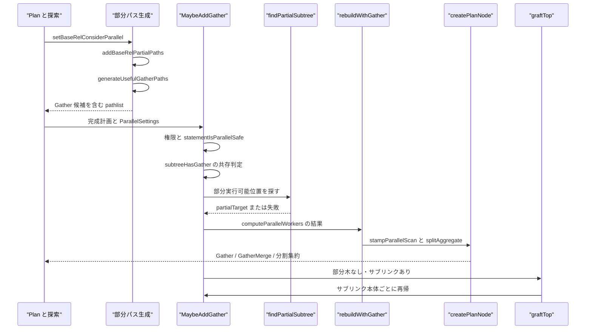
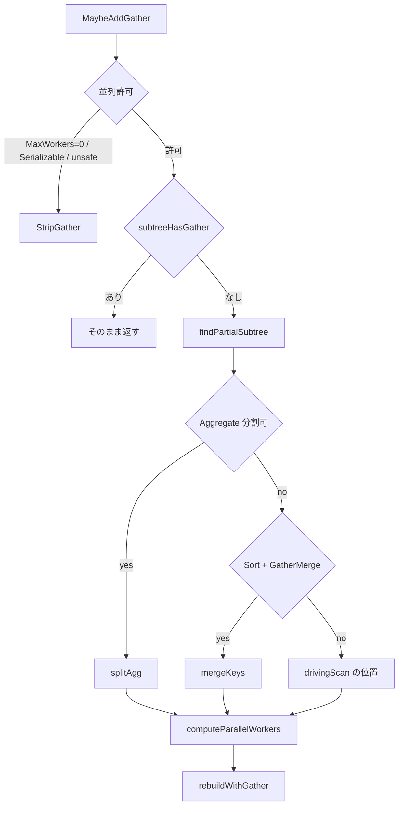

# 並列クエリの計画

<details>
<summary>関連ソースファイル</summary>

- [`internal/optimizer/considerparallel.go`](https://github.com/ryogrid/goopg/blob/19856410e8d497d59787e1ab35a2febb3f5953d6/internal/optimizer/considerparallel.go)
- [`internal/optimizer/createplangather.go`](https://github.com/ryogrid/goopg/blob/19856410e8d497d59787e1ab35a2febb3f5953d6/internal/optimizer/createplangather.go)
- [`internal/optimizer/gatherpaths.go`](https://github.com/ryogrid/goopg/blob/19856410e8d497d59787e1ab35a2febb3f5953d6/internal/optimizer/gatherpaths.go)
- [`internal/optimizer/incrementalsortpaths.go`](https://github.com/ryogrid/goopg/blob/19856410e8d497d59787e1ab35a2febb3f5953d6/internal/optimizer/incrementalsortpaths.go)
- [`internal/optimizer/parallel.go`](https://github.com/ryogrid/goopg/blob/19856410e8d497d59787e1ab35a2febb3f5953d6/internal/optimizer/parallel.go)
- [`internal/optimizer/parallel_agg.go`](https://github.com/ryogrid/goopg/blob/19856410e8d497d59787e1ab35a2febb3f5953d6/internal/optimizer/parallel_agg.go)
- [`internal/optimizer/parallelappendorder.go`](https://github.com/ryogrid/goopg/blob/19856410e8d497d59787e1ab35a2febb3f5953d6/internal/optimizer/parallelappendorder.go)
- [`internal/optimizer/partialsortpaths.go`](https://github.com/ryogrid/goopg/blob/19856410e8d497d59787e1ab35a2febb3f5953d6/internal/optimizer/partialsortpaths.go)
- [`internal/optimizer/small_dimension.go`](https://github.com/ryogrid/goopg/blob/19856410e8d497d59787e1ab35a2febb3f5953d6/internal/optimizer/small_dimension.go)
- [`internal/optimizer/subquery_parallel.go`](https://github.com/ryogrid/goopg/blob/19856410e8d497d59787e1ab35a2febb3f5953d6/internal/optimizer/subquery_parallel.go)

</details>

このコンポーネントは、クエリをワーカーで実行できるか、どの範囲をワーカーに渡し、何人のワーカーを計画し、Gather と Gather Merge のどちらで結果を集めるかを決める。goopg には 2 つの経路がある。1 つは結合探索の内部で、`setBaseRelConsiderParallel` が基底関係ごとの並列可否を決め、`addBaseRelPartialPaths` が部分 SeqScan を作り、`generateUsefulGatherPaths` が `Gather`/`GatherMerge` をコスト付きの `Path` として `addPath` に並べる経路である。もう 1 つは計画完成後の `MaybeAddGather` で、キャッシュされた直列計画を変更せずにコピーし、`findPartialSubtree` が最も深い部分実行可能位置を探し、`computeParallelWorkers` がワーカー数を決め、`rebuildWithGather` が `Gather`/`GatherMerge` または分割集約を組み立てる経路である。集約の分割可否は `parallel_agg.go` のホワイトリストが、部分ソートの採否は `partialsortpaths.go` の 2 候補比較が、UNION ALL の並列 Append の腕の順序は `parallelappendorder.go` が、相関のないサブリンクの並列化は `subquery_parallel.go` が担う。親セクションは [5 クエリプランナー](../5-Query-Planner.md)。探索側の土台は [5.1 プランナー全体像](5.1-Planner-Overview.md)、コストは [5.2 パスとコストモデル](5.2-Path-and-Cost.md)、結合は [5.3 結合順序探索](5.3-Join-Search.md)、集約の上位 rel は [5.5 集約・ウィンドウ・上位リレーション](5.5-Aggregate-and-Window.md)、Gather ノードの変換は [5.7 パスからプランへの変換](5.7-Plan-Creation.md) を参照。

## 責務

- 文レベルの並列可否。`parallelModeOK` が `max_parallel_workers_per_gather > 0` を確認し、`statementIsParallelSafe` が DML・DDL・トランザクション・行ロックを拒否する。`path:internal/optimizer/considerparallel.go:parallelModeOK`
- 基底関係の並列可否。`setBaseRelConsiderParallel` が `relConsiderParallel` と `heldBaseQualsParallelSafe` で `ConsiderParallel` を決め、既存の prebuilt パスにも `ParallelSafe` を刻む。`path:internal/optimizer/considerparallel.go:setBaseRelConsiderParallel`
- 部分 SeqScan の生成。`addBaseRelPartialPaths` が `baseRelPages` と `computeParallelWorkerForRel` でワーカー数を決め、`addPartialSeqScanPath` が `costParallelSeqscan` で部分パスを作る。`path:internal/optimizer/considerparallel.go:addBaseRelPartialPaths`
- ワーカー数の算定。`computeParallelWorker` が `min_parallel_table_scan_size`/`min_parallel_index_scan_size` の閾値と log3 ラダーでワーカー数を出し、`max_parallel_workers_per_gather` で上限を切る。`path:internal/optimizer/considerparallel.go:computeParallelWorker`
- 探索内の Gather 候補。`generateUsefulGatherPaths` が最安の partial path に `makeGatherPath` を、順序付き partial path に `makeGatherMergePath` を、未充足の順序にはワーカー側 Sort/Incremental Sort + Gather Merge を提出する。`path:internal/optimizer/gatherpaths.go:generateUsefulGatherPaths`
- 上位 rel の Gather。`generateUpperRelGatherPaths` が GROUP_AGG/DISTINCT/ORDERED/SETOP の `PartialPathlist` を読み、`overrideRows=true` で Gather を作る。`path:internal/optimizer/gatherpaths.go:generateUpperRelGatherPaths`
- Gather ノードの構築。`createGatherPlan`/`createGatherMergePlan` が子を再帰構築し、`stampParallelScan` で駆動スキャンを並列化し、`NewGather`/`NewGatherMerge` で包む。`path:internal/optimizer/createplangather.go:createGatherPlan`
- 計画完成後の Gather 付与。`MaybeAddGather` が権限・既存 Gather・部分実行可能位置・ワーカー数・順序依存を順に検査し、`rebuildWithGather` で新しい木を作る。`path:internal/optimizer/parallel.go:MaybeAddGather`
- 部分実行可能位置の探索。`findPartialSubtree` が集約の分割、ソートのワーカー移譲、駆動スキャンの位置を判定し、`partialTarget` を返す。`path:internal/optimizer/parallel.go:findPartialSubtree`
- 集約分割の可否。`AggregateIsDecomposable` がホワイトリストで集約関数を判定し、`aggregateSplitIsSafe` がノード全体の分割可否を決める。`path:internal/optimizer/parallel_agg.go:AggregateIsDecomposable`
- 部分ソートの 2 候補比較。`partialSortRootPays` が `Gather Merge -> Sort -> partial` と `Sort -> Gather -> partial` を価格付けし、`workerSideWins` で勝者を返す。`path:internal/optimizer/partialsortpaths.go:partialSortRootPays`
- 並列 Append の腕の順序。`orderParallelAppendArms` が `create_append_path` と同じ順序（非 partial を先に、コスト降順）で UNION ALL の腕を並べ替える。`path:internal/optimizer/parallelappendorder.go:orderParallelAppendArms`
- サブリンクの並列化。`graftTop`/`graftNode` が相関なし・引数なしのサブリンク本体をコピーし、祖先に Gather がなければ `MaybeAddGather` を再帰適用する。`path:internal/optimizer/subquery_parallel.go:graftTop`
- 小さな次元表のタグ付け。`smallDimensionTag` が 1024 行以下の表を small dimension とし、結合の build 側選択に使う。`path:internal/optimizer/small_dimension.go:smallDimensionTag`
- 計画の並列性の除去。`StripGather` が `Gather`/`GatherMerge` を外し、分割集約を Simple に戻し、`unstampParallelScan` でラベルを消す。`path:internal/optimizer/parallel.go:StripGather`

## 処理フロー

探索側では、`searchOneProblem` が `buildInitialRels` の後、パス生成の前に `setBaseRelConsiderParallel` を呼ぶ。ここで `parallelModeOK` と各基底関係の `relConsiderParallel` が評価され、`ConsiderParallel` が立たない関係には部分パスが作られない。続いて `addBaseRelPartialPaths` が `baseRelPages` からワーカー数を計算し、`costParallelSeqscan` で部分 SeqScan を `PartialPathlist` に追加する。結合探索の各レベルでは、`joinSearch` がレベルを出し切った後に `generateUsefulGatherPaths` を呼ぶ。ここで最安 partial path に対する `Gather`、順序付き partial path に対する `GatherMerge`、未充足順序に対するワーカー側 Sort/Incremental Sort + `GatherMerge` が `addPath` に並び、直列パスとコストで競争する。`PathGather`/`PathGatherMerge` が勝つと、`createPlanNode` が `createGatherPlan`/`createGatherMergePlan` を呼び、子の駆動スキャンを `stampParallelScan` で並列化して実行ノードを組み立てる。

計画完成後の経路は `MaybeAddGather` から始まる。まず `Explain` を剥がして実計画を見て、`MaxWorkersPerGather <= 0`、`IsSerializable`、`statementIsParallelSafe` のいずれかが成り立てば `StripGather` を返す。既に `subtreeHasGather` が真なら、探索がコストで選んだ Gather を上書きしないよう、そのまま返す。次に `findPartialSubtree` が木を下り、集約なら `aggregateSplitIsSafe` と `partialAggSplitPays` を、ソートなら `partialSortRootPays` を試し、どちらでもなければ `drivingScan` が非 nil で `drivingScanCrossesSort` でない位置を部分実行可能位置とする。ここで CTE スキャンや並列制限式があれば拒否し、探索がコストで決めた部分木（`spineReachesCostedSearch`）なら post-pass は介入しない。最後に `computeParallelWorkers` がワーカー数を出し、`rebuildWithGather` が `stampParallelScan`、`splitAggregate`、`NewGather`/`NewGatherMerge` を使って新しい根を返す。

部分実行可能位置が見つからない場合、`MaybeAddGather` は `graftTop` を呼ぶ。`graftTop` は計画内の相関なし・引数なしサブリンクを集め、各本体に対して `maybeAddGatherInner` を再帰適用する。祖先に Gather がある場合は `ancGathered` が真になり、ネストした Gather（N×N ワーカー）を避けるためサブリンクは直列のまま残る。`subtreeHasUnsafeNodeDeep` が本体の式閉包にワーカー不能ノードを見つけた場合も、そのサブリンクは変更しない。



配置の判断は、権限 → 既存 Gather → 部分実行可能位置 → ワーカー数 → 再構築の順に進む。



## 主要ファイル

| ファイル | 役割 |
| --- | --- |
| `internal/optimizer/considerparallel.go` | `parallelModeOK`、`setBaseRelConsiderParallel`、`relConsiderParallel`、`addBaseRelPartialPaths`、`computeParallelWorker`。基底関係の並列可否と部分スキャン。`path:internal/optimizer/considerparallel.go:setBaseRelConsiderParallel` |
| `internal/optimizer/gatherpaths.go` | `generateUsefulGatherPaths`、`makeGatherPath`、`makeGatherMergePath`、`gatherSubpathIsRunnable`、`generateUpperRelGatherPaths`。Gather パスの生成。`path:internal/optimizer/gatherpaths.go:generateUsefulGatherPaths` |
| `internal/optimizer/createplangather.go` | `createGatherPlan`、`createGatherMergePlan`、`gatherChildPlan`、`gatherPathDivisor`。Gather ノードの構築と駆動スキャンの刻印。`path:internal/optimizer/createplangather.go:createGatherPlan` |
| `internal/optimizer/parallel.go` | `ParallelSettings`、`MaybeAddGather`、`findPartialSubtree`、`computeParallelWorkers`、`rebuildWithGather`、`StripGather`。post-pass の本体。`path:internal/optimizer/parallel.go:MaybeAddGather` |
| `internal/optimizer/parallel_agg.go` | `AggregateIsDecomposable`、`AggregateIsOrderSensitive`、`aggregateSplitIsSafe`、`groupsToRowsRatio`。集約分割のホワイトリスト。`path:internal/optimizer/parallel_agg.go:AggregateIsDecomposable` |
| `internal/optimizer/partialsortpaths.go` | `partialSortTournament`、`partialSortRootPays`、`createPartialSortPaths`、`workerSideWins`。ワーカー側ソートとリーダー側ソートの比較。`path:internal/optimizer/partialsortpaths.go:partialSortRootPays` |
| `internal/optimizer/parallelappendorder.go` | `parallelAppendArm`、`flattensIntoParallelAppend`、`orderParallelAppendArms`。並列 Append の腕の順序。`path:internal/optimizer/parallelappendorder.go:orderParallelAppendArms` |
| `internal/optimizer/subquery_parallel.go` | `sublinkGraftState`、`graftTop`、`graftNode`、`eligibleSublinkPlan`。サブリンクの並列化。`path:internal/optimizer/subquery_parallel.go:graftTop` |
| `internal/optimizer/incrementalsortpaths.go` | `addIncrementalSortPaths`、`incrementalSortPathOver`、`incrementalSortPathWithGroups`。部分順序からの Incremental Sort。`path:internal/optimizer/incrementalsortpaths.go:addIncrementalSortPaths` |
| `internal/optimizer/small_dimension.go` | `smallDimensionTag`、`smallDimensionRows`、`smallDimensionSide`。小さな次元表の判定。`path:internal/optimizer/small_dimension.go:smallDimensionTag` |

## 公開 API / エントリポイント

計画の外側から呼ばれる入口は `MaybeAddGather` と `StripGather` である。集約の分割可否は実行器側からも参照できるよう公開されている。

```go
func MaybeAddGather(root Node, s ParallelSettings) Node
func StripGather(n Node) Node
func AggregateIsDecomposable(call AggregateCall) bool
func AggregateIsOrderSensitive(call AggregateCall) bool
func InitPlanEvaluatedByLeader(sq *SubqueryExpr) bool
```

内部の主要な入口は次のとおり。探索側は `searchCtx` のメソッドとして、post-pass 側は `Node` と `ParallelSettings` を受け取る関数として動く。

```go
func parallelModeOK(cp costParams) bool
func (s *searchCtx) setBaseRelConsiderParallel(cat catalog.Catalog)
func (s *searchCtx) addBaseRelPartialPaths()
func (s *searchCtx) generateUsefulGatherPaths(rel *RelOptInfo, overrideRows bool)
func generateUpperRelGatherPaths(rel *RelOptInfo, cp costParams)
func computeParallelWorker(cp costParams, heapPages, indexPages float64, reloptionWorkers int) int
func createGatherPlan(p *Path) (Node, outputLayout)
func createGatherMergePlan(p *Path) (Node, outputLayout)
func addIncrementalSortPaths(ordered *RelOptInfo, input *Path, sortPathkeys []PathKey, cp costParams, limitTuples float64)
func partialSortRootPays(srt *Sort, workers int, leaderParticipates bool) bool
func orderParallelAppendArms(p *Path, top *SetOp) *SetOp
func graftTop(root Node, s ParallelSettings, ancGathered bool) Node
```

## 主要データ構造

### `ParallelSettings`

post-pass が必要とするセッション GUC を明示的に運ぶ構造体である。プロセスグローバルにせず、文ごとに渡す。`path:internal/optimizer/parallel.go:ParallelSettings`

```go
type ParallelSettings struct {
	// MaxWorkersPerGather is `max_parallel_workers_per_gather`. Zero disables.
	MaxWorkersPerGather int
	// MinTableScanBlocks is `min_parallel_table_scan_size`, in blocks.
	MinTableScanBlocks int64
	// DebugParallelQuery is `debug_parallel_query` ("off"/"on"/"regress"),
	// upstream's lever for forcing parallel plans in testing. When "on" or
	// "regress", the size gate is bypassed — but the SAFETY refusals are not.
	DebugParallelQuery string
	// IsSerializable suppresses parallelism under SERIALIZABLE.
	IsSerializable bool
	// LeaderParticipates is `parallel_leader_participation`. It reaches the
	// planner because the split cost model needs the parallel divisor, which
	// counts the leader as a worker while its contribution is positive
	// (chapter 11 §1.3). Zero value false is safe: it understates the divisor,
	// which understates the split's benefit.
	LeaderParticipates bool
	// DisableGatherMerge is `enable_gathermerge = off` (B-17c): PG's
	// cost_gather_merge flag (costsize.c:485). With no GatherMerge path in the
	// search (P5-04 open) there is no disabled_nodes count to carry, so the
	// post-pass gates the P7 arm instead: off falls back to the pre-P7 shape
	// (Gather below the Sort). Plain Gather is unaffected — upstream's
	// cost_gather has no flag either. Convert to counting when P5-04 lands
	// real Gather/GatherMerge paths.
	//
	// Opt-out on purpose: the zero value keeps the merge arm, so every
	// struct-literal constructor (production dispatch, executor tests) behaves
	// as before without setting anything; only an explicit off disables it.
	DisableGatherMerge bool
	// BlocksForTable returns a relation's size in blocks. Optional: when nil
	// the size gate falls back to the row estimate, which is an approximation
	// and is recorded as such.
	BlocksForTable func(*catalog.Table) (int64, bool)
	// BlocksForIndex returns an index's size in blocks, resolved where the
	// session's catalog places it (M0146-0178). Optional: nil falls back to
	// the default-database lookup, catalog.IndexRealPages.
	BlocksForIndex func(*catalog.Index) (int64, bool)
}
```

`MaxWorkersPerGather` が 0 なら並列化しない。`MinTableScanBlocks` はスキャンのサイズ閾値である。`DebugParallelQuery` が `"on"`/`"regress"` のときはサイズ判定を飛ばすが、安全性の拒否は飛ばさない。`IsSerializable` は SERIALIZABLE 下の並列化を止める。`LeaderParticipates` は並列除数にリーダーを含めるかで、分割コストの見積もりに効く。`DisableGatherMerge` は Gather Merge を無効化し、Gather を Sort の下に置く旧来の形へ戻す。`BlocksForTable`/`BlocksForIndex` はブロック数を引く関数で、nil なら既定の参照に退避する。

### `partialTarget`

post-pass が選んだ「ワーカーに渡す部分木」と、その種類を表す。`path:internal/optimizer/parallel.go:partialTarget`

```go
type partialTarget struct {
	node Node
	// mergeKeys non-nil ⇒ the target is a Sort the workers run themselves, so
	// the leader must MERGE the streams rather than concatenate them.
	mergeKeys []SortKey
	// splitAgg ⇒ the target is an Aggregate to split into Partial (in the
	// workers) and Finalize (in the leader).
	splitAgg bool
	// orderKeys non-nil ⇒ the target is driven by an index scan whose ORDER
	// reaches an order-dependent ancestor (an ORDER BY the index satisfied,
	// a Limit, a sorted aggregate): the leader must merge the workers'
	// index-ordered streams on these keys (M0146-0034).
	orderKeys []SortKey
}
```

`node` は部分木の根である。`mergeKeys` が非 nil なら、リーダーは `GatherMerge` でワーカーのソート済みストリームをマージする。`splitAgg` なら集約を Partial/Finalize に分割する。`orderKeys` が非 nil なら、インデックス順を保つために `GatherMerge` を使う。3 つのフラグは排他ではなく、「どの再構築関数を呼ぶか」を決める種別である。

### `partialSortTournament`

ワーカー側ソートとリーダー側ソートの 2 候補を保持する。`path:internal/optimizer/partialsortpaths.go:partialSortTournament`

```go
type partialSortTournament struct {
	ordered *RelOptInfo

	// workerSide is `Gather Merge -> Sort -> partial`; leaderSide is
	// `Sort -> Gather -> partial`.
	workerSide *Path
	leaderSide *Path

	workerFiled bool
	leaderFiled bool

	divisor       float64
	inputRows     float64
	perWorkerRows float64
}
```

`workerSide` は各ワーカーが自分の分をソートし、リーダーがマージする形、`leaderSide` はワーカーが集めた行をリーダーがソートする形である。`workerFiled`/`leaderFiled` は `addPath` の支配判定を生き残ったかを示す。`divisor` は並列除数、`inputRows` は入力行数、`perWorkerRows` は 1 ワーカーあたりの行数である。`workerSideWins` は `ordered.CheapestTotal == workerSide` で判定する。

### `parallelAppendArm`

並列 Append の 1 つの腕である。`path:internal/optimizer/parallelappendorder.go:parallelAppendArm`

```go
type parallelAppendArm struct {
	node       Node
	path       *Path
	nonPartial bool
	// member is the appendrel member number the arm's link stamped for it
	// (M0146-0093), carried so a re-ordered chain keeps the stamp with the
	// arm.
	member int
}
```

`node` はその腕の実行ノード、`path` はその腕を構築したパス、`nonPartial` はリンクが腕を丸ごと担当する（PG の `pa_nonpartial_subpaths`）か、`member` は appendrel のメンバー番号である。`orderParallelAppendArms` は非 partial の腕を先に、partial の腕を起動コスト降順・総コスト降順で安定ソートする。並べ替えても各腕の `member` は一緒に移動する。

### `sublinkGraftState`

サブリンクの並列化で、式と計画の対応を保つ状態である。`path:internal/optimizer/subquery_parallel.go:sublinkGraftState`

```go
type sublinkGraftState struct {
	// targets maps an eligible sublink EXPR (pointer identity, as
	// yielded by WalkPlanExprs over the unmodified tree) to its
	// un-grafted inner Plan.
	targets map[Expr]Node
	// plans maps an input sublink Plan to its grafted replacement
	// (shared bodies graft once).
	plans map[Node]Node
	// nodes maps an input plan node to its grafted copy (shared
	// subtrees, e.g. CTE bodies, keep one identity).
	nodes map[Node]Node
	// unsafeSeen guards the deep safety scan against shared bodies.
	unsafeSeen map[Node]bool
}
```

`targets` は対象のサブリンク式から元の内側計画への対応、`plans` は内側計画から移植後の計画への対応、`nodes` は計画ノードからコピーへの対応である。共有ボディ（CTE など）は 1 回だけ移植され、`nodes` が同一性を保つ。`unsafeSeen` は深い安全性走査で共有ボディを二重に訪れないための集合である。

## 内部構造

並列計画の中心は、**探索内のコスト付き partial path** と **計画完成後の size rule** の共存である。探索は `setBaseRelConsiderParallel` で関係ごとの `ConsiderParallel` を決め、`addBaseRelPartialPaths` で部分 SeqScan を、`generateUsefulGatherPaths` で Gather/GatherMerge を `Path` として作る。これらは直列パスと同じ `addPath` に入り、`cost_gather`/`cost_gather_merge` で価格付けされて勝敗が決まる。post-pass の `MaybeAddGather` は、探索が既に Gather を選んでいるなら介入しない。`subtreeHasGather` と `spineReachesCostedSearch` の 2 つの共存判定が、size rule がコスト verdict を上書きするのを防ぐ。

post-pass は非破壊である。キャッシュされた計画は複数セッションが同時に共有するため、ノードを書き換えてはならない。`stampParallelScan` は駆動スキャンまでを浅いコピーで複製し、`rebuildWithGather` は根から対象までの単一子の鎖を `replaceSingleChild` で新しいノードに置き換える。`StripGather` も同様にコピーを作り、`Gather`/`GatherMerge` を外し、分割集約を `AggModeSimple` に戻す。`unstampParallelScan` がラベルを消す。

ワーカー数は `computeParallelWorkers` が駆動スキャンごとに求め、最大値を採る。`computeParallelWorkersForScan` は表の `parallel_workers` reloption が設定されていればそれを優先し、なければ `parallelRelationBlocks` の live ブロック数から `min_parallel_table_scan_size` を引き、log3 ラダー（閾値の 3 倍ごとに 1 人追加）で人数を出す。index-only scan はヒープではなくインデックスのページ数でサイズされ、`max_parallel_workers_per_gather` で上限を切る。探索側の `computeParallelWorker` も同じラダーを使い、`otherMemberRel` のときは閾値判定を飛ばして 1 人から登る。

Gather と GatherMerge の使い分けは順序の有無で決まる。`makeGatherPath` は `Pathkeys` を nil にし、`ParallelSafe=false`、`ParallelWorkers=0` にする。Gather は並列領域と直列領域の境界であり、別の Gather の partial 部分木に入ってはならない。`makeGatherMergePath` は子の `Pathkeys` をコピーし、`enable_gathermerge` が off なら `DisabledNodes` を 1 加える。`createGatherMergePlan` は `PathKey` をバインディング座標から子の出力座標へ `translateToLayout` で写し、`SortKey` に変換する。空の pathkeys は producer のバグとして panic する。

集約の分割は `AggregateIsDecomposable` のホワイトリストで決まる。`count`/`sum`/`avg`/`min`/`max`、ブール集約、ビット集約、分散・共分散・回帰集約、`array_agg`、`string_agg` が対象で、`DISTINCT` や集約内 `ORDER BY` は拒否する。ユーザ定義集約は `CombineFunc` があり、`Parallel` が `"safe"` で、内部状態型なら `SerialFunc` がある場合だけ許可する。`array_agg` の匿名 record 引数も拒否する。`aggregateSplitIsSafe` はノード全体で `Mode == AggModeSimple`、GROUPING SETS なし、集約呼び出しが 1 つ以上、すべての呼び出しが分解可能であることを要求する。1 つでも分解不能ならノード全体を分割しない。

部分ソートは `createPartialSortPaths` が 2 候補を作る。ワーカー側は各ワーカーが `perWorkerRows` をソートし、リーダーが `GatherMerge` でマージする。リーダー側は `Gather` の上で 1 回ソートする。ワーカー側は N 個の `R/N` 行ソートで `log N` の節約になるが、全行が境界を越えるため、`GatherMerge` のマージコストがそれを上回れば負ける。`partialSortRootPays` はコスト比較ができない場合（ワーカー予算なし、入力行数不明）に旧来の `sortPartialRootPays` に退避する。`sortPartialRootPays` は index-only scan と index scan の駆動では「ワーカー側ソートがマージ費用を払い合わない」として偽を返す。

UNION ALL の並列 Append は `orderParallelAppendArms` が `create_append_path` の順序を再現する。非 partial の腕を先に、partial の腕を起動コスト降順・総コスト降順で安定ソートする。これは行を変えない（UNION ALL は順序なしの多重集合）が、実行器のスケジューリングと EXPLAIN の見え方を PG に合わせる。組み替えた各リンクは元の出力スキーマを `pinnedSchema` に固定し、先頭の腕が変わっても列名が変わらないようにする。

サブリンクの並列化は `graftTop` が行う。`WalkPlanExprs` で相関なし・引数なしの `SubqueryExpr`/`ExistsExpr`/`InExpr`/`ArraySubqueryExpr` を集め、各本体を `maybeAddGatherInner` に通す。祖先に Gather がある場合は `ancGathered=true` で全体を飛ばす。ネストしたサブリンクの内側でさらに Gather を作ると N×N ワーカーになるためである。`graftSubPlan` は `subtreeHasUnsafeNodeDeep` で本体全体（入れ子サブリンクの内側まで）を検査し、安全な場合だけ移植する。`hasFreshSplit` は「このパスが新しい分割集約を実際に作ったか」を確認し、単なる再帰で木をコピーしただけの結果を採用しない。

`small_dimension.go` は並列化そのものではないが、結合の build 側選択に効く。`smallDimensionTag` は `tbl.SmallDimension` の明示ヒント、または `smallDimensionRows` が 1024 以下である場合に小さな次元表と判定する。`smallDimensionRows` は ANALYZE の行数があればそれを、なければ `estimateTableRowsFallback` のブロック由来推定を使う。仮想表とブロック数不明の表は「小さい」と判定しない。

## エッジケースと不変条件

- **並列化の許可**: `parallelModeOK` は `maxParallelWorkersPerGather > 0` だけを見る。`MaybeAddGather` はさらに `MaxWorkersPerGather <= 0`、`IsSerializable`、`statementIsParallelSafe` で `StripGather` を返す。`path:internal/optimizer/considerparallel.go:parallelModeOK`
- **文の安全性**: `statementIsParallelSafe` は INSERT/UPDATE/DELETE/MERGE/CTEDMLPrefix/DDL/Transaction を拒否し、`subtreeHasUnsafeNode` が `LockRows`、一時表、仮想表を含む計画を拒否する。ワーカーは XID を割り当てたりロックを解放したりできない。`path:internal/optimizer/parallel.go:statementIsParallelSafe`
- **表の安全性**: `tableIsUnsafeForParallel` は一時表と仮想カタログ表を拒否する。仮想表の `Pg*Rows` コールバックはワーカーで nil になり、呼ぶと panic する。`path:internal/optimizer/parallel.go:tableIsUnsafeForParallel`
- **既存 Gather の尊重**: `subtreeHasGather` が真なら post-pass は何もしない。探索がコストで選んだ Gather を size rule で上書きしない。`path:internal/optimizer/parallel.go:maybeAddGatherInner`
- **コスト済み探索の尊重**: `spineReachesCostedSearch` が真で、分割集約でも Gather Merge でもない場合、post-pass は Gather を追加しない。探索が直列を選んだのはコスト verdict である。`path:internal/optimizer/parallel.go:spineReachesCostedSearch`
- **部分実行の終端**: `terminatesPartial` は `Limit`、`Distinct`、`DistinctOn`、`WindowAgg`、`SetOp`、`RecursiveUnion`、`WorkTableScan`、`Memoize`、`NestedLoopIndexJoin`、`Aggregate`、`Sort`、`Gather`、`GatherMerge` を終端とする。`findPartialSubtree` は終端ノードの子へ降りる。`path:internal/optimizer/parallel.go:terminatesPartial`
- **Gather の受理条件**: `gatherSubpathIsRunnable` は `ParallelWorkers <= 0`、`!ParallelSafe`、実行器の走査モデルに合わない形を拒否する。0 ワーカーの Gather は single_copy として予約されており、goopg の producer は作らない。`path:internal/optimizer/gatherpaths.go:gatherSubpathIsRunnable`
- **Gather 子の panic 条件**: `gatherChildPlan` は子が 1 個でない、ワーカー数 0 以下、子がノードを返さない、駆動スキャンがない場合に panic する。すべて producer のバグであり、誤った計画を返すより落とす。`path:internal/optimizer/createplangather.go:gatherChildPlan`
- **GatherMerge の空 pathkeys**: `createGatherMergePlan` は `len(p.Pathkeys) == 0` で panic する。順序を保たない merge は単なる Gather である。`path:internal/optimizer/createplangather.go:createGatherMergePlan`
- **ワーカー数の上限**: `computeParallelWorker` は reloption があればそれを優先し、なければ閾値判定と log3 ラダーを使い、最後に `maxParallelWorkersPerGather` で切る。`otherMemberRel` は閾値判定を飛ばす。`path:internal/optimizer/considerparallel.go:computeParallelWorker`
- **ラダーのオーバーフロー**: `parallelWorkerLadder` は `threshold *= 3` のたびに `INT_MAX / 3` を超えたら止める。無限ループと整数オーバーフローを防ぐ。`path:internal/optimizer/considerparallel.go:parallelWorkerLadder`
- **index-only scan のサイズ**: `computeParallelWorkersForScan` は index-only scan のときインデックスのページ数でサイズする。ヒープの大きさで人数を与えると、小さなインデックスの covering scan に過剰なワーカーを割り当てる。`path:internal/optimizer/parallel.go:computeParallelWorkersForScan`
- **集約分割の拒否**: `aggregateSplitIsSafe` は `Mode != AggModeSimple`、GROUPING SETS あり、集約呼び出しなし、分解不能な呼び出しを含む場合に偽を返す。`path:internal/optimizer/parallel_agg.go:aggregateSplitIsSafe`
- **集約関数のホワイトリスト**: `AggregateIsDecomposable` は `DISTINCT`、集約内 `ORDER BY`、`CombineFunc` なし・`Parallel != "safe"`・内部状態で `SerialFunc` なしのユーザ集約を拒否する。未知の集約も拒否する。`path:internal/optimizer/parallel_agg.go:AggregateIsDecomposable`
- **グループ比率の推定不能**: `groupsToRowsRatio` はグループキーが裸の `ColumnRef` でない、`NDistinctFrac` がない、Project や Join を越える必要がある場合に `ok=false` を返す。推測せず、分割を断る。`path:internal/optimizer/parallel_agg.go:groupsToRowsRatio`
- **部分ソートの index 駆動**: `sortPartialRootPays` は index-only scan と index scan の駆動で偽を返す。これは測定済みの制約で、TPC-H q16 が 1.5s→2.3s、q13 が 4.2s→6.8s になったためである。`path:internal/optimizer/parallel.go:sortPartialRootPays`
- **並列 Append の安定順序**: `orderParallelAppendArms` は `sort.SliceStable` を使い、Relids が同じ腕は書かれた順を保つ。非 partial を先に、partial を起動コスト降順・総コスト降順に並べる。`path:internal/optimizer/parallelappendorder.go:orderParallelAppendArms`
- **サブリンクの入れ子ルール**: `graftTop` は `ancGathered` が真なら何もしない。祖先に Gather がある状態でサブリンクに Gather を作ると、ワーカー数が N×N に増える。`path:internal/optimizer/subquery_parallel.go:graftTop`
- **サブリンクの安全性**: `graftSubPlan` は `subtreeHasUnsafeNodeDeep` が偽のときだけ移植する。入れ子サブリンクの内側まで含めてワーカー不能ノードを探し、未知の式型は unsafe として扱う。`path:internal/optimizer/subquery_parallel.go:graftSubPlan`
- **表示行数のみの補正**: `perWorkerDisplayRows` は駆動スキャンの `PlanRows` をワーカーあたりに直すだけで、コストは直列のままにする。EXPLAIN の表示を PG に合わせるための処置であり、計画選択には使わない。`path:internal/optimizer/parallel.go:perWorkerDisplayRows`
- **小さな次元表の閾値**: `smallDimensionMaxRows = 1024`。行数が 0 以下（推定不能）や仮想表は「小さい」と判定しない。`path:internal/optimizer/small_dimension.go:smallDimensionMaxRows`

Sources:

- `internal/optimizer/considerparallel.go`
- `internal/optimizer/createplangather.go`
- `internal/optimizer/gatherpaths.go`
- `internal/optimizer/incrementalsortpaths.go`
- `internal/optimizer/parallel.go`
- `internal/optimizer/parallel_agg.go`
- `internal/optimizer/parallelappendorder.go`
- `internal/optimizer/partialsortpaths.go`
- `internal/optimizer/small_dimension.go`
- `internal/optimizer/subquery_parallel.go`

<sub>Generated by deepwiki-4myself from `goopg` @ `19856410e`</sub>
