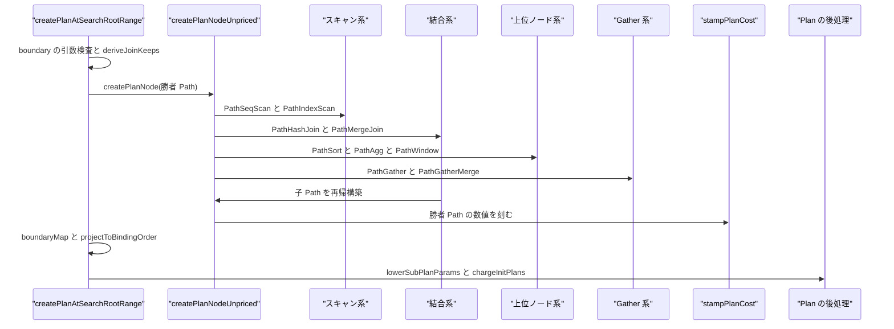
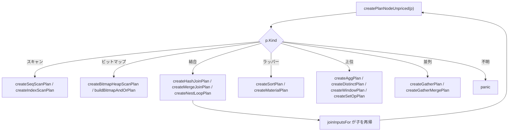

# パスからプランへの変換

<details>
<summary>関連ソースファイル</summary>

- [`internal/optimizer/createplan.go`](https://github.com/ryogrid/goopg/blob/19856410e8d497d59787e1ab35a2febb3f5953d6/internal/optimizer/createplan.go)
- [`internal/optimizer/createplanbitmap.go`](https://github.com/ryogrid/goopg/blob/19856410e8d497d59787e1ab35a2febb3f5953d6/internal/optimizer/createplanbitmap.go)
- [`internal/optimizer/createplangather.go`](https://github.com/ryogrid/goopg/blob/19856410e8d497d59787e1ab35a2febb3f5953d6/internal/optimizer/createplangather.go)
- [`internal/optimizer/createplanindex.go`](https://github.com/ryogrid/goopg/blob/19856410e8d497d59787e1ab35a2febb3f5953d6/internal/optimizer/createplanindex.go)
- [`internal/optimizer/createplanjoin.go`](https://github.com/ryogrid/goopg/blob/19856410e8d497d59787e1ab35a2febb3f5953d6/internal/optimizer/createplanjoin.go)
- [`internal/optimizer/createplannl.go`](https://github.com/ryogrid/goopg/blob/19856410e8d497d59787e1ab35a2febb3f5953d6/internal/optimizer/createplannl.go)
- [`internal/optimizer/createplanroot.go`](https://github.com/ryogrid/goopg/blob/19856410e8d497d59787e1ab35a2febb3f5953d6/internal/optimizer/createplanroot.go)
- [`internal/optimizer/createplansimple.go`](https://github.com/ryogrid/goopg/blob/19856410e8d497d59787e1ab35a2febb3f5953d6/internal/optimizer/createplansimple.go)
- [`internal/optimizer/createuniquepath.go`](https://github.com/ryogrid/goopg/blob/19856410e8d497d59787e1ab35a2febb3f5953d6/internal/optimizer/createuniquepath.go)
- [`internal/optimizer/initplancharge.go`](https://github.com/ryogrid/goopg/blob/19856410e8d497d59787e1ab35a2febb3f5953d6/internal/optimizer/initplancharge.go)
- [`internal/optimizer/materialize.go`](https://github.com/ryogrid/goopg/blob/19856410e8d497d59787e1ab35a2febb3f5953d6/internal/optimizer/materialize.go)
- [`internal/optimizer/nl_index_join.go`](https://github.com/ryogrid/goopg/blob/19856410e8d497d59787e1ab35a2febb3f5953d6/internal/optimizer/nl_index_join.go)
- [`internal/optimizer/pathbitmap.go`](https://github.com/ryogrid/goopg/blob/19856410e8d497d59787e1ab35a2febb3f5953d6/internal/optimizer/pathbitmap.go)
- [`internal/optimizer/pathindexclauses.go`](https://github.com/ryogrid/goopg/blob/19856410e8d497d59787e1ab35a2febb3f5953d6/internal/optimizer/pathindexclauses.go)
- [`internal/optimizer/pathindexonly.go`](https://github.com/ryogrid/goopg/blob/19856410e8d497d59787e1ab35a2febb3f5953d6/internal/optimizer/pathindexonly.go)
- [`internal/optimizer/pushdown.go`](https://github.com/ryogrid/goopg/blob/19856410e8d497d59787e1ab35a2febb3f5953d6/internal/optimizer/pushdown.go)
- [`internal/optimizer/qual_canonical.go`](https://github.com/ryogrid/goopg/blob/19856410e8d497d59787e1ab35a2febb3f5953d6/internal/optimizer/qual_canonical.go)
- [`internal/optimizer/subplan_cost.go`](https://github.com/ryogrid/goopg/blob/19856410e8d497d59787e1ab35a2febb3f5953d6/internal/optimizer/subplan_cost.go)
- [`internal/optimizer/subplan_lower.go`](https://github.com/ryogrid/goopg/blob/19856410e8d497d59787e1ab35a2febb3f5953d6/internal/optimizer/subplan_lower.go)

</details>

このコンポーネントは、結合探索が選んだ `Path` を実行エンジンの `Node` の木へ翻訳する。入口は `createPlanNode` で、`Path.Kind` に応じてスキャン・結合・ソート・集約・DISTINCT・ウィンドウ・集合演算・Gather の各アームへ振り分ける。翻訳の中心には `outputLayout` があり、「このノードの出力列 `i` は探索前のバインディング座標のどこから来たか」を子から親へ運ぶ。結合アームは子のレイアウトを連結し、自分の結合条件を連結後の行へ写す。探索ルートでは `createPlanAtSearchRootRange` がレイアウトを検査し、必要ならバインディング順へ並べ直す `Project` を挿入する。関連する周辺処理として、インデックス/ビットマップのパス生成（`pathindexonly.go`、`pathbitmap.go`、`pathindexclauses.go`）、条件の正規化と押し込み（`qual_canonical.go`、`pushdown.go`）、一意化パスの生成（`createuniquepath.go`）、SubPlan の PARAM_EXEC への lower（`subplan_lower.go`）、InitPlan のコスト配賦（`initplancharge.go`）がある。親セクションは [5 クエリプランナー](../5-Query-Planner.md)。探索は [5.3 結合順序探索](5.3-Join-Search.md)、コストは [5.2 パスとコストモデル](5.2-Path-and-Cost.md)、並列は [5.6 並列クエリの計画](5.6-Parallel-Planning.md)、上位 rel は [5.5 集約・ウィンドウ・上位リレーション](5.5-Aggregate-and-Window.md) を参照。

## 責務

- Path 種別のディスパッチ。`createPlanNodeUnpriced` が `PathKind` ごとに `createIndexScanPlan`、`createHashJoinPlan`、`createAggPlan` などを呼び、未知の種別は panic する。`path:internal/optimizer/createplan.go:createPlanNodeUnpriced`
- コストの刻印。`createPlanNode` が翻訳の単一の出口で `stampPlanCost` を呼び、勝者 `Path` の `Cost`/`Rows`/幅/無効化状態をノードに残す。`path:internal/optimizer/createplan.go:createPlanNode`
- スキャンの再構築。`scanLeafFor` が探索前の葉から `scanIdentity` と Filter の再ラップ関数を取り出し、`createIndexScanPlan`/`createSeqScanPlan` が同じ葉を別のスキャン種別で組み直す。`path:internal/optimizer/createplanindex.go:scanLeafFor`
- インデックス条件の順序。`indexPathClauses` がインデックス列順に `indexPathClause` を並べ、`createIndexScanPlan` が `Keys`/`LowKey`/`HighKey`/`SAOPKeys` へ下ろす。`path:internal/optimizer/pathindexclauses.go:indexPathClauses`
- index-only scan の構築。`addIndexOnlyPaths` が被覆列と残余条件を検査し、`createIndexScanPlan` が `IndexOnlyScan` を組み立てて `Covered` を写す。`path:internal/optimizer/pathindexonly.go:addIndexOnlyPaths`
- ビットマップスキャンの構築。`createBitmapHeapScanPlan` が `BitmapQual` と部分インデックス述語を集め、`createBitmapIndexScanPlan` が `BitmapIndexScan` を、`buildBitmapAndOrPlan` が AND/OR を組む。`path:internal/optimizer/createplanbitmap.go:createBitmapHeapScanPlan`
- 結合の共通プロローグ。`joinInputsFor` が両子を再帰構築し、スキーマとレイアウトを同じ文で連結し、`bindingIndex` で条件変換用の逆写像を作る。`path:internal/optimizer/createplanjoin.go:joinInputsFor`
- Hash/Merge 結合の構築。`createHashJoinPlan`/`createMergeJoinPlan` が `keyPairs` と `joinPredicate` でキー・残余を merged 座標へ写し、`Join` を組み立てる。`path:internal/optimizer/createplanjoin.go:createHashJoinPlan`
- NestLoop と NLI の構築。`createNestLoopPlan` が内側の種類で plain/NLI/param-join/param-append を選び、`createNestLoopIndexJoinPlan` が lateral `Join` と `IndexScan` を組む。`path:internal/optimizer/createplannl.go:createNestLoopPlan`
- ソート・集約・DISTINCT・ウィンドウ・集合演算の構築。`createSortPlan`、`createAggPlan`、`createDistinctPlan`、`createWindowPlan`、`createSetOpPlan` が仕様をコピーして子を差し替える。`path:internal/optimizer/createplansimple.go:createSortPlan`
- 並列ノードの構築。`createGatherPlan`/`createGatherMergePlan` が子を構築し、`stampParallelScan` で駆動スキャンを並列化して `Gather`/`GatherMerge` を包む。`path:internal/optimizer/createplangather.go:createGatherPlan`
- Material の構築。`createMaterialPlan` が子をそのまま包み、レイアウトを透過させる。`path:internal/optimizer/materialize.go:createMaterialPlan`
- 探索境界の座標復元。`createPlanAtSearchRootRange` が `boundaryMap` でレイアウトの置換性を検査し、`projectToBindingOrder` でバインディング順に戻す。`path:internal/optimizer/createplanroot.go:createPlanAtSearchRootRange`
- 一意化パスの生成。`createUniquePath` が SEMI の RHS を一意化し、`createPulledUniquePath` が引き上げ済み RHS の NOOP 形を返す。`path:internal/optimizer/createuniquepath.go:createUniquePath`
- SubPlan の lower。`lowerSubPlanParams` が相関サブリンクの外側参照を PARAM_EXEC スロットへ束縛し、失敗時は元の SubPlan をそのまま残す。`path:internal/optimizer/subplan_lower.go:lowerSubPlanParams`
- InitPlan のコスト配賦。`chargeInitPlans` がクエリレベルごとに InitPlan のコストを合計し、`InitPlanCharge` としてレベル先頭ノードに記録する。`path:internal/optimizer/initplancharge.go:chargeInitPlans`
- 条件の正規化と押し込み。`canonicalizeQual` が OR/AND の重複や分配を正規化し、`pushPredicatesIntoCrossJoins` が WHERE 等値を最も深い結合へ押し込む。`path:internal/optimizer/qual_canonical.go:canonicalizeQual`

## 処理フロー

探索が勝者 `Path` を返すと、`createPlanAtSearchRootRange(p, base, width, fill)` が境界の入口になる。まず `p == nil`、`width <= 0`、`base < 0` を検査し、`fill` を rel に記録する。次に `deriveJoinKeeps(p)` が選択済みの木に対して build 側の keep-set を導出し、`createPlanNode(p)` を呼ぶ。`createPlanNode` は `createPlanNodeUnpriced` の結果に `stampPlanCost` を適用する。`createPlanNodeUnpriced` は `Path.Kind` で分岐し、各アームが子 `Path` を再帰的に `createPlanNode` して `Node` を組み立てる。

スキャン系では、`PathSeqScan` が `createSeqScanPlan`、`PathIndexScan` が `createIndexScanPlan`、`PathBitmapHeapScan` が `createBitmapHeapScanPlan`、`PathBitmapIndexScan` が `createBitmapIndexScanPlan`、`PathBitmapAnd`/`PathBitmapOr` が `buildBitmapAndOrPlan` に渡る。`scanLeafFor` が探索前の葉から `scanIdentity`（表・別名・RTID・スキーマ・一意キー・権限情報）と Filter 再ラップ関数を取り出し、元の葉を変更せずに新しいスキャンノードを作る。インデックス系は `IndexClauses` をインデックス列順に検査し、等値は `Keys`、範囲は `LowKey`/`HighKey`、ScalarArrayOp は `SAOPKeys` に下ろす。index-only は `IndexOnlyCovered` の列だけを `Covered` に写し、`baseRelLayout` が名前で位置を戻す。

結合系では、`createHashJoinPlan`/`createMergeJoinPlan`/`createNestLoopPlan` が `joinInputsFor` を通る。`joinInputsFor` は両子を構築し、`narrowBuildInput`/`narrowMergeInput`/`narrowJoinLeg` で必要列に窄め、スキーマとレイアウトを連結する。`keyPairs` は各キー節を外側左に揃えて merged 座標へ写し、`joinPredicate` はキー等値と残余を 1 つの Predicate に畳む。Hash は `pairs[0]` を `LeftKey`/`RightKey` に共有し、`HashKeys` 全体と `Predicate` を載せる。Merge は `HashKeys` の順序をソート順として使い、`PathSort` の子を吸収してから戻す。NestLoop は内側がパラメータ化されていれば `createNestLoopIndexJoinPlan`（または param-join/param-append）へ分岐する。NLI は `Join{Lateral: true}` の下に `OuterColumnRef` をキーにした `IndexScan` を置く分解形と、Memoize 付きの融合形がある。

ソート・集約・DISTINCT・ウィンドウ・集合演算は `createplansimple.go` が扱う。`createSortPlan` は子のレイアウトを保存したまま `Sort` を積む。`createAggPlan` は `p.Agg` をコピーして子と戦略を差し替え、レイアウトは nil を返す（集約は列を並べ替えるため）。`createDistinctPlan` は hashed なら `Distinct`、unique なら全列キーの `DistinctOn` を返す。`createWindowPlan` は必要なら Sort/Incremental Sort を積み、`Presorted` を立てる。`createSetOpPlan` は左右の子を構築し、`LeftNonPartial`/`RightNonPartial` と `ParallelAware` を写し、`orderParallelAppendArms` で腕を並べ替える。`createFinalizeAggPlan` は `Finalize -> Gather -> Partial` の子を辿って最下の入力を 1 つだけ構築し、`splitAggregate` に渡す。

探索ルートへ戻ると、`createPlanAtSearchRootRange` が `len(lay) == len(n.Output())` を確認し、`assertSearchedTreeNeedsNoReconcile(n)` と `assertBoundaryColumnIdentity(n, lay, rangeTableFromPath(p))` を実行する。`boundaryMap(lay, base, width, fill)` が「穴・重複・範囲外がないか」を検査し、恒等なら `Project` を省いて `markSearchedTree(n)` に `stampSearchPathkeys` を適用する。恒等でなければ `projectToBindingOrder` でバインディング順の `Project` を挿入する。境界を通過したノードが文の計画として返り、`Plan` の末尾で `lowerSubPlanParams` と `chargeInitPlans` が走る。



`createPlanNodeUnpriced` の分岐は、Path の種別ごとに実装ファイルへ分かれている。



## 主要ファイル

| ファイル | 役割 |
| --- | --- |
| `internal/optimizer/createplan.go` | `createPlan`、`createPlanNode`、`createPlanNodeUnpriced`、`createPlanFromDPChoice`。種別ディスパッチとコスト刻印。`path:internal/optimizer/createplan.go:createPlanNodeUnpriced` |
| `internal/optimizer/createplanroot.go` | `createPlanAtSearchRootRange`、`boundaryMap`、`projectToBindingOrder`、`assertSearchedBoundariesIntact`。探索境界の座標復元。`path:internal/optimizer/createplanroot.go:createPlanAtSearchRootRange` |
| `internal/optimizer/createplanjoin.go` | `outputLayout`、`joinInputs`、`joinInputsFor`、`keyPairs`、`createHashJoinPlan`、`createMergeJoinPlan`。結合の共通プロローグ。`path:internal/optimizer/createplanjoin.go:joinInputsFor` |
| `internal/optimizer/createplannl.go` | `createNestLoopPlan`、`createNestLoopIndexJoinPlan`、`createNestLoopParamJoinPlan`、`outerParamKey`。NL/NLI の構築。`path:internal/optimizer/createplannl.go:createNestLoopPlan` |
| `internal/optimizer/createplanindex.go` | `scanLeafFor`、`scanIdentity`、`createIndexScanPlan`、`absorbableLeafCond`。インデックススキャンの再構築。`path:internal/optimizer/createplanindex.go:createIndexScanPlan` |
| `internal/optimizer/createplanbitmap.go` | `createBitmapHeapScanPlan`、`createBitmapIndexScanPlan`、`buildBitmapAndOrPlan`、`bitmapQualExprs`。ビットマップスキャン。`path:internal/optimizer/createplanbitmap.go:createBitmapHeapScanPlan` |
| `internal/optimizer/createplansimple.go` | `createSeqScanPlan`、`createSortPlan`、`createAggPlan`、`createDistinctPlan`、`createWindowPlan`、`createSetOpPlan`。単純ノード群。`path:internal/optimizer/createplansimple.go:createSortPlan` |
| `internal/optimizer/createplangather.go` | `createGatherPlan`、`createGatherMergePlan`、`gatherChildPlan`、`gatherPathDivisor`。Gather の構築。`path:internal/optimizer/createplangather.go:createGatherPlan` |
| `internal/optimizer/materialize.go` | `materialInnerPath`、`createMaterialPlan`、`materialRescanCost`。Material パスとノード。`path:internal/optimizer/materialize.go:createMaterialPlan` |
| `internal/optimizer/createuniquepath.go` | `createUniquePath`、`createPulledUniquePath`、`finishPulledUniquePath`。SEMI RHS の一意化。`path:internal/optimizer/createuniquepath.go:createUniquePath` |
| `internal/optimizer/pathindexclauses.go` | `indexPathClause`、`indexPathClauses`、`boundClauseForColumn`。インデックス条件の列順。`path:internal/optimizer/pathindexclauses.go:indexPathClauses` |
| `internal/optimizer/pathindexonly.go` | `addIndexOnlyPaths`、`indexOnlyLeafClauses`、`indexCoversColumns`、`relAllVisibleFraction`。index-only パスの生成。`path:internal/optimizer/pathindexonly.go:addIndexOnlyPaths` |
| `internal/optimizer/pathbitmap.go` | `addBaseRelBitmapPaths`、`buildOneBitmapPath`、`chooseBitmapAnd`、`addParameterizedBitmapPaths`。ビットマップパスの生成。`path:internal/optimizer/pathbitmap.go:addBaseRelBitmapPaths` |
| `internal/optimizer/nl_index_join.go` | `eligibleLeadingPrefixIndexes`、`leadingPrefixProbeKeys`、`nliProbeIndexName`。NLI のインデックス適格判定。`path:internal/optimizer/nl_index_join.go:eligibleLeadingPrefixIndexes` |
| `internal/optimizer/subplan_lower.go` | `lowerSubPlanParams`、`sublinkHandle`、`paramAlloc`、`analyzeSublink`、`rewriteSublinkPlan`。SubPlan の PARAM_EXEC 化。`path:internal/optimizer/subplan_lower.go:lowerSubPlanParams` |
| `internal/optimizer/initplancharge.go` | `InitPlanCharge`、`chargeInitPlans`、`LevelInitPlansOf`、`initPlanCost`。InitPlan のコスト配賦。`path:internal/optimizer/initplancharge.go:chargeInitPlans` |
| `internal/optimizer/subplan_cost.go` | `estimateSubplanCostPerCall`、`joinQualPerTuple`、`hashClausesPerTuple`、`joinQualEvalCost`。SubPlan/条件のコスト。`path:internal/optimizer/subplan_cost.go:estimateSubplanCostPerCall` |
| `internal/optimizer/pushdown.go` | `pushPredicatesIntoCrossJoins`、`pushOneConjunct`、`collectScanOutputNames`。条件の押し込み。`path:internal/optimizer/pushdown.go:pushPredicatesIntoCrossJoins` |
| `internal/optimizer/qual_canonical.go` | `canonicalizeQual`、`processDuplicateOrs`、`flattenAndBranches`。条件の正規化。`path:internal/optimizer/qual_canonical.go:canonicalizeQual` |

## 公開 API / エントリポイント

変換の大半はパッケージ内部で完結する。外部へ公開されているのは、InitPlan の問い合わせと SubPlan lower の不一致カウンタくらいである。

```go
func IsQueryLevelTop(n Node) bool
func LevelInitPlansOf(n Node) []SublinkRef
func SubplanLowerMismatches() int64
```

内部の主要な入口は次のとおり。`createPlanNode` が再帰の中心で、`createPlanAtSearchRootRange` が探索ルート専用の入口である。

```go
func createPlan(p *Path) Node
func createPlanNode(p *Path) (Node, outputLayout)
func createPlanNodeUnpriced(p *Path) (Node, outputLayout)
func createPlanAtSearchRootRange(p *Path, base, width int, fill func(int) (SchemaColumn, bool)) Node
func joinInputsFor(p *Path, kind string, outerPath, innerPath *Path) joinInputs
func (in joinInputs) keyPairs(kind string, keys []*restrictInfo) []JoinKeyPair
func createIndexScanPlan(p *Path) Node
func createHashJoinPlan(p *Path) (Node, outputLayout)
func createMergeJoinPlan(p *Path) (Node, outputLayout)
func createNestLoopPlan(p *Path) (Node, outputLayout)
func createUniquePath(rel *RelOptInfo, subpath *Path, sjinfo *SpecialJoinInfo, cp costParams) *Path
func lowerSubPlanParams(root Node) Node
func chargeInitPlans(root Node)
```

## 主要データ構造

### `outputLayout`

ノードの出力列から探索前のバインディング座標への対応表である。`layout[i]` が出力列 `i` のバインディング座標になる。`path:internal/optimizer/createplanjoin.go:outputLayout`

```go
// outputLayout maps an emitted node's output columns back to the pre-search
// binding coordinates the search's clauses are written in: `layout[i]` is the
// binding index of output column `i`.
//
// A nil layout means "these coordinates are not known", which is a real and
// legitimate state, not an error: the C0 bridge (`createPlanFromDPChoice`)
// wraps an already-built DP subtree in a `PathPrebuilt` over an empty
// `RelOptInfo`, and that subtree's columns were placed by the integer DP's own
// layout machinery, which this map has no relationship to. It is only a fault
// when a JOIN arm meets it, because a join is the first thing that must
// translate a clause — hence the panic there rather than here.
type outputLayout []int
```

`bindingIndex()` は逆写像を作る。同じバインディング座標が 2 つの出力列に現れたら panic する。`baseRelLayout` はレベル 1 のリレーションに `[baseOffset, baseOffset+width)` の連続座標を与え、index-only scan のように列が狭まる場合は名前で位置を戻す。`translateToLayout` は `ColumnRef.Index` をバインディング座標から出力位置へ書き換える。

### `joinInputs`

結合アームが共通で使う、両子のノード・スキーマ・レイアウト・逆写像の束である。`path:internal/optimizer/createplanjoin.go:joinInputs`

```go
type joinInputs struct {
	outer, inner Node
	// outerRelids / innerRelids are the CHILD PATHS' relsets, used to orient
	// each key clause; they come from the paths as the arm received them (a
	// `PathSort` carries its subpath's rel, so absorbing one is relid-neutral).
	outerRelids, innerRelids RelSet
	merged                   Schema
	lay                      outputLayout
	index                    map[int]int
	// outerCols is len(outer.Output()) — where the merged row's inner half
	// begins, and therefore the width of the left-only publication a SEMI or
	// ANTI join makes. C-03c.
	outerCols int
	// outerLay / innerLay are each child's own layout — the halves `lay`
	// concatenates. The merge arm translates a side's sort keys onto them
	// (restoreMergeSort).
	outerLay, innerLay outputLayout
}
```

`outer`/`inner` は構築済みの子ノード、`merged` は `outer ++ inner` のスキーマ、`lay` は同じ順のレイアウト、`index` は `lay` の逆写像である。`outerCols` は SEMI/ANTI が LHS だけを公開するときの境界になる。不変条件は「`merged[i]` と `lay[i]` が同じ列を指す」ことで、`joinInputsFor` がスキーマとレイアウトを同じ文で連結するため構造的に守られる。

### `scanIdentity`

探索前の葉スキャンから引き継ぐ状態である。表・別名・RTID・スキーマ・一意キー・権限検査の情報を持ち、別の物理スキャンに組み直しても失ってはならない。`path:internal/optimizer/createplanindex.go:scanIdentity`

```go
type scanIdentity struct {
	pos      int
	table    *catalog.Table
	alias    string
	rtid     int32
	schema   Schema
	smallDim bool
	// uniqueKeys is the leaf's uniqueness evidence (M0127-P5.6-f), carried
	// for the same reason smallDim is: it is a property of the RELATION, so
	// a leaf rebuilt as a different physical scan must not lose it.
	uniqueKeys            [][]string
	privilegeCheckRole    string
	privilegeCheckRoleSet bool

	// The `*SeqScan`-only fields (M0127-P5.5-d). Populated only when the leaf's
	// base scan IS a `*SeqScan`; zero when it is an `*IndexScan`, which never
	// carried them — the pass that promoted the leaf to an index probe dropped
	// them at substitution time, so a seq scan rebuilt from such a leaf loses
	// nothing NEW (`createSeqScanPlan`). `estRelRows` at zero merely re-enables
	// `EstimateRows`' stats fallback; the three inheritance/lock fields exist
	// only on scans produced by inheritance expansion (planner.go:2551, :2602),
	// and any substitution that had replaced such a scan with an `*IndexScan`
	// dropped them then — the loss, if any, predates this seam.
	estRelRows       int64
	lockParentOID    uint32
	skipIfVanished   bool
	inheritParentOID uint32
}
```

`table`/`alias`/`rtid` は実行時の行の出所、`schema` は葉の出力、`smallDim` と `uniqueKeys` は関係の性質、`privilegeCheckRole` は権限検査のロールである。`*SeqScan` だけが持つフィールドは、index probe から seq scan を再構築するときにだけ意味を持つ。`scanLeafFor` はこの構造体と、元の `*Filter` ラッパーを再構築する関数を返す。

### `indexPathClause`

インデックススキャンが 1 列に束縛する条件である。`path:internal/optimizer/pathindexclauses.go:indexPathClause`

```go
type indexPathClause struct {
	// ri is `IndexClause.rinfo`: the ORIGINAL clause, kept by identity so
	// `createPlan` can tell that a clause it is about to place as a filter is
	// already being applied by the probe (`is_redundant_with_indexclauses`).
	// PG's version of that test also matches a clause derived from the same
	// equivalence class rather than the same node; goopg's `restrictInfo.ecID`
	// is what the P5.5 arm will use for that half.
	ri *restrictInfo
	// indexCol is `IndexClause.indexcol` (pathnodes.h:1873): ZERO-based, PG's
	// convention here and not the 1-based `AttrNumber` used elsewhere in PG.
	// It is recorded rather than left implicit in the slice position because
	// PG's list may skip and repeat columns; goopg's cannot today (see the
	// header), and an explicit column number is what makes that agreement
	// checkable instead of assumed.
	indexCol int
	// key is the value the probe binds at `indexCol` — the clause's OUTER
	// operand, supplied by the parameterising relations. This is what becomes
	// `IndexScan.Keys[indexCol]`.
	key Expr
	// local is the leaf-local restriction conjunct this clause was taken from
	// (unparameterised restriction paths only, pathindexrestrict.go); nil for
	// a join-clause index qual. createIndexScanPlan drops it from the leaf's
	// reinstated Filter, since the probe already applies it — PG's
	// create_indexscan_plan leaves such quals out of qpqual
	// (is_redundant_with_indexclauses, createplan.c:3068-3088).
	local Expr
	// op is the clause's operator in canonical `indexcol op key` form. The
	// zero value is equality — every join-clause and equality-prefix clause.
	// OpGt/OpGe mark a LOWER and OpLt/OpLe an UPPER range bound on the
	// index's leading column (M0145-0029 slice 2, pathindexrestrict.go);
	// createIndexScanPlan lowers those onto IndexScan.LowKey/HighKey.
	op parser.OpCode
	// saop is the element list of a ScalarArrayOp index qual (`indexcol IN
	// (…)` / `= ANY (…)`, M0145-0029 slice 4) — one btree descent per
	// element, lowered onto IndexScan.SAOPKeys. `key` is nil and `op` is
	// equality when set.
	saop []Expr
}
```

`indexCol` は 0 始まりのインデックス列番号、`key` は probe が束縛する値、`local` は元の葉ローカル条件、`op` は等値/範囲の別、`saop` は IN リストである。`indexPathClauses` はインデックス列の順にこれを並べ、最初の未束縛列で止める。`createIndexScanPlan` はこの順序を `IndexScan.Keys` の位置にそのまま使う。

### `InitPlanCharge`

クエリレベルの先頭ノードに埋め込む InitPlan のコストである。`path:internal/optimizer/initplancharge.go:InitPlanCharge`

```go
type InitPlanCharge struct {
	initPlanCharge float64
	// levelTop marks a derived table's top that the join search priced as a
	// query level of its own (M0146-0005dw); the tail walk charges it as one.
	levelTop bool
	// queryLevelTop marks the top node of a query level (M0146-0104):
	// SS_attach_initplans hangs the level's initPlans there, where EXPLAIN
	// prints them, not on the node whose expression reads them.
	queryLevelTop bool
}
```

`initPlanCharge` はそのレベルの InitPlan コスト、`levelTop` は探索が独自レベルとして価格付けした派生テーブルの先頭、`queryLevelTop` は EXPLAIN が InitPlan を表示するクエリレベルの先頭である。`chargeInitPlans` はレベルごとに合計を設定し、`IsQueryLevelTop`/`LevelInitPlansOf` がその印を読む。

### `sublinkHandle`

SubPlan lower が扱う 3 種類のサブリンクを同じ形で操作するためのハンドルである。`path:internal/optimizer/subplan_lower.go:sublinkHandle`

```go
type sublinkHandle struct {
	plan      Node
	setPlan   func(Node)
	params    func() []int
	setParams func(parParam []int, args []Expr)
	nonCorr   func() bool
	setNC     func(bool)
	// pad is the sublink's OuterRowPad: its host row is a localized leaf
	// row, so an immediate-host argument indexes it pad columns lower
	// than the inner plan's FROM-cumulative reference (M0146-0130).
	pad int
}
```

`plan` は内側計画、`setPlan` は書き換え後の計画の差し込み、`params`/`setParams` は `ParParam`/`Args` の読み書き、`nonCorr`/`setNC` は非相関フラグ、`pad` はホスト行と内側計画の座標差である。`handleFor` が `SubqueryExpr`/`ExistsExpr`/`InExpr` からこのハンドルを作る。`lowerSubPlanParams` は `paramAlloc` のフラットなスロット空間に外側参照を割り当てる。

## 内部構造

このコンポーネントの設計は、**`Path` の世界と `Node` の世界を 1 つの関数で橋渡しする**ことにある。`createPlanNodeUnpriced` の巨大な switch が唯一のディスパッチ点で、各アームは「子を再帰構築する」「自分の条件を子の座標へ写す」「実行ノードを組み立てる」という同じ形を取る。`PathPrebuilt` だけは例外で、探索前のパイプラインが既に組み上げたノードをそのまま返し、`baseRelLayout` でレベル 1 の葉としての座標だけを与える。`createPlanNode` がその結果に `stampPlanCost` を適用するため、新しい Path 種別を追加するときにコストの刻印を忘れることはない。

座標の管理は `outputLayout` が担う。結合アームは `joinInputsFor` で子のレイアウトを連結し、`lay.bindingIndex()` で「バインディング座標 → 出力位置」の逆写像を作り、`translateToLayout` で条件を写す。`translateToLayout` は元の式を変更せず、`cloneExprRefs` で新しい式を作る。探索は節をポインタ同一性で照合するため、その場で書き換えると検索の状態を壊すからである。内側計画のスコープには降りず、`CTIDExpr` は位置ではないので拒否する。

結合の 3 アームは `joinInputsFor` を共有する。Hash は `pairs[0]` を `LeftKey`/`RightKey` に共有し、`HashKeys` 全体と `Predicate` を載せる。goopg のハッシュ実行器は 1 ペアでハッシュし、残りを Predicate で再検査するため、キーを Predicate から落とすと複数等値の誤答になる。Merge は `HashKeys` の順序がそのままソート順であり、`PathSort` の子を `absorbMergeSort` で吸収してから `restoreMergeSort` で戻す。NestLoop は内側の `RequiredOuter` を見て、param-join、param-append、NLI、plain の順に分岐する。

スキャン系は `scanLeafFor` が探索前の葉を解析する。`*Filter` の連鎖を剥がし、`*SeqScan` か `*IndexScan` の `scanIdentity` を取り、置換スキャンの上に同じ Filter を再構築する関数を返す。インデックススキャンは `IndexInfo`、`IndexScanDir`、`IndexClauses` を検査し、`Keys`/`LowKey`/`HighKey`/`SAOPKeys` のどれに下ろすかを決める。index-only は `IndexOnlyCovered` の列だけを `Covered` に写し、`IndexScan` ではなく `IndexOnlyScan` を返す。ビットマップは `BitmapQual` にインデックス条件と部分インデックス述語を集め、lossy ページの再検査に備える。

上位ノードは子のレイアウトを保存しないものが多い。`createAggPlan`、`createDistinctPlan`、`createWindowPlan` は列を並べ替えたり追加したりするため、`outputLayout` に nil を返す。これらは探索境界より上で `Node` の `Output()` だけを頼りに組み立てられる。`createSortPlan` と `createMaterialPlan` は子のレイアウトをそのまま通す。`createGatherPlan`/`createGatherMergePlan` もレイアウトを通すが、子の駆動スキャンを `stampParallelScan` で並列化し、駆動スキャンが存在しなければ panic する。これは `gatherOp.runWorker` が `attachParallelScan` の戻り値を無視するため、モデル外の部分木を渡すと全ワーカーが全行を読んで N 倍の行を返すからである。

探索境界では `createPlanAtSearchRootRange` が `boundaryMap` でレイアウトの置換性を検査する。`m[i]` はバインディング座標 `base+i` を出力する位置で、穴・重複・範囲外があれば panic する。恒等なら Project を省き、そうでなければ `projectToBindingOrder` が `Project` を挿入する。`assertBoundaryColumnIdentity` が範囲表と突き合わせて列の同一性を検査し、`assertSearchedBoundariesIntact` が後続パスの後で最終木を再検査する。

SubPlan の lower は `lowerSubPlanParams` が文全体で 1 回だけ走る。`handleFor` でサブリンクを取得し、`analyzeSublink` が「すべての外側参照がチェーン内で解決できるか」「入れ子サブリンクが lower 可能か」「LATERAL スコープが挟まらないか」を検査する。検査に失敗したら計画を変更しない。成功したら `paramAlloc` でフラットなスロットを割り当て、`OuterColumnRef` を `ExecParamRef`/`ParParam` に置き換える。`subplanLowerMismatches` は不一致の回数を記録する。InitPlan のコストは `chargeInitPlans` がクエリレベルごとに合計し、`InitPlanCharge` としてレベル先頭に設定する。設定は加算ではなく代入なので、再入計画でも同じ数値になる。

## エッジケースと不変条件

- **未対応 Path 種別**: `createPlanNodeUnpriced` の default は panic する。Path 種別を追加したのに翻訳アームを書かなかった場合、黙って誤ったノードを返さない。`path:internal/optimizer/createplan.go:createPlanNodeUnpriced`
- **`PathMemoize` の禁止位置**: `PathMemoize` にアームはなく、NLI の内側以外に現れると panic する。goopg の Memoize は `NestedLoopIndexJoin.InnerMemo` としてのみ存在する。`path:internal/optimizer/createplan.go:createPlanNodeUnpriced`
- **探索ルートの引数検査**: `createPlanAtSearchRootRange` は `p == nil`、`width <= 0`、`base < 0`、レイアウト不明、レイアウト長と出力長の不一致で panic する。`path:internal/optimizer/createplanroot.go:createPlanAtSearchRootRange`
- **境界の穴・重複**: `boundaryMap` はレイアウトがバインディング窓の置換でない場合に panic する。`fill` が許可した座標だけが typed NULL で埋められる。`path:internal/optimizer/createplanroot.go:boundaryMap`
- **子のレイアウト不明**: `joinInputsFor` はどちらかの子のレイアウトが nil なら panic する。結合条件を写せないまま実行すると誤った列を読む。`path:internal/optimizer/createplanjoin.go:joinInputsFor`
- **結合キーの向き**: `keyPairs` はキー節が等値結合でない、両オペランドが片側ずつに分かれない場合に panic する。ハッシュ/マージのキーは両側に分かれることが前提である。`path:internal/optimizer/createplanjoin.go:keyPairs`
- **CTID の再基準化拒否**: `translateToLayout` は `CTIDExpr` を拒否する。CTID はスキャンが自分の行のスロットに注入するもので、結合行へ持ち上げると位置が変わる。`path:internal/optimizer/createplanjoin.go:translateToLayout`
- **未知の式ノード**: `translateToLayout` は `exprChildSlots` が列挙しない式ノードで panic する。新しい式型を追加したら walker も更新する必要がある。`path:internal/optimizer/createplanjoin.go:translateToLayout`
- **ハッシュ結合の前提**: `createHashJoinPlan` は子が 2 個でない、`HashKeys` が空、外側パラメータ化があるのに `paramSink` がない場合に panic する。`path:internal/optimizer/createplanjoin.go:createHashJoinPlan`
- **NLI の RIGHT 拒否**: `createNestLoopIndexJoinPlan` は `JoinTypeRight` で panic する。パラメータ化 inner の RIGHT は保存側の未一致行を出せない。`path:internal/optimizer/createplannl.go:createNestLoopIndexJoinPlan`
- **NLI の未供給パラメータ**: `createNestLoopIndexJoinPlan` は `innerPath.RequiredOuter &^ outerPath.Rel.Relids` が非ゼロなら panic する。外側が供給しないパラメータを束縛できない。`path:internal/optimizer/createplannl.go:createNestLoopIndexJoinPlan`
- **インデックス列順**: `createIndexScanPlan` は `c.indexCol != p.IndexSkipPrefix+i` で panic する。キー列の順序が崩れると正しい値を誤った列に束縛する。`path:internal/optimizer/createplanindex.go:createIndexScanPlan`
- **index-only の被覆列**: `createIndexScanPlan` は `IndexOnlyCovered` が空、または葉スキーマにない列を被覆した場合に panic する。`path:internal/optimizer/createplanindex.go:createIndexScanPlan`
- **ビットマップの範囲条件**: `createBitmapIndexScanPlan` は範囲条件が先頭列でない、下界・上界が重複する、等値と範囲が混ざる場合に panic する。`path:internal/optimizer/createplanbitmap.go:createBitmapIndexScanPlan`
- **集約の子の数**: `createAggPlan` は `p.Agg == nil` または子が 1 個でない場合に panic する。`createFinalizeAggPlan` はワーカー数 0 以下や想定外の子の形でも panic する。`path:internal/optimizer/createplansimple.go:createAggPlan`
- **ウィンドウの仕様**: `createWindowPlan` は `p.Window == nil`、子が 1 個でない場合に panic する。必要なら Sort/Incremental Sort を積み、子が既に順序を満たすなら `Presorted` を立てる。`path:internal/optimizer/createplansimple.go:createWindowPlan`
- **Gather の駆動スキャン**: `gatherChildPlan` は子が 1 個でない、ワーカー数 0 以下、子がノードを返さない、駆動スキャンがない場合に panic する。`path:internal/optimizer/createplangather.go:gatherChildPlan`
- **GatherMerge の空順序**: `createGatherMergePlan` は `Pathkeys` が空なら panic する。順序を保たない merge は単なる Gather である。`path:internal/optimizer/createplangather.go:createGatherMergePlan`
- **一意化の拒否**: `createUniquePath` は SEMI でない、`SemiCanBtree` がない、`SemiRhsExprs` が空、`PathPrebuilt` でない、スキーマがずれている場合に nil を返す。nil は「一意化できない」であり、誤った INNER にはしない。`path:internal/optimizer/createuniquepath.go:createUniquePath`
- **SubPlan lower の原子性**: `lowerSublinkTree` は `analyzeSublink` が偽なら計画を変更しない。契約は「完全でなくてよいが健全でなければならない」である。`path:internal/optimizer/subplan_lower.go:lowerSublinkTree`
- **InitPlan の冪等性**: `chargeInitPlans` はコストを代入し、加算しない。再入計画（ビュー本体、EXPLAIN の内側文）でも同じ数値になる。`path:internal/optimizer/initplancharge.go:chargeInitPlans`

Sources:

- `internal/optimizer/createplan.go`
- `internal/optimizer/createplanbitmap.go`
- `internal/optimizer/createplangather.go`
- `internal/optimizer/createplanindex.go`
- `internal/optimizer/createplanjoin.go`
- `internal/optimizer/createplannl.go`
- `internal/optimizer/createplanroot.go`
- `internal/optimizer/createplansimple.go`
- `internal/optimizer/createuniquepath.go`
- `internal/optimizer/initplancharge.go`
- `internal/optimizer/materialize.go`
- `internal/optimizer/nl_index_join.go`
- `internal/optimizer/pathbitmap.go`
- `internal/optimizer/pathindexclauses.go`
- `internal/optimizer/pathindexonly.go`
- `internal/optimizer/pushdown.go`
- `internal/optimizer/qual_canonical.go`
- `internal/optimizer/subplan_cost.go`
- `internal/optimizer/subplan_lower.go`

<sub>Generated by deepwiki-4myself from `goopg` @ `19856410e`</sub>
