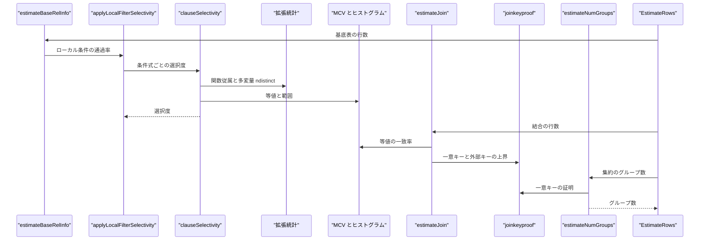
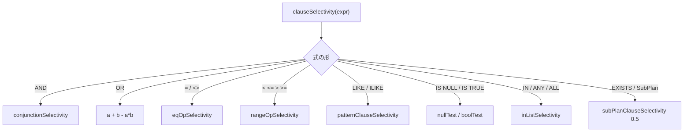

# 統計と選択度推定

<details>
<summary>関連ソースファイル</summary>

- [`internal/optimizer/cardinality.go`](https://github.com/ryogrid/goopg/blob/19856410e8d497d59787e1ab35a2febb3f5953d6/internal/optimizer/cardinality.go)
- [`internal/optimizer/equiv_class.go`](https://github.com/ryogrid/goopg/blob/19856410e8d497d59787e1ab35a2febb3f5953d6/internal/optimizer/equiv_class.go)
- [`internal/optimizer/extstats.go`](https://github.com/ryogrid/goopg/blob/19856410e8d497d59787e1ab35a2febb3f5953d6/internal/optimizer/extstats.go)
- [`internal/optimizer/funcdep_prefetch.go`](https://github.com/ryogrid/goopg/blob/19856410e8d497d59787e1ab35a2febb3f5953d6/internal/optimizer/funcdep_prefetch.go)
- [`internal/optimizer/group_input_target.go`](https://github.com/ryogrid/goopg/blob/19856410e8d497d59787e1ab35a2febb3f5953d6/internal/optimizer/group_input_target.go)
- [`internal/optimizer/joinkeyproof.go`](https://github.com/ryogrid/goopg/blob/19856410e8d497d59787e1ab35a2febb3f5953d6/internal/optimizer/joinkeyproof.go)
- [`internal/optimizer/likeprefix.go`](https://github.com/ryogrid/goopg/blob/19856410e8d497d59787e1ab35a2febb3f5953d6/internal/optimizer/likeprefix.go)
- [`internal/optimizer/notnull_qual_reduce.go`](https://github.com/ryogrid/goopg/blob/19856410e8d497d59787e1ab35a2febb3f5953d6/internal/optimizer/notnull_qual_reduce.go)
- [`internal/optimizer/orclauses.go`](https://github.com/ryogrid/goopg/blob/19856410e8d497d59787e1ab35a2febb3f5953d6/internal/optimizer/orclauses.go)
- [`internal/optimizer/patternsel.go`](https://github.com/ryogrid/goopg/blob/19856410e8d497d59787e1ab35a2febb3f5953d6/internal/optimizer/patternsel.go)
- [`internal/optimizer/predicate_implication.go`](https://github.com/ryogrid/goopg/blob/19856410e8d497d59787e1ab35a2febb3f5953d6/internal/optimizer/predicate_implication.go)
- [`internal/optimizer/selectivity.go`](https://github.com/ryogrid/goopg/blob/19856410e8d497d59787e1ab35a2febb3f5953d6/internal/optimizer/selectivity.go)
- [`internal/optimizer/sort_input_target.go`](https://github.com/ryogrid/goopg/blob/19856410e8d497d59787e1ab35a2febb3f5953d6/internal/optimizer/sort_input_target.go)

</details>

このコンポーネントは、`Path` のコスト計算と行数見積もりが読む「選択度」の一式を提供する。中心は `clauseSelectivity` で、`Filter` の条件式を `=`, `<`, `LIKE`, `IN`, `IS NULL`, `IS TRUE`, `AND`/`OR` などの形に分解し、列統計（MCV・ヒストグラム・null 率・ndistinct）から通過する行の割合を返す。`clauseSelectivityWithSource` は同じ値を「実統計に基づく信頼できる推定か、既定定数への退避か」というフラグ付きで返す。基数見積もりは `cardinality.go` の `EstimateRows` がノード種別ごとに子の行数をスケールし、`estimateJoin` が等値結合・SEMI/ANTI の一致率を、`estimateAggregate` が `estimateNumGroups` でグループ数を、`estimateDistinctRows` が DISTINCT の行数を出す。`joinkeyproof.go` は一意キー・外部キーの証明から結合の上界を導き、`equiv_class.go` は等値の推移閉包を作り、`extstats.go` は拡張統計（関数従属と多変量 ndistinct）を読む。`patternsel.go` は LIKE の選択度を、`predicate_implication.go` は部分インデックス述語の含意を、`notnull_qual_reduce.go` は NOT NULL 列に対する `IS NULL`/`IS NOT NULL` の畳み込みを担う。親セクションは [5 クエリプランナー](../5-Query-Planner.md)。コストは [5.2 パスとコストモデル](5.2-Path-and-Cost.md)、結合順は [5.3 結合順序探索](5.3-Join-Search.md)、上位 rel の行数は [5.5 集約・ウィンドウ・上位リレーション](5.5-Aggregate-and-Window.md) を参照。

## 責務

- 基底関係の行数見積もり。`estimateBaseRelInfo` が表の統計またはブロック数から `baseRows` を出し、`applyLocalFilterSelectivity` がローカル条件で `filteredRows` をスケールする。`path:internal/optimizer/cardinality.go:estimateBaseRelInfo`
- 条件の選択度。`clauseSelectivity` が式の形で分岐し、等値・範囲・LIKE・IN・NULL/BOOL テスト・AND/OR をそれぞれの推定器へ渡す。`path:internal/optimizer/selectivity.go:clauseSelectivity`
- 信頼性の追跡。`clauseSelectivityWithSource` が `selectivityEstimate{value, reliable}` を返し、既定定数への退避を `reliable=false` として区別する。`path:internal/optimizer/selectivity.go:clauseSelectivityWithSource`
- 等値選択度。`eqOpSelectivity` が一意キーの `1/tuples`、`ColumnRef = 定数` の MCV/残余質量、`列 = 非定数` の `varEqNonConstSelectivity` を選ぶ。`path:internal/optimizer/selectivity.go:eqOpSelectivity`
- 範囲選択度。`rangeOpSelectivity` が正規化した `col op const` を MCV とヒストグラムに照らし、バケット補間で返す。`path:internal/optimizer/selectivity.go:rangeOpSelectivity`
- LIKE 選択度。`patternClauseSelectivity` が固定プレフィックス、`%`/`_` の構造、MCV/ヒストグラムの一致から推定する。`path:internal/optimizer/patternsel.go:patternClauseSelectivity`
- IN リスト選択度。`inListSelectivity` が要素ごとの選択度を OR（ANY）または AND（ALL）で合成し、等値 ANY では非結合和も使う。`path:internal/optimizer/selectivity.go:inListSelectivity`
- 拡張統計。`dependenciesClauselistSelectivity` が関数従属を、`plannerMultivariateNDistinct` が多変量 ndistinct を読み、`statextClauselistSelectivity` が AND の見積もりに反映する。`path:internal/optimizer/extstats.go:dependenciesClauselistSelectivity`
- 等価類。`inferTransitiveEqualities` が等値の推移閉包を作り、`inferAnchoredEqualities` が小さな次元表をアンカーに追加の等値を作る。`path:internal/optimizer/equiv_class.go:inferTransitiveEqualities`
- 結合の基数。`estimateJoin` が `eqjoinselInnerMCV`、`semiJoinMatchFraction`、`joinResidualSelectivity` を組み合わせて結合行数を出す。`path:internal/optimizer/cardinality.go:estimateJoin`
- 結合キーの証明。`superkeyJoinEstimate` が一意キー・外部キーから `rowsBound` を導き、`provenJoinKey` が上界を保持する。`path:internal/optimizer/joinkeyproof.go:superkeyJoinEstimate`
- 集約のグループ数。`estimateNumGroups` がグループキーの ndistinct を解決し、複数列では独立積と `inputRows` クランプでグループ数を出す。`path:internal/optimizer/cardinality.go:estimateNumGroups`
- 部分インデックス述語の含意。`provePartialIndexPredicate` が `Var op Const` と `IS [NOT] NULL` の範囲で、問い合わせ条件がインデックス述語を含意するか証明する。`path:internal/optimizer/predicate_implication.go:provePartialIndexPredicate`
- NOT NULL 条件の畳み込み。`reduceNotNullQuals` が NOT NULL 列に対する `IS NOT NULL` を真、`IS NULL` を偽として除去する。`path:internal/optimizer/notnull_qual_reduce.go:reduceNotNullQuals`
- OR 条件の制限節導出。`extractRestrictionOrClauses` が OR から各関係単独の制限節を作り、選択度の補正係数を返す。`path:internal/optimizer/orclauses.go:extractRestrictionOrClauses`
- LIKE プレフィックスのインデックス化。`injectLikeRangePredicates` が `col LIKE 'prefix%'` に `col >= prefix AND col < successor` を追加する。`path:internal/optimizer/likeprefix.go:injectLikeRangePredicates`
- 入力ターゲットの導出。`deriveAggregateInputKeep`/`deriveSortInputKeep` が集約・ソートが実際に読む列を求め、狭い入力ターゲットを作る。`path:internal/optimizer/group_input_target.go:deriveAggregateInputKeep`
- 関数従属パススルーの先読み。`prefetchFuncDepPassthroughs` が集約の上で読まれる関数従属列を先に解決し、後続の解決パスと同じ結果にする。`path:internal/optimizer/funcdep_prefetch.go:prefetchFuncDepPassthroughs`

## 処理フロー

基底関係の行数は `buildInitialRels` の前に `estimateBaseRelInfo` が決める。表の統計（`TableStats.RowCount`）があればそれを使い、なければ `estimate_rel_size` 由来のブロック数推定に退避する。ローカル条件は `localizeExprToLeaf` で葉ローカル座標へ直され、`applyLocalFilterSelectivity` が `clauseSelectivity` で通過率を掛けて `filteredRows` を作る。`buildInitialRels` はこの `filteredRows` をレベル 1 の `RelOptInfo.Rows` に使い、`baseRelInfo` 自体は `estimateJoin` や `examineJoinVar` が後から読む。

`clauseSelectivity` は式の形で分岐する。`AND` は `conjunctionSelectivity` に渡り、同じ列に対する範囲の対（`x >= a AND x < b`）を 1 つの帯として扱い、それ以外は独立積にする。`OR` は `a + b - a*b`、`=` は `eqOpSelectivity`、`<>` は `1 - eq`、`< <= > >=` は `rangeOpSelectivity`、`LIKE`/`ILIKE` は `patternClauseSelectivity`、`IS NULL` は `nullTestSelectivity`、`IS TRUE/FALSE` は `boolTestSelectivity`、`IN` は `inListSelectivity` に渡る。`AND` の上ではまず `statextClauselistSelectivity` が拡張統計を試し、消費されなかった条件だけが個別推定に回る。

等値推定は MCV を最優先する。`eqSelectivityForColumn` は `stats.MCV` の中に一致する値があればその頻度を返し、なければ `(1 - MCV 質量 - null 率) / 残りの ndistinct` を返す。MCV の比較は `statLiteralEqual` が型ごとの同値意味論で行う。bpchar は末尾空白を無視し、numeric/int/float は値として比較する。範囲推定は `rangeOpSelectivityStats` が MCV の寄与とヒストグラムのバケット補間を足し、ヒストグラムがない場合は `defaultIneqSel = 1/3` に退避する。

結合の行数は `estimateJoin` が左右の行数と条件選択度から出す。等値結合は `eqjoinselInnerMCV` が両側の MCV を突き合わせ、MCV がなければ `eqJoinSelectivityExt` が小さい方の ndistinct で割る。SEMI/ANTI は `semiJoinMatchFraction` が各等値ペアの一致率を `semiPairMatchFraction` で求め、`eqjoinsel_semi` の `Ssemi <= N2 * Sinner` クランプを適用する。`outerJoinRowFloor` が外側結合の保存側の行数を床にする。`superkeyJoinEstimate` は一意キーや外部キーが証明できた場合に `rowsBound` を下げ、`estimateJoin` がその上界でクランプする。

集約の行数は `estimateAggregate` が `estimateNumGroups` を呼ぶ。`estimateNumGroups` は各グループ式を `examineGroupVar` で基底列に解決し、一意キーなら入力行数、統計があれば ndistinct、複数列なら独立積を `inputRows` でクランプする。GROUPING SETS では `groupingSetGroupCounts` が集合ごとのグループ数を出し、合計する。DISTINCT は `estimateDistinctRows` が全出力列のグループ数を求める。



条件の分岐は、式の形ごとに専用の推定器へ分かれる。



## 主要ファイル

| ファイル | 役割 |
| --- | --- |
| `internal/optimizer/cardinality.go` | `EstimateRows`、`estimateBaseRelInfo`、`estimateJoin`、`estimateAggregate`、`estimateNumGroups`、`estimateDistinctRows`。基数見積もりの本体。`path:internal/optimizer/cardinality.go:EstimateRows` |
| `internal/optimizer/selectivity.go` | `clauseSelectivity`、`clauseSelectivityWithSource`、`eqOpSelectivity`、`rangeOpSelectivity`、`inListSelectivity`、`histogramOpSelectivity`。条件選択度。`path:internal/optimizer/selectivity.go:clauseSelectivity` |
| `internal/optimizer/extstats.go` | 拡張統計レジストリ、`dependenciesClauselistSelectivity`、`plannerMultivariateNDistinct`、`chooseBestPlannerExtStats`。`path:internal/optimizer/extstats.go:dependenciesClauselistSelectivity` |
| `internal/optimizer/equiv_class.go` | `columnIdent`、`equivClasses`、`inferTransitiveEqualities`、`inferAnchoredEqualities`。等価類と推移閉包。`path:internal/optimizer/equiv_class.go:inferTransitiveEqualities` |
| `internal/optimizer/joinkeyproof.go` | `baseColumnRef`、`superkeyJoinEstimate`、`provenJoinKey`、`uniqueKeyColumnSets`。結合キーの証明。`path:internal/optimizer/joinkeyproof.go:superkeyJoinEstimate` |
| `internal/optimizer/patternsel.go` | `patternClauseSelectivity`、`patternSelectivity`、`likeSelectivityHeuristic`、`matchLikePattern`。LIKE の選択度。`path:internal/optimizer/patternsel.go:patternClauseSelectivity` |
| `internal/optimizer/predicate_implication.go` | `provePartialIndexPredicate`、`asColOpConst`、`nullStrictFor`。部分インデックス述語の含意。`path:internal/optimizer/predicate_implication.go:provePartialIndexPredicate` |
| `internal/optimizer/notnull_qual_reduce.go` | `quantifiedTruth`、`exprIsNonNullable`、`reduceNotNullQuals`、`scopeNonNullable`。NOT NULL 条件の畳み込み。`path:internal/optimizer/notnull_qual_reduce.go:reduceNotNullQuals` |
| `internal/optimizer/orclauses.go` | `extractRestrictionOrClauses`、`extractOrClauseFor`、`isSafeRestrictionClauseFor`。OR の制限節導出。`path:internal/optimizer/orclauses.go:extractRestrictionOrClauses` |
| `internal/optimizer/likeprefix.go` | `ExtractLikePrefix`、`IncrementString`、`injectLikeRangePredicates`。LIKE プレフィックスの範囲化。`path:internal/optimizer/likeprefix.go:injectLikeRangePredicates` |
| `internal/optimizer/group_input_target.go` | `groupAggregateInputNames`、`deriveAggregateInputKeep`、`stampAggregateInputTarget`。集約入力の必要列。`path:internal/optimizer/group_input_target.go:deriveAggregateInputKeep` |
| `internal/optimizer/sort_input_target.go` | `sortKeyColumnNames`、`deriveSortInputKeep`、`stampSortInputTarget`。ソート入力の必要列。`path:internal/optimizer/sort_input_target.go:deriveSortInputKeep` |
| `internal/optimizer/funcdep_prefetch.go` | `prefetchFuncDepPassthroughs`、`walkParserColumnRefs`。関数従属パススルーの先読み。`path:internal/optimizer/funcdep_prefetch.go:prefetchFuncDepPassthroughs` |

## 公開 API / エントリポイント

選択度推定の大半はパッケージ内部で、`Path` のコスト関数と基数見積もりから呼ばれる。外部へ公開されているのは、拡張統計の登録と LIKE プレフィックスのユーティリティである。

```go
func EstimateRows(n Node) int64
func RegisterPlannerExtStats(tableOID uint32, obj PlannerExtStatsObject)
func ClearPlannerExtStats()
func ExtractLikePrefix(pattern string) (prefix string, exact bool, ok bool)
func IncrementString(s string) (string, bool)
func IsSmallDimensionSide(n Node) bool
```

内部の主要な入口は次のとおり。`clauseSelectivity` が条件 1 つの入口で、`estimateBaseRelInfo`/`estimateJoin`/`estimateAggregate` が基数の入口である。

```go
func estimateBaseRelInfo(binding rangeBinding, scan Node, local Expr) baseRelInfo
func applyLocalFilterSelectivity(baseRows int64, binding rangeBinding, scan Node, local Expr) int64
func clauseSelectivity(expr Expr, child Node) float64
func clauseSelectivityWithSource(expr Expr, child Node) selectivityEstimate
func eqOpSelectivity(left, right Expr, child Node) float64
func rangeOpSelectivity(op parser.OpCode, left, right Expr, child Node) float64
func patternClauseSelectivity(op parser.OpCode, left, right Expr, child Node) float64
func estimateJoin(j *Join) int64
func semiJoinMatchFraction(j *Join, innerRows int64) float64
func superkeyJoinEstimate(j *Join, pairs []JoinKeyPair) joinSuperkeyEstimate
func estimateAggregate(a *Aggregate) int64
func estimateNumGroups(groupExprs []Expr, child Node, inputRows int64) int64
func inferTransitiveEqualities(conjuncts []Expr) []Expr
func provePartialIndexPredicate(predicate, clause Expr) bool
func reduceNotNullQuals(pred Expr, tbl *catalog.Table, srcIdx int) (Expr, bool)
func extractRestrictionOrClauses(conjuncts []Expr, spans []leafSpan, bindings []rangeBinding, scans []Node, locals *relationLocalFilters, cat catalog.Catalog) map[Expr]float64
```

## 主要データ構造

### `selectivityEstimate`

選択度と、その値が実統計に基づくかどうかのフラグである。`path:internal/optimizer/selectivity.go:selectivityEstimate`

```go
type selectivityEstimate struct {
	value    float64
	reliable bool
}
```

`value` は通過率、`reliable` は MCV・ヒストグラム・一意キーなど実統計から出た値なら真、既定定数への退避なら偽である。`clauseSelectivityWithSource` は AND で両子の `reliable` の論理積を、OR でも両子の論理積を、NOT では子の値をそのまま引き継ぐ。`eqOpSelectivityWithSource` の `isdefault` と `rangeOpSelectivityWithSource` のフォールバックが偽の源になる。

### `baseRelInfo`

1 つの FROM バインディングに対する基数・統計の情報である。`path:internal/optimizer/cardinality.go:baseRelInfo`

| フィールド | 保持するもの |
| --- | --- |
| `bindingIdx` / `sourceIdx` | FROM 内の位置と `rangeBinding.sourceIdx` の写し。 |
| `table` | 基底表。派生リーフでは nil。 |
| `baseRows` / `filteredRows` | 制限前の行数とローカル条件適用後の行数。 |
| `localFilter` / `hasLocalFilter` | 葉ローカルに押し込まれた条件。 |
| `isSmallDimension` | 小さな次元表か。 |
| `isSemiAntiSyntheticLeaf` | SEMI/ANTI の RHS を丸ごと葉にした合成リーフか。 |
| `subproblemAlts` / `subproblemBaseRows` / `subproblemBaseVars` | 探索済み部分問題の代替木と、その内部基底関係の行数・変数情報。 |
| `appendrel` | UNION ALL の appendrel リーフか。 |
| `subqueryUniqueOutput` / `uniqueOutCols` | 派生リーフの一意出力列。 |
| `leafTuples` / `leafRows` | 派生リーフ自身の制限前・制限後行数。 |

不変条件として、`baseRows` は制限前、`filteredRows` はローカル条件適用後で、`filteredRows <= baseRows` が成り立つ（統計がない場合は同値）。`table` が nil の派生リーフでは `leafTuples`/`leafRows` が統計の代わりになる。`subproblemBaseRows`/`subproblemBaseVars` は探索済み部分問題の基底関係の統計を親の join 推定へ引き継ぐ。

<details>
<summary>baseRelInfo の完全定義</summary>

`path:internal/optimizer/cardinality.go:baseRelInfo`

```go
type baseRelInfo struct {
	bindingIdx int
	// sourceIdx mirrors `rangeBinding.sourceIdx` so
	// `inferAnchoredEqualities` can translate a
	// `ColumnRef.SourceTableIdx` (the column's binding-of-origin
	// identifier) back to the matching `baseRelInfo` entry.
	sourceIdx        int16
	table            *catalog.Table
	baseRows         int64
	filteredRows     int64
	localFilter      Expr
	hasLocalFilter   bool
	isSmallDimension bool
	// isSemiAntiSyntheticLeaf marks a leaf built by joinsearchseam.go's
	// Semi/Anti admission arm for a link's own opaque RHS subtree (the
	// `j.Right` spliced in wholesale, `table` left nil because it is not a
	// single base relation). Unlike a genuine derived input (CTE scan,
	// worktable scan, or any other leaf with no real per-child stats), this
	// leaf's `baseRows` comes from `EstimateRows(scan)` over an
	// already-cost-estimated join subtree (M0142-0008a-3i-plumbing-c8). The
	// mark's live readers are the boundary filler's coordinate rule (c11 —
	// a SEMI/ANTI RHS never projects, so its own coordinates are always
	// fillable); it also kept the retired `outer-over-derived` firewall's
	// `leafIsDerivedInput` from reading the nil `table` as "no statistics".
	isSemiAntiSyntheticLeaf bool
	// subproblemAlts builds a searched sub-problem leaf's ordered runner-up
	// trees (M0146-0148): make_rel_from_joinlist hands the enclosing search
	// the sub-problem's whole RelOptInfo, so every path it kept is a
	// candidate there, not only the cheapest. Nil for any other leaf.
	subproblemAlts func() []Node
	// subproblemBaseRows records, for a searched sub-problem leaf, the row
	// count its own search gave each base relation inside it, keyed by
	// source table (ColumnRef.SourceTableIdx). Nested sub-problems' entries
	// are merged in. PG keeps a sub-joinlist's result as a joinrel whose
	// base relids stay visible, so get_loop_count (indxpath.c) still reads a
	// base relation's own rows for a probe parameterized by one of its
	// columns (M0146-0222). Nil for any other leaf.
	subproblemBaseRows map[int16]float64
	// subproblemBaseVars is the rest of examine_variable's vardata for a Var
	// of a base relation inside a searched sub-problem leaf (M0146-0227):
	// find_base_rel(varno) still reaches the base rel through the joinrel,
	// so the Var keeps its relation's statistics, tuples and rows. Keyed like
	// subproblemBaseRows; nested sub-problems' entries are merged in. Nil for
	// any other leaf.
	subproblemBaseVars map[int16]subproblemBaseVar
	// appendrel mirrors `rangeBinding.appendrel` (M0145-0004): this leaf
	// is a UNION ALL subquery the jointree pipeline marked at
	// planSubqueryRangeVar. `addAppendRelPartialPaths` reads it to hoist
	// the leaf's Parallel Append candidate onto the search leaf rel.
	appendrel bool
	// subqueryUniqueOutput marks a derived ANY_subquery leaf whose one output
	// column PG's `examine_simple_variable` would call `isunique`: it is the
	// sub-select's only DISTINCT column or only GROUP BY column
	// (postgres/src/backend/utils/adt/selfuncs.c, RTE_SUBQUERY arm). The
	// leaf has no catalog table, so this is the whole of its column
	// statistics — `examineJoinVar` reads it (M0145-0008ab).
	subqueryUniqueOutput bool
	// leafTuples/leafRows carry a DERIVED input leaf's own row estimates —
	// EstimateRows over its subtree before and after leaf-local quals —
	// for the FROM-clause leaf shapes isSubplanLeaf accepts (CTE scan,
	// subquery scan, set-op, VALUES, …). PG's examine_variable assigns
	// vardata->rel = the leaf rel unconditionally for a Var operand
	// (selfuncs.c:5331), so join-var examination must see these rows even
	// though the leaf's binding table is a synthetic catalog.Table whose
	// baseRows is 0. Zero for base relations, where the catalog-statistics
	// path already supplies both. M0146-0009e.
	leafTuples float64
	leafRows   float64
	// uniqueOutCols names the leaf output columns PG marks isunique — the
	// leaf body's lone GROUP BY or DISTINCT(ON) key (selfuncs.c:5865-5883),
	// the RTE_SUBQUERY/RTE_CTE arm generalized to per-column form. nil for
	// base relations and derived leaves whose top query has no lone key.
	// M0146-0009e.
	uniqueOutCols map[string]bool
}
```

</details>

### `columnIdent` と `equivClasses`

等価類のメンバー識別子と union-find である。`path:internal/optimizer/equiv_class.go:columnIdent`

```go
type columnIdent struct {
	name           string
	sourceTableIdx int16
	schemaIndex    int
	typeName       string
}
```

`name` は列名、`sourceTableIdx` は FROM バインディング識別子、`schemaIndex` はスキーマ内位置、`typeName` は型名である。型名を含めることで、暗黙キャストを挟む `int4 = int8` を同じクラスにしない。`sourceTableIdx` を含めることで、自己結合の同名別名を混同しない。

`path:internal/optimizer/equiv_class.go:equivClasses`

```go
type equivClasses struct {
	parent map[columnIdent]columnIdent
	rank   map[columnIdent]int
}
```

`parent` は union-find の親、`rank` は union by rank の高さである。`find` は経路圧縮を行い、`union` はランクの低い木を高い木へ付ける。`classes` は単一要素のクラスを除き、各クラスのメンバーを `compareColumnIdent` でソートして返す。これは `inferTransitiveEqualities` の合成順を実行間で安定させるためである。

### 拡張統計の型

拡張統計レジストリが保持する 3 つの型である。`path:internal/optimizer/extstats.go:PlannerExtDependency`

```go
type PlannerExtDependency struct {
	Degree float64
	Attrs  []int16
}
```

`Degree` は関数従属の確からしさ（0〜1）、`Attrs` は 1 始まりのカタログ attnum 列で、`Attrs[0:len-1]` が `Attrs[len-1]` を決定する。`path:internal/optimizer/extstats.go:PlannerExtNDistinctItem`

```go
type PlannerExtNDistinctItem struct {
	NDistinct float64
	Attrs     []int16
}
```

`NDistinct` は列の組み合わせの推定 distinct 数、`Attrs` は昇順の attnum 列である。k>=2 の組み合わせだけが保存される。`path:internal/optimizer/extstats.go:PlannerExtStatsObject`

```go
type PlannerExtStatsObject struct {
	StatsOID uint32
	Keys     []int16
	Deps     []PlannerExtDependency
	// NDistinct holds the combo ndistinct values keyed by exact attnum set.
	NDistinct []PlannerExtNDistinctItem
}
```

`StatsOID` は統計オブジェクトの OID、`Keys` はメンバー列、`Deps` は関数従属、`NDistinct` は多変量 ndistinct である。不変条件として `Keys` は重複しない昇順の attnum で、`Deps`/`NDistinct` の `Attrs` は `Keys` の部分集合である。登録は `plannerExtStatsMu` で保護され、同じ `StatsOID` は置換、違う OID は追加になる。

### `joinSuperkeyEstimate` と `provenJoinKey`

結合の上界証明の結果である。`path:internal/optimizer/joinkeyproof.go:joinSuperkeyEstimate`

```go
type joinSuperkeyEstimate struct {
	sel     float64
	covered []bool
	// fired means a declared-FK selectivity substitution consumed clauses.
	fired bool
	// boundProven is independent: a bare unique key can establish a sound
	// ceiling while leaving its equality in ordinary selectivity accounting.
	boundProven bool
	// rowsBound is the tightest STRUCTURAL upper bound on the join's output
	// implied by the proven keys, or +Inf when none is provable.
	rowsBound float64
}
```

`sel` は外部キーで置き換えた選択度、`covered` は証明が消費した条件（元の条件リストと同じ長さのフラグ）、`fired` は外部キーの選択度置換が条件を消費したか、`boundProven` は一意キーだけで構造的な上界が証明できたか、`rowsBound` はその上界である。`rowsBound` は証明がない場合 `+Inf` になる。

`path:internal/optimizer/joinkeyproof.go:provenJoinKey`

```go
type provenJoinKey struct {
	pairs     []int
	rawTuples float64
	keyScan   Node
	fromFK    bool
}
```

`pairs` はキーを構成する equi-pair の添字列、`rawTuples` はキー側の生タプル数（上界の除数）、`keyScan` はキーの一意性を保証するスキャンノード、`fromFK` は宣言済み外部キー由来かである。`rawTuples` はフィルタ後の行数ではなく生のタプル数でなければならない。

### `quantifiedTruth`

NOT NULL 条件の畳み込み結果である。`path:internal/optimizer/notnull_qual_reduce.go:quantifiedTruth`

```go
type quantifiedTruth int

const (
	truthUnknown quantifiedTruth = iota
	truthTrue
	truthFalse
)
```

`truthTrue` は条件が常に真（除去できる）、`truthFalse` は常に偽（結果を空にできる）、`truthUnknown` は実行時 Filter として残す、を意味する。`reduceNotNullQualsWith` は AND の連言ごとにこれを求め、OR は非対称に扱う。OR は 1 つでも `truthTrue` なら全体が真、すべて `truthFalse` なら偽、それ以外は個別の腕を削らずに残す。

## 内部構造

このコンポーネントの中心は、**統計がある場合とない場合を同じ関数で扱い、ない場合は安全側の既定値へ退避する**ことにある。`clauseSelectivity` は統計がなければ `defaultEqSelectivity = 0.005`、`defaultIneqSelectivity = 1/3`、`defaultGenericSelectivity = 1/3` を使う。`clauseSelectivityWithSource` はこれらを `reliable=false` とし、呼び出し側が「この見積もりを信じてよいか」を判断できるようにする。`applyLocalFilterSelectivity` は現在、`set_baserel_size_estimates` に合わせて信頼性に関係なく乗算するが、信頼性フラグは他の判断（部分インデックス、拡張統計の消費）で使われる。

等値推定の要は MCV と残余質量である。`eqSelectivityForColumn` はまず `stats.MCV` を `statLiteralEqual` で探し、一致すればその頻度を返す。見つからなければ `remainingDistinct = ResolvedNDistinct(tuples) - len(MCV)` を求め、`mass = 1 - MCV 質量 - NullFrac` を残り distinct で割る。`remainingDistinct <= 0` や `mass <= 0` は `defaultEqSelectivity` に退避する。`ResolvedNDistinct` を使うのは、相対形式の ndistinct を絶対値として読むと 0 になり、キー列の等値が既定値に落ちるためである。

範囲推定は MCV とヒストグラムの合成である。`rangeOpSelectivityStats` は MCV のうち条件を満たすものの頻度を足し、残りの質量を `histogramOpSelectivity` で配分する。ヒストグラムは境界値の文字列を型に応じて比較し、リテラルがバケットのどこに入るかを線形補間する。`histCmp` は型名を見て数値比較かバイト比較かを選び、日付は `padISODateLiteral` で桁を揃える。ヒストグラムがない場合は `defaultIneqSel = 1/3` に退避する。

LIKE 推定は `patternSelectivity` が固定プレフィックスを抽出し、`likeSelectivityHeuristic` で `%`/`_` の構造から選択度を出し、MCV やヒストグラムの値に `matchLikePattern` を適用して一致する統計値の質量を足す。`patternOpDirs` が `LIKE`/`ILIKE`/`NOT LIKE`/`NOT ILIKE` を大文字小文字と否定に分解する。既定は `defaultMatchSelectivity = 0.005` で、否定形は `1 - sel` になる。

等価類は `inferEqualitiesClosure` が `columnIdent` の union-find を作り、推移閉包を合成する。`inferTransitiveEqualities` は閉包をそのまま返し、`inferAnchoredEqualities` は `smallAnchorRowsThreshold = 1024` 行以下の小さな次元表をアンカーに、外部キー的な等値を追加する。合成順は `compareColumnIdent` でソートされ、実行間で安定する。`columnIdent` に型名と `sourceTableIdx` を含めることで、暗黙キャストや自己結合の別名を誤って統合しない。

拡張統計はレジストリが空なら即座に退避する。`plannerExtStatsLive()` が偽なら `dependenciesClauselistSelectivity` は `1.0` を返し、`statextClauselistSelectivity` は何も消費しない。登録がある場合は、条件を「単一関係の attnum」に解決し、`chooseBestPlannerExtStats` が未消費の属性を最も多く覆うオブジェクトを選ぶ。関数従属は `P(a,b) = f*min(P(a),P(b)) + (1-f)*P(a)*P(b)` の形で条件を消費し、多変量 ndistinct は完全一致する attnum 集合だけを使う。部分一致を推測しないのは、未一致列を落として過小評価するより、個別列の積に任せる方が安全だからである。

結合の基数は `estimateJoin` が左右の行数、等値ペアの選択度、残余条件の選択度を掛ける。`eqjoinselInnerMCV` は両側に MCV がある場合だけ MCV 同士を突き合わせ、ない場合は `eqJoinSelectivityExt` が小さい方の ndistinct で割る。`superkeyJoinEstimate` は一意キー・外部キーの証明から `rowsBound` を導き、`estimateJoin` がその上界でクランプする。`baseColumnRef` はスキャンノードのポインタ同一性で自己結合を区別し、`rawRows` を除数に使う。フィルタ後の行数で割ると、生き残った行がすべて相手を見つけるという誤った主張になる。

集約のグループ数は `estimateNumGroups` がグループ式を `examineGroupVar` で基底列に解決し、一意キーなら入力行数、統計があれば ndistinct、複数列なら独立積を `inputRows` でクランプする。`groupVarNDistinct` は相対 ndistinct を生行数でスケールし、`groupComboNDistinct` は複数列の組み合わせを独立積で近似する。GROUPING SETS は `groupingSetGroupCounts` が集合ごとのグループ数を出し、`estimateAggregate` が合計する。DISTINCT は `estimateDistinctRows` が全出力列をグループキーとして同じ推定を使う。

`predicate_implication.go` は部分インデックスの安全性を証明する。`provePartialIndexPredicate` は `Var op Const` 同士の比較と、`IS NOT NULL` が strict な条件から含意される場合だけ真を返す。証明できない場合は偽で、部分インデックスを使わない。`notnull_qual_reduce.go` は `exprIsNonNullable` が `NotNull` 列を確認し、`IS NOT NULL` を真、`IS NULL` を偽として除去する。OR の腕は非対称に扱い、個別に偽の腕を削らない。

`orclauses.go` は OR から各関係単独の制限節を導出する。`extractRestrictionOrClauses` は OR が 2 つ以上の関係にまたがる場合、各関係について `extractOrClauseFor` で「その関係だけを読む部分」を AND/OR で組み、選択度が 0.9 以下のときだけローカル条件として追加する。追加した分は `divisors` に選択度を掛けて返し、`joinClauseSelectivityExt` が元の OR の選択度をその分だけ割る。これで結合行数が二重に制限されない。

`likeprefix.go` は `LIKE 'prefix%'` を B-tree の範囲条件に変換する。`ExtractLikePrefix` がエスケープを解釈して固定プレフィックスを返し、`IncrementString` が C コレーションの次の文字列を作る。`injectLikeRangePredicates` は元の LIKE を残したまま `col >= prefix AND col < successor` を追加する。実行器の LIKE 再検査が正しさを保証し、範囲条件はインデックススキャンの候補を狭めるためだけに使う。

`group_input_target.go`/`sort_input_target.go`/`funcdep_prefetch.go` は選択度ではなく、上位ノードが実際に読む列を求める。`groupAggregateInputNames` が集約のグループ式・パススルー・集約引数・ORDER BY を歩き、`aboveAggregateNeededNames` が集約より上の経路の式を集める。`deriveAggregateInputKeep` がその和集合を入力スキーマの位置に写す。`sort_input_target.go` も同じ形でソートキーと上位の必要列から keep-set を作る。`prefetchFuncDepPassthroughs` は集約の上で読まれる列を先に `resolveExprAfterAggregate` に通し、後続の解決パスと同じパススルー集合にする。どれも列挙できない式があれば「不明」として狭めない。

## エッジケースと不変条件

- **既定選択度**: `defaultEqSelectivity = 0.005`、`defaultIneqSelectivity = 1/3`、`defaultGenericSelectivity = 1/3`、`subPlanClauseSelectivity = 0.5`、`defaultMatchSelectivity = 0.005`、`defaultIneqSel = 1/3`。統計がない場合の退避値で、`selectivityEstimate.reliable` は偽になる。`path:internal/optimizer/cardinality.go:defaultEqSelectivity`
- **MCV の残余質量**: `eqSelectivityForColumn` は MCV に一致しなければ `(1 - MCV 質量 - NullFrac) / 残り ndistinct` を返す。残り ndistinct が 0 以下、質量が 0 以下なら `defaultEqSelectivity` に退避する。`path:internal/optimizer/selectivity.go:eqSelectivityForColumn`
- **型ごとの同値比較**: `statLiteralEqual` は bpchar の末尾空白を無視し、numeric/int は `big.Rat`、float は `float64` で値比較する。バイト比較のままだと MCV を取り逃がし、等値選択度が 28 倍以上過小になる。`path:internal/optimizer/selectivity.go:statLiteralEqual`
- **範囲の正規化**: `rangeOpSelectivity` は `const op col` を `col op' const` に反転し、`swapInequalityOp` で演算子を入れ替える。正規化できない式は `defaultIneqSelectivity` に退避する。`path:internal/optimizer/selectivity.go:rangeOpSelectivity`
- **ヒストグラムの型比較**: `histCmp` は型名に応じて数値比較とバイト比較を切り替え、日付は `padISODateLiteral` で桁を揃える。型を見ないと `"10" < "9"` のような誤順序になる。`path:internal/optimizer/selectivity.go:histCmp`
- **IN リストのマージ**: `inListMergeSelectivity` は ANY なら OR、ALL なら AND で要素選択度を合成する。等値 ANY の非結合和は `[0,1]` に収まる場合だけ採用し、外れたら OR マージに戻す。`path:internal/optimizer/selectivity.go:inListMergeSelectivity`
- **SubPlan の既定値**: サブクエリの IN/EXISTS が SubPlan のまま残った場合、選択度は `0.5` である。PG の `boolvarsel` の統計なし既定値と同じで、否定しても `1 - 0.5 = 0.5` になる。`path:internal/optimizer/selectivity.go:subPlanClauseSelectivity`
- **AND の帯推定**: `clauseSelectivity` の AND アームが `conjunctionSelectivity` を呼び、同じ変数に対する 2 つの不等式を 1 つの帯として扱う。独立積にすると `x >= a AND x < b` が 1/9 になり、実際の帯より小さくなる。`path:internal/optimizer/selectivity.go:clauseSelectivity`
- **拡張統計の次元上限**: `extStatsMaxDimensions = 8`。`chooseBestPlannerExtStats` の「キー数が少ない方」のタイブレークもこの上限に合わせる。`path:internal/optimizer/extstats.go:extStatsMaxDimensions`
- **拡張統計の単一関係ゲート**: `dependenciesClauselistSelectivityInner` はすべての対象条件が同じスキャンノードと同じ表に解決されることを要求する。結合の両側にまたがる条件が混ざると全体を退避する。`path:internal/optimizer/extstats.go:dependenciesClauselistSelectivityInner`
- **多変量 ndistinct の完全一致**: `plannerMultivariateNDistinct` は GROUP BY の attnum 集合が登録された組み合わせと完全一致する場合だけ値を使う。部分一致を推測すると未一致列を落として過小評価する。`path:internal/optimizer/extstats.go:plannerMultivariateNDistinct`
- **等価類の型分離**: `columnIdent` は `typeName` を含むため、暗黙キャストを挟む異種型の等値を同じクラスにしない。`sourceTableIdx` を含むため、自己結合の同名別名も分離する。`path:internal/optimizer/equiv_class.go:columnIdent`
- **アンカー等値の閾値**: `smallAnchorRowsThreshold = 1024`。これ以下の小さな次元表をアンカーに、外部キー的な等値を追加する。`path:internal/optimizer/equiv_class.go:smallAnchorRowsThreshold`
- **結合キーの生行数**: `baseColumnRef.rawRows` はフィルタ前の生タプル数である。フィルタ後の行数で割ると、生き残った行がすべて相手を見つけるという誤った主張になる。`path:internal/optimizer/joinkeyproof.go:baseColumnRef`
- **一意キーの証明**: `joinKeyRowsBound` は一意キーが全列を覆う場合だけ上界を返す。部分的な覆いは証明にならない。`path:internal/optimizer/joinkeyproof.go:joinKeyRowsBound`
- **グループ数のクランプ**: `estimateNumGroups` は複数列の独立積を `inputRows` でクランプし、少なくとも 1 を返す。0 グループにすると上位の結合が無料になる。`path:internal/optimizer/cardinality.go:estimateNumGroups`
- **グループ変数の解決不能**: `examineGroupVar` はグループ式が基底列にもグループ一意列にも解決できない場合（計算式、統計を持たない派生出力など）に `groupVarInfo{ndistinct: defaultNumDistinct}` へ退避する。推測した distinct 数を作らない。`path:internal/optimizer/cardinality.go:examineGroupVar`
- **部分インデックスの含意**: `provePartialIndexPredicate` は `Var op Const` と `IS [NOT] NULL` の範囲だけを扱う。証明できない場合は偽を返し、部分インデックスを使わない。`path:internal/optimizer/predicate_implication.go:provePartialIndexPredicate`
- **NOT NULL の畳み込み**: `reduceNotNullQuals` は `IS NOT NULL` を真、`IS NULL` を偽として除去する。OR は 1 つでも真なら全体を真、すべて偽なら偽、それ以外は個別の腕を削らない。`path:internal/optimizer/notnull_qual_reduce.go:reduceNotNullQuals`
- **OR 制限節の閾値**: `extractRestrictionOrClauses` は導出した制限節の選択度が 0.9 以下の場合だけ追加する。0.9 超では行をほとんど絞れず、追加する価値がない。`path:internal/optimizer/orclauses.go:extractRestrictionOrClauses`
- **LIKE 範囲化の対象**: `injectLikeRangePredicates` は `LIKE` だけを対象にし、`NOT LIKE` は変換しない。範囲条件は C コレーションのバイト順を前提にする。`path:internal/optimizer/likeprefix.go:injectLikeRangePredicates`
- **入力ターゲットの不明**: `groupAggregateInputNames`/`sortKeyColumnNames` は Filter や列挙できない式があると `ok=false` を返す。「不明」は狭めないであり、空集合ではない。`path:internal/optimizer/group_input_target.go:groupAggregateInputNames`

Sources:

- `internal/optimizer/cardinality.go`
- `internal/optimizer/equiv_class.go`
- `internal/optimizer/extstats.go`
- `internal/optimizer/funcdep_prefetch.go`
- `internal/optimizer/group_input_target.go`
- `internal/optimizer/joinkeyproof.go`
- `internal/optimizer/likeprefix.go`
- `internal/optimizer/notnull_qual_reduce.go`
- `internal/optimizer/orclauses.go`
- `internal/optimizer/patternsel.go`
- `internal/optimizer/predicate_implication.go`
- `internal/optimizer/selectivity.go`
- `internal/optimizer/sort_input_target.go`

<sub>Generated by deepwiki-4myself from `goopg` @ `19856410e`</sub>
