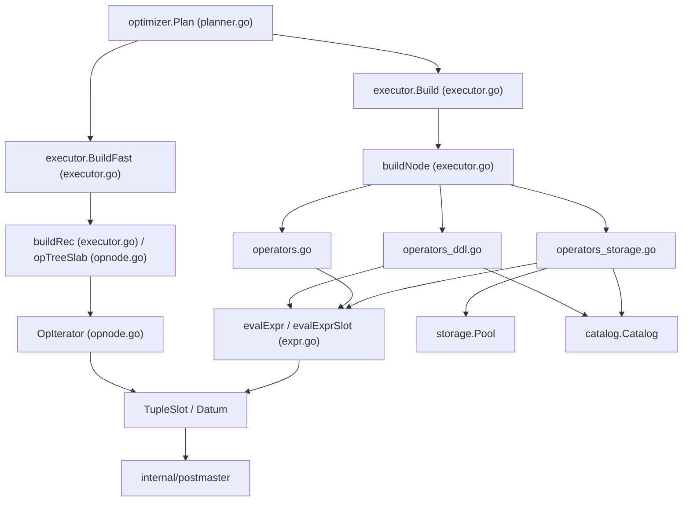
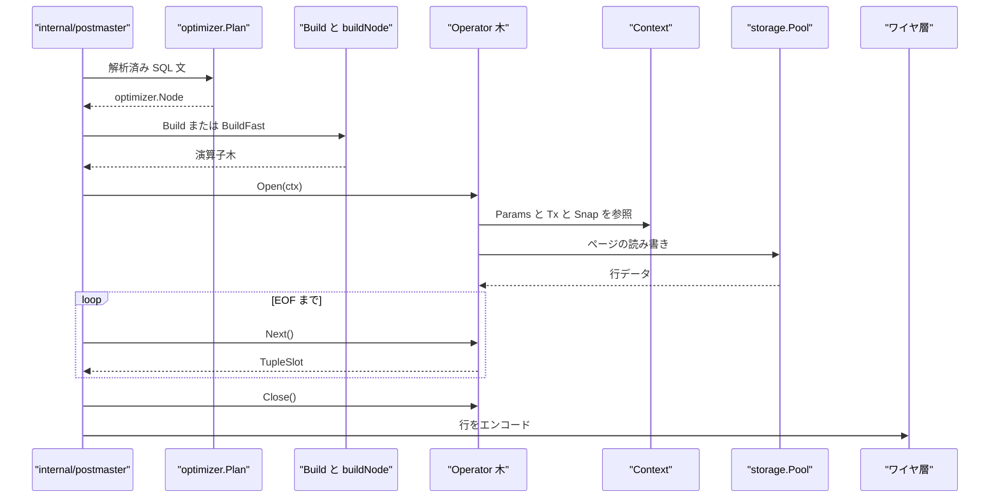

# 実行エンジン

<details>
<summary>関連ソースファイル</summary>

- [`internal/executor/context.go`](https://github.com/ryogrid/goopg/blob/19856410e8d497d59787e1ab35a2febb3f5953d6/internal/executor/context.go)
- [`internal/executor/executor.go`](https://github.com/ryogrid/goopg/blob/19856410e8d497d59787e1ab35a2febb3f5953d6/internal/executor/executor.go)
- [`internal/executor/expr.go`](https://github.com/ryogrid/goopg/blob/19856410e8d497d59787e1ab35a2febb3f5953d6/internal/executor/expr.go)
- [`internal/executor/operators_ddl.go`](https://github.com/ryogrid/goopg/blob/19856410e8d497d59787e1ab35a2febb3f5953d6/internal/executor/operators_ddl.go)
- [`internal/executor/operators_storage.go`](https://github.com/ryogrid/goopg/blob/19856410e8d497d59787e1ab35a2febb3f5953d6/internal/executor/operators_storage.go)
- [`internal/executor/operators.go`](https://github.com/ryogrid/goopg/blob/19856410e8d497d59787e1ab35a2febb3f5953d6/internal/executor/operators.go)
- [`internal/executor/opnode.go`](https://github.com/ryogrid/goopg/blob/19856410e8d497d59787e1ab35a2febb3f5953d6/internal/executor/opnode.go)
- [`internal/executor/operator.go`](https://github.com/ryogrid/goopg/blob/19856410e8d497d59787e1ab35a2febb3f5953d6/internal/executor/operator.go)
- [`internal/executor/slot.go`](https://github.com/ryogrid/goopg/blob/19856410e8d497d59787e1ab35a2febb3f5953d6/internal/executor/slot.go)
- [`internal/executor/datum.go`](https://github.com/ryogrid/goopg/blob/19856410e8d497d59787e1ab35a2febb3f5953d6/internal/executor/datum.go)
- [`internal/optimizer/planner.go`](https://github.com/ryogrid/goopg/blob/19856410e8d497d59787e1ab35a2febb3f5953d6/internal/optimizer/planner.go)

</details>

`internal/executor` は、パーサーとプランナーが作った `optimizer.Node` の木を、`Open` / `Next` / `Close` の 3 メソッドで駆動する引き上げ式（pull-based）の演算子木に変換し、実行するサブシステムである。入口は 2 つある。`Build` が `buildNode` で `Operator` 実装を組み立てる通常経路と、`BuildFast` が `OpNode` を `opTreeSlab` に詰め、`BuildFastIterator` が `OpIterator` で駆動するスラブ経路である。どちらも同じ `Context` を受け取り、同じ `TupleSlot` を返す。

制御はサーバー（[3 サーバーと接続](3-Server.md)）から SQL 文として入り、プランナー（[5 クエリプランナー](5-Query-Planner.md)）が計画木を返す。実行エンジンはその木を演算子へ変換し、スキャン・結合・集約・DML・DDL を駆動して、行を `TupleSlot` としてサーバーへ返す。データはストレージ（[7 ストレージ](7-Storage.md)）とカタログ（[12 カタログとシステムビュー](12-Catalog.md)）の間を流れ、式評価は [6.2 式評価と Datum](6-Executor/6.2-Expression-Evaluation.md)、行の寿命とスロット契約は [6.1 実行モデルとオペレータ](6-Executor/6.1-Execution-Model.md) が詳しい。

## コンポーネント

- [6.1 実行モデルとオペレータ](6-Executor/6.1-Execution-Model.md) — `Build` / `BuildFast`、`Operator` と `TupleSlot`、`Context`、スロットの寿命、spill、文境界の共通骨格。
- [6.2 式評価と Datum](6-Executor/6.2-Expression-Evaluation.md) — `evalExpr` / `evalExprSlot` が `optimizer.Expr` を `Datum` に落とし、算術・比較・キャスト・関数・JSON・日時などを評価する。
- [6.3 スキャンとインデックスアクセス](6-Executor/6.3-Scan-Operators.md) — `seqScanOp`・`indexScanOp`・`indexOnlyScanOp`・Bitmap スキャンと、B-tree プローブ・可視性・deform。
- [6.4 結合オペレータ](6-Executor/6.4-Join-Operators.md) — ハッシュ・マージ・ネストループ・LATERAL・`NestedLoopIndexJoin`・Memoize と build/probe の状態。
- [6.5 集約・ソート・集合演算](6-Executor/6.5-Aggregate-Sort-Setop.md) — `aggregateOp`・`sortOp`・`distinctOp`・`setOp`・`windowOp`・再帰 CTE・並列集約の分割。
- [6.6 DML と MVCC 書き込み](6-Executor/6.6-DML-and-Writes.md) — `insertOp`・`updateOp`・`deleteOp`・`upsertOp` と、MVCC ヘッダ・TOAST・制約・トリガー・インデックス保守。
- [6.7 DDL 実行](6-Executor/6.7-DDL-Execution.md) — `ddlOp.Next` の文型ディスパッチ、カタログ更新、テーブル・索引・ビュー・権限・VACUUM/ANALYZE。
- [6.8 並列実行](6-Executor/6.8-Parallel-Execution.md) — `Gather` / `Gather Merge`、`ParallelGroup`、共有ハッシュ build、ワーカー文脈の分離と行の越境。
- [6.9 システムカタログ同期](6-Executor/6.9-System-Catalog-Sync.md) — `pg_class`・`pg_attribute` などの仮想カタログ行を実ストレージの B-tree に同期する経路。
- [6.10 ストアドルーチンとトリガー](6-Executor/6.10-Stored-Routines.md) — `catalog.Routine`、PL/pgSQL の AST と実行、`CALL`、トリガー発火と AFTER キュー。
- [6.11 EXPLAIN と計測](6-Executor/6.11-EXPLAIN.md) — `explainOp`、`instrumentedOp`、`nodeStats`、TEXT/JSON/XML/YAML とパラレル統計の集約。

## サブシステム図



実線は実行時の呼び出し・データの流れを示す。`buildNode` の `switch` が計画ノードの具象型ごとに演算子を選び、ストレージ系は `operators_storage.go`、DDL は `operators_ddl.go`、それ以外は各 `operators_*.go` に分かれる。式評価はどの演算子からも `expr.go` の `evalExpr` / `evalExprSlot` に入り、結果は `TupleSlot` として親演算子またはサーバーへ渡る。

## データフロー

1. サーバーが SQL 文をパースし、`optimizer.Plan` が `optimizer.Node` の計画木を返す。`EXPLAIN` の内側も同じ設定で計画される。`path:internal/optimizer/planner.go:Plan`
2. `executor.Build(plan)` が `buildNode(plan, deformBoundNone, nil)` を呼び、`optimizer.Values`・`SeqScan`・`Filter`・`Project`・`Join`・`Aggregate`・`Insert`・`DDL` などの具象型を `switch` で振り分ける。未知の型は `0A000` の `ExecError` になる。`path:internal/executor/executor.go:buildNode`
3. スキャンと DML は `operators_storage.go` が担当する。`seqScanOp` がヒープページを読み、`insertOp` / `updateOp` / `deleteOp` が `Context.Pool` と `Context.Catalog` を使って MVCC 書き込みを行う。`path:internal/executor/operators_storage.go:insertOp.Open`
4. DDL は `ddlOp` の 1 回だけの `Next` が `plan.Stmt` の文型を `switch` し、`execCreateTable`・`execCreateIndex`・`execDropTable` などを呼ぶ。出力行は返さず、必要なら `DDLProcessed` で `SELECT n` のタグを報告する。`path:internal/executor/operators_ddl.go:ddlOp.Next`
5. 式は `expr.go` の `evalExpr`（`Row` 用）または `evalExprSlot`（`SlotView` 用）が評価する。`ColumnRef` は入力行の列を引き、関数呼び出しは `evalFuncCall` 系へ、キャストは型変換へ進む。`path:internal/executor/expr.go:evalExprSlot`
6. `Context` が文の実行環境を運ぶ。`Params`・`Now`・`MaxRows`・`Pool`・`Catalog`・`TxnMgr`・`Tx`・`Snap`・`Mctx`・`Session`・`CurrentDatabaseOid`・`OuterRows` に加え、`SubPlanStats`・`HashJoinStats`・`GatherWorkerStats` などの計測マップを持つ。`path:internal/executor/context.go:Context`
7. `Operator.Next` が `TupleSlot` を返し、親演算子が必要に応じて `Materialize` する。スラブ経路では `OpIterator.Next` が `opNext` を呼び、`Slot` に 1 行を書き込む。`path:internal/executor/opnode.go:OpIterator.Next`
8. 結果はサーバーのワイヤ層へ渡り、`Close` が全演算子を解放する。エラーは `ExecError` の SQLSTATE として伝播し、`Close` は `Next` が失敗した後でも呼ばなければならない。`path:internal/executor/operator.go:Operator`



## 共有データ型

### `Operator`

実行エンジンの全ノードが実装するイテレータ契約。`Open` で状態を作り、`Next` が 1 行進み、`Close` が解放する。

```go
// Operator is the iterator interface every executor node implements.
//
// Lifecycle:
//
//	Open(ctx) -> Next ... Next -> EOF -> Close
//
// Open prepares any per-statement state (pinning resources,
// pre-computing constant subexpressions). Next advances by one row
// and returns either (row, nil) or (nil, EOF) at end of stream. Close
// releases resources; Close MUST be called even after Next returned
// an error.
type Operator interface {
	Open(ctx *Context) error
	Next() (TupleSlot, error)
	Close() error
	Schema() optimizer.Schema
}
```

`Next` の終端は `operator.go` の番兵 `EOF` である。`nil` スロットと `nil` エラーは、DML などが「行を出さずに処理だけ進めた」ことを表す。`Schema` は出力列を返し、`Project` や `CALL` の OUT パラメータのように実行時に確定する場合は `Open` 後の値が使われる。

### `TupleSlot` と `SlotView`

演算子間を流れる行の共通インタフェース。`SlotView` が読み取り、`TupleSlot` が実体化・解放・TID 受け渡しを追加する。

```go
// TupleSlot is the goopg replacement for Row=[]Datum as the
// canonical pipeline carrier. Implementations represent rows in
// different storage forms (fully materialized, virtual reference
// across multiple sources, batch-relative offset). M0069-0001
// landed Stage A: the interface, MaterializedSlot, and adapters
// for use at the Row⇄slot boundary. Subsequent stages migrate
// individual operators to native slot consumption + remove the
// row-level BorrowSemantics contract; those land in M0070+.
//
// See `docs/design/0068-0002-tuple-slot-pipeline.md` for the
// authoritative design.
type TupleSlot interface {
	SlotView
	Schema() optimizer.Schema
	Width() int

	// Row exposes the slot as a Row=[]Datum view. For a
	// MaterializedSlot this is zero-copy. For a future
	// VirtualSlot this materializes lazily.
	Row() Row

	// Materialize returns a slot whose backing storage is
	// independent of any source state. Calling Materialize on
	// a MaterializedSlot is a no-op (returns self).
	Materialize() *MaterializedSlot

	// Release returns the slot to the pool. Caller must not
	// access any column afterwards. No-op for slots that don't
	// own backing storage (VirtualSlot, BatchRefSlot).
	Release()

	// TID returns the slot's carried self-tid (block, offset) and
	// whether it is valid. A heap-scan slot stamps it (seqScanOp,
	// operators_storage.go:2076-2078, propagated through projectOp
	// operators.go:369-377); synthesized slots (values/aggregates)
	// return ok=false. M0134-0074: used by materializeCursor to
	// capture per-row tids for WHERE CURRENT OF resolution.
	TID() (block uint32, off uint16, ok bool)
}

// SlotView is the read-only column interface that evalExprSlot
// accepts. Both *MaterializedSlot and *VirtualSlot satisfy it
// via their Get/IsNull methods (TupleSlot embeds SlotView).
// Plain Row=[]Datum is wrapped via rowSlotView for legacy
// call sites that still pass Row to evalExpr.
type SlotView interface {
	Get(col int) Datum
	IsNull(col int) bool
}
```

`SlotView` の `Get` / `IsNull` だけが必要な式評価は、`Row` を `rowSlotView` で包んで渡せる。行を次の `Next` 以降も保持する演算子（ソート・ハッシュ build・集約・マテリアライズ）は `Materialize` で所有権を取る。`TID` は `WHERE CURRENT OF` や CTID 式のために、ヒープスキャンが運んだ `(block, offset)` を引き継ぐ。

### `Datum` と `Row`

`Datum` は 48 バイトの値型で、行のセルを表す。`Row` は `Datum` のスライスで、旧来の行境界や保持境界で使う。

```go
// Concurrency: Datum is a value type; copying it is a 48-byte memmove.
// Buf (when non-nil) is aliased on copy — treat as read-only.
type Datum struct {
	Kind    DatumKind      // 1B @ 0 (was int = 8B; M0107-0002)
	Flags   uint8          // 1B @ 1 (flagBigNumeric; reserved others)
	ArenaID mmgr.ContextID // 2B @ 2 (replaces *mctx.Context; 0 = no mctx payload)
	Scale   int16          // 2B @ 4
	TimeSub TimeSubtype    // 1B @ 6 (KindTime only; else zero. M0127-P5.9-u —
	//                        carved out of the alignment pad, so the 48 B
	//                        layout below is unchanged.)
	_pad0 [1]byte // 1B @ 7 (alignment pad before Int)
	Int   int64   // 8B @ 8
	Buf     []byte         // 24B @ 16 (nil when arena-backed)
	Hi      uint64         // 8B @ 40 (KindInterval sub-day micros; else reserved/UUID-hi)
	// Total: 48 B. GC-traced fields: Buf (nil for arena-backed rows → 0 scans).
}
```

```go
// Row is one tuple in flight: a slice of Datums aligned with the
// emitting operator's Schema.
type Row []Datum
```

`Kind` が `KindNull` なら SQL NULL である。`Buf` はコピー時にエイリアスされるため読み取り専用として扱う。`ArenaID` が非ゼロの `Datum` は `mmgr.Context` のアリーナを指し、その寿命は文のメモリ文脈に従う。`Row` は `TupleSlot.Row()` のゼロコピー表現としても使われる。

### `ExecError`

実行時の構造化エラー。SQLSTATE を `Code` に持ち、ワイヤ層の `ErrorResponse` にそのまま渡せる。

```go
// ExecError is the executor's structured error. Code is a SQLSTATE
// value the wire-protocol path forwards to ErrorResponse.
type ExecError struct {
	Code          string
	Message       string
	Detail        string // optional DETAIL message for wire protocol. M0097-0003.
	Hint          string // optional HINT message for wire protocol. M0097-0004.
	Context       string // optional CONTEXT (WHERE) message for wire protocol. M0097-0022.
	Pos           int
	ConditionName string // set for RAISE condition_name; used for exception matching. M0097-0003.
}
```

`Code` は `42883`（関数なし）・`42501`（権限なし）・`40001`（直列化失敗）・`0A000`（未実装）などの SQLSTATE である。`Pos` は入力 SQL 内のバイト位置、`Detail` / `Hint` / `Context` はそのままクライアントへ返る。PL/pgSQL の例外ハンドラは `Code` と `ConditionName` でマッチする。

### `OpNode` と `Slot`

スラブ経路の中心型。`OpNode` は子を `int32` のスラブ添字で持ち、`Slot` はホットパスで再利用される行の器である。

```go
// OpNode is the central node type for the Phase C execution engine.
// Each query plan corresponds to a tree of OpNodes stored in an opTreeSlab.
// The tree is built by BuildFast (which populates the slab) and driven by
// RunFast. Children are encoded as int32 indices into the slab; noChild (-1)
// means "no child". This eliminates GC-scanned pointers in the hot tree.
type OpNode struct {
	Kind   OpKind
	childA int32 // index into ops slab; noChild (-1) if none
	childB int32 // index into ops slab; noChild (-1) if none
	state  any   // concrete per-Kind state struct (GC-safe)
}
```

```go
// Slot is a concrete, stack-allocatable row vessel. Phase C callers
// preallocate one Slot per goroutine and reuse it across opNext calls.
// Cells is overwritten each call; consumers that need to retain rows
// past the next opNext call must copy via CopyTo.
//
// HasRow distinguishes two zero-Cells cases:
//   - HasRow=false, Cells=[] → DML nil-row (INSERT/UPDATE/DELETE produced
//     no result row; pass through to sink without evaluating projections).
//   - HasRow=true, Cells=[] → valid row with no columns (e.g. the
//     input row for SELECT 1, which comes from a zero-column Values node).
//
// Operators that receive a DML nil-row must propagate it as-is.
// Operators like projectOp must evaluate targets even when Cells is empty
// (the target expressions may be constants that don't reference input).
type Slot struct {
	schema optimizer.Schema
	Cells  []Datum
	HasRow bool // false == DML nil-row; true == real row (may have 0 cols)
	// M0097-0062: ctid system column forwarded from MaterializedSlot.
	// Set by fillFromTupleSlot when the incoming TupleSlot is a
	// *MaterializedSlot that carries ctid info (seqScanOp path).
	hasCTID   bool
	ctidBlock uint32
	ctidOff   uint16
}
```

`OpNode` の `state` は `OpKind` ごとの具体状態（`filterState`・`projectState`・`sortOpState` など）を保持する。`opTreeSlab` は `BuildFast` の間だけ追記され、完了後は不変である。`Slot.HasRow` の 2 つのゼロ列ケースは、DML の「行なし」と「0 列の有効な行」を区別するためにある。

## 主要な設計判断

- **引き上げ式の Volcano モデル。** すべての演算子は `Open` / `Next` / `Close` を持ち、親が子を `Next` で引く。終端は `EOF`、DML の行なしは `nil` スロットで表す。`Close` はエラー後も必ず呼ぶ。`path:internal/executor/operator.go:Operator`
- **2 つのビルド経路は同じ意味論。** `Build` は `Operator` インタフェース、`BuildFast` は `OpNode` の `switch` で駆動する。スラブは `BuildFast` 後に不変で、子は `int32` 添字なのでホットツリーに GC 走査ポインタが残らない。`path:internal/executor/opnode.go:OpNode`
- **`Context` は文スコープの実行環境。** `Pool`・`Catalog`・`Tx`・`Snap`・`Mctx`・`Session`・`Params` を 1 つの構造体で持ち回り、ストアドルーチンやワーカーでは値コピーで子文脈を作る。計測スコープもグローバルではなく関数引数として渡す。`path:internal/executor/context.go:Context`
- **修飾子はスキャンへ吸収できる。** `Filter(SeqScan)` は `buildNode` が `Filter` 演算子を作らず、述語を `seqScanOp.qual` へ吸収する。`optimizer.Filter` の計画ノードは残るため、EXPLAIN の表示は変わらない。`path:internal/executor/executor.go:buildNode`
- **DML は一度きりの副作用と RETURNING のストリーム。** `insertOp` / `updateOp` / `deleteOp` は最初の `Next` で書き込みを完了し、`RETURNING` がある場合だけ `retRows` を後続の `Next` で返す。`RowsAffected` が `INSERT N` などのタグを作る。`path:internal/executor/operators_storage.go:insertOp.Next`
- **DDL は行を返さない。** `ddlOp.Open` は `Context.Catalog` が nil でないことだけ確認し、`Next` を 1 回だけ実行して文型ごとの処理へ進む。`CREATE TABLE AS` などの populate だけは `DDLProcessed` で `SELECT n` を報告する。`path:internal/executor/operators_ddl.go:ddlOp`
- **エラーは SQLSTATE 付きで伝播する。** 実行時エラーは `*ExecError` に統一され、`Code`・`Message`・`Detail`・`Hint`・`Pos` を運ぶ。演算子はエラー時に `Close` を呼び、リソースを解放してから返す。`path:internal/executor/expr.go:ExecError`
- **行の所有権は `Materialize` で切る。** パイプライン中の `Slot` は再利用されるため、次の `Next` 以降も保持する演算子は `Materialize` で独立した `Row` を取る。`TupleSlot.TID` はヒープスキャンの ctid を `WHERE CURRENT OF` まで運ぶ。`path:internal/executor/slot.go:TupleSlot`
- **文境界のスコープ。** `stmtCTEScopeOp` が CTE の実体化キャッシュと AFTER トリガーのクエリレベルを文ごとに差し替え、カーソルや後続文へ状態を漏らさない。`path:internal/executor/executor.go:stmtCTEScopeOp`

Sources:

- `internal/executor/context.go`
- `internal/executor/executor.go`
- `internal/executor/expr.go`
- `internal/executor/operators_ddl.go`
- `internal/executor/operators_storage.go`
- `internal/executor/operators.go`
- `internal/executor/opnode.go`
- `internal/executor/operator.go`
- `internal/executor/slot.go`
- `internal/executor/datum.go`
- `internal/optimizer/planner.go`

<sub>Generated by deepwiki-4myself from `goopg` @ `19856410e`</sub>
