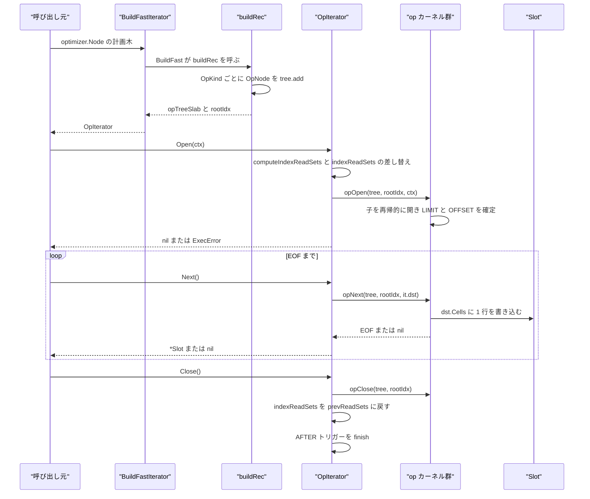
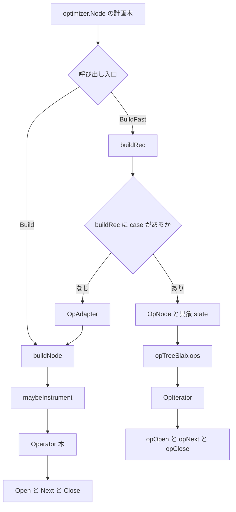

# 実行モデルとオペレータ

<details>
<summary>関連ソースファイル</summary>

- [`internal/executor/context.go`](https://github.com/ryogrid/goopg/blob/19856410e8d497d59787e1ab35a2febb3f5953d6/internal/executor/context.go)
- [`internal/executor/executor.go`](https://github.com/ryogrid/goopg/blob/19856410e8d497d59787e1ab35a2febb3f5953d6/internal/executor/executor.go)
- [`internal/executor/instrument.go`](https://github.com/ryogrid/goopg/blob/19856410e8d497d59787e1ab35a2febb3f5953d6/internal/executor/instrument.go)
- [`internal/executor/operator.go`](https://github.com/ryogrid/goopg/blob/19856410e8d497d59787e1ab35a2febb3f5953d6/internal/executor/operator.go)
- [`internal/executor/opnode.go`](https://github.com/ryogrid/goopg/blob/19856410e8d497d59787e1ab35a2febb3f5953d6/internal/executor/opnode.go)
- [`internal/executor/packedslot.go`](https://github.com/ryogrid/goopg/blob/19856410e8d497d59787e1ab35a2febb3f5953d6/internal/executor/packedslot.go)
- [`internal/executor/packedtuple.go`](https://github.com/ryogrid/goopg/blob/19856410e8d497d59787e1ab35a2febb3f5953d6/internal/executor/packedtuple.go)
- [`internal/executor/plannode.go`](https://github.com/ryogrid/goopg/blob/19856410e8d497d59787e1ab35a2febb3f5953d6/internal/executor/plannode.go)
- [`internal/executor/row_pool.go`](https://github.com/ryogrid/goopg/blob/19856410e8d497d59787e1ab35a2febb3f5953d6/internal/executor/row_pool.go)
- [`internal/executor/rowshape_assert.go`](https://github.com/ryogrid/goopg/blob/19856410e8d497d59787e1ab35a2febb3f5953d6/internal/executor/rowshape_assert.go)
- [`internal/executor/session.go`](https://github.com/ryogrid/goopg/blob/19856410e8d497d59787e1ab35a2febb3f5953d6/internal/executor/session.go)
- [`internal/executor/slot.go`](https://github.com/ryogrid/goopg/blob/19856410e8d497d59787e1ab35a2febb3f5953d6/internal/executor/slot.go)
- [`internal/executor/spill.go`](https://github.com/ryogrid/goopg/blob/19856410e8d497d59787e1ab35a2febb3f5953d6/internal/executor/spill.go)
- [`internal/executor/tempfiles.go`](https://github.com/ryogrid/goopg/blob/19856410e8d497d59787e1ab35a2febb3f5953d6/internal/executor/tempfiles.go)

</details>

`internal/executor` は、プランナーが返した `optimizer.Node` の木を、`Open` / `Next` / `Close` の 3 メソッドだけで駆動できる「引き上げ式（pull-based）」の演算子木へ変換し、実行する層である。変換の入口は 2 つある。1 つは `Build` で、`buildNode` が `optimizer.Node` の具象型を `switch` で見て `Operator` 実装を組み立てる。もう 1 つは `BuildFast` で、`buildRec` が `OpNode` のタグ付き共用体を `opTreeSlab` に詰め、子を `int32` のスラブ添字で指す。実行時は前者が `Operator.Next()` のインタフェース呼び出し、後者が `opNext` の `switch` 分岐になる。どちらの経路も同じ `Context` を受け取り、同じ `TupleSlot` を返し、同じ結果行を生成する。このページでは、個々の演算子の中身ではなく、木の組み立て・行の受け渡し・寿命・外部化（spill）・計測といった共通の骨格を扱う。式評価は [6.2 式評価と Datum](6.2-Expression-Evaluation.md)、スキャンは [6.3 スキャンとインデックスアクセス](6.3-Scan-Operators.md)、並列実行は [6.8 並列実行](6.8-Parallel-Execution.md) を参照。

## 責務

- 計画木から演算子木への変換。`Build` が `buildNode(plan, deformBoundNone, nil)` を呼び、`optimizer.Values`・`SeqScan`・`Filter`・`Project`・`Join`・`Aggregate`・`Gather`・DML・DDL などの具象型ごとに専用の `Operator` を生成する。未知のノードは `ExecError{Code: "0A000"}` で拒否する。`path:internal/executor/executor.go:buildNode`
- スラブ経路の構築。`BuildFast` が `opTreeSlab` と根の添字を返し、`buildRec` が移行済みの種類（`SeqScan`/`Filter`/`Project`/`Limit`/`Sort`/`Update`/`Delete`/`Insert`/`Join`）を `OpNode` として積み、それ以外を `OpAdapter` で旧 `Operator` に橋渡しする。`path:internal/executor/executor.go:BuildFast`
- 反復プロトコルの提供。`Operator` は `Open`/`Next`/`Close`/`Schema` の 4 メソッドで、終端は番兵 `EOF`、DML の「行なし」は `nil` スロットで表す。`path:internal/executor/operator.go:Operator`
- 文単位の実行文脈の保持。`Context` がバインド値 `Params`、文開始時刻 `Now`、トランザクション `Tx`・スナップショット `Snap`、セッション `Session`、キャンセル用 `Ctx`、メモリ文脈 `Mctx`、spill 予算 `WorkMem` などを 1 文のあいだ持ち回る。`path:internal/executor/context.go:Context`
- 行の搬送形式の規定。`TupleSlot` を共通インタフェースとし、`MaterializedSlot`・`VirtualSlot`・`PackedSlot`・具象 `Slot` がそれぞれ異なる寿命と格納形式を提供する。`path:internal/executor/slot.go:TupleSlot`
- メモリ予算超過時のディスク外部化。`drainRowsBounded` が `WorkMem` を超えた行を `spillWriter` で書き出し、`spillOp` で読み戻す。`path:internal/executor/spill.go:drainRowsBounded`
- spill ファイルの確実な後片付け。`tempFileRegistry` が文のあいだに作った全ファイルを所有し、演算子の `Close` が漏れても `ReleaseSpillFiles` で削除する。`path:internal/executor/tempfiles.go:tempFileRegistry`
- EXPLAIN ANALYZE 用の計測。`instrumenter` スコープを引数として引き回し、`maybeInstrument` が各ノードを `instrumentedOp` で包んで行数・ループ数・時間・バッファ・WAL・メモリを記録する。`path:internal/executor/instrument.go:maybeInstrument`
- 文境界のスコープ管理。`stmtCTEScopeOp` が CTE の実体化キャッシュと AFTER トリガーのキューを文ごとに差し替え、`OpIterator` が索引の読み取り集合を `Open` で設置し `Close` で復元する。`path:internal/executor/executor.go:stmtCTEScopeOp`

## 処理フロー

呼び出し側はまず計画木を渡して木を組み立てる。旧経路では `Build(plan)` が `buildNode` を再帰させ、各 `case` が子を先に建ててから親を包む。たとえば `*optimizer.Filter` は子を `deformBoundBelow` で建てたあと、子が `*optimizer.SeqScan` なら `unwrapSeqScanOp` で具象スキャンを取り出し、述語を `qual`/`qualSet`（可能なら `prefilter`）へ吸収して **フィルタ演算子を作らずにスキャン自身を返す**。吸収できない場合だけ `newFilterOp` を包む。`path:internal/executor/executor.go:buildNode`

現行のサーバー経路は `BuildFastIterator(plan)` を使う。これは `BuildFast` → `buildRec` でスラブを構築し、`OpIterator` に包んで返す。`buildRec` は子を先に積むため、`OpNode` の `childA`/`childB` は常に自分より小さい添字になり、木は DAG ではなく厳密な木として後置順に並ぶ。`path:internal/executor/opnode.go:BuildFastIterator`

実行は `OpIterator.Open(ctx)` から始まる。`Open` は初回だけ `computeIndexReadSets(it.plan)` で索引読み取り集合を計算し、`ctx.indexReadSets` と差し替える。続いて文の AFTER トリガー用レベルを `swapIn` し、`opOpen(tree, rootIdx, ctx)` を呼ぶ。`opOpen` は種類ごとに子を再帰的に開き、`OpFilter`/`OpProject` は共有の式スラブ `tree.exprs` を自分の状態へ配線し、`OpLimit` はこの時点で `LIMIT`/`OFFSET` 式を 1 回だけ評価して `limitCount`/`offsetCount` に固定する。`path:internal/executor/opnode.go:opOpen`

行の取得は `OpIterator.Next()` → `opNext(tree, rootIdx, &it.dst)` の一本道である。`opNext` は `OpKind` の `switch` で `seqScanOpNext`・`filterOpNext`・`projectOpNext`・`limitOpNext`・`sortOpKernelNext`・`joinOpKernelNext`・`adapterOpNext` などへ分岐する。`projectOpNext` は子の出力を `s.srcSlot` に受け、`outCells` を再利用して結果を書き、`tree.schemas[s.schemaIdx]` をスキーマとして貼る。`Datum` の変換は行わず、スロットのセルをそのまま次段へ渡す。`path:internal/executor/opnode.go:opNext`



旧経路の `Operator` 木でも駆動順は同じで、違いは子の呼び出しが `opNext` の `switch` か `child.Next()` のインタフェース呼び出しかだけである。テストや簡易実行向けの `Run(op, ctx)` は、`ctx.CommandCounterIncrement()` と `ctx.CmdID = ctx.GetCurrentCommandId(true)` でコマンドカウンタを進めてから `Open` し、`EOF` まで `Next` を回し、`slot.Materialize().Row()` で独立した `Row` を集めて `Close` する。`path:internal/executor/executor.go:Run`

## 主要ファイル

| ファイル | 役割 |
| --- | --- |
| `internal/executor/operator.go` | `Operator` インタフェース、`EOF` 番兵、`RowCounter` の定義。実行プロトコルの契約。`path:internal/executor/operator.go:Operator` |
| `internal/executor/executor.go` | `Build`/`buildNode` の旧経路、`BuildFast`/`buildRec` のスラブ経路、`Run`/`RunFast`、`buildCompleteChild` による消費列の絞り込み、`stmtCTEScopeOp`。`path:internal/executor/executor.go:Build` |
| `internal/executor/opnode.go` | `Slot`、`OpKind`、`OpNode`、`opTreeSlab`、`opOpen`/`opNext`/`opClose`、`OpIterator`、`opNodeOperator` の橋渡し。`path:internal/executor/opnode.go:opNext` |
| `internal/executor/plannode.go` | `PlanKind`/`PlanNode`/`planTreeSlab`。計画メタデータを `payload` バイト列に畳む第 3 のスラブ。現状 `buildRec` はこのスラブへ書き込まず、`buildPlanFilter`/`buildPlanLimit`/`buildPlanAdapter` は本番経路から呼ばれていない。`path:internal/executor/plannode.go:PlanNode` |
| `internal/executor/slot.go` | `TupleSlot`/`SlotView`、`MaterializedSlot`、`VirtualSlot`、`Row`⇄スロット変換。`path:internal/executor/slot.go:TupleSlot` |
| `internal/executor/packedslot.go` | `PackedSlot`。`PackedTuple` を `tts_nvalid` 相当の水位で遅延展開するスロット。現時点で生成元は無い。`path:internal/executor/packedslot.go:PackedSlot` |
| `internal/executor/packedtuple.go` | `TupleDesc` と `PackedTuple`。PostgreSQL の MinimalTuple 互換の保持行形式。`path:internal/executor/packedtuple.go:PackedTuple` |
| `internal/executor/context.go` | `Context` の全フィールド、`NewContext`、コマンドカウンタ、ロック取得、通知、GUC フック。`path:internal/executor/context.go:Context` |
| `internal/executor/session.go` | `Session` インタフェースと `BasicSession`。明示トランザクション、セーブポイント、DDL アンドゥ、遅延制約検査の台帳。`path:internal/executor/session.go:Session` |
| `internal/executor/instrument.go` | `nodeStats`/`instrumentedOp`/`instrumenter`/`maybeInstrument`。EXPLAIN ANALYZE の計測ラッパー。`path:internal/executor/instrument.go:instrumentedOp` |
| `internal/executor/spill.go` | `spillWriter`/`spillReader`、フレーム形式、`drainRowsBounded`、`rowsOp`/`spillOp`。`path:internal/executor/spill.go:spillWriter` |
| `internal/executor/tempfiles.go` | `tempFileRegistry` と `Context` 側の登録・解除・一括削除。`path:internal/executor/tempfiles.go:ReleaseSpillFiles` |
| `internal/executor/row_pool.go` | `acquireRow`/`releaseRow` と `rowChunk`。行プール撤去の経緯と、チャンク単位割り当て。`path:internal/executor/row_pool.go:rowChunk` |
| `internal/executor/rowshape_assert.go` | `assertRowShapeInline`。`Output()` の列数と実際に emit した列数の一致を検査するデバッグ用アサーション。`path:internal/executor/rowshape_assert.go:assertRowShapeInline` |

## 公開 API / エントリポイント

```go
func Build(plan optimizer.Node) (Operator, error)
func BuildWorker(plan optimizer.Node) (Operator, error)

func BuildFast(plan optimizer.Node) (*opTreeSlab, int32, error)
func BuildFastIterator(plan optimizer.Node) (*OpIterator, error)

func Run(op Operator, ctx *Context) ([]Row, error)
func RunFast(tree *opTreeSlab, rootIdx int32, ctx *Context) ([]Row, error)

func NewContext() *Context
func NewBasicSession() *BasicSession
func NewAutocommitUndoSession() *BasicSession
```

`BuildWorker` は `Gather`/`GatherMerge` のワーカー側の入口で、中身は `buildNode(plan, deformBoundNone, nil)` であり `Build` と同一である。ワーカーごとに独立した木を作るため、ビルドは計画ノードの純関数でなければならない。`path:internal/executor/executor.go:BuildWorker`

`Run` と `RunFast` は結果を `[]Row` に溜める便宜関数で、境界で必ず深いコピーを行う。`Run` は `slot.Materialize().Row()`、`RunFast` は `cloneRowOwned(Row(dst.Cells))` を使う。本番のワイヤー層は `Open`/`Next`/`Close` を直接回して 1 行ずつエンコードする。`path:internal/executor/executor.go:RunFast`

`Operator` の実装者は `RowCounter`（`RowsAffected() int64`）を追加実装でき、`OpIterator` は根が `OpUpdate`/`OpDelete`/`OpInsert` のとき、または `OpAdapter` の内側が `RowCounter` のときにその値を転送する。`path:internal/executor/opnode.go:OpIterator.RowsAffected`

## 主要データ構造

### `Operator` — 反復子の契約

```go
type Operator interface {
	Open(ctx *Context) error
	Next() (TupleSlot, error)
	Close() error
	Schema() optimizer.Schema
}
```

`path:internal/executor/operator.go:Operator`

`Open` はハッシュテーブルの構築やソートの入力消費など「PostgreSQL なら最初の `ExecProcNode` が行う仕事」を前倒しで実行する。`Next` は 1 行進めて `(row, nil)` を返し、終端では `(nil, EOF)` を返す。`EOF` は `errors.New("executor: end of stream")` の番兵であり、終端後も呼ばれ続ける限り `EOF` を返し続ける契約である。`Close` は `Next` がエラーを返した後でも必ず呼ばなければならない。`Schema` は出力列の定義であり、`Run` の境界や EXPLAIN のレンダラが計画側の `Output()` と突き合わせる。

### `Slot` — ホットパスの行搬送体

```go
type Slot struct {
	schema optimizer.Schema
	Cells  []Datum
	HasRow bool // false == DML nil-row; true == real row (may have 0 cols)
	// M0097-0062: ctid system column forwarded from MaterializedSlot.
	// Set by fillFromTupleSlot when the incoming TupleSlot is a
	// *MaterializedSlot that carries ctid info (seqScanOp path).
	hasCTID   bool
	ctidBlock uint32
	ctidOff   uint16
}
```

`path:internal/executor/opnode.go:Slot`

`Cells` は `Next` ごとに上書きされる再利用バッファで、`Reset()` は長さだけを 0 に戻し容量を保持する。`HasRow` は「行が無い」と「列が 0 個の行」を区別するためのフラグで、`false` は DML の nil 行（INSERT/UPDATE/DELETE が結果行を出さない場合）を意味し、`true` かつ `Cells` が空なら `SELECT 1` の入力のような 0 列の実在行を意味する。`ctidBlock`/`ctidOff`/`hasCTID` はヒープスキャンが刻んだ自己 TID を下流へ運ぶ副作用チャネルで、`fillFromTupleSlot` が `*MaterializedSlot`・`*Slot`・`*PackedSlot` の 3 種から写す。`projectOpNext` もこの 3 つを手で伝播させる。`path:internal/executor/opnode.go:Slot.fillFromTupleSlot`

### `OpKind` — スラブノードの判別子

```go
type OpKind uint8

const (
	OpInvalid OpKind = iota

	// Migrated operators (concrete dispatch, no interface per Next call).
	OpSeqScan
	OpFilter
	OpProject
	OpLimit

	// Phase C.1 follow-up: DML operators (no Operator child — they drive
	// storage directly via extractScan).
	OpUpdate
	OpDelete

	// Phase C.1 follow-up: Sort (uses opNodeOperator bridge for child so
	// the child subtree runs on concrete dispatch while sortOp itself is
	// unchanged).
	OpSort

	// Phase C.1 follow-up: Insert (opNodeOperator bridge for the VALUES
	// child; ON CONFLICT path still uses OpAdapter).
	OpInsert

	// Phase C.1 follow-up: Join (opNodeOperator bridges for left/right
	// children; the joinOp itself is unchanged).
	OpJoin

	// M0128-P2.3: Bitmap scan operators.
	// BitmapIndexScan produces a TIDBitmap; BitmapHeapScan consumes it.
	// BitmapAnd/BitmapOr combine multiple bitmap subtrees.
	OpBitmapIndexScan
	OpBitmapHeapScan
	OpBitmapAnd
	OpBitmapOr

	// Adapter — wraps a legacy Operator interface.
	// All unmigrated operators use this until they are individually
	// promoted to a concrete kind.
	OpAdapter
)
```

`path:internal/executor/opnode.go:OpKind`

`OpBitmapIndexScan` から `OpBitmapOr` までは列挙子だけが用意されており、`buildRec` の明示的な `case` には現れない。現時点では既定腕の `OpAdapter` が旧 `Operator` を包む。`opOpen`/`opNext`/`opClose` にこれらの `case` は無いため、将来 `buildRec` が直接生成する場合は 3 つの関数すべてに腕を追加する必要がある。

### `OpNode` と `opTreeSlab` — タグ付き共用体の木

```go
type OpNode struct {
	Kind   OpKind
	childA int32 // index into ops slab; noChild (-1) if none
	childB int32 // index into ops slab; noChild (-1) if none
	state  any   // concrete per-Kind state struct (GC-safe)
}
```

`path:internal/executor/opnode.go:OpNode`

```go
// noChild is the sentinel index meaning "no child in this slot".
const noChild int32 = -1

// opTreeSlab is the backing store for an OpNode tree. All nodes are
// appended during BuildFast; the slab is immutable after BuildFast returns.
// opNodeOperator and OpIterator hold a *opTreeSlab pointer so they always
// see the final slice, even if append relocated the backing array during build.
type opTreeSlab struct {
	ops     []OpNode
	exprs   exprTreeSlab     // expression-tree slab (Phase C.3); immutable after BuildFast
	plans   planTreeSlab     // plan-tree slab (Phase C.3); immutable after BuildFast
	schemas []optimizer.Schema // output-schema pool for OpProject nodes; indexed by schemaIdx
}
```

`path:internal/executor/opnode.go:opTreeSlab`

不変条件は 3 つある。第 1 に、`childA`/`childB` は必ず `-1` か自分より小さい添字であり、`BuildFast` の後は `ops` を変更しない。第 2 に、各ノードの状態は `state` の具象型（`*seqScanOp`、`*filterState`、`*projectState`、`*limitState`、`*sortOpState`、`*joinOpState`、`*opAdapterState` など）で決まり、`Kind` と `state` の型は一致していなければならない。第 3 に、`schemas` は `OpProject` 専用のプールで、`projectState.schemaIdx` がその添字を持つ。`state` を `any` にしているのは、ポインタを含まない生バイト配置への移行（Phase D3/C.3）まで GC 安全な形で先行させるためである。

### `TupleSlot` と `MaterializedSlot` — 保持境界の行

```go
type TupleSlot interface {
	SlotView
	Schema() optimizer.Schema
	Width() int

	// Row exposes the slot as a Row=[]Datum view. For a
	// MaterializedSlot this is zero-copy. For a future
	// VirtualSlot this materializes lazily.
	Row() Row

	// Materialize returns a slot whose backing storage is
	// independent of any source state. Calling Materialize on
	// a MaterializedSlot is a no-op (returns self).
	Materialize() *MaterializedSlot

	// Release returns the slot to the pool. Caller must not
	// access any column afterwards. No-op for slots that don't
	// own backing storage (VirtualSlot, BatchRefSlot).
	Release()

	// TID returns the slot's carried self-tid (block, offset) and
	// whether it is valid. A heap-scan slot stamps it (seqScanOp,
	// operators_storage.go:2076-2078, propagated through projectOp
	// operators.go:369-377); synthesized slots (values/aggregates)
	// return ok=false. M0134-0074: used by materializeCursor to
	// capture per-row tids for WHERE CURRENT OF resolution.
	TID() (block uint32, off uint16, ok bool)
}
```

`path:internal/executor/slot.go:TupleSlot`

```go
type MaterializedSlot struct {
	schema    optimizer.Schema
	row       Row
	ctidBlock uint32 // injected by seqScanOp for CTIDExpr; valid when hasCTID=true. M0097-0038.
	ctidOff   uint16
	hasCTID   bool
}
```

`path:internal/executor/slot.go:MaterializedSlot`

中心の不変条件は「スロットは次の `Next()` まで有効、保持するなら `Materialize()`」である。`MaterializedSlot.Materialize` は自分自身の `row` を `cloneRowOwned` で置き換える（その場で所有権を確定する）。`VirtualSlot.Materialize` は各セルを `Get(i).MaterializeArena()` で 1 回ずつ読み、アリーナ由来の `Datum` を所有バイトへ昇格させる。一方、`filter`/`limit`/`instrument` のような通過系はコピーせずスロットをそのまま流すため、消費側が保持するときだけ `Materialize` が境界になる。`path:internal/executor/slot.go:VirtualSlot.Materialize`

### `Context` — 文単位の実行状態（抜粋）

`Context` は数百のフィールドを持つ大きな構造体であるため、ここでは実行モデルの骨格に関わる先頭部分のみを引用する。残りのフィールドは、後述するように用途別のグループ（ロック、GUC、カタログ行供給、並列、CTE、コマンドカウンタ）として並んでいる。

```go
type Context struct {
	// Ctx, when non-nil, is the per-query cancellable context. Operators
	// poll Ctx.Err() periodically to detect query cancellation
	// (CancelRequest / psql Ctrl-C → SQLSTATE 57014).
	Ctx context.Context

	// Params holds bind values for $1, $2, ... — Params[i-1] is $i.
	Params []Datum
	// Now is the wall-clock value `current_timestamp` and friends
	// resolve to. Captured once at statement start so retries see
	// consistent values, matching upstream.
	Now time.Time
	// MaxRows caps the number of rows the executor produces. Zero
	// means unlimited. The extended-query protocol's Execute message
	// passes through here.
	MaxRows int

	// RoutineDepth counts nested stored-routine invocations currently on
	// the Go call stack (executeStoredRoutine increments/decrements it
	// around each call). A self-recursive SQL/PL/pgSQL function such as
	// `create function infinite_recurse() ... as 'select infinite_recurse()'`
	// would otherwise recurse through evalStoredRoutineFuncCall →
	// executeSQLRoutine → optimizer.Plan/Build → evalFuncCall → ... forever,
	// smashing the goroutine stack — a Go runtime "stack overflow" is a
	// fatal, unrecoverable process crash, not a catchable panic, so it takes
	// the whole server down with the client's connection. PostgreSQL instead
	// polls the C stack pointer against max_stack_depth on every function
	// call (check_stack_depth, postgres/src/backend/utils/misc/stack_depth.c)
	// and raises 54001 "stack depth limit exceeded" once the runaway depth
	// is detected — goopg has no C-stack-pointer equivalent to poll, so this
	// counts logical call depth instead and raises the same SQLSTATE. Because
	// executeSQLRoutine/executePLpgSQLRoutine each build their child Context
	// via `*child = *ctx`, the running count is carried forward by value at
	// every recursion level, exactly like a real stack depth would be.
	// M0134-0131 (infinite_recurse.sql).
	RoutineDepth int

	// Mctx is the statement-level memory context (M0107-0001).
	// Operators acquire child ExprContexts from it for per-row
	// scratch; nil disables mctx-backed arena Datums (tests that
	// don't wire a full server still work via GC-heap fallback).
	Mctx *mmgr.Context

	// Storage handles. Heap-touching operators (SeqScan/Insert/
	// Update/Delete) require all four to be set; pure-compute
	// statements (SELECT 1, …) don't.
	Pool    *storage.Pool
	Catalog catalog.Catalog
	// PlanCatalog is a search-path-aware wrapper around Catalog used when
	// calling planner.Plan so that unqualified table names resolve via the
	// session's search_path. Falls back to Catalog when nil. M0097-0022.
	PlanCatalog catalog.Catalog
	TxnMgr      *transam.Manager
	Tx          transam.Transaction
	Snap        transam.Snapshot

	// MultiXact is the process-shared MultiXact member store (the SLRU
	// analog). It is consulted by the row-locking path (stampLockInner) to
	// (a) combine a new lock holder with an existing active lock holder into a
	// MultiXactId rather than overwriting it, and (b) resolve a tuple's
	// MultiXactId xmax back to its member transactions when checking lock
	// conflicts. nil disables the multixact path entirely — the single-holder
	// xmax behaviour (one TransactionID per tuple) is preserved, so tests and
	// deployments that don't wire a store keep working unchanged. M0118-0003.
	MultiXact *multixact.Store

	// Session, if set, is consulted by the Transaction operator to
	// drive BEGIN/COMMIT/ROLLBACK. It also tracks whether the current
	// statement is running inside an explicit transaction block. The
	// wire-protocol path provides a per-connection implementation;
	// tests can leave it nil when the operator under test doesn't
	// need it.
	Session Session
```

`path:internal/executor/context.go:Context`

この先頭部分だけでも、フィールド同士の依存関係が読める。`Now` は文開始時に 1 回だけ取り、`current_timestamp` 系が同じ文内でぶれないようにする。`Params` は `$i` の解決に使い、`Ctx` は長時間走る走査のキャンセル判定に使う。`Pool`・`Catalog`・`TxnMgr`・`Tx`・`Snap` の 5 つは保存系演算子の前提条件であり、純計算の文では未設定でも動く。`Mctx` が nil のとき、アリーナ由来の `Datum` は GC ヒープにフォールバックする。

`tempFiles` だけは値ではなくポインタで持つ点が重要である。この構造体は FK 検査やパーティション DDL の経路で `synthCtx := *ctx` のように値コピーされることがあり、並列ワーカーとも共有される。ポインタなら全コピーが同一のレジストリに着地するが、値にすると「コピーごとのレジストリ」になり、ファイルが誰にも消されないリークになる。`NewContext` が生成時に必ず 1 つ設置し、`&Context{}` の直書きでは nil のままで、登録系の呼び出しはすべて no-op に退化する。`path:internal/executor/context.go:NewContext`

### `Session` — 接続スコープの状態

```go
type Session interface {
	IsolationLevel() transam.IsolationLevel
	// SetIsolationLevel updates the session-default isolation level.
	// Used by BEGIN ISOLATION LEVEL and SET TRANSACTION ISOLATION LEVEL.
	SetIsolationLevel(level transam.IsolationLevel) error
	InExplicitTransaction() bool
	// TracksDDLUndo reports whether enum/composite-type DDL (CREATE TYPE ... AS
	// ENUM/composite, ALTER TYPE ... ADD VALUE/RENAME TO) should be tracked in
	// ctx.Pending* for potential undo — true both for a real explicit
	// transaction (InExplicitTransaction()) and for a message-scoped autocommit
	// session (NewAutocommitUndoSession), whose batch can still abort mid-message
	// and needs the same undo. Deliberately NOT the same as
	// InExplicitTransaction(): flipping that would also perturb ~20 unrelated
	// call sites (deferred FK/UNIQUE/EXCLUDE check timing, TRUNCATE/DROP-in-
	// savepoint snapshotting, pg_stat scoping) — root-0024 residual, M0110-0001.
	TracksDDLUndo() bool
	IsReadOnlyTxn() bool // true when the current transaction was started with READ ONLY
	SetReadOnlyTxn(v bool)
	CurrentTransaction() (transam.Transaction, transam.Snapshot, bool)
	BeginExplicitTransaction(tx transam.Transaction, snap transam.Snapshot)
	EndExplicitTransaction()
}
```

`path:internal/executor/session.go:Session`

`Context.Session` は `BEGIN`/`COMMIT`/`ROLLBACK` を駆動する演算子が参照する。`BasicSession` は `isolation`・`inTx`・`tx`・`snap` に加えて、遅延 FK/UNIQUE/EXCLUDE 検査の列、DDL アンドゥの列、セーブポイントの `subxactStack`、`txFailed`（25P02 の判定）、`cmdCounter`（トランザクション全体のコマンドカウンタ）を持つ。`NewBasicSession` の既定分離レベルは `transam.IsolationReadCommitted` である。`path:internal/executor/session.go:BasicSession`

### `tempFileRegistry` — spill ファイルの所有権

```go
type tempFileRegistry struct {
	mu sync.Mutex
	// paths is a set rather than a slice: forget() is called on the hot
	// eager-unlink path (once per finished hash-join batch), and a linear
	// scan there would be quadratic in nbatch.
	paths map[string]struct{}
	// dir is the resolved spill directory, cached after the first
	// MkdirAll so a query with 1024 batches makes one syscall, not 1024.
	dir     string
	dirDone bool
	dirErr  error
}
```

`path:internal/executor/tempfiles.go:tempFileRegistry`

`paths` を集合にしているのは、`forget` が「完了したハッシュ結合バッチごと」というホットパスで呼ばれるためである。`dir` は最初の `dirFor` で解決してキャッシュし、`dirDone` が二重解決を防ぐ。並列ワーカーは `Context` を共有しないが、このレジストリはポインタで共有する。したがって全メソッドが `mu` で保護され、ワーカーの `Close` が走らなくても文末の `release` が全ファイルを削除できる。

### `PackedTuple` — 保持行のパック形式

```go
type PackedTuple struct {
	// buf is the whole allocation: the tuple, preceded by `extra` bytes of
	// caller prefix.
	buf []byte
	// extra is the prefix width in bytes — 0 for a bare tuple,
	// packedHashPrefixLen for a hashed one. A byte, not a slice header, so a
	// retained row costs one slice plus one word.
	extra uint8
}
```

`path:internal/executor/packedtuple.go:PackedTuple`

`buf` はヘッダ・NULL ビットマップ・列データを 1 アリーナに収めた MinimalTuple 互換のバイト列で、`extra` が 0 なら裸のタプル、`packedHashPrefixLen`（4）なら先頭に結合ハッシュ値が付く。`t_hoff` は PostgreSQL と同じヒープスケールで保存され（`MINIMAL_TUPLE_OFFSET = 8` を含む）、アクセサは `dataOffset()` でその 8 を引いてから読む。列数の上限は `mtNattsMaskBits = 0x07FF`（2047）で、`FormPackedTuple` はこれを超える行をエラーにする。この形式と `PackedSlot` には現時点で生成元が無く、パイプラインから到達しない。到達したときのための型スイッチの腕だけが先に用意されている。

## 内部構造

### 2 つのビルド経路と兄弟パスの罠

同じ計画から 2 通りの木を作るため、片方だけを直すと挙動が食い違う。典型的な例が「`SeqScan` 直上の `Filter` をスキャンへ吸収する」最適化で、`buildNode` と `buildRec` の両方に同じ吸収コードがあり、`buildRec` 側のコメントは「サーバーの現行経路（`BuildFastIterator`）と並列ワーカーはこちらを通るので、`buildNode` だけを直すと全ワーカーが述語を 2 回評価する」と明記している。`path:internal/executor/executor.go:buildRec`



`OpAdapter` の既定腕は `buildNode(plan, bound, nil)` を呼ぶ。ここで `scope` が nil なのは、スラブ経路が EXPLAIN ANALYZE では使われないためである。逆に `buildNode` 側の `Gather`/`GatherMerge` はスラブへ移行されておらず、`buildRec` の既定腕が `OpAdapter` で包む。この非対称性により、並列計画のワーカー木は旧 `Operator` 経路で建てられる。

### 変形境界（deform bound）の引き回し

`buildNode` も `buildRec` も第 2 引数に整数の `bound` を引き回す。これはスキャンが行から実際に復元（deform）すべき列の範囲を表し、親が「自分はこの列しか読まない」と分かっている場合に子へ狭い範囲を渡す。`SubqueryScan` は子の列位置を変えないので `deformBoundBelow` でそのまま透過し、`Project` は自分のターゲットが読む列だけを `deformProjectBelow` で求める。`SeqScan` の腕は `effectiveDeformBound(bound, len(op.cols))` を `op.deformBound` に刻み、`IndexScan`/`BitmapHeapScan` はインデックス条件とテーブル幅を加味して `deformIndexLeafBound`/`deformBitmapLeafBound` を通す。`Join` は左右で別々の境界を作るため `deformJoinBounds` を呼び、その結果を `joinOp.deformLeftBound`/`deformRightBound` に保存する。保存するのは、協調並列ハッシュ構築が計画から構築側を再構築するときに「同じ bound」を使わなければならないからである。`path:internal/executor/executor.go:finishJoinNode`

### 行の寿命と借用連鎖

`Operator` のスロットには所有権の型が無い代わりに、「次の `Next` まで有効」という時間的な契約がある。保持する消費者は `Materialize` を呼ぶ。この契約を前提に、`buildNode` は特定の形のときにスキャンが自分の再利用行をそのまま上へ渡せるよう `markScanBorrowChain` を呼ぶ。対象は、`Sort`/`IncrementalSort`（`Open` で全行を実体化してから次を引く）、`Aggregate`（`aggregateBorrowsScanRows` のとき）、`Join` の構築側などである。逆に `Project` の直下のスキャンには `markProjectScanReads` が「ターゲットが読む列」を記録し、復元範囲を狭める。`Aggregate` が入力順を気にしない場合は `markDistinctUnordered` で `Distinct` の順序保持を外す。`path:internal/executor/executor.go:markProjectScanReads`

`Gather`/`GatherMerge` では、ワーカーの部分計画の根が `Sort` のとき `compactOut = true` を立てる。キューへ積む時点で行をコピーするため、ソートはコンパクトな行を保ち、1 本の再利用行を出してよい。`path:internal/executor/executor.go:newGatherMergeNodeFor`

### 計測スコープは関数引数

`instrumenter` は `timing` と `table`（`nodeStatsTable`）だけを持つ。以前はパッケージグローバルを mutex で差し替えていたが、`Gather` のワーカーが並行に木を建て、別ゴルーチンから遅延構築された `SubPlan` がロックなしで読むためデータ競合になった。現在は `withInstrumentation` がスコープを作り、`buildNode` の引数として全再帰に渡す。共有可変状態が無いのでロックも不要である。`path:internal/executor/instrument.go:withInstrumentation`

`maybeInstrument` はスコープが nil なら演算子をそのまま返す。非 nil なら `scopeStats(plan, scope)` で計画ノードごとの `nodeStats` を取り出し（同じ計画ノードを複数回建てても 1 レコードに集約する）、`heapFetchCounter`・`filterRemoveCounter`・`heapBlocksCounter`・`recheckRemoveCounter`・`joinFilterRemoveCounter`・`probeFilterAttributor`・`instrumentScopeCarrier` の各能力を型アサーションで検出して統計ポインタを配る。`bitmapProducer` のときだけ `instrumentedBitmapOp` になる。`path:internal/executor/instrument.go:maybeInstrument`

### 行プールを撤去した理由と `rowChunk`

`acquireRow` は `make(Row, width)` を返すだけであり、`releaseRow` は明示的な no-op である。以前の幅キー付き `sync.Pool` はヒット率 0.1% で、`acquireRow` が 1 行ごとに呼ばれる一方 `releaseRow` は演算子の `Close` 十数箇所でしか呼ばれず、構造的に補充が無かった。プール版は `sync.Pool` の `any` ボックス化や `getSlow` の横取り走査などのコストだけを各行に課していたため撤去された。`path:internal/executor/row_pool.go:acquireRow`

代わりに残っているのが `rowChunk` で、幅 `width` の行を 1 回の `make([]Datum, width*32)` から 32 本切り出す。プールではなく、各行は依然としてゼロ化され、消費者の所有物であり、チャンクごと GC される。1 行を保持するとチャンク全体（最大 32 行分）が生き残るが、その上限が `rowChunkRows = 32` で抑えられている。各ローの容量は長さに等しいため、1 行への `append` が隣の行を壊すことはない。`path:internal/executor/row_pool.go:rowChunk.take`

### spill のフレーム形式とディレクトリ

`spillWriter` は 1 フレームを「リトルエンディアン 4 バイトの長さ + ペイロード」で書く。ペイロードは `appendRowPayload` が「列数（uvarint）+ 各 `Datum`」で符号化する。`WriteRowHashed` は先頭に 32 ビットの結合ハッシュを足し、`WriteRowKeyed` はさらに「1 バイトのタグ + キー」を挟む。タグは `spillKeyNone`(0)・`spillKeyInt`(1)・`spillKeyStr`(2) で、int レーンは固定 8 バイト、文字列レーンは uvarint 長 + バイト列である。読み戻しの `ReadRowInto` が返す `Row` は次の読み込みで無効になるため、保持する呼び出し側は `cloneRow` する。`path:internal/executor/spill.go:WriteRowKeyed`

`drainRowsBounded` は `maxBytes <= 0` なら無制限として全行をメモリに溜める。予算を超えた時点で、それまでの行を新しい `spillWriter` に書き、以降の行は直接書き込む。終了後に `spillReader` を作って `spillOp` を返す。`spillOp.Close` はリーダーを閉じるだけでなく `ctx.removeSpillFile(path)` で即座に削除する。読み込み中にエラーが出た場合は `w.Close()` と `ctx.removeSpillFile(...)` を両方呼んでから戻る。`path:internal/executor/spill.go:drainRowsBounded`

spill 先は `Context.spillDir()` が `tempFiles.dirFor(ctx.DataDir)` に問い合わせる。`DataDir` が空なら OS の一時ディレクトリ、`file.EnsureDir` が失敗した場合も OS の一時ディレクトリへ退避し、`dirDone` と `dirErr` をキャッシュする（退避時は `dirErr` を nil に戻すので、以後は再試行しない）。`Context` やレジストリが nil のユニットテストでは、登録なしで OS の一時ディレクトリを使う。`path:internal/executor/tempfiles.go:spillDir`

### 文境界の後片付け

`OpIterator.Open` は `computeIndexReadSets` の結果を `ctx.indexReadSets` に差し込み、元の値を `prevReadSets` に退避する。`Close` はそれを書き戻すので、ネストした文（ストアドルーチン本体など）が呼び出し元の読み取り集合を壊さない。同時に `stmtAfterTriggers` を `swapIn`/`swapOut` し、`Close` の最後に `finish` で文の AFTER トリガーを発火する。`stmtCTEScopeOp` も同じ形で `CTERowCache`/`CTEStableCache` を文ごとに差し替え、`Close` でトリガーを完了させる。`path:internal/executor/opnode.go:OpIterator.Close`

## エッジケースと不変条件

- **`EOF` は繰り返し返す。** `Operator.Next` は終端後も `EOF` を返し続けなければならない。`Run`/`RunFast` は `EOF` でのみループを抜ける。`path:internal/executor/operator.go:EOF`
- **エラー後も `Close` する。** `Run` は `Open` 失敗時も `Next` 失敗時も `op.Close()` を呼んでからエラーを返す。`Close` を省くとアリーナや spill ファイルが解放されない。`path:internal/executor/executor.go:Run`
- **`nil` スロットと 0 列行の区別。** `Slot.HasRow=false` は DML の nil 行であり、`filterOpNext`/`projectOpNext` は述語やターゲットを評価せずそのまま通過させる。`HasRow=true` で `Cells` が空なら実在する 0 列行であり、`projectOpNext` は定数ターゲットを評価して 1 列以上を出すことがある。`path:internal/executor/opnode.go:projectOpNext`
- **キャンセルは 4096 行ごと。** `filterOpNext` は棄却行数の下位 12 ビットが 0 になるたびに `s.ctx.Ctx.Err()` を見て、非 nil なら `ExecError{Code: "57014"}` を返す。全行が述語を通る場合はこのチェックに到達しない点に注意する。`path:internal/executor/opnode.go:filterOpNext`
- **`LIMIT`/`OFFSET` は `Open` で 1 回だけ評価する。** `NULL` の `LIMIT` は無制限、`NULL` の `OFFSET` は 0 として扱う。`WITH TIES` 付きで `LIMIT` が `NULL` なら `22004`、整数以外なら `42804` を返す。`WITH TIES` の境界行が無い（`FETCH FIRST 0 ROWS`）場合は `tieKeyVals` が空のままで、比較せず `EOF` を返す。`path:internal/executor/opnode.go:opOpen`
- **文の先頭でコマンドカウンタを進める。** `Run` は `ctx.CommandCounterIncrement()` の後に `ctx.CmdID = ctx.GetCurrentCommandId(true)` を設定する。本番のディスパッチも `Build` の前に同じことをするため、テスト用の `Run` だけが古い可視性で走ることはない。`path:internal/executor/executor.go:Run`
- **`WorkMem` の 0 は無制限。** `drainRowsBounded` は `maxBytes <= 0` でメモリ経路を選ぶ。既定は GUC が有効なら 512 MiB だが、`Context` のゼロ値は「予算なし」であって「既定値」ではない。`path:internal/executor/context.go:WorkMem`
- **spill ディレクトリは一度だけ決める。** `dirFor` は `dirDone` を立ててから解決するので、最初の失敗（読み取り専用データディレクトリなど）もキャッシュされ、以後は OS の一時ディレクトリを使う。`path:internal/executor/tempfiles.go:dirFor`
- **`tempFiles` は共有ポインタ。** 値コピーされた `Context` と並列ワーカーが同じレジストリを見る。`&Context{}` を直に作った場合は nil で、`registerSpillFile`/`forgetSpillFile`/`ReleaseSpillFiles` はすべて無害な no-op になる。`path:internal/executor/context.go:Context`
- **`PackedSlot` の部分展開は漏らさない。** `Get(col)` は `0..col` を展開する（前置きは飛ばせても後ろは飛ばせない）。展開に失敗した場合は `err` をラッチし、末尾を「前のタプルの値」のまま残さず、`Row()` が nil を返して失敗を閉じる。`Load` はスロット専用のアリーナをリセットするので、アリーナのバイト数は 1 タプル分に収まる。`path:internal/executor/packedslot.go:PackedSlot.Row`
- **パック形式の上限。** `FormPackedTuple` は descriptor が nil、行の列数が descriptor と不一致、列数が `0x07FF` 超、`attstorage='p'` の列に `KindToastPointer` が入っている、の各場合にエラーを返す。符号化側で全列を検査することで、復号側を「失敗しない」関数に保つ設計である。`path:internal/executor/packedtuple.go:formPackedTuple`
- **形状アサーションは環境変数で有効化。** `GOOPG_ASSERT_ROW_SHAPE=1` のときだけ `assertRowShapeInline` が `len(schema)` と実際の列数を比較し、不一致なら panic する。既定では 1 回の整数比較も行われない。`path:internal/executor/rowshape_assert.go:assertRowShapeInline`
- **未知の `OpKind` は `XX000`。** `opOpen`/`opNext`/`opClose` の `default` は `ExecError{Code: "XX000"}` を返す。`OpAdapter` を作り忘れた新しい `OpKind` を追加すると、ビルドは通るが実行時に落ちる。`path:internal/executor/opnode.go:opNext`
- **`noChild` は `-1`。** `opNext` は `idx == noChild` で直ちに `EOF` を返し、`opOpen`/`opClose` は nil を返す。子を持たない `Insert` の `Source` のような構築でも、添字 `-1` がそのまま「子なし」を表す。`path:internal/executor/opnode.go:noChild`
- **保持行はチャンクを道連れにする。** `rowChunk.take` で得た 1 行を保持すると、その 32 行分のバッキング配列が GC まで残る。大量の行を長期間保持する用途では `acquireRow` の個別確保のほうがメモリ効率が良い場合がある。`path:internal/executor/row_pool.go:rowChunk`

Sources:

- `internal/executor/context.go`
- `internal/executor/executor.go`
- `internal/executor/instrument.go`
- `internal/executor/operator.go`
- `internal/executor/opnode.go`
- `internal/executor/packedslot.go`
- `internal/executor/packedtuple.go`
- `internal/executor/plannode.go`
- `internal/executor/row_pool.go`
- `internal/executor/rowshape_assert.go`
- `internal/executor/session.go`
- `internal/executor/slot.go`
- `internal/executor/spill.go`
- `internal/executor/tempfiles.go`

<sub>Generated by deepwiki-4myself from `goopg` @ `19856410e`</sub>
