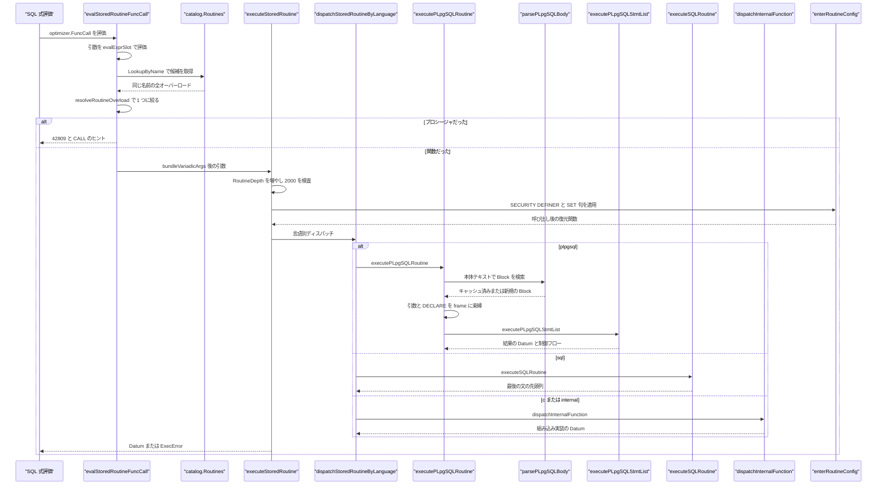
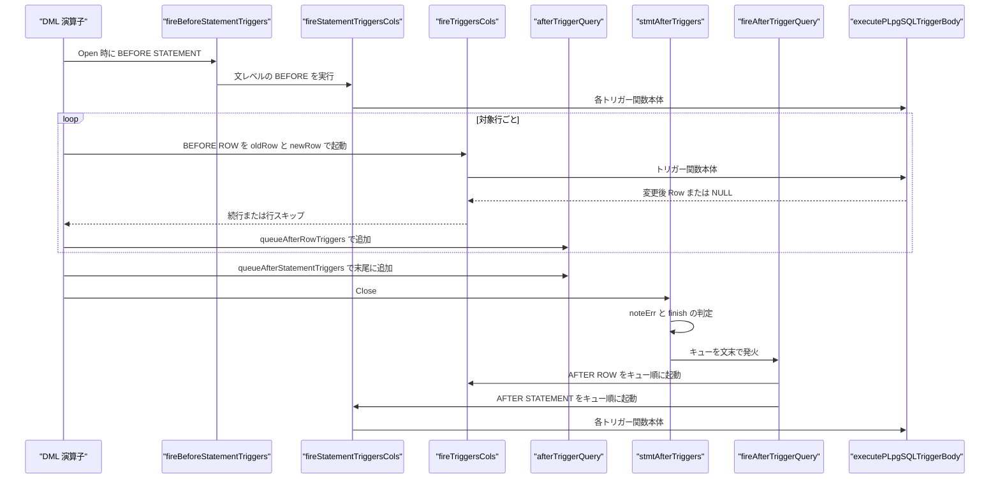

# ストアドルーチンとトリガー

<details>
<summary>関連ソースファイル</summary>

- [`internal/catalog/routines.go`](https://github.com/ryogrid/goopg/blob/19856410e8d497d59787e1ab35a2febb3f5953d6/internal/catalog/routines.go)
- [`internal/catalog/catalog.go`](https://github.com/ryogrid/goopg/blob/19856410e8d497d59787e1ab35a2febb3f5953d6/internal/catalog/catalog.go)
- [`internal/executor/after_trigger.go`](https://github.com/ryogrid/goopg/blob/19856410e8d497d59787e1ab35a2febb3f5953d6/internal/executor/after_trigger.go)
- [`internal/executor/operators_call.go`](https://github.com/ryogrid/goopg/blob/19856410e8d497d59787e1ab35a2febb3f5953d6/internal/executor/operators_call.go)
- [`internal/executor/operators_from_regexp_matches.go`](https://github.com/ryogrid/goopg/blob/19856410e8d497d59787e1ab35a2febb3f5953d6/internal/executor/operators_from_regexp_matches.go)
- [`internal/executor/operators_from_regexp_split_to_table.go`](https://github.com/ryogrid/goopg/blob/19856410e8d497d59787e1ab35a2febb3f5953d6/internal/executor/operators_from_regexp_split_to_table.go)
- [`internal/executor/operators_from_unnest.go`](https://github.com/ryogrid/goopg/blob/19856410e8d497d59787e1ab35a2febb3f5953d6/internal/executor/operators_from_unnest.go)
- [`internal/executor/operators_generated.go`](https://github.com/ryogrid/goopg/blob/19856410e8d497d59787e1ab35a2febb3f5953d6/internal/executor/operators_generated.go)
- [`internal/executor/operators_pg_input_error_info.go`](https://github.com/ryogrid/goopg/blob/19856410e8d497d59787e1ab35a2febb3f5953d6/internal/executor/operators_pg_input_error_info.go)
- [`internal/executor/operators_pg_options_to_table.go`](https://github.com/ryogrid/goopg/blob/19856410e8d497d59787e1ab35a2febb3f5953d6/internal/executor/operators_pg_options_to_table.go)
- [`internal/executor/operators_project_set.go`](https://github.com/ryogrid/goopg/blob/19856410e8d497d59787e1ab35a2febb3f5953d6/internal/executor/operators_project_set.go)
- [`internal/executor/operators_scalar_func_scan.go`](https://github.com/ryogrid/goopg/blob/19856410e8d497d59787e1ab35a2febb3f5953d6/internal/executor/operators_scalar_func_scan.go)
- [`internal/executor/operators_trigger.go`](https://github.com/ryogrid/goopg/blob/19856410e8d497d59787e1ab35a2febb3f5953d6/internal/executor/operators_trigger.go)
- [`internal/executor/operators_ts_token_type.go`](https://github.com/ryogrid/goopg/blob/19856410e8d497d59787e1ab35a2febb3f5953d6/internal/executor/operators_ts_token_type.go)
- [`internal/executor/operators_user_srf_scan.go`](https://github.com/ryogrid/goopg/blob/19856410e8d497d59787e1ab35a2febb3f5953d6/internal/executor/operators_user_srf_scan.go)
- [`internal/executor/plpgsql_bind_ast.go`](https://github.com/ryogrid/goopg/blob/19856410e8d497d59787e1ab35a2febb3f5953d6/internal/executor/plpgsql_bind_ast.go)
- [`internal/executor/plpgsql_runtime.go`](https://github.com/ryogrid/goopg/blob/19856410e8d497d59787e1ab35a2febb3f5953d6/internal/executor/plpgsql_runtime.go)
- [`internal/pl/plpgsql/ast.go`](https://github.com/ryogrid/goopg/blob/19856410e8d497d59787e1ab35a2febb3f5953d6/internal/pl/plpgsql/ast.go)
- [`internal/pl/plpgsql/parser.go`](https://github.com/ryogrid/goopg/blob/19856410e8d497d59787e1ab35a2febb3f5953d6/internal/pl/plpgsql/parser.go)
- [`internal/executor/executor.go`](https://github.com/ryogrid/goopg/blob/19856410e8d497d59787e1ab35a2febb3f5953d6/internal/executor/executor.go)
- [`internal/executor/opnode.go`](https://github.com/ryogrid/goopg/blob/19856410e8d497d59787e1ab35a2febb3f5953d6/internal/executor/opnode.go)
- [`internal/executor/operators_storage.go`](https://github.com/ryogrid/goopg/blob/19856410e8d497d59787e1ab35a2febb3f5953d6/internal/executor/operators_storage.go)

</details>

`internal/catalog/routines.go` はユーザー定義ルーチン（関数・プロシージャ）のプロセス内レジストリであり、`CREATE FUNCTION` / `DROP FUNCTION` の状態、オーバーロード解決用の署名、`pg_proc` の仮想行を支える。`internal/pl/plpgsql` はルーチン本体を PL/pgSQL の AST に落とし、`internal/executor/plpgsql_runtime.go` がその AST を実行する。`internal/executor/operators_trigger.go` と `internal/executor/after_trigger.go` は、テーブルに登録された `catalog.Trigger` を DML の前後で起動し、AFTER トリガーを文末までキューに溜めてから発火する。さらに `internal/executor/operators_call.go` が `CALL`、各種 SRF 演算子が `RETURNS SETOF` や組み込み集合返却関数の行展開を担う。演算子木の共通骨格は [6.1 実行モデルとオペレータ](6.1-Execution-Model.md)、式と Datum の評価は [6.2 式評価と Datum](6.2-Expression-Evaluation.md)、ルーチン本体を呼び出す DML は [6.6 DML と MVCC 書き込み](6.6-DML-and-Writes.md)、`CREATE FUNCTION` / `CREATE TRIGGER` の DDL は [6.7 DDL 実行](6.7-DDL-Execution.md)、`pg_proc` 行の同期は [6.9 システムカタログ同期](6.9-System-Catalog-Sync.md) を参照。PL/pgSQL の構文は SQL レキサと `parser.ParseExpr` を再利用しており、その基盤は [4 SQL パーサー](../4-SQL-Parser.md) にある。

## 責務

- ルーチンの登録・検索・削除。`Routines.Create` がスキーマ名を補完して `Routine` を clone し、`byKey`（schema・name・署名）と `byName`（schema・name）の 2 索引へ登録する。`Lookup`・`LookupByName`・`Drop`・`DropByName`・`ResolveByName` が同じ索引を読む。`path:internal/catalog/routines.go:Routines.Create`
- データベース単位の可視性。`Routines.InDB` が同じ `routineStore` を共有しつつ `db` を束ねたハンドルを返し、`dbFor` が明示 `dbOid` → ハンドルの DB → `DefaultDBOid` の順で解決する。`routineKey` は `<dbOid>\x00schema.name(sig)` をキーにする。`path:internal/catalog/routines.go:Routines.InDB`
- オーバーロードの同一性判定。`Routine.Signature` が引数型名を小文字化して `(a,b,…)` を作り、`mode == "o"` の OUT 引数を除外する。`NumInputArgs` は pronargs 相当で OUT を数えない。`path:internal/catalog/routines.go:Routine.Signature`
- 呼び出し時の型解決。`resolveRoutineOverload` が `callArgTypesForCandidate` で候補ごとの引数型を作り、`routineArgsCompatible` で `coerceDatumToType` が通る候補だけを残し、ポリモルフィック型より具体型を、次に Datum 種別の完全一致を優先する。`path:internal/executor/plpgsql_runtime.go:resolveRoutineOverload`
- 言語別の実行。`executeStoredRoutine` が再帰深さと SET 句・SECURITY DEFINER の適用を行い、`dispatchStoredRoutineByLanguage` が `plpgsql` / `sql` / `c` / `internal` に振り分ける。`path:internal/executor/plpgsql_runtime.go:executeStoredRoutine`
- PL/pgSQL 本体の構文解析。`plpgsql.Parse` が SQL レキサ `parser.Lex` でトークン化し、`parseTopBlock` が `[DECLARE …] BEGIN … END` を `*Block` にする。`parseStmt` が `IF` / `LOOP` / `FOR` / `PERFORM` / `EXECUTE` / `RAISE` / 埋め込み SQL などを各 `Stmt` に振り分ける。`path:internal/pl/plpgsql/parser.go:Parse`
- PL/pgSQL の実行。`executePLpgSQLRoutine` が引数と `DECLARE` を `plpgsqlFrame` に束縛し、`executePLpgSQLStmtList` が文を順に実行する。例外ブロックは `ExceptionBlock` の `TryBody` を実行し、失敗時に `exceptionHandlerMatches` でハンドラを選ぶ。`path:internal/executor/plpgsql_runtime.go:executePLpgSQLRoutine`
- SQL 言語ルーチン。`executeSQLRoutine` が本体を `parser.Parse` し、最後の文の先頭列を戻り値にする。`executeSQLProcedureCore` は複数文を副作用として実行し、最後の行を OUT パラメータへ返す。`path:internal/executor/plpgsql_runtime.go:executeSQLRoutine`
- `CALL` の引数整合。`callOp.Open` が `LookupByName` の全オーバーロードから引数個数・OUT プレースホルダ・既定値・VARIADIC を考慮して 1 つを選び、`Next` が SQL / PL/pgSQL のプロシージャ本体を実行して OUT 行を組み立てる。`path:internal/executor/operators_call.go:callOp.Open`
- 集合返却関数の行展開。`userSrfScanOp` が `evalPLpgSQLFunctionSetof` / `evalSQLFunctionSetof` の結果を 1 行ずつ返し、`projectSetOp` が SELECT リスト内の複数 SRF を zip する。`path:internal/executor/operators_user_srf_scan.go:userSrfScanOp.Open`
- FROM 句の関数結果列。`RoutineResultColumns` が OUT / INOUT / RETURNS TABLE の列を優先し、なければ複合戻り型の列、最後にスカラー戻り型 1 列を返す。`colAliases` は位置ごとに列名を上書きする。`path:internal/catalog/routines.go:RoutineResultColumns`
- 組み込み SRF の専用演算子。`regexp_matches`、`regexp_split_to_table`、`unnest`、`pg_input_error_info`、`pg_options_to_table`、`ts_token_type` がそれぞれ FROM 句の行集合を作る。`path:internal/executor/operators_from_unnest.go:fromUnnestOp.Open`
- トリガー定義の発火判定。`catalog.Trigger` の `Timing`・`Events`・`ForEachRow`・`UpdateColumns`・`WhenExpr`・`Enabled` を使い、`triggerFireOrder` が名前のバイト順に発火順を決める。`path:internal/executor/operators_trigger.go:triggerFireOrder`
- トリガー関数の実行。`fireTriggersCols` が行レベル、`fireStatementTriggersCols` が文レベルを担当し、`executePLpgSQLTriggerBody` が OLD/NEW と `TG_*` をフレームへ注入して本体を走らせる。`path:internal/executor/operators_trigger.go:executePLpgSQLTriggerBody`
- AFTER トリガーの文末発火。`queueAfterRowTriggers` / `queueAfterStatementTriggers` が文ごとの `afterTriggerQuery` にイベントを積み、`fireAfterTriggerQuery` がキュー順に発火する。`path:internal/executor/after_trigger.go:fireAfterTriggerQuery`
- 生成列と DEFAULT の式評価。`computeGeneratedColumns` と `applyDefaultsForMissing` が書き込み行のスロットを埋める。ルーチン本体ではないが、同じ「保存された式を実行時に評価する」経路を共有する。`path:internal/executor/operators_generated.go:computeGeneratedColumns`

## 処理フロー

### 関数呼び出しの経路

`SELECT f(...)` の式評価中に `optimizer.FuncCall` がユーザー定義関数へ解決されると、`evalStoredRoutineFuncCall` が呼ばれる。ここで引数式を `evalExprSlot` で評価し、`routineRegistry(ctx)` から得た `catalog.Routines` に対して `resolveRoutineOverload` を呼ぶ。解決結果がプロシージャなら `42809` と「CALL を使え」というヒントを返し、関数なら `bundleVariadicArgs` の後に `executeStoredRoutine` へ進む。`path:internal/executor/plpgsql_runtime.go:evalStoredRoutineFuncCall`

`executeStoredRoutine` は `ctx.RoutineDepth` を増やして `maxRoutineCallDepth`（2000）を検査し、`enterRoutineConfig` で SECURITY DEFINER のユーザー切替と `Routine.Config` の GUC を適用する。その後 `dispatchStoredRoutineByLanguage` が言語を選ぶ。PL/pgSQL なら `executePLpgSQLRoutine` が `parsePLpgSQLBody` で `*plpgsql.Block` を取得し（本体テキストをキーに `plpgsqlBlockCache` へキャッシュ）、引数・OUT 変数・`DECLARE` を `plpgsqlFrame` に登録して `executePLpgSQLStmtList` を呼ぶ。`path:internal/executor/plpgsql_runtime.go:executePLpgSQLRoutine`



PL/pgSQL の文実行では、`AssignStmt` がフレームの値を書き換え、`SQLStmt` が `execPLpgSQLEmbeddedSQL` で埋め込み SQL を計画・実行し、`SelectIntoStmt` が最初の行を `bindSelectIntoRow` で変数へ束縛する。`PerformStmt` はスカラー式なら評価だけを行い、クエリ形なら `SELECT <query>` として実行して `FOUND` と `rowCount` を更新する。`ReturnStmt` は通常関数では `flowReturn`、トリガー文脈では `RETURN OLD` / `RETURN NEW` / `RETURN NULL` を `flowReturnTriggerOld` / `flowReturnTriggerNew` / `flowReturnTriggerNull` に変換する。`path:internal/executor/plpgsql_runtime.go:executePLpgSQLStmt`

### トリガー発火と AFTER キューの経路

DML 演算子は `Open` の先頭で `fireBeforeStatementTriggers` を呼び、行ループの中で BEFORE ROW を `fireTriggersCols` で起動する（UPDATE では `updateTargetColumns` が作る `updCols` を渡す）。各行の書き込み後には `queueAfterRowTriggers` を呼び、ループ終了後に `queueAfterStatementTriggers` を呼ぶ。AFTER イベントはすぐには実行されず、文のルートが `Close` したときに `stmtAfterTriggers.finish` から `fireAfterTriggerQuery` でまとめて発火する。`path:internal/executor/operators_storage.go:insertOp.Open`



`stmtAfterTriggers` は `stmtCTEScopeOp` と `OpIterator` の両方に埋め込まれている。`swapIn` が文のあいだだけ `ctx.afterTrigQuery` をそのレベルの `*afterTriggerQuery` に差し替え、`swapOut` が呼び出し元のレベルを戻す。`Open` または `Next` が `EOF` 以外のエラーを返すと `noteErr` が `failed` を立て、`finish` は `Close` が成功していてもキューを発火しない。これは PostgreSQL の `AfterTriggerAbortQuery` に相当し、文が途中で失敗したときに AFTER トリガーを走らせない。`path:internal/executor/executor.go:stmtCTEScopeOp.Close`

`fireBeforeStatementTriggers` は同じクエリレベルで同じテーブル・同じイベントの BEFORE STATEMENT を一度しか発火しない（`bsFired`）。`queueAfterStatementTriggers` は同じキーの既存の文レベルイベントを取り除いてから末尾に追加するため、書き込み可能 CTE などで同じテーブルへ複数回 DML しても AFTER STATEMENT は 1 回だけになる。`queueAfterRowTriggers` は `oldRow` / `newRow` を `cloneRow` で複製してからキューへ積むので、後続の DML が行バッファを再利用してもイベントの内容は変わらない。`path:internal/executor/after_trigger.go:queueAfterStatementTriggers`

### CALL の経路

`CALL` は `optimizer.Call` から `callOp` を作る。`callOp.Open` は `LookupByName` の結果を総当たりし、宣言上の IN + INOUT + VARIADIC 個数と、呼び出し側が OUT プレースホルダまで書いた場合の全個数を突き合わせる。名前付き引数は `st.ArgNames` を使って宣言順に並べ替え、OUT 位置の式は評価結果を捨てて `NullDatum` にし、不足分は `r.ArgDefaults` を `evalCallDefault` で評価して埋める。VARIADIC は残りの実引数を `buildArrayDatum` で 1 つの配列にまとめる。`path:internal/executor/operators_call.go:callOp.Open`

`callOp.Next` は SQL 言語プロシージャなら `executeSQLProcedureReturning`、それ以外なら `parsePLpgSQLBody` で本体を解析して `executePLpgSQLStmtList` を直接実行する。プロシージャに `SET` 句がある場合は `child.PLpgSQLCommitChain = nil` にして原子的に実行し、本体内の `COMMIT` / `ROLLBACK` を `2D000` にする。`path:internal/executor/operators_call.go:callOp.Next`

### SETOF と SRF の経路

PL/pgSQL の `RETURNS SETOF` は `RETURN NEXT` のたびに `frame.returnNextRows` へ値を追加し、`evalPLpgSQLFunctionSetof` が本体終了後にそのスライスを返す。SQL 言語の `RETURNS SETOF` は `evalSQLFunctionSetof` が最後の文の全行を集める。`FROM f(...)` では `userSrfScanOp` が、SELECT リストでは `projectSetOp` がこの結果を受け取り、複数の SRF がある場合は長い方に合わせて短い方を NULL で埋めながら zip する。SETOF でない複合戻り値関数の FROM 句呼び出しは `scalarFuncScanOp` が 1 行だけ返し、複数列なら `decomposeCompositeText` で列ごとの値に分解する。`path:internal/executor/plpgsql_runtime.go:evalPLpgSQLFunctionSetof`

## 主要ファイル

| ファイル | 役割 |
|---|---|
| `internal/catalog/routines.go` | ルーチンレジストリ、署名、オーバーロード索引、OR REPLACE・DROP・RENAME・SET SCHEMA・SET 句の適用。`path:internal/catalog/routines.go:Routines` |
| `internal/catalog/catalog.go` | テーブルに保持される `catalog.Trigger` と `TriggerTiming`、`FireMode`。`path:internal/catalog/catalog.go:Trigger` |
| `internal/executor/operators_call.go` | `CALL` のオーバーロード選択、OUT / 既定値 / VARIADIC の整合、プロシージャ本体の実行。`path:internal/executor/operators_call.go:callOp` |
| `internal/executor/operators_trigger.go` | BEFORE/AFTER の行・文トリガー発火、`WHEN` 条件、`UPDATE OF`、`tgenabled`。`path:internal/executor/operators_trigger.go:fireTriggersCols` |
| `internal/executor/after_trigger.go` | 文ごとの AFTER トリガーキュー、BEFORE/AFTER STATEMENT の重複制御、エラー時の破棄。`path:internal/executor/after_trigger.go:fireAfterTriggerQuery` |
| `internal/executor/plpgsql_runtime.go` | PL/pgSQL / SQL ルーチンの実行、フレーム、オーバーロード解決、トリガー変数注入、SETOF。`path:internal/executor/plpgsql_runtime.go:executeStoredRoutine` |
| `internal/executor/plpgsql_bind_ast.go` | サブリンクを含む式へフレーム変数を型付きリテラルとして差し込む copy-on-write 書き換え。`path:internal/executor/plpgsql_bind_ast.go:bindPlpgsqlFrameVarsInExpr` |
| `internal/pl/plpgsql/ast.go` | `Stmt` インタフェースと各文ノード、`Block`、`Declaration`。`path:internal/pl/plpgsql/ast.go:Block` |
| `internal/pl/plpgsql/parser.go` | `BEGIN`/`END` 本体、制御構文、埋め込み SQL、`RETURN` 系のパーサ。`path:internal/pl/plpgsql/parser.go:Parse` |
| `internal/executor/operators_user_srf_scan.go` | ユーザー定義 SETOF 関数を FROM 句の行集合にする。`path:internal/executor/operators_user_srf_scan.go:userSrfScanOp` |
| `internal/executor/operators_scalar_func_scan.go` | スカラー / 複合戻り値関数を FROM 句の 1 行にする。`path:internal/executor/operators_scalar_func_scan.go:scalarFuncScanOp` |
| `internal/executor/operators_project_set.go` | SELECT リスト内の SRF 群を子行ごとに評価して zip する。`path:internal/executor/operators_project_set.go:projectSetOp` |
| `internal/executor/operators_from_unnest.go` | `FROM unnest(...)` の配列展開と要素型の補正。`path:internal/executor/operators_from_unnest.go:fromUnnestOp` |
| `internal/executor/operators_from_regexp_matches.go` | `FROM regexp_matches(...)` を行集合にする。`path:internal/executor/operators_from_regexp_matches.go:fromRegexpMatchesOp` |
| `internal/executor/operators_from_regexp_split_to_table.go` | `FROM regexp_split_to_table(...)` を行集合にする。`path:internal/executor/operators_from_regexp_split_to_table.go:fromRegexpSplitToTableOp` |
| `internal/executor/operators_pg_input_error_info.go` | `pg_input_error_info` の型検証と 1 行結果。`path:internal/executor/operators_pg_input_error_info.go:pgInputErrorInfoOp` |
| `internal/executor/operators_pg_options_to_table.go` | `pg_options_to_table` の `name=value` 展開。`path:internal/executor/operators_pg_options_to_table.go:pgOptionsToTableOp` |
| `internal/executor/operators_ts_token_type.go` | `ts_token_type` の組み込みパーサ・トークン表。`path:internal/executor/operators_ts_token_type.go:tsTokenTypeOp` |
| `internal/executor/operators_generated.go` | `GENERATED ALWAYS AS ... STORED` と DEFAULT の式評価。`path:internal/executor/operators_generated.go:evalGenExpr` |

## 公開 API / エントリポイント

```go
func NewRoutines() *Routines
func (rs *Routines) InDB(dbOid uint32) *Routines
func (rs *Routines) Create(r *Routine, orReplace bool) (*Routine, error)
func (rs *Routines) CreateDuringRecovery(r *Routine) *Routine
func (rs *Routines) Lookup(name parser.ObjectName, argTypes []Type, dbOid ...uint32) (*Routine, bool)
func (rs *Routines) LookupWithArgModes(name parser.ObjectName, argTypes []Type, argModes []string, dbOid ...uint32) (*Routine, bool)
func (rs *Routines) LookupByName(name parser.ObjectName, dbOid ...uint32) []*Routine
func (rs *Routines) Drop(name parser.ObjectName, argTypes []Type, dbOid ...uint32) error
func (rs *Routines) DropByName(name parser.ObjectName, dbOid ...uint32) error
func (rs *Routines) DropRoutine(r *Routine) error
func (rs *Routines) ResolveByName(name parser.ObjectName, dbOid ...uint32) (*Routine, error)
func (rs *Routines) ResolveBySig(name parser.ObjectName, argTypes []Type, dbOid ...uint32) (*Routine, error)
func (rs *Routines) RenameRoutine(r *Routine, newName string) error
func (rs *Routines) SetSchema(r *Routine, newSchema string) error
func (rs *Routines) List() []*Routine
func (rs *Routines) LookupByOID(oid uint32) *Routine
func RoutineResultColumns(cat Catalog, r *Routine, alias string, colAliases []string) []Column
func ApplyFunctionConfigOps(cfg []string, ops []parser.FunctionConfigOp) []string

func Parse(src string) (*Block, error) // internal/pl/plpgsql

func BeginAfterTriggerQuery(ctx *Context) func(fire bool) error // internal/executor
```

executor 内部の主な入口は、式評価から呼ばれる `evalStoredRoutineFuncCall`、`CALL` の `newCallOp`、SETOF の `evalPLpgSQLFunctionSetof` / `evalSQLFunctionSetof`、トリガーの `fireTriggersCols` / `fireStatementTriggersCols` / `executePLpgSQLTriggerBody`、AFTER キューの `BeginAfterTriggerQuery` である。

## 主要データ構造

### `catalog.Routine`

ルーチン 1 件のカタログ表現。`OID` がプロセス内の識別子、`DBOid` がレジストリのデータベース名前空間を決め、`ArgTypes` / `ArgModes` / `ArgNames` などが並行配列になっている。

```go
// Routine is one user-defined routine (function in Stage A;
// procedures join in Stage B). Stored verbatim — the analyzer /
// PL/pgSQL interpreter consumes ArgTypes / ReturnType / Language /
// Body once those slices land.
type Routine struct {
	OID             uint32
	Schema          string
	Name            string
	ArgNames        []string // parallel to ArgTypes; empty string for positional-only args
	ArgTypes        []Type
	// ArgTypeSchemas is parallel to ArgTypes: the namespace each argument type
	// was declared in at CREATE FUNCTION/PROCEDURE ("" when unknown — a BARE
	// type name, whose owner schema goopg's user-type store cannot resolve, or a
	// pre-73rd reloaded routine that predates this field). Consulted ONLY by the
	// regprocedure output path (format_type_be arg-type qualification, deferral
	// row 1342): Signature() compares ArgTypes[i].Name only, so overload
	// resolution / ALTER/DROP lookups are unaffected.
	ArgTypeSchemas   []string
	// ArgTypeOIDs is parallel to ArgTypes: the resolved pg_type OID for each
	// argument type, NON-ZERO only for the one ambiguous spelling `char` AND its
	// array forms (a bare `char` → OIDBpChar 1042, a quoted `"char"` → OIDChar
	// 18 — deferral row 1351; bare `char[]` → OIDArrayBpChar 1014, quoted
	// `"char"[]` → OIDArrayChar 1002 — deferral row 1364). Every other spelling
	// (including non-char arrays like int4[]) is 0: its name-based
	// ArgTypeDisplayAlias is already a faithful format_type_be port, and
	// buildPGProcRow's TypeNameToOID fallback resolves a baked `[]` name to the
	// ARRAY OID, so carrying a name-derived OID would add nothing. Consulted by
	// the regprocedure/pg_get_function_* output paths and the proargtypes/
	// prorettype emission; Signature() and overload resolution are unaffected.
	ArgTypeOIDs      []uint32 `json:",omitempty"`
	ArgModes        []string // parallel to ArgTypes; "i"=IN, "o"=OUT, "b"=INOUT, "v"=VARIADIC; nil=all IN
	ArgDefaults     []string // parallel to ArgTypes; raw SQL expression for DEFAULT, "" = no default
	ReturnType      Type
	// ReturnTypeOID is the resolved pg_type OID for the RETURN type, NON-ZERO
	// only for the one ambiguous spelling `char` AND its array forms (a bare
	// `char` → OIDBpChar 1042, a quoted `"char"` → OIDChar 18 — deferral row
	// 1361, sibling of ArgTypeOIDs/row 1351; bare `char[]` → OIDArrayBpChar
	// 1014, quoted `"char"[]` → OIDArrayChar 1002 — deferral row 1364). Every
	// other spelling (including non-char arrays like int4[]) is 0: TypeNameToOID's
	// name-based map (now array-correct) is already a faithful fallback, so a
	// name-derived OID would add nothing. Consulted ONLY by the
	// pg_get_function_result / pg_get_functiondef renderers and the pg_proc
	// prorettype column; signature/overload semantics are unaffected.
	ReturnTypeOID   uint32
	ReturnsSet      bool   // RETURNS SETOF ... M0097-0020
	ReturnsTable    bool   // RETURNS TABLE (...) — table cols stored as trailing OUT args
	Language        string // lower-cased
	Body            string // raw routine source between the dollar-quote delimiters
	Strict          bool   // STRICT / CALLED ON NULL INPUT
	Volatile        string // "v"=volatile (default), "s"=stable, "i"=immutable
	Parallel        string // proparallel: "u"=unsafe (default), "s"=safe, "r"=restricted
	Cost            string // procost: COST n override; "" = language default (1 internal/C, else 100)
	Rows            string // prorows: ROWS n override for SRFs; "" = default (1000 for SRF, 0 otherwise)
	SecurityDefiner bool   // SECURITY DEFINER
	Leakproof       bool   // LEAKPROOF
	IsProcedure     bool   // true when created via CREATE PROCEDURE
	IsWindow        bool   // true when created with WINDOW attribute
	BeginAtomic     bool   // PG14 BEGIN ATOMIC ... END body (no AS keyword)
	IsReturnForm    bool   // PG14 RETURN expr body (stored as "SELECT expr" internally)
	KindChar        string // prokind: 'f'=function, 'p'=procedure, 'w'=window, 'a'=aggregate
	// Aggregate carries the full UserAggregate definition on the
	// synthesized prokind='a' pg_proc row (B2.2 slice 2). It rides the
	// proargdefaults JSON meta only (never the registry — aggregates live
	// in userAggregates): the physical pg_aggregate columns store proc
	// OIDs, which are 0 for builtin transition functions outside the
	// hand-curated BuiltinProc set, so the startup reload rebuilds the
	// registry from these names instead of a lossy OID reversal.
	Aggregate *UserAggregate `json:",omitempty"`
	// Owner is pg_proc.proowner (role OID), settable via ALTER FUNCTION/
	// PROCEDURE/ROUTINE ... OWNER TO. 0 means "unset, defaults to the
	// bootstrap superuser" — see OwnerOrDefault. M0097-0150.
	Owner uint32

	// Config is pg_proc.proconfig: a list of "name=value" per-function GUC
	// overrides set via CREATE FUNCTION's SET clause or ALTER FUNCTION/
	// PROCEDURE/ROUTINE ... SET/RESET, in insertion order (mirrors
	// InMemory's role/database-level roleSettings shape). nil renders as SQL
	// NULL (matches upstream: a routine that never had a SET clause has no
	// proconfig row at all). Applied around each call by the executor's
	// enterRoutineConfig (M0146-0155); see
	// docs/design/0100-0149/m0146-0155-function-set-clauses.md.
	Config []string

	// Dependency tracking populated at CREATE FUNCTION time for information_schema views.
	SequenceDeps    []RoutineSeqDep   // sequences referenced via nextval/currval
	RoutineCallOIDs []uint32          // OIDs of routines called in body/defaults
	TableDeps       []RoutineTableRef // tables referenced in FROM clauses
	ColumnDeps      []RoutineColRef   // columns referenced in SELECT/WHERE clauses

	// DBOid is the database this routine was CREATE FUNCTION/PROCEDURE'd
	// under (mirrors catalog.Domain.DBOid/EnumType.DBOid). The registry key
	// folds this in (routineKey/nameKey) so two distinct databases may each
	// register a same-named routine without colliding. Zero is normalized to
	// DefaultDBOid by Create/CreateDuringRecovery, matching every other
	// dbOid-scoped registry's convention. M0119-0004 DU-002 follow-up
	// (M0122-0007 4e-shaped fix, mirrors follow-up 36/37's ForeignServer/
	// UserMapping DBOid fields).
	DBOid uint32
}
```

`ArgNames`・`ArgTypes`・`ArgTypeSchemas`・`ArgTypeOIDs`・`ArgModes`・`ArgDefaults` はすべて `ArgTypes` と同じ長さを持つ並行配列である。`ArgModes` が nil のときは全引数が IN とみなされる。`Signature()` は `ArgTypes[i].Name` を小文字化して連結するだけで、OUT（`"o"`）を除外する。したがって `RETURNS TABLE (...)` の列は末尾の OUT 引数として `ArgTypes` に入るが、関数呼び出しの引数個数には数えられない。`OID` は `FirstRoutineOID`（`1 << 17`）から単調増加で割り当てられ、`CREATE OR REPLACE` でも保持される。`DBOid` はレジストリキーの先頭に埋め込まれ、同じ名前・署名でもデータベースが違えば衝突しない。

### `catalog.Trigger`

テーブルごとのトリガー定義。`TableOID` が対象テーブルを指し、`Name` が同じイベント内の発火順を決める。`FuncName` / `FuncSchema` が実行するルーチンを指す。

```go
// Trigger describes one row-level or statement-level trigger on a table.
// M0096-0012.
type Trigger struct {
	Name string
	// OID is the trigger's pg_trigger.oid, assigned from the catalog OID
	// counter at CREATE TRIGGER time. pg_dump's getTriggers selects
	// pg_get_triggerdef(t.oid, false), so a zero OID means the trigger is
	// invisible to pg_dump (predates OID tracking). DU-002 slice 319.
	OID      uint32
	TableOID uint32
	Timing   TriggerTiming
	Events   []string // "insert", "update", "delete", "truncate"
	// UpdateColumns is the optional `UPDATE OF col1, col2` column list of a
	// column-specific UPDATE trigger; empty for every other form. pg_dump's
	// pg_get_triggerdef appends ` OF <cols>` right after the UPDATE event and
	// pg_trigger.tgattr carries the column attnums. DU-002 slice 326.
	UpdateColumns []string
	// IsConstraint marks a CREATE CONSTRAINT TRIGGER. pg_get_triggerdef emits
	// `CREATE CONSTRAINT TRIGGER` (instead of `CREATE TRIGGER`) and a
	// `[NOT ]DEFERRABLE INITIALLY {IMMEDIATE|DEFERRED}` clause after the ON-table
	// name. ConstraintOID is the pg_constraint OID PG implicitly creates for the
	// trigger (contype 't'); it feeds pg_trigger.tgconstraint so the trigger is
	// recognised as a constraint trigger. goopg does NOT enforce constraint-
	// trigger semantics — this is dump fidelity only. DU-002 slice 327.
	IsConstraint  bool
	Deferrable    bool
	InitDeferred  bool
	ConstraintOID uint32
	// OldTransitionTable / NewTransitionTable are the REFERENCING clause's
	// `OLD TABLE AS <name>` / `NEW TABLE AS <name>` transition-relation names.
	// pg_dump's pg_get_triggerdef emits `REFERENCING OLD TABLE AS … NEW TABLE
	// AS …` between the ON-table name and FOR EACH ROW; pg_trigger.tgoldtable /
	// tgnewtable carry the names. goopg records them for dump fidelity only — the
	// transition tables are not materialised. DU-002 slice 328.
	OldTransitionTable string
	NewTransitionTable string
	// WhenExpr is the parsed `WHEN (condition)` qualification (an OLD/NEW-aware
	// boolean expression), nil when absent. pg_dump's pg_get_triggerdef re-emits
	// `WHEN (…)` between FOR EACH and EXECUTE FUNCTION; PG stores it as a node tree
	// in pg_trigger.tgqual. goopg keeps the parsed expression for dump fidelity
	// only — the condition is not evaluated at trigger-firing time. DU-002 slice 329.
	WhenExpr   parser.Expr
	ForEachRow bool
	FuncName   string // function/procedure name (unschemed)
	FuncSchema string
	Args       []string // trigger function arguments (TG_ARGV)
	// Enabled is pg_trigger.tgenabled: 'O' fires in origin and local
	// session_replication_role, 'R' only in replica, 'A' always, 'D' never.
	// 0 means 'O', the CREATE TRIGGER default. Read it through FireMode.
	// M0146-0082.
	Enabled byte
}
```

`Events` は小文字の `"insert"` / `"update"` / `"delete"` / `"truncate"` を保持し、`triggerMatchesEvent` が `strings.EqualFold` で照合する。`ForEachRow` が true なら行レベル、false なら文レベルで、両者は別々の関数（`fireTriggersCols` と `fireStatementTriggersCols`）が処理する。`UpdateColumns` は `UPDATE OF` のときだけ入り、`triggerColumnsMatch` が更新対象列集合と交差するかを見る。`WhenExpr` は `triggerWhenPasses` が OLD/NEW をリテラルへ書き換えて評価する（構造体コメントには dump fidelity only とあるが、executor 側は実際に評価する）。`Enabled` の 0 は `TriggerFireMode` により `'O'` に正規化され、`'D'` は決して発火しない。

### `plpgsql.Stmt` と `plpgsql.Block`

PL/pgSQL 本体の AST。すべての文が `Pos()` と `plpgsqlStmtNode()` を持ち、`Block` がトップレベルの宣言と文列を保持する。

```go
// Stmt is a PL/pgSQL routine-body statement node. Implementations
// must be value-comparable enough that future interpreter tests
// can equality-check expected shapes; the embedded `pos` keeps
// error messages pointed at the source.
type Stmt interface {
	// Pos returns the 0-based byte offset within the routine body
	// where this statement begins.
	Pos() int
	plpgsqlStmtNode()
}

// Block is the upstream PL/pgSQL block:
//
//	[ DECLARE <declarations> ]
//	BEGIN
//	    <statements>
//	END [ ';' ]
//
// Stage A 4a accepted the BEGIN/END skeleton with RETURN as the only
// statement; 4b adds the optional DECLARE prefix and assignment so
// trivial functions with locals (`x := 1; RETURN x;`) parse. Label
// and EXCEPTION-block forms remain Stage A 4d+ scope.
type Block struct {
	pos          int
	Declarations []*Declaration
	Statements   []Stmt
}

func (b *Block) Pos() int         { return b.pos }
func (b *Block) plpgsqlStmtNode() {}

// Declaration is one entry in a `DECLARE` section:
//
//	varname [CONSTANT] type [NOT NULL] [DEFAULT expr | := expr] ';'
//
// Stage A 4b drops CONSTANT and NOT NULL — both surface a clean
// "Stage A 4b" diagnostic so handwritten PL/pgSQL using them gets
// a specific message instead of a generic syntax error. The future
// 4c slice extends `Declaration` with the missing fields rather
// than reshape the struct.
type Declaration struct {
	pos     int
	Name    string
	Type    parser.ColumnType
	Default parser.Expr // nil when no DEFAULT / := initializer
}
```

`Block.Statements` は実行順に並び、`executePLpgSQLStmtList` が先頭から評価する。各 `Stmt` は `ReturnStmt`・`AssignStmt`・`IfStmt`・`LoopStmt`・`SQLStmt`・`ExceptionBlock` などの具体型で、`executePLpgSQLStmt` が型スイッチで実行する。`Block.Declarations` は `DECLARE` の順序を保ち、`Default` が nil なら NULL で初期化される。`pos` は本体先頭からのバイト位置で、エラー報告に使われる。

### `plpgsqlFrame`

1 回のルーチン呼び出しのローカル変数フレーム。名前は小文字化されて行スロットに写される。

```go
// plpgsqlFrame is the local variable frame for one routine call.
// Names are case-insensitive and map to row slots consumed by evalExpr.
type plpgsqlFrame struct {
	indexByName    map[string]int
	types          []catalog.Type
	values         Row
	// trig is non-nil when this frame is for a trigger function body.
	// M0096-0012.
	trig *plpgsqlTrigCtx
	// returnNextRows accumulates values from RETURN NEXT for SETOF
	// functions. M0097-0073.
	returnNextRows []Datum
	// compositeVarFields maps lower-case variable name → ordered field list
	// for variables declared as composite types.  Populated at DECLARE time
	// (and for function arguments) so that field access / assignment works
	// inside the PL/pgSQL body. M0097-composite.
	compositeVarFields map[string][]catalog.CompositeField
	// found is the PL/pgSQL special FOUND boolean for this frame. It is set
	// by SQL-issuing statements (PERFORM, SELECT INTO, embedded DML, …) to
	// whether the underlying query produced at least one row, and read via a
	// bare `FOUND` reference. M0118-0009 (design 0118-0097).
	found bool
	// rowCount is PG's estate->eval_processed: the rows the last SQL
	// statement, PERFORM or dynamic EXECUTE processed, read by GET
	// DIAGNOSTICS … = ROW_COUNT (M0146-0081).
	rowCount int64
	// caughtErr is the error an active exception handler is handling
	// (estate->cur_error), read by GET STACKED DIAGNOSTICS; nil outside a
	// handler.
	caughtErr *ExecError
	// outParamNames lists the OUT / INOUT / RETURNS TABLE parameter names of
	// this routine. They are registered as ordinary NULL frame variables (see
	// the ArgModes loop in the frame builder), which makes them indistinguishable
	// from a local — but they are *result column names* by construction, so a
	// `RETURN QUERY select a from t` in a `RETURNS TABLE (a int)` function must
	// resolve `a` to the table column, not to the always-NULL variable.
	// PostgreSQL settles the same collision with plpgsql.variable_conflict
	// (default `error`); goopg's text substitution cannot detect ambiguity, so
	// it keeps the column — the pre-existing behaviour and the only one that
	// does not silently NULL out the query. M0134-0172.
	outParamNames []string
}
```

`indexByName` のキーは `strings.ToLower(strings.TrimSpace(name))` で、`values` と `types` は同じ添字を共有する。トリガー実行時には `injectTriggerVars` が列ごとに `_old_<col>` / `_new_<col>` を追加するため、`OLD.col` と `NEW.col` は通常の変数参照と同じ経路で解決される。`trig` が非 nil のとき、`ReturnStmt` はトリガー専用の制御フローを返す。`returnNextRows` は `RETURN NEXT` の蓄積先で、SETOF 関数の結果になる。`found` / `rowCount` は SQL 文・`PERFORM`・`SELECT INTO` のたびに更新される。

### `plpgsqlTrigCtx`

トリガー 1 回分の入力。OLD/NEW 行と `TG_*` の値の源泉である。

```go
// plpgsqlTrigCtx holds the trigger execution context injected into
// trigger function frames. M0096-0012.
type plpgsqlTrigCtx struct {
	OldRow  Row
	NewRow  Row
	Cols    []catalog.Column // table columns (both OLD and NEW use the same schema)
	TGName  string
	TGWhen  string // "before" or "after"
	TGOp    string // "insert", "update", "delete", "truncate"
	TGLevel string // "row" or "statement"
	TGTable string
	TGArgs  []string // trigger function arguments (TG_ARGV)
}
```

`OldRow` は INSERT と文レベルで nil、`NewRow` は DELETE と文レベルで nil になる。`Cols` は OLD/NEW 共通の列定義で、行の添字と列の添字を対応させる。`TGWhen` と `TGOp` はトリガー発火関数が `strings.ToUpper` した値（`"BEFORE"` / `"INSERT"` など）を入れる。`TGLevel` は行レベルなら `"ROW"`、文レベルなら `"STATEMENT"`。`TGArgs` は `CREATE TRIGGER ... EXECUTE FUNCTION f('a','b')` の引数で、`tg_argv` 配列として注入される。

### `afterTriggerEvent` と `afterTriggerQuery`

AFTER トリガーの文単位キュー。イベントは行レベルと文レベルの両方を同じスライスに積む。

```go
// afterTriggerEvent is one queued AFTER trigger event. stmt marks a
// statement-level event, which carries no rows.
type afterTriggerEvent struct {
	tbl    *catalog.Table
	event  string
	stmt   bool
	oldRow Row
	newRow Row
	// updCols is an UPDATE event's target column set
	// (updateTargetColumns); nil when unknown or for other events.
	updCols map[string]bool
}

type stmtTriggerKey struct {
	oid   uint32
	name  string
	event string
}

// afterTriggerQuery is one query level's trigger state.
type afterTriggerQuery struct {
	events  []afterTriggerEvent
	bsFired map[stmtTriggerKey]bool
}
```

`events` は発火順そのもので、`fireAfterTriggerQuery` は先頭から順に処理する。`stmt` が true のイベントは `oldRow` / `newRow` を持たず、`fireStatementTriggersCols` に渡される。行レベルイベントは `queueAfterRowTriggers` が `cloneRow` した行を保持する。`updCols` が nil のときは更新対象列が不明という意味で、`triggerColumnsMatch` は列指定トリガーを発火させる。`bsFired` は `(OID, schema.name, event)` をキーに BEFORE STATEMENT の既発火を記録する。

## 内部構造

**レジストリの 2 索引。** `routineStore` は `byKey`（`<dbOid>\x00schema.name(署名)` → `*Routine`）と `byName`（`<dbOid>\x00schema.name` → 署名キーの一覧）を持つ。`Create` は新規作成時だけ `byName` にキーを追加し、`CREATE OR REPLACE` では `byKey` の値を差し替えるだけで `byName` は触らない。`RenameRoutine` と `SetSchema` は名前・スキーマがキーに埋まっているため、旧キーを消して新キーを入れ直す。`Drop` 系は `byName` の一覧から該当キーを除去し、空になった名前キーを削除する。`path:internal/catalog/routines.go:routineStore`

**clone-on-write。** `Create` / `CreateDuringRecovery` は受け取った `*Routine` をコピーしてから登録する。呼び出し側が後から元の構造体を書き換えてもレジストリの内容は変わらない。`CREATE OR REPLACE` では既存の `OID` と `Owner` をコピー先へ引き継ぎ、関数とプロシージャの相互変更、通常関数とウィンドウ関数の相互変更を `ErrRoutineKindChange` で拒否する。`path:internal/catalog/routines.go:Routines.Create`

**署名と OUT。** `Signature()` は `ArgModes[i] == "o"` の引数を飛ばす。`Lookup` は引数モードを持たない呼び出し向けで、`LookupWithArgModes` は ALTER/DROP/COMMENT のように OUT を含む identity arguments を渡す呼び出し向けである。`Lookup` でスキーマが空の場合は `public` を先に試し、次に全スキーマを `strings.EqualFold` で走査する。`path:internal/catalog/routines.go:Routines.LookupWithArgModes`

**オーバーロード解決の優先順位。** `resolveRoutineOverload` はまず引数個数と型変換可能性で候補を絞る。複数残った場合は、ポリモルフィック型（`anyelement` など）を含まない候補を優先し、それでも複数なら `routineArgsExactMatch` で Datum 種別と宣言型が直接対応する候補を優先する。どれも 1 つに絞れなければ `42725` を返す。`path:internal/executor/plpgsql_runtime.go:resolveRoutineOverload`

**PL/pgSQL のキャッシュ。** `parsePLpgSQLBody` は本体テキストをキーに `plpgsqlBlockCache`（`sync.Map`）から `*plpgsql.Block` を取り出す。`CREATE OR REPLACE` で本体が変われば別キーになるため、古い Block が誤って使われることはない。`RETURN NEXT` の蓄積は呼び出しごとの `plpgsqlFrame` に行われるので、キャッシュされた AST は呼び出し間で共有しても状態を持たない。`path:internal/executor/plpgsql_runtime.go:parsePLpgSQLBody`

**変数の型付きリテラル化。** サブリンクを含む式は `evalExprViaSQL` で SQL として計画されるが、そのままではフレーム変数が列参照として解決できない。`bindPlpgsqlFrameVarsInExpr` / `bindPlpgsqlFrameVarsInSelect` が `rewriteParserExpr` で `ColumnRef` を `typedDatumLiteral` に置き換える。書き換えは copy-on-write で、置換対象までの経路だけを複製するため、キャッシュ済みの本体 AST は変更されない。`path:internal/executor/plpgsql_bind_ast.go:bindPlpgsqlFrameVarsInExpr`

**トリガーの発火順。** `triggerFireOrder` は `tbl.Triggers` の添字をトリガー名のバイト順（`sort.SliceStable`）に並べる。PostgreSQL が `pg_trigger` の relid+name 索引から読む順序に合わせている。同じ名前のトリガーは作成順が保たれる。`path:internal/executor/operators_trigger.go:triggerFireOrder`

**発火可否の判定。** `triggerMatchesEvent` が `Timing` と `Events` を照合し、`triggerModeFires` が `session_replication_role` を見る。`replica` では `'R'` と `'A'` だけ、それ以外では `'O'` と `'A'` だけが発火し、`'D'` は常に発火しない。`triggerColumnsMatch` は `updCols` が nil、`UpdateColumns` が空、またはイベントが update 以外なら常に true を返す。`path:internal/executor/operators_trigger.go:triggerModeFires`

**WHEN 条件の評価。** `triggerWhenPasses` は `WhenExpr` の `ColumnRef` を OLD/NEW の該当列の型付きリテラルへ、`OLD` / `OLD.*` / `NEW` / `NEW.*` を `ROW(...)` へ書き換え、`evalExprViaSQL` で評価する。結果が NULL または bool でない場合は発火しない。`tableoid` はトリガー自身のテーブル OID として束縛されるが、`ctid` や `xmin` など goopg の行が持たないシステム列は束縛されず、計画エラーになる。PostgreSQL は AFTER ROW の WHEN をイベント登録時に評価するが、goopg は発火時に評価する。`path:internal/executor/operators_trigger.go:triggerWhenPasses`

**トリガー変数の注入。** `injectTriggerVars` は列ごとに `_old_<col>` / `_new_<col>` を作り、`TG_NAME`・`TG_WHEN`・`TG_LEVEL`・`TG_OP`・`TG_TABLE_NAME`・`TG_RELNAME`・`TG_ARGV` を text 変数として追加する。さらに `OLD` / `NEW` 全体を `rowToCompositeText` の composite 文字列として `old` / `new` に束縛する。存在しない行は NULL で登録されるため、DELETE 用の共通トリガーが `NEW` を参照しても「column new does not exist」にはならない。`path:internal/executor/plpgsql_runtime.go:injectTriggerVars`

**NEW 行の再構築。** BEFORE トリガーが `NEW.a := 2` のように列を書き換えると、その値はフレームの `_new_a` に入る。`rebuildNewRowFromFrame` が元の `NewRow` をコピーし、各列の `_new_<col>` が存在すれば上書きして DML に返す。これによりパーティションキーの書き換えなどが後続の書き込み経路へ反映される。`path:internal/executor/plpgsql_runtime.go:rebuildNewRowFromFrame`

**AFTER キューのライフサイクル。** `stmtAfterTriggers` は文のルートごとに 1 つの `afterTriggerQuery` を持ち、`swapIn` / `swapOut` で `Context` の現在レベルを切り替える。カーソルのようにルートを越えて生きる演算子が後続の文へキューを漏らさないための仕組みである。`finish` は `failed` でも `flushed` でもないときだけ `fireAfterTriggerQuery` を呼び、発火後は `events = nil` にする。`path:internal/executor/after_trigger.go:stmtAfterTriggers`

**SQL ルーチンの最後の文。** `executeSQLRoutine` は最後以外の文を `op.Next` で drain して副作用だけを残し、最後の文の先頭行の先頭列を戻り値にする。複数の OUT パラメータがある場合は `recordText(row)` で composite 文字列にし、戻り値の型へ `coerceDatumToType` で変換する。最後の文が 2 行以上返した場合は `21000` で失敗する。`path:internal/executor/plpgsql_runtime.go:executeSQLRoutine`

**SRF 演算子の共通形。** `fromRegexpMatchesOp`・`fromRegexpSplitToTableOp`・`fromUnnestOp`・`pgOptionsToTableOp` は `Open` で引数を評価して `o.rows` を作り、`Next` が `o.idx` を進めながら 1 行ずつ返す。`pgOptionsToTableOp` と `tsTokenTypeOp` は `BindLateralOuter` を持ち、相関引数を外側スロットから評価できる。`path:internal/executor/operators_pg_options_to_table.go:pgOptionsToTableOp.Open`

**ProjectSet の zip。** `projectSetOp.openSelectSrfMode` は子行ごとに `OtherExprs`（非 SRF の射影）、`SrfCols`（generate_series）、`UnnestCols`、`RegexpMatchesCols`、`UserSrfCols` を評価し、最大長 `maxLen` まで出力行を作る。短い SRF は NULL で埋められる。`generate_series` の step が 0 なら `22023` を返し、int64 の加算がオーバーフローする位置で系列を打ち切る。`path:internal/executor/operators_project_set.go:openSelectSrfMode`

**生成列と DEFAULT の評価。** `computeGeneratedColumns` は `col.GeneratedExpr` が空でない列だけを対象に `evalGeneratedExpr` を呼ぶ。`evalGeneratedExpr` は式テキストを `generatedExprCache` で AST にキャッシュし、`evalGenExpr` がリテラル・列参照・算術・単項マイナス・CAST（型は無視して被演算子を評価）・限られた関数（`now`、`current_date`、`nullif`、`coalesce`、`nextval` など）を評価する。評価できない式はスロットを変更せず、多くの場合は NULL のまま残るため、`NOT NULL` 違反として表面化する。`path:internal/executor/operators_generated.go:evalGenExpr`

## エッジケースと不変条件

- **OR REPLACE は OID と所有者を保持する。** `Create` は既存エントリがあるとき `clone.OID = existing.OID`、`clone.Owner = existing.Owner` を設定する。関数とプロシージャ、通常関数とウィンドウ関数の相互変更は `ErrRoutineKindChange` で拒否される。`path:internal/catalog/routines.go:Routines.Create`
- **ルーチン OID はテーブル OID と衝突しない。** `FirstRoutineOID` は `1 << 17` で、`FirstUserOID` より上に置かれている。`CreateDuringRecovery` は WAL の OID を取り込み、`nextOID` をその値より後ろへ進める。`path:internal/catalog/routines.go:FirstRoutineOID`
- **DROP は過負荷を曖昧扱いする。** 引数リストなしの `DropByName` / `ResolveByName` は 0 件なら `ErrRoutineNotFound`、2 件以上なら `ErrRoutineAmbiguous` を返す。`Drop` / `ResolveBySig` はスキーマ未指定時に `public` を優先し、次に全スキーマを探す。`path:internal/catalog/routines.go:Routines.DropByName`
- **再帰は 2000 段で打ち切る。** `executeStoredRoutine` と `enterRoutineBody` が `ctx.RoutineDepth` を増やし、`maxRoutineCallDepth` を超えると `54001`（stack depth limit exceeded）を返す。Go の goroutine スタックを守るための上限である。`path:internal/executor/plpgsql_runtime.go:maxRoutineCallDepth`
- **STRICT の NULL 判定は PL/pgSQL 経路にある。** `executePLpgSQLRoutine` は引数に NULL が 1 つでもあれば本体を実行せず `NullDatum` を返し、`evalPLpgSQLFunctionSetof` は空集合を返す。SQL 言語ルーチンの `executeSQLRoutine` にはこの判定がないため、`STRICT` の SQL 関数は本体へ NULL を渡す。`path:internal/executor/plpgsql_runtime.go:executePLpgSQLRoutine`
- **関数とプロシージャの取り違えは 42809。** `SELECT proc(...)` は `evalStoredRoutineFuncCall` が「is a procedure」と `CALL` のヒントを返す。`CALL func(...)` は `callOp.Open` が「is not a procedure」と `SELECT` のヒントを返す。`path:internal/executor/operators_call.go:callOp.Open`
- **CALL の OUT プレースホルダの値は使われない。** 引数式は一度評価されるが、エラーは握りつぶされて `NullDatum` に落ち、OUT 位置は最終的に NULL で上書きされる。全パラメータ分の引数が渡された場合、型が合わない OUT プレースホルダは `callArgTypeCompatible` で候補から外される。`path:internal/executor/operators_call.go:callOp.Open`
- **CALL の既定値は式として評価される。** `evalCallDefault` は `SELECT <default>` を解析・計画・実行し、失敗時は NULL を返す。既定値の評価中にエラーが出ても呼び出し全体を失敗させない。`path:internal/executor/operators_call.go:evalCallDefault`
- **VARIADIC は末尾の実引数を 1 配列にまとめる。** `bundleVariadicArgs` は OUT を数えずに VARIADIC の入力位置を探し、そこから末尾までを `buildArrayDatum` で `{...}` にする。`callOp.Open` 側も `ArgModes` の `"v"` を見て同じ整形を行う。`path:internal/executor/plpgsql_runtime.go:bundleVariadicArgs`
- **無効な PL/pgSQL 本体は P0000。** `parsePLpgSQLBody` の失敗は関数呼び出しで `P0000`、トリガーで `P0000` の `ExecError` になる。構文エラーの位置は `plpgsql.SyntaxError.Pos` が保持する。`path:internal/executor/plpgsql_runtime.go:parsePLpgSQLBody`
- **例外ハンドラは SQLSTATE と条件名で照合する。** `ExceptionBlock` の `TryBody` が失敗すると、`exceptionHandlerMatches` が `conditionNameToSQLState` の対応表を使ってハンドラを選ぶ。ハンドラ本体内では `SQLERRM` と `SQLSTATE` がフレーム変数として束縛される。一致するハンドラがなければ元のエラーを再送出する。`path:internal/executor/plpgsql_runtime.go:executePLpgSQLStmt`
- **原子的文脈の COMMIT は 2D000。** `TxControlStmt` は `ctx.PLpgSQLCommitChain` が nil なら `2D000` を返す。`callOp.Next` は `SET` 句付きプロシージャに対してこのフィールドを nil にするため、そのようなプロシージャ内の `COMMIT` / `ROLLBACK` は失敗する。`path:internal/executor/plpgsql_runtime.go:executePLpgSQLStmt`
- **BEFORE トリガーの NULL は行を抑止する。** `fireTriggersCols` は BEFORE ROW が `RETURN NULL` したとき `(nil, false, nil)` を返し、DML はその行を書き込まない。BEFORE DELETE が OLD を返した場合は削除を続行する。AFTER の戻り値は常に無視される。`path:internal/executor/operators_trigger.go:fireTriggersCols`
- **非 PL/pgSQL のトリガーは実行せず通過させる。** `executePLpgSQLTriggerBody` は `Language != "plpgsql"` のとき `(nil, false, nil)` を返す。`fireTriggersCols` は `ok == false` を「実行しなかった」と解釈して行をそのまま進める。`RETURN NULL` の `ok == true` とは区別される。`path:internal/executor/plpgsql_runtime.go:executePLpgSQLTriggerBody`
- **遷移テーブル付き文トリガーは発火しない。** `fireStatementTriggersCols` は `OldTransitionTable` / `NewTransitionTable` が空でないトリガーを `continue` で飛ばす。goopg は REFERENCING の遷移テーブルを実体化しないため、本体が参照すると DML を失敗させるより前に黙ってスキップする。`path:internal/executor/operators_trigger.go:fireStatementTriggersCols`
- **AFTER は文が成功したときだけ発火する。** `stmtAfterTriggers.noteErr` が `EOF` 以外のエラーで `failed` を立て、`finish` は `failed` ならキューを破棄する。`Close` 自体がエラーを返した場合も同様である。`path:internal/executor/after_trigger.go:stmtAfterTriggers.finish`
- **文レベル AFTER は 1 回だけ。** `queueAfterStatementTriggers` は同じ `stmtKey`（OID・schema.name・event）の既存イベントを除去してから末尾に追加する。`fireBeforeStatementTriggers` は `bsFired` で同じキーの 2 回目以降を無視する。`path:internal/executor/after_trigger.go:fireBeforeStatementTriggers`
- **UPDATE OF は更新列が不明なら発火する。** `triggerColumnsMatch` は `updCols == nil`、`UpdateColumns` が空、`event != "update"` のいずれかなら true を返す。更新列が分かっている場合だけ、指定列との交差を要求する。`path:internal/executor/operators_trigger.go:triggerColumnsMatch`
- **トリガー名の順序はバイト順。** `triggerFireOrder` は `Name < Name` で安定ソートする。PostgreSQL の `pg_trigger` の relid+name 索引順に合わせており、作成順ではない。`path:internal/executor/operators_trigger.go:triggerFireOrder`
- **AFTER ROW のキューは行を複製する。** `queueAfterRowTriggers` は `cloneRow(oldRow)` / `cloneRow(newRow)` を保存する。DML の行バッファが再利用されても、文末の発火時に古い内容が消えない。`path:internal/executor/after_trigger.go:queueAfterRowTriggers`
- **`pg_input_error_info` は成功時も 1 行返す。** 入力が有効なら 4 列すべて NULL の 1 行を返す。引数自体が NULL の場合は `EOF` を返して 0 行になる。呼び出し側は行数ではなく `message IS NULL` で判定する必要がある。`path:internal/executor/operators_pg_input_error_info.go:pgInputErrorInfoOp.Next`
- **`pg_options_to_table` は NULL 要素を捨てる。** 配列要素が NULL の場合は行を作らない。`name=value` は 2 列に分かれ、`=` のない要素は `option_value` が NULL になる。`path:internal/executor/operators_pg_options_to_table.go:pgOptionsToTableOp.Open`
- **`ts_token_type` は既定パーサ以外で 0 行。** 引数 OID が `catalog.BuiltinTSParserOID["default"]` と一致するときだけ `catalog.DefaultParserTokenTypes` を返す。NULL や非整数の引数も 0 行になる。`path:internal/executor/operators_ts_token_type.go:tsTokenTypeOp.Open`
- **`unnest` は多次元配列を平坦化する。** `expandArrayDatum` が再帰的に要素を取り出し、複数配列の `unnest(a, b)` は長い方に合わせて短い方を NULL で埋める。`coerceUnnestElem` は oid・xid・数値・bool 系の要素だけを宣言型へキャストし、失敗時は元の要素を返す。`path:internal/executor/operators_from_unnest.go:expandArrayDatum`
- **`regexp_split_to_table` は N 個の一致で N+1 行。** `fromRegexpSplitToTableOp` は `evalRegexpSplitToTable` の結果をそのまま行にする。`regexp_matches` は `g` フラグがあるとき一致ごとに 1 行、ないとき最大 1 行で、一致なしは 0 行になる。`path:internal/executor/operators_from_regexp_split_to_table.go:fromRegexpSplitToTableOp.Open`

Sources:

- `internal/catalog/routines.go`
- `internal/catalog/catalog.go`
- `internal/executor/after_trigger.go`
- `internal/executor/operators_call.go`
- `internal/executor/operators_from_regexp_matches.go`
- `internal/executor/operators_from_regexp_split_to_table.go`
- `internal/executor/operators_from_unnest.go`
- `internal/executor/operators_generated.go`
- `internal/executor/operators_pg_input_error_info.go`
- `internal/executor/operators_pg_options_to_table.go`
- `internal/executor/operators_project_set.go`
- `internal/executor/operators_scalar_func_scan.go`
- `internal/executor/operators_trigger.go`
- `internal/executor/operators_ts_token_type.go`
- `internal/executor/operators_user_srf_scan.go`
- `internal/executor/plpgsql_bind_ast.go`
- `internal/executor/plpgsql_runtime.go`
- `internal/pl/plpgsql/ast.go`
- `internal/pl/plpgsql/parser.go`
- `internal/executor/executor.go`
- `internal/executor/opnode.go`
- `internal/executor/operators_storage.go`

<sub>Generated by deepwiki-4myself from `goopg` @ `19856410e`</sub>
