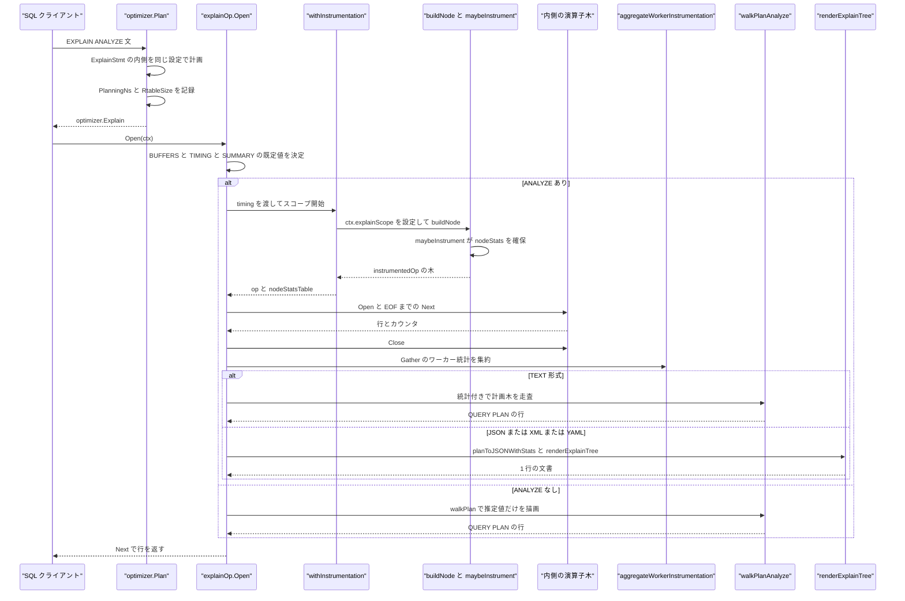
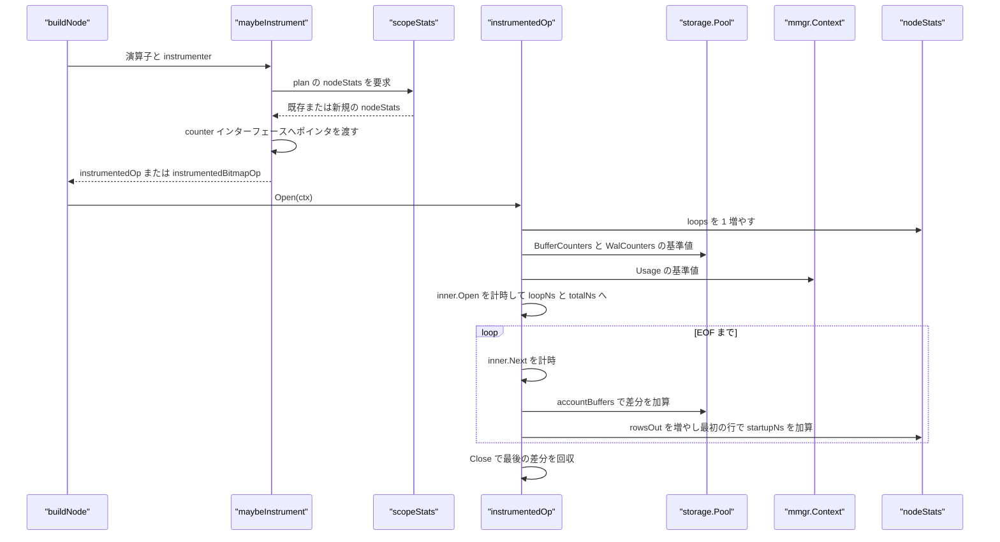
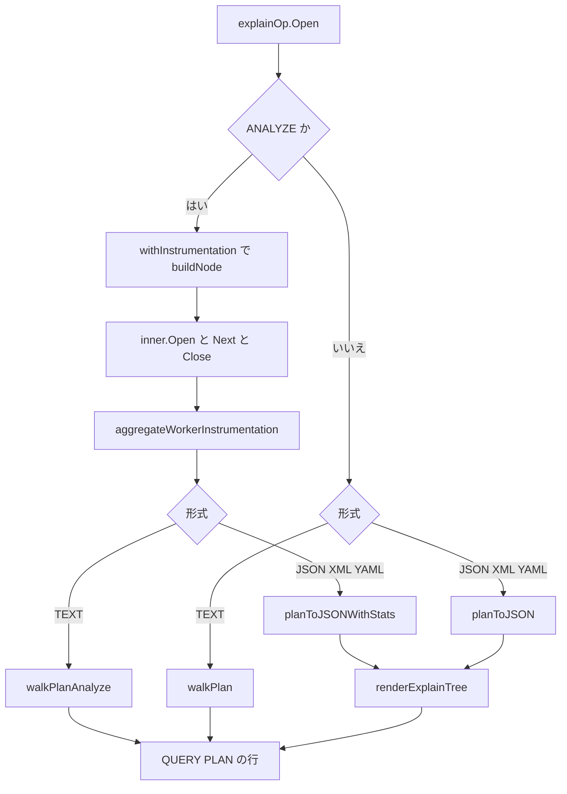

# EXPLAIN と計測

<details>
<summary>関連ソースファイル</summary>

- [`internal/executor/context.go`](https://github.com/ryogrid/goopg/blob/19856410e8d497d59787e1ab35a2febb3f5953d6/internal/executor/context.go)
- [`internal/executor/explain_cte.go`](https://github.com/ryogrid/goopg/blob/19856410e8d497d59787e1ab35a2febb3f5953d6/internal/executor/explain_cte.go)
- [`internal/executor/explain_names.go`](https://github.com/ryogrid/goopg/blob/19856410e8d497d59787e1ab35a2febb3f5953d6/internal/executor/explain_names.go)
- [`internal/executor/explain_nli_paramqual.go`](https://github.com/ryogrid/goopg/blob/19856410e8d497d59787e1ab35a2febb3f5953d6/internal/executor/explain_nli_paramqual.go)
- [`internal/executor/explain_plan_ids.go`](https://github.com/ryogrid/goopg/blob/19856410e8d497d59787e1ab35a2febb3f5953d6/internal/executor/explain_plan_ids.go)
- [`internal/executor/instrument.go`](https://github.com/ryogrid/goopg/blob/19856410e8d497d59787e1ab35a2febb3f5953d6/internal/executor/instrument.go)
- [`internal/executor/operators_explain.go`](https://github.com/ryogrid/goopg/blob/19856410e8d497d59787e1ab35a2febb3f5953d6/internal/executor/operators_explain.go)
- [`internal/executor/operators_explain_format.go`](https://github.com/ryogrid/goopg/blob/19856410e8d497d59787e1ab35a2febb3f5953d6/internal/executor/operators_explain_format.go)
- [`internal/optimizer/flaglabels.go`](https://github.com/ryogrid/goopg/blob/19856410e8d497d59787e1ab35a2febb3f5953d6/internal/optimizer/flaglabels.go)
- [`internal/optimizer/pathtrace.go`](https://github.com/ryogrid/goopg/blob/19856410e8d497d59787e1ab35a2febb3f5953d6/internal/optimizer/pathtrace.go)
- [`internal/optimizer/plan.go`](https://github.com/ryogrid/goopg/blob/19856410e8d497d59787e1ab35a2febb3f5953d6/internal/optimizer/plan.go)
- [`internal/optimizer/planner.go`](https://github.com/ryogrid/goopg/blob/19856410e8d497d59787e1ab35a2febb3f5953d6/internal/optimizer/planner.go)
- [`internal/executor/operators_memoize.go`](https://github.com/ryogrid/goopg/blob/19856410e8d497d59787e1ab35a2febb3f5953d6/internal/executor/operators_memoize.go)
- [`internal/executor/join_batch.go`](https://github.com/ryogrid/goopg/blob/19856410e8d497d59787e1ab35a2febb3f5953d6/internal/executor/join_batch.go)
- [`internal/executor/operators.go`](https://github.com/ryogrid/goopg/blob/19856410e8d497d59787e1ab35a2febb3f5953d6/internal/executor/operators.go)

</details>

`EXPLAIN` は、パーサーが作った `EXPLAIN` 文をプランナーが `optimizer.Explain` ノードに包み、実行エンジンがその内側の計画木を「実行せずに」、または `ANALYZE` 付きなら「実際に実行しながら」テキスト・JSON・XML・YAML のクエリプランとして返す機能である。`explainOp` が全体を駆動し、`ANALYZE` 時は `instrument.go` の `instrumentedOp` が各計画ノードの行数・ループ数・時間・バッファ・WAL・メモリを `nodeStats` に集め、`walkPlanAnalyze` と `planToJSONWithStats` がその値を PG 風の表示に変換する。併せて、CTE の一度だけ表示、SubPlan/InitPlan の PG 互換番号、列の完全修飾、パラレルワーカーの `Worker N:` 行、プランナー側のフラグ来歴とパス列挙トレースもここで扱う。実行モデルの前提は [6.1 実行モデルとオペレータ](6.1-Execution-Model.md)、パラレル集計は [6.8 並列実行](6.8-Parallel-Execution.md)、計画木そのものは [5 クエリプランナー](../5-Query-Planner.md) を参照。

## 責務

- EXPLAIN 文の計画。`optimizer.Plan` が `*parser.ExplainStmt` を受け取り、内側の文を同じ `plannerSet` で `planWithRtableSize` に通し、`PlanningNs` と `RtableSize` を `optimizer.Explain` に詰める。`EXPLAIN` はユーザーがコストを観測する唯一の入口なので、セッション設定を必ず引き継ぐ。`path:internal/optimizer/planner.go:Plan`
- EXPLAIN の既定オプション決定。`explainOp.Open` が `BUFFERS` 未指定なら `ANALYZE` と同じ値にし、`ANALYZE` 時は `TIMING` と `SUMMARY` を既定 ON、`ANALYZE` なしなら `SUMMARY` は明示 ON のときだけ有効にする。`GENERIC_PLAN` は goopg にプランキャッシュが無いため NOTICE を出してカスタムプランへフォールバックする。`path:internal/executor/operators_explain.go:explainOp.Open`
- 計測付きの計画構築。`withInstrumentation` が `instrumenter` スコープを作り、`buildNode` の各アームで `maybeInstrument` が `instrumentedOp`（bitmap producer なら `instrumentedBitmapOp`）を返す。`instrumenter` はグローバルではなく関数引数なので、Gather ワーカーの並行ビルドでもデータ競合しない。`path:internal/executor/instrument.go:withInstrumentation`
- ノード単位の実行計測。`instrumentedOp.Open` がループ数を増やしてバッファ・WAL・メモリの基準値を取り、`Next` が呼び出しごとの時間・行数・最初の行までの起動時間を `nodeStats` に加算する。`Close` と `Rescan` もラッパーとして内側へ委譲する。`path:internal/executor/instrument.go:instrumentedOp.Next`
- 特殊カウンタの配線。`maybeInstrument` が `heapFetchCounter`・`filterRemoveCounter`・`heapBlocksCounter`・`recheckRemoveCounter`・`joinFilterRemoveCounter`・`probeFilterAttributor` を型アサートし、対応する `nodeStats` フィールドへのポインタを演算子へ渡す。`path:internal/executor/instrument.go:maybeInstrument`
- バッファ・WAL・メモリの差分計上。`accountBuffers` が `storage.Pool` の `BufferCounters` / `ReadTimeNanos` / `WriteTimeNanos` / `ExtendTimeNanos` / `WalCounters` と `mmgr.Context.Usage` の前回値を引き、その差を現在のノードへ帰属させる。`path:internal/executor/instrument.go:accountBuffers`
- パラレル計測の統合。`foldGatherWorkerStats` がワーカーごとの `nodeStats` を `Context.GatherWorkerStats` に積み、`aggregateWorkerInstrumentation` が `InstrAggNode` 相当の合算を行う。`foldPrebuildStats` は共有ハッシュのリーダー側プリビルドを 1 サイトとして加える。`path:internal/executor/instrument.go:aggregateWorkerInstrumentation`
- テキスト形式の描画。`walkPlan` が `ANALYZE` なし、`walkPlanAnalyze` が `ANALYZE` ありの walker で、`subPlanReg` に名前表・CTE ホイスト・SubPlan 番号・Sort/Memoize 統計を束ねて `QUERY PLAN` の行を組み立てる。`path:internal/executor/operators_explain.go:walkPlanAnalyze`
- 構造化形式の描画。`planToJSON` / `planToJSONWithStats` が `map[string]any` の木を作り、`renderExplainTree` が JSON・XML・YAML に直列化する。XML のタグ名サニタイズ、YAML の JSON 互換クォート、キーのアルファベット順などは `operators_explain_format.go` が担う。`path:internal/executor/operators_explain_format.go:renderExplainTree`
- CTE の一度だけ表示。`collectCTEHoist` が `CTEScan.DeclKey` ごとに本文を 1 つだけ確保し、`emitCTESections` がルート直下に `CTE <name>` セクションとして出力する。インライン化された CTE と再帰自己参照はセクションを持たない。`path:internal/executor/explain_cte.go:collectCTEHoist`
- 範囲テーブル名の解決。`explainNames` が RTID と `SourceTableIdx` の対応、列の所属関係、重複名の `_N` サフィックスを管理し、自己結合や相関参照でも `ctr1.ctr_state` のように正しい修飾を出す。`path:internal/executor/explain_names.go:explainNames`
- SubPlan/InitPlan の番号付け。`reservePGPlanIDs` が CTE セクション、クエリレベルのソース順、ネストしたクエリレベルの計画順の順に `plan_id` を予約し、PG の `SubPlan 1` / `InitPlan 1` と一致させる。`path:internal/executor/explain_plan_ids.go:reservePGPlanIDs`
- パラメータ化 NLI の述語配置。`paramQualPlacement` が Nested Loop Index Join の残留述語を、内側スキャンの `Filter:` に移す部分、インデックスキーと重複するため消す部分、結合行に残す部分へ分割する。計画自体は変更しない。`path:internal/executor/explain_nli_paramqual.go:paramQualPlacement`
- EXPLAIN (SETTINGS)。`appendExplainSettingsRow` が TEXT の `Settings: name = 'value', ...` 行を出し、`addExplainSettingsGroup` が JSON/XML/YAML の `Settings` オブジェクトを出す。`Context.ExplainSettings` は `FlagExplain` 付き GUC のうち既定値から変わったものだけを返す。`path:internal/executor/operators_explain.go:appendExplainSettingsRow`
- プランナーフラグの来歴。`FlagProvenanceTable` が `GOOPG_*` 環境変数の未設定時ラベルを、実際のデフォルト解決関数から計算する。`RenderFlagProvenanceEnv` がベンチマーク用の `planner-flags.env` を生成する。`path:internal/optimizer/flaglabels.go:FlagProvenanceTable`
- パス列挙の診断。`tracePath` が `DPPATH` 行を stderr に書き、候補パスが受理されたか支配されたか、どの producer が出したか、行数・コスト・pathkeys・jointype を記録する。`GOOPG_PGSHAPED_DP_TRACE` で有効になる。`path:internal/optimizer/pathtrace.go:tracePath`

## 処理フロー

### EXPLAIN ANALYZE の実行経路

プランナーは `*parser.ExplainStmt` を見ると、内側の文を同じ設定で計画し、`planStart` から `planningNs` を測って `optimizer.Explain{Child, Options, PlanningNs, RtableSize}` を返す。実行側では `executor.go` の `buildNode` がこの型を `newExplainOp` に渡す。`explainOp.Open` は `ANALYZE` の有無で分岐し、`ANALYZE` なら `withInstrumentation` のスコープ内で `buildNode(o.plan.Child, deformBoundNone, scope)` を呼んで計測付きの演算子木を作る。`path:internal/executor/operators_explain.go:explainOp.Open`

計測付きの木は `inner.Open(ctx)` の後、`inner.Next()` を `EOF` まで繰り返して実行され、最後に `inner.Close()` される。実行時間 `execNs` は `buildNode` の直前から `Close` の直後までを測る。完了後、`aggregateWorkerInstrumentation(stats, ctx.GatherWorkerStats, timing)` が Gather 配下のワーカー計測をノード統計へ畳み込み、TEXT なら `walkPlanAnalyze`、JSON/XML/YAML なら `planToJSONWithStats` と `renderExplainTree` で出力を作る。`path:internal/executor/operators_explain.go:explainOp.Open`



`ANALYZE` なしの経路は内側の演算子を `Open` しない。`walkPlan` が `newExplainNamesSized`・`collectCTEHoist`・`reservePGPlanIDs` を持つ `subPlanReg` を作り、`walkPlanFiltered` が計画木を pre-order でたどってノード行と詳細行を `o.rows` に積む。`EXPLAIN` の出力は `Schema()` が返す 1 列 `QUERY PLAN` の行集合であり、`Next` は `o.rows` を順に返すだけである。`path:internal/executor/operators_explain.go:walkPlan`

### ノード計測のライフサイクル

`buildNode` の各成功アームは、`scope` が非 nil なら `maybeInstrument(plan, op, scope)` を通す。`scopeStats` は `scope.table[plan]` を引き、同じ計画ノードが複数回ビルドされても 1 つの `nodeStats` を共有する。これは、実体化 CTE の本文を複数の参照が共有する場合や、SubPlan が外側行ごとに再ビルドされる場合に、ループ数を上書きせず累積させるためである。`path:internal/executor/instrument.go:scopeStats`



`seedCounters` は最初の `Open` でだけバッファ・WAL・メモリの基準値を取り、以降は `accountBuffers` が前回値との差を現在のノードに足す。バッファと WAL は `storage.Pool` のグローバルカウンタ、メモリは文単位の `mmgr.Context.Usage()` から読む。`accountBuffers` は `Next` のたびに加えて親ノードへ子の消費も含めるため、入れ子のストップウォッチと同じ「サブツリー込み」の値になる。`path:internal/executor/instrument.go:seedCounters`

### レンダリングの分岐

`explainOp.Open` の後半は形式で分かれる。TEXT は `walkPlan` / `walkPlanAnalyze` が `Row` を積み、`appendExplainSettingsRow` と `Planning Time` / `Execution Time` 行を追加する。JSON/XML/YAML は `planToJSON` / `planToJSONWithStats` が計画部分の `map[string]any` を作り、`explainOp.Open` が `{"Plan": ...}` のルートに包んで `planningBufferUsageJSON` と `addExplainSettingsGroup` を足し、`renderExplainTree` に渡す。`path:internal/executor/operators_explain.go:explainOp.Open`



## 主要ファイル

| ファイル | 役割 |
|---|---|
| `internal/executor/operators_explain.go` | `explainOp` の本体、TEXT walker、JSON 構築、詳細行の描画。`path:internal/executor/operators_explain.go:explainOp` |
| `internal/executor/operators_explain_format.go` | JSON/XML/YAML の直列化、XML タグのサニタイズ、YAML のクォート。`path:internal/executor/operators_explain_format.go:renderExplainTree` |
| `internal/executor/instrument.go` | `nodeStats`、`instrumentedOp`、`instrumenter`、ワーカー統計の統合。`path:internal/executor/instrument.go:instrumentedOp` |
| `internal/executor/context.go` | `SubPlanStats`・`MemoizeStats`・`HashJoinStats`・`GatherLaunched`・`GatherWorkerStats`・`SortStats`・`explainScope`・`ExplainSettings` の保持。`path:internal/executor/context.go:Context` |
| `internal/executor/explain_cte.go` | CTE セクションのホイストと `CTE <name>` の出力。`path:internal/executor/explain_cte.go:collectCTEHoist` |
| `internal/executor/explain_names.go` | 範囲テーブル名・列修飾・`_N` サフィックスの解決。`path:internal/executor/explain_names.go:explainNames` |
| `internal/executor/explain_plan_ids.go` | SubPlan/InitPlan の PG 互換 `plan_id` 予約。`path:internal/executor/explain_plan_ids.go:reservePGPlanIDs` |
| `internal/executor/explain_nli_paramqual.go` | パラメータ化 NLI の残留述語を内側 Filter と結合行へ分割。`path:internal/executor/explain_nli_paramqual.go:paramQualPlacement` |
| `internal/optimizer/plan.go` | `optimizer.Explain` ノードと `PlanningNs` / `RtableSize`。`path:internal/optimizer/plan.go:Explain` |
| `internal/optimizer/planner.go` | `EXPLAIN` 文の計画と計画時間の計測。`path:internal/optimizer/planner.go:Plan` |
| `internal/optimizer/flaglabels.go` | プランナー環境変数の未設定ラベルと `planner-flags.env` の生成。`path:internal/optimizer/flaglabels.go:FlagProvenanceTable` |
| `internal/optimizer/pathtrace.go` | `DPPATH` によるパス候補の来歴トレース。`path:internal/optimizer/pathtrace.go:tracePath` |
| `internal/executor/operators_memoize.go` | Memoize の Hits/Misses/Evictions/Overflows。`path:internal/executor/operators_memoize.go:MemoizeStats` |
| `internal/executor/join_batch.go` | ハッシュ結合の buckets / batches / peak memory / build time。`path:internal/executor/join_batch.go:HashJoinStats` |
| `internal/executor/operators.go` | Sort の method / space / worker。`path:internal/executor/operators.go:SortStat` |

## 公開 API / エントリポイント

```go
// 計画ノード（フィールドは主要データ構造を参照）
func (n *optimizer.Explain) Pos() int
func (n *optimizer.Explain) Output() optimizer.Schema

// プランナーフラグの来歴
func optimizer.FlagProvenanceTable() []optimizer.FlagProvenance
func optimizer.RenderFlagProvenanceEnv() string
func optimizer.FlagProvenanceExemptNames() []string

// executor 内部の入口（パッケージ外からは直接呼ばない）
func newExplainOp(p *optimizer.Explain) *explainOp
func withInstrumentation(timing bool, fn func(scope *instrumenter) (Operator, error)) (Operator, nodeStatsTable, error)
func maybeInstrument(plan optimizer.Node, op Operator, scope *instrumenter) Operator
func aggregateWorkerInstrumentation(stats nodeStatsTable, workers workerNodeStatsTable, timing bool) nodeStatsTable
func collectCTEHoist(root optimizer.Node) *cteHoist
func newExplainNamesSized(n optimizer.Node, rtableSize int, verbose bool) *explainNames
func renderExplainTree(format parser.ExplainFormat, root map[string]any) (string, error)
```

`explainOp` は `executor.buildNode` の `*optimizer.Explain` アームから `newExplainOp` で作られ、`Open` が出力行をすべて構築する。したがって外部コードが触る実質的な API は `optimizer.Explain` と、`flaglabels.go` の 3 つのエクスポート関数である。`path:internal/executor/executor.go:buildNode`

## 主要データ構造

### `optimizer.Explain`

`EXPLAIN` 文 1 つ分の計画ノード。内側の計画木と、プランナーが測った時間・範囲テーブルサイズを保持する。

```go
// Explain — `EXPLAIN <stmt>`. Wraps the planned inner node so
// the executor can render it as a single-column QUERY PLAN
// text result-set without re-running planning. The Options
// field carries the parsed EXPLAIN flags (M0018-0001) — the
// executor consults Format / Verbose to switch between TEXT /
// JSON / verbose-mode rendering. Zero-value Options preserves
// the pre-M0018 bare-EXPLAIN behaviour.
type Explain struct {
	pos     int
	Options parser.ExplainOptions
	Child   Node
	// PlanningNs is the wall time the planner spent on Child, the figure
	// EXPLAIN ANALYZE prints as "Planning Time" — PG's ExplainOneQuery
	// times pg_plan_query alone (explain.c:350-356) (M0122-0019).
	PlanningNs int64
	// RtableSize is the explained statement's range-table size (PG's
	// es->rtable_size), counting RTEs that left no plan node — a pulled-up
	// or stripped subquery, a view, a removed join. EXPLAIN qualifies
	// upper-node columns when it exceeds 1. Zero means unknown: the renderer
	// then counts the relations visible in the plan.
	RtableSize int
}
```

`Child` は `ANALYZE` の有無にかかわらず同じ計画木である。`PlanningNs` は `pg_plan_query` 相当の時間だけを含み、実行時間は含まない。`RtableSize` は計画木に現れない RTE も数えるため、`explainNames.qualify` が `len(bySource) > 1` だけで判定すると修飾が不足する場合の補正に使われる。

### `nodeStats`

1 つの計画ノードに対する実行カウンタ。行・ループ・時間に加えて、フィルタ拒否、ヒープフェッチ、バッファ、WAL、メモリを保持する。

```go
// nodeStats holds the per-Node runtime counters EXPLAIN ANALYZE
// renders. The map below is keyed by planner.Node identity so
// the EXPLAIN renderer can look up stats while walking the
// (already-built) plan tree.
type nodeStats struct {
	rowsOut    int64
	loops      int64
	startupNs  int64 // time inside the node up to its first row, summed over loops (PG instr->startup)
	totalNs    int64 // time inside the node's Open and Next calls, every loop (PG instr->total)
	timing     bool  // tracks whether time.Now() snapshots are taken
	gotFirst   bool  // first Next-since-Open returned a row
	loopNs     int64 // time inside the node so far this loop (PG instr->counter)
	// heapFetches counts the heap tuples an IndexOnlyScan had to fetch
	// because the page was not ALL_VISIBLE (design 0118-0102). Mirrors
	// upstream's IndexOnlyScanState.ioss_HeapFetches, surfaced by EXPLAIN
	// ANALYZE as the "Heap Fetches" line / JSON key. The IOS operator
	// increments it directly via a pointer handed to it in maybeInstrument.
	heapFetches int64

	// exactPages / lossyPages count the heap pages a Bitmap Heap Scan
	// fetched from an exact / a lossy bitmap entry — PG's
	// BitmapHeapScanState.stats (heapam_handler.c BitmapHeapScanNextBlock),
	// surfaced as `Heap Blocks: exact=N lossy=M` (explain.c
	// show_tidbitmap_info). Handed to the operator by maybeInstrument
	// (heapBlocksCounter). M0122-0021.
	exactPages int64
	lossyPages int64

	// recheckRejected counts the tuples a Bitmap Heap Scan's recheck of
	// the original index qual rejected — PG's nfiltered2 on that node
	// (nodeBitmapHeapscan.c BitmapHeapNext, InstrCountFiltered2), surfaced
	// as `Rows Removed by Index Recheck` (M0122-0021).
	recheckRejected int64

	// filterRejected counts tuples a Filter operator rejected (scan-level
	// qual). Mirrors upstream's Instrumentation.nfiltered1 for scan nodes,
	// surfaced by EXPLAIN ANALYZE as "Rows Removed by Filter".
	filterRejected int64

	// joinFilterRejected counts tuples a join operator rejected on its join
	// residual qual. Mirrors upstream's Instrumentation.nfiltered1 for join
	// nodes, surfaced by EXPLAIN ANALYZE as "Rows Removed by Join Filter".
	joinFilterRejected int64

	// probeFilterRejected is the share of joinFilterRejected a
	// parameterized nested loop attributes to the part of its residual
	// EXPLAIN renders as the inner scan's Filter (PG's ppi_clauses): a
	// rejected row whose moved part fails counts here, as PG's scan qual
	// would have rejected it before the join qual ran. Set only when the
	// residual splits across both lines (probeFilterAttributor).
	probeFilterRejected int64

	// bufHit / bufRead / bufDirtied / bufWritten are the cumulative
	// shared-buffer hit/read/dirtied/written counts EXPLAIN (ANALYZE,
	// BUFFERS) attributes to this node, inclusive of its children (same
	// nested-stopwatch semantics as totalNs above — a parent's Next() call
	// fully executes its child's Next() calls before returning, so the
	// pool-counter delta since the last checkpoint naturally rolls up
	// whatever the subtree touched). The bufBase* fields hold the
	// last-seen storage.Pool snapshot for delta computation; bufSeeded
	// guards the very first checkpoint on Open.
	bufHit, bufRead, bufDirtied, bufWritten                 int64
	bufBaseHit, bufBaseRead, bufBaseDirtied, bufBaseWritten int64
	bufSeeded                                               bool

	// bufReadTimeNs / bufWriteTimeNs are the cumulative real wall-clock
	// nanoseconds EXPLAIN (ANALYZE, BUFFERS)'s "I/O Timings:" line
	// attributes to this node, diffed the same nested-stopwatch way as
	// bufHit/bufRead above. bufWriteTimeNs folds storage.Pool's extend
	// time in alongside write time, mirroring upstream's
	// pgstat_count_io_op_time (postgres/src/backend/utils/activity/
	// pgstat_io.c), which buckets IOOP_EXTEND under
	// pgstat_count_buffer_write_time / shared_blk_write_time — EXPLAIN has
	// no separate "extend=" term. Both stay zero when track_io_timing is
	// off (the Pool accumulators never advance), so no extra gate is
	// needed beyond the nonzero check formatIOTimingsLine already does.
	bufReadTimeNs, bufWriteTimeNs         int64
	bufBaseReadTimeNs, bufBaseWriteTimeNs int64

	// walRecords / walBytes are the cumulative WAL record count and
	// payload bytes EXPLAIN (ANALYZE, WAL) attributes to this node,
	// inclusive of its children (nested-stopwatch semantics like buffers
	// above). The walBase* fields hold the last-seen Pool.WalCounters()
	// snapshot for delta computation; walSeeded guards the first
	// checkpoint on Open. M0122-0003.
	walRecords, walBytes           int64
	walBaseRecords, walBaseBytes   int64
	walSeeded                      bool

	// memAllocated / memPeak are the cumulative mctx memory counters
	// EXPLAIN (ANALYZE, MEMORY) attributes to this node, inclusive of
	// its children (nested-stopwatch semantics). memAllocated is the
	// total cap of all chunks ever created; memPeak is the high-water
	// mark of in-use bytes. The memBase* fields hold the last-seen
	// Context.Usage() snapshot for delta computation; memSeeded guards
	// the first checkpoint on Open. M0122-0003.
	memAllocated, memPeak           int64
	memBaseAllocated, memBasePeak   int64
	memSeeded                       bool
}
```

`rowsOut` と `startupNs` / `totalNs` はループをまたいだ累積値であり、描画時に `rowsPerLoop` / `msPerLoop` が `loops` で割る。`startupNs` は「そのループの最初の行が出るまで」の時間だけを加算するため、`gotFirst` は各 `Open` サイクルで最初の 1 回だけ真になる。`timing` が false のときは `time.Now()` を呼ばず、`actual rows=` だけを出す。バッファ・WAL・メモリの `*Base*` フィールドと `*Seeded` は差分計算の状態であり、ノードをまたいで共有してはならない。

### `instrumentedOp`

計測用の演算子ラッパー。内側の `Operator` と同じスキーマを返し、`Open` / `Next` / `Close` / `Rescan` を横取りする。

```go
// instrumentedOp wraps inner so the EXPLAIN ANALYZE renderer can
// surface actual-rows / loops / timing per Node.
type instrumentedOp struct {
	inner Operator
	plan  optimizer.Node
	stats *nodeStats
	pool  *storage.Pool  // captured from ctx.Pool in Open; nil-safe (BUFFERS off / no ctx.Pool)
	sctx  *mmgr.Context  // captured from ctx.Mctx in Open; nil-safe (MEMORY off / no ctx.Mctx)
}
```

`pool` と `sctx` は `seedCounters` が `Open` 時に捕捉する。`BUFFERS` が無効でも `ctx.Pool` があれば捕捉され、`accountBuffers` は常に差分を取るが、描画側が必要なときだけ行を出す。`plan` は `nodeStatsTable` のキーであり、`stats` は同じ計画ノードの複数ビルドで共有される。

### `instrumenter`

1 回の `EXPLAIN ANALYZE` のスコープ。計測の有無と、計画ノードから `nodeStats` への対応表を持つ。

```go
// instrumenter is the instrumentation scope buildNode threads through
// its dispatch as an explicit parameter. When non-nil, every successful
// buildNode arm returns an *instrumentedOp wrapping its result so child-
// site buildNode calls inside the dispatch arms get their wraps too
// (the wrap propagates recursively through the natural build tree).
// nil disables instrumentation — every existing caller path is
// byte-for-byte unchanged.
//
// M-NIGHTLY-instrumentscope-race-fix: this used to be a package global
// swapped under a mutex by every scope-handoff site. Gather workers
// build concurrently, and a lazily-built SubPlan subtree reached
// mid-Next() from another goroutine read the global with no lock —
// a real data race (take3-instrumentscope-datarace,
// e18-instrumentscope-global-races-coop-producers). The scope is now a
// plain function argument: there is no shared mutable state left to
// race on, and no mutex.
type instrumenter struct {
	timing bool
	table  nodeStatsTable
}
```

`timing` はノードごとの `nodeStats.timing` にコピーされ、`table` は `plan` をキーにした `*nodeStats` のマップである。`instrumenter` 自体は `buildNode` の引数として渡され、Gather ワーカーのように並行にビルドされる場面でも共有可変状態を持たない。

### `explainOp`

EXPLAIN の実行演算子。出力行を `Open` で全構築し、`Next` はそれを順に返す。

```go
// explainOp renders the inner plan tree as a single-column
// "QUERY PLAN" text result. v0 emits one row per plan node in
// pre-order with two-space indent per nesting level, matching
// upstream PG's text-format output well enough for
// debugging-by-eyeball during the M0003 planner work. EXPLAIN
// ANALYZE / VERBOSE / FORMAT JSON wait on later loops; see
// docs/design/0003-0007-explain.md.
type explainOp struct {
	plan *optimizer.Explain
	rows []Row
	idx  int
}
```

`rows` がすべての出力行を保持し、`idx` が `Next` の位置である。`Open` の途中でエラーが起きた場合、`rows` は部分的に埋まった状態で返らないよう、エラーをそのまま返して呼び出し側の文を失敗させる。

### `explainNames`

EXPLAIN の範囲テーブル名表。RTID（文全体で一意）と `SourceTableIdx`（クエリレベルごとに 1 から振り直される）を橋渡しし、列の修飾名を作る。

```go
// explainNames is EXPLAIN's range-table name table: the mapping from a
// scan node's statement-unique range-table identity (the planner-stamped
// RTID, PostgreSQL's varno analogue, A-01(ii)) to the name EXPLAIN prints
// in front of that node's columns.
//
// It exists because goopg's plan expressions are *resolved* references — a
// ColumnRef carries only the column's name and its slot index, so two
// distinct columns of a self-join render identically. Before M0125-0039,
// EXPLAIN printed TPC-DS Q30's correlated filter as
// `Filter: (ctr_state = ctr_state)`, which reads as an unsatisfiable
// self-comparison; PostgreSQL prints `(ctr1.ctr_state = ctr_state)`.
// Nothing in the old output distinguished the two readings, which is exactly
// the distinction a triage loop needs.
//
// Upstream analogue: ruleutils.c's deparse_namespace / set_rtable_names.
// PostgreSQL names each RTE by its FROM-clause alias, falling back to the
// relation name, and disambiguates a repeated name with a `_N` suffix while
// leaving the first occurrence bare (`date_dim`, `date_dim_1`, …).
//
// Divergence from upstream worth knowing: PostgreSQL numbers those suffixes
// over the *query's* range table, which includes entries goopg's plan tree
// never materialises as a node (pulled-up subqueries, eliminated joins), so
// goopg's suffix for the N-th duplicate can differ from PG's for the same
// query. The qualification itself — which relation a column came from — is
// what this table is for and is unaffected.
type explainNames struct {
	// bySource maps statement-unique RTID → printed name. Entry 0 is never
	// populated: RTID 0 means "no identity assigned" (scan kinds whose
	// stamping lands in a later cut, nodes built outside a threaded
	// planning path), and those stay unqualified, exactly as they render
	// today.
	bySource map[int32]string
	// taken is the per-base high-water mark behind printed-name
	// disambiguation (PostgreSQL's RTENameHashEntry.counter): taken[base]
	// is the largest _N suffix handed out for base, and every generated
	// name is itself entered, so a literal alias `x_1` pushes the second
	// `x` to `x_2`. See claimName.
	taken map[string]int
	// seen guards against registering the same RTID twice — a subplan
	// body is collected when its `SubPlan N` subtree is about to render,
	// CTE bodies are *shared* pointers across references (CTEScan.Child
	// aliases one planned body), and NestedLoopIndexJoin.InnerMemo.Child
	// aliases Inner — the same node is reachable twice and must register
	// once.
	seen map[int32]bool
	// cols is the column set the relation registered for an RTID
	// actually exposes, and it is a correctness guard, not a nicety.
	// A ColumnRef naming a derived column can still resolve to an
	// unrelated relation through the bySrc translation below, and
	// EXPLAIN would print a confident, wrong qualifier — strictly worse
	// than the bare name it replaced. Requiring the column name to exist
	// in the claimed relation turns that case back into today's
	// unqualified rendering. (Recorded limit, review F8: on a mixed node
	// whose outputs carry several identities, cols covers every output
	// name, so a later column(src=X, derivedName) lookup can still wrongly
	// qualify. Low-probability; the guard narrows it, it does not close
	// it.)
	cols map[int32]map[string]bool
	// bySrc translates a column reference's per-level SourceTableIdx
	// (the storage type every SchemaColumn and ColumnRef carries,
	// M0071-0009) to the RTID registered for it. The planner's
	// SourceTableIdx counter restarts at 1 for every query level while
	// RTIDs are statement-unique, so one src value can name several
	// relations across levels; the first registration in WALK order wins
	// — root tree before sublink bodies, consumer before CTE body —
	// which is the outer scope, the name a correlated OuterColumnRef,
	// the case this table exists for, needs. (Walk order, not RTID
	// order, deliberately: CTE bodies are allocated before their
	// consumers, so an allocation-order tie-break would resolve an outer
	// reference to the body's inner scan.)
	bySrc map[int16]int32
	// nodeLabels maps each plan node to its EXPLAIN-node-label name,
	// disambiguated per RTID in allocation order so two distinct nodes
	// over the same relation (e.g. a SEMI-join outer and inner side
	// sharing one SourceTableIdx) still get distinguishable labels.
	// Keyed by nodePtr(n). Populated by collect; absent means no
	// disambiguation was needed (bare first occurrence).
	// M0128-P5.1: this is the select_rtable_names_for_explain equivalent
	// for node labels — the existing bySource/taken/seen serve column
	// qualification, which has different collision rules.
	nodeLabels map[string]string
	// labelSeen is the node-label pass's visited set, kept across collect
	// calls: the root pass already labels sublink bodies (they hang off
	// NodeSubplans), and the per-subplan collect operators_explain runs
	// before rendering an `InitPlan N` body must not relabel them from a
	// fresh claim table — two InitPlans over one appendrel printed their
	// members `_1`…`_4` twice where PG continues `_6`…`_9` (M0148-0001c).
	labelSeen map[string]bool
	// parent maps each plan node (nodePtr) to the node it was first
	// reached from in collect's walk, and scopes caches each node's
	// subtree SourceTableIdx → RTID map. Together they let columnIn
	// resolve a column against the rendered node's own level before the
	// statement-wide bySrc.
	parent map[string]optimizer.Node
	scopes map[string]map[int16]int32
	// scopeLists is scopes with every RTID per SourceTableIdx, in walk
	// order. An unpulled subquery whose Subquery Scan is elided leaves no
	// level boundary in the tree, so its relations share SourceTableIdx
	// values with the parent level's (M0146-0042).
	scopeLists map[string]map[int16][]int32
	// nodes maps each registered RTID to its scan node, so a column whose
	// scope resolves to a transparent inlined CTE can be chased into the
	// CTE body (transparentCTEFor). M0146-0021.
	nodes map[int32]optimizer.Node
	// rtableSize is PG's es->rtable_size for the explained statement when
	// the planner reported it (optimizer.Explain.RtableSize), else 0.
	rtableSize int
	// verbose is es->verbose: EXPLAIN (VERBOSE) qualifies every qual and
	// key column (qualify / qualifyScan).
	verbose bool
}
```

`collect` は RTID の割り当て順に登録するため、`_N` サフィックスは結合順ではなく FROM 順に決まる。`column` は `bySrc[src]` で RTID を引き、`cols[rtid][colName]` に列が実在する場合だけ `rel.col` を返す。`columnIn` は描画中のノードのスコープを先に試し、見つからなければ祖先へ遡る。`qualify` は `len(bySource) > 1 || rtableSize > 1 || verbose`、`qualifyScan` は `verbose` だけを見る。

### `cteSection` と `cteHoist`

CTE を「宣言ごとに 1 回」だけ表示するための状態。本文ノードと宣言順を持ち、参照箇所では葉として扱う。

```go
// cteSection is one `CTE <name>` heading plus the body it prints.
type cteSection struct {
	name    string
	body    optimizer.Node
	declSeq int
}

// cteHoist is the per-EXPLAIN-render set of CTE bodies that have been lifted
// out of their reference sites. A declaration present in byDecl renders as a
// leaf wherever it is referenced, INCLUDING inside sublink subtrees (the same
// subPlanReg — and therefore the same cteHoist — is threaded through them).
type cteHoist struct {
	order  []*cteSection
	byDecl map[string]*cteSection
}
```

`byDecl` のキーは `CTEScan.DeclKey()`（宣言のソース位置と名前）である。名前キーや本文ポインタキーではなく宣言キーを使うことで、同名の別宣言を混同せず、同じ宣言を複数回表示しない。`order` は `declSeq` で安定ソートされ、`emitCTESections` がルート（`indent == 0`）でだけ出力する。

### `subPlanReg`

1 回の EXPLAIN 描画を通じて共有される状態。名前表、CTE、SubPlan 番号、述語チェイス、Sort/Memoize のワーカー統計をまとめる。

```go
type subPlanReg struct {
	num     map[optimizer.Expr]int
	pending []subPlanEntry

	// initPlanQueued holds the initPlans already queued for printing
	// (M0146-0104): one plan, one `InitPlan N` section.
	initPlanQueued map[optimizer.Node]bool
	// rel is the render's range-table name table (M0125-0039). It lives
	// here rather than in its own parameter because subPlanReg is already
	// the one piece of per-EXPLAIN state threaded through every walker and
	// every expression-render site, and the two have the same lifetime.
	// nil is safe: explainNames' methods are nil-receiver tolerant, so a
	// registry-less caller renders bare column names as before.
	rel *explainNames
	// ancestor is the plan node whose detail lines are currently being
	// rendered — upstream's push_ancestor_plan target, used to name a
	// correlated reference whose binding id was erased on the way up
	// (an aggregate zeroes SourceTableIdx). Set by the walkers around
	// each node's render; nil outside one.
	ancestor optimizer.Node
	// paramInner is set while a parameterised nested loop's inner side
	// prints (enterParamInner): ancestor is then the loop's outer input and
	// an OuterColumnRef is that loop's NestLoop param (M0146-0005cq).
	paramInner bool
	// current is the plan node whose own lines are being rendered. A plain
	// column in its detail lines is resolved against that node's subtree
	// first (explainNames.columnIn), the way PG deparses a Var against the
	// node's own children. Set by both walkers for each node; nil outside.
	current optimizer.Node
	// joinRow is the join whose residual (Join Filter / an index join's
	// Filter) is being rendered, set only around that call: its columns
	// index the join's concatenated input row, so a column that would print
	// bare is resolved positionally through the child that produced it
	// (explainNames.joinResidualColumn, M0146-0005as).
	joinRow optimizer.Node
	// filterSrc is the collapsed Filter wrapper whose predicate this node's
	// line prints (walkPlanFiltered's attachedFilterNode), set around the
	// node's detail lines. filterRow is that Filter's child while a join's
	// attached `Filter:` is being rendered: its columns index the child's
	// output, so a column no scope can name is chased through it to the node
	// that computes it, as a join residual is (M0146-0224: TPC-DS Q78's
	// `COALESCE((sum(web_sales.ws_quantity)), ...)` over stripped CTE
	// subquery scans).
	filterSrc optimizer.Node
	filterRow optimizer.Node
	// inChase is set while an expression a chase returned is rendered: its
	// columns belong to the node the chase landed on and are never chased
	// again from the line's own row.
	inChase bool
	// paramRow is the parameterised nested loop whose inner side prints with
	// its param qual rendered (walkPlanFiltered's renderedParamQual arm). A
	// sublink in that inner's Filter evaluates its PARAM_EXEC Args against
	// the loop's merged row (M0146-0012a), so subPlanEntry.paramOwner takes
	// this node; nothing else reads it.
	paramRow optimizer.Node
	// hashMemLimit is the session's hash_mem in bytes (work_mem *
	// hash_mem_multiplier), which decides whether a SubPlan renders as
	// `hashed` (subPlanUsesHashTable). 0 means unknown: the defaults.
	hashMemLimit int64
	// cte holds the CTE bodies lifted out of their reference sites for this
	// render, so a multiply-referenced CTE prints once as a `CTE <name>`
	// section instead of once per reference (M0125-0049). Shared with the
	// sublink walk, which is why it lives here: a reference inside a
	// `SubPlan N` subtree must render as a leaf too. nil when the plan has
	// no CTE, and nil-receiver tolerant either way.
	cte *cteHoist
	// planID / hashedPlanID are the SubPlan/InitPlan numbers reserved in
	// PG's plan_id order before rendering (reservePGPlanIDs, M0146-0005bv),
	// keyed by the sublink's inner plan root; lastID is the highest number
	// handed out, so an unreserved sublink continues the sequence.
	// pinnedKeyName holds a key the OUTER_VAR chase ended at a base-relation
	// scan, rendered qualified in THAT scan's own naming context
	// (resolveKeySource's scan arm, M0146-0005bz). Resolved from the node
	// being printed instead, a relation id reused at another query level in
	// the subtree (planner ids restart per level) would make the qualifier
	// ambiguous and print the bare name.
	// chaseCrossedLevel is set by resolveKeySource's arms that enter another
	// query level (an inlined CTE body, a UNION arm), where relation ids
	// restart; the Project arm's descent reads it to know the landing
	// column's id cannot be compared with its own target's (M0146-0005cc).
	chaseCrossedLevel bool
	pinnedKeyName map[*optimizer.ColumnRef]string
	// boundaryKeyName is a key the chase stopped at a Subquery Scan PG keeps
	// (one with quals), named `alias.col`: always qualified, since a plan
	// holding a subquery RTE has more than one range-table entry.
	boundaryKeyName map[*optimizer.ColumnRef]string
	planID       map[optimizer.Node]int
	hashedPlanID map[optimizer.Node]int
	lastID       int
	// sortStats / sortWorkers carry EX0-03c's per-Sort execution stats for
	// this render (the leader's main-line entries and the folded per-worker
	// carrier). They live here rather than in their own walker parameters
	// because subPlanReg is already the one piece of per-EXPLAIN state
	// threaded through every walker call — same reason as rel above — so
	// the Sort arm stays reachable without re-signaturing the walker. Nil
	// (or empty) renders no `Sort Method:` lines, so serial plans,
	// unexecuted nodes, and reg-less callers stay byte-identical.
	sortStats   map[*optimizer.Sort]SortStat
	sortWorkers map[*optimizer.Sort][]SortStat
	// memoWorkers is the per-worker Memoize carrier (Context.
	// MemoizeWorkerStats), held here for the same reason as sortWorkers.
	memoWorkers map[*optimizer.Memoize][]MemoizeStats
	// execParamSources is the owning sublink's validated PARAM_EXEC
	// input map while that sublink body renders. It is body-scoped (set /
	// restored by emitSubPlanSubtrees), not statement-global: PG resolves
	// PARAM_EXEC against the supplying ancestor SubPlan, and nested bodies
	// must not see their parent's slot sources. Only direct ColumnRef Args
	// enter the map; forwarded params and every doubtful shape retain `$N`.
	execParamSources map[int]*optimizer.ColumnRef
	// execParamOwner, when set, is where execParamSources resolve instead of
	// the ancestor (subPlanEntry.paramOwner); body-scoped like the map.
	execParamOwner optimizer.Node
	// execParamScope, when set, is the plan node that evaluates the sublink
	// (subPlanEntry.paramScope), tried before execParamOwner; body-scoped.
	execParamScope optimizer.Node
}
```

`num` はサブリンク式から番号への対応、`pending` はまだ描画していない SubPlan/InitPlan の待ち行列である。`planID` / `hashedPlanID` は `reservePGPlanIDs` が事前に埋める。`cte` と `rel` は描画全体で共有され、`sortStats` / `sortWorkers` / `memoWorkers` は Context から渡された実行統計を walker へ運ぶ。

### `workerNodeStat`

Gather 配下の 1 実行サイト分の計測値。ワーカーごとの `Worker N:` 行と、ノード行への合算に使う。

```go
type workerNodeStat struct {
	Worker    int
	RowsOut   int64
	Loops     int64
	StartupNs int64
	TotalNs   int64
	// FilterRejected is the site's scan-qual rejection count. PG folds
	// nfiltered1 from every worker into the leader (instrument.c:187) and
	// EXPLAIN divides the total by nloops; without carrying it here a
	// parallel plan would report only what the LEADER rejected — and after
	// E-17 absorbed the qual into the scan, the scan is what runs inside
	// workers.
	FilterRejected int64
	// JoinFilterRejected / ProbeFilterRejected / HeapFetches are the site's
	// remaining per-node counters (nodeStats' joinFilterRejected,
	// probeFilterRejected, heapFetches). PG's InstrAggNode folds every one
	// of them into the node's own instrumentation, so the node line's
	// `Rows Removed by Join Filter`, a parameterized probe's moved-Filter
	// subtraction and `Heap Fetches` all need the per-site values
	// (M0122-0021).
	JoinFilterRejected  int64
	ProbeFilterRejected int64
	HeapFetches         int64
	// ExactPages / LossyPages are the site's Bitmap Heap Scan page counts.
	// Unlike the counters above PG does NOT sum them into the node: the
	// `Heap Blocks:` line is the leader's own pages, and each worker's
	// print as a `Worker N:  Heap Blocks:` line (explain.c
	// show_tidbitmap_info over sinstrument). M0122-0021.
	ExactPages int64
	LossyPages int64
	// RecheckRejected is the site's nfiltered2; summed into the node like
	// FilterRejected (instrument.c InstrAggNode).
	RecheckRejected int64
	// Leader marks the leader's site (the last slot). PG keeps the
	// leader's counters in planstate->instrument and prints `Worker N:`
	// lines only for worker_instrument, so the leader never gets a line
	// of its own — it only contributes to the node-line aggregate.
	Leader bool
}
```

`Leader` は最後のスロット（`idx == len(tables)-1`）で真になる。`aggregateWorkerInstrumentation` は `RowsOut` / `Loops` / `StartupNs` / `TotalNs` と各種拒否カウンタを合算するが、`ExactPages` / `LossyPages` は `Leader` のサイトだけをノード行に足し、ワーカー分は `Worker N:` 行に残す。`Worker` が `-1` の `foldPrebuildStats` エントリはリーダー扱いで、ワーカー行にはならない。

### `FlagProvenance`

プランナー環境変数 1 つ分の来歴。ベンチマーク成果物に「未設定時にバイナリがどう動くか」を刻む。

```go
// FlagProvenance is one row of the table: an env var whose value shapes plans,
// and the label an artefact carries when that var is UNSET.
type FlagProvenance struct {
	// Env is the environment variable name, e.g. "GOOPG_PGSHAPED_DP".
	Env string
	// Unset is what the gate stamps when the variable is not exported. It
	// spells the RESOLVED default — `unset(on)`, `unset(off)`, `unset(2)` —
	// so the line is a positive statement about the binary rather than a
	// note that the operator typed nothing.
	Unset string
	// Retired marks a variable no code reads any more. The gate stamps the
	// retirement instead of the environment, so a later loop cannot A/B a
	// variable the binary cannot see. The row is kept rather than deleted
	// because dropping it would make older artefacts that DO carry the
	// variable look like this version of the gate produced them.
	Retired bool
}
```

`Unset` は `unset(on)` のように解決済みのデフォルトを綴る。`Retired` が真なら `retired(<milestone>)` が入り、変数自体が読まれないことを示す。`FlagProvenanceTable` は `flagProvenanceOrder` の順にこの構造体を組み立て、`RenderFlagProvenanceEnv` が `GOOPG_PLANNER_FLAG_VARS` と `GOOPG_PLANNER_FLAG_LABEL_*` を生成する。

### `pathVerdict`

`pathtrace.go` のパス候補判定。`tracePath` が候補を受理したか、支配されたかを記録する。

```go
// pathVerdict is what addToPathlist decided about a candidate.
type pathVerdict string

const (
	verdictAccepted  pathVerdict = "accepted"
	verdictDominated pathVerdict = "dominated"
)
```

`formatPathLine` は `DPPATH` タグに続けて `producer`・`relids`・`kind`・`rows`・`startup`・`total`・`disabled`・`pathkeys`・`verdict`・`jointype`・`outer`・`inner`・`width`・`inputtotal` を並べる。`pathTraceEnabled` は `GOOPG_PGSHAPED_DP_TRACE` をプロセス起動時に読んだ `dpTrace` であり、無効時は `tracePath` が即座に戻る。

## 内部構造

**ANALYZE のタイミングと起動時間。** `instrumentedOp.Open` は各サイクルの先頭で `loops++` を行い、`timing` 有効時は `gotFirst = false` にしたうえで `inner.Open` 全体を 1 つの `loopNs` として測って `totalNs` に足す。`Next` は呼び出しごとの時間を `loopNs` と `totalNs` に足し、そのサイクルで最初の行が返った瞬間に `startupNs += loopNs` として起動時間を確定する。したがって `startupNs` は「各サイクルで最初の行を出すまでの時間」の合計、`totalNs` は `Open` と全 `Next` の合計である。描画側は `msPerLoop` と `rowsPerLoop` で `loops` 除算し、PG の `actual time=startup..total rows=N loops=L` に合わせる。`path:internal/executor/operators_explain.go:msPerLoop`

**タイミング無効時の表示。** `TIMING OFF` では `nodeStats.timing` が false になり、`Open` / `Next` は `time.Now()` を呼ばない。描画は `actual time=` を省き、`actual rows=... loops=...` だけを出す。一方、トップレベルの `Execution Time` は `ANALYZE` なら `TIMING` に関係なく `time.Since(execStart)` で測られるので、`SUMMARY` の数値は残る。`path:internal/executor/operators_explain.go:explainOp.Open`

**バッファ・WAL・メモリの入れ子ストップウォッチ。** `accountBuffers` は `storage.Pool` のグローバルカウンタを前回の `bufBase*` / `walBase*` と比較し、その差を現在のノードに足してから基準値を更新する。親ノードの `Next` は子の `Next` を完了させてから戻るため、親の差分には子の消費が含まれる。`bufWriteTimeNs` は `WriteTimeNanos() + ExtendTimeNanos()` で、PG の `IOOP_EXTEND` を write に含める扱いに対応する。`path:internal/executor/instrument.go:accountBuffers`

**Bitmap プロデューサの計測。** `instrumentedBitmapOp` は `Open` ではループを数えず、`buildBitmap` の 1 回を 1 ループとして `loops` と `startupNs` を更新する。`bitmapTupleCounter` を実装するプロデューサだけが `lastBitmapTuples()` を `rowsOut` に足し、`BitmapAnd` / `BitmapOr` は 0 行として扱う。`path:internal/executor/instrument.go:instrumentedBitmapOp.buildBitmap`

**NLI 内側と Memoize の計測。** `instrumentNLIInner` は `nliInner` を `instrumentedNLIInner` で包み、`Rescan` を 1 ループとして数える。`instrumentMemoProbe` は Memoize の下のプローブを包み、キャッシュミス時だけプローブが呼ばれる PG の構造に合わせる。`heapFetchCounter` などの特殊カウンタもここで配線される。`path:internal/executor/instrument.go:instrumentNLIInner`

**パラレル統計の畳み込み。** `foldGatherWorkerStats` は各サイトの `nodeStats` から行・ループ・時間・拒否カウンタ・ヒープフェッチ・ページ数を `workerNodeStat` にコピーし、`Worker` にスロット番号、最後のスロットに `Leader` を立てる。`aggregateWorkerInstrumentation` は `InstrAggNode` と同様にこれらを合算するが、バッファ・WAL・メモリはサイト間で共有されるグローバルカウンタなので合算しない。`path:internal/executor/instrument.go:foldGatherWorkerStats`

**`loops == 0` の扱い。** 実行されなかったノードは `stats` にエントリがあっても `loops == 0` で、TEXT では ` (never executed)` と表示される。`aggregateWorkerInstrumentation` は `loops == 0` のノードを「どのサイトも開かなかった共有ハッシュビルド入力」とみなし、既存の値を上書きしない。`path:internal/executor/operators_explain.go:walkPlanAnalyzeFiltered`

**CTE の宣言キー。** `collectCTEHoist` は `CTEScan.DeclKey()` で本文を 1 つだけ確保する。再帰自己参照（`isRecursiveSelfRef`）は `WorkTable Scan` として葉にし、インライン化された CTE（`Inlined()`）は本文をその場に展開する。確保済みの本文へ入る再参照は descend しない。`emitCTESections` はルートでだけセクションを出し、出力後に `order` を空にするので、本文の再帰描画で二重に出ない。`path:internal/executor/explain_cte.go:emitCTESections`

**SubPlan/InitPlan の番号。** `reservePGPlanIDs` はまず CTE セクションの本文を歩いて番号を消費し、次に計画木のクエリレベルごとに `NodeSublinks` を集める。`preprocessRank` がターゲットリスト・結合条件・HAVING・LIMIT の順を表し、同ランク内は式のソース位置で並べる。`EXISTS` がハッシュ化 ANY に変換される場合は `hashedPlanID` にもう 1 つ番号を消費する。`path:internal/executor/explain_plan_ids.go:reservePGPlanIDs`

**NLI の述語配置。** `paramQualPlacement` は `NestedLoopIndexJoin` または Lateral Nested Loop の `Join` を受け取り、内側が `IndexScan` / `BitmapHeapScan` / `IndexOnlyScan` のときだけ適用する。`Memoize` が間にある場合は何も動かさない。各結合項は `restatesProbeKey`（インデックスキーの等価を繰り返す）なら消え、内側を読みかつ `required_outer` の外を参照しなければ内側 `Filter:` へ移り、それ以外は結合行に残る。`WalkExprHostScope` を使うため `= ANY (...)` の内部も検査できる。`path:internal/executor/explain_nli_paramqual.go:paramQualPlacement`

**`EXPLAIN (SETTINGS)` の TEXT と構造化の差。** `appendExplainSettingsRow` は変更された GUC が 0 件なら行自体を出さない。`addExplainSettingsGroup` は `SETTINGS` が要求されていれば空の `Settings` オブジェクトを必ず出す。`Context.ExplainSettings` が nil のときは「変更された GUC なし」として扱う。`path:internal/executor/operators_explain.go:addExplainSettingsGroup`

**構造化出力の直列化。** `renderExplainTree` は JSON なら `json.MarshalIndent([]any{root})`、XML なら `<explain xmlns="...">` の下に `Query` グループ、YAML なら `- ` で始まるトップレベルグループを書く。XML のタグ名は `[A-Za-z0-9-_.]` 以外を `-` に置換し、`Plans` 配列は単数形の `Plan` タグで包む。YAML の文字列は `json.Marshal` でクォートする。キーは `sortedKeys` によりアルファベット順になる。`path:internal/executor/operators_explain_format.go:renderExplainTree`

**プランナーフラグの来歴。** `FlagProvenanceTable` は `flagProvenanceOrder` を走査し、`flagProvenanceRetired` にあれば `retired(...)`、`flagResolvedState` にあれば解決関数を通した `unset(...)` を入れる。解決関数が無い場合は `unset(?)` を入れるが、ビルドされたバイナリではテストが先に落ちる。`RenderFlagProvenanceEnv` は `GOOPG_PLANNER_FLAG_VARS` と各 `GOOPG_PLANNER_FLAG_LABEL_*` を POSIX sh 用にクォートして出す。`path:internal/optimizer/flaglabels.go:RenderFlagProvenanceEnv`

**DPPATH の来歴トレース。** `tracePath` は `DPPATH` タグで `formatPathLine` の 1 行を stderr に書く。`producer` は候補を提示した呼び出し側の名前で、`verdict` は `accepted` / `dominated`。`relSetBits` は `RelSet` を `{0,2}` のような安定したメンバー列にし、`DPTRACE` と結合できるようにする。`traceOrderedCandidatePopulation`・`traceIncrementalSortCandidate`・`traceOrderedSeedCandidate`・`traceOrderedGroupingCandidate`・`traceOrderedSortedCandidate` は ORDERED 検索の候補とコストを個別に記録する。`path:internal/optimizer/pathtrace.go:formatPathLine`

## エッジケースと不変条件

- **`ANALYZE` は内側の文を本当に実行する。** `explainOp.Open` は `inner.Open`→`EOF` まで `Next`→`Close` を呼ぶため、`EXPLAIN ANALYZE INSERT/UPDATE/DELETE` は副作用を持つ（DML の詳細は [6.6 DML と MVCC 書き込み](6.6-DML-and-Writes.md)）。DML の `RowsAffected` は `instrumentedOp.RowsAffected` が内側へ委譲する。`path:internal/executor/instrument.go:instrumentedOp.RowsAffected`
- **内側のエラーは EXPLAIN の失敗になる。** `inner.Open` が失敗すればそのまま返し、`Next` が `EOF` 以外のエラーを返せば `inner.Close` してから返す。`Close` 自体のエラーも呼び出し元へ返す。`path:internal/executor/operators_explain.go:explainOp.Open`
- **`BUFFERS` の既定は `ANALYZE` に従う。** `opts.Set.Buffers` が false のとき `opts.Buffers = opts.Analyze` になる。明示的な `BUFFERS OFF` は `Set.Buffers` が true なので上書きされない。`path:internal/executor/operators_explain.go:explainOp.Open`
- **`SUMMARY` の既定は ANALYZE のときだけ ON。** `ANALYZE` では `summary := !opts.Set.Summary || opts.Summary`、`ANALYZE` なしでは `plainSummary := opts.Set.Summary && opts.Summary` である。`path:internal/executor/operators_explain.go:explainOp.Open`
- **`TIMING OFF` でも計画・実行時間は出る。** ノード行の `actual time=` だけが消え、`Planning Time` と `Execution Time` は `SUMMARY` が有効なら表示される。`path:internal/executor/operators_explain.go:explainOp.Open`
- **`loops == 0` は `never executed`。** 実行されなかったノードは `rowsPerLoop` のゼロ除算を避けるため生の `rowsOut`（実際には 0）を返し、TEXT は ` (never executed)` を付ける。`path:internal/executor/operators_explain.go:walkPlanAnalyzeFiltered`
- **`rows=` と `actual time=` はループ平均。** `nodeStats.rowsOut` / `startupNs` / `totalNs` は累積なので、描画時に `loops` で割る。`loops <= 0` のときは割らずにそのまま返す。`path:internal/executor/operators_explain.go:rowsPerLoop`
- **`startupNs` は各ループの最初の行まで。** `gotFirst` が false の間に `Next` が行を返すと `startupNs += loopNs` し、以後の行では加算しない。`Open` の時間も `loopNs` に入るため、ハッシュビルドやソートの初期化時間が起動時間に含まれる。`path:internal/executor/instrument.go:instrumentedOp.Next`
- **バッファ計測は子を含む。** 親の `accountBuffers` は子が進めた `Pool` カウンタの差分も含む。そのため親と子の `Buffers:` を単純に足すと二重計上になる。`path:internal/executor/instrument.go:accountBuffers`
- **ワーカー統計はノード行に合算される。** `aggregateWorkerInstrumentation` は `RowsOut` / `Loops` / `StartupNs` / `TotalNs` / 拒否カウンタ / `HeapFetches` を合算する。バッファ・WAL・メモリはサイト間で共有されるため合算しない。`path:internal/executor/instrument.go:aggregateWorkerInstrumentation`
- **`Heap Blocks:` はリーダーだけがノード行に寄与する。** `ExactPages` / `LossyPages` は `Leader` のサイトだけノードへ加算し、ワーカーのページ数は `Worker N:` 行に残す。`path:internal/executor/instrument.go:aggregateWorkerInstrumentation`
- **`loops == 0` のワーカー集約はスキップ。** 共有ハッシュのプリビルド入力のように、どのサイトも `Open` しなかったノードは `loops == 0` なので、既存の `stats` をそのまま残す。`path:internal/executor/instrument.go:aggregateWorkerInstrumentation`
- **CTE セクションはルートに集約される。** `emitCTESections` は `indent == 0` でだけ動く。ネストした WITH のセクションもルートへ hoist される点は PG と異なる（deferral ledger 記載の意図的な差分）。`path:internal/executor/explain_cte.go:emitCTESections`
- **インライン化 CTE はセクションを持たない。** `collectCTEHoist` は `scan.Inlined()` のとき本文をそのまま walk し、`CTE <name>` を作らない。再帰自己参照も `WorkTable Scan` として葉にし、セクションを作らない。`path:internal/executor/explain_cte.go:collectCTEHoist`
- **同じ CTE 宣言は 1 セクション。** `byDecl` のキーは `DeclKey()` であり、名前でも本文ポインタでもない。同名の別宣言は別セクションになり、同じ宣言の複数参照は 1 セクションになる。`path:internal/executor/explain_cte.go:collectCTEHoist`
- **列修飾は列の実在を確認する。** `explainNames.column` は `cols[rtid][colName]` が真でない限り修飾しない。これにより誤った relation 名を自信を持って出すより、裸の列名に戻す。`path:internal/executor/explain_names.go:explainNames.column`
- **`_N` サフィックスは PG と一致しない場合がある。** `explainNames` は計画木に現れる RTID だけを数えるため、pulled-up subquery や除去された結合を含む PG の range table と数が違い、N 番目の重複のサフィックスがずれうる。修飾の正しさ自体は影響を受けない。`path:internal/executor/explain_names.go:explainNames`
- **SubPlan 番号は描画順ではない。** `reservePGPlanIDs` は PG の `plan_id` に合わせて CTE → クエリレベルのソース順 → ネストレベルの計画順に予約する。ソース位置が不明な場合はプラン順にフォールバックする。`path:internal/executor/explain_plan_ids.go:reservePGPlanIDs`
- **NLI の述語分割は計画を変えない。** `paramQualPlacement` は表示だけを変え、実行時の結合は元の残留述語全体を評価する。`ANALYZE` では `probeFilterAttributor` が拒否を内側スキャンと結合行のどちらに帰属させるかを再評価で決める。`path:internal/executor/explain_nli_paramqual.go:paramQualPlacement`
- **Memoize があると述語は動かない。** `paramQualPlacement` は `paramJoinParts` の `memo` が真なら `applies=false` を返す。キャッシュがある場合、残留述語は goopg ではキャッシュの上で走るため、PG の `ppi_clauses` の位置に合わせない。`path:internal/executor/explain_nli_paramqual.go:paramQualPlacement`
- **計画バッファは常にゼロ。** `planningBufferUsageJSON` の Shared / Local / Temp の各カウンタは、goopg のプランナーが `storage.Pool` を触らないため常に 0 である。これはスタブではなく、計画段階にバッファ I/O を行う経路が無いというアーキテクチャ上の事実である。`path:internal/executor/operators_explain.go:planningBufferUsageJSON`
- **`Settings:` の TEXT と構造化の差。** TEXT は変更 GUC が 0 件なら行を出さないが、JSON/XML/YAML は `SETTINGS` 要求時に空の `Settings` オブジェクトを出す。`path:internal/executor/operators_explain.go:addExplainSettingsGroup`
- **`GENERIC_PLAN` は NOTICE のみ。** goopg にプランキャッシュが無いため、`GENERIC_PLAN` が明示されると「generic plan is not available」という NOTICE を出し、カスタムプランを表示する。`path:internal/executor/operators_explain.go:explainOp.Open`
- **フラグ来歴はデフォルト反転に追従する。** `FlagProvenanceTable` は `flagResolvedState` の解決関数を呼ぶので、デフォルトを変えれば `unset(...)` の文字列も変わる。`scripts/planner-flags.env` を再生成しないとテストが落ちる設計である。`path:internal/optimizer/flaglabels.go:FlagProvenanceTable`
- **DPPATH は計画を変えない。** `pathTraceEnabled` が false のとき `tracePath` は即座に戻る。有効でも stderr へ書くだけで、`addToPathlist` の判定やコストには影響しない。`path:internal/optimizer/pathtrace.go:tracePath`

Sources:

- `internal/executor/context.go`
- `internal/executor/explain_cte.go`
- `internal/executor/explain_names.go`
- `internal/executor/explain_nli_paramqual.go`
- `internal/executor/explain_plan_ids.go`
- `internal/executor/instrument.go`
- `internal/executor/operators_explain.go`
- `internal/executor/operators_explain_format.go`
- `internal/optimizer/flaglabels.go`
- `internal/optimizer/pathtrace.go`
- `internal/optimizer/plan.go`
- `internal/optimizer/planner.go`
- `internal/executor/operators_memoize.go`
- `internal/executor/join_batch.go`
- `internal/executor/operators.go`

<sub>Generated by deepwiki-4myself from `goopg` @ `19856410e`</sub>
