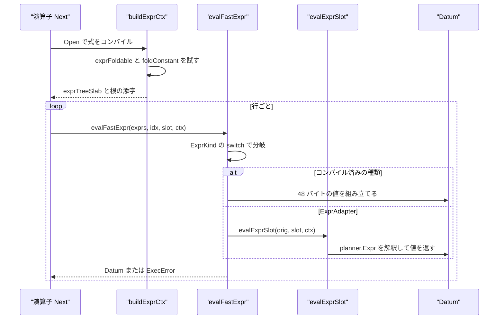
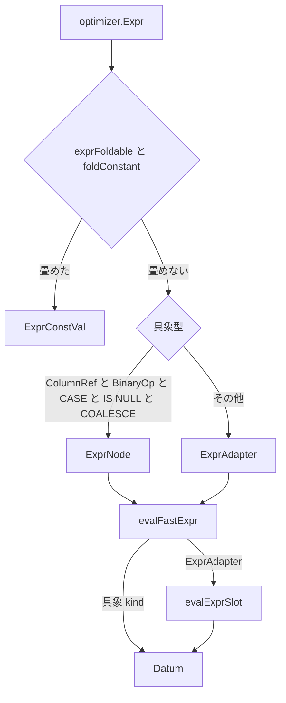

# 式評価と Datum

<details>
<summary>関連ソースファイル</summary>

- [`internal/executor/bytea.go`](https://github.com/ryogrid/goopg/blob/19856410e8d497d59787e1ab35a2febb3f5953d6/internal/executor/bytea.go)
- [`internal/executor/codec.go`](https://github.com/ryogrid/goopg/blob/19856410e8d497d59787e1ab35a2febb3f5953d6/internal/executor/codec.go)
- [`internal/executor/codec_aclitem.go`](https://github.com/ryogrid/goopg/blob/19856410e8d497d59787e1ab35a2febb3f5953d6/internal/executor/codec_aclitem.go)
- [`internal/executor/codec_array.go`](https://github.com/ryogrid/goopg/blob/19856410e8d497d59787e1ab35a2febb3f5953d6/internal/executor/codec_array.go)
- [`internal/executor/coltypeinfo.go`](https://github.com/ryogrid/goopg/blob/19856410e8d497d59787e1ab35a2febb3f5953d6/internal/executor/coltypeinfo.go)
- [`internal/executor/compiled_cond.go`](https://github.com/ryogrid/goopg/blob/19856410e8d497d59787e1ab35a2febb3f5953d6/internal/executor/compiled_cond.go)
- [`internal/executor/datum.go`](https://github.com/ryogrid/goopg/blob/19856410e8d497d59787e1ab35a2febb3f5953d6/internal/executor/datum.go)
- [`internal/executor/expr.go`](https://github.com/ryogrid/goopg/blob/19856410e8d497d59787e1ab35a2febb3f5953d6/internal/executor/expr.go)
- [`internal/executor/expr_batch.go`](https://github.com/ryogrid/goopg/blob/19856410e8d497d59787e1ab35a2febb3f5953d6/internal/executor/expr_batch.go)
- [`internal/executor/exprnode.go`](https://github.com/ryogrid/goopg/blob/19856410e8d497d59787e1ab35a2febb3f5953d6/internal/executor/exprnode.go)
- [`internal/executor/exprnode_batch.go`](https://github.com/ryogrid/goopg/blob/19856410e8d497d59787e1ab35a2febb3f5953d6/internal/executor/exprnode_batch.go)
- [`internal/executor/field_select.go`](https://github.com/ryogrid/goopg/blob/19856410e8d497d59787e1ab35a2febb3f5953d6/internal/executor/field_select.go)
- [`internal/executor/float_in.go`](https://github.com/ryogrid/goopg/blob/19856410e8d497d59787e1ab35a2febb3f5953d6/internal/executor/float_in.go)
- [`internal/executor/fold_func.go`](https://github.com/ryogrid/goopg/blob/19856410e8d497d59787e1ab35a2febb3f5953d6/internal/executor/fold_func.go)
- [`internal/executor/in_list_hash.go`](https://github.com/ryogrid/goopg/blob/19856410e8d497d59787e1ab35a2febb3f5953d6/internal/executor/in_list_hash.go)
- [`internal/executor/int_group_table.go`](https://github.com/ryogrid/goopg/blob/19856410e8d497d59787e1ab35a2febb3f5953d6/internal/executor/int_group_table.go)
- [`internal/executor/jsonb_canonical.go`](https://github.com/ryogrid/goopg/blob/19856410e8d497d59787e1ab35a2febb3f5953d6/internal/executor/jsonb_canonical.go)
- [`internal/executor/jsonpath_encoding.go`](https://github.com/ryogrid/goopg/blob/19856410e8d497d59787e1ab35a2febb3f5953d6/internal/executor/jsonpath_encoding.go)
- [`internal/executor/numeric.go`](https://github.com/ryogrid/goopg/blob/19856410e8d497d59787e1ab35a2febb3f5953d6/internal/executor/numeric.go)
- [`internal/executor/numeric_typmod.go`](https://github.com/ryogrid/goopg/blob/19856410e8d497d59787e1ab35a2febb3f5953d6/internal/executor/numeric_typmod.go)
- [`internal/executor/operators.go`](https://github.com/ryogrid/goopg/blob/19856410e8d497d59787e1ab35a2febb3f5953d6/internal/executor/operators.go)
- [`internal/executor/rangetypes.go`](https://github.com/ryogrid/goopg/blob/19856410e8d497d59787e1ab35a2febb3f5953d6/internal/executor/rangetypes.go)
- [`internal/executor/text_compare.go`](https://github.com/ryogrid/goopg/blob/19856410e8d497d59787e1ab35a2febb3f5953d6/internal/executor/text_compare.go)
- [`internal/executor/unistr.go`](https://github.com/ryogrid/goopg/blob/19856410e8d497d59787e1ab35a2febb3f5953d6/internal/executor/unistr.go)
- [`internal/executor/xmltypes.go`](https://github.com/ryogrid/goopg/blob/19856410e8d497d59787e1ab35a2febb3f5953d6/internal/executor/xmltypes.go)

</details>

`internal/executor` は、プランナーが組み立てた `optimizer.Expr` の木を、ヒープから復元した行（`Row` または `SlotView`）に対して評価し、1 列分の値を 48 バイトの `Datum` として返す。評価器は 2 系統ある。ひとつは `evalExprSlot` で、`optimizer.Expr` の具象型を `switch` で見て都度解釈する。もうひとつは `(*exprTreeSlab).buildExprCtx` が式を `ExprNode` の平坦なスラブへコンパイルし、`evalFastExpr` が整数の `ExprKind` で分岐する高速経路である。コンパイルできない種類は `ExprAdapter` として残り、実行時に `evalExprSlot` へ委譲されるため、高速化が正しさを損なわない。`Datum` 自体は型タグ付きの値型で、整数・文字列・時刻・区間・NUMERIC・列挙・TOAST ポインタを 1 つのレイアウトに畳み、NUMERIC の多倍長・bytea・range・jsonb・xml・浮動小数点入力といった型固有の規則は別ファイルが担う。式評価の呼び出し元は [6.1 実行モデルとオペレータ](6.1-Execution-Model.md) の演算子木であり、スキャン側の適用は [6.3 スキャンとインデックスアクセス](6.3-Scan-Operators.md)、集約の式は [6.5 集約・ソート・集合演算](6.5-Aggregate-Sort-Setop.md) を参照。

## 責務

- 値の共通表現 `Datum` の定義。48 バイト固定、GC 追跡フィールドは `Buf` のみというレイアウトを `const _ uintptr = 48 - unsafe.Sizeof(Datum{})` でコンパイル時に検査する。`path:internal/executor/datum.go:Datum`
- 解釈評価。`evalExpr` が `Row` を `rowSlotView` に包んで `evalExprSlot` へ渡し、`evalExprSlot` が `ColumnRef`・`OuterColumnRef`・`ExecParamRef`・`CaseExpr`・`SubqueryExpr`・`InExpr`・`CastExpr`・`FuncCall` など約 40 種の式ノードをディスパッチする。`path:internal/executor/expr.go:evalExprSlot`
- コンパイル評価。`buildExprCtx` が `ColumnRef`・整数/真偽/NULL 定数・`BinaryOp`・`UnaryOp`・`CASE`・`IS [NOT] NULL`・`COALESCE`・`OuterColumnRef`・`ExecParamRef` を `ExprNode` に落とし、その他を `ExprAdapter` にする。`path:internal/executor/exprnode.go:buildExprCtx`
- 定数畳み込み。`exprFoldable` のホワイトリストに載る列非依存の部分木を `foldConstant` がビルド時に評価し、設定非依存性を検証したうえで `ExprConstVal` に置き換える。`path:internal/executor/exprnode.go:foldConstant`
- 3 値論理と比較。`evalAnd`/`evalOr` が Kleene 論理を実装し、`compareDatum` が同一 Kind・NUMERIC/INT 昇格・pg_lsn・UUID・行・配列の各規則で順序を決める。`path:internal/executor/expr.go:compareDatum`
- 型ごとの入力検証と正規化。`evalCast`/`evalTypedStringLit` から呼ばれる `numeric.go`・`float_in.go`・`bytea.go`・`rangetypes.go`・`jsonb_canonical.go`・`jsonpath_encoding.go`・`xmltypes.go`・`unistr.go` が PostgreSQL のエラーコードと綴りを再現する。`path:internal/executor/expr.go:evalCast`
- 行の PostgreSQL バイナリ表現への変換。`EncodeRowPGCtx` と `decodeRowRangeInfo` が列型ごとの varlena・固定幅・TOAST ポインタを扱い、`colTypeInfo` が列ごとの型名解析をメモ化する。`path:internal/executor/codec.go:EncodeRowPGCtx`
- バッチ評価。`evalFastExprBatch` が選択行の集合に対して式木を 1 ノード 1 回だけディスパッチし、`exprBatchScratch` の再利用バッファで行ごとの割り当てを消す。`path:internal/executor/exprnode_batch.go:evalFastExprBatch`
- 集合探索の高速化。定数 `IN` リストは 9 要素以上なら `inListHash` のハッシュ集合になり、整数キーの集約は `intGroupTable` の開番地法テーブルにグループを持つ。`path:internal/executor/in_list_hash.go:inListHash`
- 保持境界でのアリーナ切り離し。`MaterializeArena` と `cloneRowOwned` が、producer のアリーナ Reset で無効になる文字列・バイト列・多倍長 NUMERIC を所有バイトへ昇格させる。`path:internal/executor/datum.go:MaterializeArena`

## 処理フロー

式が最初に評価されるのは演算子の `Open` である。`projectOp.Open` は各ターゲットを `o.fast.buildExprCtx(t, o.ctx)` でコンパイルし、`filterOp` は `newFilterOp` の時点で `o.predExprs.buildExpr(plan.Predicate)` を呼ぶ。前者は `Context` を渡すので定数畳み込みが有効になり、後者は `Context` を持たない構築時点なので畳み込みを行わない。どちらも `ExprNode` のスラブと根の添字（`noExpr = -1` が空）を保持する。`path:internal/executor/operators.go:projectOp.Open`

行ごとの評価では `evalFastExpr(exprs, idx, slot, ctx)` が呼ばれる。ここは `ExprKind` の `switch` で、`ExprConstVal` は畳み込み済みの `*Datum` をそのまま返し、`ExprColumnRef` はスロットの具象型（`*MaterializedSlot`・`*VirtualSlot`・`*Slot`・`*PackedSlot`・`rowSlotView`・`nil`）ごとに範囲検査をして `Get` する。`ExprBinaryOp` はまず両オペランドが既にどこかに存在する形（列・外側行・PARAM_EXEC・定数）なら `fastComparisonBool` でその場比較し、一般形では左を評価してから `OpAnd`/`OpOr` の短絡を行い、右を評価して `evalFastBinaryApply` へ渡す。`ExprAdapter` に落ちたノードだけが `evalExprSlot` を呼ぶ。`path:internal/executor/exprnode.go:evalFastExpr`

`evalExprSlot` は `ColumnRef` だけを関数先頭の高速路で処理し、それ以外を型 `switch` に流す。`CastExpr` はオペランドを評価してから `evalCast` を呼び、`FuncCall` は `evalFuncCall` の巨大な名前ディスパッチ（`now()`・`current_date`・`current_setting`・`substring`・range コンストラクタなど）へ渡す。`SubqueryExpr`/`ExistsExpr`/`CaseExpr`/`ExtractExpr` は内側の計画や複合値のために `slotToRow(slot)` で `Row` に戻り、`InExpr` はスロットのまま `evalInExpr` へ渡る。`path:internal/executor/expr.go:evalExprSlot`



インデックススキャンの `Cond` のように、演算子の外側で繰り返し評価される述語には `compiledCond` が使われる。`compiledCond.eval` は初回だけ `buildExpr`（畳み込みなし）でスラブを作り、以後は `MaterializedSlot.row` にその行を差し替えて `evalFastExpr` を呼ぶ。`compiledCondDisabled` を立てると解釈評価へ戻る。`path:internal/executor/compiled_cond.go:compiledCond.eval`

スキャンの吸収述語のように多数の行をまとめて判定できる形では `evalFastExprBatch` が使われる。`ExprConstVal`/`ExprIntConst`/`ExprBoolConst`/`ExprNullConst` は全行へ同じ値を書き、`ExprColumnRef` は選択行を回るだけ、`ExprBinaryOp` は子をバッチで評価した後 `evalFastBinaryApply` を共有する。`OpAnd`/`OpOr` は短絡する行を選択ベクトルから外し、右辺を評価する行だけを再帰に渡す。それ以外の種類は `evalFastExpr` を行ごとに呼ぶ。`path:internal/executor/exprnode_batch.go:evalFastExprBatch`

式の結果は述語なら `KindBool` か `KindNull` として検査され、射影ならそのままスロットのセルになる。`filterOp.nextPerRow` は `v.Kind == KindBool && v.BoolValue()` のときだけ行を通し、`NULL` や非 bool は棄却する。`Run` の境界では `Materialize()` がアリーナ由来の値を所有バイトへ昇格させる。`path:internal/executor/operators.go:filterOp.nextPerRow`

## 主要ファイル

| ファイル | 役割 |
| --- | --- |
| `internal/executor/datum.go` | `Datum`・`DatumKind`・`TimeSubtype`、コンストラクタ、`Format`/`AppendValueText`、`MaterializeArena`/`cloneRowOwned`。値表現の中心。`path:internal/executor/datum.go:Datum` |
| `internal/executor/expr.go` | 解釈評価の本体。`evalExprSlot`・`evalBinary`・`evalUnary`・`compareDatum`・`evalCast`・`evalFuncCall`・`evalInExpr`・`evalCaseExpr`・`evalTypedStringLit`。`path:internal/executor/expr.go:evalExprSlot` |
| `internal/executor/exprnode.go` | コンパイル評価。`ExprKind`/`ExprNode`/`exprTreeSlab`、`buildExprCtx`、`evalFastExpr`、`evalFastCase`、`foldConstant`。`path:internal/executor/exprnode.go:evalFastExpr` |
| `internal/executor/exprnode_batch.go` | `evalFastExprBatch` と `exprBatchScratch`。選択行に対するバッチ評価。`path:internal/executor/exprnode_batch.go:evalFastExprBatch` |
| `internal/executor/expr_batch.go` | `evalBinaryBatch`、`canVectoriseBinary`、`evalFilterBatch`。旧来の配列ベースの一括評価と bpchar/pg_lsn の再評価規則。`path:internal/executor/expr_batch.go:evalFilterBatch` |
| `internal/executor/compiled_cond.go` | スキャン `Cond` 用の `compiledCond`。初回コンパイルと `compiledCondDisabled`。`path:internal/executor/compiled_cond.go:compiledCond` |
| `internal/executor/operators.go` | `projectOp`/`filterOp`/`limitOp` など、式評価の主要な消費者。`projectOp.Open` の `buildExprCtx` と `filterOp` の `predExprs`。`path:internal/executor/operators.go:filterOp` |
| `internal/executor/numeric.go` | NUMERIC の int64 高速路と `big.Int` 路。`numericAdd`/`numericSub`/`numericMul`/`numericDiv`/`numericCmp`、除算ゼロの 22012。`path:internal/executor/numeric.go:numericCmp` |
| `internal/executor/numeric_typmod.go` | `numeric(p,s)` の typmod 適用。丸めと桁あふれ `22003 numeric field overflow`。`path:internal/executor/numeric_typmod.go:applyNumericTypmod` |
| `internal/executor/codec.go` | PG のタプルバイト列との相互変換。`EncodeRowPGCtx`/`DecodeRowInto`/`decodeRowRangeInfo`、型別の encode/decode。`path:internal/executor/codec.go:EncodeRowPGCtx` |
| `internal/executor/coltypeinfo.go` | 列ごとの `lower`/`align`/`isVarlena`/`intWidth`/`skip` を 1 回だけ解決する `colTypeInfo`。`path:internal/executor/coltypeinfo.go:colTypeInfo` |
| `internal/executor/codec_array.go` | 1 次元・NULL なし `ArrayType` varlena のエンコード。要素型ごとの OID と配置。`path:internal/executor/codec_array.go:encodeArrayValuePGCtx` |
| `internal/executor/codec_aclitem.go` | `aclitem[]`（OID 1034）専用コーデック。16 バイトの `AclItem` を PG 互換に並べる。呼び出し元はまだ無い。`path:internal/executor/codec_aclitem.go:encodeAclItemArrayText` |
| `internal/executor/bytea.go` | `byteaIn`/`hexDecodePG`/`escDecodePG`/`hexEncodePG`/`byteaOutHex`。22P02 と 22023 を撃ち分ける。`path:internal/executor/bytea.go:byteaIn` |
| `internal/executor/float_in.go` | `floatIn`/`floatInDatum`/`strtodToken`。PG の `float8in_internal` 互換の字句解析と 22003。`path:internal/executor/float_in.go:floatIn` |
| `internal/executor/rangetypes.go` | range の入力・出力・正規化・コンストラクタ。値は正規化済みの `KindString` として持つ。`path:internal/executor/rangetypes.go:rangeIn` |
| `internal/executor/jsonb_canonical.go` | `jsonb` の入力時正規化。キー順・重複キー・数値・エスケープを `jsonb_out` に合わせる。`path:internal/executor/jsonb_canonical.go:canonicalizeJSONB` |
| `internal/executor/jsonpath_encoding.go` | `jsonpath` の二重引用符文字列のエスケープ走査と再出力。`path:internal/executor/jsonpath_encoding.go:rewriteJSONPathText` |
| `internal/executor/xmltypes.go` | `xml` の整形式検査。`xmloption` GUC により DOCUMENT/CONTENT を切り替え、2200M/2200N を返す。`path:internal/executor/xmltypes.go:xmlValidate` |
| `internal/executor/unistr.go` | `unistr(text)` のデコード。`\XXXX`・`\uXXXX`・`\UXXXXXXXX`・`\+XXXXXX` とサロゲートペア。`path:internal/executor/unistr.go:unistrDecode` |
| `internal/executor/field_select.go` | `(composite).field` の実行時評価。`parseRecordText` で複合値のテキストを分解する。`path:internal/executor/field_select.go:evalFieldSelect` |
| `internal/executor/text_compare.go` | 静的型が文字列型のときの比較規則。`textShapeAmbiguous` と `compareDatumTyped`/`compareDatumPlain`。`path:internal/executor/text_compare.go:compareDatumTyped` |
| `internal/executor/in_list_hash.go` | 定数 `IN` リストのハッシュ集合。`minHashedInListItems = 9`、文字列/int の単一 Kind のみ。`path:internal/executor/in_list_hash.go:inListHash` |
| `internal/executor/int_group_table.go` | 整数キー集約の開番地法グループ表。Fibonacci ハッシュ、線形探索、2/3 で倍化。`path:internal/executor/int_group_table.go:intGroupTable` |
| `internal/executor/fold_func.go` | `init()` で `optimizer.EvalConstFunc` に `foldConstFuncCall` を登録するプランナ側の不変関数畳み込み。`path:internal/executor/fold_func.go:foldConstFuncCall` |

## 公開 API / エントリポイント

パッケージ外へ出るのは `Datum` のコンストラクタとコーデック、パラメータ強制変換などで、評価器そのものは主にパッケージ内の演算子から呼ばれる。

```go
func evalExpr(e optimizer.Expr, row Row, ctx *Context) (Datum, error)
func evalExprSlot(e optimizer.Expr, slot SlotView, ctx *Context) (Datum, error)
func evalFastExpr(exprs exprTreeSlab, idx int32, slot SlotView, ctx *Context) (Datum, error)
func evalFastExprBatch(exprs exprTreeSlab, idx int32, rows []Row, views []SlotView,
	sel []int32, ctx *Context, sc *exprBatchScratch, out []Datum) error

func (s *exprTreeSlab) buildExpr(e optimizer.Expr) int32
func (s *exprTreeSlab) buildExprCtx(e optimizer.Expr, ctx *Context) int32

func evalBinary(op parser.OpCode, left, right Datum, pos int, ctx *Context) (Datum, error)
func compareDatum(a, b Datum, pos int) (int, error)
func compareDatumTyped(a, b Datum, pos int, e optimizer.Expr) (int, error)
func evalCast(d Datum, targetType string, pos int, ctx *Context) (Datum, error)
func CoerceParamToDeclaredType(d Datum, targetType string, ctx *Context) (Datum, error)

func EncodeRowPG(cols []catalog.Column, row Row) ([]byte, error)
func EncodeRowPGCtx(cols []catalog.Column, row Row, ctx *Context, pos int) ([]byte, error)
func DecodeRow(cols []catalog.Column, data []byte) (Row, error)
func DecodeRowInto(dst Row, cols []catalog.Column, data []byte) error
```

`evalExpr` は `Row` を受ける薄いラッパーで、`row != nil` のときだけ `rowSlotView(row)` を作る。`nil` 行は許され、`ColumnRef` を含む式は `XX000` になるが、定数式は評価できる。`evalExprSlot` は `SlotView` を受けるので、`VirtualSlot` の合成を実体化せずに読める。`path:internal/executor/expr.go:evalExpr`

`Datum` の生成は `NewIntDatum`・`NewStringDatum`・`NewBytesDatum`・`NewBoolDatum`・`NewTimeDatum`・`NewDateDatum`・`NewTimestampTZDatum`・`NewTimeTZDatum`・`NewIntervalDatumFull`・`NewNumericInt64Datum`・`NewNumericBigDatum`・`NewEnumDatum`・`NewToastPointerDatum` などがあり、`NullDatum` が唯一の NULL 値である。`path:internal/executor/datum.go:NewNumericBigDatum`

## 主要データ構造

### `DatumKind` — 値の判別子

```go
// DatumKind discriminates the value carrier in a Datum.
type DatumKind uint8

const (
	KindNull DatumKind = iota
	KindBool
	KindInt
	KindString
	KindBytes
	KindTime
	// KindInterval is goopg's interval-arithmetic carrier,
	// mirroring upstream's months-days-microseconds shape. Months
	// and days pack into the int64 inline payload (months in the
	// high half, days in the low half) — see
	// (Datum).IntervalMonthsValue / IntervalDaysValue. The sub-day
	// microsecond component rides in the reserved Hi word
	// (IntervalMicrosValue); it is populated by timestamp −
	// timestamp subtraction and zero for month/day-only literals.
	// Sub-day interval *literal* syntax is still parser-deferred;
	// see docs/design/0003-0006-date-interval-arithmetic.md.
	KindInterval
	// KindNumeric is goopg's v0 NUMERIC/DECIMAL carrier. v0
	// stores the value as `mantissa * 10^-scale` where mantissa
	// is an int64 (Datum.Int) and scale is the number of
	// digits to the right of the decimal point (Datum.Scale).
	// Arithmetic uses int64 math after aligning scales —
	// sufficient for TPC-H SF1 magnitudes (~10^17 worst-case
	// accumulator) but bounded by int64 overflow; the rare
	// big-number lane spills to flagBigNumeric in mctx
	// (e.g. Q8's `1.00000000000000000000`). See
	// docs/design/0003-0012-numeric-arithmetic.md and
	// docs/design/0068-0001-datum-compact-layout.md.
	// M0107-0002: Big *big.Int removed; big mantissa stored in mctx.
	KindNumeric
	// KindToastPointer is an unresolved TOAST reference (M0046-0006).
	// Datum.Buf carries the 12-byte on-disk TOAST pointer:
	// [toast_oid(4)|total_len(4)|num_chunks(4)]. The value must be
	// detoasted (via DetoastRow) before it is used in expressions.
	// Scan operators detoast automatically; callers that operate on
	// raw decoded rows (e.g. UPDATE predicates) receive already-detoasted
	// datums from the underlying scan.
	KindToastPointer
	// KindEnum stores an enum value for correct ORDER BY semantics.
	// Datum.Int = math.Float64bits(sortOrder) for comparison.
	// Datum.Buf = []byte(label) for display.
	// compareDatum compares by sort order; Format/StringValue return the label.
	KindEnum

	// datumKindCount is one past the last kind. It exists so
	// TestSpillDatumRoundTripCoversEveryKind can assert that the spill codec
	// has an arm for EVERY declared kind rather than for the ones someone
	// happened to think of. M0127-P5.9-u added it after finding that KindEnum
	// and KindToastPointer had no arm at all — encodeDatum wrote a bare kind
	// byte and decodeDatum then rejected the frame with "unknown datum kind",
	// so a query that had to spill an enum column simply failed.
	datumKindCount
)
```

`path:internal/executor/datum.go:DatumKind`

`KindNull` が iota の 0 であるため、`Datum{}` のゼロ値はそのまま SQL NULL になる。`IsNull()` は `Kind == KindNull` だけを見るので、`Scale` や `Int` が残っていても Kind が NULL なら NULL である。`KindString`/`KindBytes` は `ArenaID != 0` なら `Int` の上位 32 ビットがオフセット、下位 32 ビットが長さを表し、`Buf` は nil になる。`KindTime` は Unix ナノ秒、`KindInterval` は `Int` に月（上位 32）と日（下位 32）、`Hi` にサブ日のマイクロ秒を持つ。

### `TimeSubtype` — `KindTime` の SQL 型タグ

```go
type TimeSubtype uint8

const (
	// TimeSubTimestamp is the zero value: a bare `timestamp without time
	// zone`. Datum.Format() renders it "2006-01-02 15:04:05.000000".
	TimeSubTimestamp TimeSubtype = iota
	// TimeSubDate marks the datum as a DATE. Format() renders it in
	// PostgreSQL's Postgres,MDY output style ("MM-DD-YYYY"), matching the
	// pg_regress default DateStyle (M0097-0063), and `date + integer`
	// (expr.go, upstream date_pli) dispatches on it.
	TimeSubDate
	// TimeSubTimestampTZ marks `timestamp with time zone`. Not yet populated.
	TimeSubTimestampTZ
	// TimeSubTime marks `time without time zone`. Not yet populated.
	TimeSubTime
	// TimeSubTimeTZ marks `time with time zone`; the offset east of UTC rides
	// in Datum.Scale as minutes (see NewTimeTZDatum).
	TimeSubTimeTZ

	// timeSubtypeCount is one past the last subtype. It exists so the spill
	// round-trip guard can assert it has an arm for every declared subtype;
	// adding a subtype without extending that test's table is a test failure.
	timeSubtypeCount
)
```

`path:internal/executor/datum.go:TimeSubtype`

`KindTime` は timestamp・date・timestamptz・time・timetz の 5 型を 1 つのキャリアに載せるため、`TimeSub` が「何の型か」を決める。`TimeSubDate` なら `Format` が `MM-DD-YYYY` を出し、`date + integer` の分岐もこれを見る。`TimeSubTimeTZ` は `Scale` に UTC 東方向の分位（分）を持ち、`compareDatum` は `Int - Scale*60*1e9` で UTC に正規化してから比較する。`TimeSubTimestampTZ` は表示だけの判別子で、保存される瞬間は timestamp と同じ UTC ナノ秒である。

### `Datum` — 48 バイトの値

```go
type Datum struct {
	Kind    DatumKind      // 1B @ 0 (was int = 8B; M0107-0002)
	Flags   uint8          // 1B @ 1 (flagBigNumeric; reserved others)
	ArenaID mmgr.ContextID // 2B @ 2 (replaces *mctx.Context; 0 = no mctx payload)
	Scale   int16          // 2B @ 4
	TimeSub TimeSubtype    // 1B @ 6 (KindTime only; else zero. M0127-P5.9-u —
	//                        carved out of the alignment pad, so the 48 B
	//                        layout below is unchanged.)
	_pad0 [1]byte // 1B @ 7 (alignment pad before Int)
	Int   int64   // 8B @ 8
	Buf     []byte         // 24B @ 16 (nil when arena-backed)
	Hi      uint64         // 8B @ 40 (KindInterval sub-day micros; else reserved/UUID-hi)
	// Total: 48 B. GC-traced fields: Buf (nil for arena-backed rows → 0 scans).
}
```

`path:internal/executor/datum.go:Datum`

各フィールドの意味は Kind に依存する。`Int` は整数値・Unix ナノ秒・区間の月日・NUMERIC の仮数・列挙のソート順（`float64` のビット列）・アリーナ座標のいずれかである。`Scale` は NUMERIC の小数桁数、timetz の UTC オフセット（分）。`Flags` の bit 0 は `flagBigNumeric` で、立っていると `Int` がアリーナ内の `(offset<<32|length)` になり、符号バイトと BE マグニチュードは `Buf` かアリーナに置かれる。`Hi` は区間のサブ日マイクロ秒に使い、それ以外では予約（UUID の高位など）である。`Buf` は非アリーナの文字列・バイト列・TOAST ポインタ・所有 NUMERIC の実体を指し、コピー時はエイリアスされるので読み取り専用として扱う。

### `ExprKind` — コンパイル済み式ノードの判別子

```go
// ExprKind discriminates ExprNode kinds in the expression-tree slab.
type ExprKind uint8

const (
	ExprInvalid        ExprKind = iota
	ExprColumnRef               // payload[0:4] = int32 column index
	ExprIntConst                // payload[0:8] = int64 value
	ExprBoolConst               // payload[0] = 0 (false) or 1 (true)
	ExprNullConst               // no payload
	ExprBinaryOp                // payload[0] = op, [1] = overflow code, [4:8] = int32 pos; childA/childB = operands
	ExprUnaryOp                 // payload[0] = uint8(parser.OpCode), [4:8] = int32 pos; childA = operand index
	ExprAdapter                 // orig = original planner.Expr; delegates to evalExprSlot
	ExprConstVal                // constVal = a subtree folded to a value at build time
	ExprCase                    // caseInfo = the CASE's operand / WHEN / THEN / ELSE nodes
	ExprNullTest                // payload[0] = 1 for IS NOT NULL; childA = operand
	ExprCoalesce                // childA = first argument, childB = the rest (another ExprCoalesce, or the last argument)
	ExprOuterColumnRef          // payload[0:4] = int32 level, [4:8] = int32 column index; orig kept for the error path
	ExprExecParamRef            // payload[0:4] = int32 PARAM_EXEC slot; orig kept for the error path
)
```

`path:internal/executor/exprnode.go:ExprKind`

`ExprBinaryOp` の `payload` は多目的である。`payload[0]` が `parser.OpCode`、`payload[1]` が `ovfNone`/`ovfInt2`/`ovfInt4` の桁あふれコード、`payload[4:8]` がソース位置、`payload[8:12]`/`[12:16]` が左右の宣言 bpchar 幅、`payload[16]` が「左/右が素の文字列リテラル」「両方が文字列型比較」「`||` の解決モード」のビット、`payload[17]` が未知リテラル強制後の Kind である。`payload[8:16]` を 1 つの `uint64` として読むのが `fastBinarySimple` の判定である。

### `ExprNode` と `exprTreeSlab`

```go
type ExprNode struct {
	Kind    ExprKind
	_pad    [3]byte
	childA  int32        // left/only child index; noExpr if none
	childB  int32        // right child index; noExpr if none
	payload [40]byte     // per-Kind inline data (see constants above)
	orig    optimizer.Expr // non-nil only for ExprAdapter
	// constVal is the folded value for ExprConstVal; for an ExprBinaryOp
	// comparison it is the bare literal operand coerced once to the kind in
	// payload[17] (unknownLitCoercion, unknown_literal.go); nil otherwise. A Datum is 48 bytes against payload's 40, so it cannot ride inline;
	// a pointer costs 8 bytes on every node instead of growing payload by 48.
	constVal *Datum
	// caseInfo is the ExprCase node's arms (evalFastCase), nil for every
	// other kind.
	caseInfo *exprCaseInfo
}

// exprTreeSlab is the flat slice of ExprNode for a single statement.
// It is appended to during BuildFast and immutable thereafter.
type exprTreeSlab []ExprNode
```

`path:internal/executor/exprnode.go:ExprNode`

`childA`/`childB` は `noExpr = -1` か、自分より小さいスラブ添字である。`buildExprCtx` は子を再帰的に積んでから親の添字を埋めるため、この順序が保証される。`payload` は 40 バイトしかないので 48 バイトの `Datum` は直接入らず、畳み込み値と未知リテラル強制値だけが `*Datum` として外に置かれる。`orig` は `ExprAdapter` と `ExprColumnRef`/`ExprOuterColumnRef`/`ExprExecParamRef` のエラー経路だけが読み、それ以外は nil である。

### `exprCaseInfo` — コンパイル済み CASE

```go
// exprCaseInfo is a compiled CASE: the slab indices of its operand (noExpr
// for the searched form), its WHEN/THEN pairs and its ELSE (noExpr when
// absent), plus the declared-type facts the simple form's implicit `=` needs
// — compiled here because evaluation only sees Datums (the same facts
// evalCaseExpr reads from the expressions).
type exprCaseInfo struct {
	operand      int32
	whens, thens []int32
	els          int32
	opBP         int64
	opLit        bool
	whenBP       []int64
	whenLit      []bool
}
```

`path:internal/executor/exprnode.go:exprCaseInfo`

`operand == noExpr` なら検索 CASE、そうでなければ単純 CASE である。単純 CASE の暗黙の `=` は `comparisonOperandsAsBpchar` を通すため、オペランドと各 WHEN の宣言 bpchar 幅・素リテラルかどうかを式の段階で固定して `opBP`/`opLit`/`whenBP`/`whenLit` に持つ。評価時には `Datum` しか見えないので、この事前計算がなければ bpchar の末尾空白規則を再現できない。

### `compiledCond` — スキャン述語のコンパイル状態

```go
type compiledCond struct {
	exprs exprTreeSlab
	idx   int32
	done  bool
	slot  MaterializedSlot
}
```

`path:internal/executor/compiled_cond.go:compiledCond`

`done` が偽の間だけ `exprs` を切り詰めて `buildExpr(cond)` を実行する。`slot.row` は評価のたびに呼び出し元の `Row` を指し、終わったら nil に戻す。`exprs` は `Context` を持たない `buildExpr` で作るため定数畳み込みは行われず、計画ノードに紐づく状態を持たない。

### `inListHash` — 定数 IN リストのハッシュ集合

```go
type inListHash struct {
	built bool
	// ok reports the list is hashable: at least minHashedInListItems items,
	// a bpchar rule that is the same for every item (below), and items of a
	// single kind, string or int.
	ok      bool
	strs    map[string]struct{}
	ints    map[int64]struct{}
	hasNull bool
	// trimOperand: comparisonOperandsAsBpchar trims the operand's trailing
	// blanks against every item (a bpchar operand).
	trimOperand bool
}
```

`path:internal/executor/in_list_hash.go:inListHash`

`built` が初回構築を 1 回に限定し、`ok` が「ハッシュで答えられる」ことを表す。`strs` と `ints` は同時に非 nil にならない（混在リストはハッシュ化を諦める）。`hasNull` は一致しなかったときに `NULL` を返すべきか、`false`/`true` を返すべきかを決める。`trimOperand` は bpchar オペランドの末尾空白を全項目に対して落とす規則を表す。

### `intGroupTable` — 整数キー集約の開番地法テーブル

```go
type intGroupTable struct {
	entries []intGroupEntry
	mask    uint64
	shift   uint
	n       int
	// m is the map the table replaced, used instead when
	// aggIntTableDisabled is set (A/B and tests).
	m map[int64]*groupRuntime
}

type intGroupEntry struct {
	key int64
	g   *groupRuntime // nil marks an empty slot
}
```

`path:internal/executor/int_group_table.go:intGroupTable`

`entries` の長さは 2 の冪で、`mask = len-1`、`shift = 64 - TrailingZeros(len)` により `(key * 0x9E3779B97F4A7C15) >> shift` がインデックスになる。空きスロットは `g == nil` で表し、`key` は `g` が非 nil のときだけ意味を持つ。`n` は格納数で、`3*(n+1) > 2*len(entries)` になると倍化して再ハッシュする。`m` が非 nil のときは `aggIntTableDisabled` による A/B 用の Go map 経路であり、`entries` は使われない。

## 内部構造

### 2 つの評価器は「兄弟」であり、結果が一致しなければならない

`exprnode.go` と `expr.go` のコメントは繰り返し "sibling path" という語を使う。コンパイル評価は解釈評価の高速版であり、同じ式に対して同じ `Datum` と同じエラーを返さなければならない。そのため次のような細工が入っている。

- `ColumnRef` の範囲外は `evalFastColumnRefErr` が `orig` を使って `evalExprSlot` を呼び、解釈側の per-type メッセージをそのまま返す。両者が「範囲内」について食い違った場合は `XX000` で失敗する。`path:internal/executor/exprnode.go:evalFastColumnRefErr`
- `int2`/`int4` の算術は `payload[1]` のコードに従って `fastIntOverflow` が範囲検査し、`22003 smallint out of range` / `integer out of range` を返す。位置は付けない（PostgreSQL の `int2pl`/`int4pl` が `errposition` を呼ばないため）。`path:internal/executor/exprnode.go:fastIntOverflow`
- `AND`/`OR` の短絡は左が `Kind == KindBool` のときだけ行う。`!IsNull()` で判定すると、`Datum.BoolValue()` が任意 Kind の `Int != 0` を見るため、文字列をそのまま返したり、アリーナ座標によって分岐が変わったりする。`path:internal/executor/exprnode.go:evalFastExpr`
- 浮動小数点の `BinaryOp`、行同士の比較、`ROW(...) = (SELECT ...)` は `ExprAdapter` に落として解釈評価の float64 / 要素ごと 3 値論理に委ねる。`path:internal/executor/exprnode.go:buildExprCtx`
- 文字列比較の bpchar・pg_lsn・UUID・行・配列の規則は、コンパイル時に `payload` へ畳んだり `binaryTextComparison` を共有したりして、両経路で同じ関数を通す。`path:internal/executor/text_compare.go:binaryTextComparison`



### 定数畳み込みは 2 回評価して一致したときだけ行う

`foldConstant` はまず呼び出し元の `Context` で式を評価し、次に `GetSetting = nil` にしたコピーで評価する。ワーカーの `NewWorkerContext` は `GetSetting` が nil なので、後者はワーカーが見る世界と等しい。両者の `Datum` を `foldedValuesIdentical` で比較し、Kind・Int・Scale・TimeSub・Flags と文字列/バイト列の実体がすべて一致したときだけ畳む。`Format()` で比較しないのは、タイムゾーンの異なる 2 つの瞬間が同じ壁時計文字列になるためである。評価がエラーになる式も畳まない（エラーの発生時期をビルド時に動かさない）。`path:internal/executor/exprnode.go:foldedValuesIdentical`

プランナ側にも別の畳み込みがある。`fold_func.go` の `init()` が `optimizer.EvalConstFunc` に `foldConstFuncCall` を登録し、IMMUTABLE な組み込み関数を定数引数で計画時に評価する。こちらは `evalFuncCall` をそのまま呼び、結果が `int2/int4/int8`・`numeric`・`bool`・`text/varchar` のリテラルとして正確に往復できるときだけ文字列を返す。panic は `recover` で飲み込み、未畳み込みに倒す。`path:internal/executor/fold_func.go:foldConstFuncCall`

### 比較は「値の形」を推測する

`compareDatum` は型が同じなら Kind ごとの比較に進むが、型が違う場合はまず `promoteCrossKind` を通し、NUMERIC と INT を NUMERIC に揃える。それでも Kind が違えば、文字列同士は pg_lsn なら `uint64` として、UUID なら正規化してから `strings.Compare` する。バイト列と文字列の混在は、文字列側を `byteaIn` でデコードして比較する。それ以外は最後の手段として `Format()` の文字列比較に落ちる。この最後の手段はコメントが明記するとおり PostgreSQL 的に正しいとは限らず、「クエリを落とさない」ためのものである。`path:internal/executor/expr.go:compareDatum`

この値形推測は text 型の実値に対して誤る。`'(999,9)'::text` は行のように見えるが text である。そこで `text_compare.go` は式の静的型を `optimizer.ExprResultType` で調べ、文字列型なら `textShapeAmbiguous` のときだけ `compareText`（`strings.Compare`）を使う。`compareDatumTyped` と `compareDatumPlain` がその入口で、コンパイル評価は `payload[16]` のビット 2 に同じ判定を畳んでいる。`path:internal/executor/text_compare.go:compareDatumTyped`

### NUMERIC の 2 レーン

`KindNumeric` は `Flags & flagBigNumeric == 0` なら `Int` の int64 仮数と `Scale` による高速路、立っていれば符号バイト + BE マグニチュードの多倍長路である。`numericCmp` は両方が高速路なら `numericCmpInt64Fast` を試し、桁合わせでオーバーフローする場合だけ `big.Int` に落ちる。加減乗は `numericAdd`/`numericSub`/`numericMul`、除算は `numericDiv` が `numericDivInt64Fast` → `numericDivUint128` → `numericDivBig` の順に試す。除算ゼロは `22012 division by zero`。結果の仮数が int64 を超えると `NewNumericBigDatum` が所有 `Buf` に符号+BE を書く（以前の `mmgr.Perm()` 常駐はプロセス寿命のメモリリークだった）。`path:internal/executor/numeric.go:numericDiv`

### アリーナと保持境界

スキャンは `mmgr.Context` のアリーナに文字列・バイト列を置き、`Datum` には `ArenaID` と `(offset,length)` だけを残す。アリーナはページ単位やタプル単位で Reset されるため、`Datum` の `StringValue()`/`BytesValue()` が返す参照は次の Reset までしか有効でない。保持する側は `MaterializeArena` を呼び、`KindString`/`KindBytes` は新しい `[]byte` にコピーし、`flagBigNumeric` は符号+BE を新しい `Buf` にコピーする。`rowHasArena` は `ArenaID != 0` だけを見るので、文字列以外のアリーナ利用も漏れなく検出できる。`path:internal/executor/datum.go:cloneRowOwned`

### バッチ評価のスクラッチ

`exprBatchScratch` は `datums` のスタックと `sels`（選択添字）のスタックを持つ。`push`/`pop` は BinaryOp の再帰の深さごとに 1 フレームを使い、`cap` が足りなければその場で伸ばす。定常状態では前のバッチのバッファをそのまま再利用するので、行数が同じ限り割り当てはゼロになる。`pushSel`/`popSel` は AND/OR の短絡で「右辺を評価する行」の集合を積む。`path:internal/executor/exprnode_batch.go:exprBatchScratch`

### IN リストと集約グループ表

`inListHash.hashed` は `len(values) < minHashedInListItems`（9 未満）なら何もしない。bpchar の規則が項目ごとに違う場合（オペランドが bpchar でないのに bpchar 項目が混じる）も諦める。項目が文字列と int に分かれた場合も両方の map を捨てて `ok=false` にする。`probe` は一致すれば `true`（NOT IN なら `false`）、不一致で NULL 項目があれば `NULL`、なければ `false`（NOT IN なら `true`）を返す。`path:internal/executor/in_list_hash.go:inListHash.probe`

`intGroupTable` は `map[int64]*groupRuntime` を置き換えたもので、1 エントリ 16 バイト（key 8 + ポインタ 8）を 1 キャッシュラインに収める。`get` は空きスロットかキー一致まで線形に進み、`put` は 2/3 を超える前に倍化する。`aggIntTableDisabled` を立てると `m` の Go map 経路に戻る。`path:internal/executor/int_group_table.go:intGroupTable.put`

### デコード側のメモ化

`colTypeInfo` は `catalog.Type.Name` の小文字化・物理アラインメント・varlena 判定・整数幅・NUMERIC 判定・スキップ可否を列ごとに 1 回だけ解決する。以前は値を 1 つ復元するたびに型名を 3 回走査しており、TPC-H Q14 の CPU の 4.64% を占めていた。`skip`/`skipLen` はスキャンが読まない列を、デコードせずにバイト列の長さだけで飛ばすための情報である。`path:internal/executor/coltypeinfo.go:colTypeInfo`

## エッジケースと不変条件

- **`Datum` は 48 バイト。** `const _ uintptr = 48 - unsafe.Sizeof(Datum{})` がコンパイル時にサイズを固定する。`Buf` 以外のフィールドはポインタを含まず、アリーナ backed の行では `Buf` が nil なので GC スキャンは 0 回になる。`path:internal/executor/datum.go:Datum`
- **NULL は `KindNull` のみ。** `Datum{}` のゼロ値が NULL であり、`IsNull()` は他のフィールドを見ない。`NullDatum` は `Datum{Kind: KindNull}` である。`path:internal/executor/datum.go:NullDatum`
- **`ColumnRef` の範囲外は文を殺し、バックエンドは殺さない。** 解釈評価は `*MaterializedSlot`・`*Slot`・`*VirtualSlot`・`*PackedSlot`・`rowSlotView`・nil ごとに `XX000` を返す。コンパイル評価も同じ検査を持ち、外れたら解釈評価へ委譲してメッセージを一致させる。`path:internal/executor/expr.go:evalExprSlot`
- **短絡は bool のときだけ。** `OpAnd` は左が `KindBool` かつ false のとき、`OpOr` は左が `KindBool` かつ true のときだけ右を評価しない。それ以外は右を評価し、`evalAnd`/`evalOr` の Kleene 論理に渡す。`path:internal/executor/exprnode.go:evalFastExpr`
- **`int2`/`int4` の算術は 22003。** `fastIntOverflow` が `-32768..32767` / `-2147483648..2147483647` を検査する。`ovfNone` の結果（`int8`・text・bool など）は検査しない。`path:internal/executor/exprnode.go:fastIntOverflow`
- **浮動小数点の `BinaryOp` はコンパイルしない。** `isFloatResultType` が `float8`/`float4`/`double precision`/`real` を検出して `ExprAdapter` にする。高速路の厳密な整数/NUMERIC 算術は PostgreSQL の float8 出力と一致しないためである。`path:internal/executor/exprnode.go:buildExprCtx`
- **畳み込みは失敗を先送りする。** `foldConstant` は評価エラー・設定依存の食い違い・`GetSetting` の差で値を変える式を畳まない。畳まなかった式は実行時に同じエラーを同じ順序で出す。`path:internal/executor/exprnode.go:foldConstant`
- **型付き文字列リテラルのキャッシュはセッション依存時に書かない。** `evalTypedStringLit` は `usedSession` が真なら `CachedTime`/`CacheValid` を更新しない。ゾーンなし timestamptz はセッションの `TimeZone` を読むため、キャッシュすると別セッションの計画に一方の瞬間が凍結される。`path:internal/executor/expr.go:evalTypedStringLit`
- **比較の最終手段は文字列化。** Kind が揃わず pg_lsn/UUID/行/配列/bytea の規則にも当たらない場合、`compareDatum` は `Format()` 同士を比較してクエリを完了させる。これは PostgreSQL の型解決の代替ではなく、プランナ側の列ずれで落とさないための保険である。`path:internal/executor/expr.go:compareDatum`
- **IN リストのハッシュ化は 9 要素から。** `minHashedInListItems = 9` は PostgreSQL の `MIN_ARRAY_SIZE_FOR_HASHED_SAOP` と同じ値である。空リストの `NULL IN (∅)` は false、`NULL NOT IN (∅)` は true で、オペランドが NULL でも空リストなら NULL にならない。`path:internal/executor/in_list_hash.go:minHashedInListItems`
- **NUMERIC の除算ゼロは 22012。** `numericDiv`/`numericDivBig`/`numericDivInt64Fast` の各経路が `division by zero` を返す。`numeric(p,s)` の丸め後の桁あふれは `22003 numeric field overflow` である。`path:internal/executor/numeric.go:numericDiv`
- **浮動小数点入力は 22P02 と 22003 を分ける。** `floatIn` は構文エラーを元の（trim していない）文字列で `22P02`、範囲外を数値トークンだけで `22003` として報告する。空入力は構文エラー、denormal へのアンダーフローはエラーではない。`path:internal/executor/float_in.go:floatIn`
- **bytea のエラーは 2 系統。** エスケープ形式の解析は `22P02 invalid input syntax for type bytea`、hex 形式の診断は `22023` を返す。`'\xaabb'::bytea` は 6 文字の文字列ではなく 2 バイトの `KindBytes` になる。`path:internal/executor/bytea.go:byteaIn`
- **range は正規化済みテキスト。** range 型に専用の `Datum` Kind はなく、`KindString` に `range_out` の正規形を入れる。`'[1,4]'::int4range` と `'[1,5)'::int4range` は同じ値になり、比較は文字列比較で PostgreSQL の `range_eq` と一致する。`path:internal/executor/rangetypes.go:rangeIn`
- **jsonb は入力時に正規化。** オブジェクトのキーは「長さ→バイト順」で並び、重複キーは最後が勝ち、数値は `numeric_in`/`numeric_out` を通す。`'{"b":1,"a":2}'::jsonb` は `{"a": 2, "b": 1}` になる。`path:internal/executor/jsonb_canonical.go:canonicalizeJSONB`
- **xml は整形式検査のみ。** `xmlValidate` は `xmloption`（既定 `content`）に応じて DOCUMENT/CONTENT の規則を適用し、不正なら `2200M`/`2200N` を返す。XPath や SQL/XML 生成関数は未実装である。`path:internal/executor/xmltypes.go:xmlValidate`
- **`unistr` のサロゲートは 42601。** 高位サロゲートの直後に低位サロゲートが来ない場合や、ペアの途中で別のエスケープが来た場合は `invalid Unicode surrogate pair` を返す。`path:internal/executor/unistr.go:unistrDecode`
- **バッチのエラーは行ごとの再評価に倒す。** `evalFastExprBatch` はノード単位で評価するため、どの行のエラーが先に見つかるかは行順と一致しない。呼び出し側はエラーを受けたらバッチを捨てて `evalFastExpr` を行順に回し、元のエラー位置と順序を再現する。`path:internal/executor/exprnode_batch.go:evalFastExprBatch`
- **集約グループ表の負荷率は 2/3。** `put` は `3*(n+1) > 2*len(entries)` で倍化し、初期サイズは 64、ハッシュ乗数は `0x9E3779B97F4A7C15`（黄金比）である。`path:internal/executor/int_group_table.go:intGroupTable`
- **`colTypeInfo` は DDL をまたいでキャッシュしない。** 列リストを解決する演算子の `Open` で作り直す前提であり、テーブル単位で保持すると `ALTER TABLE` 後に古い型情報を使う。`path:internal/executor/coltypeinfo.go:colTypeInfo`

Sources:

- `internal/executor/bytea.go`
- `internal/executor/codec.go`
- `internal/executor/codec_aclitem.go`
- `internal/executor/codec_array.go`
- `internal/executor/coltypeinfo.go`
- `internal/executor/compiled_cond.go`
- `internal/executor/datum.go`
- `internal/executor/expr.go`
- `internal/executor/expr_batch.go`
- `internal/executor/exprnode.go`
- `internal/executor/exprnode_batch.go`
- `internal/executor/field_select.go`
- `internal/executor/float_in.go`
- `internal/executor/fold_func.go`
- `internal/executor/in_list_hash.go`
- `internal/executor/int_group_table.go`
- `internal/executor/jsonb_canonical.go`
- `internal/executor/jsonpath_encoding.go`
- `internal/executor/numeric.go`
- `internal/executor/numeric_typmod.go`
- `internal/executor/operators.go`
- `internal/executor/rangetypes.go`
- `internal/executor/text_compare.go`
- `internal/executor/unistr.go`
- `internal/executor/xmltypes.go`

<sub>Generated by deepwiki-4myself from `goopg` @ `19856410e`</sub>
