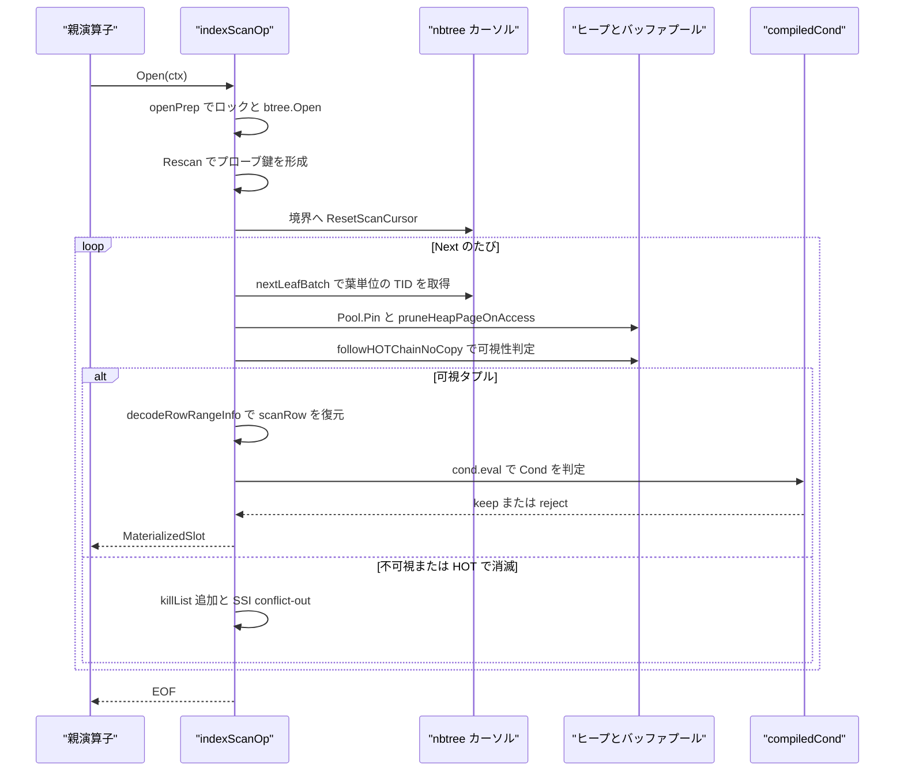
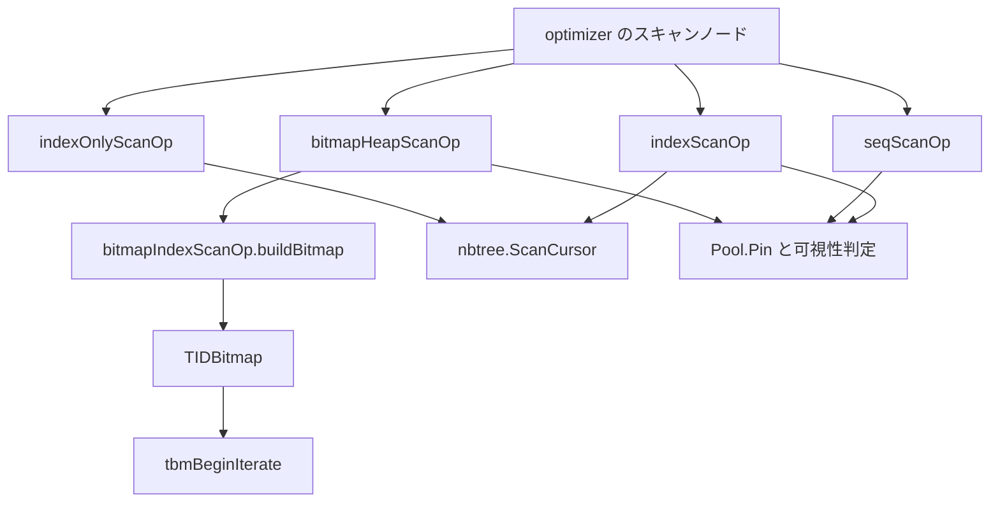

# スキャンとインデックスアクセス

<details>
<summary>関連ソースファイル</summary>

- [`internal/executor/btree_array_key.go`](https://github.com/ryogrid/goopg/blob/19856410e8d497d59787e1ab35a2febb3f5953d6/internal/executor/btree_array_key.go)
- [`internal/executor/btree_interval_key.go`](https://github.com/ryogrid/goopg/blob/19856410e8d497d59787e1ab35a2febb3f5953d6/internal/executor/btree_interval_key.go)
- [`internal/executor/btree_key_decodable.go`](https://github.com/ryogrid/goopg/blob/19856410e8d497d59787e1ab35a2febb3f5953d6/internal/executor/btree_key_decodable.go)
- [`internal/executor/btree_scalar_keys.go`](https://github.com/ryogrid/goopg/blob/19856410e8d497d59787e1ab35a2febb3f5953d6/internal/executor/btree_scalar_keys.go)
- [`internal/executor/btree_skip.go`](https://github.com/ryogrid/goopg/blob/19856410e8d497d59787e1ab35a2febb3f5953d6/internal/executor/btree_skip.go)
- [`internal/executor/heap_insert_select.go`](https://github.com/ryogrid/goopg/blob/19856410e8d497d59787e1ab35a2febb3f5953d6/internal/executor/heap_insert_select.go)
- [`internal/executor/index_probe_form.go`](https://github.com/ryogrid/goopg/blob/19856410e8d497d59787e1ab35a2febb3f5953d6/internal/executor/index_probe_form.go)
- [`internal/executor/index_read_sets.go`](https://github.com/ryogrid/goopg/blob/19856410e8d497d59787e1ab35a2febb3f5953d6/internal/executor/index_read_sets.go)
- [`internal/executor/int_probe_index.go`](https://github.com/ryogrid/goopg/blob/19856410e8d497d59787e1ab35a2febb3f5953d6/internal/executor/int_probe_index.go)
- [`internal/executor/operators_bitmap.go`](https://github.com/ryogrid/goopg/blob/19856410e8d497d59787e1ab35a2febb3f5953d6/internal/executor/operators_bitmap.go)
- [`internal/executor/operators_index.go`](https://github.com/ryogrid/goopg/blob/19856410e8d497d59787e1ab35a2febb3f5953d6/internal/executor/operators_index.go)
- [`internal/executor/operators_indexonly.go`](https://github.com/ryogrid/goopg/blob/19856410e8d497d59787e1ab35a2febb3f5953d6/internal/executor/operators_indexonly.go)
- [`internal/executor/operators_storage.go`](https://github.com/ryogrid/goopg/blob/19856410e8d497d59787e1ab35a2febb3f5953d6/internal/executor/operators_storage.go)
- [`internal/executor/prune_on_access.go`](https://github.com/ryogrid/goopg/blob/19856410e8d497d59787e1ab35a2febb3f5953d6/internal/executor/prune_on_access.go)
- [`internal/executor/scan_borrow.go`](https://github.com/ryogrid/goopg/blob/19856410e8d497d59787e1ab35a2febb3f5953d6/internal/executor/scan_borrow.go)
- [`internal/executor/scan_deform.go`](https://github.com/ryogrid/goopg/blob/19856410e8d497d59787e1ab35a2febb3f5953d6/internal/executor/scan_deform.go)
- [`internal/executor/scan_prefilter.go`](https://github.com/ryogrid/goopg/blob/19856410e8d497d59787e1ab35a2febb3f5953d6/internal/executor/scan_prefilter.go)
- [`internal/executor/tablesample.go`](https://github.com/ryogrid/goopg/blob/19856410e8d497d59787e1ab35a2febb3f5953d6/internal/executor/tablesample.go)
- [`internal/executor/tidbitmap.go`](https://github.com/ryogrid/goopg/blob/19856410e8d497d59787e1ab35a2febb3f5953d6/internal/executor/tidbitmap.go)

</details>

スキャン演算子は、読み取り経路でストレージを実際に触る場所である。`seqScanOp` はヒープのブロックを 0 から順にたどって可視タプルを復元し、`indexScanOp` は B-tree のカーソルから一致する TID を葉単位で取り出してヒープを fetch し、`indexOnlyScanOp` は Visibility Map が ALL_VISIBLE なページならインデックスキーだけから行を組み立て、`bitmapIndexScanOp` が作った `TIDBitmap` を `bitmapHeapScanOp` がブロック順に消費する。ヒープを読む 3 者は共通の部品を共有する。Build 時に決まる deform bound で復元する列を絞り、スキャンが引き受けた述語（吸収 qual や `Cond`）を行ごとに 1 回だけ評価し、条件下の親には行を clone せずに渡し（borrow）、ページを読むついでに opportunistic prune を走らせ、TABLESAMPLE の決定的ハッシュで行を選ぶ。IOS はさらに Visibility Map の ALL_VISIBLE を使う。式評価そのものは [6.2 式評価と Datum](6.2-Expression-Evaluation.md)、行の搬送と寿命は [6.1 実行モデルとオペレータ](6.1-Execution-Model.md) を参照。B-tree のページ構造とキー比較は [8 B-tree インデックス](../8-Btree.md)、ヒープページとバッファプールは [7 ストレージ](../7-Storage.md) が扱う。

## 責務

- ヒープの順次走査。`seqScanOp.Open` がリレーションロック・ring buffer・per-page アリーナ・enum 型の解決を行い、`Next` がブロックごとに `Pool.Pin` → `PageGetHeapTupleNoCopyInto` → `TupleVisibleSubxactPtr` の順で可視行を返す。`path:internal/executor/operators_storage.go:seqScanOp.Next`
- インデックスプローブ。`indexScanOp.openPrep` がロックと `openIndexBTree` を 1 回だけ行い、`Rescan` が等値・範囲・SAOP・skip-scan の各形に応じて `nbtree.ScanCursor` を構え、`Next` が葉単位の TID バッチをヒープへ解決する。`path:internal/executor/operators_index.go:indexScanOp.Rescan`
- インデックスオンリースキャン。`indexOnlyScanOp.Rescan` が VM の `AllVisible` を見て、可視ページなら `decodeRowFromKey` でキーから行を作り、そうでなければヒープへフォールバックする。`path:internal/executor/operators_indexonly.go:indexOnlyScanOp.Rescan`
- ビットマップスキャン。`bitmapIndexScanOp.buildBitmap` が `RangeScanWithPos` で TID を集めて `TIDBitmap` を作り、`bitmapHeapScanOp.nextSerial` がページ単位で消費する。`path:internal/executor/operators_bitmap.go:bitmapIndexScanOp.buildBitmap`
- deform bound の適用。Build 時の消費者ウォークが決めた `[0, bound)` だけを復元し、`deformBoundNone`/`deformBoundZero`/`deformBoundFull` の代数で「読まれない列は復元しない」を安全側に倒す。`path:internal/executor/scan_deform.go:effectiveDeformBound`
- 吸収 qual の配置。`scanPrefilter` が「MaxCols までの部分復元で判定する EARLY」か「完成行で判定する LATE」を選び、`scanQualLead` が AND の先頭 conjunct だけで棄却できる行を先に落とす。`path:internal/executor/scan_prefilter.go:evalQual`
- 行の借用。`markScanBorrowChain` が「次の `Next` までに消費され、保持されない」ことが証明できる経路をたどり、スキャンが `scanRow` を clone せずに渡せるようにする。`path:internal/executor/scan_borrow.go:markScanBorrowChain`
- 読み取り集合の伝播。`computeIndexReadSets` が計画を上から歩き、各 `IndexScan` の取得行をどの列まで読むかを `[]bool` で記録する。`path:internal/executor/index_read_sets.go:computeIndexReadSets`
- プローブキーの再利用。`indexProbeForm` が固定幅キーの最初のプローブをテンプレートとして保持し、以降は値の像をオフセットへ書くだけでキーを組む。`path:internal/executor/index_probe_form.go:indexProbeForm.form`
- skip-scan。`btreeSkipEnum` が先頭キー列に条件のない等値プローブを、格納済みの先頭列の異なる値ごとの外側ループに変換する。`path:internal/executor/btree_skip.go:btreeSkipEnum`
- B-tree キーの符号化と復号。`btree_scalar_keys.go`・`btree_array_key.go`・`btree_interval_key.go` が型ごとの順序保存キーを作り、`indexKeyColumnIsDecodable` が復号不能なキーを事前に判定する。`path:internal/executor/btree_key_decodable.go:indexKeyColumnIsDecodable`
- ページアクセス時の保守。`pruneHeapPageOnAccess` がスキャン中のページを `heap_page_prune_opt` 相当で刈り、`TABLESAMPLE` は `tableSampler` の決定的ハッシュでブロック／タプルを選ぶ。`path:internal/executor/prune_on_access.go:pruneHeapPageOnAccess`

## 処理フロー

### シーケンシャルスキャン

`seqScanOp.Open` は `Pool` と `Catalog` の存在を確認し、`acquireScanReadLockTxn` でリレーションの読み取りロックを取り、ring buffer の要否（`nBlocks > pool.Capacity()/4`）を決め、配列列がある場合だけ `arrayStyle` を解決する。`Next` はページを pin したらまず `pruneHeapPageOnAccess` を呼び、`IsNew` なら空ページとして飛ばす。タプルごとに RLock を取り、`PageGetHeapTupleNoCopyInto` でページ内のタプルを指す `storage.HeapTuple` を埋め、`TupleVisibleSubxactPtr` で可視性を判定する。可視でなければ SSI の conflict-out を記録して次へ進む。可視なら `deformBound` に従って `decodeScanRowRange`／`decodeScanRow` で `scanRow` を埋め、必要なら `DetoastRowBound` で TOAST を展開し、`cloneRowOwnedPrefix` で所有行にしてから `slot` を返す。`borrowRows` が立っていれば clone を省く。`path:internal/executor/operators_storage.go:seqScanOp.Next`

吸収 qual がある場合、`Next` はまず `scanQualLead` の先頭 conjunct を `leadRejects` で試す。ここで FALSE なら qual 全体も FALSE なので、行を復元しきらずに棄却できる。次に `prefilter.MaxCols` までの部分復元で `evalPrefilter` を呼ぶ。判定できればその時点で確定し、エラーや TOAST のように早期判定できない場合だけ、完成行に対して `evalQual` を LATE で呼ぶ。1 行につき verdict は高々 1 回である。`path:internal/executor/scan_prefilter.go:evalQual`

### インデックススキャン

`indexScanOp.Open` は初回だけ `openPrep` を呼び、リレーション／索引のロック、権限検査、`openIndexBTree`、`resolveEnumColumns`、`resolveColTypeInfo` を済ませる。以降は `Rescan` がプローブ形を選ぶ。`plan.Keys` があれば `lookupKeys` で複数列等値を組み、`plan.Key` があれば `lookupKey`、どちらもなければ `lookupRangeBounds` で範囲を組む。キーが NULL なら何にも一致しないので空のスキャンになる。`Rescan` は `nbtree.ScanCursor` を境界へ向け、SAOP なら要素ごとのカーソル列を `saopBounds` に積み、skip-scan なら `btreeSkipEnum` を初期化する。`path:internal/executor/operators_index.go:indexScanOp.Rescan`

`Next` は `tids` バッチが尽きるたびに `nextLeafBatch` を呼び、カーソルから次の葉ブロックの一致 TID を取る。TID ごとにヒープを pin し、ブロックが変わったときだけ prune を走らせ、`followHOTChainNoCopy` で HOT チェーンをたどって可視な実体を得る。不可視なら `heapChainDeadToAll` が真のときだけ `killList` に積み、SSI が有効なら不可視タプルの `xmin` に対して conflict-out を記録して次へ進む。可視なら `decodeRowRangeInfo` で `scanRow` を埋め、`applyEnumColumns`、`DetoastRowBound`、`renderHeapACLColumnInto` を経て、`plan.Cond` があれば `compiledCond.eval` で判定する。Cond を通った行だけが `lastTID` を更新し、`ssiRecordTupleRead` の後に `slot` として返る。`path:internal/executor/operators_index.go:indexScanOp.Next`



### インデックスオンリースキャン

`indexOnlyScanOp.Rescan` はプローブ形ごとに lo/hi を決め、`indexKeyIsDecodable` でキーから値へ戻せるかを 1 回だけ判定する。`scanFn` は VM の `AllVisible(heapRel, ptr.Block)` が真なら `decodeRowFromKey` の結果を `rows` に積み、偽ならヒープを pin して `followHOTChain` で可視タプルを取得し、`decodeRowFromHeap` → `projectHeapRow` でカバー列を射影する。`heapFetchCount` はこのフォールバックでだけ増える。`Next` は `rows` を前方向（`Backward` なら逆方向）に歩き、`plan.Cond` を満たす行だけを返す。`path:internal/executor/operators_indexonly.go:indexOnlyScanOp.Next`

### ビットマップスキャン

`bitmapHeapScanOp.nextSerial` は初回に `outerBitmap.buildBitmap` を呼び、`TIDBitmap` と `tbmBeginIterate` のイテレータを作る。以降はブロック番号順にページを pin し、exact ページなら `fetchExact`、lossy ページなら `nextLossyTuple` でページ上の全ライン・ポインタを走査して `BitmapQual` の再検査を行う。`nextParallel` は同じ処理を `parallelBitmapState.nextPage` の原子的なページクレームで行う。`path:internal/executor/operators_bitmap.go:bitmapHeapScanOp.nextSerial`

## 主要ファイル

| ファイル | 役割 |
| --- | --- |
| `internal/executor/operators_storage.go` | `seqScanOp` の本体。ページ走査、可視性、吸収 qual、deform、detoast、enum/ACL 変換、ring buffer、TABLESAMPLE、並列ブロッククレーム。`path:internal/executor/operators_storage.go:seqScanOp` |
| `internal/executor/operators_index.go` | `indexScanOp`。プローブ形、SAOP、skip-scan、葉単位 TID バッチ、HOT チェーン、kill list、SSI。`path:internal/executor/operators_index.go:indexScanOp` |
| `internal/executor/operators_indexonly.go` | `indexOnlyScanOp`。VM の ALL_VISIBLE 高速路、キー復号、ヒープフォールバック、カバー列の射影。`path:internal/executor/operators_indexonly.go:indexOnlyScanOp` |
| `internal/executor/operators_bitmap.go` | `bitmapIndexScanOp`/`bitmapHeapScanOp`/`bitmapAndOp`/`bitmapOrOp`。TID 収集とページ単位の消費。`path:internal/executor/operators_bitmap.go:bitmapHeapScanOp` |
| `internal/executor/tidbitmap.go` | `TIDBitmap` と `pageEntry`、`tbmAddTuples`/`tbmUnion`/`tbmIntersect`/`tbmLossify`、イテレータ。`path:internal/executor/tidbitmap.go:TIDBitmap` |
| `internal/executor/scan_deform.go` | deform bound の代数、`effectiveDeformBound`、`deformScanReadSet`、tail poison。`path:internal/executor/scan_deform.go:effectiveDeformBound` |
| `internal/executor/scan_prefilter.go` | `scanPrefilter` と `scanQualLead`。吸収 qual の EARLY/LATE 配置と先頭 conjunct の早期棄却。`path:internal/executor/scan_prefilter.go:scanPrefilter` |
| `internal/executor/scan_borrow.go` | `markScanBorrowChain` と `aggregateBorrowsScanRows`。clone を省ける経路の判定。`path:internal/executor/scan_borrow.go:markScanBorrowChain` |
| `internal/executor/index_read_sets.go` | `computeIndexReadSets` と `indexReadSetWalk`。インデックススキャンが読む列集合の伝播。`path:internal/executor/index_read_sets.go:computeIndexReadSets` |
| `internal/executor/index_probe_form.go` | `indexProbeForm`。固定幅プローブのテンプレート化。`path:internal/executor/index_probe_form.go:indexProbeForm` |
| `internal/executor/btree_skip.go` | `btreeSkipEnum`。先頭列無条件の等値プローブを skip-scan に変換する。`path:internal/executor/btree_skip.go:btreeSkipEnum` |
| `internal/executor/btree_scalar_keys.go` | int2・oid・bool・bytea・time・timetz・interval の順序保存キー符号化。`encodeScalarBTreeKey` が型ごとの腕を束ねる。`path:internal/executor/btree_scalar_keys.go:encodeScalarBTreeKey` |
| `internal/executor/btree_array_key.go` | 配列キーの符号化（要素タグ + 要素キー + 終端 0x00）。`path:internal/executor/btree_array_key.go:encodeArrayBTreeKey` |
| `internal/executor/btree_interval_key.go` | interval キー。`interval_cmp_value` の 128 ビット span を 16 バイトで表す非可逆キー。`path:internal/executor/btree_interval_key.go:intervalKeyParts` |
| `internal/executor/btree_key_decodable.go` | `indexKeyColumnIsDecodable`/`indexKeyColumnRendersHeapText`。IOS がキーから答えられるかの事前判定。`path:internal/executor/btree_key_decodable.go:indexKeyColumnIsDecodable` |
| `internal/executor/prune_on_access.go` | `pruneHeapPageOnAccess`。読み取り中のページの opportunistic prune。`path:internal/executor/prune_on_access.go:pruneHeapPageOnAccess` |
| `internal/executor/tablesample.go` | `tableSampler`、SYSTEM/BERNOULLI の決定的ハッシュと `tsmCutoff`。`path:internal/executor/tablesample.go:tableSampler` |
| `internal/executor/heap_insert_select.go` | FSM からの挿入先候補選択とバッチ延長。`candidatesPerInsert`/`hotPinThreshold`/`extendBatchSize`。`path:internal/executor/heap_insert_select.go:selectFSMCandidatePage` |
| `internal/executor/int_probe_index.go` | ハッシュ結合の int レーン用 `intProbeIndex`。開番地法の凍結ビュー。`path:internal/executor/int_probe_index.go:intProbeIndex` |

## 公開 API / エントリポイント

スキャン演算子は `Build`／`buildRec` が計画ノードから生成し、`Operator` インタフェース（`Open`/`Next`/`Close`/`Schema`）で駆動される。以下はパッケージ内の生成関数と、スキャン系の補助 API。

```go
func newSeqScanOp(p *optimizer.SeqScan) *seqScanOp
func newIndexScanOp(p *optimizer.IndexScan) *indexScanOp
func newIndexOnlyScanOp(p *optimizer.IndexOnlyScan) *indexOnlyScanOp
func newBitmapIndexScanOp(p *optimizer.BitmapIndexScan) *bitmapIndexScanOp
func newBitmapHeapScanOp(p *optimizer.BitmapHeapScan) *bitmapHeapScanOp

func (o *bitmapIndexScanOp) buildBitmap(ctx *Context) (*TIDBitmap, error)
func tbmAddTuples(tbm *TIDBitmap, tids []storage.ItemPointer, recheck bool)
func tbmUnion(tbm, other *TIDBitmap)
func tbmIntersect(tbm, other *TIDBitmap)
func tbmLossify(tbm *TIDBitmap)
func tbmBeginIterate(tbm *TIDBitmap) *tbmIterator

func computeIndexReadSets(root optimizer.Node) indexReadSets
func planScanPrefilter(pred optimizer.Expr, ncols int) (scanPrefilter, bool)
```

`bitmapIndexScanOp.Next` は呼ばれると panic する。ビットマップインデックススキャンは pull モデルでは実行されず、`bitmapHeapScanOp` が `bitmapProducer` インタフェース越しに `buildBitmap` を呼ぶ。`path:internal/executor/operators_bitmap.go:bitmapIndexScanOp.Next`

## 主要データ構造

### `TIDBitmap` — ページキーの TID 集合

```go
// TIDBitmap is a sparse, page-keyed set of tuple IDs (PG's TIDBitmap
// analogue in nodes/tidbitmap.c). It stores exact pages (per-offset
// bitmap) and lossy pages (one bit per page, every tuple must be
// re-checked against the original index qual).
//
// Zero value is an empty bitmap ready for use.
type TIDBitmap struct {
	// entries maps BlockNumber → pageEntry. nil until the first insert.
	entries map[storage.BlockNumber]*pageEntry
	// maxEntries is the soft memory ceiling; when exceeded, the heaviest
	// exact page is degraded to lossy. 0 = unlimited.
	maxEntries int
	// npages counts exact entries; nchunks counts lossy entries.
	npages  int
	nchunks int
	// recheckAny is true if any entry has recheck set (fast-path for
	// the heap-scan operator).
	recheckAny bool
}

// MaxOffsetNumber is the maximum tuple offset on a heap page (PG's
// MaxOffsetNumber, itemptr.h).
const MaxOffsetNumber = 2048 // PG default; must be >= the actual max on any page.

// bitmapWords is the number of bytes needed to represent MaxOffsetNumber bits.
const bitmapWords = MaxOffsetNumber / 8

type pageEntry struct {
	block   storage.BlockNumber // block number (key)
	isLossy bool                // true → visited entirely; bitmap ignored
	recheck bool                // true → evaluate original index qual per tuple
	// bitmap[k/8] & (1<<(k%8)) means OffsetNumber (k+1) is present.
	// Only used when isLossy == false. Length = bitmapWords.
	bitmap []byte
}
```

`path:internal/executor/tidbitmap.go:TIDBitmap`

`entries` はブロック番号 → `pageEntry` の疎な写像で、最初の追加まで nil である。exact ページは `bitmap[k/8]` のビットでオフセット `k+1` を表し、lossy ページは `isLossy` を立てて `bitmap` を捨て、ページ全体を走査対象にする。`recheck` は「インデックス条件だけでは行を保証できない」ことを示し、`recheckAny` はヒープスキャン側の高速判定用である。`npages` は exact、`nchunks` は lossy の数を数え、`maxEntries` を超えると `tbmLossify` が最も重い exact ページを lossy に落とす。

### `indexProbeForm` — 固定幅プローブのテンプレート

```go
type indexProbeForm struct {
	// cols[i] is the table column of key position i, resolved on first use.
	cols []*catalog.Column
	// tmpl is the template probe for tmplN attributes, offs/lens each
	// attribute's offset and width in it; nil when the probe is not
	// all-fixed-width (or no probe has been formed yet).
	tmpl  []byte
	tmplN int
	offs  []int
	lens  []int
	tried bool
}
```

`path:internal/executor/index_probe_form.go:indexProbeForm`

`cols` はキー位置ごとのテーブル列で、`colAt` が初回だけカタログを引いてキャッシュする。`tmpl` は全属性が固定幅で NULL ビットマップを持たないプローブの雛形で、`offs`/`lens` が各属性のオフセットと幅である。`tried` はテンプレート化を 1 回だけ試すためのフラグで、一度失敗したら以後は `ctx.indexProbeKey` の一般経路を使う。`fill` は値の像がテンプレートの幅と一致しない場合に `ok=false` を返し、呼び出し側を一般経路へ戻す。

### `scanPrefilter` — 吸収 qual の早期判定

```go
type scanPrefilter struct {
	pred optimizer.Expr
	// MaxCols is the exclusive upper bound on the column indexes pred reads:
	// the scan deforms cols[0:MaxCols] before evaluating it.
	MaxCols int
}
```

`path:internal/executor/scan_prefilter.go:scanPrefilter`

`pred` はスキャンが吸収した Filter の述語そのもので、`MaxCols` はその述語が読む列の排他的上限である。`MaxCols` までの列だけを復元して述語を評価し、通った行だけ残りの列を復元する。`planScanPrefilter` が `optimizer.PlanScanQual` の `sq.Early`/`sq.MaxCols` を受け取るが、`scanPrefilterForceLate` が立っている場合や解析が早期評価を拒んだ場合は `ok=false` を返し、LATE 評価に倒す。

### `scanQualLead` — AND の先頭 conjunct

```go
type scanQualLead struct {
	// idx is the lead's node in the prefilter's slab; noExpr means no lead
	// stage (none was found, or the probe below switched it off).
	idx int32
	// max is the lead's MaxCols, and info is colInfo with every column in
	// [0, max) the lead does not read marked skip (nil: colInfo itself).
	max  int
	info []colTypeInfo
	// seen / rejected count the lead's evaluations and FALSE verdicts. A lead
	// that rejects under a quarter of the first scanLeadProbeRows rows only
	// adds work (the rows it passes decode its columns twice), so the stage
	// is switched off for the rest of the scan.
	seen, rejected int
}
```

`path:internal/executor/scan_prefilter.go:scanQualLead`

`idx` は prefilter のスラブ内で先頭 conjunct を指し、`noExpr` なら先頭段階は無効である。`max` はその conjunct が読む列の上限で、`info` は `[0, max)` のうち conjunct が読まない列を `skip` にした `colInfo` のコピーである。`seen`/`rejected` は評価回数と FALSE の回数で、`scanLeadProbeRows = 4096` 行を処理した時点で棄却率が 1/4 未満なら `idx = noExpr` にして段階ごと止める。先頭 conjunct が FALSE なら qual 全体も FALSE になるのは、コンパイル済み AND が左を先に評価して FALSE を返すためである。

### `btreeSkipEnum` — skip-scan の列挙

```go
type btreeSkipEnum struct {
	rest      []indexProbeKeyPart // evaluated bound-column parts (columns skipPrefix..), once per Rescan
	keyCols   []*catalog.Column   // resolved index key columns (pgIndexKeyColumns), tuple AND blob prefix decode
	desc      *nbtree.PGIndexKeyDesc
	restBytes []byte // blob format only: encoded suffix bound, appended behind each group's prefix
	seek      []byte // lo bound for the next group's first entry (nil = index start)
	seekExcl  bool   // seek is exclusive (tuple pivots; blob successors are inclusive)
	done      bool   // enumeration exhausted (or impossible — e.g. a NULL bound)

	// The leaf walk's state (walkLeaf, tuple format only): the cursor, and
	// the current prefix group's probe (prefix || bound columns) and pivot
	// (prefix alone), with whether the walk has reached and passed the
	// probe's range inside that group.
	walkCur  *nbtree.ScanCursor
	gProbe   []byte
	gPivot   []byte
	gReached bool
	gPassed  bool

	// walkSpare / enumSpare are the cursors walkLeaf and next re-aim
	// (nbtree.BTree.ResetScanCursor) for every descent, kept across init and
	// reset so one scan node allocates each once — PG's one BTScanOpaque
	// per scan (M0122-0012 slice 77).
	walkSpare *nbtree.ScanCursor
	enumSpare *nbtree.ScanCursor

	// vals is groupBounds' reused value buffer (prefix datums, then the
	// bound columns' values).
	vals []Datum
	// restImgs are the bound columns' attribute images, encoded once per
	// Rescan for groupBoundsRaw (nil when one cannot be, e.g. a TOAST
	// pointer); rawImgs / rawNulls are its reused per-group buffers.
	restImgs     [][]byte
	restImgsDone bool
	rawImgs      [][]byte
	rawNulls     []bool
	// probeTmpl / pivotTmpl are groupBoundsFixed's per-Rescan templates for
	// a skip prefix of tmplS attributes (nil when the probe is not all
	// fixed-width), and tmplOffs the prefix attributes' offsets in them.
	tmplDone  bool
	tmplS     int
	probeTmpl []byte
	pivotTmpl []byte
	tmplOffs  []int
}
```

`path:internal/executor/btree_skip.go:btreeSkipEnum`

`rest` は `skipPrefix` 以降の束縛列を評価した `indexProbeKeyPart` で、`Rescan` ごとに 1 回だけ評価される。`keyCols`/`desc` は索引キーの列と記述子で、`desc` が nil なら blob 形式のキーとして `restBytes` に束縛列の符号化を前もって持つ。`seek`/`seekExcl` は次のグループの先頭を探す下限で、`done` が立つと列挙は終わりである。`walkCur`/`enumSpare` などはカーソルを毎回 allocate しないための再利用スロットで、`reset` は `done` だけを更新してカーソルを保持する。

### `indexReadSets` — インデックススキャンの読み取り集合

```go
// indexReadSets maps each IndexScan of a statement's plan to the table
// columns its fetched rows may be read at. An entry's nil value, and a
// missing entry, both mean every column.
type indexReadSets map[*optimizer.IndexScan][]bool
```

`path:internal/executor/index_read_sets.go:indexReadSets`

キーは計画上の `*optimizer.IndexScan`、値はテーブル列ごとの「親が読むか」の真偽値である。値が nil のエントリと欠落エントリはどちらも「全列を読む」を意味する。この集合はトップダウンにのみ広がるため、スキャンが列を飛ばせるのは根からスキャンまでのどのノードもその列を読まないと証明できた場合だけである。

### `tableSampler` — TABLESAMPLE のコールバック

```go
type tableSampler interface {
	// nextSampleBlock returns the first block at or after `from` that is in
	// the sample, or ok=false once the relation is exhausted. BERNOULLI
	// returns `from` unchanged (it samples within every block).
	nextSampleBlock(from, nblocks uint32) (blk uint32, ok bool)
	// sampleTuple reports whether the tuple at (blockno, offset) — offset
	// being a 1-based OffsetNumber, as upstream's OffsetNumber is — belongs
	// to the sample. SYSTEM returns true for every tuple in a block it
	// already accepted.
	sampleTuple(blockno uint32, offset uint16) bool
	// method is the name EXPLAIN prints on the "Sampling:" line.
	method() string
}
```

`path:internal/executor/tablesample.go:tableSampler`

`nextSampleBlock` は `from` 以降で最初に標本へ入るブロックを返し、`sampleTuple` は 1 始まりのオフセットが標本に入るかを返す。SYSTEM はブロック単位で採否を決めて `sampleTuple` は常に true、BERNOULLI は全ブロックを通してタプルごとに決める。どちらも `tsmHashAny` の決定的ハッシュと `tsmCutoff` の閾値だけで判定するため、`REPEATABLE (seed)` が同じ行集合を再現する。

### 大型の走査構造体

`seqScanOp` は 294 行、`indexScanOp` は以下に全文を引用する 178 行、`indexOnlyScanOp` は 83 行、`bitmapHeapScanOp` は 117 行あり、それぞれの全定義は `path:internal/executor/operators_storage.go:979`、`path:internal/executor/operators_indexonly.go:24`、`path:internal/executor/operators_bitmap.go:310` にある。ここでは不変条件を決めるフィールドだけを整理する。

#### `indexScanOp`

```go
type indexScanOp struct {
	// cond is plan.Cond compiled for the per-row filter (C43).
	cond compiledCond
	// filterRemoved counts the visible tuples cond rejected — PG's
	// nfiltered1 on the scan node (execScan.h ExecScan,
	// InstrCountFiltered1), shown as `Rows Removed by Filter`. Handed over
	// by maybeInstrument or the NLI probe sidecar; nil outside EXPLAIN
	// ANALYZE (M0122-0021).
	filterRemoved *int64

	// probeForm resolves the probe key's columns once and forms fixed-width
	// probes from a template (M0122-0012 slice 80).
	probeForm indexProbeForm
	// curSpare is the cursor the equality / range rescan re-aims.
	curSpare *nbtree.ScanCursor
	// rangeLoExcl / rangeHiExcl: the INDEX-ORDER exclusivity of the bounds
	// lookupRangeBounds returned — the plan's operators, swapped for a DESC
	// column, and forced exclusive where an open end became a NULL pivot
	// (nullStopRangeBound). Rescan hands them to the cursor.
	rangeLoExcl, rangeHiExcl bool

	plan *optimizer.IndexScan
	ctx  *Context
	// enumTypes[i] is non-nil when Table.Columns[i] is a user-defined enum,
	// resolved ONCE in openPrep. Before this existed, Next() asked the
	// catalog per column PER ROW — 17.94% of TPC-H CPU on a schema with no
	// enums at all, two thirds of it RWMutex traffic. nil when the scan has
	// no enum column, which is every TPC-H and TPC-DS table.
	// See resolveEnumColumns (enumcols.go).
	enumTypes []*catalog.EnumType
	// colInfo is the per-column decode memo (resolveColTypeInfo), resolved
	// once in openPrep from o.plan.Table.Columns -- the SAME slice Next()
	// decodes with, which is the positional-indexing precondition
	// decodeRowIntoInfo documents. Without it this operator decoded through
	// the public entry points, which hardcode info = nil, so every value
	// re-derived its type facts from a string: 29.70% of TPC-H CPU reached
	// decodeRowRangeInfo this way. seqScanOp already threaded its memo.
	colInfo []colTypeInfo
	// M0092-0001: heap-fetch-lazy; M0142-0005b: TID-list-lazy too.
	// `tids`/`poss` are now a per-LEAF batch refilled from `cur` (the
	// leaf-grain nbtree.ScanCursor) only when Next() reaches the batch
	// end — not the whole match set collected eagerly in Rescan. This is
	// the index-side laziness PG's index_getnext_tid gives
	// nodeIndexscan.c: a probe whose consumer stops early (semi/anti
	// inner, LIMIT, a rejecting Filter) never pays to walk the leaf
	// pages it did not need.
	// `tids[i]` holds the (block, index-pointed offset) pair for the
	// i-th match of the CURRENT batch. The HOT-resolved actual
	// slot offset is computed PER Next() and recorded in lastTID for
	// currentTID() — the lockRowsOp consumer.
	//
	// Pre-M0092 the operator also kept `rows []Row` (fully materialised
	// matches via cloneRow per scanFn invocation), which dominated 34 %
	// of allocations in the post-M0091 pgbench select-only profile.
	// The new lazy model decodes one row per Next() into the reusable
	// `scanRow` and returns a slot ALIASING it — caller must consume /
	// Materialize before the next Next() call (standard
	// MaterializedSlot contract).
	tids    []storage.ItemPointer
	idx     int
	lastTID storage.ItemPointer
	hasLast bool

	// C3-S2: physical index-entry positions parallel to tids (from
	// the cursor's per-leaf batch), and the kill list of entries whose
	// whole heap chain proved dead-to-all at the Next() visibility step.
	// S3 turns killList into the deferred exclusive-latched mark pass at
	// Close/Rescan; S2 only collects.
	poss     []nbtree.ScanPos
	killList []nbtree.KillItem

	// M0142-0005b cursor state. `cur` is the live ScanCursor (nil once
	// exhausted); `scanDone` marks the scan fully drained; `sawTID`
	// records that the scan pulled at least one index entry — the
	// deferred SSI gap-lock oracle (ssiRecordIndexScanGapLock used to
	// read len(tids) at Rescan end, when the match set was materialised
	// eagerly; under laziness the answer is known only at exhaustion or
	// Rescan/Close, so finalizeIndexScanSSI fires once per scan at the
	// first of those three). `isFullKeyProbe` is stashed for that
	// deferred call; `ssiDone` makes it once-only.
	cur            *nbtree.ScanCursor
	scanDone       bool
	sawTID         bool
	isFullKeyProbe bool
	ssiDone        bool

	// saopBounds/saopIdx/saopSeen implement the SAOP multi-descent as a
	// lazy chain of per-element cursors: bounds are encoded eagerly at
	// Rescan (same eval timing as the pre-cursor loop, same eager
	// per-element hash-bucket SIREADs), while each element's descent and
	// leaf reads happen only when the chain reaches it — mirroring PG's
	// own lazy array-element advance in index_getnext_tid. saopSeen
	// dedups TIDs across equal array elements (IN (1,1,2)).
	saopBounds [][2][]byte
	saopIdx    int
	saopSeen   map[storage.ItemPointer]struct{}

	// skip-scan state (M0146-0005v, PG18's `_bt_skiparray`): a probe that
	// binds a NON-leading key column is executed as an outer loop over the
	// distinct values stored in the skipped leading columns — one descent
	// that finds each group's first entry (skipSeek as a strictly-past
	// bound), then one bounded probe descent per group, chained lazily
	// through nextLeafBatch exactly like the SAOP multi-descent. No
	// dedup map: the strictly-past successor guarantees strictly increasing
	// groups, unlike SAOP's possibly-duplicated array elements.
	skip btreeSkipEnum

	// pidx is the shared leaf-block claim set when this scan is a Gather
	// worker's driving scan (C-19c, the plain-index-scan sibling of the IOS's
	// M0134-0189 field); nil for a serial scan, and a nil receiver claims
	// every block (parallel_scan.go). leafMemo caches this worker's verdicts.
	//
	// Only the single-range site in Rescan consults it. The SAOP multi-descent
	// (rescanSAOP) and the NLI-driven re-probe are never a Gather's driving
	// scan — the planner's drivingScan (optimizer/parallel.go) admits a plain
	// index scan only as a bare range/full scan — so those sites stay serial
	// by construction rather than by a filter they do not apply.
	pidx     *parallelIndexScanState
	leafMemo leafClaimMemo

	// M0054-0006a: state captured at Open() time and reused across
	// Rescan() calls when the index probe is driven by an outer row
	// from a parent NestedLoopIndexJoin.
	heapRel storage.RelFileNode
	tree    *nbtree.BTree
	// M0072-0001: outerSlot is the slot the parent NLI bound via
	// BindOuter. The slot's Get(col) is read by lookupKey /
	// lookupRangeBounds / lookupKeys via evalExprSlot. nil when this
	// scan is run from a single-table path (the historical case):
	// then `o.plan.Key` / `LowKey` / `HighKey` must reduce to
	// constants. outerWidth is captured at BindOuter time so the
	// per-call evalExprSlot path has a consistent width hint
	// (preserves the legacy `len(o.outerRow)` bound check
	// equivalence without requiring a Width() method on SlotView).
	outerSlot  SlotView
	outerWidth int

	// scanRow is the per-Next decode buffer; reused across every
	// Next() call. The slot returned by Next() aliases this buffer.
	// Acquired in openPrep from the rowPool (M0068-0004), released
	// in Close.
	scanRow Row

	// deformBound is the EX1-02b exclusive deform width: the heap-fetch
	// path deforms columns [0, deformBound) instead of the full row,
	// because the Build-time consumer walk proved no consumer reads past
	// it (union of the parent walk, the leaf-local Cond refs, and the
	// index key columns as belt-and-braces over-widening — never the key
	// probe exprs, which index outer space on an NLI inner). Stamped by
	// both Build paths; 0 means unset and behaves as full width.
	// scanRow stays full-width — only the deform window narrows, so a
	// bound equal to the column count takes the exact pre-EX1-02b path.
	deformBound int
	// prunedBlock / prunedBlockSet remember the heap block the last
	// on-access prune ran for, so the prune runs once per block switch
	// (M0145-0008t).
	prunedBlock    storage.BlockNumber
	prunedBlockSet bool

	// M0092-0007: embedded slot reused across every Next() call so
	// we don't allocate a fresh MaterializedSlot per emission.
	// The returned `&o.slot` pointer is stable across calls; its
	// `row` field is overwritten each Next.
	slot MaterializedSlot

	// hashBucketScan is set in Open when this is a SERIALIZABLE equality scan
	// over a HASH index (design 0118-0099). When true the scan takes a
	// bucket-grain SIREAD on the index instead of a relation-grain / per-tuple
	// heap lock, and the per-tuple reads in Next switch to conflict-out-only so
	// they cannot coarsen into a heap-page lock that would re-introduce the
	// different-bucket false positive (predicate-hash spec).
	hashBucketScan bool
	// hashProbeFingerprint is the blob-format encoding of this scan's probe key
	// (ssiHashProbeFingerprint), which is what the bucket tag must be derived
	// from — NOT the tuple-image search key the same probe descends the tree
	// with. Set by lookupKey/lookupKeys, cleared per Rescan.
	hashProbeFingerprint []byte
}
```

`path:internal/executor/operators_index.go:indexScanOp`

`cur` が生きた `nbtree.ScanCursor` で、nil は枯渇を意味する。`tids`/`poss` は現在の葉バッチの TID と物理エントリ位置で、`idx` がその中の読み位置、`lastTID`/`hasLast` が「最後に emit した行の TID」を表す。`killList` はヒープ側で dead-to-all と判明した索引エントリをため、`Close` か `flushKills` で `tree.KillItems` に渡す。`saopBounds`/`saopIdx`/`saopSeen` は `IN (...)` の各要素を遅延してたどるカーソル列と TID 重複排除、`skip` は skip-scan の列挙である。`deformBound` は `[0, bound)` の復元幅、`prunedBlock` は同じブロックで prune を二度走らせないための記憶、`slot` と `scanRow` は `Next` ごとに再利用される。

#### `seqScanOp` の主要フィールド

| フィールド | 保持するもの |
| --- | --- |
| `schema`/`tbl`/`rel` | 出力スキーマ、カタログ上のテーブル、物理リレーションファイル。`Open` で `rel` を固定し、`Next` ごとのカタログ参照を避ける。 |
| `qual`/`qualSet`/`prefilter` | 吸収した qual と、その EARLY 判定の `MaxCols`。`qualSet` が真なら上位に `filterOp` は無い。 |
| `deformBound`/`readCols`/`colInfo`/`pfInfo` | 復元幅、消費者が読む列、列型メモ、prefilter のスキップ用メモ。 |
| `scanRow`/`scanSlot`/`slot`/`sctx` | 再利用する復元バッファ、その `SlotView`、返却スロット、ページ単位アリーナ。 |
| `borrowRows` | 親が行を保持しないと証明できたときの clone 省略。 |
| `sampler`/`sampleSpec` | TABLESAMPLE の実行器と計画時の指定。`sampleSpec` が nil なら通常スキャン。 |
| `pscan`/`nBlocks`/`curBlock`/`curSlot`/`slotMax` | 並列ブロッククレームと現在位置。`pscan` が非 nil なら `curBlock` は共有アロケータから取る。 |
| `ring`/`activePage`/`pinned` | リングバッファ、現在ページ、プールのピン。 |
| `enumTypes`/`typeACLColIdx`/`attrACLColIdx`/`dbACLColIdx` | enum のソート順注入と、`pg_type.typacl` などの `_aclitem` ブロブ描画。 |

`seqScanOp` の不変条件は「`scanRow` と `schema` は常に全幅、狭いのは deform の窓だけ」「1 行につき吸収 qual の verdict は高々 1 回」「`slot` は次の `Next` まで有効」の 3 つである。

#### `indexOnlyScanOp` の主要フィールド

| フィールド | 保持するもの |
| --- | --- |
| `cond`/`filterRemoved` | `plan.Cond` のコンパイル済み評価器と、それを落とした行数。 |
| `probeForm`/`keyDesc`/`keyCols`/`keyNames`/`keyVals` | プローブ鍵のテンプレートと、キー復号で使う列・名前・再利用バッファ。 |
| `coveredHeapIdx`/`coveredEnum`/`coveredKeyIdx` | `Covered` 列のヒープ位置、enum のソート順写像、キー内位置。いずれも 1 スキャン 1 回解決。 |
| `rows`/`idx` | Rescan が実体化した一致行と、その読み位置（`Backward` なら逆順）。 |
| `pidx`/`leafMemo` | 並列ワーカーの葉クレームと、その判定メモ。 |
| `heapFetchCount`/`touchedBlocks` | ALL_VISIBLE でなかったエントリのヒープ fetch 数と、TEMP 表で触れたブロック。 |
| `heapRel`/`tree`/`outerSlot`/`outerWidth` | `openPrep` が固定する物理関係・B-tree と、NLI が `BindOuter` で渡す外側スロット。 |

#### `bitmapHeapScanOp` の主要フィールド

| フィールド | 保持するもの |
| --- | --- |
| `outer`/`outerBitmap` | `BitmapIndexScan`／`BitmapAnd`／`BitmapOr` の producer と、その `buildBitmap` 能力。 |
| `tbm`/`iter`/`ownBitmap` | 構築済み `TIDBitmap`、`tbmIterator`、自分が作ったビットマップを Close で解放するかのフラグ。 |
| `pinned`/`pageBuf`/`pageBlock`/`pageLossy` | 現在 pin しているページと、そのブロック・lossy 属性。 |
| `lossyOff`/`inLossyPage`/`parOffsets`/`parOff`/`parRecheck` | lossy ページ内の走査カーソルと、exact ページを複数 `Next` にまたがって処理するためのオフセット列。 |
| `scanRow`/`deformBound`/`mctx`/`slot`/`cols` | 復元バッファ、復元幅、ページ単位アリーナ、返却スロット、列情報。 |
| `cond`/`exactPages`/`lossyPages`/`recheckRemoved` | `Cond` の評価器と、EXPLAIN ANALYZE 用のページ数・再検査棄却数。 |
| `borrowRows` | `emitRow` が clone を省いて `scanRow` を返してよいかのフラグ。 |

## 内部構造

### deform bound の代数

Build は親から子へ `bound` を渡す。`deformBoundNone = -1` は「まだ消費者参照が無い」、`deformBoundZero = -2` は「子の列を 1 つも読まない消費者境界」（`count(*)` の Aggregate）、`deformBoundFull` は粘着的な全幅、`deformWidthZero = -1` は「1 列も復元しない」という葉への刻印である。`effectiveDeformBound` は `deformBoundZero` を `deformWidthZero` に、負値や Full を `ncols` に、それ以外を `bound+1` に解決する。`seqScanSurvivorWidth` は SeqScan 用に `deformWidthZero` を 0 に、通常の刻印をそのまま幅に変える。`path:internal/executor/scan_deform.go:effectiveDeformBound`

この代数が安全なのは、値を変えうる形（関数呼び出し、サブクエリ、外側参照、行全体参照、CTID など）をウォークがすべて「拒否」に倒し、拒否が全幅へ widening する方向にだけ働くからである。狭い窓で復元しなかった末尾は、フラグ `seqScanDeformPoison` が立っているときだけ `deformPoisonMagic` で毒され、`checkDeformPoison` が ColumnRef 評価サイトで panic する。`path:internal/executor/scan_deform.go:checkDeformPoison`

### 吸収 qual の 2 位置と先頭 conjunct

Filter をスキャンへ吸収すると、述語の評価位置は「MaxCols までの部分復元後（EARLY）」か「完成行（LATE）」のどちらか一方になる。EARLY でエラーが出た場合は verdict を立てずに LATE へ回すので、エラーの発生順序は削除前の `filterOp` と同じになる。`scanQualLead` は AND の左端が全体より少ない列しか読まない場合に、その conjunct だけを復元して FALSE なら行を捨てる。`scanLeadProbeRows` 行の観測で棄却率が低ければ段階を止めるので、当たらない形にコストを払い続けない。`path:internal/executor/scan_prefilter.go:planScanQualLead`

### 借用連鎖

`markScanBorrowChain` はスキャンから上へ向かって、`instrumentedOp` を剥がし、`projectOp`・非 LATERAL のハッシュ結合の probe 側・ストリーミング nested loop・`nestedLoopIndexJoinOp` の outer・`Gather`・ストリーミング `UNION ALL` をたどる。途中で Filter（バッチ読み先）やソート、集約など保持する演算子に当たると止まる。到達した `seqScanOp`/`bitmapHeapScanOp` に `borrowRows` を立てると、`Next` は `cloneRowOwnedPrefix` を省いて自分の `scanRow` をそのまま返す。`aggregateBorrowsScanRows` は集約が `count/sum/avg/min/max` だけで、passthrough・DISTINCT・ORDER BY・user aggregate を持たないことを確認する。`path:internal/executor/scan_borrow.go:aggregateBorrowsScanRows`

### 読み取り集合とプローブ形成

`computeIndexReadSets` は `Project`・`Filter`・`Sort`・`Join` などの既知の形だけをモデル化し、未知のノードに当たるとその配下の `IndexScan` にはエントリを作らない（＝全列復元）。`OpIterator.Open` がこの集合を `ctx.indexReadSets` に設置し、`indexScanOp` の `colInfo` 構築がそれを `skip` に反映する。`path:internal/executor/index_read_sets.go:indexReadSetWalk.walk`

`indexProbeForm` は最初のプローブから `nbtree.PGIndexFixedAttrOffsets` で属性オフセットを求め、`nbtree.PGIndexTupleSize` と各属性長が整合するときだけテンプレートを保持する。以降のプローブは `encodeValuePG` で値の像を作り、幅が一致すれば `copy` で所定の位置へ書く。NULL や TOAST ポインタ、幅の食い違いは一般経路に戻すので、テンプレートが誤ったキーを生むことはない。`path:internal/executor/index_probe_form.go:keepTemplate`

### ビットマップの lossy 化と走査

`tbmLossify` は `maxEntries` を超えたとき、exact ページを 1 つずつ lossy に落とし、`npages*5 + nchunks` が予算内に収まるまで続ける。lossy ページはオフセットを持たないので、`bitmapHeapScanOp` はページ上の全ライン・ポインタを走査し、`BitmapQual` を再評価する。exact ページでも `recheck` が立っていれば同じ再評価を行う。`inLossyPage` と `lossyOff` は、イテレータが lossy ページを 1 回しか返さないことと、ページ内走査が複数の `Next` にまたがることを両立させる状態である。`path:internal/executor/tidbitmap.go:tbmLossify`

### B-tree キーの表現

スカラーキーは型ごとに順序保存の形へ変換される。`int2` は int4 へ拡張、`oid` は符号なし 32 ビットを int8 へ拡張、`bool` は 0/1、`bytea` はエスケープして 0x00 終端、`time` は深夜からのマイクロ秒を int8、`timetz` は UTC 時刻とオフセットの 2 部を連結する。配列は `0x01`（非 NULL 要素）+ 要素キー、`0xFF`（NULL 要素）、`0x00`（終端）で、要素ごとの比較・NULL の後置・短い配列の先行という `array_cmp` の順序を再現する。`path:internal/executor/btree_array_key.go:encodeArrayBTreeKey`

interval だけは意図的に非可逆である。キーは `interval_cmp_value` の `(month*30 + day)*USECS_PER_DAY + time` を 128 ビットにしたもので、`'1 mon'` と `'30 days'` が同じキーになることが PostgreSQL の等値性そのものである。したがってキーから月日マイクロ秒へ戻すことはできず、IOS は `indexKeyColumnIsDecodable` でこれを拒否してヒープへフォールバックする。`numeric` は値は復元できるが表示スケール（`1.50` と `1.5`）がキーに無いため、blob キーでは `indexKeyColumnRendersHeapText` が拒否する。`path:internal/executor/btree_key_decodable.go:indexKeyColumnRendersHeapText`

### ページの opportunistic prune と FSM 候補

`pruneHeapPageOnAccess` は `EnableOpportunisticPrune` が有効で、standby でなく、OID が `pruneOnAccessFirstOID = 16384` 以上のユーザー表でだけ動く。まず `PagePruneXIDSet` のヒントを見て、次に `PagePruneOnAccessWanted` を満たすときだけ `ConditionalLockForCleanup` を取り、ロック下で再検査してから `PagePruneOpt` を呼ぶ。エラーは握りつぶす。`path:internal/executor/prune_on_access.go:pruneHeapPageOnAccess`

挿入側は `selectFSMCandidatePage` が FSM から `candidatesPerInsert = 4` ページを取得し、`Pool.SlotPinCount` が `hotPinThreshold = 4` 未満で最小のページを選ぶ。すべて熱ければ `batchExtendAndRegisterFSM` が `extendBatchSize = 8` ページを 1 回の smgr 呼び出しで延長し、先頭以外を FSM に登録して次の挿入波を分散させる。`path:internal/executor/heap_insert_select.go:selectFSMCandidatePage`

4 つの走査形と、ビットマップ経由の TID の流れを整理すると次のようになる。



## エッジケースと不変条件

- **不可視タプルはスキップし、kill は dead-to-all のときだけ。** `indexScanOp.Next` は `followHOTChainNoCopy` が見つけない TID を捨てるが、`heapChainDeadToAll(page, offset, OldestXmin)` が真のときだけ `killList` に積む。SSI 有効時は不可視タプルの `xmin` に conflict-out を記録する。`path:internal/executor/operators_index.go:indexScanOp.Next`
- **NULL プローブキーは何にも一致しない。** `bitmapIndexScanOp.buildBitmap` は `nullKey` を空の `TIDBitmap` として返し、開いた範囲の全走査にはしない。`Rescan` 側も `lookupKey` の `ok=false` で空スキャンになる。`path:internal/executor/operators_bitmap.go:bitmapIndexScanOp.buildBitmap`
- **ビットマップの上限。** `MaxOffsetNumber = 2048`、`bitmapWords = 256`。`tbmCalculateMaxEntries` は `work_mem / (bitmapWords+64)` を計算し、16 未満なら 16 に切り上げ、`work_mem <= 0` なら無制限（0）にする。`path:internal/executor/tidbitmap.go:tbmCalculateMaxEntries`
- **lossy ページは全オフセットを走査する。** イテレータは lossy ページを 1 回だけ返すので、`inLossyPage`/`lossyOff` でページ内カーソルを保持する。ここを `continue` で飛ばすとページ上の全行が黙って落ちる。`path:internal/executor/operators_bitmap.go:bitmapHeapScanOp.nextSerial`
- **`BitmapIndexScan.Next` は panic する。** このノードは `bitmapProducer.buildBitmap` でのみ実行され、pull モデルの `Next` は契約違反である。`path:internal/executor/operators_bitmap.go:bitmapIndexScanOp.Next`
- **EOF は `(nil, EOF)` で返す。** ビットマップヒープスキャンが `(nil, nil)` を返すと、`NestedLoopIndexJoin` の内側がそれを実在の 0 列行として扱い、述語評価で `index out of range` になる。`path:internal/executor/operators_bitmap.go:bitmapHeapScanOp.nextSerial`
- **IOS のキー復号は型の性質で決まる。** interval は `intervalKeyNotDecodable`、blob キーの numeric は表示スケール欠落のため、`indexKeyIsDecodable` が偽になりヒープフォールバックする。復号不能を実行中に発見するとクエリ全体が `XX000` になるため、必ずスキャン開始前に判定する。`path:internal/executor/operators_indexonly.go:indexKeyIsDecodable`
- **IOS の ALL_VISIBLE 高速路は VM が前提。** `ctx.VM == nil` なら常にヒープへフォールバックし、`heapFetchCount` が実際のヒープ fetch 回数を数える。TEMP 表では触れたブロックを `touchedBlocks` に記録し、スキャン後に prune する。`path:internal/executor/operators_indexonly.go:indexOnlyScanOp.Rescan`
- **skip-scan の前提。** `SkipPrefix > 0` はハッシュ索引ではなく、`Keys` があり、`Key`/`LowKey`/`HighKey` を持たず、`skipPrefix+len(Keys) <= 列数` でなければ `XX000` になる。NULL の束縛値は「どのグループにも一致しない」として空スキャンになる。`path:internal/executor/btree_skip.go:btreeSkipEnum.init`
- **deform の毒はデバッグ専用。** `seqScanDeformPoison` は本番で false のままで、毒の書き込みも検査も分岐 1 つ分のコストしか持たない。毒を読んだ場合は `EX1-01 deform-bound violation` で panic する。`path:internal/executor/scan_deform.go:checkDeformPoison`
- **吸収 qual の verdict は 1 行 1 回。** EARLY でエラーが出た行だけ LATE で再評価する。EARLY 対象の式は `optimizer.PlanScanQual` が関数・サブクエリ・パラメータを除外しているため、破棄された試行に副作用はない。`path:internal/executor/scan_prefilter.go:evalQual`
- **prune は助言的。** standby、`enable_opportunistic_prune` 無効、カタログ（OID < 16384）、`TxnMgr`/`Pool` なしでは何もしない。cleanup ロックが取れない、または `PagePruneOpt` がエラーを返す場合も握りつぶしてスキャンを続ける。`path:internal/executor/prune_on_access.go:pruneHeapPageOnAccess`
- **TABLESAMPLE の範囲。** `tsmCutoff` は確率が 0〜100 の外か NaN なら `2202H sample percentage must be between 0 and 100` を返す。判定は `uint64(MaxUint32+1)*percent/100` を `math.RoundToEven`（偶数丸め）した閾値との比較で、0% は何も通さず 100% はすべて通す。`path:internal/executor/tablesample.go:tsmCutoff`
- **読み取り集合は fail-closed。** `indexReadSetWalk` が知らないノードに当たると、その配下の `IndexScan` にはエントリを作らず全列復元になる。`need == nil` は「全列」を表し、`readSetUnion` で他の集合を吸収する。`path:internal/executor/index_read_sets.go:readSetUnion`
- **固定幅テンプレートの拒否条件。** `keepTemplate` は記述子が無い、属性数 0、`PGIndexTupleHasNulls` が真、`PGIndexFixedAttrOffsets` が偽、サイズが合わない場合にテンプレート化を諦める。`fill` も NULL/TOAST/幅不一致で一般経路へ戻す。`path:internal/executor/index_probe_form.go:keepTemplate`
- **int レーンのプローブ索引にも上限がある。** `intProbeIndexMaxKeys = 1 << 20` を超える表や `intProbeIndexDisabled` が立つ場合は Go map の `lazyIntHash` をそのまま引く。索引は `sameIntMap` と要素数で同一性を判定し、マップが差し替わると作り直す。`path:internal/executor/int_probe_index.go:intProbeRows`

Sources:

- `internal/executor/btree_array_key.go`
- `internal/executor/btree_interval_key.go`
- `internal/executor/btree_key_decodable.go`
- `internal/executor/btree_scalar_keys.go`
- `internal/executor/btree_skip.go`
- `internal/executor/heap_insert_select.go`
- `internal/executor/index_probe_form.go`
- `internal/executor/index_read_sets.go`
- `internal/executor/int_probe_index.go`
- `internal/executor/operators_bitmap.go`
- `internal/executor/operators_index.go`
- `internal/executor/operators_indexonly.go`
- `internal/executor/operators_storage.go`
- `internal/executor/prune_on_access.go`
- `internal/executor/scan_borrow.go`
- `internal/executor/scan_deform.go`
- `internal/executor/scan_prefilter.go`
- `internal/executor/tablesample.go`
- `internal/executor/tidbitmap.go`

<sub>Generated by deepwiki-4myself from `goopg` @ `19856410e`</sub>
