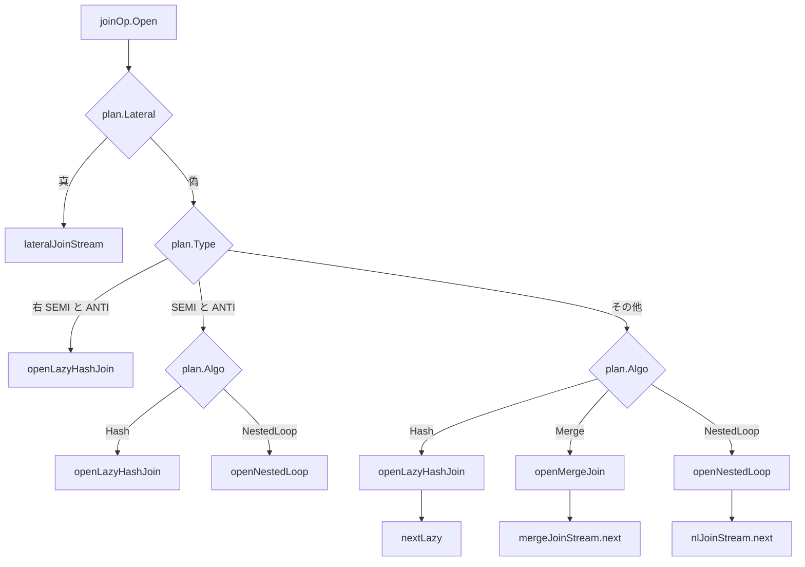
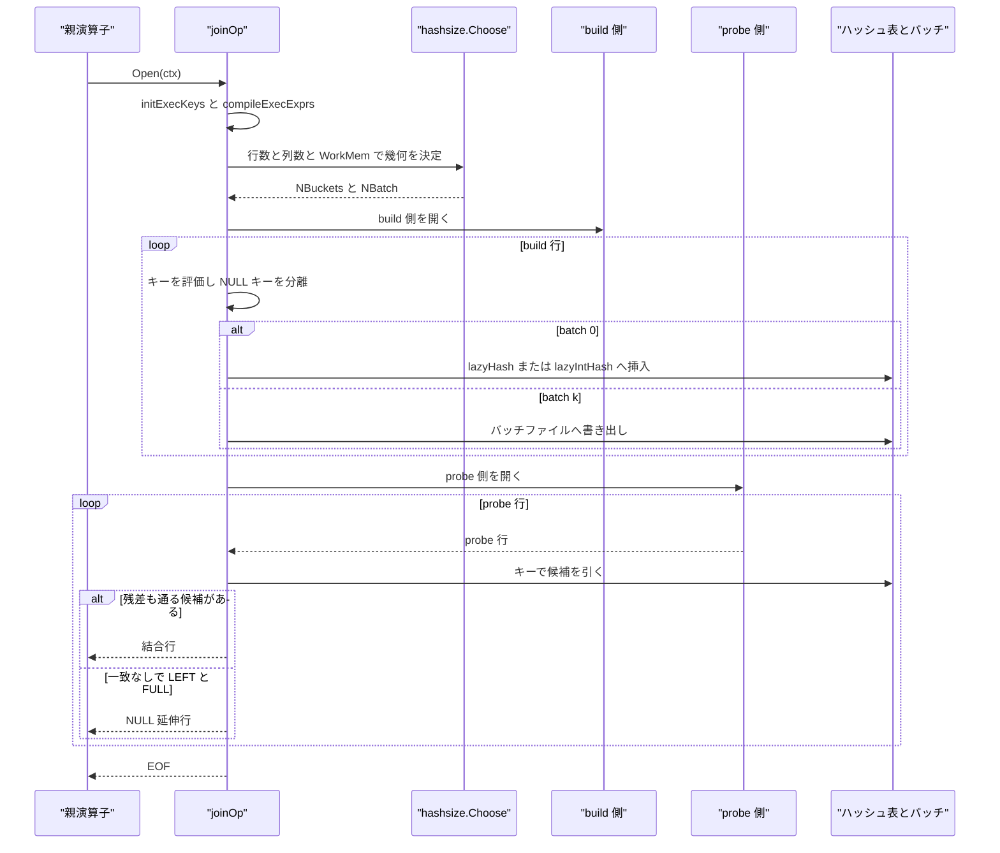

# 結合オペレータ

<details>
<summary>関連ソースファイル</summary>

- [`internal/executor/dense_build.go`](https://github.com/ryogrid/goopg/blob/19856410e8d497d59787e1ab35a2febb3f5953d6/internal/executor/dense_build.go)
- [`internal/executor/hash_partition.go`](https://github.com/ryogrid/goopg/blob/19856410e8d497d59787e1ab35a2febb3f5953d6/internal/executor/hash_partition.go)
- [`internal/executor/hashsize/hashsize.go`](https://github.com/ryogrid/goopg/blob/19856410e8d497d59787e1ab35a2febb3f5953d6/internal/executor/hashsize/hashsize.go)
- [`internal/executor/join_batch.go`](https://github.com/ryogrid/goopg/blob/19856410e8d497d59787e1ab35a2febb3f5953d6/internal/executor/join_batch.go)
- [`internal/executor/join_composite_key.go`](https://github.com/ryogrid/goopg/blob/19856410e8d497d59787e1ab35a2febb3f5953d6/internal/executor/join_composite_key.go)
- [`internal/executor/join_lateral_stream.go`](https://github.com/ryogrid/goopg/blob/19856410e8d497d59787e1ab35a2febb3f5953d6/internal/executor/join_lateral_stream.go)
- [`internal/executor/join_merge_key.go`](https://github.com/ryogrid/goopg/blob/19856410e8d497d59787e1ab35a2febb3f5953d6/internal/executor/join_merge_key.go)
- [`internal/executor/join_merge_stream.go`](https://github.com/ryogrid/goopg/blob/19856410e8d497d59787e1ab35a2febb3f5953d6/internal/executor/join_merge_stream.go)
- [`internal/executor/join_nl_stream.go`](https://github.com/ryogrid/goopg/blob/19856410e8d497d59787e1ab35a2febb3f5953d6/internal/executor/join_nl_stream.go)
- [`internal/executor/join_outer_fill.go`](https://github.com/ryogrid/goopg/blob/19856410e8d497d59787e1ab35a2febb3f5953d6/internal/executor/join_outer_fill.go)
- [`internal/executor/kvcache/kvcache.go`](https://github.com/ryogrid/goopg/blob/19856410e8d497d59787e1ab35a2febb3f5953d6/internal/executor/kvcache/kvcache.go)
- [`internal/executor/operators_join_agg.go`](https://github.com/ryogrid/goopg/blob/19856410e8d497d59787e1ab35a2febb3f5953d6/internal/executor/operators_join_agg.go)
- [`internal/executor/operators_material.go`](https://github.com/ryogrid/goopg/blob/19856410e8d497d59787e1ab35a2febb3f5953d6/internal/executor/operators_material.go)
- [`internal/executor/operators_memoize.go`](https://github.com/ryogrid/goopg/blob/19856410e8d497d59787e1ab35a2febb3f5953d6/internal/executor/operators_memoize.go)
- [`internal/executor/operators_merge.go`](https://github.com/ryogrid/goopg/blob/19856410e8d497d59787e1ab35a2febb3f5953d6/internal/executor/operators_merge.go)
- [`internal/executor/operators_nljoin.go`](https://github.com/ryogrid/goopg/blob/19856410e8d497d59787e1ab35a2febb3f5953d6/internal/executor/operators_nljoin.go)

</details>

`internal/executor` の結合は、`optimizer.Join` 1 ノードを `joinOp` 1 個で表し、`plan.Algo` と `plan.Lateral` に応じて 4 つのストリーミング実装へ振り分ける。ハッシュ結合は build 側を `map[string][]Row` または `map[int64][]Row` に読み込み、probe 側を 1 行ずつ照合して `Next` の要求ごとに行を返す。`work_mem` を超える build は `join_batch.go` のハイブリッドハッシュでバッチファイルへ退避する。マージ結合は両側を `mergeSortedSource` のキー順ストリームにして `mergeJoinStream` の状態機械で進め、ネストループは外側を 1 行ずつ引きながら内側を `materializeOp` で再走査する。LATERAL は外側 1 行ごとに右部分木を Open/Close し、パラメータ化されたインデックスプローブ（`NestedLoopIndexJoin`）は内側の `indexScanOp` を外側行ごとに `Rescan` する。このページはこれらのアルゴリズム選択、build/probe の状態、`work_mem` に基づく外部化、外側結合の NULL 延伸、および付随するサイズ計算とキャッシュを扱う。式評価は [6.2 式評価と Datum](6.2-Expression-Evaluation.md)、インデックスプローブ自体は [6.3 スキャンとインデックスアクセス](6.3-Scan-Operators.md)、並列ハッシュ build は [6.8 並列実行](6.8-Parallel-Execution.md) を参照。

## 責務

- 結合アルゴリズムの選択。`joinOp.Open` が LATERAL を最初に判定し、右 SEMI/ANTI はハッシュ限定、SEMI/ANTI はハッシュかネストループ、それ以外は `JoinAlgoHash`/`JoinAlgoMerge`/ネストループへ振り分ける。`path:internal/executor/operators_join_agg.go:joinOp.Open`
- ハッシュテーブルの構築。`openLazyHashJoin` が `hashsize.Choose` でジオメトリを決め、`buildLoopLeft`/`buildLoopRight` が build 側を drain して `lazyHash` または `lazyIntHash` に詰める。`path:internal/executor/operators_join_agg.go:openLazyHashJoin`
- probe と出力。`nextLazy` が probe 行ごとにバケットを引き、`joinPredicateMatchSlot` で残差を確認し、`VirtualSlot` 合成で `plan.Output()` 順の行を返す。`path:internal/executor/operators_join_agg.go:nextLazy`
- `work_mem` 超過時のバッチ退避。`hashBatchState` がバッチ番号を `(hash >> log2(nbuckets)) & (nbatch-1)` で決め、batch 0 以外を build/probe の一時ファイルに書く。`path:internal/executor/join_batch.go:hashBatchState`
- マージ結合のストリーム化。`openMergeJoin` が両側を `mergeSortedSource` にし、`mergeJoinStream.next` が merge → group → group fill → tail の位相で 1 行ずつ返す。`path:internal/executor/join_merge_stream.go:mergeJoinStream.next`
- ネストループのストリーム化。`openNestedLoop` が外側をストリームし、内側を `materializeOp`（計画が `Materialize` を選んだ場合はそれ）で再走査する。`path:internal/executor/join_nl_stream.go:openNestedLoop`
- LATERAL の再実行。`openLateral` が外側 1 行ごとに右部分木を開き、`bindOuter`/`unbindOuter` で相関スコープをその呼び出しの間だけ設置する。`path:internal/executor/join_lateral_stream.go:openLateral`
- パラメータ化インデックス結合。`nestedLoopIndexJoinOp` が `nliInner`（裸の `indexScanOp` か `memoizeOp`）を `BindOuter` + `Rescan` で駆動し、`VirtualSlot` で外側＋内側を合成する。`path:internal/executor/operators_nljoin.go:nestedLoopIndexJoinOp`
- 相関結果のキャッシュ。`memoizeOp` が外側キーごとに完全な結果集合を `kvcache.Cache` に保持し、`MemoizeStats` でヒット／ミスを数える。`path:internal/executor/operators_memoize.go:memoizeOp`
- 再走査可能なキャッシュ。`materializeOp` が子を 1 度だけ読み、`materialBuffer` に保持して `Rescan` で先頭から再生する。`path:internal/executor/operators_material.go:materializeOp`
- build 行のアリーナ化。`retainBuildRow` が可変長ペイロードを `buildBytes`、`Datum` セルを `buildCells` に置き、行ヘッダだけを残す。`path:internal/executor/dense_build.go:retainBuildRow`
- 幾何の共有。`hashsize.Choose` が planner と executor の双方から呼ばれ、同じ `work_mem` と同じ行幅から同じ `NBuckets`/`NBatch` を返す。`path:internal/executor/hashsize/hashsize.go:Choose`
- 外側結合の NULL 延伸。`fillProbeSide`/`fillBuildSide` が「一致しなかった probe/build 行をどちらが延伸するか」を決め、後者だけが matched ビットマップと掃引を必要とする。`path:internal/executor/join_outer_fill.go:fillBuildSide`

## 処理フロー

### アルゴリズムの選択

`joinOp.Open` はまず `o.plan.Lateral` を見る。LATERAL の等値述語は「右側が外側行に依存しない」ことを意味しないため、ハッシュが選ばれていても LATERAL を優先する。次に右 SEMI/ANTI をハッシュ限定で受け、通常の SEMI/ANTI をハッシュかネストループへ、残りを `plan.Algo` でハッシュ・マージ・ネストループへ振る。`Open` の最後に何も選ばれなければ、`Next` は `EOF` を返す。`path:internal/executor/operators_join_agg.go:joinOp.Open`



### ハッシュ結合の build と probe

`openLazyHashJoin` は `buildGeometry` で `hashsize.Choose(推定行数, 列数, 可変長平均, WorkMem)` を呼び、`presizeLazyHash` で Go map の容量を予約する（上限 `maxPresizeBuckets = 1 << 20`）。build 側の式は `initExecKeys` が `o.execKeyPlan()`（内部で `plan.ExecHashKeyPlan()`）から取り、`buildKeyExprs`/`probeKeyExprs` に左右を確定してから `compileExecExprs` で `ExprNode` スラブにコンパイルする。キーがすべて int64 なら `lazyHashIsInt` が立ち、`lazyIntHash` と `intProbeIndex` の専用経路になる。`path:internal/executor/join_composite_key.go:initExecKeys`

build ループは `buildLoopLeft`/`buildLoopRight` が子を 1 行ずつ引き、`evalHashKeyDatumSlot` でキーを評価する。NULL キーの行はバケットに入らず、`fillNullBuild` に積まれる（外側結合の掃引で必要になる）。`hashBatchState` が非 nil で、行のバッチ番号が 0 以外なら `spillRowKey` と `WriteRowKeyed` でバッチファイルへ書く。バッチ 0 だけが `lazyHash`/`lazyIntHash` に残る。`path:internal/executor/join_batch.go:writeInner`

probe 側は `adoptProbeSide` で `lazyProbe` を開き、`nextLazy` が probe 行を 1 行引いてキーを作り、`lazyIntHash` または `lazyHash` から一致候補を得る。候補ごとに `joinPredicateMatchSlot` が残差 `execResidual` を評価し、通った組だけを `VirtualSlot` で合成して返す。LEFT JOIN で一致が 1 つも無ければ、`lazyProbeMatched` が偽のままなので build 側の NULL 行を延伸する。`path:internal/executor/operators_join_agg.go:nextLazy`



### マージ結合

`openMergeJoin` は両子を開き、`initMergeKeys` で `ExecMergeKeyPlan()` のキーと残差を確定してから、左右を `newMergeSortedSource` で包む。子の `Schema()` が空の場合は最初の 1 行を `prime` して幅を確定し、その幅でキー式が参照する merged 列空間（自分側の実列＋相手側の NULL）を決める。`mergeSortedSource.fill` は `work_mem` に収まる限りメモリに溜め、超えたらチャンクをソートして spill run にし、`next` で N 路マージする。`path:internal/executor/join_merge_stream.go:openMergeJoin`

`mergeJoinStream.next` は `steps` を数え、257 ステップごとに `ctx.Ctx.Err()` を見る。位相は `mjPhaseMerge`（キー比較で小さい側を進める）、`mjPhaseGroup`（等キー群の内側をバッファし、左行ごとに全内側行と突き合わせる）、`mjPhaseGroupFill`（RIGHT/FULL の未一致内側を掃く）、`mjPhaseTailLeftReal`/`mjPhaseTailLeftNull`/`mjPhaseTailRightReal`/`mjPhaseTailRightNull` である。NULL キーは `nullKey` フラグ付きで実キーの後ろに並び、どのキーとも一致しない。`path:internal/executor/join_merge_stream.go:mergeJoinStream.next`

### ネストループと LATERAL

`openNestedLoop` は両子を開き、内側を `rescannable` として用意する。計画が `*optimizer.Materialize` を持っていれば `buildNode` が既に作った `materializeOp` を `planMaterializeOp` で取り出し、持っていなければ互換用の attach-time キャッシュを `materializeOp.openCached` で被せる（`GOOPG_NL_BARE_REEXEC=1` のときだけ裸の内側を再実行する `rescanByReexec`）。`nlJoinStream` は `nlPhaseOuter` で外側を 1 行引き、`nlPhaseInner` で内側を頭から再走査し、`nlPhaseSweep` で RIGHT/FULL の未一致内側を出す。keyless の SEMI/ANTI は最初に条件を満たした内側行で `break` するが、`materializeOp` の遅延充填により次の外側行は続きから読める。`path:internal/executor/join_nl_stream.go:openNestedLoop`

`openLateral` は右部分木を外側行ごとに Open/Close する。相関は 2 経路で入る。右子が `lateralBindable` なら `BindLateralOuter` に外側スロットを渡し、同時に `ctx.OuterRows` へ外側行を push する。どちらも右側の各呼び出し（`Open`、各 `Next`、`Close`）の直前だけ設置し、戻った瞬間に外す。これは親が自分の `OuterColumnRef` を評価するときに、この結合の外側行がスタックに残らないようにするためである。`CTERowCache` も外側行ごとに差し替え、外側に依存する CTE だけを再実体化する。`path:internal/executor/join_lateral_stream.go:lateralJoinStream`

### パラメータ化インデックス結合と Memoize

`nestedLoopIndexJoinOp.Open` は外側を開き、内側の `openPrep` を 1 回だけ呼ぶ。外側行ごとに `outerMS.row` を差し替えて `inner.Rescan(outerMS, outerWidth)` を呼び、内側の `Next` が返す行を `innerMS.row` に入れて `virtualOut`（`sources = [outerMS, innerMS]`）で合成する。LEFT の NULL 延伸は「内側が 1 行でも返したか」ではなく、`plan.Predicate` を通った `outerMatched` で決める。`path:internal/executor/operators_nljoin.go:nestedLoopIndexJoinOp.Next`

`memoizeOp` は `openPrep` で `kvcache.New(WorkMem/4)` を作る（`WorkMem == 0` は無制限）。`Rescan` の後の最初の `Next` でキーを評価し、`memoizeModeServe`（完全なエントリを再生）、`memoizeModeFill`（子を引いて tee しながら返す）、`memoizeModePass`（予算超過でキャッシュを諦めて素通し）のいずれかに入る。EOF まで読めたエントリだけが完全とみなされ、途中までの結果を後で返すことはない。`path:internal/executor/operators_memoize.go:memoizeOp.Next`

## 主要ファイル

| ファイル | 役割 |
| --- | --- |
| `internal/executor/operators_join_agg.go` | `joinOp` 本体。アルゴリズム選択、ハッシュ build/probe、`nextLazy`、CTID 保存、空 build/outer の早期終了。`path:internal/executor/operators_join_agg.go:joinOp` |
| `internal/executor/join_batch.go` | `hashBatchState`/`joinBatchFile`。ハイブリッドハッシュのバッチ分割・spill・共有 build。`path:internal/executor/join_batch.go:hashBatchState` |
| `internal/executor/join_composite_key.go` | `initExecKeys`、複合キーの int64 パック／長さ前置 `datumKey` 符号化。`path:internal/executor/join_composite_key.go:initExecKeys` |
| `internal/executor/join_merge_key.go` | `initMergeKeys` とマージ側キーのコンパイル。`path:internal/executor/join_merge_key.go:initMergeKeys` |
| `internal/executor/join_merge_stream.go` | `mergeSortedSource`/`mergeRunCursor`/`mergeJoinStream`。ソート済みストリームと group バッファリング。`path:internal/executor/join_merge_stream.go:mergeJoinStream` |
| `internal/executor/join_nl_stream.go` | `nlJoinStream`。外側ストリーム、内側 Materialize、RIGHT/FULL 掃引。`path:internal/executor/join_nl_stream.go:nlJoinStream` |
| `internal/executor/join_lateral_stream.go` | `lateralJoinStream`。外側行ごとの右部分木再実行と相関スコープの設置。`path:internal/executor/join_lateral_stream.go:lateralJoinStream` |
| `internal/executor/join_outer_fill.go` | `hashBuildIsLeft`、`fillProbeSide`/`fillBuildSide`、matched ビットマップ、build 掃引。`path:internal/executor/join_outer_fill.go:fillBuildSide` |
| `internal/executor/operators_nljoin.go` | `nestedLoopIndexJoinOp` と `nliInner` プロトコル。パラメータ化プローブの駆動。`path:internal/executor/operators_nljoin.go:nestedLoopIndexJoinOp` |
| `internal/executor/operators_memoize.go` | `memoizeOp` と `MemoizeStats`。キーごとの結果キャッシュ。`path:internal/executor/operators_memoize.go:memoizeOp` |
| `internal/executor/operators_material.go` | `materializeOp`/`materialBuffer`/`rescannable`。work_mem 境界付き再走査キャッシュ。`path:internal/executor/operators_material.go:materializeOp` |
| `internal/executor/dense_build.go` | `retainBuildRow`/`packDenseBuildRow`/`materializeBuildDatum`。build 行のアリーナ配置。`path:internal/executor/dense_build.go:retainBuildRow` |
| `internal/executor/hashsize/hashsize.go` | `Choose`、`Sizing`、`EntryBytes`。planner と executor が共有するハッシュ幾何。`path:internal/executor/hashsize/hashsize.go:Choose` |
| `internal/executor/kvcache/kvcache.go` | `Budget` と LRU `Cache`。Memoize と相関サブクエリキャッシュの土台。`path:internal/executor/kvcache/kvcache.go:Cache` |
| `internal/executor/hash_partition.go` | `pgHashBytesExtended`/`pgHashInt8`/`computeHashPartitionRowHash`。PostgreSQL 互換 Jenkins ハッシュ。`path:internal/executor/hash_partition.go:computeHashPartitionRowHash` |
| `internal/executor/operators_merge.go` | `mergeOp`。SQL `MERGE INTO` 文の実行（結合アルゴリズムとしてのマージ結合とは別物）。`path:internal/executor/operators_merge.go:mergeOp` |

## 公開 API / エントリポイント

```go
func newJoinOp(plan *optimizer.Join, left, right Operator) *joinOp
func newNestedLoopIndexJoinOp(p *optimizer.NestedLoopIndexJoin, outer Operator, inner nliInner) *nestedLoopIndexJoinOp
func newMemoizeOp(p *optimizer.Memoize, child memoProbe) *memoizeOp
func newMaterializeOp(child Operator) *materializeOp
func newMergeOp(p *optimizer.Merge) *mergeOp

func Choose(ntuples float64, ncols int, avgVarBytes float64, memLimit int64) Sizing
func EntryBytes(ncols int, avgVarBytes float64) float64

func New(budgetBytes int64) *Cache
func NewShared(b *Budget) *Cache
func NewBudget(limit int64) *Budget

func computeHashPartitionRowHash(tbl *catalog.Table, im *catalog.InMemory, ctx *Context, pos int,
	resolveKey func(i int) (Datum, error)) (uint64, error)
```

`newJoinOp` は `plan.Output()` が空なら左右の `Schema()` を連結して出力スキーマを作り、`execResidual` を `plan.Predicate` で初期化する。`deformLeftBound`/`deformRightBound` は fail-closed で `deformBoundFull` に置かれ、ツリー構築側が実際の値で上書きする。`path:internal/executor/operators_join_agg.go:newJoinOp`

## 主要データ構造

### `hashsize.Sizing` — 共有されるハッシュ幾何

```go
// Sizing is the geometry chosen for one hash-join build.
type Sizing struct {
	// NBuckets is the number of hash buckets, always a power of two and
	// at least MinBuckets. It doubles as the capacity hint for the Go map
	// the executor builds.
	NBuckets int

	// NBatch is the number of batches, always a power of two. 1 means the
	// build is projected to fit in memory and no spill files are needed.
	NBatch int

	// SpaceAllowed is the in-memory budget the geometry was solved for, in
	// bytes. It equals the caller's limit except when the walk-back below
	// deliberately raised it to buy back batches; zero means the caller
	// asked for an unlimited budget.
	SpaceAllowed int64

	// EntryBytes is the per-row footprint the geometry assumed. Callers
	// pricing batch I/O multiply it by the row count to get the spilled
	// byte volume.
	EntryBytes float64
}
```

`path:internal/executor/hashsize/hashsize.go:Sizing`

`NBuckets` は常に 2 の冪で `MinBuckets = 1024` 以上、`NBatch` も 2 の冪で 1 なら spill 不要である。`SpaceAllowed` は幾何を解いたときの実効予算で、walk-back が「バッチを減らして表を大きくする」判断をした場合は呼び出し元の `memLimit` より大きくなることがある。`EntryBytes` は 1 行あたりの見積もりで、`DatumBytes = 48`・`RowSliceBytes = 24`・可変長ペイロードの平均から成る。planner のコスト計算と executor の build が同じ `Choose` を呼ぶため、両者が「収まる／溢れる」で食い違わない。

### `kvcache.Budget` と `kvcache.Cache`

```go
type Budget struct {
	limit int64
	used  int64
}
```

`path:internal/executor/kvcache/kvcache.go:Budget`

```go
// Cache is an LRU map drawing from a (possibly shared) Budget.
type Cache struct {
	budget    *Budget
	ll        *list.List // front = most recently used
	m         map[string]*list.Element
	bytes     int64
	evictions int64
}
```

`path:internal/executor/kvcache/kvcache.go:Cache`

`Budget` は 1 文のキャッシュ群が共有するバイト上限で、`limit <= 0` は無制限、`Reserve` は上限を超える要求を何も予約せずに拒否する。`Cache` は `container/list` の先頭を最近使用、末尾を最古とする LRU で、`Put` は既存キーを置き換えるときに旧サイズを返却し、新しいエントリがどうしても収まらなければ「保存しない」で戻る。エビクションは自分のキャッシュ内だけで完結し、同じ `Budget` を共有する兄弟キャッシュのエントリは追い出さない。ロックは無く、1 文を実行する単一ゴルーチンだけが触る契約である。

### `joinBatchFile` と `hashBatchState`

```go
type joinBatchFile struct {
	// w is the writer while the file is being filled; nil once the file has
	// been frozen for sharing (freezeForSharing), after which only path is
	// consulted and only by readers.
	w    *spillWriter
	path string
	rows int64
	// createdNBatch is nbatch as it stood when the file was created. A file
	// created before a later doubling may hold rows the final geometry assigns
	// to a HIGHER batch (they were routed under the smaller nbatch), and that
	// is what freezeForSharing uses to decide which files need settling
	// before they can be read by participants that may not write.
	createdNBatch int
}
```

`path:internal/executor/join_batch.go:joinBatchFile`

```go
type hashBatchState struct {
	nbatch     int
	origNBatch int
	// nbatchOutstart is nbatch as it stood when the outer (probe) scan
	// began. PG keeps the same counter for the same reason: together with
	// origNBatch it tells nextBatch whether a one-sided batch is genuinely
	// empty or merely un-reassigned (nodeHashjoin.c rules 2 and 3).
	nbatchOutstart int
	curBatch       int
	// bucketBits is log2(nbuckets) — the low hash bits notionally reserved
	// for bucket selection, so the batch bits are disjoint from them. goopg's
	// buckets are Go map slots hashed by the runtime, so the reservation buys
	// no independence here the way it does in PG; it is kept because the
	// SHIFT is what makes doubling move rows forward by exactly nbatch.
	bucketBits uint

	spaceAllowed int64
	spaceUsed    int64
	peakSpace    int64
	growEnabled  bool

	inner []*joinBatchFile
	outer []*joinBatchFile
	// extraOuter holds, per batch, probe-row files other participants of a
	// Parallel Hash join that fills its build side handed to this one, the
	// sweeper, which replays them after its own (M0146-0095).
	extraOuter [][]*joinBatchFile

	// buildIsLeft is the build orientation, needed to re-evaluate the build
	// key of a row reloaded from an inner batch file. The two widths that
	// complete the merged key slot are read live off the operator
	// (o.lazyLW/o.lazyRW) rather than captured here, because a child with no
	// schema only reveals its width once the build's first row arrives.
	buildIsLeft bool

	// ctx is the statement's context: the owner of the spill-file registry
	// every batch file is registered with (M0127-P3.3). It is stored rather
	// than passed because a batch file is created deep inside the build and
	// probe hot paths, where threading a Context argument through would buy
	// nothing.
	ctx *Context

	// replaying is true while o.lazyProbe is a batch replay operator rather
	// than the real probe child; replayHash is the hash value stored with the
	// row that operator most recently returned.
	replaying  bool
	replayHash uint32
	replayOp   *batchReplayOp

	innerSpilled int64
	outerSpilled int64

	// nbuckets is the bucket count hashsize.Choose picked for this build —
	// the CHOSEN geometry, which is what PG's nbuckets reports too, not a
	// measurement of the Go map. Two divergences follow and both are
	// deliberate: goopg has no bucket ARRAY that could be resized, so there is
	// no ExecHashIncreaseNumBuckets and the reported original never differs;
	// and presizeLazyHash caps its allocation at maxPresizeBuckets, so on a
	// large build this number is bigger than the slots actually reserved (the
	// SF1 evidence run shows 2,097,152 against a 1<<20 cap). Retiring that gap
	// means making the presize revisable, which is the same deferral
	// maxPresizeBuckets already carries.
	nbuckets int

	// stats is the EXPLAIN (ANALYZE) sink for this join, owned by the
	// statement's Context and keyed by the plan node. nil when the operator
	// was built without one (unit fixtures, and any path that never went
	// through NewContext).
	stats *HashJoinStats

	// innerShared marks a participant state derived from a shared batch
	// descriptor (E-09a): `inner` aliases files the leader wrote and froze,
	// and other participants read the same files concurrently. While it is
	// set this state must never write to, truncate, or unlink an inner file
	// — writeInner refuses, openReader leaves the writer alone, discard and
	// close skip the inner slice, and loadInnerBatch closes its reader with
	// closeKeepFile. Growth is frozen too, so the reload path can never need
	// to re-route a row forward (every file was settled before publication).
	innerShared bool

	// desc is the shared descriptor this participant state was derived from
	// (E-09b), and the owner of the per-batch load slots. nil on every
	// private state, which is what selects the private reload path.
	desc *sharedBatchDesc
	// held is the shared batch table this participant is currently probing,
	// and heldBatch the batch number it was acquired under. One reference is
	// owned for as long as held is non-nil; releaseHeldBatch is the only
	// thing that drops it, and it is idempotent.
	held      *sharedBatchLoad
	heldBatch int
}
```

`path:internal/executor/join_batch.go:hashBatchState`

`joinBatchFile` の寿命は「書いてから読む」の一方向で、`rows` が 0 なら空バッチと判定できる。`createdNBatch` は、より小さい `nbatch` の下で作られたファイルが、後の倍化でより大きいバッチ番号の行を含み得ることを記録する。`hashBatchState` は `nbatch`/`curBatch`/`bucketBits` でルーティングを決め、`spaceAllowed`/`spaceUsed`/`peakSpace` で予算を追跡する。`inner`/`outer` がバッチごとのファイル、`buildIsLeft` が再ロード時のキー評価の向き、`replaying`/`replayHash`/`replayOp` がバッチ再生の状態である。`innerShared` が立つと、その状態は inner ファイルを書く・切り詰める・unlink することが禁止され、成長も凍結される。

### `HashJoinStats` — EXPLAIN ANALYZE の計測

```go
type HashJoinStats struct {
	NBuckets     int
	OrigNBuckets int
	NBatch       int
	OrigNBatch   int
	SpacePeak    int64
	// BuildTimeNs is the wall-clock time the hash table build took.
	// Merged by MAXIMUM across re-Opens, same as the geometry fields.
	// PG's Hash node (a separate plan node under the Hash Join) carries
	// this implicitly as its (actual time=…) line; goopg has no Hash
	// node, so the measurement hangs here. M0128-P2.1.
	BuildTimeNs int64
}
```

`path:internal/executor/join_batch.go:HashJoinStats`

`NBuckets`/`OrigNBuckets`/`NBatch`/`OrigNBatch` は PG の `HashInstrumentation` と同じ意味で、`SpacePeak` は build のピーク、`BuildTimeNs` は build の実時間である。値は再 Open をまたいで最大値で統合される（PG の `ExecHashAccumInstrumentation` と同じ規則）。goopg には独立した Hash ノードが無いため、この行は結合ノード自身に付く。

### `nlJoinStream` — ネストループの状態機械

```go
type nlJoinStream struct {
	o *joinOp
	// inner is whichever rescannable serves the inner side (M0146-0010): the
	// materializeOp a `*optimizer.Materialize` plan node built, the compat
	// attach-time cache over a bare inner (default), or — under
	// GOOPG_NL_BARE_REEXEC — a rescanByReexec re-executing a bare inner.
	inner rescannable
	// mat is the *materializeOp half of inner, kept beside it so Close can
	// release the buffer without a type assertion at the close site.
	mat *materializeOp

	lw, rw    int
	nullLeft  Row
	nullRight Row
	pair      Row // reusable lw+rw merge buffer for predicate evaluation

	semiAnti  bool
	anti      bool
	fillOuter bool // LEFT / FULL: null-extend an outer tuple that matched nothing
	fillInner bool // RIGHT / FULL: sweep inner tuples that matched nothing

	phase int

	outerRow     Row
	outerCTID    joinRowCTID
	outerMatched bool
	// pairOuterValid reports pair[:len(outerRow)] already holds the current
	// outer tuple, so pairMatches copies only the inner tuple (M0122-0012
	// slice 65). Cleared when a new outer tuple is read, when pair is
	// reallocated, and when pair is handed to the consumer borrowed.
	pairOuterValid bool

	// innerMatched is one bit per inner tuple ORDINAL. The Materialize replays
	// in insertion order, so the ordinal is just the count of tuples returned
	// since the last Rescan — no key, no map. Sized by row count, so it stays
	// small even when the cache overflowed to disk.
	innerMatched []bool
	innerIdx     int

	sweepIdx int

	scanLeaf currentTIDProvider
	steps    int

	// deferScan is the outer seq scan armed for C38's lazy outer deform
	// (armOuterDefer), deferProj the bare-reference projection between them
	// (nil when none) and deferRefs its column map.
	deferScan *seqScanOp
	deferProj *projectOp
	deferRefs []int
}
```

`path:internal/executor/join_nl_stream.go:nlJoinStream`

`inner` は計画が選んだ `materializeOp`、互換用キャッシュ、または再実行アダプタのいずれかで、`mat` はその実体を Close で解放するために並べて持つ。`pair` は述語評価用の `outer++inner` 再利用バッファで、`pairOuterValid` が「外側部分は既に書かれている」ことを示す。`innerMatched` は内側の**出現順**に対する 1 ビットで、`Materialize` が挿入順に再生するためキーも写像も不要である。`phase` は `nlPhaseOuter`/`nlPhaseInner`/`nlPhaseSweep`/`nlPhaseDone` を取る。

### `mergeSortedSource` と `mergeJoinStream`

```go
type mergeStreamRow struct {
	row     Row
	keys    []Datum
	nullKey bool
}

// mergeKeyBlockRows is how many key tuples one backing block holds. The keys
// of a run are carved from blocks rather than allocated per row, so a side
// costs one allocation per this many rows; blocks are never appended to, so a
// carved sub-slice can never be invalidated by a growth reallocation (the
// property buildMergeSide got from its single exactly-sized store).
const mergeKeyBlockRows = 1024

// mergeSortedSource turns a child operator into a key-ordered stream of
// mergeStreamRow, spilling sorted runs once the resident chunk exceeds the
// budget. Constructed per side, drained during Open, streamed by next().
type mergeSortedSource struct {
	o        *joinOp
	child    Operator
	isLeft   bool
	keyExprs []optimizer.Expr
	// keyTrims[i] flags a bpchar-typed key expression on this side: the
	// merge's equality (compareMergeKeys on the evaluated key datums)
	// must see the same bcTruelen image the scalar `=` sees, or a
	// char(10) = char(20) merge pair can never meet — the merge-join
	// sibling of the hash buildKeyTrim/probeKeyTrim flags. M0146.
	keyTrims []bool
	nkeys    int

	// Widths of the merged column space this side's key expressions are
	// written against: selfWidth columns of real row, otherWidth of NULL.
	selfWidth  int
	otherWidth int

	keySlot  mergedKeySlotCache
	rowSlot  *MaterializedSlot
	keyBlock []Datum

	// limit is the resident-chunk budget in bytes (work_mem); 0 = unlimited.
	limit int64

	// primed holds the row pulled before the widths were known (see prime).
	primed    Row
	hasPrimed bool
	primedEOF bool

	// tail is the final in-memory run; cursors is non-empty only once a
	// chunk has spilled, in which case tail is the last cursor.
	tail    []mergeStreamRow
	tailIdx int
	cursors []*mergeRunCursor

	sortErr error
}

// mergeRunCursor is one sorted run — a spill file or the in-memory tail —
// positioned on its current row. Cursors are ordered by creation, which is the
// order the rows were pulled from the child, so breaking a comparison tie by
// cursor index makes the N-way merge as stable as the per-chunk sort.
type mergeRunCursor struct {
	src  *mergeSortedSource
	mem  []mergeStreamRow
	idx  int
	r    *spillReader
	path string

	cur  mergeStreamRow
	live bool
}
```

`path:internal/executor/join_merge_stream.go:mergeSortedSource`

```go
type mergeJoinStream struct {
	o     *joinOp
	left  *mergeSortedSource
	right *mergeSortedSource

	nullLeft  Row
	nullRight Row
	fillLeft  bool
	fillRight bool

	phase int

	lr, rr       mergeStreamRow
	haveL, haveR bool

	// Current inner group. groupMem holds the prefix that fit work_mem;
	// anything past it lives in the overflow file at groupPath and is
	// replayed by groupReader (once per outer row) and by fillReader (once
	// per group, for the RIGHT/FULL sweep).
	groupKeys    []Datum
	groupMem     []mergeStreamRow
	groupBytes   int64
	groupWriter  *spillWriter
	groupPath    string
	groupReader  *spillReader
	groupCount   int
	groupMatched []bool

	groupIdx    int // position of the current outer row inside the group
	leftMatched bool
	fillIdx     int // position of the RIGHT/FULL sweep inside the group

	// steps counts state-machine iterations, not emitted rows: a join whose
	// residual rejects a whole large group makes progress without emitting
	// anything, and that is exactly the case a cancel has to interrupt.
	steps int
}
```

`path:internal/executor/join_merge_stream.go:mergeJoinStream`

各 `mergeStreamRow` は行・評価済みキー tuple・`nullKey` フラグを持ち、NULL キーは実キーの後ろに並ぶ。`mergeSortedSource` は `work_mem` を `limit` とし、`tail`（最後のメモリ内 run）と `cursors`（spill 済み run のカーソル）で N 路マージする。`mergeJoinStream` は左右 1 行ずつ (`lr`/`rr`) と現在の内側グループ (`groupMem` と溢れファイル) だけを保持し、`groupMatched` で RIGHT/FULL の掃引時に未一致内側を判定する。`steps` は出力行数ではなく状態機械の反復数を数え、キャンセル確認の粒度を保つ。

### `lateralJoinStream` — 外側行ごとの再実行

```go
type lateralJoinStream struct {
	o *joinOp

	// The two correlation mechanisms are ORTHOGONAL and both install whenever
	// they can, rather than being mutually exclusive:
	//   - bindable != nil: the right child accepts the outer tuple through the
	//     slot it was handed at Open (a FROM-clause SRF — pg_get_publication_tables
	//     & co., M0103-0008 — or, on the BuildFast path, the opNodeOperator bridge
	//     that forwards to one). outerSlot is that slot; its `row` field is
	//     repointed per outer tuple, which carries same-level ColumnRef args.
	//   - ctx.OuterRows push (whenever ctx != nil): the outer tuple is ALSO pushed
	//     onto ctx.OuterRows so OuterColumnRef (level>=1) resolves against it —
	//     e.g. a LATERAL aggregate over generate_series whose aggregate expression
	//     references the outer row (M0134-0001). A lateralBindable SRF whose args
	//     are all same-level ColumnRef never reads ctx.OuterRows, so both can
	//     install without interfering.
	bindable  lateralBindable
	outerSlot *MaterializedSlot

	rw        int // right width, resolved from Schema() or the first inner tuple
	nullRight Row
	pair      Row // reusable outer++inner buffer for predicate evaluation

	fillOuter bool // LEFT lateral: null-extend an outer tuple nothing matched

	// emitOuter / antiEmit carry the SEMI/ANTI emit-once contract PG's
	// nodeNestloop implements natively (R25's decomposed Join{Lateral}
	// over a parameterised probe reaches here for a searched semi/anti
	// NLI — the shape M0145-0005's pulled-sublink scopes first handed the
	// executor). A semi/anti join publishes the OUTER row alone, so the
	// emitted row is m.outerRow, never the concatenated pair: SEMI emits
	// it on the first qualifying inner tuple, ANTI emits it iff no inner
	// tuple qualified at all.
	emitOuter bool // SEMI or ANTI: emit the outer row alone
	antiEmit  bool // ANTI: emit iff no inner tuple qualified

	phase        int
	outerRow     Row
	outerMatched bool
	rightOpen    bool

	// innerCTE is the CTERowCache belonging to the CURRENT outer tuple. It is
	// swapped in for the duration of each right-side call and swapped back out
	// again, so the enclosing query's cache never sees the lateral's entries
	// and vice versa. Cleared when a new outer tuple arrives — that clearing is
	// the whole point (a CTE whose body reads the outer row must recompute).
	// A body that reads no outer value is not cached here at all: it lives in
	// ctx.CTEStableCache, which this swap leaves alone (M0146-0049d2).
	innerCTE map[string][]Row
	savedCTE map[string][]Row

	steps int
}
```

`path:internal/executor/join_lateral_stream.go:lateralJoinStream`

`bindable`/`outerSlot` が「外側スロットを直接受け取る」相関経路、`ctx.OuterRows` への push が「`OuterColumnRef` を解決する」経路で、両者は排他ではなく同時に設置できる。`innerCTE`/`savedCTE` は現在の外側行に属する CTE キャッシュと、退避した外側スコープのキャッシュである。`emitOuter`/`antiEmit` が SEMI/ANTI の「外側行だけを 1 回出す」契約を表す。

### `materialBuffer` と `materializeOp`

```go
type materialBuffer struct {
	ctx   *Context
	limit int64 // work_mem in bytes; <= 0 means unlimited

	mem   []Row
	bytes int64
	count int // total rows appended, resident + spilled

	w     *spillWriter
	path  string
	r     *spillReader
	dirty bool // rows written since the last Flush
}
```

`path:internal/executor/operators_material.go:materialBuffer`

```go
type materializeOp struct {
	child  Operator
	ctx    *Context
	schema optimizer.Schema

	buf materialBuffer
	pos int
	// out is the one slot this operator ever returns. A Materialize under a
	// nested loop is stepped N×M times, so allocating a MaterializedSlot per
	// call would put an allocation on the join's innermost loop — the exact
	// cost `concatRows`-per-pair was removed to avoid. It is a PRODUCER slot
	// in the sense operator.go documents: a consumer that retains it across
	// Next must Materialize.
	out MaterializedSlot
	// eofUnderlying mirrors PG's MaterialState field of the same name: once
	// the child has returned EOF the cache is complete and no further pass
	// touches the child again.
	eofUnderlying bool
}
```

`path:internal/executor/operators_material.go:materializeOp`

`materialBuffer` は `mem` に収まる前置きと、`w`/`r` で表す溢れファイルを持ち、`limit <= 0` は無制限である。`append` は予算が 1 行分より小さくても必ず 1 行はメモリに残し、溢れファイルのリーダーはファイルが空の時点で開く（後からパスを解決すると unlink 後に開けなくなるため）。`materializeOp` は `pos` で再生位置を持ち、`eofUnderlying` が「子を最後まで読んだのでキャッシュは完成」を表す。`out` は唯一の返却スロットで、N×M 回呼ばれても割り当てない。

### `memoizeOp` と `MemoizeStats`

```go
type memoizeOp struct {
	plan  *optimizer.Memoize
	child memoProbe
	ctx   *Context
	cache *kvcache.Cache
	stats *MemoizeStats

	outerSlot  SlotView
	outerWidth int

	mode      int
	served    []Row
	serveIdx  int
	fillKey   string
	filling   []Row
	fillBytes int64
	emitMS    *MaterializedSlot
}
```

`path:internal/executor/operators_memoize.go:memoizeOp`

```go
type MemoizeStats struct {
	Hits      int64
	Misses    int64
	Evictions int64
	Overflows int64
	// Worker is the fan-out slot of a MemoizeWorkerStats entry; unused on
	// the leader's MemoizeStats entry.
	Worker int
}
```

`path:internal/executor/operators_memoize.go:MemoizeStats`

`mode` は `memoizeModeIdle`/`Serve`/`Fill`/`Pass` のいずれかで、`served`/`serveIdx` が再生中の完全エントリ、`filling`/`fillBytes` が現在充填中の集合、`fillKey` がそのキーである。`emitMS` は子の行を包む再利用スロットで、1 行ごとの `MaterializedSlot` 割り当てを避ける。`MemoizeStats` の `Hits`/`Misses`/`Evictions`/`Overflows` は PG の `show_memoize_info` と同じ 4 項目で、`Worker` はワーカー別行のときだけ使う。

### `nestedLoopIndexJoinOp` と `nliInner`

```go
type nestedLoopIndexJoinOp struct {
	plan  *optimizer.NestedLoopIndexJoin
	outer Operator
	inner nliInner
	ctx   *Context

	// joinFilterRemoved is the stats.joinFilterRejected pointer handed by
	// maybeInstrument; nil when EXPLAIN ANALYZE is not active. Incremented
	// each time evalPredicateSlot returns false (residual reject).
	joinFilterRemoved *int64

	// probeQual / probeFilterRemoved: the residual part EXPLAIN renders as
	// the inner scan's Filter, and its rejection counter
	// (probeFilterAttributor); nil unless ANALYZE splits the residual.
	probeQual          optimizer.Expr
	probeFilterRemoved *int64

	// outerWidth / innerWidth are captured in Open() from the child
	// schemas. They are constant for the operator's lifetime.
	outerWidth int
	innerWidth int

	// nullInner is a reusable nullRow(innerWidth) used both for
	// LEFT-join filler and for binding before the IndexScan
	// resolves its key (so the outer-column slot is the only
	// non-NULL value visible).
	nullInner Row

	// M0071-0013 Stage D-1: VirtualSlot composition replaces the
	// per-Next joinBuf concat. outerMS / innerMS are persistent
	// MaterializedSlots whose .row field is overwritten in place
	// per match; virtualOut sources [outerMS, innerMS] and serves
	// as the operator's emit slot. Predicate evaluation reads via
	// virtualOut.Get(col) — zero allocation per match.
	outerMS    *MaterializedSlot
	innerMS    *MaterializedSlot
	virtualOut *VirtualSlot

	// outerOnly is the operator's emit slot for Semi / Anti, which
	// emit the outer row alone (their plan.Output() schema is the
	// outer schema). Reused; .row points to currentOuter.
	outerOnly *MaterializedSlot

	// (M0072-0001 deleted the per-outer boundRow; the IndexScan
	// now consumes o.outerMS directly via its slot-aware
	// BindOuter / Rescan signature.)

	// state: when an outer row is being processed, currentOuter
	// holds it and innerExhausted tracks whether we've already
	// drained the inner's matches for this outer row.
	currentOuter   Row
	innerExhausted bool
	// outerMatched records whether the current outer row has a
	// QUALIFYING inner match — one that passed plan.Predicate, not
	// merely one the index probe produced. LEFT's null-pad fallback and
	// Anti's emit-the-outer fallback both key off it, and both are only
	// correct under that definition: the NLI Predicate is the JOIN ON
	// residual, so an inner row failing it is not a match at all
	// (R3-1; before it, this was set on row-produced and named
	// leftJoinEmitted, which silently dropped preserved LEFT rows).
	outerMatched bool
	openOnce     bool
}
```

`path:internal/executor/operators_nljoin.go:nestedLoopIndexJoinOp`

```go
// nliInner is the protocol the NLI driver requires of its inner side:
// prepared once (openPrep), then per outer row BindOuter + Rescan, with
// Next draining the probe's matches. Satisfied by *indexScanOp (the
// bare probe) and *memoizeOp (S7's parameterized result cache, which
// forwards to a child *indexScanOp on cache misses).
type nliInner interface {
	Schema() optimizer.Schema
	openPrep(ctx *Context) error
	Next() (TupleSlot, error)
	BindOuter(slot SlotView, outerWidth int)
	Rescan(outerSlot SlotView, outerWidth int) error
	Close() error
}
```

`path:internal/executor/operators_nljoin.go:nliInner`

`outerWidth`/`innerWidth` は `Open` で固定され、`nullInner` は LEFT の延伸とキー解決前のバインドの両方に使う。`outerMS`/`innerMS`/`virtualOut` が合成出力を作り、`outerOnly` が SEMI/ANTI の外側行のみの出力を作る。`currentOuter`/`innerExhausted` が現在の外側行の走査状態、`outerMatched` が「`plan.Predicate` を通った内側行があったか」を表す。`nliInner` は `openPrep` を 1 回、以降 `BindOuter` + `Rescan` + `Next` という順序を要求する。

### `joinOp` の主要フィールド

`joinOp` の全定義は 394 行に及ぶため、ここではアルゴリズムごとの状態を整理する。全体は `path:internal/executor/operators_join_agg.go:joinOp` を参照。

| フィールド群 | 保持するもの |
| --- | --- |
| `plan`/`left`/`right`/`schema`/`slot`/`ctx` | 計画、左右の子、出力スキーマ、再利用スロット、文脈。 |
| `lazyHash`/`lazyIntHash`/`lazyHashIsInt`/`intProbe` | ハッシュ表（文字列キー or int64 キー）と int レーンの probe 索引。 |
| `buildBytes`/`buildCells`/`buildBytesShared`/`buildCellsShared` | build 行のアリーナ（可変長とセル）と共有 build の所有権フラグ。 |
| `execKeys`/`execResidual`/`buildKeyExprs`/`probeKeyExprs`/`execKeyPackInt` | ハッシュのキー計画と左右の式、int64 パックの選択。 |
| `execExprs`/`buildKeyNodes`/`probeKeyNodes`/`execResidualNode`/`execCompiled` | コンパイル済みキーと残差、`probeKeyCol` の直接読み。 |
| `buildKeyTrim`/`probeKeyTrim` | bpchar キーの末尾空白を落とすかどうか。 |
| `mergeKeys`/`mergeResidual`/`mergeExprs`/`mergeKeyNodesL`/`mergeKeyNodesR`/`mergeKeyText` | マージ側のキーと残差、テキスト比較フラグ。 |
| `mergeStream`/`lazyProbe`/`lazyMatches`/`lazyMatchIdx`/`lazyActive`/`lazyProbeMatched` | マージの状態機械とハッシュ probe の進行状態。 |
| `lazyVirtualOut`/`lazyProbeSrc`/`lazyOuterOnlyOut`/`lazyBuildKeySlot`/`lazyProbeKeySlot` | VirtualSlot 合成と merged キースロットのキャッシュ。 |
| `batches`/`noBatch` | ハイブリッドハッシュのバッチ状態。 |
| `antiBuildRows`/`antiBuildHasNull` | NullAware ANTI の全域判定。 |
| `buildRows`/`buildRowsCounted`/`firstProbe`/`outerNotEmpty`/`prefetchCost` | 空 build／空 outer の早期終了。 |
| `lazyHashCTID`/`lazyMatchCTIDs`/`preserveCTIDRel` | FOR UPDATE 用の CTID 保存。 |
| `lazyMatchedS`/`lazyMatchedI`/`lazyMatchedCur`/`fillNullBuild`/`sweep*`/`probeEOF` | 外側結合の fill-build 掃引。 |
| `nlStream`/`latStream` | ネストループと LATERAL の状態機械。 |
| `deformLeftBound`/`deformRightBound` | 左右の deform 境界（協調並列 build の再構築用）。 |

`joinOp` の不変条件は「`Next` の時点で 4 つの stream のうち高々 1 つだけが非 nil」「ハッシュ系の `execKeys` とマージ系の `mergeKeys` は同時に使わない」「`plan.Output()` の列順は `VirtualSlot` の `cols` が保証する」の 3 つである。

## 内部構造

### 幾何の一致と walk-back

`hashsize.Choose` は `ExecChooseHashTableSize` の 3 つの見落としやすい部分を再現する。第 1 に `ntuples <= 0` や NaN は 1000 行とみなす。第 2 にマルチバッチが確定すると、バケット数を「全体がメモリに載ると仮定した表」のサイズから引き直す。第 3 に末尾の walk-back が `nbatch` を半分にして表を倍にする方がファイルバッファ代で得かを判定する。goopg の 1 行は `Datum` 48 バイト×列数 + スライスヘッダ 24 バイト + 可変長で、PG の MinimalTuple より大きいため、`MapSlotBytes = 48` という保守的なバケット単価を使う（実際の Go map は 80〜96 バイトだが、この値を上げると Q14 の計画が変わることが測定済みで、コスト側の修正待ちとして据え置かれている）。`path:internal/executor/hashsize/hashsize.go:Choose`

### バッチは前にしか動かない

バッチ番号は `(hash >> bucketBits) & (nbatch-1)` で決まる。`nbatch` を倍にすると、バッチ k の行は k か k+oldNBatch のどちらかへしか移らない。したがって build の途中でバッチ数を増やしても、既にファイルへ書いた行を前のバッチへ戻す必要はない。`nextBatch` は `origNBatch` と `nbatchOutstart` を比較して、片側にしか行がないバッチが「本当に空」か「まだ再割り当てされていないだけ」かを区別する。`maxJoinBatches = 1 << 12` を超えると諦めて警告し、`minBatchSpaceAllowed = 64 << 10` がバケット配列に食われた後の残予算の下限になる。`path:internal/executor/join_batch.go:maxJoinBatches`

### build 行の dense アリーナ

`retainBuildRow` は行に `Buf` を持つ `Datum` が 1 つでもあれば `retainBuildRowHeap` に回し、行全体をヒープに残す。`mmgr` のチャンクは GC スキャン対象外の `[]byte` なので、チャンク内に `Buf` を置くと参照先が回収され得るためである。`Buf` を持たない行は `packDenseBuildRow` が `buildCells.AllocAligned(w*48, 8)` に構造体コピーを置き、返す `Row` はそのチャンクのビューになる。`buildBytes` は可変長ペイロード専用で、`ArenaID != 0` の `String`/`Bytes`/big-numeric を再ホームする。dense 行は `acquireRow`/`releaseRow` を通らない。`path:internal/executor/dense_build.go:retainBuildRow`

### 複合キーの 2 レーン

`initExecKeys` は `plan.ExecHashKeyPlan()` の `Keys` を左右に分割し、`buildLeft := !probeSideIsLeft(plan)` で向きを固定する。SEMI/ANTI は常に右側を build するため、`hashBuildIsLeft` も同じ規則を返す。キーが 2 列以上で全部 int64 なら `execKeyPackInt` が立ち、8×n バイトの固定長バッファにビッグエンディアンで詰める。それ以外は長さ前置の `datumKey` を連結する。NUL 区切りではなく長さ前置なのは、text の `datumKey` 自体が NUL を含み得るためである。`path:internal/executor/join_composite_key.go:initExecKeys`

### 外側結合の fill

`hashBuildIsLeft` は `plan.BuildLeft` ではなく、SEMI/ANTI では常に偽を返す。`fillProbeSide` は「一致しなかった probe 行を NULL 延伸する」側で、LEFT なら probe が右のとき、RIGHT なら probe が左のとき、FULL なら常に真である。`fillBuildSide` は「一致しなかった build 行を掃引する」側で、RIGHT ANTI では掃引自体が出力になる。matched ビットマップはバケットごとに遅延作成し、一度も probe されなかったバケットは「全行未一致」としてビットマップ無しで扱う。`path:internal/executor/join_outer_fill.go:fillProbeSide`

### マージのグループバッファと出力順

`mergeSortedSource` は `work_mem` を超えたチャンクをソートして spill run にし、`mergeRunCursor` を run の作成順に並べて N 路マージする。同キーの比較で cursor 番号をタイブレークに使うため、チャンク単位ソートと同じ安定性が保たれる。`mergeJoinStream` は PG の mark/restore を持たないため、内側の等キーグループだけをバッファする。出力順は「merge 本体 → 左の残り → 右の残り → NULL キー左 → NULL キー右」で、配列実装と同一になるよう固定されている。`path:internal/executor/join_merge_stream.go:newMergeSortedSource`

### Materialize の遅延充填

`materializeOp.Next` は `pos` が `buf.count` 未満なら `buf.rowAt(pos)` を返すだけで、足りなければ子を引いて `append` する。keyless SEMI/ANTI が内側を途中で `break` しても、次の外側行が `pos` を進めて続きを読めるのはこの遅延充填のためである。`eofUnderlying` が立った後は子を再実行しない。キャッシュは `work_mem` を超えると 1 本の spill ファイルへ溢れ、`rowAt` は 0 から順にしか進めない前提で連続再生する。`path:internal/executor/operators_material.go:materializeOp.Next`

### LATERAL の相関スコープ

LATERAL の右部分木は外側行ごとに Open/Close されるため、`ctx.OuterRows` に外側行を積んだまま親へ戻ってはならない。`bindOuter` は右側の各呼び出しの直前に積み、`unbindOuter` が戻りで必ず取り除く。`innerCTE` は外側行ごとに新しくし、`savedCTE` と入れ替えることで、外側に依存する CTE だけを再計算し、外側スコープのキャッシュを汚さない。`lateralBindable` な右子（FROM 句 SRF や `opNodeOperator` の橋渡し）には `BindLateralOuter` で外側スロットを渡す。`path:internal/executor/join_lateral_stream.go:bindOuter`

### Memoize の状態機械と LRU

`memoizeOp` は `Rescan` 後の最初の `Next` で `mode = memoizeModeIdle` から始め、キーを評価して `cache.Get` を試す。ヒットすれば `memoizeModeServe` で `served` を順に返し、ミスすれば `memoizeModeFill` で子を引きながら `filling` に tee する。EOF まで到達したときだけ `cache.Put` し、途中で予算が尽きたらエントリを捨てて `memoizeModePass` に移る。`kvcache.Cache.Put` は収まらないエントリを保存せずに戻るので、部分的な結果が後で「完全な結果」として返ることはない。`path:internal/executor/operators_memoize.go:Next`

### NLI の合成と Predicate の意味

`nestedLoopIndexJoinOp` は内側の `indexScanOp`（または `memoizeOp`）を `BindOuter` + `Rescan` で駆動する。`virtualOut` の `sources` は `[outerMS, innerMS]` で、`plan.Output()` の列順に `cols` を並べる。LEFT の NULL 延伸は内側が 0 行だったかではなく、`plan.Predicate` を通った行があったかを `outerMatched` で判定する。内側が行を返しても残差で落ちた場合は「一致なし」であり、ここを取り違えると保存側の行が消える。`path:internal/executor/operators_nljoin.go:Next`

### SQL MERGE との区別

`operators_merge.go` の `mergeOp` は `MERGE INTO ... USING ... ON ...` 文の実行器であり、マージ結合 (`JoinAlgoMerge`) とは無関係である。実装は USING 側をメモリに drain し、対象ヒープを走査して最初に ON を満たすソース行を探し、MATCHED の UPDATE/DELETE を適用し、最後に未一致ソースへ NOT MATCHED INSERT を適用する。EPQ の再評価用に `mergePendingMod` が対象 TID・新行・ソース行を保持する。`path:internal/executor/operators_merge.go:mergeOp`

### ハッシュ関数の共有

`hash_partition.go` の `pgHashBytesExtended`/`pgHashInt8`/`pgHashCombine64` は `satisfies_hash_partition` やパーティションルーティングのために PostgreSQL の Jenkins ハッシュを再現する。`computeHashPartitionRowHash` はテーブルのパーティションキーを順に解決し、`hashPartitionSeed = 0x7A5B22367996DCFD` を種にして `hash_combine64` で結合する。`path:internal/executor/hash_partition.go:computeHashPartitionRowHash`

## エッジケースと不変条件

- **右 SEMI/ANTI はハッシュ限定。** `joinOp.Open` は `plan.Type.IsRightSemiAnti()` で `Algo != JoinAlgoHash` なら内部エラーを返す。右 SEMI は matched ビットマップで build 行を 1 回だけ出し、右 ANTI は掃引そのものが出力になる。`path:internal/executor/operators_join_agg.go:joinOp.Open`
- **keyless SEMI/ANTI は述語必須。** `JoinAlgoNestedLoop` の SEMI/ANTI で `plan.Predicate == nil` の場合、無条件 cross semi になるため `internal error: nested-loop semi/anti join without a predicate` で拒否する。`path:internal/executor/operators_join_agg.go:joinOp.Open`
- **LATERAL の NullAware SEMI/ANTI は未対応。** 外側行ごとの再走査では「内側全体に NULL キーがあるか」を判定できないため、`XX000` で拒否する。`path:internal/executor/join_lateral_stream.go:openLateral`
- **NULL キーはバケットに入らない。** build 行のキーが NULL なら `fillNullBuild` に積まれ、probe 行のキーが NULL ならどのバケットにも一致しない。`joinPredicateMatchSlot` の残差評価でも `NULL` は不一致として扱われる。`path:internal/executor/join_outer_fill.go:recordBuildNullKey`
- **NullAware ANTI は 2 つの定数に潰れる。** 内側が 0 行なら全 probe 行を出し、内側に NULL キーが 1 つでもあれば何も出さない。これは行ごとのハッシュ照合より前の短絡である。`path:internal/executor/operators_join_agg.go:nextLazy`
- **バッチ数の上限。** `maxJoinBatches = 1 << 12` を超えると、それ以上倍化せずに諦める。`minBatchSpaceAllowed = 64 << 10` はバケット配列に食われた後の残予算の下限で、これが無いと 1 行ごとに spill して倍化し続ける無限退行になる。`path:internal/executor/join_batch.go:maxJoinBatches`
- **共有 inner ファイルは読み取り専用。** `innerShared` の状態は `writeInner` を拒否し、`discard`/`close` で inner を消さず、`loadInnerBatch` は `closeKeepFile` で閉じる。成長も凍結されるので、再ロードが行を前のバッチへ戻すことはない。`path:internal/executor/join_batch.go:hashBatchState`
- **空 build／空 outer の早期終了。** `buildRows` が 0 で `buildRowsCounted` が真なら、ハッシュ結合は何も出さずに終了できる。probe 側は `firstProbe` を build 前に 1 行だけ引いて `outerNotEmpty` を立て、再 Open でもその事実を保持する。`path:internal/executor/operators_join_agg.go:emptyBuildEndsJoin`
- **マージのキー nil は明示エラー。** `newMergeSortedSource` はキー式が空か nil を含むと `merge join key is nil` を返す。キー無しで「何も一致しない結合」を黙って実行しないためのフェイルクローズである。`path:internal/executor/join_merge_stream.go:newMergeSortedSource`
- **Materialize は必ず 1 行残す。** `materialBuffer.append` は予算が 1 行未満でも `len(mem) == 0` の間はメモリに置く。これが無いと全行 spill で進捗しなくなる。`path:internal/executor/operators_material.go:materialBuffer.append`
- **Memoize は部分結果を返さない。** EOF まで読めなかったエントリは保存せず、`memoizeModePass` で素通しする。`kvcache.Cache.Put` も収まらないエントリを保存しない。`path:internal/executor/operators_memoize.go:memoizeOp.Next`
- **NLI の LEFT 判定は残差込み。** `outerMatched` は `plan.Predicate` を通った内側行があるときだけ真になる。内側が行を返したが残差で落ちた場合は NULL 延伸する。`path:internal/executor/operators_nljoin.go:nestedLoopIndexJoinOp.Next`
- **NLI のスキーマは開くときに検算する。** `Open` は `virtualOut` の列数が `outerWidth+innerWidth`（SEMI/ANTI は `outerWidth` のみ）と一致するか検査し、食い違えば `XX000` を返す。放置すると `Get(i)` が埋まっていないソースを読み、式評価の奥で `index out of range` になる。`path:internal/executor/operators_nljoin.go:nestedLoopIndexJoinOp.Open`
- **キャンセルの粒度。** `nextLazy` は `Next` ごとに `ctx.Ctx.Err()` を見て `57014` を返す。マージは状態機械の反復回数の下位 8 ビットが 1 のとき（256 ステップごと）、ネストループは各状態機械ステップで確認する。`path:internal/executor/operators_join_agg.go:nextLazy`
- **`MapSlotBytes` は意図的に過小。** `hashsize.MapSlotBytes = 48` は実測 80〜96 バイトより小さく、2 倍低いと明記されている。これを 96 に直すと Q14 の計画が Hash Join から Nested Loop に変わり TPC-H が 10.4% 遅くなったため、コスト側の narrowing 修正待ちで保留されている。`path:internal/executor/hashsize/hashsize.go:MapSlotBytes`
- **kvcache にロックは無い。** `Cache` と `Budget` は 1 文の `Context` に属し、その文を実行する単一ゴルーチンだけが触る。並列ワーカーがそれぞれ別の `Context` を持つ設計と対になっている。`path:internal/executor/kvcache/kvcache.go:Cache`

Sources:

- `internal/executor/dense_build.go`
- `internal/executor/hash_partition.go`
- `internal/executor/hashsize/hashsize.go`
- `internal/executor/join_batch.go`
- `internal/executor/join_composite_key.go`
- `internal/executor/join_lateral_stream.go`
- `internal/executor/join_merge_key.go`
- `internal/executor/join_merge_stream.go`
- `internal/executor/join_nl_stream.go`
- `internal/executor/join_outer_fill.go`
- `internal/executor/kvcache/kvcache.go`
- `internal/executor/operators_join_agg.go`
- `internal/executor/operators_material.go`
- `internal/executor/operators_memoize.go`
- `internal/executor/operators_merge.go`
- `internal/executor/operators_nljoin.go`

<sub>Generated by deepwiki-4myself from `goopg` @ `19856410e`</sub>
