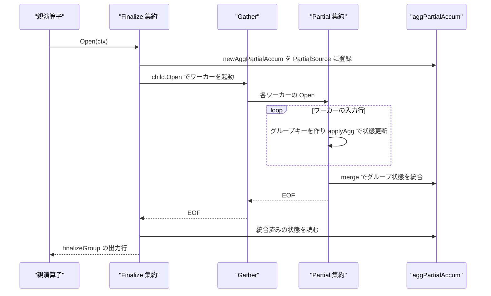
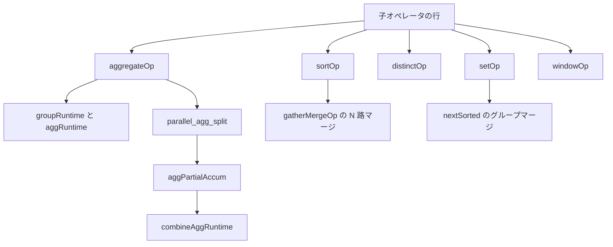

# 集約・ソート・集合演算

<details>
<summary>関連ソースファイル</summary>

- [`internal/executor/agg_state_serial.go`](https://github.com/ryogrid/goopg/blob/19856410e8d497d59787e1ab35a2febb3f5953d6/internal/executor/agg_state_serial.go)
- [`internal/executor/operators.go`](https://github.com/ryogrid/goopg/blob/19856410e8d497d59787e1ab35a2febb3f5953d6/internal/executor/operators.go)
- [`internal/executor/operators_cte_dml.go`](https://github.com/ryogrid/goopg/blob/19856410e8d497d59787e1ab35a2febb3f5953d6/internal/executor/operators_cte_dml.go)
- [`internal/executor/operators_distinct.go`](https://github.com/ryogrid/goopg/blob/19856410e8d497d59787e1ab35a2febb3f5953d6/internal/executor/operators_distinct.go)
- [`internal/executor/operators_gather.go`](https://github.com/ryogrid/goopg/blob/19856410e8d497d59787e1ab35a2febb3f5953d6/internal/executor/operators_gather.go)
- [`internal/executor/operators_gather_merge.go`](https://github.com/ryogrid/goopg/blob/19856410e8d497d59787e1ab35a2febb3f5953d6/internal/executor/operators_gather_merge.go)
- [`internal/executor/operators_generate_series.go`](https://github.com/ryogrid/goopg/blob/19856410e8d497d59787e1ab35a2febb3f5953d6/internal/executor/operators_generate_series.go)
- [`internal/executor/operators_incremental_sort.go`](https://github.com/ryogrid/goopg/blob/19856410e8d497d59787e1ab35a2febb3f5953d6/internal/executor/operators_incremental_sort.go)
- [`internal/executor/operators_join_agg.go`](https://github.com/ryogrid/goopg/blob/19856410e8d497d59787e1ab35a2febb3f5953d6/internal/executor/operators_join_agg.go)
- [`internal/executor/operators_ordinality.go`](https://github.com/ryogrid/goopg/blob/19856410e8d497d59787e1ab35a2febb3f5953d6/internal/executor/operators_ordinality.go)
- [`internal/executor/operators_project_set.go`](https://github.com/ryogrid/goopg/blob/19856410e8d497d59787e1ab35a2febb3f5953d6/internal/executor/operators_project_set.go)
- [`internal/executor/operators_recursive_cte.go`](https://github.com/ryogrid/goopg/blob/19856410e8d497d59787e1ab35a2febb3f5953d6/internal/executor/operators_recursive_cte.go)
- [`internal/executor/operators_setop.go`](https://github.com/ryogrid/goopg/blob/19856410e8d497d59787e1ab35a2febb3f5953d6/internal/executor/operators_setop.go)
- [`internal/executor/operators_window.go`](https://github.com/ryogrid/goopg/blob/19856410e8d497d59787e1ab35a2febb3f5953d6/internal/executor/operators_window.go)
- [`internal/executor/parallel_agg_combine.go`](https://github.com/ryogrid/goopg/blob/19856410e8d497d59787e1ab35a2febb3f5953d6/internal/executor/parallel_agg_combine.go)
- [`internal/executor/parallel_agg_split.go`](https://github.com/ryogrid/goopg/blob/19856410e8d497d59787e1ab35a2febb3f5953d6/internal/executor/parallel_agg_split.go)
- [`internal/executor/sort_presorted.go`](https://github.com/ryogrid/goopg/blob/19856410e8d497d59787e1ab35a2febb3f5953d6/internal/executor/sort_presorted.go)

</details>

`internal/executor` の集約・ソート・集合演算は、行を「グループ化・順序付け・重複排除」する演算子群である。`aggregateOp` は GROUP BY のハッシュ表またはソート済み入力のラン圧縮でグループを作り、`sum`/`avg`/`min`/`max`・分散・回帰・`string_agg`・`array_agg`・WITHIN GROUP などを `aggRuntime` に累積する。`sortOp` は `chunkLimit()` の閾値までメモリでクイックソートし、超えたらチャンクを spill して外部マージする。`distinctOp` は全行をハッシュで重複排除し、`setOp` は UNION ALL をストリームし、UNION/INTERSECT/EXCEPT をバッファかソート済みマージで計算する。`windowOp` はパーティションをバッファしてフレームを評価し、`recursiveUnionOp` は WITH RECURSIVE の不動点を回す。これらに付随して、並列集約の Partial/Finalize 分割、`Gather`/`Gather Merge` の行受け渡し、CTE DML の需要駆動実行、SRF（`generate_series`・`unnest`・`ROWS FROM`）の展開がある。式評価は [6.2 式評価と Datum](6.2-Expression-Evaluation.md)、並列ワーカーの起動は [6.8 並列実行](6.8-Parallel-Execution.md)、ソートの TID 側路を使う行ロックは [6.6 DML と MVCC 書き込み](6.6-DML-and-Writes.md) を参照。

## 責務

- ハッシュ集約。`aggregateOp.Open` が入力行ごとに `appendGroupKey`/`setGroupKey` でグループキーを組み、`map[string]*groupRuntime`（整数キーは `intGroupTable`）にグループを蓄積する。`path:internal/executor/operators_join_agg.go:aggregateOp.Open`
- ソート集約。`plan.Strategy == AggStrategySorted` かつ単純集約なら、`nextSorted` が同じキーの連続ランを読みながらグループを確定する。`path:internal/executor/operators_join_agg.go:nextSorted`
- グループ化セットと ROLLUP。`sets` を `plan.GroupingSets`（nil なら全列の 1 セット）から作り、`rollupCloseOrder` が PG の one-pass AGG_SORTED と同じ順でグループを閉じる。`path:internal/executor/operators_join_agg.go:rollupCloseOrder`
- 集約状態の合成。`combineAggRuntime` が `count`/`sum`/`avg`/`min`/`max`/分散/回帰/`string_agg`/`array_agg`/ユーザー集約を分解可能な範囲で合成する。`path:internal/executor/parallel_agg_combine.go:combineAggRuntime`
- 状態の直列化。`serializeAggRuntime`/`deserializeAggRuntime` が Partial の遷移状態を `KindBytes` の `Datum` に潰し、Gather の行として運べるようにする。`path:internal/executor/agg_state_serial.go:serializeAggRuntime`
- ソート。`sortOp.Open` がキー値を行ごとに 1 回評価して `keyvals` に保持し、`chunkLimit()` の閾値（`chunkLimitBytes` の明示上書き、無ければ `ctx.WorkMem`、未設定なら `sortChunkBytes` = 256 MiB）を超えたチャンクを spill して `sortHeap` でマージする。`path:internal/executor/operators.go:sortOp.Open`
- 増分ソート。`incrementalSortOp` が先頭 `presortedCount` 列でグループを切り、グループ内だけを全キーでソートする。`path:internal/executor/operators_incremental_sort.go:incrementalSortOp`
- 重複排除。`distinctOp` が `appendRowKeyTrimmed` のキーでハッシュ集合を作り、必要なら出力をソートする。`distinctOnOp` は前置ソート済み入力の先頭行だけを返すか、`plan.Hashed` なら `seen` で判定する。`path:internal/executor/operators_distinct.go:distinctOp`
- 集合演算。`setOp` が UNION ALL のストリーム、UNION/INTERSECT/EXCEPT のバッファ計算、`plan.MergeKeys` がある場合のグループマージを切り替える。`path:internal/executor/operators_setop.go:setOp`
- ウィンドウ。`windowOp` がパーティションをバッファし、`frameBounds`/`frameBoundsRange` でフレームを決め、フレーム集約は `aggregateOp` を補助器として再利用する。`path:internal/executor/operators_window.go:windowOp`
- 再帰 CTE。`recursiveUnionOp` が anchor を drain し、`ctx.WorkTableRows` を介して再帰メンバーを反復実行する。`path:internal/executor/operators_recursive_cte.go:recursiveUnionOp`
- 並列集約の分割。`aggPartialAccum` がワーカーのグループ状態を `ctx.PartialAggStates` に集め、Finalize が Gather の EOF 後に読む。`path:internal/executor/parallel_agg_split.go:aggPartialAccum`
- SRF と行の整形。`projectSetOp` が SELECT リストの SRF を行ごとに zip し、`generateSeriesOp`/`ordinalityOp`/`rowsFromOp` が系列・順序番号・複数 SRF の並置を供給する。`path:internal/executor/operators_project_set.go:projectSetOp`
- CTE DML の需要駆動実行。`cteDMLPrefixOp` が参照された DML CTE だけを `ran`/`running` で管理しながら実行する。`path:internal/executor/operators_cte_dml.go:cteDMLPrefixOp`

## 処理フロー

### 集約

`aggregateOp.Open` は Finalize モードなら最初に `newAggPartialAccum()` を作り、`ctx.PartialAggStates[o.plan.PartialSource]` に登録してから子を開く。これは子が Gather で、開いた瞬間にワーカーが accumulator へ書き始めるため、登録が後だと競合するからである。続いて `compileAggExprs` で遷移式をコンパイルし、`Strategy == AggStrategySorted`・グループ化セット無し・`GroupExprs` 非空・`AggModeSimple` の 4 条件が揃えばソート集約のストリームへ入る。それ以外はハッシュ集約で、`GroupingSets` が nil なら全 GROUP BY 列を持つ 1 セットを作り、空セット（集約なし・ROLLUP の総計）のグループを入力ゼロでも 1 行出るよう先に作る。`path:internal/executor/operators_join_agg.go:aggregateOp.Open`

入力行ごとにグループキーを `setGroupKey` で作り、既存グループなら `applyAgg` を呼ぶ。`applyAgg` は集約ごとに `aggRuntime` を更新し、`count`/`sum`/`avg` は int64 カウンタ、`min`/`max` は `MaterializeArena` した値、`string_agg` は `strAccum` への追記、`array_agg` は `arrayElems`、分散は int128/`big.Rat`/Youngs-Cramer、回帰は `regr*` に蓄積する。`Simple` モードは drain 後に `finalizeGroup` で各行を確定し、`Partial` は状態行を出すか共有 accumulator に merge する。`path:internal/executor/operators_join_agg.go:applyAgg`



### ソートと DISTINCT

`sortOp.Open` は子から行を引きながら `evalSortKeyValue` でキーを評価し、`rows`/`keyvals`/`ctids` を並行して伸ばす。`chunkLimit()` の閾値（`chunkLimitBytes` の明示上書き、無ければ `ctx.WorkMem`、未設定なら `sortChunkBytes` = 256 MiB）を超えるとチャンクを `sort.SliceStable` でソートして spill ファイルへ書き、`rows`/`keyvals`/`ctids` を切り詰める。全入力を読み終えたらメモリ上の tail をソートし、spill があれば `sortHeap` で N 路マージする。`wantCTIDs` が立つときだけ `ctids` を維持し、spill 時は行の末尾列として TID を書いてマージで読み戻す。`path:internal/executor/operators.go:sortOp.Open`

`distinctOp.Open` は子を drain しながら `appendRowKeyTrimmed` のキーを `seen` に入れ、新しいキーだけ `cloneRow` して保持する。`unordered` が立っていなければ、PostgreSQL のソートベース DISTINCT に合わせて NULL を最後に置く比較で出力をソートする。`distinctOnOp` は子が `DISTINCT ON` キーで前置ソートされている前提で、直前キーと異なる行だけを返す。`plan.Hashed` の場合は順序前提を捨て、`seen` で「これまでに見たか」を判定する。`path:internal/executor/operators_distinct.go:distinctOp.Open`

### 集合演算

`newSetOp` は `p.All && p.Op == SetOpUnion` のときだけ `streaming` を立てる。`Open` は左右を開き、streaming ならそのまま、`MergeKeys` があり INTERSECT/EXCEPT なら `sorted` を立て、それ以外は `computeBuffered` で両入力を drain して結果を `rows` に格納する。`Next` は streaming なら左を出し切ってから右、`MergeKeys` 付き streaming なら `nextMerge` で先頭の小さい方を出し、sorted なら `nextSorted` でグループ単位に数える。`path:internal/executor/operators_setop.go:setOp.Open`

`nextSorted` は現在の左グループのキー `gkeys` を取り、左の同キー行数 `nLeft` と右の同キー行数 `nRight` を数える。INTERSECT ALL は `min(nLeft, nRight)`、INTERSECT は両方非零なら 1、EXCEPT ALL は `max(nLeft-nRight, 0)`、EXCEPT は右が 0 なら 1 を出し、残りを `pendingRow`/`pendingN` で複数 `Next` に分割する。bpchar 列は `lTrims`/`rTrims` で `bcTruelen` 像に正規化してからキーにする。`path:internal/executor/operators_setop.go:nextSorted`

### ウィンドウ

`windowOp.Open` はフレームの offset 式を 1 回だけ評価し（`frameStartOff`/`frameEndOff`、RANGE 用は `Datum` 版）、子を drain してパーティション単位に並べる。`streaming` が立つ前置ソート済みの場合は 1 パーティションずつ `spoolPartition` し、LIMIT が上にあるときに残りの入力を読まない。`Next` は現在の行を出し、`RunCondition` があればその真偽で早期終了する。`path:internal/executor/operators_window.go:windowOp.Open`

フレーム計算は `peerGroupBounds` で ORDER BY の peer 境界を作り、ROWS は `frameBounds`、RANGE は `frameBoundsRange` が行範囲を返す。フレーム集約は `evalFrameAggFuncs` が `aggHelper`（実際には `aggregateOp`）を再利用し、`frameAggIncremental` が立っていれば前のフレームの状態を引き継いで差分更新する。`ntile` は `evalNtileFuncs` が別扱いする。`path:internal/executor/operators_window.go:evalFrameAggFuncs`

### 再帰 CTE と CTE DML

`recursiveUnionOp.Next` は最初に anchor を drain し、`UNION`（`UnionAll == false`）なら `rowKeyTrimmed` で重複を除く。その後、`ctx.WorkTableRows = o.working` を設定して再帰メンバーを Open し、drain した行を次の working テーブルにする。反復ごとに `depth` を増やし、`maxRecursiveDepth = 1000` を超えると `54001`、1 反復で `maxRecursiveIterationRows = 2_000_000` 行を超えても `54001` を返す。`path:internal/executor/operators_recursive_cte.go:recursiveUnionOp.Next`

`cteDMLPrefixOp` は外側クエリの `inner` を持ち、`ran[i]` が「DML CTE i を完了した」、`running[i]` が「実行中」を表す。参照された CTE だけをその場で実行し、外側本体が終わった後の後処理は `drained`、エラー時は `failed` で抑制する。`path:internal/executor/operators_cte_dml.go:cteDMLPrefixOp`

### SRF と行の整形

`projectSetOp.Open` は SELECT リストに SRF があるモード（`SrfCols`/`UnnestCols`/`RegexpMatchesCols`/`UserSrfCols`）と、旧来の複合 SRF モードに分かれる。SELECT リストモードでは子行ごとに非 SRF 式を評価し、各 SRF の start/stop/step を評価して zip し、長さが違う SRF は短い方を NULL で埋める。`generateSeriesOp` は start/stop/step を最初の `Next` で評価し、step が 0 なら `22023 step size cannot equal zero`、加算が int64 を溢れる位置で終了する。`ordinalityOp` は子行の末尾に 1 始まりの連番を足し、`rowsFromOp` は複数 SRF を横に並べて尽きた子を NULL 埋めする。`path:internal/executor/operators_project_set.go:openSelectSrfMode`

## 主要ファイル

| ファイル | 役割 |
| --- | --- |
| `internal/executor/operators_join_agg.go` | `aggregateOp`/`groupRuntime`/`aggRuntime`。ハッシュ集約・ソート集約・グループ化セット・集約関数の実装。`path:internal/executor/operators_join_agg.go:aggregateOp` |
| `internal/executor/operators.go` | `sortOp`。メモリソート、チャンク spill、外部マージ、TID 側路、compact 出力。`path:internal/executor/operators.go:sortOp` |
| `internal/executor/operators_distinct.go` | `distinctOp`/`distinctOnOp`。ハッシュ重複排除と DISTINCT ON。`path:internal/executor/operators_distinct.go:distinctOp` |
| `internal/executor/operators_setop.go` | `setOp`。UNION ALL ストリーム、バッファ計算、ソート済みグループマージ。`path:internal/executor/operators_setop.go:setOp` |
| `internal/executor/operators_window.go` | `windowOp`。パーティションのバッファ／ストリーム、フレーム境界、フレーム集約。`path:internal/executor/operators_window.go:windowOp` |
| `internal/executor/operators_incremental_sort.go` | `incrementalSortOp`。前置ソート済みグループの部分ソート。`path:internal/executor/operators_incremental_sort.go:incrementalSortOp` |
| `internal/executor/sort_presorted.go` | `sortPrefixEqual`。増分ソートの入力契約（前置キーの等価判定）。`path:internal/executor/sort_presorted.go:sortPrefixEqual` |
| `internal/executor/operators_recursive_cte.go` | `recursiveUnionOp`/`workTableScanOp`。WITH RECURSIVE の不動点と working テーブル走査。`path:internal/executor/operators_recursive_cte.go:recursiveUnionOp` |
| `internal/executor/operators_cte_dml.go` | `cteDMLPrefixOp`/`cteScanOp`/`materializedCTEScanOp`。DML CTE の需要駆動実行と CTE の実体化。`path:internal/executor/operators_cte_dml.go:cteDMLPrefixOp` |
| `internal/executor/operators_project_set.go` | `projectSetOp`。SELECT リスト SRF の zip 展開。`path:internal/executor/operators_project_set.go:projectSetOp` |
| `internal/executor/operators_generate_series.go` | `generateSeriesOp`/`generateSubscriptsOp`。系列生成と step 0／オーバーフロー処理。`path:internal/executor/operators_generate_series.go:generateSeriesOp` |
| `internal/executor/operators_ordinality.go` | `ordinalityOp`/`rowsFromOp`。順序番号の付与と複数 SRF の並置。`path:internal/executor/operators_ordinality.go:ordinalityOp` |
| `internal/executor/operators_gather.go` | `gatherOp`。ワーカーのバッチ送信、`gatherBatchRows = 256`、channel 深さ 2。`path:internal/executor/operators_gather.go:gatherOp` |
| `internal/executor/operators_gather_merge.go` | `gatherMergeOp`/`gmSource`/`gmHeap`。ソート済みワーカー出力の N 路マージ。`path:internal/executor/operators_gather_merge.go:gatherMergeOp` |
| `internal/executor/parallel_agg_split.go` | `aggPartialAccum`/`aggPartialGroup`。ワーカー状態の共有と merge。`path:internal/executor/parallel_agg_split.go:aggPartialAccum` |
| `internal/executor/parallel_agg_combine.go` | `combineAggRuntime` と集約ファミリごとの合成規則、`aggregateIsDecomposable`。`path:internal/executor/parallel_agg_combine.go:combineAggRuntime` |
| `internal/executor/agg_state_serial.go` | `serializeAggRuntime`/`deserializeAggRuntime`/`aggStateFieldBelt`。Partial 状態の行輸送。`path:internal/executor/agg_state_serial.go:serializeAggRuntime` |

## 公開 API / エントリポイント

```go
func newAggregateOp(plan *optimizer.Aggregate, child Operator) *aggregateOp
func newSortOp(plan *optimizer.Sort, child Operator) *sortOp
func newIncrementalSortOp(child Operator, plan *optimizer.IncrementalSort, keys []optimizer.SortKey, presortedCount int) *incrementalSortOp
func newDistinctOp(p *optimizer.Distinct, child Operator) *distinctOp
func newDistinctOnOp(p *optimizer.DistinctOn, child Operator) *distinctOnOp
func newSetOp(p *optimizer.SetOp, left, right Operator) *setOp
func newWindowOp(plan *optimizer.WindowAgg, child Operator) *windowOp
func newRecursiveUnionOp(p *optimizer.RecursiveUnion, anchor, recursive Operator) *recursiveUnionOp
func newWorkTableScanOp(p *optimizer.WorkTableScan) *workTableScanOp
func newProjectSetOp(p *optimizer.ProjectSet, child Operator) *projectSetOp
func newGenerateSeriesOp(p *optimizer.GenerateSeries) *generateSeriesOp
func newOrdinalityOp(p *optimizer.OrdinalityWrap, child Operator) *ordinalityOp
func newRowsFromOp(p *optimizer.RowsFrom, children []Operator) *rowsFromOp
func newCTEDMLPrefixOp(p *optimizer.CTEDMLPrefix) *cteDMLPrefixOp

func combineAggRuntime(call optimizer.AggregateCall, dst, src *aggRuntime, ctx *Context) error
func serializeAggRuntime(name string, st *aggRuntime) (Datum, error)
func deserializeAggRuntime(name string, data []byte) (aggRuntime, error)
func sortPrefixEqual(a, b []Datum, keys []optimizer.SortKey, n int) bool
```

`newAggregateOp` は GROUP BY 式の宣言型が bpchar なら `gkTrims` を立て、グループキーのハッシュを `bcTruelen` 像に合わせる。`newSortOp` は `sortKeyTextFlags` で文字列キーを記録し、`compareDatumTyped` の「文字列型なら素の text 比較」を効かせる。`path:internal/executor/operators_join_agg.go:newAggregateOp`

## 主要データ構造

### `aggregateOp` — 集約の本体

```go
type aggregateOp struct {
	plan   *optimizer.Aggregate
	child  Operator
	schema optimizer.Schema
	// gkVals is the hashed grouping loop's per-row scratch (M0145-0008f):
	// the group-key values are rebuilt for every input row but retained only
	// when the row founds a new group, so they live in a reused buffer
	// instead of a fresh slice per row. The sorted path keeps its own allocations: it holds the
	// previous row's key parts across rows (curParts).
	gkVals Row
	// aggLower / aggLowerSrc cache each aggregate's lower-cased name by
	// aggregate index (aggLowerName).
	aggLower    []string
	aggLowerSrc []string
	// gkBuf is the per-row group key, built in place by appendGroupKey so
	// the map lookup allocates nothing for a row of an existing group
	// (M0122-0012). It holds exactly setGroupKey's bytes.
	gkBuf []byte
	// gkTrims[i] flags a bpchar-typed grouping expression: its bcTruelen
	// image is what the group key must hash (PG's hashbpchar ignores
	// trailing blanks so that char(20) 'x' and char(5) 'x' land in one
	// group). nil when no grouping column is bpchar — the common case
	// pays nothing. M0146 bpchar hash parity.
	gkTrims []bool
	// slot is reused across emissions (review/260831 EO2-24).
	slot MaterializedSlot

	ctx  *Context
	rows []Row
	idx  int

	// Sorted aggregation streams (M0122-0012 slice 44): sorted is set by Open
	// when the AGG_SORTED path applies, and Next then reads the child only up
	// to the end of the next group (nextSorted). sCur is the group being
	// accumulated; its per-column key parts are sCurKey[sCurEnds[i-1]:
	// sCurEnds[i]]. sEOF records the child's EOF.
	sorted   bool
	sCur     *groupRuntime
	sCurKey  []byte
	sCurEnds []int
	sEOF     bool
	// sFree is the last group's runtime, kept once it is finalized so the
	// next stream (a rescan) reuses it (M0122-0012 slice 87).
	sFree *groupRuntime
	// sKeyBuf is nextSorted's reused per-column key buffer (M0122-0012
	// slice 58): a row's group key is compared without allocating.
	sKeyBuf []byte

	// sharedUserStates supports PG aggregate state sharing: when multiple user-defined
	// aggregates have the same sfunc/stype and the same input, sfunc is called only
	// once per row and the state is shared. SharedStateSlot=-1 means no sharing. M0097-0035.
	sharedUserStates       []Datum
	sharedUserStateSet     []bool
	sharedUserStateVersion []int64 // which currentRowVersion last updated this slot
	currentRowVersion      int64   // incremented per input row

	// M0122-0012 C27: a multi-set aggregate evaluates each aggregate's
	// argument once per input row, not once per grouping set. aggArgRow is
	// the drain's current input row (1-based); aggArgSeen[i] == aggArgRow
	// means aggArgVal[i] is aggregate i's argument for that row.
	aggArgShare bool
	aggArgRow   int64
	aggArgSeen  []int64
	aggArgVal   []Datum

	// E-06 (EX4-03): compiled per-call transition expressions. Node
	// lists run parallel to plan.Aggs; extraNodes/orderNodes are
	// per-call lists. aggDeclined marks whole-call UserAgg declines
	// (shared transition machinery stays interpreted). Compiled once
	// per Open; the window helper (bare struct, never Opened) runs
	// interpreted via the idx<0 path.
	aggExprs       exprTreeSlab
	aggArgNodes    []int32
	aggFilterNodes []int32
	aggArg2Nodes   []int32
	aggExtraNodes  [][]int32
	aggOrderNodes  [][]int32
	aggWGOrderNodes [][]int32
	aggDeclined    []bool
	aggCompiled    bool
}
```

`path:internal/executor/operators_join_agg.go:aggregateOp`

`idx`/`rows` はハッシュ集約が drain 後に確定した出力行の読み位置、`sorted`/`sCur`/`sCurEnds`/`sEOF` はソート集約の現在グループとキー境界である。`sharedUserStates`/`sharedUserStateVersion`/`currentRowVersion` は同じ sfunc/stype の複数ユーザー集約が 1 行につき 1 回だけ遷移関数を呼ぶための状態共有、`aggArgRow`/`aggArgSeen`/`aggArgVal` は複数のグループ化セットで引数を 1 回だけ評価するキャッシュである。`aggExprs` 以下のコンパイル済みノード列は `applyAgg` の高速路で、`aggDeclined` が立つ呼び出しは解釈評価に戻る。`slot` は出力の再利用スロットで、返した行は次の `Next` まで有効である。

### `groupRuntime` — 1 グループの蓄積

```go
type groupRuntime struct {
	setIdx          int // which grouping set produced this group
	groupValues     Row
	passthroughVals Row // values of functionally-determined passthrough columns
	aggs            []aggRuntime
	// closeSeq is the input row (1-based) whose key left this group behind
	// in a sorted rollup's drain; 0 while it is still the current group of
	// its set. Only a sorted single-rollup aggregate stamps it (see
	// rollupCloseOrder).
	closeSeq int
}
```

`path:internal/executor/operators_join_agg.go:groupRuntime`

`groupValues[i]` は `GroupExprs[i]` の値で、そのグループ化セットで畳まれた列は NULL になる。`passthroughVals` は GROUP BY に関数従属する列（PostgreSQL の `GROUP BY` 緩和）の値、`aggs` は集約呼び出しごとの `aggRuntime`、`setIdx` はどのグループ化セットが作ったか、`closeSeq` はソート ROLLUP で「このグループを終わらせた入力行」を表す。

### `aggRuntime` — 集約 1 つ分の累積器

```go
type aggRuntime struct {
	hasValue bool
	value    Datum
	// sum tracks INT-only running sums; numericSum tracks the
	// NUMERIC accumulator. Each aggregate-call uses exactly one
	// of them based on the first non-NULL argument's kind. The
	// two are not mixed within a single aggregate.
	sum        int64
	numericSum Datum
	count      int64
	// floatSpecial tracks NaN/Infinity state for sum/avg when float
	// inputs contain special IEEE 754 values (stored as KindString).
	// M0097-0053.
	floatSpecial floatSpecialKind
	distinct     map[string]struct{}
	// Extended aggregate accumulators (M0097-0007).
	boolResult bool   // for bool_and / bool_or / every
	intResult  int64  // for bit_and / bit_or / bit_xor
	strResult  string // for bit_and/bit_or/bit_xor's BIT(n) width tag
	// strAccum is string_agg's unordered accumulator. review/260831 EO2-1:
	// this used to be `strResult += delim + piece`, which reallocates and
	// recopies the whole accumulator per input row — O(n^2) bytes copied for
	// one group. Appending to a byte slice amortises the growth, and it holds
	// bytea mode's RAW bytes just as well as text mode's UTF-8 (finishAgg
	// renders bytea through byteaOutMode at the end either way).
	strAccum []byte
	// strFirstDelim is the delimiter that came with string_agg's first
	// unordered piece. PG's state keeps every piece's leading delimiter and
	// skips the first only when finishing (string_agg_finalfn's cursor), so
	// string_agg_combine joins two partial states with the SECOND state's
	// first delimiter; strAccum drops it, so it is kept here for the
	// combine phase (M0148-0001i).
	strFirstDelim string
	// arrayElems holds the accumulated element format-strings for
	// array_agg(expr); arrayElemNull[i] marks element i as NULL
	// (reserved — current applyAgg skips NULL inputs, so this is
	// always all-false in practice). finishAgg emits the standard
	// `{e1,e2}` text-array literal via formatTextArray, which the
	// libpqrcv `fetch_table_list` probe pipes back into
	// pg_get_publication_tables. M0103-0008 probe-survival.
	arrayElems    []string
	arrayElemNull []bool
	// arrayOfArrays marks array_agg over an ARRAY input
	// (array_agg_array_transfn): each arrayElems entry is a whole input
	// array's text and the result stacks them one dimension deeper;
	// arrayShape is the first input's dimension lengths, which every later
	// input must match. M0146-0033.
	arrayOfArrays bool
	arrayShape    []int
	// arrayElemKeys stores ORDER BY key values for array_agg(x ORDER BY y).
	// Each entry corresponds to arrayElems[i]; nil when no ORDER BY.
	arrayElemKeys [][]Datum
	// strElems/strDelims/strElemKeys are string_agg's deferred-concatenation
	// mode, used ONLY when the call carries its own ORDER BY (M0125-0019).
	// PostgreSQL sorts the transition inputs before running the transition
	// function (nodeAgg.c process_ordered_aggregate_single), so the delimiter
	// that separates two adjacent pieces is the *right-hand* row's own second
	// argument — which is only knowable after the sort. strAccum stays the
	// accumulator for the far more common unordered case.
	strElems    []string
	strDelims   []string
	strElemKeys [][]Datum
	// Variance accumulators (var_pop/var_samp/stddev_pop/stddev_samp).
	// Uses Youngs-Cramer algorithm for float inputs.
	floatSx float64 // running sum of values (Youngs-Cramer Sx)
	floatM2 float64 // running sum of squared deviations (Youngs-Cramer Sxx)
	// Exact integer accumulators for var_pop/var_samp/stddev on integer inputs.
	// When intExact is true, these hold exact values and finishAgg uses them
	// instead of the float Youngs-Cramer values. Matches PG's int4_accum/int8_accum.
	intExact bool
	intSx    *big.Int // Σx
	intSxx   *big.Int // Σx²
	// int2 / int4 input accumulates in 128-bit integers first, as PG's
	// int2_accum / int4_accum do (do_int128_accum, Int128AggState): x² < 2^62,
	// so neither sum can overflow. intSums folds them into intSx / intSxx for
	// every reader (M0122-0012 slice 67: two big.Int per group and a big.Int
	// multiply per row were most of TPC-DS Q39's stddev_samp accumulation).
	int128On bool
	sx128    int128
	sxx128   int128
	// Exact rational accumulators for var_pop/var_samp/stddev on numeric inputs.
	// When numericExact is true, these hold exact rational values matching PG's
	// numeric_accum path (which uses exact arithmetic, not floating point). M0097-0125.
	numericExact bool
	numericSx    *big.Rat // Σx (exact)
	numericSxx   *big.Rat // Σx² (exact)
	// Regression accumulators for regr_*/covar_*/corr. M0097-0020.
	// Follows PostgreSQL's float8_regr_accum signature: first arg is y, second is x.
	regrN     int64   // count of non-NULL (x,y) pairs
	regrSumX  float64 // Σx
	regrSumY  float64 // Σy
	regrSumXX float64 // Σx²
	regrSumXY float64 // Σx*y
	regrSumYY float64 // Σy²
	// userState holds the running state for user-defined aggregates (CREATE AGGREGATE).
	// Initialized from initcond; updated by sfunc on each row.
	userState    Datum
	userStateSet bool // true once userState has been initialized
	// userNoTrans is nodeAgg's noTransValue for the combine phase: the
	// state came from a NULL INITCOND and no partial has been combined yet.
	userNoTrans bool
	// withinGroupElems accumulates per-row values for WITHIN GROUP (ORDER BY ...)
	// ordered-set aggregates (percentile_cont, percentile_disc, rank, dense_rank, mode).
	// Each entry is [sortKey0, sortKey1, ..., valueExpr]. M0097-0035.
	withinGroupElems [][]Datum
	// withinGroupDirectArg stores the "direct argument" (e.g. the fraction p in
	// percentile_cont(p)) evaluated from the first row of the group. M0097-0035.
	withinGroupDirectArg    Datum
	withinGroupDirectArgSet bool
	// withinGroupDirectArgs stores ALL direct args for multi-arg hypothetical-set aggregates
	// like rank(5,'AZZZZ',50) WITHIN GROUP (ORDER BY col1, col2, col3). Set alongside
	// withinGroupDirectArg; used for tuple comparison in rank/dense_rank/cume_dist/percent_rank.
	withinGroupDirectArgs []Datum
	// distinctUserAggRows holds per-row arg vectors for user-defined aggregates
	// with DISTINCT (and optional ORDER BY). Deferred to finishAgg for correct
	// multi-arg dedup and ORDER BY sort before sfunc calls. M0097-0035.
	distinctUserAggRows [][]Datum // inner: [sortKey0..., arg0, arg1, ...]
	// presortedSeen holds the argument keys a presorted DISTINCT user
	// aggregate has already transitioned in this group (M0148-0001j).
	presortedSeen map[string]struct{}
}
```

`path:internal/executor/operators_join_agg.go:aggRuntime`

`hasValue` は「まだ 1 つも非 NULL 入力を見ていない」を表し、`value` は `min`/`max`/`any_value` の保持値である。`sum` と `numericSum` は排他で、最初の非 NULL 引数の Kind が int64 路か NUMERIC 路かを決める。`count` は件数、`floatSpecial` は NaN／±Infinity の支配関係、`distinct` は DISTINCT 集約の既見キー、`strAccum`/`strFirstDelim` は unordered `string_agg`、`arrayElems`/`arrayShape`/`arrayElemKeys` は `array_agg`、`strElems`/`strDelims` は ORDER BY 付き `string_agg`、`floatSx`/`floatM2` と `intSx`/`intSxx` と `numericSx`/`numericSxx` は分散の 3 レーン、`regr*` は回帰、`userState` はユーザー集約、`withinGroup*` は WITHIN GROUP である。`int128On`/`sx128`/`sxx128` は int2/int4 入力を 128 ビットで蓄える中間路で、`intSums` が読むときに `big.Int` へ畳む。

### `sortOp` — メモリソートと外部マージ

```go
type sortOp struct {
	child Operator
	// plan is the Sort plan node this operator executes. Retained (unlike
	// the pre-EX0-03c shape that kept only Keys) so Open can publish the
	// node's EXPLAIN ANALYZE SortStat keyed by plan-node identity.
	plan *optimizer.Sort
	keys []optimizer.SortKey
	ctx  *Context
	// keyText[i] reports key i's static type is a character string
	// (sortKeyTextFlags, set by newSortOp): two string values of such a key
	// compare as plain strings (lessKeyVals, M0122-0012 slice 60). A sortOp
	// built without it compares through compareDatumTyped as before.
	keyText []bool
	// live, when set, marks the only columns of the input rows any reader
	// of this sort's output reads (buildCompleteChild: its consumers and its
	// keys). Only those cells are read and detached into the stored row; the
	// rest stay NULL (the deform poison when armed). nil = every column.
	// M0122-0012 slice 71.
	live []bool
	// liveSlot is the scratch slot the keys of a live-ingested row are
	// evaluated on.
	liveSlot MaterializedSlot
	// compactOut is set by the Gather Merge that is this sort's only reader
	// (newGatherMergeNodeFor), which copies every row it pulls. A live sort
	// then stores compact rows — the live cells alone, in liveIdx order — as
	// PG's tuplesort stores a MinimalTuple of the sort's narrow targetlist,
	// and Next expands each into one reused full-width row (outRow). Before
	// the first spill the stored rows are expanded back (compact is cleared),
	// so the spill and merge paths only ever see full-width rows.
	// M0122-0012 slice 83.
	compactOut bool
	compact    bool
	liveIdx    []int
	width      int // the input rows' width, from the first compact row
	outRow     Row
	rowChunk   rowChunk

	// chunk size threshold for triggering a spill. Default 256 MiB.
	chunkLimitBytes int64
```

`path:internal/executor/operators.go:sortOp`

`keyvals[i]` は `rows[i]` の ORDER BY キーを 1 回だけ評価した結果で、`rows` とロックステップに並べ替え・切り詰めされる。`ctids` は `wantCTIDs` のときだけ維持する TID 側路で、spill 時は行の末尾列として書かれ、マージで読み戻される。`live`/`liveIdx`/`compactOut` は「消費者が読む列だけを保持し、Gather Merge が唯一の読者ならコンパクト行を出す」ための最適化で、spill が起きた時点で全幅行に戻す。`chunkLimitBytes` は既定 256 MiB、`peakBytes` は EXPLAIN ANALYZE の SpaceKB 用のピークである。

### `setOp` — 集合演算

```go
type setOp struct {
	plan  *optimizer.SetOp
	left  Operator
	right Operator

	// streaming is true only for UNION ALL.
	streaming bool
	leftDone  bool
	rightDone bool
	opened    bool

	// claimLeft / claimRight (M0140-0006c-3) are PG's `pa_finished` on a
	// non-partial Append subplan (nodeAppend.c): wired by attachAll's
	// *setOp arm to the shared claimedWhole flag on the branch's leaf
	// claim set when — and only when — the plan marks that branch
	// claimed-whole (SetOp.LeftNonPartial/RightNonPartial). Every
	// participant's private *setOp points at the SAME shared flag, so the
	// CAS in nextStreaming decides which single participant drains its
	// private copy of the branch whole; losers treat it as exhausted.
	// nil for a partial branch (the ordinary per-block claim sets on
	// setOpLeft/setOpRight drive those) and everywhere outside a Gather.
	claimLeft  *atomic.Bool
	claimRight *atomic.Bool
	// leftClaimed / rightClaimed remember a won CAS so later Next calls
	// drain without re-claiming — CAS(true→true) would lose against
	// itself. They are NOT reset by Open: a worker that won keeps its
	// claim across a re-open (the shared flag stays true either way, and
	// only the winner may re-emit the branch), while a loser that
	// re-opens simply loses the CAS again.
	leftClaimed  bool
	rightClaimed bool

	// buffered output (non-streaming variants) produced at Open.
	rows []Row
	idx  int

	// M0141-S2b-4c: ordered merge (plan.MergeKeys). Each side's front row
	// and its evaluated keys, and whether the side is exhausted.
	mergeCur  [2]Row
	mergeKeys [2][]Datum
	mergeLive [2]bool
	mergeInit bool
	mergeErr  error
	// mergeKeyText is sortKeyTextFlags(plan.MergeKeys), built on first use
	// (mergeKeysLess's string arm).
	mergeKeyText []bool
	// mergeKeySlot presents a transferred row and its input slot's tid to
	// the merge-key evaluation (M0146-0052); scratch, reused per row.
	mergeKeySlot MaterializedSlot
	ctx          *Context

	// sorted is the SETOP_SORTED form of INTERSECT / EXCEPT (M0146-0005q):
	// both inputs arrive sorted on plan.MergeKeys and are merged group by
	// group. pendingRow / pendingN are the current group's output copies.
	sorted     bool
	pendingRow Row
	pendingN   int

	// lTrims / rTrims mark bpchar columns on each input's rows: dedup keys
	// (rowKeyTrimmed) must hash the bcTruelen image so a char(20) 'x' from
	// one arm and a char(5) 'x' from the other are the same row — PG's
	// set-op dedup runs under the result column's hashbpchar. A column is
	// trimmed when either the arm's declared type or the set-op output
	// type is bpchar. M0146 bpchar hash parity.
	lTrims []bool
	rTrims []bool
}
```

`path:internal/executor/operators_setop.go:setOp`

`streaming` は UNION ALL のときだけ真で、`leftDone`/`rightDone` が各腕の枯渇を表す。`rows`/`idx` はバッファ計算の出力、`mergeCur`/`mergeKeys`/`mergeLive` はソート済みマージの各腕の先頭行とキー、`pendingRow`/`pendingN` は 1 グループから複数行を出すための保留である。`claimLeft`/`claimRight` は並列 Append の「このブランチを丸ごと drain するのは 1 人だけ」を CAS で決める共有フラグで、勝ったワーカーは `leftClaimed`/`rightClaimed` を立てて以後 drain を続ける。

### `distinctOp` と `distinctOnOp`

```go
type distinctOp struct {
	plan   *optimizer.Distinct
	child  Operator
	ctx    *Context
	rows   []Row
	idx    int
	schema optimizer.Schema
	// junkPos marks resjunk (rowmark ctid) positions excluded from the
	// dedup key — a unique ctid datum would otherwise make every row
	// distinct. M0143-0009.
	junkPos map[int]bool
	// colTrims flags bpchar-typed columns: dedup keys and the output-order
	// comparison run on the bcTruelen image so a char(20) 'x' and a
	// char(5) 'x' are one row — hashbpchar/bpcharlt parity. M0146.
	colTrims []bool
	// colText flags character-string columns, whose output-order
	// comparison is plain text whatever the values look like (M0146-0053).
	colText []bool
	// unordered skips the output sort: the consumer is a hashed aggregate
	// whose result does not depend on input order (markDistinctUnordered).
	unordered bool
}
```

`path:internal/executor/operators_distinct.go:distinctOp`

`junkPos` は resjunk の ctid を重複キーから除外する。ctid は行ごとに一意なので、含めると DISTINCT が何も畳めない。`colTrims` は bpchar の末尾空白を落とし、`colText` は文字列列を素の text 比較にする。`unordered` は「消費者がハッシュ集約で順序を気にしない」と証明できたときに出力ソートを省く。

```go
type distinctOnOp struct {
	plan    *optimizer.DistinctOn
	child   Operator
	ctx     *Context
	schema  optimizer.Schema
	prevKey string
	started bool
	// keyTrims[i] marks a bpchar-typed DISTINCT-ON key column: its key
	// image is the bcTruelen form so padding-width variants of one value
	// stay one key. Contiguity under that image is guaranteed by the
	// child's pre-sort, whose keys evalSortKeyValue already trims.
	keyTrims []bool
	// seen is the hashed mode's key set (plan.Hashed: PG's UNIQUE_PATH_HASH
	// for a unique-ified semijoin RHS, M0146-0005dk) — the input is
	// unsorted, so a key is a duplicate when it was ever seen, not only
	// when it equals the previous row's.
	seen map[string]struct{}
	// keyBuf is Next's reused key buffer (appendDistinctOnKey).
	keyBuf []byte
}
```

`path:internal/executor/operators_distinct.go:distinctOnOp`

`prevKey` は前置ソート済みモードの直前キー、`keyBuf` は `appendDistinctOnKey` の再利用バッファである。`plan.Hashed` のときは `seen` が「これまでに見たキー」を持ち、`prevKey` の隣接比較ではなく集合判定になる。

### `windowOp`

```go
type windowOp struct {
	plan   *optimizer.WindowAgg
	child  Operator
	schema optimizer.Schema

	ctx  *Context
	rows []Row
	idx  int

	// frameStartOff/frameEndOff are o.plan.Frame's offset expressions
	// evaluated once (mirroring LIMIT/OFFSET's once-per-query
	// evaluation, not per-row — PG disallows column/aggregate/window
	// references in a frame offset for exactly this reason). Only
	// meaningful when the corresponding bound kind is
	// FrameBoundOffsetPreceding/Following.
	frameStartOff int64
	frameEndOff   int64

	// frameStartOffDatum/frameEndOffDatum are the RANGE-mode value offsets
	// (numeric/float/interval, not just int), evaluated once alongside
	// frameStartOff/frameEndOff. Only meaningful when Frame.Mode is
	// FrameModeRange and the corresponding bound is
	// FrameBoundOffsetPreceding/Following; see frameBoundsRange.
	frameStartOffDatum Datum
	frameEndOffDatum   Datum

	// pTrims / obTrims flag bpchar-typed PARTITION BY / ORDER BY
	// expressions: partition keys hash and peers compare under the
	// bcTruelen image (hashbpchar / bpcharlt), so padding-width variants
	// of one value share a partition and a peer group. M0146.
	pTrims  []bool
	obTrims []bool

	// wantCTIDs is the TID side-channel's request flag (markSortWantCTIDs):
	// a consumer above evaluates `ctid` against this operator's slots. The
	// window buffers its input, so each row's TID is kept in ctids, in step
	// with rows through the partition sort, and re-attached on output — as
	// sortOp does. PG computes the Var below the WindowAgg and passes it up as
	// a column (make_window_input_target); goopg's ctid rides the slot
	// (M0146-0236).
	wantCTIDs bool
	ctids     []sortCTID

	// streaming is set for a presorted, partitioned window (streamsPartitions):
	// rows holds ONE partition at a time and Next spools the next one when it
	// runs out, as nodeWindowAgg.c's spool_tuples / begin_partition do, so a
	// LIMIT above stops the input after the partitions it needed (M0122-0012
	// slice 74: TPC-DS Q51's Sort emitted all 169 297 rows into the window
	// where PG's emitted 506). pending is the next partition's first row,
	// read while finding this one's end; childDone marks the input's end.
	streaming  bool
	pending    Row
	pendingTID sortCTID
	childDone  bool
	// offsetsResolved marks the frame offsets evaluated for this scan, and
	// aggHelper is the frame-aggregate accumulator reused across partitions.
	offsetsResolved bool
	aggHelper       *aggregateOp
}
```

`path:internal/executor/operators_window.go:windowOp`

`frameStartOff`/`frameEndOff` は ROWS の offset、`frameStartOffDatum`/`frameEndOffDatum` は RANGE の値 offset で、どちらもクエリ開始時に 1 回だけ評価する。`pTrims`/`obTrims` は PARTITION BY/ORDER BY の bpchar を `bcTruelen` 像で扱うためのフラグ、`ctids` は `wantCTIDs` のときの TID 側路である。`streaming` のとき `rows` は 1 パーティションだけを持ち、`pending`/`pendingTID`/`childDone` が次のパーティションとの境界を表す。`aggHelper` はフレーム集約の `aggregateOp` で、パーティションをまたいで再利用される。

### `incrementalSortOp`

```go
type incrementalSortOp struct {
	child          Operator
	plan           *optimizer.IncrementalSort
	keys           []optimizer.SortKey
	presortedCount int
	ctx            *Context

	// group is the presorted-prefix group being emitted, sorted by every key;
	// ri is the next row of it to return. groupKeys holds its key values while
	// it is collected.
	group     []Row
	groupKeys [][]Datum
	ri        int
	// next / nextKV is the first row of the following group, read to find
	// where the current group ends and held until that group is collected.
	next    Row
	nextKV  []Datum
	hasNext bool
	// eof records that the child returned EOF.
	eof    bool
	pulled int
}
```

`path:internal/executor/operators_incremental_sort.go:incrementalSortOp`

`presortedCount` は「先頭何列が既に整列済みか」で、`group` が現在の前置キーグループ、`groupKeys` がそのキー値、`ri` がグループ内の読み位置である。`next`/`nextKV`/`hasNext` は次のグループの先頭行を、現在のグループの終端を見つけるために先読みして保持する。`eof` は子の枯渇、`pulled` は引き抜いた行数である。

### `recursiveUnionOp` と `workTableScanOp`

```go
type recursiveUnionOp struct {
	plan      *optimizer.RecursiveUnion
	anchor    Operator
	recursive Operator
	working   []Row
	output    []Row
	// seen tracks rows already in output for UNION (non-ALL) dedup.
	seen map[string]bool
	// colTrims marks bpchar output columns: UNION dedup hashes the
	// bcTruelen image so padding-width variants of one value dedup to
	// one row (hashbpchar parity, M0146).
	colTrims []bool
	outIdx   int
	initDone bool
	done     bool
	depth    int // iteration counter for maxRecursiveDepth guard
	ctx      *Context
	// slot is reused across emissions (review/260831 EO2-24); the returned
	// pointer is stable and its row field is overwritten each Next, as in
	// indexScanOp (M0092-0007).
	slot MaterializedSlot
}
```

`path:internal/executor/operators_recursive_cte.go:recursiveUnionOp`

`anchor` は最初に 1 度だけ drain され、`working` が現在の反復の入力、`output` が全結果、`seen` が UNION の重複排除、`depth` が反復回数である。`outIdx` は `output` の読み位置、`initDone`/`done` が開始・終了状態、`slot` が再利用する出力スロットである。

```go
type workTableScanOp struct {
	plan *optimizer.WorkTableScan
	ctx  *Context
	idx  int
	// slot is reused across emissions (review/260831 EO2-24).
	slot MaterializedSlot
}
```

`path:internal/executor/operators_recursive_cte.go:workTableScanOp`

`workTableScanOp` は `ctx.WorkTableRows` を先頭から読み、`idx` を進めるだけの走査である。再帰メンバーの計画に現れ、`recursiveUnionOp` が反復ごとに `ctx.WorkTableRows` を差し替えることで「前の反復の出力」を入力に変える。

### `cteDMLPrefixOp`

```go
type cteDMLPrefixOp struct {
	plan  *optimizer.CTEDMLPrefix
	ctx   *Context
	inner Operator // outer query operator

	// ran[i] is set once DMls[i] has been executed to completion, running[i]
	// while it is executing. running guards against a CTE reachable from its
	// own body; references may only point backwards, so it should be
	// unreachable, but a demand-driven runner must not recurse forever if it
	// ever is.
	ran     []bool
	running []bool

	// prevPending restores ctx.pendingDMLCTEs at Close, so a nested driver
	// (currently rejected by the analyzer — a data-modifying WITH below the
	// top level is an error, M0125-0051) could not strand the outer one.
	prevPending *cteDMLPrefixOp

	// drained records that the post-body phase has already been attempted, so
	// Close does not repeat what Next already did. failed suppresses that
	// phase after the body raised: PG never reaches ExecutorFinish on the
	// error path either.
	drained bool
	failed  bool

	// scope is the instrumenter active on this op's own Build() call,
	// handed over by maybeInstrument (instrumentScopeCarrier). The DML
	// plans and the outer body below are only buildNode()d at Open()
	// time — long after the top-level EXPLAIN ANALYZE Build() call
	// returned — so Open() passes it down into each nested build to
	// keep those nodes under EXPLAIN ANALYZE's instrumentation.
	scope *instrumenter
}
```

`path:internal/executor/operators_cte_dml.go:cteDMLPrefixOp`

`ran[i]`/`running[i]` が DML CTE ごとの完了・実行中フラグで、`running` は「CTE が自分の本体から参照される」循環を防ぐためのガードである。`prevPending` は `ctx.pendingDMLCTEs` の退避、`drained`/`failed` は外側本体後の後処理を 1 回だけ行うための状態、`scope` は Open 時に遅延ビルドする DML 計画へ EXPLAIN ANALYZE の計測を伝えるためのスコープである。

### 並列集約の状態

```go
// aggPartialGroup is one group's accumulated state, combined across workers.
type aggPartialGroup struct {
	groupValues Row
	passthrough Row
	states      []aggRuntime
}

// aggPartialAccum collects per-group states from every worker running a
// Partial aggregate.
//
// Combining happens on INSERT, under the mutex, rather than being deferred to
// the Finalize node. The contention is negligible — one lock acquisition per
// (worker, group), and Q1 has four groups — while the alternative would hold
// every worker's full group map alive until the end.
type aggPartialAccum struct {
	mu     sync.Mutex
	groups map[string]*aggPartialGroup
	order  []string
}
```

`path:internal/executor/parallel_agg_split.go:aggPartialAccum`

`aggPartialGroup` はグループキー・関数従属列・集約状態を 1 組にしたもので、`aggPartialAccum` は `groups` の写像と `order`（初出順）を持つ。`merge` は mutex の下で、初出ならそのまま所有し、既存なら `combineAggRuntime` で各状態を畳み込む。ユーザー集約の初出は `INITCOND` から始めた状態に最初の partial を combine する（単純に採用しない）。

### SRF と行の整形

```go
type projectSetOp struct {
	plan   *optimizer.ProjectSet
	child  Operator
	schema optimizer.Schema

	ctx  *Context
	rows []Row
	pos  int
}
```

`path:internal/executor/operators_project_set.go:projectSetOp`

`projectSetOp` は `Open` で全結果を `rows` に作り、`Next` は `pos` を進めるだけである。SELECT リスト SRF の zip は `openSelectSrfMode` が行ごとに行い、複数 SRF の長さが違えば短い側を NULL 埋めする。

```go
type generateSeriesOp struct {
	plan    *optimizer.GenerateSeries
	ctx     *Context
	current int64
	stop    int64
	step    int64
	started bool
	done    bool

	// row and slot are reused across emissions (review/260831 EO1-10): the
	// series used to allocate a one-column Row AND a MaterializedSlot per
	// value. Same "valid until the next Next()" contract as indexScanOp
	// (M0092-0007).
	row  Row
	slot MaterializedSlot
}
```

`path:internal/executor/operators_generate_series.go:generateSeriesOp`

`current`/`stop`/`step` が系列の状態で、`started` が「最初の `Next` で引数を評価した」、`done` が終了を表す。`row`/`slot` は 1 列の出力を再利用する。

```go
type ordinalityOp struct {
	plan  *optimizer.OrdinalityWrap
	child Operator
	ord   int64
}
```

`path:internal/executor/operators_ordinality.go:ordinalityOp`

`ord` は 1 始まりの連番で、`Open` のたびに 0 に戻る。`Next` は子行のコピーを作り、末尾に `NewIntDatum(ord)` を足して返す。

### `Gather` と `Gather Merge` の転送単位

`operators_gather.go` の `rowBatch` は `rows []Row`、`tids []queueTID`、`worker int` を持ち、ワーカーは `gatherBatchRows = 256` 行ごとに送る。channel の深さは `gatherChanDepth = 2` で、これがそのまま流量制御になる。`gatherMergeOp` は `gmSource` ごとに先頭行 `cur` と評価済みキー `curKeys` を持ち、`gmHeap` で最小のソースを選ぶ。`curKeys` を 1 回だけ評価するのは、比較のたびにキー式を評価すると O(keys·log sources) になるからである。`path:internal/executor/operators_gather_merge.go:gmSource`

## 内部構造

### ハッシュ集約とソート集約の分岐

`aggregateOp.Open` のソート集約条件は 4 つすべてを要求する。`Strategy == AggStrategySorted`、`GroupingSets == nil`、`len(GroupExprs) > 0`、`Mode == AggModeSimple` である。グループ化セットや並列の Partial/Final はハッシュ路に残る。ハッシュ路では `sets` を `GroupingSets`（nil なら全列の 1 セット）から作り、`multiSet` のときは `aggArgShare` を有効にして集約引数を入力行ごとに 1 回だけ評価する。空セットのグループは入力ゼロでも 1 行出るよう、drain の前に作られる。`GroupedNoKeys` は「GROUP BY のキーがすべて定数畳み込みで消えた」場合で、PG の AGG_SORTED と同様に入力行があるときだけ 1 グループを作る。`path:internal/executor/operators_join_agg.go:aggregateOp.Open`

### 並列集約の状態輸送

Partial/Finalize の分割は、遷移状態を Gather の行として運ばない。Partial ノードは自分の `Open` の中で子を drain し、グループを作り、`aggPartialAccum.merge` で共有 accumulator へ畳み込む。Finalize は子（Gather）を開く前に accumulator を `ctx.PartialAggStates` に登録し、Gather が EOF を返した時点で全ワーカーの merge が完了していることを利用する。したがって barrier は Gather の EOF だけである。`path:internal/executor/parallel_agg_split.go:aggPartialAccum.merge`

行として状態を運ぶ経路もある。`serializeAggRuntime` は `count`・`sum`/`avg`・`min`/`max`・`bool_*`・`bit_*`・分散・回帰など、`combineAggRuntime` が合成規則を持つ族を固定レイアウトで書き、`aggStateFieldBelt` が DISTINCT 集合・順序付き `string_agg`・順序付き `array_agg`・WITHIN GROUP・ユーザー状態を持つ状態を**明示的に拒否**する。壊れた partial 状態は最終結果を静かに間違えるため、運べないものはエラーにする。`path:internal/executor/agg_state_serial.go:aggStateFieldBelt`

### ソートのチャンクと spill

`sortOp.Open` は行を引くたびにキーを評価して `keyvals` に積み、`chunkLimit()` が返す閾値（`chunkLimitBytes` の明示上書き、無ければ `ctx.WorkMem`、未設定なら `sortChunkBytes` = 256 MiB）を超えたらチャンクをソートして spill する。`spillFiles` が 1 つでもあれば `mergeReady` が立ち、`Next` は `sortHeap` から最小行を選ぶ。`trackCTIDs` は「消費者が TID を要求する」か「ソートキーが ctid を読む」ときに立ち、spill 行の末尾に TID を追加する。`live`/`compactOut` の最適化は spill 前に解除され、spill とマージの経路は常に全幅行を見る。`path:internal/executor/operators.go:sortOp.Open`

### 集合演算の 3 形態

`setOp` は入力を 3 通りに扱う。UNION ALL は左を出し切って右を出すストリーム、UNION/INTERSECT/EXCEPT で `MergeKeys` が無いものは `computeBuffered` が両入力を drain して `rows` に結果を作る、`MergeKeys` がある INTERSECT/EXCEPT は `nextSorted` がグループ単位で数える。バッファ計算は右側の行キーをカウントし、UNION は左＋右の未見、INTERSECT は右にもある左、EXCEPT は右に無い左を出す。`drainSetOpInput` は bpchar の `trims` を適用しながらキーを作る。`path:internal/executor/operators_setop.go:computeBuffered`

### ウィンドウのフレーム

`windowOp` は `frameBounds`（ROWS）と `frameBoundsRange`（RANGE）で `[start, end)` を決め、`frameRowExcluded`/`firstInFrame`/`lastInFrame`/`nthInFrame` が EXCLUDE を適用する。`peerGroupBounds` は ORDER BY キーが等しい連続行の境界を作り、RANGE の `CURRENT ROW` や `GROUPS` モードの基礎になる。`frameAggReusesState` が真の集約は前フレームの状態を引き継ぎ、`evalFrameAggFuncs` が差分更新する。`RunCondition` は「これ以上行を出さない」条件で、PARTITION BY が無ければ即 EOF、あればそのパーティションの残りを飛ばす。`path:internal/executor/operators_window.go:frameBounds`

### 増分ソートの契約

`sort_presorted.go` は `incrementalSortOp` の入出力契約を型ではなくコメントと `sortPrefixEqual` で固定している。入力は先頭 `n` キーで整列し、同キー行は連続し、グループは前置キー順に来る。出力は全キーで整列し、`sortOp` と同じ順序でなければならない。`compareDatum` がエラーになる比較不能なペアは「新しいグループ」として分割し、マージはしない（過分割は性能、誤マージは誤答）。`path:internal/executor/sort_presorted.go:sortPrefixEqual`

### 再帰 CTE の反復

`recursiveUnionOp.Next` は anchor を `output` と `working` の両方に積み、`UNION` なら `seen` で重複を落とす。反復では `ctx.WorkTableRows = working` を設定してから再帰メンバーを Open し、drain した行を `iterRows` に集める。`UNION` は `iterRows` の各キーを `seen` と照合し、`UNION ALL` はそのまま通す。`depth` が `maxRecursiveDepth = 1000` に達するか、1 反復が `maxRecursiveIterationRows = 2_000_000` 行に達すると `54001` で止まる。両方とも暴走クエリをプロセスごと落とさないための上限である。`path:internal/executor/operators_recursive_cte.go:recursiveUnionOp.Next`

### Gather の終了順序

`gatherOp.Close` は「drain してから join する」「どの経路でも join する」「待つ前に cancel する」の 3 つを守る。実際の順序は drain → cancel → join（待機）である。ワーカーが channel 送信で詰まったまま join するとデッドロックし、早期 LIMIT・エラー・キャンセルのどの経路でもワーカーの寿命は文の内側に閉じている必要がある。`gatherMergeOp` は同じ規律に加え、`gmSource.curKeys` を 1 回だけ評価し、`wantCTIDs` のときは `keySlot` で行と TID を一緒にキー評価へ渡す。`path:internal/executor/operators_gather.go:gatherOp.Close`

### CTE DML の需要駆動

`cteDMLPrefixOp` は PostgreSQL の「データ変更 CTE は参照されたときに実行し、参照されなかったものは本体の後に実行する」を再現する。`ran[i]` が実行済み、`running[i]` が実行中で、参照が後方にしか向かない前提を破る循環を検出する。外側本体が終わった後の未実行 CTE は `Next` の後処理で走らせ、`drained` で二重実行を防ぐ。本体がエラーを出した場合は `failed` が立ち、PG の `ExecutorFinish` に相当する後処理を行わない。`path:internal/executor/operators_cte_dml.go:cteDMLPrefixOp`

行の削減・順序付けを担う演算子の関係は次のとおりである。



## エッジケースと不変条件

- **ハッシュ集約のグループキーは bpchar を正規化する。** `gkTrims` が立つ列は `bcTruelen` 像でハッシュされ、`char(20) 'x'` と `char(5) 'x'` が同じグループになる。`path:internal/executor/operators_join_agg.go:newAggregateOp`
- **空セットのグループは入力ゼロでも 1 行。** 集約なしのクエリや ROLLUP の総計レベルは、drain の前にグループを作る。`GROUP BY` キーが定数化で消えた `GroupedNoKeys` はこの逆で、入力行があるときだけグループを作る。`path:internal/executor/operators_join_agg.go:aggregateOp.Open`
- **ソート集約は 4 条件をすべて満たすときだけ。** `AggStrategySorted`・`GroupingSets == nil`・`GroupExprs` 非空・`AggModeSimple` のいずれかが欠けるとハッシュ路に落ちる。`path:internal/executor/operators_join_agg.go:aggregateOp.Open`
- **Partial/Finalize の登録は子を開く前。** Finalize は `ctx.PartialAggStates[o.plan.PartialSource]` を子の `Open` より先に設置し、`defer delete` で文の終わりに外す。後から登録すると最初のワーカーの merge と競合する。`path:internal/executor/operators_join_agg.go:aggregateOp.Open`
- **分解できない集約は partial にできない。** `aggregateIsDecomposable` が偽の集約（DISTINCT・ORDER BY 付き・ユーザー集約など）は Partial/Finalize に分割されない。`combineAggRuntime` も同じホワイトリストに従う。`path:internal/executor/parallel_agg_combine.go:aggregateIsDecomposable`
- **直列化できない状態は黙って落とさずエラー。** `aggStateFieldBelt` は DISTINCT 集合・`string_agg`・`array_agg`・WITHIN GROUP・ユーザー状態を検出すると `internal error: cannot serialise ...` を返す。`path:internal/executor/agg_state_serial.go:aggStateFieldBelt`
- **ソートの spill は keyvals/ctids を同時に切り詰める。** `keyvals` が `rows` より長く残ると、以降の比較が 1 行ずつずれて誤ったキーを見る。`ctids` も同じ理由でロックステップに保つ。`path:internal/executor/operators.go:sortOp.Open`
- **外部ソートの出力は全幅行。** `live`/`compactOut` のコンパクト行は spill が起きた時点で解除され、マージ経路は常に全幅行を扱う。`compactOut` は Gather Merge が唯一の読者のときだけ立つ。`path:internal/executor/operators.go:sortOp`
- **DISTINCT の出力順は NULL 最後。** `unordered` でない限り、`distinctOp` は NULL を最後に置く比較で `rows` をソートする。PostgreSQL のソートベース DISTINCT に合わせるためである。`path:internal/executor/operators_distinct.go:distinctOp.Open`
- **DISTINCT ON は前置ソート前提かハッシュか。** 通常は子がキーで整列済みで、`prevKey` と異なる行だけを返す。`plan.Hashed` のときは `seen` による集合判定に切り替わる。`path:internal/executor/operators_distinct.go:distinctOnOp.Next`
- **集合演算の bpchar 正規化。** `lTrims`/`rTrims` が立つ列は `bcTruelen` 像でキーを作る。片方の腕が `char(20)`、もう片方が `char(5)` でも同じ値なら 1 行に畳まれる。`path:internal/executor/operators_setop.go:setOp`
- **INTERSECT ALL / EXCEPT ALL の個数規則。** `nextSorted` は `min(nLeft,nRight)` と `max(nLeft-nRight,0)` を出し、`INTERSECT`/`EXCEPT` は 1 行だけ出す。`pendingN` で複数行を複数の `Next` に分割する。`path:internal/executor/operators_setop.go:nextSorted`
- **ウィンドウの offset は 1 回だけ評価。** `frameStartOff`/`frameEndOff`（ROWS）と `frameStartOffDatum`/`frameEndOffDatum`（RANGE）はクエリ開始時に固定され、行ごとには評価しない。PostgreSQL がフレーム offset に列参照を許さないのと同じ前提である。`path:internal/executor/operators_window.go:windowOp.Open`
- **`RunCondition` は単調。** 偽または NULL になったら、PARTITION BY が無ければ即 EOF、あればそのパーティションの残りを飛ばす。条件が単調であることが前提である。`path:internal/executor/operators_window.go:windowOp.Next`
- **増分ソートは比較不能でグループを分割する。** `sortPrefixEqual` は `compareDatumTyped` のエラーを「別グループ」として扱う。過分割は性能劣化で済むが、誤マージは順序を壊す。`path:internal/executor/sort_presorted.go:sortPrefixEqual`
- **再帰 CTE の上限。** `maxRecursiveDepth = 1000` と `maxRecursiveIterationRows = 2_000_000` のどちらに達しても `54001` を返す。1 反復が終わらないケースは後者が捕まえる。`path:internal/executor/operators_recursive_cte.go:maxRecursiveDepth`
- **`generate_series` の step 0 は 22023。** `step == 0` は `step size cannot equal zero`、`current + step` が int64 を溢れる位置では系列を終了する。どちらも無限ループを防ぐ。`path:internal/executor/operators_generate_series.go:generateSeriesOp.Next`
- **Gather の Close 順序。** drain → cancel → join（待機）の順を守る。ワーカーが channel 送信で詰まったまま join すると Close がデッドロックする。`path:internal/executor/operators_gather.go:gatherOp.Close`
- **Gather Merge のキー評価は 1 行 1 回。** `gmSource.curKeys` は行を引いたときに評価し、比較のたびには評価しない。`wantCTIDs` のときは `keySlot` が行と TID を一緒に提示する。`path:internal/executor/operators_gather_merge.go:gmSource`

Sources:

- `internal/executor/agg_state_serial.go`
- `internal/executor/operators.go`
- `internal/executor/operators_cte_dml.go`
- `internal/executor/operators_distinct.go`
- `internal/executor/operators_gather.go`
- `internal/executor/operators_gather_merge.go`
- `internal/executor/operators_generate_series.go`
- `internal/executor/operators_incremental_sort.go`
- `internal/executor/operators_join_agg.go`
- `internal/executor/operators_ordinality.go`
- `internal/executor/operators_project_set.go`
- `internal/executor/operators_recursive_cte.go`
- `internal/executor/operators_setop.go`
- `internal/executor/operators_window.go`
- `internal/executor/parallel_agg_combine.go`
- `internal/executor/parallel_agg_split.go`
- `internal/executor/sort_presorted.go`

<sub>Generated by deepwiki-4myself from `goopg` @ `19856410e`</sub>
