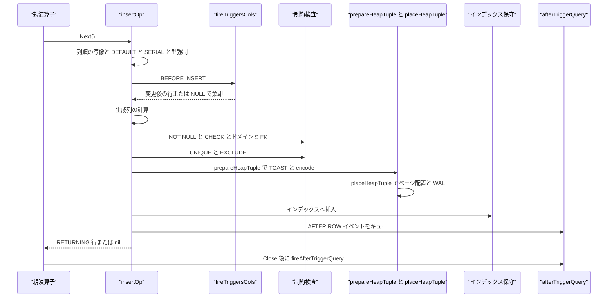
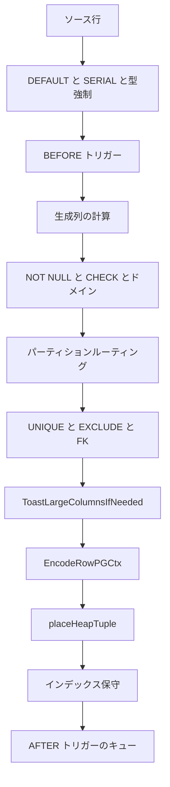

# DML と MVCC 書き込み

<details>
<summary>関連ソースファイル</summary>

- [`internal/executor/after_trigger.go`](https://github.com/ryogrid/goopg/blob/19856410e8d497d59787e1ab35a2febb3f5953d6/internal/executor/after_trigger.go)
- [`internal/executor/bulk_insert.go`](https://github.com/ryogrid/goopg/blob/19856410e8d497d59787e1ab35a2febb3f5953d6/internal/executor/bulk_insert.go)
- [`internal/executor/deferred_exclusion.go`](https://github.com/ryogrid/goopg/blob/19856410e8d497d59787e1ab35a2febb3f5953d6/internal/executor/deferred_exclusion.go)
- [`internal/executor/deferred_unique.go`](https://github.com/ryogrid/goopg/blob/19856410e8d497d59787e1ab35a2febb3f5953d6/internal/executor/deferred_unique.go)
- [`internal/executor/heap_fillfactor.go`](https://github.com/ryogrid/goopg/blob/19856410e8d497d59787e1ab35a2febb3f5953d6/internal/executor/heap_fillfactor.go)
- [`internal/executor/operators_fk.go`](https://github.com/ryogrid/goopg/blob/19856410e8d497d59787e1ab35a2febb3f5953d6/internal/executor/operators_fk.go)
- [`internal/executor/operators_lockrows.go`](https://github.com/ryogrid/goopg/blob/19856410e8d497d59787e1ab35a2febb3f5953d6/internal/executor/operators_lockrows.go)
- [`internal/executor/operators_storage.go`](https://github.com/ryogrid/goopg/blob/19856410e8d497d59787e1ab35a2febb3f5953d6/internal/executor/operators_storage.go)
- [`internal/executor/operators_trigger.go`](https://github.com/ryogrid/goopg/blob/19856410e8d497d59787e1ab35a2febb3f5953d6/internal/executor/operators_trigger.go)
- [`internal/executor/operators_tx.go`](https://github.com/ryogrid/goopg/blob/19856410e8d497d59787e1ab35a2febb3f5953d6/internal/executor/operators_tx.go)
- [`internal/executor/operators_upsert.go`](https://github.com/ryogrid/goopg/blob/19856410e8d497d59787e1ab35a2febb3f5953d6/internal/executor/operators_upsert.go)
- [`internal/executor/partial_index_maintain.go`](https://github.com/ryogrid/goopg/blob/19856410e8d497d59787e1ab35a2febb3f5953d6/internal/executor/partial_index_maintain.go)
- [`internal/executor/probe_defer.go`](https://github.com/ryogrid/goopg/blob/19856410e8d497d59787e1ab35a2febb3f5953d6/internal/executor/probe_defer.go)
- [`internal/executor/relation_locks.go`](https://github.com/ryogrid/goopg/blob/19856410e8d497d59787e1ab35a2febb3f5953d6/internal/executor/relation_locks.go)
- [`internal/executor/replica_identity_check.go`](https://github.com/ryogrid/goopg/blob/19856410e8d497d59787e1ab35a2febb3f5953d6/internal/executor/replica_identity_check.go)
- [`internal/executor/spec_insert_registry.go`](https://github.com/ryogrid/goopg/blob/19856410e8d497d59787e1ab35a2febb3f5953d6/internal/executor/spec_insert_registry.go)
- [`internal/executor/toast.go`](https://github.com/ryogrid/goopg/blob/19856410e8d497d59787e1ab35a2febb3f5953d6/internal/executor/toast.go)

</details>

`internal/executor` の DML は、プランナーが作った `Insert`/`Update`/`Delete`/`Upsert` ノードを、MVCC のヘッダを刻んだヒープタプルとしてストレージへ書き込む層である。`insertOp` はソース行を列順に並べ替えて DEFAULT・SERIAL・型強制・BEFORE トリガー・生成列・NOT NULL/CHECK/ドメイン・パーティションルーティング・FK・UNIQUE/EXCLUDE を順に適用し、`prepareHeapTuple` で TOAST と `EncodeRowPGCtx` を済ませ、`placeHeapTuple` で FSM/fillfactor に従うページへ置いて WAL を出す。`updateOp` は HOT が可能なら同一ページに新版を書き、不可なら旧版の `xmax` を刻んで新タプルを別ページへ置く。`deleteOp` は `xmax` を刻んで可視性を落とし、`upsertOp` は arbiter インデックスで衝突を調べ、DO NOTHING か DO UPDATE に分岐する。`transactionOp` は COMMIT 時に遅延 FK/UNIQUE/EXCLUDE を検査し、`lockRowsOp` は `FOR UPDATE` 系の行ロックを `xmax` に刻む。式評価は [6.2 式評価と Datum](6.2-Expression-Evaluation.md)、インデックス保守の B-tree 側は [8 B-tree インデックス](../8-Btree.md)、WAL と永続性は [10 WAL と耐久性](../10-WAL.md)、MVCC の可視性判定は [9 トランザクションと MVCC](../9-Transactions.md) を参照。

## 責務

- INSERT の行変換と制約適用。`insertOp.Next` が `plan.ColumnIndex` でソース行を列順へ写し、`applyDefaultsForMissing`・`autoGenerateSerialValues`・`coerceRowForConstraintChecks`・`computeGeneratedColumns`・`checkConstraints`・`checkFKInsert` を順に呼ぶ。`path:internal/executor/operators_storage.go:insertOp.Next`
- ヒープタプルの生成。`prepareHeapTuple` が `MaterializeWriterXID` で XID を確定し、`ToastLargeColumnsIfNeeded` で大きな値を外部化し、`EncodeRowPGCtx` で PostgreSQL 互換のバイト列にし、`xmin`/`cmin`/infomask を刻む。`path:internal/executor/operators_storage.go:prepareHeapTuple`
- ページ配置と WAL。`placeHeapTuple` が `heapFillfactor` と `bulkInsertState` を使って空きページを選び、`LogHeapInsert` で WAL を出してタプルを置く。`path:internal/executor/operators_storage.go:placeHeapTuple`
- UPDATE の HOT/非 HOT 分岐。`tryApplyHOTUpdate` が同一ページに新タプルを置けるなら `HeapOnlyTuple` として書き、不可なら `stampUpdaterXmaxPreservingLockers` で旧版の `xmax` を刻む。`path:internal/executor/operators_storage.go:tryApplyHOTUpdate`
- DELETE と MVCC。`deleteOp.next` が可視行の `xmax` を自 XID にし、`markHeapDeleteDirtyAndClearVM` で VM を落とす。`path:internal/executor/operators_storage.go:deleteOp.next`
- UPSERT。`upsertOp.next` が arbiter キーを probe し、衝突なしなら `applyInsert`、衝突ありなら `applyUpdate` を呼ぶ。`path:internal/executor/operators_upsert.go:upsertOp.next`
- 一意性と排他制約。`checkUniqueIndexesForInsert`/`checkUniqueIndexesForUpdate`/`checkExclusionConstraintsForInsert` が UNIQUE/PK と EXCLUDE を検査し、延期可能ならキューに積む。`path:internal/executor/operators_storage.go:checkUniqueIndexesForInsert`
- 外部キー。`checkFKInsert`・`enforceFKOnDelete`・`fkCascadeDelete`・`fkSetNull` が親の存在確認と参照アクションを実行する。`path:internal/executor/operators_fk.go:enforceFKOnDelete`
- トリガー。`fireTriggersCols` が BEFORE/AFTER の行トリガーを発火し、`queueAfterRowTriggers`/`fireAfterTriggerQuery` が AFTER イベントをクエリ終端まで遅延する。`path:internal/executor/operators_trigger.go:fireTriggersCols`
- 行ロック。`lockRowsOp.drainAndStamp` が `FOR UPDATE`/`FOR SHARE`/`FOR KEY SHARE` を `xmax` の infomask と MultiXact に刻み、NOWAIT/SKIP LOCKED を扱う。`path:internal/executor/operators_lockrows.go:lockRowsOp`
- トランザクション制御。`transactionOp.execCommit` が遅延制約検査・ON COMMIT アクション・SSI pre-commit・保留 DDL を順に処理する。`path:internal/executor/operators_tx.go:transactionOp.execCommit`
- TOAST。`ToastLargeColumnsIfNeeded` が 2000 バイト超の値を PGLZ 圧縮のうえチャンク分割し、`DetoastValue`/`DetoastRowBound` が読み戻す。`path:internal/executor/toast.go:ToastLargeColumnsIfNeeded`
- 部分インデックスと replica identity。`indexPredicateAdmits` が部分インデックスの述語を評価し、`checkCmdReplicaIdentity` が論理レプリケーション対象表の UPDATE/DELETE を検査する。`path:internal/executor/partial_index_maintain.go:indexPredicateAdmits`

## 処理フロー

### INSERT

`insertOp.Next` は最初の呼び出しで `done` を立て、子を最後まで drain する。行ごとに `plan.ColumnIndex` でソース行を目標列順へ写し、`applyDefaultsForMissing` が指定外列の DEFAULT を埋め、`autoGenerateSerialValues` が SERIAL/IDENTITY を採番する。次に `coerceRowForConstraintChecks` で型強制と範囲検査を行い、BEFORE INSERT トリガーを発火する。トリガーが NULL を返した行はスキップされ、返された行は以後の検査対象になる。`path:internal/executor/operators_storage.go:insertOp.Next`

続いて `computeGeneratedColumns` で STORED 生成列を計算し、NOT NULL・CHECK・ドメイン・WITH CHECK OPTION を検査する。パーティション表なら `routeToPartition` でリーフを決め、`lockRoutingPathPartitions` で経路上のパーティションをロックしてから FK を検査する。リーフの列順が親と違えば `remapRowForPartition` で写し、リーフ側の NOT NULL/ドメイン/UNIQUE/EXCLUDE を再検査する。最後に `writeHeapRowReturning` で書き、`ssiRecordTupleInsert` とインデックス保守、AFTER トリガーのキュー投入を行う。`path:internal/executor/operators_storage.go:insertOp.Next`



`prepareHeapTuple` は `ctx.MaterializeWriterXID()` を最初に呼ぶ。これは遅延 XID 割り当ての前提で、`ToastLargeColumnsIfNeeded` が TOAST チャンクを書く際の `NewHeapTuple` にも同じ XID が必要になる。続いて列ごとに TOAST 判定を行い、`bpchar` はパディングしてから長さを測る（PG の入力時パディングと同じ順序）。2000 バイトを超える値は `col.Storage != "external"` なら PGLZ 圧縮を試し、圧縮後の方が小さければ圧縮フラグ付きで格納する。`path:internal/executor/toast.go:ToastLargeColumnsIfNeeded`

### UPDATE と DELETE

`updateOp.next` は子スキャンから旧行を取得し、SET 式を評価して新行を作る。`hotUpdateEligible` と `updateChangesIndexKeys` が「同一ページに置けて、索引キーも変わらない」と判定できれば `tryApplyHOTUpdate` を呼ぶ。HOT 版は `HeapOnlyTuple` を立てて新タプルを書き、旧タプルの `xmax` を自分にし、HOT チェーンで新版へつなぐ。不可なら `stampUpdaterXmaxNonHOT` で旧版の `xmax` を刻み、`writeHeapRowReturning` で新行を別ページに置き、全インデックスへ新エントリを追加する。旧版に `FOR UPDATE` のロック保持者がいる場合、`survivingLockersForUpdate` が生き残りを選び、`carryForwardLockersToNewTuple` が MultiXact として新版へ引き継ぐ。`path:internal/executor/operators_storage.go:tryApplyHOTUpdate`

`deleteOp.next` は可視行を見つけると、その `xmax` が有効でないこと・自 XID でないことを確認してから `xmax` に自 XID を刻む。`markHeapDeleteDirtyAndClearVM` がページを dirty にし、Visibility Map の all-visible ビットを落とす。行ロック待ちが必要なら `waitForConflictingRowLock` が MultiXact のメンバーを調べ、競合する保持者が解放されるまで待つ。`path:internal/executor/operators_storage.go:deleteOp.next`

### UPSERT

`upsertOp.next` はソース行を親列順に写し、DEFAULT/SERIAL/型強制を INSERT と同じ順序で適用する。パーティション表なら `routeAndOpenLeaf` でリーフと arbiter インデックスを切り替え、BEFORE INSERT トリガーを発火してから `probeArbiterWaiting` で arbiter キーを probe する。NULLS NOT DISTINCT の arbiter ではキーが NULL になり得るので、`probeArbiterNND` がヒープ走査で衝突を補う。衝突が無ければ `applyInsert` が行を書き、`specInsertRegistry` に投機トークンを登録する。衝突があれば `applyUpdate` が ON CONFLICT DO UPDATE の SET を評価し、`writtenPtrs` で「同じ文が同じ行を 2 回変更した」を検出して `21000` を返す。`path:internal/executor/operators_upsert.go:upsertOp.next`

### トランザクションと遅延制約

`transactionOp.Next` は 1 回だけ動くワンショットで、`plan.Verb` に応じて `execBegin`/`execCommit`/`execRollback`/`execSavepoint`/`execRelease`/`execRollbackTo` を呼ぶ。`execCommit` はまず `TakeDeferredFKChecks` を取り、`runAllDeferredFKChecks` で親の存在を再検査する。次に `RunDeferredUniqueChecks` と `RunDeferredExclusionChecks` がキューを drain し、違反があれば `TxnMgr.Rollback` と `EndExplicitTransaction` でトランザクションを畳んでからエラーを返す。続いて `RunOnCommitActions`（ON COMMIT DELETE ROWS/DROP）、`ssiPreCommitCheck`（SERIALIZABLE の危険構造検査）、保留中の DROP INDEX/ATTACH PARTITION/INHERIT/DROP TABLE/DROP FUNCTION の適用、`CommitTransaction` の順に進む。`path:internal/executor/operators_tx.go:transactionOp.execCommit`

### 行ロック

`lockRowsOp` は子チェーンを `Project`/`Filter` の下までたどって `currentTIDProvider`（`seqScanOp`/`indexScanOp` など）を見つける。最初の `Next` で `drainAndStamp` が子をすべて読み、行ごとに `(rel, ptr, row)` を `pendingLockedRow` に記録し、2 パス目で `stampLock` がページの `xmax` をロック infomask（`HeapXmaxKeyShrLock`/`HeapXmaxShrLock`/`HeapXmaxExclLock`）と MultiXact で更新する。その後 `Next` はバッファから行を返す。`FOR UPDATE` は `lockKeysUpdated` も立て、`FOR NO KEY UPDATE` と区別する。`path:internal/executor/operators_lockrows.go:lockRowsOp`

## 主要ファイル

| ファイル | 役割 |
| --- | --- |
| `internal/executor/operators_storage.go` | `insertOp`/`updateOp`/`deleteOp`、HOT、EPQ、ヒープ書き込み、インデックス保守、制約検査。`path:internal/executor/operators_storage.go:insertOp` |
| `internal/executor/operators_upsert.go` | `upsertOp`。arbiter probe、DO NOTHING/DO UPDATE、投機挿入、`writtenPtrs` の二重変更検出。`path:internal/executor/operators_upsert.go:upsertOp` |
| `internal/executor/operators_tx.go` | `transactionOp`/`setTransactionOp`/`setConstraintsOp`。BEGIN/COMMIT/ROLLBACK、遅延制約、保留 DDL。`path:internal/executor/operators_tx.go:transactionOp` |
| `internal/executor/operators_lockrows.go` | `lockRowsOp`/`pendingLockedRow`。行ロックの 2 パス処理と EPQ。`path:internal/executor/operators_lockrows.go:lockRowsOp` |
| `internal/executor/operators_trigger.go` | `fireTriggersCols`/`fireStatementTriggersCols`/`triggerWhenPasses`。トリガーの発火順と WHEN。`path:internal/executor/operators_trigger.go:fireTriggersCols` |
| `internal/executor/after_trigger.go` | `afterTriggerEvent`/`afterTriggerQuery`/`stmtAfterTriggers`。AFTER トリガーのクエリレベル キュー。`path:internal/executor/after_trigger.go:afterTriggerQuery` |
| `internal/executor/operators_fk.go` | `checkFKInsert`/`enforceFKOnDelete`/`fkCascadeDelete`/`fkSetNull`。FK 検査と参照アクション。`path:internal/executor/operators_fk.go:checkFKInsert` |
| `internal/executor/deferred_unique.go` | `uniqueCheckDeferred`/`queueDeferredUniqueCheck`/`RunDeferredUniqueChecks`。延期 UNIQUE/PK。`path:internal/executor/deferred_unique.go:RunDeferredUniqueChecks` |
| `internal/executor/deferred_exclusion.go` | `excludeCheckDeferred`/`queueDeferredExclusionCheck`/`RunDeferredExclusionChecks`。延期 EXCLUDE。`path:internal/executor/deferred_exclusion.go:RunDeferredExclusionChecks` |
| `internal/executor/toast.go` | `ToastLargeColumnsIfNeeded`/`toastStore`/`DetoastValue`/`DetoastRowBound`。TOAST の書き込みと読み戻し。`path:internal/executor/toast.go:ToastLargeColumnsIfNeeded` |
| `internal/executor/bulk_insert.go` | `bulkInsertState`/`heapMultiInsertPages`。COPY の複数行一括配置とページ計画。`path:internal/executor/bulk_insert.go:bulkInsertState` |
| `internal/executor/heap_fillfactor.go` | `Context.heapFillfactor`/`invalidateHeapFillfactor`。fillfactor のセッション内メモ化。`path:internal/executor/heap_fillfactor.go:heapFillfactor` |
| `internal/executor/partial_index_maintain.go` | `indexPredicateAdmits`/`indexPredicateColumns`。部分インデックスの述語評価。`path:internal/executor/partial_index_maintain.go:indexPredicateAdmits` |
| `internal/executor/replica_identity_check.go` | `checkCmdReplicaIdentity`/`hasReplicaIdentity`。論理レプリケーション対象表の UPDATE/DELETE 検査。`path:internal/executor/replica_identity_check.go:checkCmdReplicaIdentity` |
| `internal/executor/spec_insert_registry.go` | `specInsertRegistry`/`specEntry`。投機挿入トークンと待機者の登録。`path:internal/executor/spec_insert_registry.go:specInsertRegistry` |
| `internal/executor/relation_locks.go` | `relLockMgr`/`relLockEntry`。`LOCK TABLE` のプロセス全体レジストリ。`path:internal/executor/relation_locks.go:relLockMgr` |
| `internal/executor/probe_defer.go` | `armProbeDefer`/`finishDeferred`。ハッシュ結合 probe 用の遅延 deform。`path:internal/executor/probe_defer.go:armProbeDefer` |

## 公開 API / エントリポイント

```go
func newInsertOp(p *optimizer.Insert, child Operator) *insertOp
func newUpdateOp(p *optimizer.Update) (*updateOp, error)
func newDeleteOp(p *optimizer.Delete) (*deleteOp, error)
func newUpsertOp(p *optimizer.Insert, child Operator) *upsertOp
func newTransactionOp(p *optimizer.Transaction) *transactionOp
func newLockRowsOp(p *optimizer.LockRows, child Operator) *lockRowsOp

func writeHeapRow(ctx *Context, rel storage.RelFileNode, cols []catalog.Column, row Row) error
func writeHeapRowReturning(ctx *Context, rel storage.RelFileNode, cols []catalog.Column, row Row) (storage.ItemPointer, error)
func ToastLargeColumnsIfNeeded(ctx *Context, rel storage.RelFileNode, cols []catalog.Column, row Row) (Row, error)
func DetoastRowBound(ctx *Context, mainRel storage.RelFileNode, cols []catalog.Column, row Row, bound int) (Row, error)
func checkFKInsert(ctx *Context, fkOwnerTbl, reportTbl *catalog.Table, row Row) error
func RunDeferredFKChecks(ctx *Context, sess *BasicSession) error
func RunDeferredUniqueChecks(ctx *Context, sess *BasicSession) error
func RunDeferredExclusionChecks(ctx *Context, sess *BasicSession) error
func checkCmdReplicaIdentity(ctx *Context, tbl *catalog.Table, isUpdate bool) error
func (r *specInsertRegistry) RegisterSpec(xid storage.TransactionID, pid string)
func (r *specInsertRegistry) SettleSpec(xid storage.TransactionID)
func DeregisterSpecXID(xid storage.TransactionID)
```

`newUpdateOp`/`newDeleteOp` は `extractScan` で子計画から `SeqScan`・述語・`IndexScan` を取り出し、更新対象の探索方法を決める。`newInsertOp`/`newUpsertOp` は子オペレータ（VALUES や SELECT）を持ち、`Open` で権限とリレーションロックを確認する。`path:internal/executor/operators_storage.go:newUpdateOp`

## 主要データ構造

### `insertOp` / `updateOp` / `deleteOp`

```go
type insertOp struct {
	plan         *optimizer.Insert
	ctx          *Context
	child        Operator
	rowsAffected int64
	done         bool

	// retRows / retIdx: collected RETURNING rows; iterated via Next()
	// after all inserts are applied (M0100-0005).
	retRows []Row
	retIdx  int
}
```

`path:internal/executor/operators_storage.go:insertOp`

```go
type updateOp struct {
	plan         *optimizer.Update
	updCols      map[string]bool // updateColumns' cache
	scan         *optimizer.SeqScan
	pred         optimizer.Expr
	ctx          *Context
	rowsAffected int64
	done         bool

	// idxScan, when non-nil, is the IndexScan from the child plan.
	// updateOp uses the B-tree to find matching tuples (O(log n))
	// instead of the full SeqScan path (O(n)). Set by newUpdateOp
	// when the planner produced an IndexScan.
	idxScan *optimizer.IndexScan

	// retRows / retIdx: collected RETURNING rows; iterated via Next()
	// after all updates are applied (M0100-0005).
	retRows []Row
	retIdx  int
}
```

`path:internal/executor/operators_storage.go:updateOp`

```go
type deleteOp struct {
	plan         *optimizer.Delete
	scan         *optimizer.SeqScan
	pred         optimizer.Expr
	ctx          *Context
	rowsAffected int64
	done         bool
	idxScan      *optimizer.IndexScan
	retRows      []Row
	retIdx       int
}
```

`path:internal/executor/operators_storage.go:deleteOp`

`insertOp` は子を 1 回 drain して `done` を立て、`retRows` に RETURNING の結果を溜めて `Next` で 1 行ずつ返す。`updateOp` は `scan`/`pred`/`idxScan` のいずれかで対象行を見つけ、`updCols` は SET 対象列の写像である。`deleteOp` も同じ探索フィールドを持ち、`idxScan` があればインデックスで対象を絞る。3 者とも `rowsAffected` が `RowCounter` の値であり、`retRows`/`retIdx` が RETURNING のストリームである。

### `upsertOp`

```go
type upsertOp struct {
	plan         *optimizer.Insert
	updCols      map[string]bool // updateColumns' cache
	ctx          *Context
	child        Operator
	rowsAffected int64
	done         bool
	// RETURNING accumulator: appendUpsertRetRow fills retRows during the
	// processing loop; Next() streams them out on subsequent calls.
	retRows []Row
	retIdx  int
	// arbiterTree is opened lazily on first conflict probe (or
	// first row insert when ArbiterIndex != nil) and kept across
	// the statement for cheap reuse. nil when ArbiterIndex is nil
	// (the bare DO NOTHING form). For partitioned targets, this
	// is swapped per-row to point at the routed leaf partition's
	// matching arbiter index (M0100-0005t).
	arbiterTree *nbtree.BTree
	// leafTrees caches per-leaf-partition arbiter btree handles so
	// multi-row UPSERTs over the same partition reuse a single
	// open tree.  Keyed by leaf table OID.  M0100-0005t.
	leafTrees map[uint32]*nbtree.BTree
	// writtenPtrs tracks heap ItemPointers written by this statement
	// (via applyInsert or applyUpdate).  When a subsequent row in the
	// same multi-row INSERT conflicts with a pointer in this set, the
	// conflict target was already affected in this statement and we must
	// raise SQLSTATE 21000 "ON CONFLICT DO UPDATE command cannot affect
	// row a second time".  M0097-0028.
	writtenPtrs map[storage.ItemPointer]struct{}
	// specIndexKeys caches the non-arbiter index keys computed during the
	// speculative applyInsert for the current source row, keyed by index OID.
	// specInsertedLeaf is the leaf-ordered row those keys were computed from.
	// On the ON CONFLICT DO UPDATE retry, applyUpdate reuses a cached key when
	// the index's referenced base columns are unchanged from the speculative
	// row, so a side-effectful expression index (e.g. blurt_and_lock_*) is not
	// re-evaluated — mirroring PG's HOT update, which touches no index when no
	// indexed column changed. Both are reset per source row. M0100-0006b.
	specIndexKeys    map[uint32][]byte
	specInsertedLeaf Row
}
```

`path:internal/executor/operators_upsert.go:upsertOp`

`arbiterTree` は衝突判定に使う B-tree で、パーティション表では `leafTrees` のリーフごとのハンドルへ差し替わる。`writtenPtrs` は同じ文が書き込んだ TID の集合で、2 回目の更新を `21000` にする。`specIndexKeys`/`specInsertedLeaf` は投機挿入時に計算した非 arbiter 索引キーのキャッシュで、DO UPDATE の再試行時に索引式を再評価しないためのものである（PG の HOT 更新が索引に触らないのと同じ理屈）。

### `lockRowsOp` と `pendingLockedRow`

```go
type lockRowsOp struct {
	plan  *optimizer.LockRows
	ctx   *Context
	child Operator

	// scan is the underlying TID-providing leaf operator
	// resolved at Open time — found by walking the child chain
	// past Project / Filter wrappers. Each row that bubbles up
	// through child.Next() can be traced back to (block, slot)
	// via scan.currentTID. nil when the child tree has no
	// supported leaf (e.g. Values); in that case Next() falls
	// through to pass-through and only the relation-level lock
	// from Open applies. Both seqScanOp (M0021 step 2a) and
	// indexScanOp (M0021 step 2c) implement currentTIDProvider.
	scan currentTIDProvider
	// lockStrength is the HeapXmax* lock-mode infomask bit corresponding
	// to the locks slice, resolved once at Open from the four-way row-lock
	// strength (M0118-0003):
	//   FOR KEY SHARE      → HeapXmaxKeyShrLock
	//   FOR SHARE          → HeapXmaxShrLock
	//   FOR NO KEY UPDATE  → HeapXmaxExclLock              (lockKeysUpdated=false)
	//   FOR UPDATE         → HeapXmaxExclLock + KEYS_UPDATED (lockKeysUpdated=true)
	// Multiple LockedRels targeting the same scan would need merging under
	// strongest-wins; v0 keeps that deferred and uses the first
	// LockedRel's strength.
	lockStrength uint16
	// lockKeysUpdated distinguishes FOR UPDATE (true) from FOR NO KEY UPDATE
	// (false) — both stamp HeapXmaxExclLock, but FOR UPDATE additionally
	// reserves the key via HEAP_KEYS_UPDATED so a concurrent FOR KEY SHARE
	// correctly conflicts with it. Mirrors heap_lock_tuple's new_infomask2.
	lockKeysUpdated bool

	// Two-pass buffer. seqScanOp holds the page's RLock
	// across multiple Next() calls (RUnlock fires only at
	// page exhaustion / Close), so we can't grab the slot's
	// write Lock for xmax-stamping while the scan is mid-page.
	// First Next call drains the entire child chain, recording
	// (rel, ptr, row) per row, then runs the stamp pass, then
	// yields rows from the buffer. Memory cost is the result
	// set; SELECT FOR UPDATE typically targets a small range
	// so the buffering is acceptable for Stage A. Streaming
	// per-tuple stamping requires a deeper seqScan refactor
	// (one Pin/RLock per Next) and is deferred.
	pending []pendingLockedRow
	pos     int
	drained bool

	// maxDrain, when > 0, limits drainAndStamp to at most maxDrain rows.
	// Used by EXISTS (SELECT ... FOR UPDATE) to stop after the first match
	// instead of scanning the full inner table. M0100-0005.
	maxDrain int

	// junkPos is the set of resjunk (rowmark ctid) column positions in the
	// child row — stripped before a row leaves the operator. Positions are
	// read from the child schema's Resjunk marks; a ctid injected into a
	// non-rightmost leaf sits mid-row, so the trailing-NumCtidCols trim is
	// only a fallback for hand-built plans without marks. M0143-0009.
	junkPos map[int]bool

	// filterPred / filterCols: extracted from the child chain at Open time.
	// When stampLock follows a committed-update CTID chain to a live successor
	// (EPQ for SELECT FOR UPDATE), the filter predicate is re-evaluated against
	// the new row — matching PostgreSQL's EvalPlanQualFetchRowMark behaviour.
	filterPred optimizer.Expr
	filterCols []catalog.Column

	// waitPolicy is the effective NOWAIT / SKIP LOCKED / (default) blocking
	// policy for the per-tuple lock acquisition in stampLock. Resolved once at
	// Open from Locks[0].WaitPolicy (v0 assumes a single policy per LockRows;
	// multi-clause merge is deferred, consistent with lockStrength). M0118-0003.
	waitPolicy optimizer.LockWaitPolicy
	// lockRelName is the name of the first locked relation, used to format the
	// NOWAIT "could not obtain lock on row in relation \"%s\"" diagnostic with
	// the upstream-canonical relation name. Resolved at Open from Locks[0].
	lockRelName string

	// pgClassRowMarkOID / pgClassRowMarkXID record the explicit pg_class rowmark
	// this LockRows took up front in maybeRecordPgClassRowMark (so a concurrent
	// GRANT/REVOKE blocks behind it during the wait). If the post-wait scan then
	// yields no row — the relation's pg_class tuple was concurrently DELETEd and
	// committed — PG holds no tuple lock, so we retract the mark immediately
	// (ClearPgClassRowMark) and a peer waiting behind it proceeds without waiting
	// for our transaction to end. Design 0118-0117 (intra-grant-inplace perm 10).
	pgClassRowMarkOID uint32
	pgClassRowMarkXID uint32
	// pgClassRelDropped is set in Open when the pending-DROP wait released into
	// a committed drop — the pg_class tuple this rowmark locked is gone. PG
	// resolves 'rel'::regclass once into the scan key before the LockTuple
	// wait, so its scan just finds the tuple deleted and yields 0 rows; the
	// child scan's lazy re-evaluation would instead raise 42P01. drainAndStamp
	// skips the drain; the empty-pending arm retracts the mark. Sticky on
	// purpose: the OID cannot come back, matching PG's bound scan key across
	// rescans. Design 0118-0117 (intra-grant-inplace perm 10).
	pgClassRelDropped bool
}
```

`path:internal/executor/operators_lockrows.go:lockRowsOp`

```go
type pendingLockedRow struct {
	rel storage.RelFileNode
	ptr storage.ItemPointer
	row Row
	// haveTID reports whether currentTID returned ok=true at
	// capture time; rows scanned through non-seqScan leaves
	// (IndexScan, Values) get haveTID=false and skip the
	// stamp pass — only the relation-level lock applies.
	haveTID bool
	// newPtr/newPtrValid: set when stampLock followed a committed-update
	// CTID chain to a live successor. lockRowsOp.Next() refetches the
	// row from newPtr so callers see the post-update values.
	newPtr      storage.ItemPointer
	newPtrValid bool
}
```

`path:internal/executor/operators_lockrows.go:pendingLockedRow`

`lockStrength` は `FOR KEY SHARE`/`FOR SHARE`/`FOR NO KEY UPDATE`/`FOR UPDATE` を `xmax` の infomask ビットへ写したもので、`lockKeysUpdated` が `FOR UPDATE` だけを `HEAP_KEYS_UPDATED` にする。`pending` は 2 パス処理のバッファで、`pos` が読み位置、`drained` が drain 完了、`maxDrain` が EXISTS 用の上限である。`junkPos` は子スキーマの resjunk ctid を出力から除く位置、`waitPolicy` は NOWAIT/SKIP LOCKED の別、`pgClassRowMarkOID`/`pgClassRowMarkXID` は pg_class の行マークを後から撤回するための記録である。`pendingLockedRow.newPtr` は EPQ で更新後の行へ付け替えるときに使う。

### AFTER トリガーのキュー

```go
type afterTriggerEvent struct {
	tbl    *catalog.Table
	event  string
	stmt   bool
	oldRow Row
	newRow Row
	// updCols is an UPDATE event's target column set
	// (updateTargetColumns); nil when unknown or for other events.
	updCols map[string]bool
}

type stmtTriggerKey struct {
	oid   uint32
	name  string
	event string
}

// afterTriggerQuery is one query level's trigger state.
type afterTriggerQuery struct {
	events  []afterTriggerEvent
	bsFired map[stmtTriggerKey]bool
}
```

`path:internal/executor/after_trigger.go:afterTriggerEvent`

```go
type stmtAfterTriggers struct {
	level   *afterTriggerQuery
	failed  bool
	flushed bool
}
```

`path:internal/executor/after_trigger.go:stmtAfterTriggers`

`afterTriggerEvent` は 1 イベント分のテーブル・イベント名・文レベルか・旧行・新行・UPDATE 対象列を持つ。`afterTriggerQuery.events` は発生順のキューで、`bsFired` は「同じ (テーブル, イベント) の BEFORE STATEMENT を 1 クエリレベルで 1 回だけ発火した」ことを記録する。`stmtAfterTriggers` は文の根が所有するレベルで、`swapIn`/`swapOut` が `Context.afterTrigQuery` を差し替え、`finish` が Close 後に 1 回だけキューを発火する。

### `bulkInsertState`

```go
type bulkInsertState struct {
	rel storage.RelFileNode

	// current_buf: the page the last tuple went to.
	cur     storage.BlockNumber
	haveCur bool
	// next_free / last_free: pages of the last bulk extension not used yet.
	nextFree, lastFree storage.BlockNumber
	haveFree           bool
	// already_extended_by: every page this state has extended the relation by.
	alreadyExtendedBy int

	// The batch a multi-insert flush is placing; lens is nil outside one, and
	// then every request is for one page (heap_insert passes num_pages 0).
	lens          []int // t_len of each prepared tuple of the batch
	saveFree      int   // the fillfactor reserve (saveFreeSpace)
	idx           int   // the tuple being placed
	npages        int   // heap_multi_insert's npages
	npagesUsed    int   // and npages_used
	startingEmpty bool  // starting_with_empty_page
}
```

`path:internal/executor/bulk_insert.go:bulkInsertState`

`cur` は最後にタプルを置いたページ、`nextFree`/`lastFree` は直前の一括延長で未使用のページ、`alreadyExtendedBy` はこの状態が延長した総ページ数である。`lens`/`saveFree`/`idx`/`npages`/`npagesUsed`/`startingEmpty` は COPY のバッチ配置で、`heapMultiInsertPages` が「詰めたとき何ページ必要か」を先に計算する。`maxBuffersToExtendBy = 64` が 1 回の延長で確保する上限である。

### `specInsertRegistry`

```go
type specInsertRegistry struct {
	mu          sync.Mutex
	cond        *sync.Cond
	active      map[storage.TransactionID]*specEntry // XID → entry; from RegisterSpec to DeregisterXID
	specWaiters []specWaiter                         // waiting for a spec token (spectoken ShareLock f)
	xidWaiters  []xidWaiter                          // waiting for XID commit/abort (transactionid ShareLock f)
}

type specEntry struct {
	pid     string
	settled bool // false = holding spec token; true = token released
}

type specWaiter struct {
	pid       string
	ownXID    storage.TransactionID
	targetXID storage.TransactionID
}

type xidWaiter struct {
	pid       string
	ownXID    storage.TransactionID
	targetXID storage.TransactionID
}
```

`path:internal/executor/spec_insert_registry.go:specInsertRegistry`

`active` は「投機挿入トークンを保持している XID」、`specWaiters` はトークン解放待ち、`xidWaiters` は XID の commit/abort 待ちである。`specEntry.settled` が偽の間はトークン保持中で、`SettleSpec` が真にすると `cond.Broadcast` で待機者を起こす。`DeregisterSpecXID` はトランザクション終了フックから呼ばれ、`active` から消す。

### `transactionOp`

```go
// transactionOp is a one-shot operator that mutates explicit
// transaction state for BEGIN/COMMIT/ROLLBACK.
type transactionOp struct {
	plan *optimizer.Transaction
	ctx  *Context
	done bool
}
```

`path:internal/executor/operators_tx.go:transactionOp`

`plan.Verb` が 1 つの操作を選び、`done` が「もう実行した」を表すワンショットである。`Open` は `TxnMgr` と `Session` の存在を要求し、`Next` が実際の BEGIN/COMMIT/ROLLBACK/SAVEPOINT を実行する。

### `fkPendingRef` と関係ロック

```go
type fkPendingRef struct {
	xid  storage.TransactionID
	rel  storage.RelFileNode
	blk  storage.BlockNumber
	slot uint16
}
```

`path:internal/executor/operators_fk.go:fkPendingRef`

FK 検査で「一致した親行の `xmax` がまだ in-flight の更新者」だった場合、`fkPendingRef` が `(xid, rel, blk, slot)` を返し、呼び出し側はその XID の決着を待ってから再スキャンする。`clean` な一致行が 1 つでもあれば待たずに合格する（PG の `SELECT FOR KEY SHARE` と同じ優先順位）。

```go
type relLockEntry struct {
	sessID uint64
	dbOID  uint32
	relOID uint32
	mode   string
}

type relLockMgr struct {
	mu    sync.Mutex
	locks []relLockEntry
}

var globalRelLockMgr = &relLockMgr{}
```

`path:internal/executor/relation_locks.go:relLockMgr`

`relLockEntry` はセッション識別子・DB OID・リレーション OID・モードを持ち、`relLockMgr` はプロセス全体のスライスを mutex で守る。同じ (セッション, リレーション) の再ロックはモードを上書き（アップグレード）し、`ReleaseSession` が COMMIT/ROLLBACK でまとめて消す。

### TOAST の定数

```go
// ToastThreshold is the value length above which a column is stored
// out-of-line in the TOAST relation. Mirrors PostgreSQL's
// TOAST_TUPLE_THRESHOLD (≈ 2 KB). Values smaller than this limit are
// stored inline in the main heap page.
const ToastThreshold = 2000

// ToastMaxChunkSize is the maximum payload size per TOAST chunk row.
// Each chunk carries at most this many bytes of the original value.
const ToastMaxChunkSize = 1996

// toastCompressedFlag marks, in the high bit of a TOAST pointer's
// num_chunks word, that the out-of-line bytes are a PGLZ-compressed inline
// varlena (VARATT_IS_4B_C, built by pglz.BuildCompressedVarlena) rather
// than the raw value, and must be run through pglz.DecodeInlineCompressed
// on detoast. Free to steal because num_chunks is bounded by
// maxDetoastChunks (1<<20) and never approaches 2^31.
const toastCompressedFlag = uint32(1) << 31

// Detoast sanity bounds reject corrupted or accidental TOAST pointers before
// they can trigger unbounded allocations during reassembly.
const (
	maxDetoastChunks   = 1 << 20
	maxDetoastTotalLen = maxDetoastChunks * ToastMaxChunkSize
)
```

`path:internal/executor/toast.go:ToastThreshold`

`ToastThreshold = 2000` はこれを超える値を外部化する閾値、`ToastMaxChunkSize = 1996` は 1 チャンクの最大ペイロードである。`toastCompressedFlag` は `num_chunks` の最上位ビットを使い、PGLZ 圧縮済みかを示す。`maxDetoastChunks = 1<<20` と `maxDetoastTotalLen` は、壊れたポインタが無制限の割り当てを引き起こすのを防ぐ上限である。

## 内部構造

### INSERT の検査順序

`insertOp.Next` の順序は PostgreSQL の `ExecInsert` に合わせてある。DEFAULT → SERIAL/IDENTITY → 型強制 → BEFORE トリガー → 生成列 → NOT NULL/CHECK/ドメイン/WITH CHECK OPTION → パーティションルーティング → FK → （リーフ側の NOT NULL/ドメイン/UNIQUE/EXCLUDE）→ ヒープ書き込み → SSI → 索引保守 → AFTER トリガー、である。生成列を BEFORE トリガーの後に計算するのは、トリガーが生成前の行を見る PG の順序に合わせるためであり、パーティションの NOT NULL をルーティング後に検査するのは、エラーメッセージがリーフ名を出すようにするためである。`path:internal/executor/operators_storage.go:insertOp.Next`

### ヒープ書き込みと fillfactor

`placeHeapTuple` は `HeapInsertTargetFreeSpace(len(tupleBytes), ctx.heapFillfactor(rel))` で「既存ページに必要な空き」を決める。fillfactor=100 なら予備は 0 で、従来の「物理的に収まるか」と同じ判定になる。`ctx.heapFillfactor` は `Context.heapFillfactorCache` にリレーション OID ごとの値をメモ化し、`ALTER TABLE ... SET/RESET (fillfactor)` の経路だけが `invalidateHeapFillfactor` で消す。キャッシュの陳腐化は「今後の詰まり方」だけを変え、既存行の内容には影響しない。`path:internal/executor/operators_storage.go:placeHeapTuple`

### HOT 更新の条件と継承

`tryApplyHOTUpdate` は新タプルを旧タプルと同じページに置けること、索引キーが変わらないこと、ページに十分な空きがあることを前提にする。HOT 版は `HeapOnlyTuple` を立て、旧版の `xmax` を自 XID にし、旧→新の HOT チェーンを作る。非 HOT 版は `stampUpdaterXmaxNonHOT` が旧版の `xmax` を刻み、`writeHeapRowReturning` が新行を書き、`maintainUniqueIndexesForInsert` などが全索引へ新エントリを追加する。旧版に `FOR UPDATE` のロック保持者がいる場合、`survivingLockersForUpdate` が生き残りを選び、`carryForwardLockersToNewTuple` が MultiXact として新版へ引き継ぐ。`path:internal/executor/operators_storage.go:tryApplyHOTUpdate`

### 延期制約の 2 段階

DEFERRABLE な UNIQUE/PK は「挿入時に部分チェックだけ行い、確定検査を後回しにする」2 段階になる。`uniqueCheckDeferred` は `idx.Deferrable` だけを見て、`uniqueCheckDeferToCommit` が「文末か COMMIT か」を `SET CONSTRAINTS` の上書き込みで決める。`queueDeferredUniqueCheck` が候補キーをセッションのキューへ積み、`RunDeferredUniqueChecks` が COMMIT で再 probe する。このとき候補行は既に索引に載っているので、違反判定は「他に live な行があるか」ではなく「2 行以上が同じキーを持つか」になる。EXCLUDE も同じ構造で、`WITH =` はエンコード済みキー、`USING gist ... WITH &&` は box テキストをキューに積む。`path:internal/executor/deferred_unique.go:uniqueCheckDeferred`

### FK の in-flight 親行

`scanRelForFKMatch` は一致する親行のうち `xmax` が in-flight の非自 XID であるものを `fkPendingRef` として返す。呼び出し側はその XID の commit/abort を待ち、commit なら再スキャン、abort なら別の一致行を探す。`clean` な一致行が 1 つでもあれば待たずに合格するのは、PG の `RI_FKey_check` が `SELECT FOR KEY SHARE` で「実際にキーを変える更新」とだけ直列化するのと同じである。`findFKCoveringUniqueIndex` が参照列をちょうど覆う unique/PK インデックスを見つけた場合は、その B-tree を probe して走査を省く。`path:internal/executor/operators_fk.go:scanRelForFKMatch`

### 部分インデックスと replica identity

`indexPredicateAdmits` は部分インデックスの述語を新しい行に対して評価し、偽なら索引エントリを作らない。述語が解決できない・評価がエラーになる場合は「入れる」側に倒す。これは「索引がスーパーセットを持つ」方向で、述語を証明できない読み手はその索引を使わないため安全である。`indexPredicateColumns` は述語が読む列を HOT 判定の対象に加える。`checkCmdReplicaIdentity` は UPDATE/DELETE の対象表が publication に含まれ、かつ replica identity を持たない場合に `55000` を返す。`path:internal/executor/partial_index_maintain.go:indexPredicateAdmits`

### TOAST のチャンクと圧縮

`ToastLargeColumnsIfNeeded` は TOAST 可能な型（`isToastableType`）だけを対象にし、`bpchar` は `catalog.PadBpchar` でパディングしてから長さを測る。2000 バイト超なら `col.Storage != "external"` のとき PGLZ 圧縮を試し、圧縮後が元より小さければ `toastCompressedFlag` 付きで格納する。`toastStore` は値を 1996 バイトずつに切り、TOAST リレーションへ 1 チャンク 1 タプルで書く。`DetoastValue` は `num_chunks` と `total_len` を検証し、`maxDetoastChunks` を超えるポインタを拒否する。`path:internal/executor/toast.go:toastStore`

### 投機挿入と待機

`upsertOp` の `applyInsert` は行を書いた後、`specInsertRegistry.RegisterSpec` で「この XID は投機トークンを保持している」と登録する。別のトランザクションが同じ arbiter キーで衝突した場合、`probeArbiterWaiting` はトークン解放（`SettleSpec`）または XID の決着を `cond.Wait` で待つ。待機中は `pg_locks` の合成行（`spectoken`/`transactionid`）として見える。`SettleSpec` は ON CONFLICT の処理が終わった時点で呼ばれ、`DeregisterSpecXID` はトランザクション終了時に `active` から消す。`path:internal/executor/spec_insert_registry.go:RegisterSpec`

### 書き込みパイプライン

DML の共通部分を並べると、行は次の順に処理される。



## エッジケースと不変条件

- **XID は書き込み前に確定する。** `prepareHeapTuple` と `tryApplyHOTUpdate` は最初に `ctx.MaterializeWriterXID()` を呼ぶ。これを `isConcurrentlyUpdated` の後ろへ動かすと XID=0 の false negative が出て、孤児の可視タプルが残る。`path:internal/executor/operators_storage.go:prepareHeapTuple`
- **保存点内の書き込みは sub-XID で刻む。** `effectiveWriterXID` が保存点内なら sub-XID を返すので、`ROLLBACK TO SAVEPOINT` でその行だけが見えなくなる。保存点外では `ctx.Tx.XID` と同じである。`path:internal/executor/operators_storage.go:effectiveWriterXID`
- **HOT は「同一ページ・索引キー不変」のときだけ。** `hotUpdateEligible` と `updateChangesIndexKeys` の両方が真で、ページに空きがある場合に限る。不可なら全索引へ新エントリを追加する。`path:internal/executor/operators_storage.go:tryApplyHOTUpdate`
- **旧版のロック保持者は新版へ引き継ぐ。** `survivingLockersForUpdate` が `FOR UPDATE` のメンバーを選び、`carryForwardLockersToNewTuple` が MultiXact として新版に移す。引き継がないと、旧版にロックを取ったままのトランザクションが新版本体を見失う。`path:internal/executor/operators_storage.go:carryForwardLockersToNewTuple`
- **DELETE は VM を落とす。** `markHeapDeleteDirtyAndClearVM` が all-visible ビットを消す。これを忘れると index-only scan が死んだ行を可視と誤認する。`path:internal/executor/operators_storage.go:markHeapDeleteDirtyAndClearVM`
- **UPSERT の二重変更は 21000。** 同じ文が同じ TID を 2 回更新しようとすると `ON CONFLICT DO UPDATE command cannot affect row a second time` を返す。`writtenPtrs` がその検出器である。`path:internal/executor/operators_upsert.go:upsertOp`
- **arbiter の NULL は NND でだけ衝突する。** NULLS DISTINCT の arbiter では NULL キーは衝突しないためキー probe が空になり、NULLS NOT DISTINCT では `probeArbiterNND` がヒープ走査で補う。`path:internal/executor/operators_upsert.go:upsertOp.next`
- **延期 UNIQUE は「2 行以上」で判定する。** 即時検査は「他の live 行があるか」だが、COMMIT 時の再検査は候補行自身が既に索引に載っているため「2 行以上が同じキー」になる。`path:internal/executor/deferred_unique.go:uniqueCheckDeferred`
- **延期 EXCLUDE も同じ 2 段階。** `excludeCheckDeferred` は DEFERRABLE かつ明示トランザクション内のときだけ延期し、`WITH =` はキー、GiST の `&&` は box テキストをキューに積む。`path:internal/executor/deferred_exclusion.go:excludeCheckDeferred`
- **FK は clean な一致を優先する。** 一致する親行のうち in-flight の更新者がいないものが 1 つでもあれば待たない。すべて in-flight のときだけ `fkPendingRef` を返して待つ。`path:internal/executor/operators_fk.go:scanRelForFKMatch`
- **BEFORE トリガーの NULL は行を消す。** `fireTriggersCols` が `ok=false` を返すと `insertOp`/`upsertOp` はその行をスキップする。BEFORE INSERT/UPDATE で返された行は以後の検査対象に差し替わる。`path:internal/executor/operators_trigger.go:fireTriggersCols`
- **AFTER トリガーはクエリ終端で発火する。** `queueAfterRowTriggers` はイベントを `afterTriggerQuery.events` に積み、`fireAfterTriggerQuery` が発生順に発火する。文がエラーで終わった場合、`stmtAfterTriggers.noteErr` が `failed` を立て、キューは破棄される。`path:internal/executor/after_trigger.go:fireAfterTriggerQuery`
- **COMMIT の失敗は ROLLBACK と同じ後始末をする。** 遅延 FK/UNIQUE/EXCLUDE の違反、ON COMMIT アクションの失敗、SSI pre-commit の 40001 のいずれでも `TxnMgr.Rollback`・`EndExplicitTransaction`・enum DDL の undo を行う。`path:internal/executor/operators_tx.go:execCommit`
- **TOAST の閾値と上限。** `ToastThreshold = 2000`、`ToastMaxChunkSize = 1996`。`maxDetoastChunks = 1 << 20` を超えるポインタは破損として拒否し、`maxDetoastTotalLen` で総バイト数も制限する。`path:internal/executor/toast.go:ToastThreshold`
- **TOAST OID は再起動をまたいで衝突しない。** `toastOIDCounter` はプロセス内カウンタだが、起動時に `SeedToastOIDCounter` が既存 TOAST リレーションの最大 chunk_id を読み、`AdvanceToastOIDCounterPast` で追い越す。これをしないと再起動後に chunk_id が再利用され、別行のバイトが混ざる。`path:internal/executor/toast.go:toastOIDCounter`
- **fillfactor のメモはセッション内だけ。** `heapFillfactorCache` はリレーション OID ごとの値を保持し、`ALTER TABLE ... SET/RESET (fillfactor)` だけが無効化する。他セッションの変更は再接続まで反映されないが、影響は「今後の詰まり方」に限られる。`path:internal/executor/heap_fillfactor.go:heapFillfactor`
- **部分インデックスの述語が不明なら入れる。** `indexPredicateAdmits` は述語の解決失敗・評価エラーで `true` を返す。索引がスーパーセットになる方向で、述語を証明できない読み手はその索引を使わないため安全である。`path:internal/executor/partial_index_maintain.go:indexPredicateAdmits`
- **replica identity の無い表は更新・削除できない。** publication が UPDATE/DELETE を publish しているのに replica identity が無い場合、`55000` と HINT を返す。論理デコードが旧行を特定できないためである。`path:internal/executor/replica_identity_check.go:checkCmdReplicaIdentity`
- **LOCK TABLE の可視性はプロセス全体。** `relLockMgr` は mutex 付きのプロセス全体スライスで、`pg_locks` の仮想行がこれを読む。同じセッション・同じリレーションの再ロックはモードを上書きし、COMMIT/ROLLBACK の `ReleaseSession` で消える。`path:internal/executor/relation_locks.go:relLockMgr`
- **probe deform は棄却率で自動停止する。** `probeDeferDisarmRows = 4096` 行を返した時点で、join がその半分以上を finish していれば遅延を止める。2 パス分のコストが節約を上回る形（TPC-DS Q59 の date_dim probe）を避けるためである。`path:internal/executor/probe_defer.go:probeDeferDisarmRows`

Sources:

- `internal/executor/after_trigger.go`
- `internal/executor/bulk_insert.go`
- `internal/executor/deferred_exclusion.go`
- `internal/executor/deferred_unique.go`
- `internal/executor/heap_fillfactor.go`
- `internal/executor/operators_fk.go`
- `internal/executor/operators_lockrows.go`
- `internal/executor/operators_storage.go`
- `internal/executor/operators_trigger.go`
- `internal/executor/operators_tx.go`
- `internal/executor/operators_upsert.go`
- `internal/executor/partial_index_maintain.go`
- `internal/executor/probe_defer.go`
- `internal/executor/relation_locks.go`
- `internal/executor/replica_identity_check.go`
- `internal/executor/spec_insert_registry.go`
- `internal/executor/toast.go`

<sub>Generated by deepwiki-4myself from `goopg` @ `19856410e`</sub>
