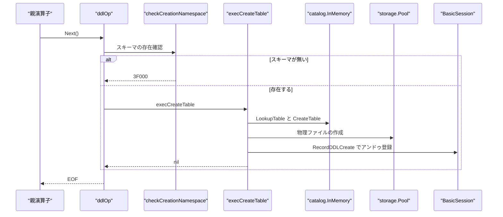
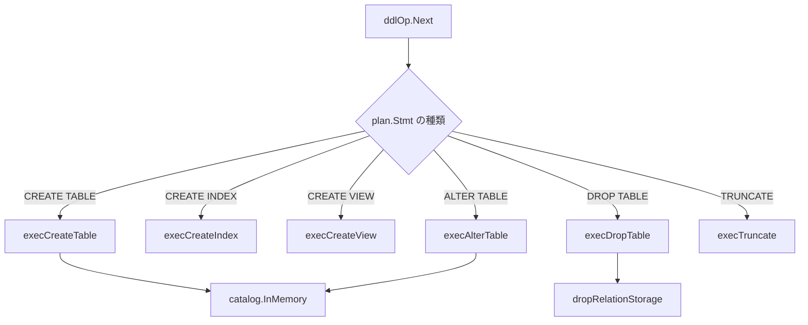

# DDL 実行

<details>
<summary>関連ソースファイル</summary>

- [`internal/executor/drop_type_dependents.go`](https://github.com/ryogrid/goopg/blob/19856410e8d497d59787e1ab35a2febb3f5953d6/internal/executor/drop_type_dependents.go)
- [`internal/executor/operators_analyze.go`](https://github.com/ryogrid/goopg/blob/19856410e8d497d59787e1ab35a2febb3f5953d6/internal/executor/operators_analyze.go)
- [`internal/executor/operators_checkpoint.go`](https://github.com/ryogrid/goopg/blob/19856410e8d497d59787e1ab35a2febb3f5953d6/internal/executor/operators_checkpoint.go)
- [`internal/executor/operators_cluster.go`](https://github.com/ryogrid/goopg/blob/19856410e8d497d59787e1ab35a2febb3f5953d6/internal/executor/operators_cluster.go)
- [`internal/executor/operators_ddl.go`](https://github.com/ryogrid/goopg/blob/19856410e8d497d59787e1ab35a2febb3f5953d6/internal/executor/operators_ddl.go)
- [`internal/executor/operators_ddl_database_acl.go`](https://github.com/ryogrid/goopg/blob/19856410e8d497d59787e1ab35a2febb3f5953d6/internal/executor/operators_ddl_database_acl.go)
- [`internal/executor/operators_ddl_default_privileges.go`](https://github.com/ryogrid/goopg/blob/19856410e8d497d59787e1ab35a2febb3f5953d6/internal/executor/operators_ddl_default_privileges.go)
- [`internal/executor/operators_ddl_parameter_acl.go`](https://github.com/ryogrid/goopg/blob/19856410e8d497d59787e1ab35a2febb3f5953d6/internal/executor/operators_ddl_parameter_acl.go)
- [`internal/executor/operators_ddl_partition.go`](https://github.com/ryogrid/goopg/blob/19856410e8d497d59787e1ab35a2febb3f5953d6/internal/executor/operators_ddl_partition.go)
- [`internal/executor/operators_ddl_role_membership.go`](https://github.com/ryogrid/goopg/blob/19856410e8d497d59787e1ab35a2febb3f5953d6/internal/executor/operators_ddl_role_membership.go)
- [`internal/executor/operators_reindex.go`](https://github.com/ryogrid/goopg/blob/19856410e8d497d59787e1ab35a2febb3f5953d6/internal/executor/operators_reindex.go)
- [`internal/executor/operators_sequence.go`](https://github.com/ryogrid/goopg/blob/19856410e8d497d59787e1ab35a2febb3f5953d6/internal/executor/operators_sequence.go)
- [`internal/executor/operators_utility_settings.go`](https://github.com/ryogrid/goopg/blob/19856410e8d497d59787e1ab35a2febb3f5953d6/internal/executor/operators_utility_settings.go)
- [`internal/executor/operators_vacuum.go`](https://github.com/ryogrid/goopg/blob/19856410e8d497d59787e1ab35a2febb3f5953d6/internal/executor/operators_vacuum.go)
- [`internal/executor/operators_vacuum_datfrozenxid.go`](https://github.com/ryogrid/goopg/blob/19856410e8d497d59787e1ab35a2febb3f5953d6/internal/executor/operators_vacuum_datfrozenxid.go)
- [`internal/executor/rel_drop_storage.go`](https://github.com/ryogrid/goopg/blob/19856410e8d497d59787e1ab35a2febb3f5953d6/internal/executor/rel_drop_storage.go)
- [`internal/executor/reloptions_catalog.go`](https://github.com/ryogrid/goopg/blob/19856410e8d497d59787e1ab35a2febb3f5953d6/internal/executor/reloptions_catalog.go)
- [`internal/executor/tablespace_options.go`](https://github.com/ryogrid/goopg/blob/19856410e8d497d59787e1ab35a2febb3f5953d6/internal/executor/tablespace_options.go)
- [`internal/executor/viewdef_deparse.go`](https://github.com/ryogrid/goopg/blob/19856410e8d497d59787e1ab35a2febb3f5953d6/internal/executor/viewdef_deparse.go)

</details>

`internal/executor` の DDL は、`optimizer.DDL` ノード 1 つを `ddlOp` 1 個で実行する。`ddlOp.Next` はパーサーの文型を大きな `switch` で振り分け、`CREATE TABLE`/`CREATE INDEX`/`CREATE VIEW`/`ALTER TABLE`/`DROP ...`/`TRUNCATE` などの本体を呼ぶ。本体はカタログ（`catalog.InMemory` とその検索パスラッパー）を更新し、必要なら `Pool` で物理ファイルを作成・削除し、`BasicSession` の DDL アンドゥ台帳へ記録する。DDL は行を返さず、`CommandComplete` のタグはワイヤー層が文型から決める。ただし `CREATE TABLE AS`/`SELECT INTO`/`CREATE MATERIALIZED VIEW` の populate は `DDLProcessed` で `SELECT <n>` を報告する。このページはそのディスパッチ、テーブル・索引・ビュー・シーケンスの作成と削除、パーティションと reloptions、VACUUM/ANALYZE/REINDEX/CLUSTER/CHECKPOINT、権限・ロール・テーブルスペースの DDL を扱う。ヒープ書き込みの MVCC 側は [6.6 DML と MVCC 書き込み](6.6-DML-and-Writes.md)、カタログ行の同期は [6.9 システムカタログ同期](6.9-System-Catalog-Sync.md)、B-tree の構築は [8 B-tree インデックス](../8-Btree.md) を参照。

## 責務

- DDL 文のディスパッチ。`ddlOp.Next` が `plan.Stmt` の具象型を見て `execCreateTable`・`execCreateIndex`・`execDropTable`・`execAlterTable` などへ振り分け、未知の文型は `0A000` で拒否する。`path:internal/executor/operators_ddl.go:ddlOp.Next`
- 作成名前空間の検査。`checkCreationNamespace`/`requireSchema` がスキーマ付きの CREATE で `3F000` を返す（`pg_temp` は除外）。`path:internal/executor/operators_ddl.go:checkCreationNamespace`
- テーブル作成。`execCreateTable` が一時表・`ON COMMIT`・検索パス・同一トランザクション内 DROP の影・パーティション子・制約・物理ファイル作成を扱う。`path:internal/executor/operators_ddl.go:execCreateTable`
- 索引作成。`execCreateIndex` がアクセスメソッドの能力検査、部分索引述語の可変性、reloptions 名、式キーの可変性を順に検証してから B-tree を構築する。`path:internal/executor/operators_ddl.go:execCreateIndex`
- ビュー作成と本文の保存。`execCreateView` が `optimizer.Plan` で本文を検証し、循環・未対応の `0A000`/`42P10` だけを許容して `ViewDef` を保存する。`path:internal/executor/operators_ddl.go:execCreateView`
- ビュー定義の逆コンパイル。`deparseViewDef` が `pg_get_viewdef` 用に保存済み SELECT を SQL テキストへ戻す。`path:internal/executor/viewdef_deparse.go:deparseViewDef`
- 削除と物理ストレージ。`execDropTable` がパーティション子を深さ優先で落とし、`dropRelationStorage` が COMMIT 時の `PendingRelDelete` として `removeRelationStorage` を登録する（WAL/TxnMgr が無い場合は即時削除）。`path:internal/executor/rel_drop_storage.go:dropRelationStorage`
- 遅延 DROP。`dropTableByRef` が明示トランザクション内の DROP TABLE を `PendingTableDrop` として記録し、COMMIT の `ApplyPendingTableDrops` で実削除する。`path:internal/executor/operators_ddl.go:ApplyPendingTableDrops`
- パーティション境界。`boundTuple`/`lexicoCompareTuples` が `FROM`/`TO` の境界値を比較し、空範囲を `42P16` にする。`path:internal/executor/operators_ddl_partition.go:lexicoCompareTuples`
- Analyzer。`analyzeOp.Next` が対象を展開し、`ShareUpdateExclusiveLock` を取り、`analyzeTableStats` で統計を収集する。`path:internal/executor/operators_analyze.go:analyzeOp.Next`
- VACUUM。`vacuumOp.Next` が凍結限界を計算し、対象ごとにページ剪定・VM/FSM 更新・`relfrozenxid` 前進を行い、最後に `persistDatFrozenXID` を呼ぶ。`path:internal/executor/operators_vacuum.go:vacuumOp.Next`
- シーケンス。`seqState.nextVal` が overflow を検出して `min`/`max`/`cycle` を適用し、`seqRegistry` が `<dbOid>:<name>` でプロセス全体に共有する。`path:internal/executor/operators_sequence.go:seqState.nextVal`
- REINDEX。`reindexOp.Next` が `CONCURRENTLY` の待機、TOAST 合成リレーションの解決、索引の再構築スワップを行う。`path:internal/executor/operators_reindex.go:reindexOp.Next`
- 設定系ユーティリティ。`utilitySettingsOp.Next` が SHOW/SET/RESET/ALTER SYSTEM を実行し、`SET LOCAL` の `25P01` 警告や security-definer 内の `42501` を扱う。`path:internal/executor/operators_utility_settings.go:utilitySettingsOp.Next`
- reloptions とテーブルスペース。`validateRelOptionNames` がアクセスメソッド／ビュー／テーブルスペースごとの許容名を検査し、`tablespaceOptionArray` が `ALTER TABLESPACE ... SET/RESET` を差分適用する。`path:internal/executor/reloptions_catalog.go:validateRelOptionNames`
- 権限系 DDL。`execDatabaseACLChange`・`execParameterACLChange`・`execAlterDefaultPrivileges`・`execRoleMembershipChange` が ACL とロール membership をカタログへ反映する。`path:internal/executor/operators_ddl_database_acl.go:execDatabaseACLChange`
- 型に依存するオブジェクトの追跡。`typeDepNode`/`typeDepTarget` が DROP TYPE 時に配列型・ドメイン・関数・列などの依存をグラフとして表す。`path:internal/executor/drop_type_dependents.go:typeDepNode`

## 処理フロー

`ddlOp.Open` は `Catalog` の存在だけを確認して `ctx` を保持する。`Next` は 1 回だけ動き、まず `checkCreationNamespace` を呼んでから文型の `switch` に入る。`CREATE TABLE` は `execCreateTable`、`CREATE INDEX` は `execCreateIndex`、`CREATE VIEW` は `execCreateView`、`DROP TABLE` は `execDropTable`、`TRUNCATE` は `execTruncate`、`ALTER TABLE` は `execAlterTable` である。文型がどれにも当たらなければ `0A000` を返す。`path:internal/executor/operators_ddl.go:ddlOp.Next`



`execCreateTable` はまず外部テーブルの FDW オプション、一時表のスキーマ制約、`ON COMMIT` の一時表限定、検索パスによるスキーマ解決を検査する。既存名と衝突した場合、同一セッションが現在の明示トランザクション内で DROP した `PendingTableDrop` があれば `CancelPendingTableDropMatching` で取り消して `pendingDropShadow` に退避する。`TEMP TABLE` が永久テーブルを隠す場合は `ctx.TempTableShadows` に退避し、失敗時は `restoreTempShadow` で戻す。`path:internal/executor/operators_ddl.go:execCreateTable`

`execCreateIndex` はテーブルを検索パス経由で解決し、`rtree` を `gist` に置換する NOTICE を出し、`checkIndexAMCapabilities` でアクセスメソッドの能力を確認する。次に部分索引述語の可変性（`checkIndexPredicateMutability`）と式キーの可変性（`checkIndexExprMutability`）を検査し、`validateRelOptionNames` で `WITH (...)` の名前を検証する。fillfactor は 10〜100、`buffering` は `on`/`off`/`auto`、`gin_pending_list_limit` は 64〜2097151 の範囲でなければ `22023` を返す。`path:internal/executor/operators_ddl.go:execCreateIndex`



`execDropTable` は明示的に列挙された表と CASCADE で落ちる表を 1 つの集合として扱う。パーティション子は常に親より先に深さ優先で落とし、相続子は `CASCADE` のときだけ落とす。`cascadeDropped` に記録して、同じ文で親と子が両方列挙されても二重削除にならないようにする。`IF EXISTS` の一致なしは NOTICE、`CASCADE` の子は「drop cascades to table ...」の NOTICE（複数なら DETAIL 付き）を出す。`dropTableByRef` は明示トランザクション内なら削除を COMMIT まで延期し、`rollback` 時に元へ戻せるようにする。`path:internal/executor/operators_ddl.go:execDropTable`

`execCreateView` は `optimizer.Plan(s.Query, o.planCatalog())` で本文を検証する。ここで `0A000`（v0 プランナの未対応）と `42P10`（循環ビュー）だけは許容し、それ以外の計画エラーを `ExecError` として返す。本文が一時リレーションを参照する場合、明示指定がなくても一時ビューへ昇格する。`OR REPLACE` のときは既存ビューの OID と所有者を控え、計画中だけカタログから外して循環を避け、新しい OID で再登録する。`path:internal/executor/operators_ddl.go:execCreateView`

## 主要ファイル

| ファイル | 役割 |
| --- | --- |
| `internal/executor/operators_ddl.go` | `ddlOp`。DDL 全体のディスパッチ、テーブル／索引／ビュー／型／関数／トリガーの CREATE/ALTER/DROP、DROP の延期。`path:internal/executor/operators_ddl.go:ddlOp` |
| `internal/executor/operators_ddl_partition.go` | パーティション境界の解析と比較。`boundTuple`/`lexicoCompareTuples`/`parseBoundValue`。`path:internal/executor/operators_ddl_partition.go:boundTuple` |
| `internal/executor/operators_analyze.go` | `analyzeOp`。対象展開、ロック、統計収集、パーティション親の継承統計。`path:internal/executor/operators_analyze.go:analyzeOp` |
| `internal/executor/operators_vacuum.go` | `vacuumOp`/`vacuumTarget`。凍結限界、対象展開、ページ剪定、VM/FSM 更新。`path:internal/executor/operators_vacuum.go:vacuumOp` |
| `internal/executor/operators_vacuum_datfrozenxid.go` | `persistDatFrozenXID`。`pg_database.datfrozenxid` の in-place 更新。`path:internal/executor/operators_vacuum_datfrozenxid.go:persistDatFrozenXID` |
| `internal/executor/operators_sequence.go` | `seqState`/`seqRegistry`。nextval、setval、WAL ログ地平、シーケンス情報。`path:internal/executor/operators_sequence.go:seqState` |
| `internal/executor/operators_reindex.go` | `reindexOp`。REINDEX TABLE/INDEX、CONCURRENTLY、TOAST 合成リレーション。`path:internal/executor/operators_reindex.go:reindexOp` |
| `internal/executor/operators_cluster.go` | `clusterOp`。CLUSTER の存在確認と no-op。`path:internal/executor/operators_cluster.go:clusterOp` |
| `internal/executor/operators_checkpoint.go` | `checkpointOp`。`Context.Checkpointer` を同期実行。`path:internal/executor/operators_checkpoint.go:checkpointOp` |
| `internal/executor/operators_utility_settings.go` | `utilitySettingsOp`。SHOW/SET/RESET/ALTER SYSTEM。`path:internal/executor/operators_utility_settings.go:utilitySettingsOp` |
| `internal/executor/reloptions_catalog.go` | `relOptKind` と reloption 名の検証。`path:internal/executor/reloptions_catalog.go:relOptKind` |
| `internal/executor/tablespace_options.go` | `tablespaceOptionArray`/`execAlterTablespace`。テーブルスペース reloptions。`path:internal/executor/tablespace_options.go:execAlterTablespace` |
| `internal/executor/rel_drop_storage.go` | `dropRelationStorage`/`removeRelationStorage`。COMMIT/ABORT 後の物理ファイル削除をスケジュールする。`path:internal/executor/rel_drop_storage.go:dropRelationStorage` |
| `internal/executor/operators_ddl_database_acl.go` | `execDatabaseACLChange`。データベース ACL と `pg_database` 行の再同期。`path:internal/executor/operators_ddl_database_acl.go:execDatabaseACLChange` |
| `internal/executor/operators_ddl_default_privileges.go` | `execAlterDefaultPrivileges`。ロール／スキーマ別のデフォルト権限。`path:internal/executor/operators_ddl_default_privileges.go:execAlterDefaultPrivileges` |
| `internal/executor/operators_ddl_parameter_acl.go` | `execParameterACLChange`。パラメータ ACL（SET/ALTER SYSTEM）。`path:internal/executor/operators_ddl_parameter_acl.go:execParameterACLChange` |
| `internal/executor/operators_ddl_role_membership.go` | `execRoleMembershipChange`。GRANT/REVOKE ロールと grantor 検査。`path:internal/executor/operators_ddl_role_membership.go:execRoleMembershipChange` |
| `internal/executor/drop_type_dependents.go` | `typeDepNode`/`typeDepTarget`。型依存の収集と CASCADE 判定。`path:internal/executor/drop_type_dependents.go:typeDepNode` |
| `internal/executor/viewdef_deparse.go` | `viewDeparser`/`deparseViewDef`。`pg_get_viewdef` 用の SQL 逆生成。`path:internal/executor/viewdef_deparse.go:viewDeparser` |

## 公開 API / エントリポイント

```go
func newDDLOp(p *optimizer.DDL) *ddlOp
func newAnalyzeOp(stmt *parser.AnalyzeStmt) *analyzeOp
func newVacuumOp(p *optimizer.Utility) *vacuumOp
func newReindexOp(s *parser.ReindexStmt) *reindexOp
func newClusterOp(s *parser.ClusterStmt) *clusterOp
func newCheckpointOp(p *optimizer.Checkpoint) *checkpointOp
func newUtilitySettingsOp(p *optimizer.Utility) *utilitySettingsOp

func deparseViewDef(view *catalog.Table, cat *catalog.InMemory,
	visible func(schema, name string) bool, pretty bool) (string, bool)
func validateRelOptionNames(names []string, kind relOptKind, allowNamespaces, acceptOidsOff bool, pos int) *ExecError
func tablespaceOptionArray(old []string, opts []parser.TablespaceOption, isReset bool, pos int) ([]string, *ExecError)
func dropRelationStorage(ctx *Context, rel storage.RelFileNode, heap bool) error
func persistDatFrozenXID(ctx *Context) error
func ApplyPendingTableDrops(ctx *Context, sess *BasicSession)
func ApplyDeferredRoutineDrops(ctx *Context, sess *BasicSession)
```

`newDDLOp` は計画だけを保持し、`Open` で `Context` を受ける。`ddlOp` は `DDLProcessedReporter` も実装し、populate を伴う CREATE の `SELECT <n>` タグをワイヤー層へ伝える。`path:internal/executor/operators_ddl.go:DDLProcessed`

## 主要データ構造

### `ddlOp`

```go
type ddlOp struct {
	plan *optimizer.DDL
	ctx  *Context
	done bool
	// buildHeapTuples is the live heap-tuple count the latest btree build's
	// heap scan saw — heapam_index_build_range_scan's return value, which
	// index_update_stats publishes as the heap's reltuples.
	buildHeapTuples float64
	// pendingDropShadow carries the table a CREATE displaced by overwriting a
	// same-transaction deferred-DROP's still-present catalog slot
	// (M0134-0023). Set by execCreateTable right after
	// CancelPendingTableDropMatching confirms the collision is a same-session
	// recreate, and read by both the direct CREATE TABLE path (below) and
	// execCreateTableAs (CTAS / SELECT INTO share this ddlOp instance) so each
	// can (a) use CreateTableReplacingPendingDrop instead of the guarded
	// CreateTable, and (b) stash it on the DDLUndoEntry for ROLLBACK restore.
	pendingDropShadow *catalog.Table
	// processed counts the rows a populating CREATE TABLE AS / SELECT INTO /
	// CREATE MATERIALIZED VIEW wrote; reportProcessed says the statement's
	// CommandComplete tag is PostgreSQL's `SELECT <n>` (createas.c:349,
	// matview.c:389 — SetQueryCompletion(qc, CMDTAG_SELECT, es_processed)).
	// REFRESH shares materializeView (so it counts too) but leaves
	// reportProcessed false: its tag is plain REFRESH MATERIALIZED VIEW.
	processed       int64
	reportProcessed bool
}
```

`path:internal/executor/operators_ddl.go:ddlOp`

`plan` が `optimizer.DDL`（中の `parser.Stmt` が実際の文）、`done` がワンショット実行のフラグである。`buildHeapTuples` は索引構築のヒープ走査が数えた行数で、`index_update_stats` が `reltuples` として公開する値になる。`pendingDropShadow` は「同一トランザクション内で DROP した名前を CREATE し直した」ときに、まだカタログに残っている旧テーブルを退避するためのもので、`DDLUndoEntry` に載せて ROLLBACK で戻す。`processed`/`reportProcessed` は CTAS・SELECT INTO・CREATE MATERIALIZED VIEW の行数と、`SELECT <n>` タグを報告するかどうかである。

### Analyzer と VACUUM

```go
type analyzeOp struct {
	stmt *parser.AnalyzeStmt
	done bool
	ctx  *Context
}
```

`path:internal/executor/operators_analyze.go:analyzeOp`

```go
type vacuumOp struct {
	plan *optimizer.Utility
	ctx  *Context
	done bool
}
```

`path:internal/executor/operators_vacuum.go:vacuumOp`

```go
type vacuumTarget struct {
	tbl      *catalog.Table
	explicit bool
}
```

`path:internal/executor/operators_vacuum.go:vacuumTarget`

`analyzeOp` は `stmt`/`done`/`ctx` だけの薄いワンショットで、実処理は `expandAnalyzeTargets` と `analyzeTableStats` にある。`vacuumOp` も同じ形で、`plan.Stmt` から `*parser.VacuumStmt` を取り出す。`vacuumTarget` の `explicit` は「ユーザーが明示的に指定したか」を表し、ロック競合や同時 DROP の WARNING を出すかどうかの分岐に使う。パーティション親を展開して得た子は `explicit=false` になる。

### `seqState`

```go
type seqState struct {
	current   atomic.Int64
	start     int64
	increment int64
	min       int64
	max       int64
	cache     int64 // CACHE n (preallocation size); PG default 1
	cycle     bool
	called    atomic.Bool // true after first nextval or setval
	ownedBy   string      // "table.column" set by ALTER SEQUENCE ... OWNED BY
	schema    string      // schema name (default "public")
	seqName   string      // bare sequence name (no schema prefix)
	dataType  string      // "smallint", "integer", or "bigint" (default)
	temporary bool        // true for TEMPORARY sequences (allowed in READ ONLY txns)
	dbOid     uint32      // owning database oid (M0122-0007 4e); immutable after creation
	mu        sync.Mutex  // serialises nextval

	// Restart persistence (RecordKindSequenceState — see wal/recovery.go).
	// colSpelling is the serial spelling ("bigserial", ...) when this
	// sequence backs a SERIAL column; identityKind is 1/2 for GENERATED
	// BY DEFAULT/ALWAYS identity columns. Both ride the WAL record so
	// startup replay can restore the owning column's catalog markers.
	// logHorizon is the highest (lowest, for descending sequences) value
	// covered by a WAL record: nextval pre-logs 32 values ahead (upstream
	// SEQ_LOG_VALS, postgres/src/backend/commands/sequence.c) and only
	// re-logs when a fetched value crosses the horizon. Guarded by mu.
	colSpelling  string
	identityKind byte
	logHorizon   int64
	hasLogged    bool
}
```

`path:internal/executor/operators_sequence.go:seqState`

`current` は現在値（atomic）、`start`/`increment`/`min`/`max`/`cache`/`cycle` はシーケンス定義、`called` は nextval/setval が一度でも呼ばれたか、`ownedBy` は `ALTER SEQUENCE ... OWNED BY` の対象、`dbOid` は所属データベースである。`mu` が nextval を直列化し、`logHorizon`/`hasLogged` が WAL 再ログの地平を管理する。`nextval` は加算が int64 をラップしていないかを `(increment>0 && next<cur) || (increment<0 && next>cur)` で検出し、範囲外なら `cycle` なら反対端へ、そうでなければエラーにする。

### `reindexOp` / `utilitySettingsOp` / `clusterOp` / `checkpointOp`

```go
type reindexOp struct {
	stmt *parser.ReindexStmt
	ctx  *Context
	done bool
}
```

`path:internal/executor/operators_reindex.go:reindexOp`

```go
type utilitySettingsOp struct {
	plan   *optimizer.Utility
	ctx    *Context
	rows   []Row
	rowIdx int
	done   bool
}
```

`path:internal/executor/operators_utility_settings.go:utilitySettingsOp`

```go
type clusterOp struct {
	stmt *parser.ClusterStmt
	ctx  *Context
	done bool
}
```

`path:internal/executor/operators_cluster.go:clusterOp`

```go
type checkpointOp struct{ plan *optimizer.Checkpoint }
```

`path:internal/executor/operators_checkpoint.go:checkpointOp`

4 つはいずれも `done` で 1 回だけ実行するワンショットである。`utilitySettingsOp` だけは SHOW の結果行を `rows`/`rowIdx` に持ち、SELECT と同じように複数行を返す。`checkpointOp` は `Open` で `ctx.Checkpointer.CheckpointNow()` を同期実行し、`Next` は常に `EOF` を返す。

### `relOptKind`

```go
type relOptKind uint32

const (
	relOptHeap relOptKind = 1 << iota
	relOptToast
	relOptBTree
	relOptHash
	relOptGiST
	relOptSPGiST
	relOptGIN
	relOptBRIN
	relOptView
	relOptTablespace
)
```

`path:internal/executor/reloptions_catalog.go:relOptKind`

`relOptKind` はビットマスクで、各 reloption がどのリレーション種別（ヒープ、TOAST、B-tree、Hash、GiST、SP-GiST、GIN、BRIN、ビュー、テーブルスペース）に属するかを表す。`relOptionKinds` は PG 18.3 の 5 つの reloption テーブルを 1 つの写像へ畳んだもので、例えば `fillfactor` はヒープと B-tree/Hash/GiST/SP-GiST の両方に属し、`parallel_workers` はヒープ専用である。

### `viewDeparser`

```go
type viewDeparser struct {
	buf         []byte
	indentLevel int
	cat         *catalog.InMemory
	visible     func(schema, name string) bool
	pretty      bool
	rtes        []*vdRTE
	useprefix   bool
	ok          bool
}

// vdRTE is one FROM item: its printed refname and output columns.
type vdRTE struct {
	refname string
	relname string // relation RTEs: generate_relation_name's text
	cols    []string
	types   []string // catalog type names, relation RTEs only
}
```

`path:internal/executor/viewdef_deparse.go:viewDeparser`

`viewDeparser` は `ruleutils` の deparse コンテキスト 1 クエリレベル分で、出力バッファ `buf`、インデント、カタログ、可視性判定、`rtes`（FROM 項目）を持つ。`ok` が偽になると「保存済み本文が対応サブセット外」として `deparseViewDef` が `ok=false` を返す。`vdRTE` は FROM 項目の参照名・関係名・列名・型名を保持する。

### `typeDepNode` と `typeDepTarget`

```go
type typeDepNode struct {
	kind     string // "type", "arraytype", "domain", "function", "aggregate", "table", "column", "attribute"
	oid      uint32
	classID  uint32
	subID    int
	desc     string
	routine  *catalog.Routine
	agg      *catalog.UserAggregate
	table    *catalog.Table
	column   string                 // column / attribute name
	comp     *catalog.CompositeType // attribute owner
	domain   *catalog.Domain
	internal bool
	// Type-like nodes ("type", "domain", and their "arraytype"): the type's
	// name and OIDs the dependents are matched against; elem links an array
	// node to its element type node.
	tname     string
	tOID      uint32
	tArrayOID uint32
	elem      *typeDepNode
}

type typeDepTarget struct {
	node     *typeDepNode
	dependee *typeDepNode
}
```

`path:internal/executor/drop_type_dependents.go:typeDepNode`

`typeDepNode` は DROP TYPE の依存グラフの 1 ノードで、`kind` が「type/arraytype/domain/function/aggregate/table/column/attribute」のいずれか、`classID` が `pg_type`/`pg_proc`/`pg_class` の OID、`desc` がエラーメッセージ用の説明である。`internal` は暗黙に作られた依存（配列型など）を示す。`typeDepTarget` は「依存される型ノード」と「依存する側のノード」の組で、CASCADE の対象列挙に使う。

### `boundTuple`

```go
type boundTuple struct {
	val   int64
	isMin bool
	isMax bool
	ok    bool
}
```

`path:internal/executor/operators_ddl_partition.go:boundTuple`

`boundTuple` はパーティション境界の 1 列分で、`val` が比較用の整数値、`isMin`/`isMax` が `MINVALUE`/`MAXVALUE`、`ok` が解析成功を表す。`lexicoCompareTuples` は列ごとに `compareBounds` で比較し、全列等しい場合は空範囲として `42P16` にする。

## 内部構造

### カタログとアンドゥの二重管理

DDL の変更は 2 か所に記録される。1 つは `catalog.InMemory` のテーブル・索引・スキーマ・ルーチン・型の写像で、もう 1 つが `BasicSession` の DDL アンドゥ台帳（`DDLUndoEntry`、`DDLDropUndoEntry`、`PendingTableDrop` など）である。`execCreateTable` は成功時に `RecordDDLCreate` を呼び、`execDropTable` は `dropTableByRef` で `PendingTableDrop` を積む。ROLLBACK は `ProcessRollbackUndos` が台帳を逆順に処理し、COMMIT は `ApplyPendingTableDrops` などが延期削除を実行する。この 2 層があるため、DDL の途中失敗でもカタログと物理ファイルが食い違わない。`path:internal/executor/operators_ddl.go:dropTableByRef`

### 一時テーブルの影

`CREATE TEMP TABLE` が既存の永久テーブルと同じ名前を隠す場合、`ctx.TempTableShadows` に永久テーブルを退避し、カタログから一時的に外す。`CREATE` の後続処理（CTAS の SELECT 解決、パーティション子検証、列定義、テーブルスペース解決）が失敗した場合、`defer` が `restoreTempShadow` を呼んで永久テーブルを戻す。これがないと、失敗した CREATE TEMP TABLE が既存の永久テーブルを永久に消してしまう。`path:internal/executor/operators_ddl.go:restoreTempShadow`

### DROP TABLE の延期と物理削除

`execDropTable` はパーティション子を常に、相続子を CASCADE のときだけ落とす。明示トランザクション内では `dropTableByRef` が `allowDefer=true` で `PendingTableDrop` を記録し、カタログ上のエントリと AccessExclusiveLock を COMMIT まで残す。これにより他セッションからは DROP がまだ見えず、ROLLBACK も可能になる。COMMIT では `ApplyPendingTableDrops` が実削除を行い、`dropRelationStorage` が `PendingRelDelete` として削除を登録する。実際のファイル削除は COMMIT レコードの後に `removeRelationStorage` が行う。`path:internal/executor/operators_ddl.go:execDropTable`

### 索引構築の検証順序

`execCreateIndex` の検証順序は PostgreSQL の `DefineIndex` に合わせてある。アクセスメソッドの能力 → 部分索引述語の可変性 → reloptions の名前 → 式キーの可変性 → 名前衝突、の順である。この順序は観測可能で、reloptions.sql のように同じ索引名を負のケースで使い回すテストは「unrecognized parameter」を期待し、「relation already exists」を期待しない。fillfactor の 10〜100、`buffering` の enum、`gin_pending_list_limit` の 64〜2097151 も、索引作成前に検証する。`path:internal/executor/operators_ddl.go:execCreateIndex`

### VACUUM の凍結限界

`vacuumOp.Next` は `FreezeLimit = nextXID − min(freeze_min_age, autovacuum_freeze_max_age/2)` を計算し、必ず `OldestXmin` 以下にクランプする。クランプを外すと age 0 の FREEZE 限界が nextXID 自身になり、in-flight の xmin まで凍結してしまう。`VACUUM (FREEZE)` は `freeze_min_age` を 1 に強制する。Aggressive 判定はテーブルごとの `relfrozenxid` 年齢で行い、`freezeTableAge = freezeMaxAge * 95 / 100` を境にする。`path:internal/executor/operators_vacuum.go:vacuumOp.Next`

### シーケンスのレジストリと WAL

`seqRegistry` は `sync.Map` で、キーは `seqKey(name, dbOid)` が作る `"<dbOid>:<lowercase name>"` である。これにより同名のシーケンスがデータベースごとに別カウンタになる。`seqState.nextVal` は `mu` の下で `current` を読み、加算のラップを検出し、`cycle` なら反対端へ、そうでなければ「reached maximum/minimum value」を返す。`logHorizon` は nextval が 32 値先までを WAL に記録し（`SEQ_LOG_VALS`）、越えたときだけ再ログするための地平である。`path:internal/executor/operators_sequence.go:nextVal`

### ANALYZE の対象展開と権限

`expandAnalyzeTargets` はパーティション親をリーフへ展開し、`explicit` フラグを付ける。`Next` のループは明示対象について `maintenancePermitted` を検査し、拒否なら WARNING を出してスキップする。`SKIP_LOCKED` なら `tryAcquireMaintenanceLock` が取れない対象を飛ばし、明示対象のときだけ「lock not available」を知らせる。ロック取得後に `relationStillExists` で同時 DROP を確認し、消えていれば明示対象のときだけ WARNING を出す。`path:internal/executor/operators_analyze.go:analyzeOp.Next`

### reloptions の名前空間

`validateRelOptionNames` は `relOptionKinds` を引き、要求された名前がその種別に属するかを検査する。`relOptionNamespaces` は `toast.autovacuum_enabled` のような名前空間付き指定を処理する。索引は名前空間を持たないため、`allowNamespaces=false` で呼ばれ、`WITH (ns.option=...)` は常に「unrecognized namespace」になる。`splitRelOptionName` が `ns.name` を分割する。`path:internal/executor/reloptions_catalog.go:validateRelOptionNames`

## エッジケースと不変条件

- **DDL は 1 回だけ実行する。** `ddlOp.Next` は `done` を立ててから文型を処理し、2 回目以降は `EOF` を返す。`Close` は何もしない。`path:internal/executor/operators_ddl.go:ddlOp.Next`
- **存在しないスキーマは 3F000。** `checkCreationNamespace` はスキーマ付き CREATE の前に `requireSchema` を呼び、`pg_temp` と `pg_temp_N` は検査しない。`path:internal/executor/operators_ddl.go:checkCreationNamespace`
- **`ON COMMIT` は一時表だけ。** 非一時表に `ON COMMIT` を付けると `42P16`、一時スキーマに非一時・非 UNLOGGED を作ると暗黙に一時表へ昇格する。`path:internal/executor/operators_ddl.go:execCreateTable`
- **失敗した CREATE TEMP TABLE は永久テーブルを戻す。** 影の退避後、後続処理が失敗したら `defer` が `restoreTempShadow` を呼ぶ。`path:internal/executor/operators_ddl.go:execCreateTable`
- **同一トランザクション内の DROP→CREATE は影を退避する。** `CancelPendingTableDropMatching` が保留中の DROP を取り消し、`pendingDropShadow` を `DDLUndoEntry` に載せる。`path:internal/executor/operators_ddl.go:execCreateTable`
- **DROP TABLE のパーティション子は常に落とす。** 相続子は CASCADE のときだけ。`cascadeDropped` で二重削除を防ぎ、明示列挙された子には CASCADE NOTICE を出さない。`path:internal/executor/operators_ddl.go:execDropTable`
- **索引の reloption 検証は名前衝突より先。** reloptions 名・式の可変性・部分述語の可変性を、`LookupIndex` の名前衝突判定より前に済ませる。`path:internal/executor/operators_ddl.go:execCreateIndex`
- **索引の数値 reloption の範囲。** `fillfactor` は 10〜100、`gin_pending_list_limit` は 64〜2097151、`buffering` は on/off/auto のみ。範囲外は `22023`。`path:internal/executor/operators_ddl.go:execCreateIndex`
- **ビューの計画エラーは一部だけ許容する。** `0A000`（v0 プランナ未対応）と `42P10`（循環ビュー）は保存を許し、参照時にエラーにする。それ以外は CREATE 時点で拒否する。`path:internal/executor/operators_ddl.go:execCreateView`
- **`OR REPLACE` は新しい OID を割り当てる。** 旧ビューを計画中だけ外し、新 OID で登録する。旧 OID の `pg_class`/`pg_attribute` 行は `xmax` を刻んで無効化する。`path:internal/executor/operators_ddl.go:execCreateView`
- **VACUUM のエラーはセッションを殺さない。** `vacuumOp.Next` は `Pool`/`TxnMgr` が無ければ `EOF` を返し、`persistDatFrozenXID` の失敗も非致命である。`path:internal/executor/operators_vacuum.go:vacuumOp.Next`
- **凍結限界は OldestXmin でクランプする。** `nextXID - min(freeze_min_age, autovacuum_freeze_max_age/2)` が `OldestXmin` を超えたら `OldestXmin` に下げる。`path:internal/executor/operators_vacuum.go:vacuumOp.Next`
- **`datfrozenxid` の永続化は生 DB の行だけ。** `persistDatFrozenXID` は `catalog.InMemory.DBOID()` の `pg_database` 行を in-place 更新する。horizon が `InvalidTransactionID` なら何もしない。`path:internal/executor/operators_vacuum_datfrozenxid.go:persistDatFrozenXID`
- **シーケンスの加算はラップを検出する。** `nextVal` は `(increment>0 && next<cur) || (increment<0 && next>cur)` でオーバーフローを判定し、範囲外なら cycle かエラーにする。`path:internal/executor/operators_sequence.go:nextVal`
- **REINDEX CONCURRENTLY の TOAST は親を待つ。** `pg_toast` 名は合成リレーションとして解決し、親テーブルが待機中に DROP されたら `42P01` を返す。`path:internal/executor/operators_reindex.go:reindexOp.Next`
- **CLUSTER は no-op。** 対象なしは常に成功、対象ありは存在確認と AccessExclusiveLock だけを行う。物理的な並べ替えはしない。`path:internal/executor/operators_cluster.go:clusterOp.Next`
- **CHECKPOINT は WAL ライター必須。** `ctx.Checkpointer` が nil なら `0A000`、`CheckpointNow` が失敗したら `XX000` を返す。`path:internal/executor/operators_checkpoint.go:checkpointOp.Open`
- **`SET LOCAL` はトランザクション外で 25P01。** `InTransactionBlock` が偽なら警告を出し、値自体は適用する（周囲のトランザクション終了で破棄される）。security-definer 内の `role`/`session_authorization` は `42501`。`path:internal/executor/operators_utility_settings.go:utilitySettingsOp.Next`
- **reloptions の名前空間は種別ごと。** 索引は名前空間を持たないため `WITH (ns.opt=...)` は常に不正、`toast.*` は TOAST 種別の名前空間として扱う。`path:internal/executor/reloptions_catalog.go:validateRelOptionNames`

Sources:

- `internal/executor/drop_type_dependents.go`
- `internal/executor/operators_analyze.go`
- `internal/executor/operators_checkpoint.go`
- `internal/executor/operators_cluster.go`
- `internal/executor/operators_ddl.go`
- `internal/executor/operators_ddl_database_acl.go`
- `internal/executor/operators_ddl_default_privileges.go`
- `internal/executor/operators_ddl_parameter_acl.go`
- `internal/executor/operators_ddl_partition.go`
- `internal/executor/operators_ddl_role_membership.go`
- `internal/executor/operators_reindex.go`
- `internal/executor/operators_sequence.go`
- `internal/executor/operators_utility_settings.go`
- `internal/executor/operators_vacuum.go`
- `internal/executor/operators_vacuum_datfrozenxid.go`
- `internal/executor/rel_drop_storage.go`
- `internal/executor/reloptions_catalog.go`
- `internal/executor/tablespace_options.go`
- `internal/executor/viewdef_deparse.go`

<sub>Generated by deepwiki-4myself from `goopg` @ `19856410e`</sub>
