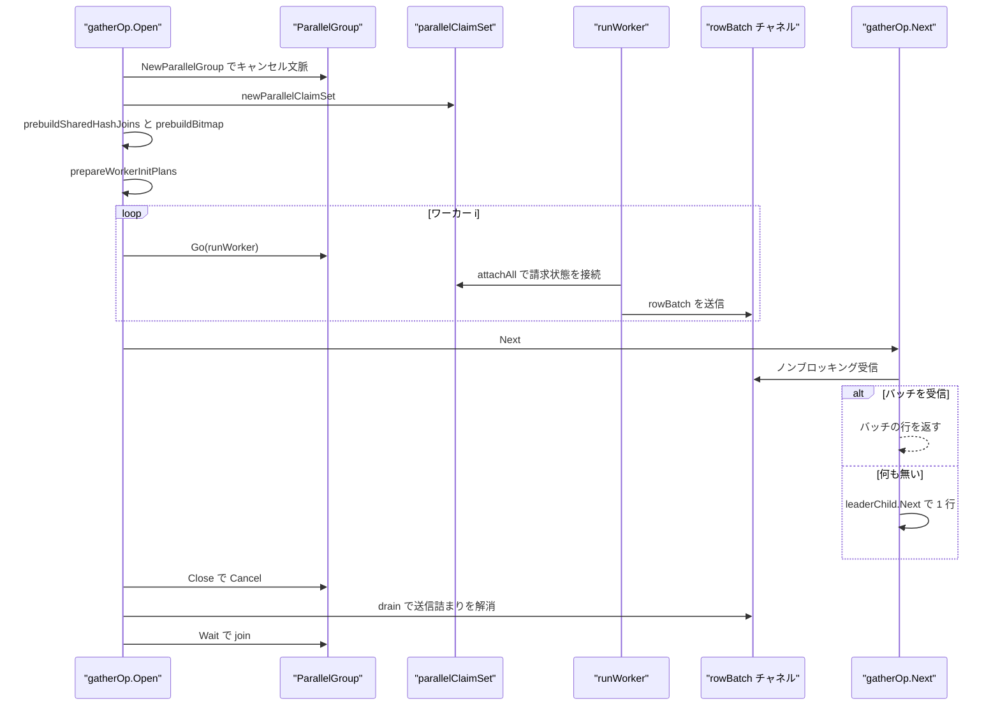
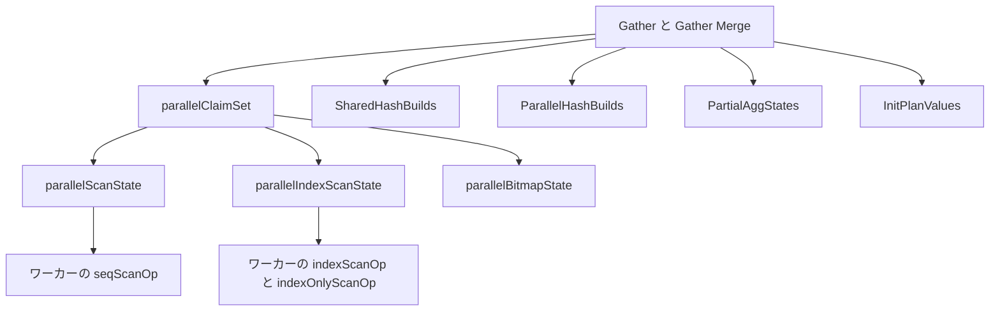

# 並列実行

<details>
<summary>関連ソースファイル</summary>

- [`internal/executor/operators_gather.go`](https://github.com/ryogrid/goopg/blob/19856410e8d497d59787e1ab35a2febb3f5953d6/internal/executor/operators_gather.go)
- [`internal/executor/operators_gather_merge.go`](https://github.com/ryogrid/goopg/blob/19856410e8d497d59787e1ab35a2febb3f5953d6/internal/executor/operators_gather_merge.go)
- [`internal/executor/parallel_agg_combine.go`](https://github.com/ryogrid/goopg/blob/19856410e8d497d59787e1ab35a2febb3f5953d6/internal/executor/parallel_agg_combine.go)
- [`internal/executor/parallel_agg_split.go`](https://github.com/ryogrid/goopg/blob/19856410e8d497d59787e1ab35a2febb3f5953d6/internal/executor/parallel_agg_split.go)
- [`internal/executor/parallel_bitmap_scan.go`](https://github.com/ryogrid/goopg/blob/19856410e8d497d59787e1ab35a2febb3f5953d6/internal/executor/parallel_bitmap_scan.go)
- [`internal/executor/parallel_hash_build.go`](https://github.com/ryogrid/goopg/blob/19856410e8d497d59787e1ab35a2febb3f5953d6/internal/executor/parallel_hash_build.go)
- [`internal/executor/parallel_hash_shared.go`](https://github.com/ryogrid/goopg/blob/19856410e8d497d59787e1ab35a2febb3f5953d6/internal/executor/parallel_hash_shared.go)
- [`internal/executor/parallel_initplan.go`](https://github.com/ryogrid/goopg/blob/19856410e8d497d59787e1ab35a2febb3f5953d6/internal/executor/parallel_initplan.go)
- [`internal/executor/parallel_runtime.go`](https://github.com/ryogrid/goopg/blob/19856410e8d497d59787e1ab35a2febb3f5953d6/internal/executor/parallel_runtime.go)
- [`internal/executor/parallel_scan.go`](https://github.com/ryogrid/goopg/blob/19856410e8d497d59787e1ab35a2febb3f5953d6/internal/executor/parallel_scan.go)
- [`internal/executor/parallel_worker_ctx.go`](https://github.com/ryogrid/goopg/blob/19856410e8d497d59787e1ab35a2febb3f5953d6/internal/executor/parallel_worker_ctx.go)

</details>

`internal/executor` の並列実行は、`Gather`/`Gather Merge` を境にリーダーと N 個のワーカーへ処理を分ける。リーダーは `ParallelGroup` でワーカーを起動し、各ワーカーは共有の請求集合（`parallelClaimSet`）からブロックや葉ブロックを請求して、部分計画の自分の担当分だけを実行する。ワーカーは行を `rowBatch` にまとめてチャネルへ送り、リーダーは `transferRowForQueue` でアリーナから切り離した行を受け取る。`Gather Merge` はワーカーごとに別チャネルを持ち、`gmHeap` でソート済みストリームをマージする。ハッシュ結合の build 側はリーダーが fan-out 前に 1 回だけ構築して `SharedHashBuilds` として公開するか、`Parallel Hash` では全参加者が 1 つの共有表へ build して barrier で揃える。集約は Partial/Finalize に分割され、`aggPartialAccum` がワーカーのグループ状態を集める。このページはこれらの起動・分担・所有権・失敗伝播・終了順序を扱う。行の寿命とスロット契約は [6.1 実行モデルとオペレータ](6.1-Execution-Model.md)、スキャン側の請求は [6.3 スキャンとインデックスアクセス](6.3-Scan-Operators.md)、集約の合成規則は [6.5 集約・ソート・集合演算](6.5-Aggregate-Sort-Setop.md) を参照。

## 責務

- ワーカーの起動と失敗伝播。`ParallelGroup.Go` が goroutine を起動し、panic を `XX000` に変換し、最初のエラーで兄弟をキャンセルする。`path:internal/executor/parallel_runtime.go:ParallelGroup.Go`
- 行の所有権移転。`MaterializeForTransfer` が `cloneRowOwned` でアリーナ由来の `Datum` を所有バイトへ昇格し、`transferRowForQueue` がスロット種別ごとに最小コピーで越境させる。`path:internal/executor/parallel_runtime.go:transferRowForQueue`
- ワーカー文脈の分離。`NewWorkerContext` が共有読み取り専用・値コピー・空生成・コールバック nil の 4 分類で `Context` を組み立てる。`path:internal/executor/parallel_worker_ctx.go:NewWorkerContext`
- ワーカー終了後の折り込み。`MergeWorkerContext` が NOTICE/WARNING、ハッシュ結合・ソート・Memoize の計測をリーダーへ畳み込む。`path:internal/executor/parallel_worker_ctx.go:MergeWorkerContext`
- シーケンシャルスキャンの分割。`parallelScanState.nextBlock` が 1 ブロックずつ原子的に配り、`attachParallelScan` が部分計画の駆動スキャンへ配線する。`path:internal/executor/parallel_scan.go:parallelScanState.nextBlock`
- インデックススキャンの分割。`parallelIndexScanState.claimLeaf` が葉ブロックを `sync.Map` で排他請求し、`leafClaimMemo` がワーカーごとの判定をキャッシュする。`path:internal/executor/parallel_scan.go:parallelIndexScanState.claimLeaf`
- ビットマップスキャンの分割。`parallelBitmapState` がリーダー構築済みの `TIDBitmap` とソート済みブロック列を公開し、`nextPage` でページを配る。`path:internal/executor/parallel_bitmap_scan.go:parallelBitmapState.nextPage`
- 共有ハッシュ構築。`prebuildSharedHashJoins` が fan-out 前に build 側を 1 回だけ drain し、`sharedHashBuild` として公開する。`path:internal/executor/parallel_hash_build.go:captureSharedBuild`
- Parallel Hash の barrier。`parallelHashBuild` が参加者の attached/finished を数え、全員の build が終わるまで probe を禁止する。`path:internal/executor/parallel_hash_shared.go:parallelHashBuild`
- 部分集約。`aggPartialAccum.merge` がワーカーのグループ状態を mutex 下で合成し、Finalize が Gather の EOF 後に読む。`path:internal/executor/parallel_agg_split.go:aggPartialAccum.merge`
- initplan の事前評価。`prepareWorkerInitPlans` がワーカーが到達し得る initplan をリーダーで評価し、`InitPlanValues` として渡す。`path:internal/executor/parallel_initplan.go:prepareWorkerInitPlans`
- Gather の出力。`gatherOp.Next` がワーカーのバッチをノンブロッキングで優先し、無ければリーダー自身の子から 1 行取る。`path:internal/executor/operators_gather.go:gatherOp.Next`
- Gather Merge の整列。`gatherMergeOp.Next` が `gmHeap` の先頭ソースを返し、同じソースから次の行を引いて heap を修復する。`path:internal/executor/operators_gather_merge.go:gatherMergeOp.Next`

## 処理フロー

`gatherOp.Open` は `WorkersPlanned` を `ctx.MaxParallelWorkers` でクランプし、0 なら並列を無効化する。`NewParallelGroup(ctx.Ctx)` でキャンセル文脈を作り、`gatherChanDepth*(n+1)` 容量の `rowBatch` チャネルを用意し、`newParallelClaimSet` で共有の請求集合を作る。次に `registerParallelHashBuilds` で Parallel Hash の状態を `ctx.ParallelHashBuilds` に登録し、`prebuildSharedHashJoins` で共有ハッシュ表を、`prebuildBitmap` で共有ビットマップを、`prepareWorkerInitPlans` で initplan 値を用意する。ワーカーのアリーナはリーダーが先に `mmgr.Acquire` し、`NewWorkerContext` で各ワーカーの `Context` を作る。`parallel_worker_ctx.go` が「共有読み取り専用」「値コピー」「空生成」「コールバック nil」の 4 分類を守るのは、`CTERowCache` などの共有 map への並行書きが Go の fatal throw になるためである。`path:internal/executor/operators_gather.go:gatherOp.Open`



`runWorker` は自分専用の子オペレータ木を `buildChild` で建て、`attachAll(child)` で駆動スキャンに請求状態を配線し、`child.Open(wctx)` の後で行を `transferRowForQueueLive` により越境可能な形へ変換する。`gatherBatchRows = 256` 行ごとに `flush` し、送信は `select { case ch <- batch: ... case <-wctx.Ctx.Done(): ... }` でキャンセルに応答する。EOF 後に最後のバッチを送り、`runWorker` は終了する。`path:internal/executor/operators_gather.go:runWorker`

`gatherOp.Next` はリーダーが参加している場合、まずチャネルをノンブロッキングで試し、無ければ `leaderChild.Next()` を 1 回だけ呼ぶ。これを「リーダーが自分の子を最後まで drain してからワーカーを読む」順序にすると、ワーカーが `gatherChanDepth` 分で送信詰まりし、リーダーが全ブロックを請求してしまい、並列化が実質無効になる。チャネルが閉じたら `group.Wait()` で確定したエラーを返し、無ければ `EOF` である。`path:internal/executor/operators_gather.go:gatherOp.Next`

`gatherMergeOp.Open` は `Gather` と同じ準備に加え、ワーカーごとに**別々の**チャネルを作る。マージは「どのストリームから来た行か」を保持して同じストリームから次の行を引く必要があるため、共有チャネルでは順序が壊れる。各ソースを `advance` で 1 行ずつ prime し、空のソースを落としてから `gmHeap` を初期化する。`gatherMergeOp.Next` はヒープ先頭の行を返し、そのソースを進めて `heap.Fix`、枯渇なら `heap.Pop` する。`path:internal/executor/operators_gather_merge.go:gatherMergeOp.Next`



## 主要ファイル

| ファイル | 役割 |
| --- | --- |
| `internal/executor/operators_gather.go` | `gatherOp`/`rowBatch`。ワーカー起動、チャネル、リーダー参加、Close の cancel→drain→join。`path:internal/executor/operators_gather.go:gatherOp` |
| `internal/executor/operators_gather_merge.go` | `gatherMergeOp`/`gmSource`/`gmHeap`。ワーカー別チャネルと N 路マージ。`path:internal/executor/operators_gather_merge.go:gatherMergeOp` |
| `internal/executor/parallel_runtime.go` | `ParallelGroup`/`parallelErrBox`/`MaterializeForTransfer`/`transferRowForQueue`。所有権と失敗。`path:internal/executor/parallel_runtime.go:ParallelGroup` |
| `internal/executor/parallel_worker_ctx.go` | `NewWorkerContext`/`MergeWorkerContext`。Context のフィールド分類と計測の折り込み。`path:internal/executor/parallel_worker_ctx.go:NewWorkerContext` |
| `internal/executor/parallel_scan.go` | `parallelScanState`/`parallelIndexScanState`/`leafClaimMemo`/`parallelClaimSet`。ブロック・葉の請求。`path:internal/executor/parallel_scan.go:parallelClaimSet` |
| `internal/executor/parallel_bitmap_scan.go` | `parallelBitmapState`。共有 `TIDBitmap` とページ請求。`path:internal/executor/parallel_bitmap_scan.go:parallelBitmapState` |
| `internal/executor/parallel_hash_build.go` | `sharedHashBuild`/`captureSharedBuild`/`prebuildSharedHashJoins`/`channelSource`/`coopBatch`。リーダー事前 build と協調 build。`path:internal/executor/parallel_hash_build.go:sharedHashBuild` |
| `internal/executor/parallel_hash_shared.go` | `parallelHashBuild`/`parallelHashPart`。全参加者 build の barrier と probe 禁止。`path:internal/executor/parallel_hash_shared.go:parallelHashBuild` |
| `internal/executor/parallel_initplan.go` | `prepareWorkerInitPlans`。initplan のリーダー評価。`path:internal/executor/parallel_initplan.go:prepareWorkerInitPlans` |
| `internal/executor/parallel_agg_split.go` | `aggPartialGroup`/`aggPartialAccum`。Partial→Finalize の状態共有。`path:internal/executor/parallel_agg_split.go:aggPartialAccum` |
| `internal/executor/parallel_agg_combine.go` | `combineAggRuntime`/`aggregateIsDecomposable`。部分状態の合成規則。`path:internal/executor/parallel_agg_combine.go:combineAggRuntime` |

## 公開 API / エントリポイント

```go
func NewParallelGroup(parent context.Context) *ParallelGroup
func (g *ParallelGroup) Go(fn func(ctx context.Context) error)
func (g *ParallelGroup) Cancel()
func (g *ParallelGroup) Wait() error

func MaterializeForTransfer(row Row) Row
func transferRowForQueue(slot TupleSlot) Row
func transferRowForQueueLive(slot TupleSlot, live []bool, chunk *rowChunk) Row
func AssertTransferable(row Row) error

func NewWorkerContext(leader *Context, workerMctx *mmgr.Context, workerCtx context.Context) *Context
func MergeWorkerContext(leader, worker *Context)

func newParallelScanState(nBlocks storage.BlockNumber) *parallelScanState
func newParallelIndexScanState() *parallelIndexScanState
func newParallelClaimSet() *parallelClaimSet
func newParallelBitmapState() *parallelBitmapState
func prepareWorkerInitPlans(ctx *Context, plan optimizer.Node) (map[*optimizer.SubqueryExpr]Datum, error)
```

`NewParallelGroup` は親文脈の子を作る。親がキャンセルされればワーカーにも伝播するので、ステートメントタイムアウトやクライアント EOF の扱いは既存の `ctx.Err()` ポーリングのままでよい。`Wait` は join した後に初めて `cancel()` を呼び、待機前にキャンセルしない。待機前にキャンセルすると、`ctx.Done()` で起きたワーカーが `context.Canceled` を返し、本物の失敗を first-error レースで隠すからである。`path:internal/executor/parallel_runtime.go:ParallelGroup.Wait`

## 主要データ構造

### `ParallelGroup` と `parallelErrBox`

```go
type parallelErrBox struct {
	once sync.Once
	err  error
}

// record keeps err if it is the first non-nil error seen, and reports whether
// this call was the one that won.
func (b *parallelErrBox) record(err error) bool {
	if err == nil {
		return false
	}
	won := false
	b.once.Do(func() {
		b.err = err
		won = true
	})
	return won
}

// err returns the winning error, or nil.
func (b *parallelErrBox) get() error { return b.err }

// ParallelGroup runs worker functions and gives the leader one error and a
// clean shutdown. It is deliberately narrower than errgroup: it owns the
// cancellation context, converts panics, and guarantees that Wait joins every
// goroutine even when the leader stops consuming early.
type ParallelGroup struct {
	cancel context.CancelFunc
	ctx    context.Context
	wg     sync.WaitGroup
	errBox parallelErrBox
}
```

`path:internal/executor/parallel_runtime.go:ParallelGroup`

`parallelErrBox` は `sync.Once` で最初の非 nil エラーだけを保持する。`ParallelGroup` は `cancel`/`ctx`/`wg`/`errBox` を持ち、`Go` が `wg.Add(1)` して goroutine を起動し、panic を `XX000` に変換して `fail` へ渡す。`fail` はエラーを記録して `cancel` を呼ぶので、最初の失敗が兄弟を止める。`Wait` は全 goroutine の終了を待ってから `cancel` を呼び、勝ったエラーを返す。

### `parallelScanState`

```go
type parallelScanState struct {
	// next is the next unallocated block number. Workers claim blocks with a
	// single atomic increment; the value may run past nBlocks, which is how
	// exhaustion is detected without a second synchronisation point.
	next atomic.Uint64

	// nBlocks is the scan boundary. It is not known when the Gather creates
	// this state — the relation size is read in seqScanOp.Open — so the first
	// scan to open publishes it under initOnce and the rest observe it.
	// Immutable thereafter.
	nBlocks  storage.BlockNumber
	initOnce sync.Once
}
```

`path:internal/executor/parallel_scan.go:parallelScanState`

`next` は次に配るブロック番号で、`atomic.Uint64.Add(1)-1` で請求する。`nBlocks` はスキャン境界で、Gather 作成時には未確定なので `initOnce` の下で最初のスキャンが公開する。`nextBlock` は 1 回 1 ブロックだけ配り、`b >= nBlocks` を枯渇として `false` を返す。境界を超えた `next` はそのまま残るが、以降も `false` を返すだけで害はない。

### `parallelIndexScanState` と `leafClaimMemo`

```go
type parallelIndexScanState struct {
	claimed sync.Map // storage.BlockNumber -> struct{}
	blocks  atomic.Uint64
}
```

`path:internal/executor/parallel_scan.go:parallelIndexScanState`

```go
type leafClaimMemo struct {
	owned     map[storage.BlockNumber]bool
	last      storage.BlockNumber
	lastOwned bool
	lastValid bool
}
```

`path:internal/executor/parallel_scan.go:leafClaimMemo`

`parallelIndexScanState` の `claimed` は「この葉ブロックは誰かが取った」を `sync.Map` で表し、`claimLeaf` の `LoadOrStore` がただ 1 人に `true` を返す。`blocks` は請求済み葉の数を数えるだけである。`leafClaimMemo` はワーカーごとのキャッシュで、`last`/`lastOwned` が「直前に見た葉と同じか」を 1 比較で判定する。B-tree はキー順に葉を歩くので、同じ葉の連続エントリで共有 `sync.Map` を毎回引く無駄を消す。`owned` は再訪時の自分の判定を保持し、共有集合に「もう取られている」と誤答されて自分の行を落とすのを防ぐ。

### `parallelClaimSet`

```go
type parallelClaimSet struct {
	// pscan is the shared block allocator for a parallel sequential scan.
	pscan *parallelScanState
	// pbm is the shared page allocator for a parallel bitmap heap scan (S5.6).
	// Unlike the others it is nil until prebuildBitmap runs, because the leader
	// must build the TIDBitmap once before fan-out.
	pbm *parallelBitmapState
	// pidx is the shared leaf-block claim set for a parallel index or
	// index-only scan (M0134-0189, C-19c).
	pidx *parallelIndexScanState

	// setOpLeft / setOpRight (M0140-0006c) are the INDEPENDENT claim state
	// for a partial SetOp's two branches (operators_setop.go's *setOp,
	// built from a PathSetOp addPartialSetOpPath produced). A SetOp streams
	// BOTH branches, unlike a join which is partial through one side only,
	// so its two driving scans cannot share one pscan/pidx: parallelScanState
	// publishes its block-count boundary from whichever scan opens FIRST
	// (initOnce) and every later scan on that same state reuses it — correct
	// when both scans are on the SAME relation, silently wrong when a SetOp's
	// two branches are on different ones.
	//
	// Level one is built eagerly by newParallelClaimSet. M0145-0004a: deeper
	// levels grow LAZILY through setOpBranch, because a branch can now be a
	// nested partial SetOp itself (a right-leaning UNION ALL chain's inner
	// link — the whole-chain appendrel candidate files one PathSetOp whose
	// child is another PathSetOp). Laziness is what lets the chain be
	// arbitrary length: claim sets materialise only where attachAll actually
	// walks, in O(nesting depth) instead of the exponential 2^depth a fixed
	// eager bound would need. attachAll runs from every worker goroutine
	// concurrently, so the growth is funnelled through setOpKidsOnce — one
	// Once per claim set publishes both children, and every caller reads
	// them only through setOpBranch.
	setOpLeft  *parallelClaimSet
	setOpRight *parallelClaimSet
	// setOpKidsOnce is the growth lock for the pair above — bookkeeping,
	// NOT a claim kind: it guards setOpLeft/setOpRight creation on sets
	// whose constructor left them nil (every level below the first).
	// attachAll's *setOp arm is the only trigger; the Once's
	// happens-before makes the publish safe across worker goroutines.
	setOpKidsOnce sync.Once

	// claimedWhole (M0140-0006c-3) is PG's `pa_finished` on a non-partial
	// Append subplan (nodeAppend.c:68-80,704-832): a SetOp branch the
	// planner marked claimed-whole (SetOp.LeftNonPartial/RightNonPartial —
	// its pa_nonpartial_subpaths member) is not split by block at all.
	// Instead every participant CASes this flag once; the winner drains
	// its own private copy of the branch serially, losers treat the
	// branch as exhausted. It lives on the LEAF claim set
	// (setOpLeft/setOpRight) because the claim is per-branch, and attachAll
	// wires it into the *setOp op's claimLeft/claimRight rather than
	// attaching any scan state — the branch's scans stay unclaimed by
	// design (the claiming worker runs them serially). Unused on a claim
	// set whose SetOp branch is partial — the zero value is the
	// "unclaimed" state CAS expects, so no constructor work is needed.
	claimedWhole atomic.Bool

	// hashBuildKids (M0146-0002) is the INDEPENDENT claim state of each
	// Parallel Hash join's build side, keyed by the join. The build side is
	// a partial path over a different relation from the probe side, so it
	// cannot share this set's pscan/pidx (parallelScanState publishes the
	// block count of whichever scan opens it first — the SetOp hazard above).
	// Grown lazily under hashKidsMu: attachAll runs in every participant
	// concurrently, and every participant must reach the SAME state for a
	// given join or each would scan the whole inner.
	hashKidsMu    sync.Mutex
	hashBuildKids map[*optimizer.Join]*parallelClaimSet
}
```

`path:internal/executor/parallel_scan.go:parallelClaimSet`

`pscan`/`pbm`/`pidx` がそれぞれシーケンシャル・ビットマップ・インデックスの請求状態である。`setOpLeft`/`setOpRight` は部分 SetOp の 2 ブランチ用で、`setOpKidsOnce` が遅延生成を直列化する。`claimedWhole` は「この Append ブランチは分割せず、1 参加者が丸ごと drain する」という CAS フラグで、勝者が自分のコピーを直列に読み、敗者は枯渇として扱う。`hashBuildKids` は Parallel Hash の build 側ごとの独立した請求状態を `hashBuildBranch` が遅延生成する。

### `parallelBitmapState`

```go
type parallelBitmapState struct {
	// tbm is the fully-built TIDBitmap, read-only after initialisation.
	// nil until the leader publishes.
	tbm *TIDBitmap

	// blocks is the sorted list of block numbers from tbm.entries.
	// Immutable after initialisation.
	blocks []storage.BlockNumber

	// nextIdx is the next unclaimed index into blocks. Workers claim a range
	// with a single atomic add; the value may run past len(blocks), which is
	// how exhaustion is detected without a second synchronisation point.
	nextIdx atomic.Int64
}
```

`path:internal/executor/parallel_bitmap_scan.go:parallelBitmapState`

`tbm` はリーダーが構築した `TIDBitmap` で、公開後は読み取り専用である。`blocks` は `tbm.entries` のブロック番号を昇順に並べた列で、物理順 I/O のためにソートされる。`nextIdx` は次に配るページ索引で、`atomic.Int64.Add(1)-1` が `len(blocks)` 以上なら枯渇である。ワーカーは 1 ページずつ請求し、以降は自分のページをローカルに反復する（追加の同期は無い）。

### `parallelHashBuild` と `parallelHashPart`

```go
type parallelHashBuild struct {
	mu sync.Mutex
	// attached / finished count participants that entered the build phase and
	// that left it. The build is complete when they are equal after a
	// finish: a participant finishes only after its inner scan returned EOF,
	// i.e. after every block of the inner was CLAIMED, and a participant
	// still holding a claimed block is attached and not finished — so
	// equality cannot be reached while any inner row is still unpublished.
	attached int
	finished int
	complete bool
	done     chan struct{}
	err      error
	// groupDone is the Gather group's cancellation. Workers' contexts derive
	// from the group, but the LEADER waits on its own statement context,
	// which a failing worker does not cancel — so the barrier watches the
	// group directly, or a leader would wait forever on a worker that died.
	groupDone <-chan struct{}

	// The merged table. Written only under mu, only before `complete`;
	// read unlocked after `done` is closed (the close is the publication
	// edge). When any participant's build spilled, `table.batches` is the
	// merged batch descriptor and the maps hold batch 0 only (M0146-0090).
	table sharedHashBuild
	// seeded records that `table` has taken its first participant's maps
	// (the first contribution's maps are adopted whole; later ones are merged
	// in).
	seeded bool
	// parts are the published contributions, merged when the last attached
	// participant arrives: only then is the batch count every one of them
	// must be routed under known.
	parts []parallelHashPart

	// builders / rowsPublished are witnesses, not control: how many
	// participants published a share and how many build rows they published
	// in total. The identity tests read them to prove the build was genuinely
	// partial (several builders, whose shares sum to the inner exactly once).
	builders      int
	rowsPublished int

	// The probe-phase half of PG's PHJ_BATCH_PROBE → PHJ_BATCH_SCAN, for a
	// join that fills its build side (RIGHT, FULL, RIGHT ANTI; M0146-0005dj).
	// No one participant sees every match, so each keeps a private matched
	// bitmap over the shared table — the same key and row position name the
	// same build row in every participant — and ORs it in here when its probe
	// side is exhausted. The participant whose detach brings `probers` to
	// zero runs the unmatched sweep alone, with the merged bits; it is PG's
	// "last participant to detach from the probe phase scans for unmatched
	// tuples" (ExecParallelPrepHashTableForUnmatched). A participant that
	// attaches after the sweep was claimed probes nothing: every participant
	// that reached its probe EOF saw the shared partial scan exhausted, so
	// there is no probe input left for it.
	probers      int
	sweepClaimed bool
	mergedS      map[string][]bool
	mergedI      map[int64][]bool
	// handedOuter collects, per batch, the probe-row files every detached
	// prober wrote for batches past 0 (M0146-0095). A join that fills its
	// build side cannot let each participant probe batch k with its own rows
	// alone — no participant would see every match of a batch-k build row —
	// so the participant that claims the sweep runs every later batch itself
	// over all participants' probe rows, and its per-batch matched bits are
	// complete.
	handedOuter [][]*joinBatchFile
}
```

`path:internal/executor/parallel_hash_shared.go:parallelHashBuild`

```go
type parallelHashPart struct {
	local *sharedHashBuild
	// bs is the participant's batch state when its build grew past one batch:
	// detached from the operator, its maps hold the share's batch 0 and its
	// inner files the share's other batches, routed under bs.nbatch. nil for a
	// share that fit in memory.
	bs *hashBatchState
}
```

`path:internal/executor/parallel_hash_shared.go:parallelHashPart`

`attached` は build フェーズに入った参加者、`finished` は抜けた参加者で、`finished` は自分の内側スキャンが EOF を返した後にだけ増える。`complete` が真になるのは両者が等しく、かつ最後の参加者が `parts` をマージした後だけである。`done` チャネルの close が公開の edge で、以降 `table` はロックなしで読める。`parts` は各参加者の `sharedHashBuild` と、spill した場合の `hashBatchState` を保持する。`probers`/`sweepClaimed`/`mergedS`/`mergedI`/`handedOuter` は、RIGHT/FULL の未一致掃引を「最後に detach した参加者」が 1 人で行うための状態である。

### `sharedHashBuild`

```go
type sharedHashBuild struct {
	hash     map[string][]Row
	hashCTID map[string][]joinRowCTID

	// int64 fast-path (INNER only): when the build side's keys were all
	// int64-representable, buildLazyHashTable/lazyHashFinalize sets
	// lazyHashIsInt and frees lazyHash, leaving the table in lazyIntHash. These
	// must ride along, or a worker probes an empty string map and drops every
	// match (the symptom: parallel INNER joins return 0 rows).
	intHash   map[int64][]Row
	hashIsInt bool

	// probeIsLeft records which side the build consumed, so a worker opens the
	// other one without re-deriving the rule.
	probeIsLeft bool

	// EX3-02 Cut 1 (stratum B): the builder's buildBytes arena, parented to
	// the statement context. Adopted by workers (applySharedBuild) so
	// chunk-backed rows stay valid after the prebuild throwaway tree is
	// gone; reclaimed at statement end (Cut 3 owns the explicit teardown).
	buildBytes *mmgr.Context

	preserveBuildSide bool
	antiBuildRows     int
	antiBuildHasNull  bool
	leftWidth         int
	rightWidth        int

	// buildRows / buildRowsCounted carry the builder's row count
	// (joinOp.buildRows), so a participant takes the empty-inner exit on a
	// shared table exactly as on a private one (emptyBuildEndsJoin;
	// M0122-0012 slice 72). Only a complete table sets them — a Parallel
	// Hash participant's share does not, as an empty share says nothing of
	// the whole.
	buildRows        int64
	buildRowsCounted bool

	// E-09a (docs/design/executor-e09a-shared-spilling-build/DESIGN.md §4):
	// the batch descriptor of a build that batched. The maps above hold
	// BATCH 0 ONLY; every other batch is an inner file the leader wrote and
	// froze, and each participant reloads it privately (join_batch.go,
	// newParticipantBatchState). nil when the build had no batch state —
	// then, as before, the maps are the whole table.
	batches *sharedBatchDesc
}
```

`path:internal/executor/parallel_hash_build.go:sharedHashBuild`

`hash`/`intHash` はリーダーが構築した表で、`hashIsInt` が int64 レーンを示す。`probeIsLeft` は build がどちら側を消費したかを表し、ワーカーが同じ規則を再導出せずに probe 側を開くために使う。`buildBytes` は build 行の可変長ペイロードを保持するアリーナで、ワーカーが adopt する。`batches` は spill した build のバッチ記述子で、nil なら map が表全体である。`buildRowsCounted` は空 inner 早期終了を共有表でも正しく行うための計数完了フラグである。

### `channelSource` と `coopBatch`

```go
type channelSource struct {
	ch     <-chan coopBatch
	schema optimizer.Schema
	batch  []Row
	idx    int
	// free takes back a batch's cells once the source moves past it
	// (coopBatch); cells is the current batch's.
	free  chan<- []Datum
	cells []Datum
}

// coopBatch is one producer batch of a cooperative build (M0122-0012
// slice 92). rows are carved from cells, a block the producer takes from the
// free list (or allocates) and the consumer's channelSource hands back once
// it has moved past the batch: the build loop copies every row it keeps
// before it pulls the next one (retainBuildRow — the invariant the serial
// build's scan borrow already rests on, joinBorrowBuildChild), so by then
// nothing reads the batch. A row the producer could not carve (a width
// change) is its own allocation and cells stays as is.
type coopBatch struct {
	rows  []Row
	cells []Datum
}
```

`path:internal/executor/parallel_hash_build.go:channelSource`

`channelSource` は協調 build の producer 群を 1 つの `Operator` として消費する。`batch`/`idx` が現在のバッチの読み位置、`cells` がそのバッチのセル配列で、次のバッチへ移る前に `free` チャネルへ返す。`Close` は残りのバッチを `for range s.ch` で drain し、producer が送信で詰まらないようにする。`coopBatch.rows` は `cells` から切り出された行で、consumer が次の行を引く前に build ループが保持行をコピーするため、返却後は誰も読まない。

### `gatherOp` と `rowBatch`

```go
type rowBatch struct {
	rows []Row
	// tids carries each row's self-tid, index-aligned with rows, when the
	// sending Gather was asked for them (wantCTIDs); nil otherwise. A row's
	// tid is a slot property, not a column, so transferRowForQueue cannot
	// carry it and a worker row would otherwise reach the leader with
	// `ctid` reading NULL (M0146-0051).
	tids   []queueTID
	worker int
}

// queueTID is one row's carried self-tid crossing a Gather queue.
type queueTID struct {
	block uint32
	off   uint16
	ok    bool
}
```

`path:internal/executor/operators_gather.go:rowBatch`

```go
type gatherOp struct {
	plan   *optimizer.Gather
	ctx    *Context
	schema optimizer.Schema

	// buildChild constructs a fresh operator tree over the partial plan for
	// one worker. Injected so tests can drive the operator without a planner.
	buildChild func(scope *instrumenter) (Operator, error)

	// borrowLeader is set when Gather sits under a borrowing chain
	// (markScanBorrowChain): the leader's own rows pass straight up, so its
	// tree may borrow only then. Worker trees always may (markWorkerBorrow).
	borrowLeader bool

	// liveCols, when set, marks the only columns of the worker rows any
	// consumer reads (a consumer-complete aggregate's arms directly above;
	// buildCompleteChild). Workers then ship just those as owned copies
	// (transferRowForQueueLive) instead of deep-copying the whole row. nil =
	// every column. M0122-0012 slice 39.
	liveCols []bool

	group   *ParallelGroup
	ch      chan rowBatch
	workers []*Context
	arenas  []*mmgr.Context

	// cur is the batch being drained into Next()'s return values; curTIDs
	// is its tid side-channel (nil unless wantCTIDs).
	cur     []Row
	curTIDs []queueTID
	curIdx  int
	slot    MaterializedSlot

	// wantCTIDs is set by markSortWantCTIDs when a consumer above evaluates
	// `ctid` against this node's rows. The child trees are built only at
	// Open, so the marker is re-applied to each of them there, and worker
	// rows ship their tids in rowBatch.tids (M0146-0051).
	wantCTIDs bool

	closed   bool
	drainErr error
	launched int

	// closerStarted records that the goroutine which closes o.ch is running.
	// Open guarantees it before returning on ANY path — see startChannelCloser.
	closerStarted bool

	// leaderRuns / leaderChild implement parallel_leader_participation: the
	// leader executes a share of the partial plan itself before falling back
	// to draining worker output.
	leaderRuns  bool
	leaderChild Operator

	// selfCancelled records that WE cancelled the group (early Close), so
	// Close can tell a self-inflicted 57014 apart from a genuine failure.
	selfCancelled bool

	// parallelClaimSet is the shared work-claim state every child tree's
	// driving scan is wired to (embedded, so o.pscan / o.pbm / o.pidx still
	// name the individual kinds). Without it each tree would scan the WHOLE
	// relation and the Gather would return N copies of every row — which is
	// exactly what happened the first time these pieces were connected, and
	// what the serial-vs-parallel identity check caught. It is shared with
	// gatherMergeOp so the two cannot drift apart again (see the type's
	// comment in parallel_scan.go).
	*parallelClaimSet

	// ownsSharedBuilds records that this Gather published hash tables on the
	// session context (P8) and must retract them at Close.
	ownsSharedBuilds bool
	// ownsParallelHash records that this Gather published Parallel Hash
	// build states on ctx (M0146-0002) and must retract them at Close.
	ownsParallelHash bool

	// EX0-03b (new): scope is the instrumenter active on this op's own
	// Build() call, handed over by maybeInstrument (instrumentScopeCarrier).
	// workerTables holds one FRESH nodeStatsTable per execution site —
	// worker i fills slot i, the leader fills slot n — folded post-join in
	// Close into ctx.GatherWorkerStats. Pre-sized in Open; nil (unarmed)
	// when no instrumentation scope was stored.
	scope        *instrumenter
	workerTables []nodeStatsTable
	// prebuildTable is the instrumentation of the shared hash prebuild
	// (prebuildSharedHashJoins) under EXPLAIN ANALYZE, folded at Close as
	// a leader-side site (M0122-0021 slice 4); nil otherwise.
	prebuildTable nodeStatsTable
}
```

`path:internal/executor/operators_gather.go:gatherOp`

`rowBatch.rows` はワーカーが 256 行ずつ送る単位で、`tids` は `wantCTIDs` のときだけ行と並行に運ぶ TID 側路である。`worker` は送信元のファンアウト番号で、計測のスロット対応に使う。`gatherOp` は `buildChild` クロージャ、`group`、`ch`、`workers`、`arenas` を持ち、`parallelClaimSet` を埋め込む。`leaderRuns`/`leaderChild` がリーダー参加、`ownsSharedBuilds`/`ownsParallelHash` が Close 時の公開撤回、`scope`/`workerTables` が EXPLAIN ANALYZE のサイト別計測である。

### `gatherMergeOp`

```go
type gatherMergeOp struct {
	plan       *optimizer.GatherMerge
	ctx        *Context
	schema     optimizer.Schema
	buildChild func(scope *instrumenter) (Operator, error)

	group   *ParallelGroup
	chans   []chan rowBatch
	workers []*Context
	arenas  []*mmgr.Context

	// E-10: the SAME claim set gatherOp uses, embedded so o.pscan / o.pbm /
	// o.pidx name the individual kinds. Before this, Gather Merge attached
	// only the sequential-scan allocator, so a Gather Merge over a partial
	// INDEX path had every participant walk the whole index and returned
	// (workers+1) copies of every row, correctly ordered. See
	// parallelClaimSet in parallel_scan.go.
	*parallelClaimSet

	sources  []*gmSource
	h        *gmHeap
	keys     []optimizer.SortKey
	// keyText marks the character-string keys (sortKeyTextFlags) for
	// mergeKeysLess's string arm.
	keyText []bool
	sortErr  error
	slot     MaterializedSlot
	launched int

	// wantCTIDs: see gatherOp.wantCTIDs. Here the tids also feed the merge
	// keys — a `ctid` key evaluated on a bare Row reads NULL — so keySlot
	// presents a row and its tid to evalSortKeyValueSlot (M0146-0051).
	wantCTIDs bool
	keySlot   MaterializedSlot

	closed        bool
	selfCancelled bool

	// ownsSharedBuilds — see gatherOp; P8 hash tables published on ctx.
	ownsSharedBuilds bool
	// ownsParallelHash records that this Gather published Parallel Hash
	// build states on ctx (M0146-0002) and must retract them at Close.
	ownsParallelHash bool

	// EX0-03b (new): scope is the instrumenter active on this op's own
	// Build() call, handed over by maybeInstrument (instrumentScopeCarrier).
	// workerTables holds one FRESH nodeStatsTable per execution site —
	// worker i fills slot i, the leader fills slot n — folded post-join in
	// Close into ctx.GatherWorkerStats. Pre-sized in Open; nil (unarmed)
	// when no instrumentation scope was stored.
	scope        *instrumenter
	workerTables []nodeStatsTable
	// prebuildTable — see gatherOp.prebuildTable (M0122-0021 slice 4).
	prebuildTable nodeStatsTable

	// liveCols, when set, marks the only columns of the worker (and the
	// leader's own) rows that the merge keys and the consumers above read;
	// only those are transferred, the rest arrive NULL (gatherOp.liveCols,
	// transferRowForQueueLive). nil = every column. M0122-0012 slice 63.
	liveCols []bool
	// borrowOut is set at Build when the parent reads each row before its
	// next Next and keeps nothing of the row slice (aggregateBorrowsGatherRows).
	// Open then sets liveIdx — the live columns in order — when liveCols
	// marks fewer columns than the row has: every participant ships compact
	// rows holding just those cells (transferRowCompact), and the leader
	// expands each into one of its source's two scratch rows (expandLive)
	// instead of receiving a full-width row per tuple (M0122-0012 slice 88).
	borrowOut bool
	liveIdx   []int
}
```

`path:internal/executor/operators_gather_merge.go:gatherMergeOp`

`chans` はワーカーごとの専用チャネルで、`sources` がリーダー自身の子と各ワーカーチャネルを `gmSource` として並べる。`h` は `gmHeap`、`keys`/`keyText` がマージキー、`sortErr` が比較中のエラーを保持する。`liveCols`/`liveIdx`/`borrowOut` は「リーダーが読む列だけを移す」最適化で、`wantCTIDs` のときは `keySlot` が行と TID を一緒にキー評価へ渡す。

### `aggPartialAccum`

```go
// aggPartialGroup is one group's accumulated state, combined across workers.
type aggPartialGroup struct {
	groupValues Row
	passthrough Row
	states      []aggRuntime
}

// aggPartialAccum collects per-group states from every worker running a
// Partial aggregate.
//
// Combining happens on INSERT, under the mutex, rather than being deferred to
// the Finalize node. The contention is negligible — one lock acquisition per
// (worker, group), and Q1 has four groups — while the alternative would hold
// every worker's full group map alive until the end.
type aggPartialAccum struct {
	mu     sync.Mutex
	groups map[string]*aggPartialGroup
	order  []string
}
```

`path:internal/executor/parallel_agg_split.go:aggPartialAccum`

`groups` はグループキーごとの `aggPartialGroup`、`order` は初出順である。`merge` は mutex の下で、初出ならそのまま所有し、既存なら `combineAggRuntime` で各集約状態を畳み込む。ユーザー集約の初出は `INITCOND` から始めた状態に最初の partial を combine する（単純採用しない）。Partial ノードは `Open` の中で子を drain して merge まで済ませるので、Gather が EOF を返した時点で全ワーカーの merge が完了している。

## 内部構造

### 所有権の境界

ワーカーからリーダーへ行を渡す唯一の正しい方法は `MaterializeForTransfer`（= `cloneRowOwned`）か、その最適化版である `transferRowForQueue`/`transferRowForQueueLive` である。`cloneRow` と `Slot.CopyTo` は浅く、`ArenaID` を保持するため、単一ゴルーチンでは正しく、越境すると古いアリーナを読む。`transferRowForQueue` は `*VirtualSlot` だけ「`Row()` が毎回新しいプール行を返す」性質を使ってコピーを省き、アリーナがある場合だけ `cloneRowOwned` して元を `releaseRow` する。他のスロット種別は生産者がバッファを再利用するので必ずコピーする。`path:internal/executor/parallel_runtime.go:transferRowForQueue`

`transferRowForQueueLive` は `live` マスクがあるとき、読まれる列だけを `MaterializeArena` して `rowChunk` から切り出した行へ書く。読まれない列は NULL のまま渡る。`live == nil` でも `*VirtualSlot` はセル単位で読み、`Row()` の一時行と `cloneRowOwned` の二重割り当てを避ける。`path:internal/executor/parallel_runtime.go:transferRowForQueueLive`

### ワーカー Context の 4 分類

`NewWorkerContext` は `NewContext()` で空の Context を作り、リーダーからフィールドを分類して写す。共有読み取り専用は `Pool`/`Catalog`/`TxnMgr`/`Tx`/`Snap`/`FSM`/`VM`/`WAL` などで、値コピーは `ParamExec`/`ParamSet`/`ParamDirty`/`OuterRows` である。`ParamExec` を空にすると `ExecParamRef` が `XX000` を投げるので、これは最適化ではなく正しさの条件である。空生成は `CTERowCache`・`MaterializedCTEs`・`WorkTableRows` などのキャッシュで、共有すると並行 map 書きでプロセスが落ちる。約 40 個の接続コールバックは nil のままで、ワーカーが `GetSetting` や `Pg*Rows` に触れるとその場で panic する。planner の並列安全ゲートが漏らしたときの最終防波堤である。`path:internal/executor/parallel_worker_ctx.go:NewWorkerContext`

### 請求状態の種類

`parallelScanState` はシーケンシャルスキャン用で、ブロックを 1 個ずつ原子的に配る。`parallelIndexScanState` はインデックス用で、葉ブロックを `sync.Map` の `LoadOrStore` で排他請求する。`parallelBitmapState` はビットマップ用で、リーダーが構築した `TIDBitmap` のブロック列をインデックスで配る。`attachParallelScan`/`attachParallelIndexScan` は部分計画の駆動スキャンまで狭く降り、モデル化していないノードでは並列化を諦める。誤って接続すると行の重複や欠落になるが、接続しない場合は単なる性能低下で済むため、曖昧な形は直列に倒す。`path:internal/executor/parallel_scan.go:attachParallelScan`

### SetOp と Parallel Hash の独立請求

`parallelClaimSet` の `setOpLeft`/`setOpRight` が独立しているのは、SetOp が両ブランチをストリームするためである。1 つの `pscan` を共有すると、`parallelScanState` が最初に開いたスキャンの `nBlocks` を `initOnce` で公開し、別リレーションのブランチがその境界を誤用する。`hashBuildKids` も同じ理由で join ごとに独立している。`claimedWhole` は非部分ブランチを 1 参加者が丸ごと drain する CAS で、`setOp.nextStreaming` が勝者だけを読む。`path:internal/executor/parallel_scan.go:parallelClaimSet`

### Parallel Hash の barrier

`parallelHashBuild` は「build が完了するまで誰も probe しない」を不変条件にする。各参加者は自分の担当ブロックを請求して build し、`attached` を増やし、内側スキャンが EOF になったら `finished` を増やす。最後の参加者が `parts` を 1 つの表へマージして `complete` を立て、`done` を close する。待機側は `groupDone` も監視する。リーダーは自分のステートメント文脈で待つが、ワーカーの失敗はその文脈をキャンセルしないため、`groupDone` が無いと失敗したワーカーを永遠に待つ。`path:internal/executor/parallel_hash_shared.go:parallelHashBuild`

### 共有 build の公開と撤回

`prebuildSharedHashJoins` は fan-out 前に build 側を 1 回だけ drain し、`captureSharedBuild` で `sharedHashBuild` を作る。spill した build は `freezeForSharing` でバッチファイルを凍結し、ワーカーは `applySharedBuild` で表を adopt する。Gather は `ownsSharedBuilds` を立て、Close の join 後に `releaseSharedHashBuilds` で公開を撤回し、バッチファイルを unlink する。参加者が読み終わる前に消してはいけないので、撤回は必ず join の後である。`path:internal/executor/parallel_hash_build.go:captureSharedBuild`

### Gather Merge の比較器

`mergeKeysLess` は NULL の位置を `keys[i].NullsFirst` で決める。以前は `Desc` で代用していたが、これは PG の既定（ASC は NULLS LAST、DESC は NULLS FIRST）とたまたま一致するだけで、明示的な `NULLS FIRST/LAST` では誤った順序になる。ワーカーの Sort とリーダーのマージが NULL を逆に扱うと、片方の NULL が尽きた時点で順序が壊れる。文字列キーは `strings.Compare`、それ以外は `fastCompareDatum` を試し、失敗すれば `compareDatumTyped` に落ちる。`path:internal/executor/operators_gather_merge.go:mergeKeysLess`

### 終了順序と自己キャンセル

`gatherOp.Close` と `gatherMergeOp.Close` は、① `group.Cancel()`、② チャネルを drain、③ `group.Wait()` の順に進む。drain を省くと、送信で詰まったワーカーがキャンセルを観測できず Wait がデッドロックする。`group == nil` の場合は「Open されなかった Gather」で、キャンセルすると nil panic が兄弟 producer を巻き込むため、即 return する。join 後に `MergeWorkerContext` で NOTICE/WARNING と計測を畳み、`arenas` を Release し、共有 build を撤回する。自分でキャンセルした場合は `selfCancelled` が立ち、ワーカーの `57014` をクエリエラーとして表面化しない。`path:internal/executor/operators_gather.go:gatherOp.Close`

## エッジケースと不変条件

- **行の越境は `MaterializeForTransfer` だけ。** `cloneRow`/`Slot.CopyTo` は `ArenaID` を保持するので、ワーカー境界では静かに間違う。`AssertTransferable` が `ArenaID != 0 && != PermContextID` を検出する。`path:internal/executor/parallel_runtime.go:AssertTransferable`
- **ワーカー数をクランプする。** `WorkersPlanned` は `ctx.MaxParallelWorkers` を超えられず、0 は並列無効を意味する（「上限なし」ではない）。`path:internal/executor/operators_gather.go:gatherOp.Open`
- **ワーカー 0 でもリーダーが走る。** `leaderRuns = n == 0 || ctx.ParallelLeaderParticipation`。全ワーカーが拒否されたときに空結果を返さないための必須条件である。`path:internal/executor/operators_gather.go:gatherOp.Open`
- **ワーカーの map は共有しない。** `CTERowCache`・`MaterializedCTEs`・`WorkTableRows` などを共有すると、並行 map 書きが Go の fatal throw になり `-race` では救えない。`NewWorkerContext` は `NewContext` の空 map をそのまま使う。`path:internal/executor/parallel_worker_ctx.go:NewWorkerContext`
- **ワーカーのコールバックは nil。** `GetSetting`/`SetSetting`/`Pg*Rows` などは nil のままなので、planner の並列安全ゲートを漏れたプランはワーカーで panic する。`path:internal/executor/parallel_worker_ctx.go:NewWorkerContext`
- **spill ファイルはリーダーのレジストリを共有する。** ワーカーの `Context` は独自の `tempFiles` を持たず、リーダーの `tempFileRegistry` をポインタ共有する。ワーカーの Close が走らなくても文末で削除できる。`path:internal/executor/parallel_worker_ctx.go:NewWorkerContext`
- **ParallelGroup は待機前にキャンセルしない。** `Wait` は join 後に `cancel` する。待機前キャンセルは `context.Canceled` を first-error レースで勝たせ、本物の失敗を隠す。`path:internal/executor/parallel_runtime.go:ParallelGroup.Wait`
- **チャネルは drain してから join。** `gatherOp.Close`/`gatherMergeOp.Close` は cancel → drain → Wait の順を守る。逆にすると送信詰まりのワーカーでデッドロックする。`path:internal/executor/operators_gather.go:gatherOp.Close`
- **Open されなかった Gather の Close は no-op。** `group == nil` なら即 return する。nil グループのキャンセルは panic し、兄弟 producer を巻き込んで行を落とす。`path:internal/executor/operators_gather.go:gatherOp.Close`
- **自己キャンセルはエラーではない。** LIMIT や上位エラーで早期 Close した場合、ワーカーの `57014` は `selfCancelled` で握りつぶす。本物の失敗だけがクライアントへ届く。`path:internal/executor/operators_gather.go:gatherOp.Close`
- **ブロック請求は 1 個ずつ。** `nextBlock` は 1 回 1 ブロック。終盤に大きなチャンクを持つ straggler を作らないためで、原子的加算のコストはページ読みより小さい。`path:internal/executor/parallel_scan.go:parallelScanState.nextBlock`
- **葉の請求は 1 ワーカー 1 葉。** `claimLeaf` の `LoadOrStore` がただ 1 人に `true` を返す。`leafClaimMemo` は同じ葉の連続エントリで共有 map を引き直さない。`path:internal/executor/parallel_scan.go:leafClaimMemo.owns`
- **ビットマップはリーダーが 1 回だけ構築する。** `parallelBitmapState.init` は最初の 1 回だけ `tbm` とソート済み `blocks` を公開し、以降は冪等である。ワーカーはページ索引を原子的に請求する。`path:internal/executor/parallel_bitmap_scan.go:parallelBitmapState.init`
- **Parallel Hash は build 完了まで probe しない。** `attached == finished` かつ最後の参加者が `parts` をマージして `complete` を立てるまで、`table` は公開されない。途中で probe すると一致を取りこぼす。`path:internal/executor/parallel_hash_shared.go:parallelHashBuild`
- **Parallel Hash の失敗は全員に伝播する。** `err` は barrier の待機者全員に返り、`errParallelHashAbandoned`/`errParallelHashUnregistered` が「放棄された」「未登録」を明示する。`path:internal/executor/parallel_hash_shared.go:errParallelHashAbandoned`
- **共有 build の撤回は join 後。** `releaseSharedHashBuilds` は参加者が読み終わる前にバッチファイルを消してはいけない。Gather の Close は join の後に呼ぶ。`path:internal/executor/parallel_hash_build.go:releaseSharedHashBuilds`
- **initplan はリーダーで評価する。** `prepareWorkerInitPlans` は `InitPlanEvaluatedByLeader` が許す sublink だけをリーダーで評価し、`InitPlanValues` として渡す。ワーカー内で initplan を実行すると、その中の Gather が入れ子になる。`path:internal/executor/parallel_initplan.go:prepareWorkerInitPlans`
- **部分集約は分解可能な集約だけ。** `aggregateIsDecomposable` が真の集約だけが Partial/Finalize に分割され、`combineAggRuntime` が同じホワイトリストで合成する。`path:internal/executor/parallel_agg_combine.go:aggregateIsDecomposable`
- **Gather Merge の NULL 位置は `NullsFirst` で決める。** `Desc` で代用すると明示的な `NULLS FIRST/LAST` でワーカーの Sort と順序が食い違う。`path:internal/executor/operators_gather_merge.go:mergeKeysLess`
- **Gather Merge はワーカーごとに別チャネル。** 共有チャネルでは行の出所が分からず、同じストリームから次の行を引けないのでマージ順序が壊れる。`path:internal/executor/operators_gather_merge.go:gatherMergeOp.Open`

Sources:

- `internal/executor/operators_gather.go`
- `internal/executor/operators_gather_merge.go`
- `internal/executor/parallel_agg_combine.go`
- `internal/executor/parallel_agg_split.go`
- `internal/executor/parallel_bitmap_scan.go`
- `internal/executor/parallel_hash_build.go`
- `internal/executor/parallel_hash_shared.go`
- `internal/executor/parallel_initplan.go`
- `internal/executor/parallel_runtime.go`
- `internal/executor/parallel_scan.go`
- `internal/executor/parallel_worker_ctx.go`

<sub>Generated by deepwiki-4myself from `goopg` @ `19856410e`</sub>
