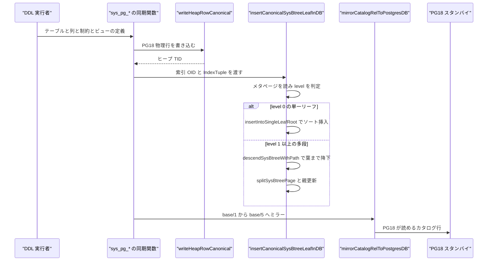
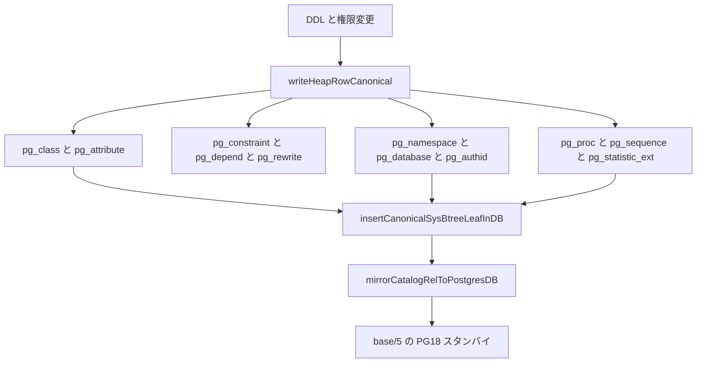

# システムカタログ同期

<details>
<summary>関連ソースファイル</summary>

- [`internal/executor/pg18_user_catalog_rows.go`](https://github.com/ryogrid/goopg/blob/19856410e8d497d59787e1ab35a2febb3f5953d6/internal/executor/pg18_user_catalog_rows.go)
- [`internal/executor/pg_authid_sync.go`](https://github.com/ryogrid/goopg/blob/19856410e8d497d59787e1ab35a2febb3f5953d6/internal/executor/pg_authid_sync.go)
- [`internal/executor/pg_catalog_fk_data.go`](https://github.com/ryogrid/goopg/blob/19856410e8d497d59787e1ab35a2febb3f5953d6/internal/executor/pg_catalog_fk_data.go)
- [`internal/executor/pg_class_relstats_sync.go`](https://github.com/ryogrid/goopg/blob/19856410e8d497d59787e1ab35a2febb3f5953d6/internal/executor/pg_class_relstats_sync.go)
- [`internal/executor/pgindex_btree.go`](https://github.com/ryogrid/goopg/blob/19856410e8d497d59787e1ab35a2febb3f5953d6/internal/executor/pgindex_btree.go)
- [`internal/executor/pgindex_dead_purge.go`](https://github.com/ryogrid/goopg/blob/19856410e8d497d59787e1ab35a2febb3f5953d6/internal/executor/pgindex_dead_purge.go)
- [`internal/executor/pgindex_fingerprint.go`](https://github.com/ryogrid/goopg/blob/19856410e8d497d59787e1ab35a2febb3f5953d6/internal/executor/pgindex_fingerprint.go)
- [`internal/executor/pgindex_keydesc.go`](https://github.com/ryogrid/goopg/blob/19856410e8d497d59787e1ab35a2febb3f5953d6/internal/executor/pgindex_keydesc.go)
- [`internal/executor/pgindex_tuplekey.go`](https://github.com/ryogrid/goopg/blob/19856410e8d497d59787e1ab35a2febb3f5953d6/internal/executor/pgindex_tuplekey.go)
- [`internal/executor/sys_catalog_btree_insert_split.go`](https://github.com/ryogrid/goopg/blob/19856410e8d497d59787e1ab35a2febb3f5953d6/internal/executor/sys_catalog_btree_insert_split.go)
- [`internal/executor/sys_catalog_btree_levels.go`](https://github.com/ryogrid/goopg/blob/19856410e8d497d59787e1ab35a2febb3f5953d6/internal/executor/sys_catalog_btree_levels.go)
- [`internal/executor/sys_catalog_btree_multilevel.go`](https://github.com/ryogrid/goopg/blob/19856410e8d497d59787e1ab35a2febb3f5953d6/internal/executor/sys_catalog_btree_multilevel.go)
- [`internal/executor/sys_catalog_btree_split.go`](https://github.com/ryogrid/goopg/blob/19856410e8d497d59787e1ab35a2febb3f5953d6/internal/executor/sys_catalog_btree_split.go)
- [`internal/executor/sys_catalog_index_insert.go`](https://github.com/ryogrid/goopg/blob/19856410e8d497d59787e1ab35a2febb3f5953d6/internal/executor/sys_catalog_index_insert.go)
- [`internal/executor/sys_catalog_postgres_db_mirror.go`](https://github.com/ryogrid/goopg/blob/19856410e8d497d59787e1ab35a2febb3f5953d6/internal/executor/sys_catalog_postgres_db_mirror.go)
- [`internal/executor/sys_pg_attrdef.go`](https://github.com/ryogrid/goopg/blob/19856410e8d497d59787e1ab35a2febb3f5953d6/internal/executor/sys_pg_attrdef.go)
- [`internal/executor/sys_pg_auth_members.go`](https://github.com/ryogrid/goopg/blob/19856410e8d497d59787e1ab35a2febb3f5953d6/internal/executor/sys_pg_auth_members.go)
- [`internal/executor/sys_pg_authid.go`](https://github.com/ryogrid/goopg/blob/19856410e8d497d59787e1ab35a2febb3f5953d6/internal/executor/sys_pg_authid.go)
- [`internal/executor/sys_pg_constraint.go`](https://github.com/ryogrid/goopg/blob/19856410e8d497d59787e1ab35a2febb3f5953d6/internal/executor/sys_pg_constraint.go)
- [`internal/executor/sys_pg_database.go`](https://github.com/ryogrid/goopg/blob/19856410e8d497d59787e1ab35a2febb3f5953d6/internal/executor/sys_pg_database.go)
- [`internal/executor/sys_pg_depend.go`](https://github.com/ryogrid/goopg/blob/19856410e8d497d59787e1ab35a2febb3f5953d6/internal/executor/sys_pg_depend.go)
- [`internal/executor/sys_pg_namespace.go`](https://github.com/ryogrid/goopg/blob/19856410e8d497d59787e1ab35a2febb3f5953d6/internal/executor/sys_pg_namespace.go)
- [`internal/executor/sys_pg_proc.go`](https://github.com/ryogrid/goopg/blob/19856410e8d497d59787e1ab35a2febb3f5953d6/internal/executor/sys_pg_proc.go)
- [`internal/executor/sys_pg_publication.go`](https://github.com/ryogrid/goopg/blob/19856410e8d497d59787e1ab35a2febb3f5953d6/internal/executor/sys_pg_publication.go)
- [`internal/executor/sys_pg_rewrite.go`](https://github.com/ryogrid/goopg/blob/19856410e8d497d59787e1ab35a2febb3f5953d6/internal/executor/sys_pg_rewrite.go)
- [`internal/executor/sys_pg_sequence.go`](https://github.com/ryogrid/goopg/blob/19856410e8d497d59787e1ab35a2febb3f5953d6/internal/executor/sys_pg_sequence.go)
- [`internal/executor/sys_pg_statistic_ext.go`](https://github.com/ryogrid/goopg/blob/19856410e8d497d59787e1ab35a2febb3f5953d6/internal/executor/sys_pg_statistic_ext.go)
- [`internal/executor/sys_pg_statistic_ext_data.go`](https://github.com/ryogrid/goopg/blob/19856410e8d497d59787e1ab35a2febb3f5953d6/internal/executor/sys_pg_statistic_ext_data.go)
- [`internal/executor/sys_pg_subscription.go`](https://github.com/ryogrid/goopg/blob/19856410e8d497d59787e1ab35a2febb3f5953d6/internal/executor/sys_pg_subscription.go)

</details>

`internal/executor` のシステムカタログ同期は、goopg のメモリ内カタログ（`catalog.InMemory`）に対する DDL や権限変更を、PostgreSQL 18 の物理行レイアウト（`Form_pg_class`/`Form_pg_attribute` など）を持つヒープ行として `base/<dbOid>/` に書き出し、対応するシステム B-tree を更新する層である。goopg 自身の `SELECT` は従来どおり仮想行（`VirtualRows`）から答え、この物理コピーは「PG18 スタンバイが `pg_basebackup` で接続したときにカタログを解決できること」と「起動時のリロード」を目的とする。`CREATE TABLE` は `pg_class`/`pg_attribute` を書き、`CREATE INDEX` は `pg_index`、制約は `pg_constraint`、ビューは `pg_rewrite`、シーケンスは `pg_sequence` と `pg_depend`、ロールは `pg_authid` を更新する。システム B-tree はリーダー（block 1）へのソート挿入から始まり、満杯ならページ分割・内部レベル昇格・多段降下まで行う。さらに `base/1/` の変更を `base/5/`（postgres データベース）へミラーする。カタログの論理モデルは [12 カタログとシステムビュー](../12-Catalog.md)、物理 B-tree は [8 B-tree インデックス](../8-Btree.md)、起動時リロードは [10 WAL と耐久性](../10-WAL.md) を参照。

## 責務

- PG18 物理行の生成。`pgClassColumnsPG18` が 34 列、`pgAttributeColumnsPG18` が 25 列の `pg_class`/`pg_attribute` スキーマを定義し、ユーザーテーブル行が PG18 のタプル記述子で読めるようにする。`path:internal/executor/pg18_user_catalog_rows.go:pgClassColumnsPG18`
- 型属性の解決。`userTypeAttrsForOID` が OID ごとの `typlen`/`typbyval`/`typalign`/`typstorage`/`typcollation` を返し、`pg_attribute` の物理値を埋める。`path:internal/executor/pg18_user_catalog_rows.go:userTypeAttrsForOID`
- カタログヒープの書き込み。`writeHeapRowCanonical` が PG18 形式のヒープ行を書き、TID を返す。各 `sys_pg_*.go` がこの上にテーブル・列・制約・ビュー・シーケンスなどの行を組み立てる。`path:internal/executor/sys_pg_namespace.go:syncSchemaToCatalogHeap`
- システム B-tree の保守。`insertCanonicalSysBtreeLeafInDB` がメタページを読み、単一リーフならソート挿入、多段なら葉まで降下して分割・親更新を行う。`path:internal/executor/sys_catalog_index_insert.go:insertCanonicalSysBtreeLeafInDB`
- 空 B-tree の遅延ルート。`allocateEmptySysBtreeLeafRoot` がメタページだけのインデックスに block 1 の空リーフを作り、`btm_root=1`/`btm_level=0` を書く。`path:internal/executor/sys_catalog_index_insert.go:allocateEmptySysBtreeLeafRoot`
- リーフ・ルートの分割。`splitLeafRootAndInsert` と `splitSysBtreePage` が葉を 2 分割し、内部レベルを `layoutSysBtreeInternalLevels` で再構築する。`path:internal/executor/sys_catalog_btree_split.go:splitLeafRootAndInsert`
- 監視用キーとフィンガープリント。`pgIndexKeyDesc` がインデックスのキー記述子を解決し、`indexKeyFingerprint`/`indexColumnFingerprint` が TID を含まない比較専用のキーを作る。`path:internal/executor/pgindex_fingerprint.go:indexKeyFingerprint`
- 死んだ TID の回収。`indexDeadTIDFilter` が分割前にヒープを検証し、HOT チェーン全体が dead-to-all のエントリだけを回収候補にする。`path:internal/executor/pgindex_dead_purge.go:indexDeadTIDFilter`
- `pg_class` 統計の反映。`syncPgClassRelStats` が `UPDATE pg_class SET reltuples` を `Table.Stats` と relstats サイドカーへ反映し、ROLLBACK 用の `RelStatsUndoEntry` を積む。`path:internal/executor/pg_class_relstats_sync.go:syncPgClassRelStats`
- `pg_database` の行と索引。`SyncPgDatabaseCatalogRow` がテンプレート DB の行を複製し、2671/2672 の索引へ入れる。`path:internal/executor/sys_pg_database.go:SyncPgDatabaseCatalogRow`
- `pg_authid` の行生成。`buildAuthidUserRow` が 12 列のロール行を作り、`rolvaliduntil` を timestamptz として格納する。`path:internal/executor/pg_authid_sync.go:buildAuthidUserRow`
- `pg_rewrite` のビュールール。`writeViewRewriteRow` が `_RETURN` ルール行を書き、PG が依存する 2693 索引を先に更新する。`path:internal/executor/sys_pg_rewrite.go:writeViewRewriteRow`
- `pg_sequence` と `pg_depend`。`syncSequenceDefinitionToCatalogHeap` が定義変更時だけ行を upsert し、`writeSequenceOwnedByDependRow` が OWNED BY を auto-dependency 行にする。`path:internal/executor/sys_pg_sequence.go:syncSequenceDefinitionToCatalogHeap`
- `base/5` へのミラー。`mirrorCatalogRelToPostgresDB` が `base/1/` のカタログファイルを `base/5/` へブロック単位でコピーする。`path:internal/executor/sys_catalog_postgres_db_mirror.go:mirrorCatalogRelToPostgresDB`
- 制約行。`writeUniqueConstraintRow`/`writeExclusionConstraintRow`/`writeNotNullConstraintRow`/`writeCheckConstraintRow` が `contype` 別の `pg_constraint` 行を書き、`stamp*ConstraintRows` が削除時に `xmax` を刻む。`path:internal/executor/sys_pg_constraint.go:writeUniqueConstraintRow`

## 処理フロー

DDL がカタログを更新するとき、まずメモリ内カタログの変更が成功し、その後で物理カタログの同期が走る。たとえば `syncSchemaToCatalogHeap` は `writeHeapRowCanonical(ctx, pgNamespaceRel(ctx), PGNamespaceColumnsPG18(), buildPGNamespaceRow(...))` で `base/<db>/2615` に `pg_namespace` 行を書き、TID を受けて `insertPgNamespaceIndexEntries` で 2684/2685 の索引を更新し、`im.SetSchemaHeapTID` で TID をキャッシュしてから `mirrorSchemaCatalogFiles` で `base/5` へミラーする。`path:internal/executor/sys_pg_namespace.go:syncSchemaToCatalogHeap`



システム B-tree の挿入は、`insertCanonicalSysBtreeLeafInDB` が `NBlocks` を見るところから始まる。0 ブロックなら「bootstrap 未実行」として何もせず、1 ブロック（メタページのみ）なら `allocateEmptySysBtreeLeafRoot` でリーフルートを作る。`readSysBtreeMeta` が `level == 0` を返せば `insertIntoSingleLeafRoot` がスロットを走査して正しい位置に挿入し、`ErrNoSpaceInPage` なら `splitLeafRootAndInsert` がリーフを左右に分けて新しい内部ルートを block 1 の上に作る。`level >= 1` なら `insertSysBtreeMultiLevel` → `descendSysBtreeWithPath` で対象葉まで降り、満杯なら `splitSysBtreePage` と `insertSysBtreeDownlink` で親を更新する。`path:internal/executor/sys_catalog_index_insert.go:insertCanonicalSysBtreeLeafInDB`



`mirrorCatalogRelToPostgresDB` は `DefaultDBOid` と `PostgresDBOid` が同じなら no-op、`Pool` が nil でも no-op である。ソース `base/1/<relOid>` の各ブロックを pin し、スロットのロック下で `storage.BlockSize` バイトをコピーし、宛先 `base/5/<relOid>` の同じブロックへ書く。宛先が足りなければ `PinNewWithXID` で 1 ブロックずつ延長する。両ファイルは bootstrap 時点でバイト同一という前提なので、ブロック単位のコピーで整合する。`path:internal/executor/sys_catalog_postgres_db_mirror.go:mirrorCatalogRelToPostgresDB`

## 主要ファイル

| ファイル | 役割 |
| --- | --- |
| `internal/executor/pg18_user_catalog_rows.go` | PG18 canonical な `pg_class`（34 列）/`pg_attribute`（25 列）行の定義と `userTypeAttrs`。`path:internal/executor/pg18_user_catalog_rows.go:pgClassColumnsPG18` |
| `internal/executor/sys_catalog_index_insert.go` | システム B-tree の固定長 IndexTuple ビルダーと挿入入口。`path:internal/executor/sys_catalog_index_insert.go:insertCanonicalSysBtreeLeafInDB` |
| `internal/executor/sys_catalog_btree_split.go` | リーフ・ルート分割とページ構築。`path:internal/executor/sys_catalog_btree_split.go:splitLeafRootAndInsert` |
| `internal/executor/sys_catalog_btree_insert_split.go` | 多段 B-tree の降下・葉分割・親更新。`path:internal/executor/sys_catalog_btree_insert_split.go:insertSysBtreeMultiLevel` |
| `internal/executor/sys_catalog_btree_levels.go` | 内部レベルのレイアウト。`sysBtreeLevelChild` と `layoutSysBtreeInternalLevels`。`path:internal/executor/sys_catalog_btree_levels.go:layoutSysBtreeInternalLevels` |
| `internal/executor/sys_catalog_btree_multilevel.go` | メタページ読み、葉降下、全葉収集、ブルク再構築のフォールバック。`path:internal/executor/sys_catalog_btree_multilevel.go:descendSysBtreeToLeaf` |
| `internal/executor/sys_catalog_postgres_db_mirror.go` | `base/1` → `base/5` のカタログミラー。`path:internal/executor/sys_catalog_postgres_db_mirror.go:mirrorCatalogRelToPostgresDB` |
| `internal/executor/pgindex_btree.go` | インデックスキー記述子の解決、probe/entry/build キーの funnel、B-tree の open/create。`path:internal/executor/pgindex_btree.go:indexEntryKey` |
| `internal/executor/pgindex_tuplekey.go` | `pgIndexTupleKey`/`pgIndexTupleKeyFromRow`。PostgreSQL タプル形式のキー生成。`path:internal/executor/pgindex_tuplekey.go:pgIndexTupleKey` |
| `internal/executor/pgindex_keydesc.go` | `buildPGIndexKeyDesc`、型 OID→比較器・整列幅の対応。`path:internal/executor/pgindex_keydesc.go:buildPGIndexKeyDesc` |
| `internal/executor/pgindex_fingerprint.go` | `indexKeyFingerprint`/`indexColumnFingerprint`。TID を含まない比較専用キー。`path:internal/executor/pgindex_fingerprint.go:indexKeyFingerprint` |
| `internal/executor/pgindex_dead_purge.go` | `indexDeadTIDFilter`。分割前の dead-to-all 検証。`path:internal/executor/pgindex_dead_purge.go:indexDeadTIDFilter` |
| `internal/executor/pg_class_relstats_sync.go` | `syncPgClassRelStats`/`RelStatsUndoEntry`。`reltuples` の計画統計への反映。`path:internal/executor/pg_class_relstats_sync.go:syncPgClassRelStats` |
| `internal/executor/sys_pg_constraint.go` | `pg_constraint` 行（unique/exclude/not-null/check/fk）と削除 stamp。`path:internal/executor/sys_pg_constraint.go:writeUniqueConstraintRow` |
| `internal/executor/sys_pg_rewrite.go` | `pg_rewrite` の `_RETURN` ルール行と 2693/2694 索引。`path:internal/executor/sys_pg_rewrite.go:writeViewRewriteRow` |
| `internal/executor/sys_pg_sequence.go` | `pg_sequence` 定義行と `pg_sequence_data` の同期。`path:internal/executor/sys_pg_sequence.go:syncSequenceDefinitionToCatalogHeap` |
| `internal/executor/sys_pg_depend.go` | シーケンス OWNED BY と継承の `pg_depend` 行。`path:internal/executor/sys_pg_depend.go:writeSequenceOwnedByDependRow` |
| `internal/executor/sys_pg_database.go` | `pg_database` 行の INSERT/DELETE、2671/2672 索引、`datconnlimit`。`path:internal/executor/sys_pg_database.go:SyncPgDatabaseCatalogRow` |
| `internal/executor/sys_pg_namespace.go` | `pg_namespace` の CREATE/ALTER/DROP 同期と TID キャッシュ。`path:internal/executor/sys_pg_namespace.go:syncSchemaToCatalogHeap` |
| `internal/executor/pg_authid_sync.go` | `pg_authid` の 12 列スキーマとロール行ビルダー。`path:internal/executor/pg_authid_sync.go:buildAuthidUserRow` |
| `internal/executor/sys_pg_attrdef.go` | `pg_attrdef` のデフォルト式行と 2656/2657 索引。`path:internal/executor/sys_pg_attrdef.go:writeAttrdefRow` |
| `internal/executor/sys_pg_auth_members.go` | `pg_auth_members` のロール membership 行。`path:internal/executor/sys_pg_auth_members.go:syncAuthMemberRow` |
| `internal/executor/sys_pg_proc.go` | `pg_proc` の 30 列行、引数 OID 配列、`prosqlbody`。`path:internal/executor/sys_pg_proc.go:buildPGProcRow` |
| `internal/executor/sys_pg_publication.go` | `pg_publication`/`pg_publication_rel`/`pg_publication_namespace` 行。`path:internal/executor/sys_pg_publication.go` |
| `internal/executor/sys_pg_subscription.go` | `pg_subscription` 行。`path:internal/executor/sys_pg_subscription.go` |
| `internal/executor/sys_pg_statistic_ext.go` | `pg_statistic_ext` 行。`path:internal/executor/sys_pg_statistic_ext.go` |
| `internal/executor/sys_pg_statistic_ext_data.go` | `pg_statistic_ext_data` 行と統計データ。`path:internal/executor/sys_pg_statistic_ext_data.go` |
| `internal/executor/pg_catalog_fk_data.go` | カタログ外部キー関係のデータ。`path:internal/executor/pg_catalog_fk_data.go` |

## 公開 API / エントリポイント

```go
func PGClassColumnsPG18() []catalog.Column
func PGAttributeColumnsPG18() []catalog.Column
func PGTypeColumnsPG18() []catalog.Column
func PGConstraintColumnsPG18() []catalog.Column
func PGProcColumnsPG18() []catalog.Column
func PGAuthidColumnsPG18() []catalog.Column
func PGSequenceColumnsPG18() []catalog.Column
func PGRewriteColumnsPG18() []catalog.Column
func PGDependColumnsPG18() []catalog.Column
func PGNamespaceColumnsPG18() []catalog.Column

func SyncPgDatabaseCatalogRow(ctx *Context, newOid uint32, name string, owner, templateOid uint32, encodingOverride int32) error
func DeletePgDatabaseCatalogRow(ctx *Context, oid uint32) error
func PersistDatConnLimit(ctx *Context, dbOid uint32, newLimit int32) error
func insertCanonicalSysBtreeLeaf(ctx *Context, indexOID uint32, indexTuple []byte, cmp keyCompareFn) error
func (ctx *Context) indexEntryKey(idx *catalog.Index, cols []catalog.Column, row Row, tid storage.ItemPointer) ([]byte, error)
func (ctx *Context) indexProbeKey(idx *catalog.Index, parts []indexProbeKeyPart) ([]byte, *ExecError)
func (ctx *Context) pgIndexKeyDesc(idx *catalog.Index) *nbtree.PGIndexKeyDesc
```

エクスポートされているのは主に列定義アクセサと `pg_database` の同期関数である。これらは initdb の起動時リロードとサーバー層の CREATE/DROP DATABASE ハンドラから呼ばれる。残りは executor 内の DDL 実装から直接使う。

## 主要データ構造

### `userTypeAttrs`

```go
type userTypeAttrs struct {
	TypLen       int16 // -1 == variable-length
	TypByVal     bool
	TypAlign     byte // 'c' | 's' | 'i' | 'd'
	TypStorage   byte // 'p' | 'e' | 'x' | 'm'
	TypCollation uint32
}
```

`path:internal/executor/pg18_user_catalog_rows.go:userTypeAttrs`

`TypLen` は `-1` が可変長、`TypByVal` は値渡しか参照渡しか、`TypAlign` は `'c'`/`'s'`/`'i'`/`'d'` の物理整列、`TypStorage` は `'p'`/`'e'`/`'x'`/`'m'` の TOAST 方針、`TypCollation` は照合順序 OID である。`userTypeAttrsForOID` は OID ごとに PG18 の `pg_type.dat` と同じ値を返し、未知の OID は text 形の可変長記述子に倒す。これは「4 バイトの by-val として誤解釈してインライン・バイトをポインタとして参照する」より安全な失敗方向である。

### `btreeIndexKeyMeta`

```go
type btreeIndexKeyMeta struct {
	tupleSize int    // total IndexTuple size in bytes (e.g. 16 or 80); 0 when variable
	nkeyatts  uint16 // number of key attributes (1 for oid, 2 for name+oid or oid+int2)
	variable  bool   // true when tuples are variable-length (varlena key column,
	// e.g. pg_proc_proname_args_nsp_index's oidvector) — the rebuild
	// fallback then uses the variable-size bulk layout instead of the
	// fixed-tupleSize one
}
```

`path:internal/executor/sys_catalog_btree_split.go:btreeIndexKeyMeta`

`tupleSize` は固定長 IndexTuple の総バイト数（16/80/72 など）、`nkeyatts` はキー属性数（oid は 1、name+oid は 2）、`variable` は可変長キー（`pg_proc_proname_args_nsp_index` の `oidvector` など）を示す。`keyMetaForSysBtree` がインデックス OID ごとにこの記述を返し、ランタイム挿入できるシステム B-tree の一覧を兼ねる。

### `sysBtreePageImage` と `sysBtreeLevelChild`

```go
type sysBtreePageImage struct {
	highKey []byte
	items   [][]byte
	prev    uint32
	next    uint32
	level   uint32
	flags   uint16
}
```

`path:internal/executor/sys_catalog_btree_insert_split.go:sysBtreePageImage`

```go
type sysBtreeLevelChild struct {
	block  uint32
	lowKey []byte // data-tuple form; nil for the leftmost child (minus infinity)
}
```

`path:internal/executor/sys_catalog_btree_levels.go:sysBtreeLevelChild`

`sysBtreePageImage` は 1 ページを解析した結果で、`highKey`（右端ページでは nil）、スロット順の `items`、`prev`/`next`、`level`、`flags` を持つ。内部ページでは `items[0]` がマイナス無限大のダウンリンクである。`sysBtreeLevelChild` は内部レベルを組むときの子 1 個で、`block` と `lowKey`（左端の子は nil）を持つ。

### システム B-tree の定数と `keyCompareFn`

```go
const (
	pgClassOidIndexOID             uint32 = 2662
	pgClassRelnameNspIndexOID      uint32 = 2663
	pgAttributeRelidAttnumIndexOID uint32 = 2659
	pgAttrdefAdrelidAdnumIndexOID  uint32 = 2656
	pgAttrdefOidIndexOID           uint32 = 2657
	pgIndexIndrelidIndexOID        uint32 = 2678
	pgIndexIndexrelidIndexOID      uint32 = 2679
)
```

`path:internal/executor/sys_catalog_index_insert.go:pgClassOidIndexOID`

```go
type keyCompareFn func(a, b []byte) int
```

`path:internal/executor/sys_catalog_index_insert.go:keyCompareFn`

OID 定数は PG18 の固定 OID（`pg_class_oid_index`=2662、`pg_class_relname_nsp_index`=2663、`pg_attribute_relid_attnum_index`=2659 など）である。`sysBtreeRootBlock = 1` は「block 0 がメタページ、block 1 がルートリーフ」という bootstrap の約束を表す。`sysIndexTupleHoff = 8` は NULL も varlena もない場合の `MAXALIGN(sizeof(IndexTupleData))`、`sysIndexSizeMask = 0x1FFF` は `t_info` の下位 13 ビットからタプル長を復元するマスクである。`keyCompareFn` は `cmpKeyUint32`/`cmpKeyName`/`cmpKeyNameOid`/`cmpKeyOidInt2` などの比較関数の型である。

### `indexProbeKeyPart`

```go
type indexProbeKeyPart struct {
	col *catalog.Column
	val Datum
	pos int
}
```

`path:internal/executor/pgindex_btree.go:indexProbeKeyPart`

`col` はキー属性を支えるテーブル列、`val` はその値、`pos` はエラー位置である。`indexProbeKey` は先頭 `len(parts)` 属性だけを指す探索キーを作る。タプル形式では、全属性を指定しないキーは「自分が持つ属性数」を刻んだ PIVOT になり、指定しなかった属性はマイナス無限大として比較される。

### `RelStatsUndoEntry`

```go
type RelStatsUndoEntry struct {
	Table *catalog.Table
	Stats *catalog.TableStats
}
```

`path:internal/executor/pg_class_relstats_sync.go:RelStatsUndoEntry`

`Table` は更新対象のカタログテーブル、`Stats` は更新前の `*catalog.TableStats` へのポインタである。`syncPgClassRelStats` は新しい `TableStats` を別ポインタとして作り、`rel.Stats` を差し替える。同時にプランナが中途半端な構造体を見ないためのポインタ置換であり、明示トランザクション内ならこのエントリを積んで ROLLBACK で旧ポインタへ戻す。

### `viewRelationResolver`

```go
type viewRelationResolver struct {
	ctx *Context
}
```

`path:internal/executor/sys_pg_rewrite.go:viewRelationResolver`

`ctx` だけを持つアダプタで、`nodes.RelationResolver` として `LookupRelation` を実装する。ビューの `_RETURN` ルールを canonical なノード木（`ev_action`）で書けるかどうかを判断するために使う。列がすべて単純なスカラー組み込み型でない場合や、解決できない場合は `(nil,false)` を返し、呼び出し側は SQL テキスト形式の `ev_action` にフォールバックする。

## 内部構造

### PG18 物理行と仮想カタログの二重性

goopg の `SELECT * FROM pg_class` は `catalog.InMemory` と `VirtualRows` から答え、物理 `pg_class` ヒープは読みに行かない。物理行は「PG18 スタンバイ」と「起動時リロード」のためのコピーである。したがって DDL は、メモリ内カタログの更新（goopg の真実）と物理行の同期（外部から見える形）を同じトランザクションで行う。物理行の書き込みに失敗しても、多くの `sys_pg_*` 関数は DDL 自体を失敗させずに戻る（例: `syncSequenceDefinitionToCatalogHeap` は `updateHeapRowCanonicalPG` のエラーを無視する）。これは外部パリティ面の欠落であって、goopg 自身の正しさを壊さないための切り分けである。`path:internal/executor/sys_pg_sequence.go:syncSequenceDefinitionToCatalogHeap`

### システム B-tree の 3 形態

`insertCanonicalSysBtreeLeafInDB` はメタページの `level` で 3 形態を選ぶ。block 数 0 は「ファイル無し」で何もしない。block 数 1 はメタページだけでルートが無いので、`allocateEmptySysBtreeLeafRoot` が空リーフを作って `btm_root=1`/`btm_level=0` を書く。`level == 0` は単一リーフで、`insertIntoSingleLeafRoot` がソート挿入し、溢れたら `splitLeafRootAndInsert` がリーフを 2 分割して新しい内部ルートを block 1 に昇格する。`level >= 1` は多段で、`insertSysBtreeMultiLevel` が `descendSysBtreeWithPath` で葉まで降り、`splitSysBtreePage` と `insertSysBtreeDownlink` で親を更新する。`path:internal/executor/sys_catalog_index_insert.go:insertCanonicalSysBtreeLeafInDB`

### 分割の fillfactor と内部レベル

`splitSysBtreePage` は葉なら `sysBtreeLeafFillfactor = 90`、内部なら `sysBtreeNonLeafFillfactor = 70` を目標に左右へ振り分ける。内部レベルは `layoutSysBtreeInternalLevels` が子をページにまとめ、右端以外のページには high key の分だけ余白を残す。`sysBtreePageImage` の `prev`/`next` はリーフの兄弟リンクで、内部ページでは `items[0]` がマイナス無限大のダウンリンクになる。`path:internal/executor/sys_catalog_btree_insert_split.go:splitSysBtreePage`

### キー形式の 2 レーンとフィンガープリント

ユーザーインデックスのキーは、`pgIndexKeyDesc` が非 nil なら PostgreSQL の IndexTuple 形式（`pgIndexTupleKey`）、nil なら goopg の blob 連結形式である。`pgIndexTupleKeys` は現在 true で、記述子を解決できるインデックスはタプル形式で書かれる。`indexEntryKey` は行の実 TID を `t_tid` に埋め、`indexRowProbeKey` はゼロ TID（heapkeyspace のマイナス無限大）を使う。この違いを混同すると、probe が自分の一致範囲の途中に着地して一致を読み落とす。`path:internal/executor/pgindex_btree.go:indexEntryKey`

一方、`indexKeyFingerprint` と `indexColumnFingerprint` は意図的に blob 形式のままである。これらは「更新でインデックス対象列が変わったか」「SSI のバケットタグ」「NULLS NOT DISTINCT のヒープ走査」に使われ、異なるヒープ行から作ったバイト列同士を比較する。タプル形式は `t_tid` を含むため、フィンガープリントに使うと「常に変わった」「バケットが一致しない」「重複を見つけられない」という静かな誤りになる。`path:internal/executor/pgindex_fingerprint.go:indexKeyFingerprint`

### 死んだ TID の回収

`indexDeadTIDFilter` は分割の直前に呼ばれ、インデックスエントリの TID が「ヒープ上で dead-to-all」かどうかを検証する。`purgeHeapBlockBudget = 32` で 1 回に fault するヒープブロック数を制限し、予算外のエントリは「live」として扱う。`heapChainDeadToAll` が HOT チェーン全体を歩き、1 つでも live または recent なメンバーがあれば回収しない。LP_DEAD ヒントを立てる方式ではなく、ヒープを検証する方式なので、dedup と共存できる。`path:internal/executor/pgindex_dead_purge.go:indexDeadTIDFilter`

### `pg_class` 統計の反映

`UPDATE pg_class SET reltuples` は物理行を書き換えるだけでは goopg のプランナに届かない。プランナと仮想 `pg_class` は `catalog.Table.Stats` を読み、起動時は relstats サイドカーから復元するからである。`syncPgClassRelStats` は SET 句が `reltuples` を割り当てているときだけ `Table.Stats` を新しいポインタに差し替え、`reltuples = -1` を「未 VACUUM/ANALYZE」として `RowCount=0`/`Analyzed=false` にする。`relpages` は意図的に同期しない。goopg のコストは `Stats.Pages` と live ブロック数から計算するため、書き込まれた `relpages` はかえって偽のページ数になる。`path:internal/executor/pg_class_relstats_sync.go:syncPgClassRelStats`

### `base/1` から `base/5` へのミラー

bootstrap は nailed カタログを `base/1/` と `base/5/` の両方に同じ内容で作る。ランタイム DDL が `base/1/` だけを更新すると、PG18 が dbname=postgres（DBOid=5）で接続したときに `pg_class` や `pg_class_relname_nsp_index` が bootstrap 状態のまま残り、`relation "public.foo" does not exist` になる。`mirrorCatalogRelToPostgresDB` は変更されたカタログファイルの全ブロックを `base/5/` へコピーし、バッファプール経由で dirty/checkpoint/fsync の通常経路に乗せる。`path:internal/executor/sys_catalog_postgres_db_mirror.go:mirrorCatalogRelToPostgresDB`

## エッジケースと不変条件

- **物理カタログは goopg の読み取り経路ではない。** goopg 自身の `SELECT` は `VirtualRows` から答える。物理行の同期失敗は外部パリティの欠落であり、多くの同期関数は DDL を失敗させない。`path:internal/executor/sys_pg_sequence.go:syncSequenceDefinitionToCatalogHeap`
- **ファイルが無ければ何もしない。** `insertCanonicalSysBtreeLeafInDB` は `NBlocks == 0` で no-op、`Pool == nil` でも no-op を返す。bootstrap 未実行の埋め込み環境で落ちないためのガードである。`path:internal/executor/sys_catalog_index_insert.go:insertCanonicalSysBtreeLeafInDB`
- **メタページだけのインデックスは遅延ルート。** `NBlocks == 1` なら `allocateEmptySysBtreeLeafRoot` が block 1 を空リーフにし、`btm_root=1`/`btm_level=0` を書く。メタページが既に root を指しているのにブロックが無い場合はエラーである。`path:internal/executor/sys_catalog_index_insert.go:allocateEmptySysBtreeLeafRoot`
- **ルートは block 1 固定。** `sysBtreeRootBlock = 1`。`PinNew` が block 1 以外を返したらエラーにする。`path:internal/executor/sys_catalog_index_insert.go:allocateEmptySysBtreeLeafRoot`
- **IndexTuple の長さは 13 ビット。** `sysIndexSizeMask = 0x1FFF` で `t_info` からタプル長を復元する。固定長ビルダーは 16/80/72/88 バイトの像を作り、NameData は 64 バイトで切り詰める。`path:internal/executor/sys_catalog_index_insert.go:buildIndexTupleNameOidKey`
- **タプル形式の probe はゼロ TID。** `indexRowProbeKey` は `storage.ItemPointer{}` を渡し、heapkeyspace の最後のタイブレーカでマイナス無限大にする。実 TID を渡すと一致範囲の途中に着地する。`path:internal/executor/pgindex_btree.go:indexRowProbeKey`
- **全属性でないキーは PIVOT。** `pgIndexTupleKey` は `len(vals) < nkey` のとき `BTreeTupleSetNAtts` で属性数を刻み、指定しない属性をマイナス無限大として扱う。`path:internal/executor/pgindex_tuplekey.go:pgIndexTupleKey`
- **TOAST ポインタはキーにできない。** `pgIndexTupleKey` は未解決の `KindToastPointer` を拒否する。TOAST ポインタをインデックスすると値ではなく参照を並べ替えることになる。`path:internal/executor/pgindex_tuplekey.go:pgIndexTupleKey`
- **NULL キーの扱いは呼び出し側の政策。** `pgIndexTupleKey` は NULL を表現できるが、NULL キー行をインデックスに入れるかは `keepNull`（`indexEntryKey` は `NullKeyedIndexEntries()`）で決まる。`path:internal/executor/pgindex_btree.go:indexEntryKey`
- **フィンガープリントに TID を入れてはいけない。** `indexKeyFingerprint`/`indexColumnFingerprint` は `*Context` も `storage.ItemPointer` も取らない。TID が入ると更新判定・SSI バケット・NND 重複判定がすべて壊れる。`path:internal/executor/pgindex_fingerprint.go:indexColumnFingerprint`
- **死んだ TID の回収はヒープ検証。** `indexDeadTIDFilter` は `heapChainDeadToAll` で HOT チェーン全体が `OldestXmin` より古いときだけ回収し、1 回の分割で fault するブロックは `purgeHeapBlockBudget = 32` に制限する。`path:internal/executor/pgindex_dead_purge.go:purgeHeapBlockBudget`
- **`reltuples = -1` は未解析。** `syncPgClassRelStats` は負値を「未 VACUUM/ANALYZE」として `RowCount=0`/`Analyzed=false` にし、`relpages` は同期しない。`path:internal/executor/pg_class_relstats_sync.go:syncPgClassRelStats`
- **統計の差し替えはポインタ置換。** 並行プランナが中途半端な `TableStats` を見ないよう、`rel.Stats = &merged` で丸ごと差し替える。明示トランザクション内なら `RelStatsUndoEntry` を積む。`path:internal/executor/pg_class_relstats_sync.go:syncPgClassRelStats`
- **`pg_database` のテンプレート行が無ければスキップ。** `SyncPgDatabaseCatalogRow` はテンプレート DB のヒープ行が無い場合、壊れた行を書かずに戻る。goopg のレジストリ（VirtualRows）が真実として残る。`path:internal/executor/sys_pg_database.go:SyncPgDatabaseCatalogRow`
- **ビューの `ev_action` は 2 形式。** canonical なノード木（`({` で始まる）か SQL テキストかで、goopg のリロードは先頭で判別する。`writeViewRewriteRow` は 2693（relname）を先に更新する。PG の `RelationBuildRuleLock` は 2693 以外で規則に到達できない。`path:internal/executor/sys_pg_rewrite.go:writeViewRewriteRow`
- **シーケンス定義の変更だけが行を書く。** `syncSequenceDefinitionToCatalogHeap` は `seqDefSig` のフィンガープリントが前回と同じなら「カウンタだけのスナップショット」としてスキップする。`path:internal/executor/sys_pg_sequence.go:syncSequenceDefinitionToCatalogHeap`
- **`pg_depend` の OWNED BY は auto-dependency。** `writeSequenceOwnedByDependRow` は書く前に既存行の `xmax` を刻み、再ポイントで 2 行が生き残らないようにする。deptype は `'a'`。`path:internal/executor/sys_pg_depend.go:writeSequenceOwnedByDependRow`
- **`base/5` ミラーはカタログだけ。** `mirrorCatalogRelToPostgresDB` は `DBOid` 1→5 のコピーで、ユーザーテーブルのデータファイルや WAL リプレイは対象外である。`path:internal/executor/sys_catalog_postgres_db_mirror.go:mirrorCatalogRelToPostgresDB`
- **PG18 物理行の列順は固定。** `pgClassColumnsPG18` の 34 列、`pgAttributeColumnsPG18` の 25 列、`pgAuthidSyncCols` の 12 列は PG18 の `Form_*` と一致しなければならない。列を 1 つ挿入するとスタンバイが全列をずらして読む。`path:internal/executor/pg18_user_catalog_rows.go:pgClassColumnsPG18`

Sources:

- `internal/executor/pg18_user_catalog_rows.go`
- `internal/executor/pg_authid_sync.go`
- `internal/executor/pg_catalog_fk_data.go`
- `internal/executor/pg_class_relstats_sync.go`
- `internal/executor/pgindex_btree.go`
- `internal/executor/pgindex_dead_purge.go`
- `internal/executor/pgindex_fingerprint.go`
- `internal/executor/pgindex_keydesc.go`
- `internal/executor/pgindex_tuplekey.go`
- `internal/executor/sys_catalog_btree_insert_split.go`
- `internal/executor/sys_catalog_btree_levels.go`
- `internal/executor/sys_catalog_btree_multilevel.go`
- `internal/executor/sys_catalog_btree_split.go`
- `internal/executor/sys_catalog_index_insert.go`
- `internal/executor/sys_catalog_postgres_db_mirror.go`
- `internal/executor/sys_pg_attrdef.go`
- `internal/executor/sys_pg_auth_members.go`
- `internal/executor/sys_pg_authid.go`
- `internal/executor/sys_pg_constraint.go`
- `internal/executor/sys_pg_database.go`
- `internal/executor/sys_pg_depend.go`
- `internal/executor/sys_pg_namespace.go`
- `internal/executor/sys_pg_proc.go`
- `internal/executor/sys_pg_publication.go`
- `internal/executor/sys_pg_rewrite.go`
- `internal/executor/sys_pg_sequence.go`
- `internal/executor/sys_pg_statistic_ext.go`
- `internal/executor/sys_pg_statistic_ext_data.go`
- `internal/executor/sys_pg_subscription.go`

<sub>Generated by deepwiki-4myself from `goopg` @ `19856410e`</sub>
