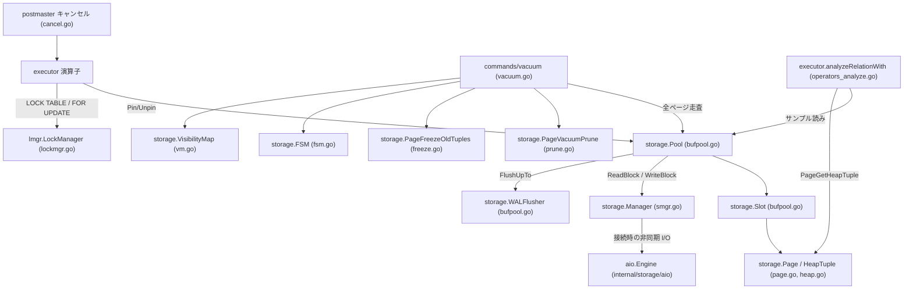
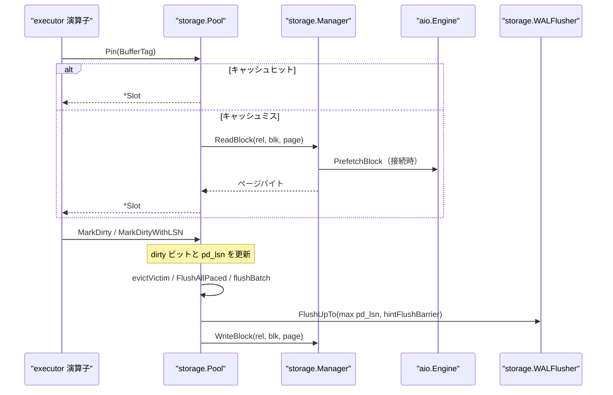

# ストレージ

<details>
<summary>関連ソースファイル</summary>

- [`internal/storage/bufpool.go`](https://github.com/ryogrid/goopg/blob/19856410e8d497d59787e1ab35a2febb3f5953d6/internal/storage/bufpool.go)
- [`internal/storage/checksum.go`](https://github.com/ryogrid/goopg/blob/19856410e8d497d59787e1ab35a2febb3f5953d6/internal/storage/checksum.go)
- [`internal/storage/fsm.go`](https://github.com/ryogrid/goopg/blob/19856410e8d497d59787e1ab35a2febb3f5953d6/internal/storage/fsm.go)
- [`internal/storage/heap.go`](https://github.com/ryogrid/goopg/blob/19856410e8d497d59787e1ab35a2febb3f5953d6/internal/storage/heap.go)
- [`internal/storage/lmgr/lockmgr.go`](https://github.com/ryogrid/goopg/blob/19856410e8d497d59787e1ab35a2febb3f5953d6/internal/storage/lmgr/lockmgr.go)
- [`internal/storage/lp_lifecycle.go`](https://github.com/ryogrid/goopg/blob/19856410e8d497d59787e1ab35a2febb3f5953d6/internal/storage/lp_lifecycle.go)
- [`internal/storage/page.go`](https://github.com/ryogrid/goopg/blob/19856410e8d497d59787e1ab35a2febb3f5953d6/internal/storage/page.go)
- [`internal/storage/prune.go`](https://github.com/ryogrid/goopg/blob/19856410e8d497d59787e1ab35a2febb3f5953d6/internal/storage/prune.go)
- [`internal/storage/smgr.go`](https://github.com/ryogrid/goopg/blob/19856410e8d497d59787e1ab35a2febb3f5953d6/internal/storage/smgr.go)
- [`internal/storage/vm.go`](https://github.com/ryogrid/goopg/blob/19856410e8d497d59787e1ab35a2febb3f5953d6/internal/storage/vm.go)
- [`internal/commands/vacuum/vacuum.go`](https://github.com/ryogrid/goopg/blob/19856410e8d497d59787e1ab35a2febb3f5953d6/internal/commands/vacuum/vacuum.go)
- [`internal/executor/operators_analyze.go`](https://github.com/ryogrid/goopg/blob/19856410e8d497d59787e1ab35a2febb3f5953d6/internal/executor/operators_analyze.go)

</details>

`internal/storage` は、SQL 実行エンジンが扱う行データを 8 KiB の固定長ページに載せ、そのページをメモリ上のバッファプールとディスク上のリレーションファイルの間で往復させる層である。実行エンジンは `BufferTag`（`RelFileNode` + `BlockNumber`）でページを要求し、`Pool` は `bufmap` でスロットを引き、ミス時だけ `Manager` に読み込みを依頼する。ページ上のタプルは `HeapTuple`/`HeapTupleHeader` として解釈され、MVCC の xmin/xmax とライン・ポインタで管理される。VACUUM と ANALYZE はこのページ層を全走査し、死んだタプルの回収・凍結・空き領域マップ（FSM）・可視性マップ（VM）の更新・統計収集を行う。

制御は 3 つの境界を持つ。実行エンジンとバッファプールの境界は `Pin`/`Unpin` と `MarkDirty*`、バッファプールとストレージマネージャの境界は `ReadBlock`/`WriteBlock`/`Extend`、そしてページ内容とディスクの間にはチェックサムと WAL-before-data の順序がある。ロックマネージャはページ内容のラッチとは別に、リレーション／タプルの heavyweight ロックを調停する。上位の実行エンジンは [6 実行エンジン](6-Executor.md)、WAL は [10 WAL と耐久性](10-WAL.md)、トランザクション可視性は [9 トランザクションと MVCC](9-Transactions.md) を参照。

## コンポーネント

- [7.1 バッファプール](7-Storage/7.1-Buffer-Pool.md) — `Pool`/`Slot`/`bufmap`。ロックフリーのヒット判定、`pinMu` 下の victim 置換、WAL を先行させる書き戻し、バックグラウンドライタを担う。
- [7.2 ページとヒープタプル](7-Storage/7.2-Page-and-Heap.md) — `PageHeader`、`ItemID`、`HeapTupleHeader`/`HeapTuple` のバイト配置、挿入・読み出し・xmax/ctid スタンプ、ページ再パックを担う。
- [7.3 ストレージマネージャと非同期 I/O](7-Storage/7.3-Storage-Manager-and-AIO.md) — `Manager`/`relFile` のファイルキャッシュ、ブロック単位ラッチ、`aio.Engine` の `sync`/`worker`/`io_uring` と `ReadStream` を担う。
- [7.4 空き領域マップと可視性マップ](7-Storage/7.4-FSM-and-Visibility-Map.md) — `FSM` のフラット配列＋PG 互換ツリー、`VisibilityMap` の ALL_VISIBLE/ALL_FROZEN、`_fsm`/`_vm` フォークの読み書きを担う。
- [7.5 ページプルーニングとフリーズ](7-Storage/7.5-Pruning-and-Freeze.md) — `PagePruneOpt`/`PageVacuumPrune` の死判定と redirect/LP_DEAD/LP_UNUSED の振り分け、`PageFreezeOldTuples` の凍結を担う。
- [7.6 VACUUM と ANALYZE](7-Storage/7.6-Vacuum-and-Analyze.md) — `vacuumCore` の全ページ走査、2 段目のスロット回収、2 段サンプリング ANALYZE、拡張統計とオートバキュームを担う。
- [7.7 ロックマネージャ](7-Storage/7.7-Lock-Manager.md) — 8 モードの heavyweight ロック、FIFO 待機、デッドロック検出、advisory lock、`pg_locks` への反映を担う。

## サブシステム図



バッファプールが中心にあり、実行エンジン・VACUUM/ANALYZE・ストレージマネージャのすべてが `Pool` を通る。`prune.go`/`freeze.go` のページ関数は `Pool` から渡された `Page` を直接書き換え、変更は `MarkDirty*` でバッファプールに返る。`FSM`/`VM` は VACUUM が更新する補助構造で、ページそのものではない。

## データフロー

1. **ページ要求**: 実行エンジンが `Pool.Pin(tag)` を呼ぶ。`bufmap.Lookup` がスロットを返し、`Slot.state` の CAS が成功すればロックを取らずにヒットする (`internal/storage/bufpool.go:Pin`)。
2. **キャッシュミス**: `pinSlow` が `pinMu` を取り、`claimVictim` のクロックスイープで victim を確保し、`evictVictim` が必要なら dirty ページを書き戻してから `pinLoad` が `Manager.ReadBlock` を呼ぶ (`internal/storage/bufpool.go:pinLoad`)。
3. **ディスク読み込み**: `Manager.ReadBlock` が `relFile` を解決し、`lockBlock` でブロックラッチを取って `f.ReadAt` する。読み込み後は `recordIOTrace` と `verifyOnRead` が走る (`internal/storage/smgr.go:readBlock`)。
4. **ページ解釈**: 呼び出し元は `PageGetHeapTuple`/`PageGetHeapTupleNoCopyInto` で `HeapTupleHeader` と列データを取り出し、`PageAddHeapTuple` や `PageSetHeapTupleXmax` でページを変更する (`internal/storage/heap.go:PageGetHeapTuple`)。
5. **変更の記録**: 変更は `Pool.MarkDirty`、WAL 論理レコードを伴うなら `MarkDirtyWithLSN`/`MarkDirtyChangeRecord` で dirty ビットと `pd_lsn` を更新する。first-touch FPI の判定は公開 redo と `Slot.nativeImageLSN` の比較で行う (`internal/storage/bufpool.go:MarkDirtyChangeRecord`)。
6. **書き戻し**: 追い出し・チェックポイント・bgwriter のいずれも、`flushSlot`/`flushBatch` がページの `pd_lsn` と `hintFlushBarrier` の最大値まで WAL をフラッシュしてから `Manager.WriteBlock` を呼ぶ (`internal/storage/bufpool.go:flushSlot`)。
7. **保全**: VACUUM は `vacuumCore` が `PageVacuumPrune`、`PageFreezeOldTuples`、FSM/VM 更新、末尾切り詰めを順に行い、インデックス掃除後に `VacuumDeadItems` で `LP_DEAD` を `LP_UNUSED` にする (`internal/commands/vacuum/vacuum.go:vacuumCore`)。
8. **統計**: ANALYZE は `analyzeRelationWith` がブロックを Algorithm S、行を Algorithm Z でサンプルし、列統計と拡張統計を `pg_statistic` に保存する (`internal/executor/operators_analyze.go:analyzeRelationWith`)。
9. **ロック**: `LOCK TABLE`・スキャンの ACCESS SHARE・`FOR UPDATE` のタプルロックは `lmgr.LockManager` を通り、競合時は `Waiter` として FIFO に並ぶ。デッドロックは `deadlock_timeout` 後に検出される (`internal/storage/lmgr/lockmgr.go:Acquire`)。



## 共有データ型

コンポーネント間でページを指し示す基本語彙は `RelFileNode`・`BufferTag`・`Page` である。`RelFileNode` はフォークまで含むファイル識別子、`BufferTag` はそれにブロック番号を加えたバッファプールのキー、`Page` はそのまま 8 KiB のバイト列を表す。

```go
// BlockNumber is a relation-relative block index. Upstream uses
// uint32 (postgres/src/include/storage/block.h). 4 GiB / 8 KiB =
// 32 TiB per relation, the same hard limit upstream lives with.
type BlockNumber uint32

// InvalidBlockNumber is the sentinel for "no such block".
const InvalidBlockNumber BlockNumber = 0xFFFFFFFF

// ForkNumber identifies which fork of a relation a request targets.
// Mirrors upstream's ForkNumber enum.
type ForkNumber int8

const (
	MainFork          ForkNumber = 0
	FSMFork           ForkNumber = 1
	VisibilityMapFork ForkNumber = 2
	InitFork          ForkNumber = 3
)

// RelFileNode is the (tablespace, database, relation, fork) tuple used by
// smgr to resolve a backing file. Upstream calls this RelFileLocator; we
// keep the older name because it's shorter and the v0 codebase doesn't yet
// have to disambiguate from upstream's variants.
//
// TblOid is 0 for the default tablespace (mirrors catalog.Table.Tablespace/
// catalog.Index.Tablespace's "0 means pg_default" convention — see
// resolveTablespaceClause in internal/executor/operators_ddl.go), in which
// case the file resolves under the existing base/<DBOid>/ layout unchanged.
// A non-zero TblOid routes through pg_tblspc/<TblOid>/... (M0122-0007
// tablespace physical relocation).
type RelFileNode struct {
	TblOid uint32
	DBOid  uint32
	RelOid uint32
	Fork   ForkNumber
}

// BufferTag is RelFileNode + BlockNumber. Used as the buffer-pool
// hash-table key.
type BufferTag struct {
	Rel   RelFileNode
	Block BlockNumber
}

// Page is a fixed-size byte slice carrying one block of storage. The
// underlying memory is owned by a Pool (the buffer manager) or by a
// caller's allocator; the Page type itself is just a typed view.
type Page []byte
```

`internal/storage/page.go:BlockNumber`（46〜93 行）。

- `BlockNumber` は 32 bit で、1 リレーション 32 TiB が上限。`InvalidBlockNumber` は「ブロックなし」の sentinel。
- `RelFileNode` の `TblOid`/`DBOid`/`RelOid` がファイルパスを決め、`Fork` が `_fsm` / `_vm` / `_init` の別を決める。`Fork` をキーに含めるため、同じリレーションのヒープと FSM は別のバッファ・別のファイルになる。
- `BufferTag` は `Rel` と `Block` の組。`bufmap` はこの型をキーにスロットを引き、`smgr` は `Rel` からファイルを開き `Block` からオフセットを計算する。
- `Page` は長さ 8192 のバイト列ビュー。所有権は `Pool` のアリーナか呼び出し元にあり、`Page` 型自体はコピーも確保もしない。

```go
// PageHeader is a typed view over the first SizeOfPageHeaderData bytes
// of a Page. All accessors validate the page length so callers can
// receive a Page from anywhere without re-asserting size.
//
// Field offsets and semantics mirror upstream's PageHeaderData; see
// docs/design/0006-storage-format.md for the layout table.
type PageHeader struct {
	Page Page
}
```

`internal/storage/page.go:PageHeader`（95〜103 行）。ページの先頭 24 バイトは `PageHeader` で、`pd_lsn`（offset 0、高位 32 bit が先）・`pd_checksum`（8）・`pd_flags`（10）・`pd_lower`（12）・`pd_upper`（14）・`pd_special`（16）・`pd_pagesize_version`（18）・`pd_prune_xid`（20）を持つ。`pd_lower` はライン・ポインタ配列の終端、`pd_upper` はタプル領域の先頭、`pd_special` は special 領域の開始であり、`24 <= pd_lower <= pd_upper <= pd_special <= 8192` が不変条件である。

## 主要な設計判断

- **ページは自己完結した 8 KiB 固定長**。ページサイズは `BlockSize = 8192`、ヘッダは `SizeOfPageHeaderData = 24`。ページを読めばタプルとライン・ポインタが揃うため、スキャンはページ単位で完結する。
- **バッファプールの速い道はロックフリー**。ヒット時は `bufmap.Lookup` と `Slot.state` の CAS だけで済み、`pinMu` はミス／IO 待ちの遅い道だけが取る。スロット状態は pin・usage・dirty・valid・IO 中・世代を 1 つの 64 bit ワードに詰める (`internal/storage/bufpool.go:Slot`)。
- **WAL-before-data は書き戻し層が強制する**。`flushSlot`/`flushBatch` は `pd_lsn` と `hintFlushBarrier` の最大値まで `WALFlusher.FlushUpTo` してから書き込む。`pd_lsn` と FPI は `MarkDirty*` が管理し、ヒープのスタンプ関数は `pd_lsn` を更新しない。
- **ページ内容のラッチと heavyweight ロックは別物**。`Slot.contentMu` はページバイトを守る短命のラッチ、`lmgr.LockManager` はリレーション／タプルのロックを守る。明示トランザクションのリレーションロックはコミットまで保持され、タプルロックは待機順序を付けるため文の間だけ保持され、トランザクション終了待ちは `xmax` と `WaitForXID` が担う。
- **プルーニングは索引との整合を最優先する**。死んだ HOT 根は `LP_REDIRECT`、索引が参照し得る死んだ項目は `LP_DEAD`、索引から参照されない項目だけ `LP_UNUSED` にする。`LP_UNUSED` の再利用は `heap_lp_lifecycle` 能力を持つクラスタに限定する (`internal/storage/lp_lifecycle.go:heapLinePointerLifecycle`)。
- **FSM と VM は助言的（advisory）な構造**。FSM の値は古くなり得るので、挿入側は失敗時に無効化して再試行する。VM の偽陰性は遅くなるだけで、偽陽性だけが正しさを壊すため、DML は `ClearBlock`、VACUUM は `PageAllVisible`/`PageAllFrozen` で保守的に判定する。
- **ファイル I/O はバッファ付き pwrite とチェックポイント時 fdatasync**。`Manager.WriteBlock` はページを書くだけで、耐久性は `Sync`/`SyncAll` が担う。`aio.Engine` は任意で、未接続なら同期 I/O にフォールバックする (`internal/storage/smgr.go:SyncAll`)。
- **チェックサムは PG 互換で、全ゼロの新規ページは対象外**。`PageChecksum` は 0 を返さず、`VerifyPage` は `IsNew` のページを常に有効とする。io_uring の raw-fd 経路は `ChecksumFile` フックで同じ検証を強制する (`internal/storage/checksum.go:PageChecksum`)。

Sources:

- `internal/storage/bufpool.go`
- `internal/storage/checksum.go`
- `internal/storage/fsm.go`
- `internal/storage/heap.go`
- `internal/storage/lmgr/lockmgr.go`
- `internal/storage/lp_lifecycle.go`
- `internal/storage/page.go`
- `internal/storage/prune.go`
- `internal/storage/smgr.go`
- `internal/storage/vm.go`
- `internal/commands/vacuum/vacuum.go`
- `internal/executor/operators_analyze.go`

<sub>Generated by deepwiki-4myself from `goopg` @ `19856410e`</sub>
