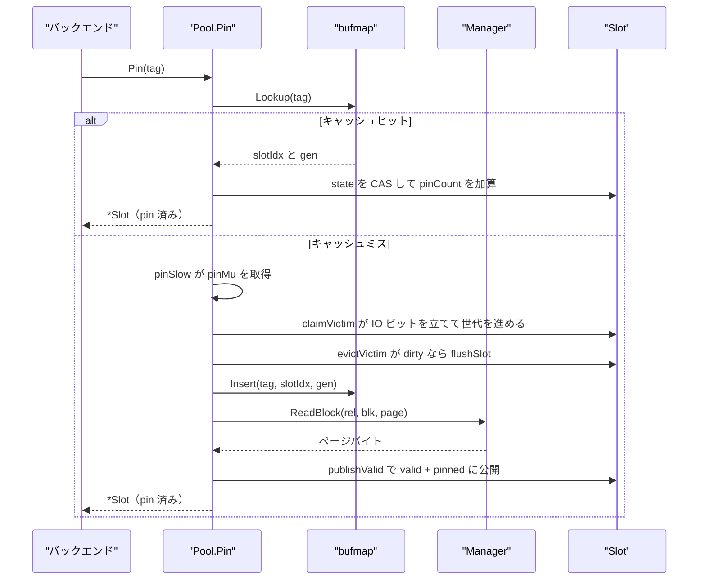
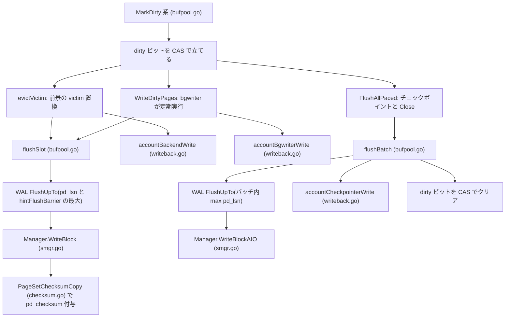
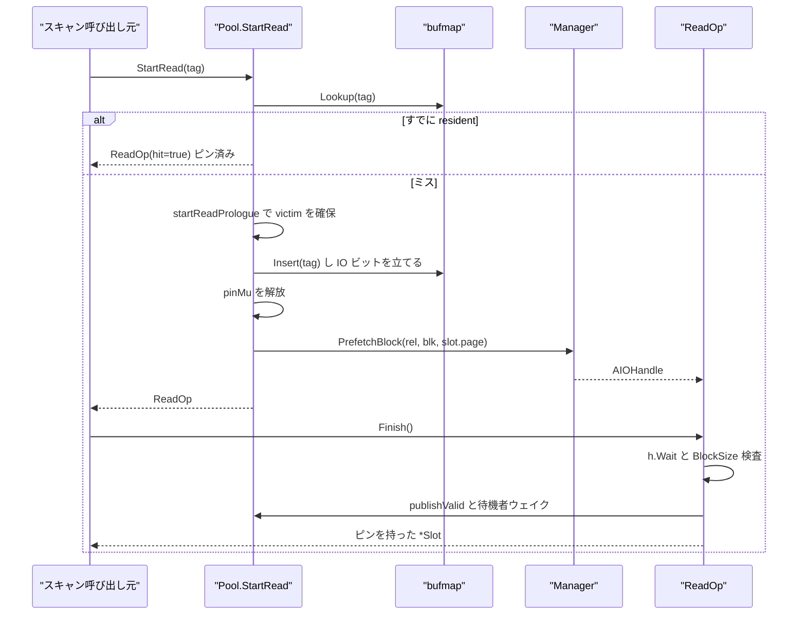
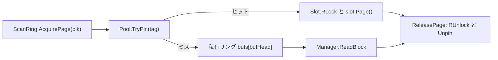

# バッファプール

<details>
<summary>関連ソースファイル</summary>

- [`internal/storage/arena.go`](https://github.com/ryogrid/goopg/blob/19856410e8d497d59787e1ab35a2febb3f5953d6/internal/storage/arena.go)
- [`internal/storage/bgwriter.go`](https://github.com/ryogrid/goopg/blob/19856410e8d497d59787e1ab35a2febb3f5953d6/internal/storage/bgwriter.go)
- [`internal/storage/bufmap.go`](https://github.com/ryogrid/goopg/blob/19856410e8d497d59787e1ab35a2febb3f5953d6/internal/storage/bufmap.go)
- [`internal/storage/bufpool.go`](https://github.com/ryogrid/goopg/blob/19856410e8d497d59787e1ab35a2febb3f5953d6/internal/storage/bufpool.go)
- [`internal/storage/checksum.go`](https://github.com/ryogrid/goopg/blob/19856410e8d497d59787e1ab35a2febb3f5953d6/internal/storage/checksum.go)
- [`internal/storage/io_trace.go`](https://github.com/ryogrid/goopg/blob/19856410e8d497d59787e1ab35a2febb3f5953d6/internal/storage/io_trace.go)
- [`internal/storage/page.go`](https://github.com/ryogrid/goopg/blob/19856410e8d497d59787e1ab35a2febb3f5953d6/internal/storage/page.go)
- [`internal/storage/pdlsn_assert.go`](https://github.com/ryogrid/goopg/blob/19856410e8d497d59787e1ab35a2febb3f5953d6/internal/storage/pdlsn_assert.go)
- [`internal/storage/prefetch.go`](https://github.com/ryogrid/goopg/blob/19856410e8d497d59787e1ab35a2febb3f5953d6/internal/storage/prefetch.go)
- [`internal/storage/scan_ring.go`](https://github.com/ryogrid/goopg/blob/19856410e8d497d59787e1ab35a2febb3f5953d6/internal/storage/scan_ring.go)
- [`internal/storage/smgr.go`](https://github.com/ryogrid/goopg/blob/19856410e8d497d59787e1ab35a2febb3f5953d6/internal/storage/smgr.go)
- [`internal/storage/writeback.go`](https://github.com/ryogrid/goopg/blob/19856410e8d497d59787e1ab35a2febb3f5953d6/internal/storage/writeback.go)
- [`internal/storage/writeback_linux.go`](https://github.com/ryogrid/goopg/blob/19856410e8d497d59787e1ab35a2febb3f5953d6/internal/storage/writeback_linux.go)

</details>

`internal/storage` の `Pool` は、8 KiB のページを固定数のスロットに載せ、`BufferTag`（`RelFileNode` + `BlockNumber`）からスロットを引く共有バッファマネージャである。本ページは [7 ストレージ](../7-Storage.md) のうちバッファ管理を担う部分を扱う。`Pool.Pin` はキャッシュヒットをロックフリーの `bufmap.Lookup` と `Slot.state` の CAS だけで返し、ミス時だけ `pinMu` を取ってクロックスイープで victim を選び、`Manager.ReadBlock` で読み込む。書き込み側は `MarkDirty*` 群が dirty ビットと full-page image (FPI) を管理し、`FlushAllPaced`（チェックポインタ）、`WriteDirtyPages`（バックグラウンドライタ）、`evictVictim`（前景の追い出し）の 3 経路が WAL を先にフラッシュしてから `Manager.WriteBlock` / `WriteBlockAIO` でページを書き戻す。ページ形式そのものは [7.2 ページとヒープタプル](7.2-Page-and-Heap.md)、`Manager` と非同期 I/O は [7.3 ストレージマネージャと非同期 I/O](7.3-Storage-Manager-and-AIO.md) を参照。

## 責務

- 固定長スロット（`Pool.slots []Slot`）と連続アリーナ（`arena`）の寿命管理。`NewPool` が `newArena(cfg.Slots)` で 4 KiB 境界に整列した 1 個のバイト列を確保し、`arena.slot(i)` を各 `Slot.page` に割り当てる (`internal/storage/bufpool.go:NewPool`, `internal/storage/arena.go:newArena`)。
- タグ → スロットの索引。`bufmap` はオープンアドレッシングのハッシュ表で、`Lookup` は無ロック、`Insert`/`Delete` は `mu` の下で行う (`internal/storage/bufmap.go:bufmap`)。
- ピン留めとページ内容ラッチの分離。`Slot.state` の CAS が pin 数・usage・dirty・valid・IO 中・世代を 1 ワードで管理し、`Slot.contentMu`（`sync.RWMutex`）がページバイトを守る (`internal/storage/bufpool.go:Slot`)。
- バッファ置換。`claimVictim` が `clockHand` を進めるクロックスイープ（第 2 チャンス付き）で victim を選び、`evictVictim` が dirty なら WAL を追い越さずに書き戻す (`internal/storage/bufpool.go:claimVictim`, `internal/storage/bufpool.go:evictVictim`)。
- 新規ブロックの割り当て。`PinNew` は `Manager.Extend` で関係を 1 ブロック伸ばし、そのスロットを valid + dirty + pin 1 で公開する (`internal/storage/bufpool.go:pinNewXID`)。
- 書き戻しの 3 コンテキスト分離。チェックポインタは `FlushAllPaced`/`flushBatch`、bgwriter は `WriteDirtyPages`、前景は `evictVictim` で、それぞれ別のカウンタと `sync_file_range(2)` のしきい値を持つ (`internal/storage/writeback.go:accountWrite`)。
- WAL-before-data の強制。`flushSlot` と `flushBatch` は書き込み前に `WALFlusher.FlushUpTo` を呼び、`hintFlushBarrier` も含めた最大 LSN まで待つ (`internal/storage/bufpool.go:flushSlot`)。
- 一貫性診断用のフック。`DebugValidateCleanEvictions`、`DebugTraceSlotEvents`、`GOOPG_IO_TRACE`、`GOOPG_PDLSN_ASSERT` は既定で無効のまま、破損・取り違えを追跡できる (`internal/storage/bufpool.go:Pool`, `internal/storage/io_trace.go:recordIOTrace`, `internal/storage/pdlsn_assert.go:reportUnstampedMarkDirty`)。

## 処理フロー

`Pin` は「速い道」と「遅い道」を 1 つのループで使い分ける。ヒット時は `pinMu` を取らず、ミス時だけ `pinSlow` が `pinMu` を握って victim を確保する。



`claimVictim` は `n * (maxUsageCount + 2)` 回を上限に時計針を進め、`statePin != 0` と `stateIO` のスロットを飛ばす。`usage > 0` なら 1 だけ減らして次へ進む（第 2 チャンス）。`usage == 0` のスロットに `slotIOBit | (newGen << slotGenShift)` を CAS で書き込み、valid/dirty を落とす (`internal/storage/bufpool.go:claimVictim`)。dirty だった victim の書き戻しは `evictVictim` が `pinMu` を一度解放してから `contentMu.Lock` → `flushSlot` の順で行い、完了後に `bufmap` から旧タグを消す。この削除順序は重要で、フラッシュ中に同じタグを `Pin` したゴルーチンは `slotIOBit` を見てセマフォで待ち、書き込みが永続化してから削除済みの `bufmap` を見る (`internal/storage/bufpool.go:evictVictim`)。

書き戻しは 3 つの呼び出し元を持つが、最終的にページを書く関数は `flushSlot` と `flushBatch` の 2 つに集約される。



`flushBatch` はまずバッチ全スロットの `contentMu.RLock` を取り、その時点で `s.tag != tags[i]` または valid/dirty が失われていれば「stale」としてスキップする。バッチ収集から RLock 取得までの間にスロットが別リレーションへ再利用され得るため、この再検査がないと新しい内容を古いタグの位置へ書いてしまう (`internal/storage/bufpool.go:flushBatch`)。stale でないページの `pd_lsn` の最大値と `hintFlushBarrier` の大きい方まで WAL をフラッシュし、`WriteBlockAIO` を全件サブミットしてから `Wait` をまとめて回す。

先読みを伴う読み込みは `StartRead` / `ReadOp.Finish` の 2 段階になる。`pinMu` は victim 確保と `bufmap` 公開までで解放し、`PrefetchBlock` のサブミット中は保持しない（AIO ワーカーが `pinMu` を要求する経路とのデッドロックを避けるため）。



`StartRead` が `stateIO` のスロットを見つけた場合は待たずに `ErrReadInFlight` を返す。待つとウィンドウ全体が他バックエンドの I/O に直列化されるためで、実際に消費者がそのブロックへ到達したときは通常の `Pin` が `slotSema` で待つ (`internal/storage/prefetch.go:startReadPrologue`)。

逐次スキャン用の `ScanRing` は、共有プールを汚さない別経路を取る。



## 主要ファイル

| ファイル | 役割 |
| --- | --- |
| `internal/storage/bufpool.go` | `Pool`・`Slot`・`BufferTag` ベースのピン/置換/書き戻しの中核。`NewPool`, `Pin`, `pinSlow`, `pinLoad`, `claimVictim`, `evictVictim`, `flushSlot`, `flushBatch`, `MarkDirty*`, `PinNew` (`internal/storage/bufpool.go:Pool`) |
| `internal/storage/bufmap.go` | タグ→(slotIdx, gen) のオープンアドレッシング表。`Lookup`, `Insert`, `Delete`, `compact`, `packKey`/`unpackKey` (`internal/storage/bufmap.go:bufmap`) |
| `internal/storage/arena.go` | 4 KiB 整列した連続ページ領域。`newArena`, `arena.slot`, `arena.close` (`internal/storage/arena.go:arena`) |
| `internal/storage/bgwriter.go` | 定期書き戻しゴルーチン。`NewBgwriter`, `Start`, `Stop`, `SetDelay`, `SetMaxPages` (`internal/storage/bgwriter.go:Bgwriter`) |
| `internal/storage/writeback.go` | `sync_file_range` ヒントのしきい値管理。`accountCheckpointerWrite`, `accountBgwriterWrite`, `accountBackendWrite`, `accountWrite` |
| `internal/storage/writeback_linux.go` | Linux の `syncFileRangeHint`（`SyncFileRange` に `SYNC_FILE_RANGE_WRITE` のみ） |
| `internal/storage/checksum.go` | PG 互換ページチェックサム。`pageChecksumBlock`, `PageChecksum`, `PageSetChecksumCopy`, `VerifyPage` |
| `internal/storage/prefetch.go` | 設置型先読み。`StartRead`, `ReadOp`, `Finish`, `Abort`, `publishValid` (`internal/storage/prefetch.go:ReadOp`) |
| `internal/storage/scan_ring.go` | 逐次スキャン用の私的 32 ページリング。`NewScanRing`, `AcquirePage`, `ReleasePage` (`internal/storage/scan_ring.go:ScanRing`) |
| `internal/storage/io_trace.go` | `GOOPG_IO_TRACE=1` 時のページ内容ハッシュ記録。`recordIOTrace`, `HashPage`, `IOTraceEventsForTag` |
| `internal/storage/pdlsn_assert.go` | `GOOPG_PDLSN_ASSERT=1` 時の「WAL 記録済みなのに pd_lsn 未設定の MarkDirty」検出。`reportUnstampedMarkDirty` |
| `internal/storage/page.go` | `BufferTag`, `RelFileNode`, `Page`, `PageHeader` と `LSN`/`Checksum` アクセサ |
| `internal/storage/smgr.go` | `Manager.ReadBlock`, `WriteBlock`, `WriteBlockAIO`, `Extend`, `ExtendBatch`, `SyncFileRangeHint` の実体 |

## 公開 API / エントリポイント

- 構築: `NewPool(mgr *Manager, cfg PoolConfig) (*Pool, error)`。`cfg.Slots <= 0` はエラー、`cfg.Logger == nil` は `slog.Default()` (`internal/storage/bufpool.go:NewPool`)。
- 読み込み: `Pin(tag BufferTag) (*Slot, error)`, `TryPin(tag) (*Slot, bool)`, `StartRead(tag) (*ReadOp, error)`。
- 解放: `Unpin(s *Slot)`。pin 0 の `Unpin` は panic する (`internal/storage/bufpool.go:Unpin`)。
- 新規確保: `PinNew(rel)`, `PinNewWithXID(rel, xid)`, `ExtendRelationBatch(rel, n)`, `ExtendRelationBatchWithXID(rel, n, xid)`。
- 変更通知: `MarkDirty`, `MarkDirtyUnlogged`, `MarkDirtyHint`, `MarkDirtyHintBit`, `MarkDirtyWithLSN`, `MarkDirtyWithLSNLocked`, `MarkDirtyCoveredByRecordLocked`, `MarkDirtyChangeRecord`, `MarkDirtyLogicalChange`, `MarkDirtyForceFPI`。
- 書き戻し: `FlushAll()`, `FlushAllPaced(pacer func(float64) error)`, `FlushRel(rel)`, `WriteDirtyPages(maxPages int) int`。
- 無効化: `InvalidateRel(rel)`, `InvalidateRelForTruncate(rel)`, `InvalidateBlock(tag)`, `TruncateRelationTail(rel, keep)`。
- クリーンアップロック: `IsCleanupOK(s)`, `ConditionalLockForCleanup(s) bool`, `LockForCleanup(s)`。
- チューニング: `SetAsyncFlushBatchSize(n)`, `SetCheckpointFlushAfter(n)`, `SetBgwriterFlushAfter(n)`, `SetBackendFlushAfter(n)`, `SetFullPageWrites(on)`。
- FPI エポック: `PublishRedoRecPtr(redo)`, `PublishRedoBarrier(sample func() uint64) uint64`, `RedoRecPtr()`。
- 計測: `BufferCounters() (hit, read, dirtied, written int64)`, `EvictionCount()`, `ExtendCount()`, `TotalPinCount()`, `DirtyVictimRate()`, `ReadTimeNanos()`, `WriteTimeNanos()`, `CheckpointWritebackCount()` ほか `*WritebackCount` / `*WrittenCount`。
- スキャン: `NewScanRing(pool, rel) *ScanRing`, `AcquirePage(blk)`, `ReleasePage()`, `Close()`。
- バックグラウンドライタ: `NewBgwriter(pool, delay, maxPages)`, `Start()`, `Stop()`, `SetDelay(d)`, `SetMaxPages(n)`。

## 主要データ構造

### Slot — ピン・状態・内容ロックの 1 単位

```go
// Slot is one buffer-pool entry holding one Page. Callers receive
// *Slot from Pin and return it via Unpin. Direct field access is
// permitted under contentMu (held implicitly by the pin guarantee
// for single-writer flows).
type Slot struct {
	page Page // alias into the arena

	// idx is this slot's fixed index into Pool.slots, set once in
	// NewPool. Lets MarkDirty* (which only receive a *Slot) address
	// Pool.slotEvents without pointer arithmetic. See DebugTraceSlotEvents.
	idx int32

	// Tag identifies the (rel, fork, block) the slot currently holds.
	// Written only while ioInflight is set in state; readable once valid.
	tag BufferTag

	// state packs pinCount, usageCount, dirty, valid, ioInflight, gen
	// into a single 64-bit atomic word for lock-free Pin/Unpin.
	state atomic.Uint64

	// nativeImageLSN is the end-LSN of the last NATIVE full-page image
	// (RecordKindPageImage via logFPI, or the multi-page-image records the
	// MarkDirtyWithLSN* callers log) emitted for the page occupying this
	// slot; 0 on load/reuse. The FPI decision keys on THIS token — not on
	// pd_lsn — because pd_lsn is stamped by BOTH record families: a
	// canonical record's stamp would otherwise satisfy the test and
	// suppress the native image the native-family replay depends on (the
	// cross-family poisoning class rejected as F1 in the C1 design review;
	// rediscovered as a live S2 regression by the S3a crash-sim tests).
	// Slot-keyed: eviction/reload re-arms conservatively (extra image).
	nativeImageLSN atomic.Uint64

	// contentMu guards the Page bytes for read/write. The pool does
	// not hold any global lock while this is taken.
	contentMu sync.RWMutex
}
```

`internal/storage/bufpool.go:Slot`（51〜82 行）。

- `page` は `arena` の一部を指すスライスで、`NewPool` の初期化時に固定される。以後 `s.page` のポインタは変わらず、内容だけが差し替わる。
- `idx` は `Pool.slots` 内の固定添字で、`MarkDirty*` のように `*Slot` しか受け取らない関数が `Pool.slotEvents[idx]` を引くために使う。
- `tag` は「そのスロットが今どのブロックを保持しているか」を表す。書き込みは `ioInflight` 中（または `pinMu` 保持中）に限られ、読み取りは valid 公開後に行われる。この順序が「valid なのにタグが別ブロック」という中間状態を防ぐ。
- `state` の 1 ワードは 22 bit の pin 数、8 bit の usage、dirty/valid/ioInflight の 3 ビット、15 bit の世代を持つ。`pinCount` は `Pin`/`Unpin` の CAS だけで増減し、`usage` は 5 で飽和する。世代は victim クレームのたびに +1 され、`bufmap` に記録された世代と一致しないスロットへの `tryPinSlot` を ABA として失敗させる。
- `nativeImageLSN` は「このページに最後にネイティブ FPI を書いた LSN」であり、`pd_lsn` とは別物である。正規レコードも `pd_lsn` を進めるため、`pd_lsn` で FPI を判定すると別系統のレコードが画像を抑止してしまう（cross-family poisoning）。`needsImage` はこの値と公開 redo の比較だけで判断する (`internal/storage/bufpool.go:needsImage`)。
- `contentMu` はページバイトの読み書きラッチで、`Pool` のグローバルロック（`pinMu`）とは独立している。`Pin` の成功が暗黙に「ピン中は他者が置換しない」ことを保証するが、ページ内容を読むには改めて `RLock` が必要である。

状態ワードのレイアウトは次の定数で固定されている。

```go
const (
	slotPinMask    = uint64((1 << 22) - 1) // bits 0..21
	slotUsageShift = 22
	slotUsageMask  = uint64(((1 << 8) - 1) << slotUsageShift)
	slotDirtyBit   = uint64(1 << 30)
	slotValidBit   = uint64(1 << 31)
	slotIOBit      = uint64(1 << 32)
	slotGenShift   = 33
	slotGenMask    = uint64(((1 << 15) - 1) << slotGenShift)
	maxUsageCount  = 5
	maxPinCount    = (1 << 22) - 1
)
```

`internal/storage/bufpool.go:slotPinMask`（26〜37 行）。`maxUsageCount = 5` はクロックスイープの第 2 チャンス回数の上限、`maxPinCount` は 22 bit の表現限界であり、これを超えると `Pin` は `ErrNoBuffer` を返す。

### bufmap — タグからスロットへの無ロック索引

```go
// bufmapBucket is one slot of the open-addressing hash table. Every
// field is mutated only via atomic operations so concurrent lock-free
// Lookups never observe a torn key or val.
//
// Layout encoding for key:
//
//	key0 = uint64(DBOid)<<32 | uint64(RelOid)
//	key1 = uint64(Block)<<32 | uint64(uint8(Fork))
//
// val:
//
//	0  = empty   (sentinel; treat as "not present, terminate probe")
//	1  = tombstone (sentinel; continue probing past)
//	>1 = packVal(slotIdx, gen) = ((slotIdx+1)<<32) | gen
//	    — biased by +1 so the live range never collides with sentinels.
type bufmapBucket struct {
	key0 atomic.Uint64
	key1 atomic.Uint64
	val  atomic.Uint64
}

// bufmapInner is the backing store of a bufmap. Insert/Delete mutate
// individual buckets in place under bufmap.mu; compact() never mutates
// an inner that is concurrently visible to readers — it builds a fresh
// inner and publishes it via bufmap.inner.Store, so each Lookup observes
// a single, self-consistent snapshot.
type bufmapInner struct {
	mask    uint64
	buckets []bufmapBucket // len == mask+1
}

// bufmap is an open-addressing hash table mapping BufferTag to a packed
// (slotIdx<<32 | gen) value.
//
// Lookup is lock-free (atomic loads only). Insert and Delete take mu
// (release-ordered with readers via the atomic store on val).
//
// compact() replaces the entire inner atomically so that no concurrent
// reader observes a partially-rewritten bucket array.
type bufmap struct {
	mu    sync.Mutex
	inner atomic.Pointer[bufmapInner]
}
```

`internal/storage/bufmap.go:bufmapBucket`（14〜56 行）。

- `key0` は `DBOid` と `RelOid`、`key1` は `Block` と `Fork` を詰める。`Fork` を `uint8` 経由で詰めるのは、`ForkNumber` が `int8` であり符号拡張で `Block` 側のビットを汚さないためである (`internal/storage/bufmap.go:packKey`)。
- `val` は 0 が空、1 が墓標、それ以上が `((slotIdx+1)<<32)|gen`。`slotIdx+1` のバイアスにより、生きたエントリは必ず 32 bit 上限を超え、センチネルと衝突しない (`internal/storage/bufmap.go:packVal`)。
- `Lookup` は `val` → `key0`/`key1` → `val` の順で読み、前後の `val` が一致しなければ同じバケットを読み直す。墓標は探索を止めず、真空のバケットだけが終端になる。テーブル全体を舐めても見つからなければ `(-1, 0)` を返す (`internal/storage/bufmap.go:Lookup`)。
- `Insert` は墓標を見つけてもそこで確定せず、真空の終端まで探索して「同じタグが既に存在しない」ことを確認してから、最初に見つけた墓標または空きバケットへ書く。途中の墓標を再利用すると 1 つのタグに 2 つのスロットが「所有者」として登録され、リロードとフラッシュが競合して更新を失う (`internal/storage/bufmap.go:Insert`)。
- `compact` は生存エントリだけを新しい `bufmapInner` に再ハッシュし、`inner.Store` で原子的に差し替える。古い inner は進行中の `Lookup` が参照し終わるまで不変のまま残る (`internal/storage/bufmap.go:compact`)。

### arena — 整列された連続ページ記憶域

```go
// arena is a contiguous, 4 KiB-aligned slab of memory carved into
// BlockSize-sized slots that the buffer pool uses as page storage.
//
// Allocation strategy: a single Go-heap allocation over-reserved by
// one extra page so the start can be trimmed to 4 KiB alignment.
// 4 KiB alignment matches the natural alignment of most Linux
// filesystems and is preferable for efficient page I/O.
type arena struct {
	mem []byte // the carved-up memory; length == nslots * BlockSize
}
```

`internal/storage/arena.go:arena`（5〜14 行）。

`newArena` は `nslots*BlockSize + 4096` バイトを 1 回だけ確保し、先頭アドレスを 4 KiB に切り下げず切り上げて `mem` を `raw[off : off+size]` に再スライスする。`arena.slot(i)` は `mem[i*BlockSize:(i+1)*BlockSize:(i+1)*BlockSize]` を返す 3 インデックススライスで、容量をページ境界に固定して `append` による隣接ページへの溢れを防ぐ (`internal/storage/arena.go:newArena`)。`close` は `mem = nil` にするだけで、`Slot.page` を保持したまま `Close` した場合の挙動は保証されない。

### ScanRing — 共有プールを追い出さない逐次スキャン

```go
type ScanRing struct {
	pool *Pool
	rel  RelFileNode

	// Private ring page buffers for cache misses.  Pre-allocated to
	// avoid repeated heap allocation.  head cycles through 0..ScanRingSize-1.
	bufs    [ScanRingSize][]byte
	bufHead int

	// activeSlot is non-nil when the current page came from the pool
	// (cache hit path).  Its RLock is held until ReleasePage.
	activeSlot *Slot

	// activePage is the current page bytes (from pool or ring buffer).
	activePage Page
}
```

`internal/storage/scan_ring.go:ScanRing`（23〜38 行）。

`ScanRingSize = 32` は PostgreSQL の `NBuffers_QueryRing` に合わせた私的バッファ数である。`AcquirePage` はまず `Pool.TryPin` を試し、ヒットすれば `Slot.RLock` を取って `activeSlot` に保持する。ミスなら `bufs[bufHead]` に `Manager.ReadBlock` で読み、`bufHead` を 1 つ進める。共有プールのスロットは 1 つも消費しないため、大きな逐次スキャンがホットページを全追い出しする問題を避けられる。`ReleasePage` は `activeSlot` があるときだけ `RUnlock` と `Unpin` を行い、`activePage` を nil に戻す (`internal/storage/scan_ring.go:AcquirePage`)。`AcquirePage` の冒頭で必ず `ReleasePage` を呼ぶため、前のページを保持したまま次へ進むと自動的に解放される。

### ReadOp — 設置型先読みのハンドル

```go
type ReadOp struct {
	pool *Pool
	slot *Slot
	tag  BufferTag
	h    AIOHandle
	idx  int32
	gen  uint32

	// hit is set when StartRead found the block already resident and valid.
	// There is no I/O to wait for; Finish is a no-op that returns the slot
	// still pinned. This is the alreadyValid half of §4.1's signature.
	hit bool

	// settled guards against a double Finish/Abort, which would drop a pin
	// that is no longer ours and corrupt another backend's accounting.
	settled bool
}
```

`internal/storage/prefetch.go:ReadOp`（104〜120 行）。

`ReadOp` は「ピン済みだがまだ valid でないスロット」を表す。`hit == true` のときは I/O がなく、`Finish` はそのままピンを返す。`settled` は二重 `Finish`/`Abort` を防ぐ。`Slot()` が返すページの中身は `Finish` が nil を返した後だけ有効である。`StartRead` は `PrefetchBlock` の前に `slotSema` 待機者を数えないが、`Finish` が `pinMu` の下で `slotWaiters` を読んでから IO ビットを落とすため、待機者の取りこぼしは起きない (`internal/storage/prefetch.go:Finish`)。

### Bgwriter — 定期書き戻しゴルーチン

```go
type Bgwriter struct {
	pool     *Pool
	delay    atomic.Int64 // time.Duration
	maxPages atomic.Int64
	// kick wakes the loop after SetDelay so a new delay takes effect
	// at once, as the SIGHUP latch wakes PG's bgwriter from its sleep.
	kick   chan struct{}
	stop   chan struct{}
	done   chan struct{}
	logger *slog.Logger

	// OnLoopStart/OnLoopEnd, when set, bracket the goroutine's entire run
	// (called once each, not per-tick) so a caller can register this
	// goroutine's identity with the activity registry the same way
	// wal.Config's OnLoopStart/OnLoopEnd let initdb.Open track the WAL
	// writer goroutine (walProcNum). Without this the bgwriter's dirty-page
	// flushes (WriteDirtyPages → accountBgwriterWrite) have no registered
	// goroutine to attribute a wait event to (M0122-0003 writeback
	// simplification 3 follow-up).
	OnLoopStart func()
	OnLoopEnd   func()
}
```

`internal/storage/bgwriter.go:Bgwriter`（29〜50 行）。

`delay` と `maxPages` は `atomic` で保持され、`SetDelay` は新しい値を書いたうえで `kick` に非ブロッキング送信して `ticker.Reset` を促す。`delay <= 0` で `Start` しても `run` は即座に `done` を閉じて戻る。ループは `ticker.C` で `WriteDirtyPages(maxPages)` を呼ぶだけで、fsync は一切発行しない。耐久性はチェックポインタの責務である (`internal/storage/bgwriter.go:run`)。

## 内部構造

`Pool` 本体（`internal/storage/bufpool.go:Pool`）は、`mgr *Manager`、`arena *arena`、`slots []Slot`、`wal WALFlusher`、`logFPI` 以下の WAL フック群、`bm *bufmap`、`pinMu sync.Mutex`、`clockHand atomic.Int64`、`slotSema []uint32` と `slotWaiters []atomic.Int32`、`bgwriterHand int`、`tombstones atomic.Int64`、`evictedImageLSN map[BufferTag]uint64`、各種統計カウンタ（`sharedHitCount` / `sharedReadCount` / `sharedDirtiedCount` / `sharedWrittenCount` / `sharedEvictionCount` / `sharedExtendCount` など）、`On*` フックを持つ。`slots` の長さは `NewPool` 以降不変で、`slotSema`・`slotWaiters`・`slotEvents` の長さはすべて `len(slots)` に一致する。`bm` は同時に 1 つのタグにつき 1 つのスロットしか指してはならず、この不変条件が `Insert` の全探索と `compact` の原子差し替えで守られている。

### 2 層のロックと速い道

`Pool` はグローバルな `pinMu` を「遅い道」だけに限定している。ヒット時は `bufmap.Lookup`（無ロック）と `Slot.state` の CAS だけで完結し、`sharedHitCount` を加算して返る。CAS が失敗したら同じタグでループをやり直す (`internal/storage/bufpool.go:Pin`)。`pinSlow` は `pinMu` を取り、`bufmap` を再確認したうえで、`stateIO` なら `slotWaiters[idx]` を増やして `pinMu` を手放し、`runtimeshim.SemaAcquire(&slotSema[idx])` で待つ。起床後は `pinMu` を取り直して先頭から再評価する (`internal/storage/bufpool.go:pinSlow`)。この「待機者数を pinMu 下で数える」規約により、ローダーが IO ビットを落とす直前に到着した待機者を取りこぼさない。

`contentMu` は `Pin` の成功とは独立で、ページバイトを読む呼び出し元が明示的に `RLock`/`Lock` する。`Slot.TryRLock` は非ブロッキングの共有ラッチで、B-tree のページ削除プロトコルが「他の経路が排他ラッチを保持している」ことを検査するために存在する (`internal/storage/bufpool.go:Slot.TryRLock`)。

### クロックスイープと第 2 チャンス

`claimVictim` の時計針は `clockHand.Add(1)-1` をスロット数で割った余りで進む。pin 中・IO 中のスロットは飛ばし、usage が正なら 1 減らして次へ進む。usage が 0 のスロットをクレームするとき、`newSt := slotIOBit | (uint64(newGen) << slotGenShift)` を CAS で書き、valid と dirty を落とす。同時に世代を +1 するので、そのスロットを指していた `bufmap` の古いエントリ（古い世代）を使った `tryPinSlot` は ABA で失敗する。`maxProbes = n * (maxUsageCount + 2)` を超えても見つからなければ `ErrNoBuffer` を返す (`internal/storage/bufpool.go:claimVictim`)。

### 無効化と世代バンプ

`invalidateSlot` は `InvalidateBlock` / `InvalidateRel` / `TruncateRelationTail` から呼ばれ、タグが一致するスロットを捨てる。`stateIO` のときはフラッシュ中の書き込みが切り詰め後の範囲外へ着地しないよう、単にビットを落とすのではなく世代をバンプする。`evictVictim` は書き込み直前に `stateGen` を再検査し、クレーム時の世代と違えば flush を中止して `bufmap` から削除するだけにする（PostgreSQL の `DropRelationBuffers` が dirty ページを書かずに捨てる挙動の写し）。ピン中のスロットは `waitPins == false` ならスキップし、`true` なら最大 `invalidateWaitLimit = 10 * time.Second` まで指数バックオフで待つ (`internal/storage/bufpool.go:invalidateSlot`)。

### bufmap の墓標とコンパクション

`evictVictim` のクリーン経路もダーティ経路も、`bmDelete` のたびに `tombstones` を +1 する。`maybeCompact` は `tombstones*4 >= len(slots)`（25% 超）になったときだけ `compactMu.TryLock` を取り、`bm.compact` で墓標を消してカウンタを 0 に戻す。複数のゴルーチンが同時にコンパクションを始めないよう、`TryLock` 失敗時は何もしない (`internal/storage/bufpool.go:maybeCompact`)。

### FPI エポックと WAL 順序

`PublishRedoRecPtr` はチェックポイント開始時の redo を保存する。`needsImage` は `nativeImageLSN <= redoRecPtr` のときだけ真になる。`MarkDirtyChangeRecord` と `MarkDirtyLogicalChange` は `fpiPublishMu.RLock` を「FPI 判定からレコード追加まで」保持し、`PublishRedoBarrier` は `Lock` を取ってから新しい redo をサンプル・保存する。これにより、古い redo に対して画像不要と判定したレコードの LSN は必ず新しい redo より小さくなり、判定と追記の間にエポックが跨る窓が閉じる (`internal/storage/bufpool.go:PublishRedoBarrier`)。

`PublishRedoBarrier` は同時に `evictedImageLSN` マップを丸ごと捨てる。スロットが追い出されると `nativeImageLSN` はスロットと一緒に失われるため、`stashEvictedImageLSN` / `takeEvictedImageLSN` がタグ単位で水位を引き継ぐ。これがないとホットページが再ロードのたびに 8 KiB の FPI を再放出し、WAL が膨張する。`PinNew` は新しいブロックに `nativeImageLSN = 0` を入れ、`dropEvictedImageLSN` で古いスタッシュを消す（切り詰め後に再延伸したブロックは再び画像が必要なため） (`internal/storage/bufpool.go:stashEvictedImageLSN`)。

### ヒントビットの durability barrier

`MarkDirtyHint` は FPI も `pd_lsn` 更新もせず dirty ビットだけを立てるが、その前に `hintFlushBarrier` を現在の WAL frontier まで CAS で引き上げる。`flushSlot` と `flushBatch` はページの `pd_lsn` とこのバリアの大きい方まで WAL をフラッシュしてから書き込むため、LP_DEAD のようなヒントが「その根拠となったコミットレコード」より先に永続化されることがない。`walFrontier` が nil のハーネスではバリアは動かず、`HasWALFrontier()` が false になる (`internal/storage/bufpool.go:MarkDirtyHint`)。

### writeback ヒントのしきい値

`accountWrite` は `threshold <= 0` なら即 return し、`pendingBlocks.Add(1) < threshold` の間は何もしない。しきい値に達するとカウンタを 0 に戻し、`mgr.SyncFileRangeHint(rel)` を呼ぶ。`ErrWritebackUnsupported` を含むエラー時は「実際には書き戻していない」ため `writebackCount` を加算しない。既定値は `NewPool` が上流に合わせて checkpointer 32、bgwriter 64、backend 0 を設定し、`initdb.Open` が実 GUC で上書きする (`internal/storage/bufpool.go:NewPool`, `internal/storage/writeback.go:accountWrite`)。

### 診断用の seam

- `io_trace.go` は `GOOPG_IO_TRACE=1` のときだけ `recordIOTrace` が動き、`evictVictim` の `preFlush` と `Finish` の `postRead` でページ内容の FNV-64a ハッシュとライン・ポインタ数を記録する。上限は `ioTraceMaxEvents = 4_000_000` 件 (`internal/storage/io_trace.go:ioTraceMaxEvents`)。
- `pdlsn_assert.go` は `GOOPG_PDLSN_ASSERT=1` のとき、`p.logFPI != nil` なプールに対する素の `MarkDirty` 呼び出しを検出し、呼び出し元 PC ごとに 1 回だけ stderr へ出す。report-only で panic しない (`internal/storage/pdlsn_assert.go:reportUnstampedMarkDirty`)。
- `DebugTraceSlotEvents` はスロットごとに 64 件のリングバッファを持ち、`MarkDirty` / claim / evict / publish / release の遷移を記録する。`slotEventRingSize = 64` (`internal/storage/bufpool.go:slotEventRingSize`)。

### チェックサム

`checksum.go` は 8 KiB のページを 32 列 × 64 行（2048 個）のリトルエンディアン 32 bit ワード格子として FNV-1a 変種で畳み込む。`pd_checksum`（オフセット 8 の下位 16 bit）は計算時にマスクされ、最後にブロック番号を XOR して `(checksum % 65535) + 1` に落とすため、戻り値は決して 0 にならない。`VerifyPage` は `IsNew` の全ゼロページを常に有効とし、`PageSetChecksumCopy` は入力を変更せずコピーにだけ checksum を書く。書き込み側は `relFile.checksummedForWrite` が `PageSetChecksumCopy` を呼び、読み込み側は `relFile.verifyOnRead` が `VerifyPage` を呼ぶ (`internal/storage/smgr.go:verifyOnRead`)。

## エッジケースと不変条件

- **全スロットがピン中**: `claimVictim` は `ErrNoBuffer` を返し、`Pin` はそのままエラーを返す。`PinNew` も同じ経路で失敗する。無限に待つことはない。
- **pin 数のアンダーフロー**: `Unpin` は `statePin == 0` を見つけると `panic` する。二重 `Unpin` や、`Abort` 後にスロットを再利用した呼び出しはここで即座に露見する (`internal/storage/bufpool.go:Unpin`)。
- **スロット再利用と ABA**: `bufmap` の値には世代が入り、`tryPinSlot`/`TryPin` は世代不一致を失敗として扱う。クレーム時の世代バンプがこれと対になる。
- **フラッシュ中の無効化**: `evictVictim` は `contentMu.Lock` 取得後と書き込み失敗後の 2 回、世代を再検査する。TRUNCATE/DROP が先に着地していれば書き込みを破棄し、エラーを伝播しない。無効化されていないスロットの flush 失敗は本物の障害として返す (`internal/storage/bufpool.go:evictVictim`)。
- **無効化待ちの上限**: `InvalidateRelForTruncate` はピンが外れるまで待つが、`invalidateWaitLimit = 10 * time.Second` を超えると諦める。PostgreSQL の無限待ちと違い、goopg のピンリークで TRUNCATE が永久にハングしないようにするための相違である (`internal/storage/bufpool.go:invalidateWaitLimit`)。
- **バッチ書き戻しのタグ取り違え**: `flushBatch` は `s.tag != tags[i]` を stale としてスキップする。RLock 取得前のタグは権威ではないため、この再検査を省くとヒープページのバイトが B-tree ファイルへ書かれる種の破損になる (`internal/storage/bufpool.go:flushBatch`)。
- **`PinNew` の公開競合**: `Manager.Extend` 中に別ゴルーチンが同じブロックを `Pin` して `bufmap` へ先に登録した場合、`pinNewXID` は自分のスロットを未公開に戻して `releaseVictimSlot` し、通常の `Pin(tag)` で勝者のスロットを掴み直す。未マップのまま valid + dirty で残すと、後で近空のページが勝者の内容を上書きする (`internal/storage/bufpool.go:pinNewXID`)。
- **先読みの競合**: 同じブロックの読み込みが既に in flight なら `StartRead` は `ErrReadInFlight` を返す。ウィンドウはそのブロックを飛ばし、消費者が到達した時点で通常の `Pin` がセマフォで待つ (`internal/storage/prefetch.go:ErrReadInFlight`)。
- **`Abort` は読み込みを待つ**: スロットのページが AIO ワーカーの書き込み先である間は解放できない。`abortRead` は `op.h.Wait()` してから `bufmap` を削除し、ピンだけを残して IO/valid を落とす。`releaseVictimSlot` を使わないのは、`state.Store(0)` が世代を消して呼び出し元の `*Slot` の所有権を壊すためである (`internal/storage/prefetch.go:abortRead`)。
- **WAL 会計ラグ**: `flushWALWithRetry` は `ErrWALAccountingLag`（`wal.ErrLSNNotWritten` の別名）だけを再試行する。最初の 100 回は `runtime.Gosched()`、以降は 200 マイクロ秒スリープで、他のエラーは即座に返す (`internal/storage/bufpool.go:flushWALWithRetry`)。
- **チェックサム無効ページ**: `VerifyPage` は `IsNew` を常に有効とする。全ゼロの新規ページに checksum を付けないのは PostgreSQL と同じで、`PageChecksum` の戻り値が 0 にならない設計と対になっている (`internal/storage/checksum.go:VerifyPage`)。
- **チューニング上限**: `SetAsyncFlushBatchSize` は 256 (`MaxFlushBatchSize`) でクランプし、負値は 0 にする。`flushBatchSize` は 1 未満を 1 に引き上げるため、未設定でも 1 ページずつ必ず前進する (`internal/storage/bufpool.go:MaxFlushBatchSize`)。
- **クリーンアップロック**: `LockForCleanup` は排他ラッチを取っては「ピンが自分 1 つだけか」を `IsCleanupOK` で確認し、違えばラッチを離して最大 10 ms (`cleanupLockMaxBackoff`) まで指数バックオフで再試行する。自分が同じページに 2 つ目のピンを持っていると永久に返らないため、呼び出し側のピン規律が前提になる (`internal/storage/bufpool.go:LockForCleanup`)。
- **`Close` の順序**: `Close` は先に `FlushAll` で全 dirty ページを書き、その後 `arena.close()` で記憶域を手放す。フラッシュに失敗した場合は flush のエラーを優先して返す (`internal/storage/bufpool.go:Close`)。

Sources:

- `internal/storage/arena.go`
- `internal/storage/bgwriter.go`
- `internal/storage/bufmap.go`
- `internal/storage/bufpool.go`
- `internal/storage/checksum.go`
- `internal/storage/io_trace.go`
- `internal/storage/page.go`
- `internal/storage/pdlsn_assert.go`
- `internal/storage/prefetch.go`
- `internal/storage/scan_ring.go`
- `internal/storage/smgr.go`
- `internal/storage/writeback.go`
- `internal/storage/writeback_linux.go`

<sub>Generated by deepwiki-4myself from `goopg` @ `19856410e`</sub>
