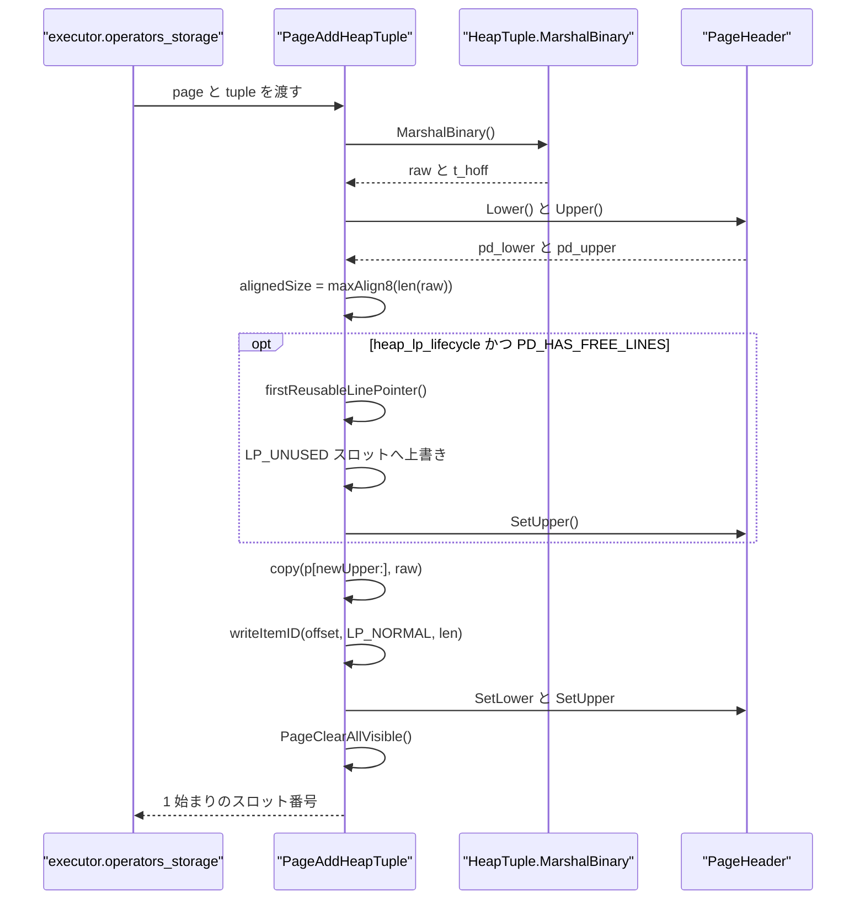
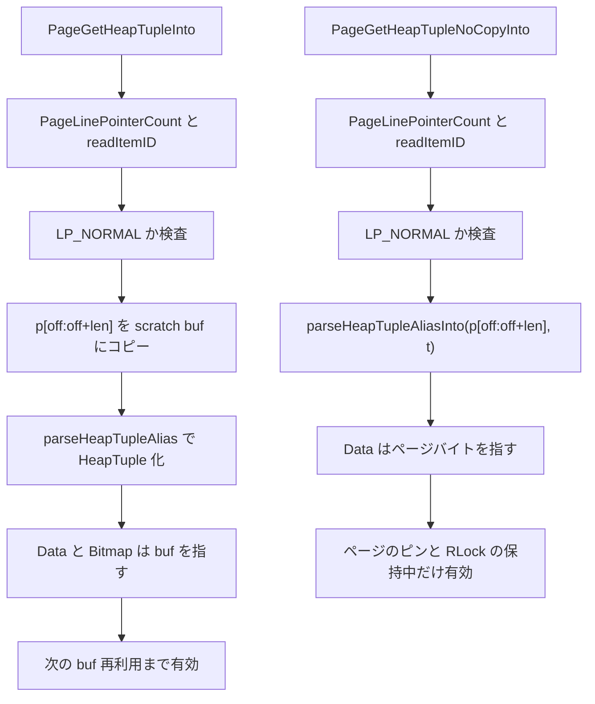
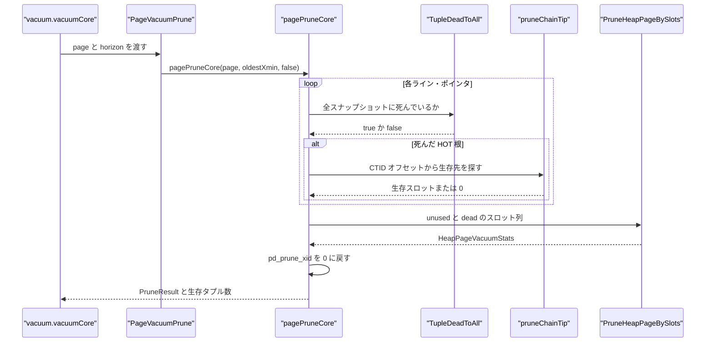
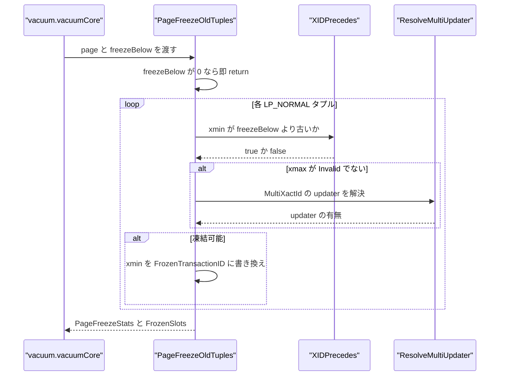
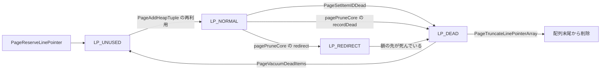

# ページとヒープタプル

<details>
<summary>関連ソースファイル</summary>

- [`internal/storage/checksum.go`](https://github.com/ryogrid/goopg/blob/19856410e8d497d59787e1ab35a2febb3f5953d6/internal/storage/checksum.go)
- [`internal/storage/command_id.go`](https://github.com/ryogrid/goopg/blob/19856410e8d497d59787e1ab35a2febb3f5953d6/internal/storage/command_id.go)
- [`internal/storage/freeze.go`](https://github.com/ryogrid/goopg/blob/19856410e8d497d59787e1ab35a2febb3f5953d6/internal/storage/freeze.go)
- [`internal/storage/heap.go`](https://github.com/ryogrid/goopg/blob/19856410e8d497d59787e1ab35a2febb3f5953d6/internal/storage/heap.go)
- [`internal/storage/linepointer.go`](https://github.com/ryogrid/goopg/blob/19856410e8d497d59787e1ab35a2febb3f5953d6/internal/storage/linepointer.go)
- [`internal/storage/lp_lifecycle.go`](https://github.com/ryogrid/goopg/blob/19856410e8d497d59787e1ab35a2febb3f5953d6/internal/storage/lp_lifecycle.go)
- [`internal/storage/page.go`](https://github.com/ryogrid/goopg/blob/19856410e8d497d59787e1ab35a2febb3f5953d6/internal/storage/page.go)
- [`internal/storage/pdlsn_assert.go`](https://github.com/ryogrid/goopg/blob/19856410e8d497d59787e1ab35a2febb3f5953d6/internal/storage/pdlsn_assert.go)
- [`internal/storage/prune.go`](https://github.com/ryogrid/goopg/blob/19856410e8d497d59787e1ab35a2febb3f5953d6/internal/storage/prune.go)
- [`internal/storage/unsafe.go`](https://github.com/ryogrid/goopg/blob/19856410e8d497d59787e1ab35a2febb3f5953d6/internal/storage/unsafe.go)
- [`internal/commands/vacuum/vacuum.go`](https://github.com/ryogrid/goopg/blob/19856410e8d497d59787e1ab35a2febb3f5953d6/internal/commands/vacuum/vacuum.go)
- [`internal/commands/vacuum/dead_items_pass.go`](https://github.com/ryogrid/goopg/blob/19856410e8d497d59787e1ab35a2febb3f5953d6/internal/commands/vacuum/dead_items_pass.go)
- [`internal/executor/prune_on_access.go`](https://github.com/ryogrid/goopg/blob/19856410e8d497d59787e1ab35a2febb3f5953d6/internal/executor/prune_on_access.go)
- [`internal/executor/operators_storage.go`](https://github.com/ryogrid/goopg/blob/19856410e8d497d59787e1ab35a2febb3f5953d6/internal/executor/operators_storage.go)

</details>

8 KiB のページは 24 バイトの `PageHeaderData`、4 バイト固定のライン・ポインタ配列、後方から前方へ伸びるタプル領域、そして末尾の special 領域で構成される。`internal/storage/page.go` はこのヘッダのバイト配置と `InitPage`/`IsNew` を、`internal/storage/heap.go` は行ポインタ (`ItemID`) とヒープタプルの on-page 形式 (`HeapTupleHeader` + null bitmap + 列データ)、および MVCC 用の xmin/xmax/ctid スタンプを扱う。`internal/storage/prune.go` と `internal/storage/freeze.go` は、そのページから死んだタプルを回収する経路と古い xmin を凍結する経路を提供する。バッファへの読み書きは [7.1 バッファプール](7.1-Buffer-Pool.md)、ページを載せるファイル I/O は [7.3 ストレージマネージャと非同期 I/O](7.3-Storage-Manager-and-AIO.md) を参照。

## 責務

- ページの初期化とヘッダ accessor。`InitPage` が全バイトをゼロにし `pd_lower = 24`、`pd_upper = 8192`、`pd_special = 8192`、`pd_pagesize_version = BlockSize | 4` を書く (`internal/storage/page.go:InitPage`)。
- ライン・ポインタ配列の管理。`PageLinePointerCount` は `(pd_lower - 24) / 4` を検証付きで返し、`PageAddItemRaw` / `PageInsertItemRawAt` / `PageRemoveHeapTuple` が配列とタプル領域の境界を動かす (`internal/storage/heap.go:PageLinePointerCount`)。
- ヒープタプルの on-page エンコードとデコード。`HeapTuple.MarshalBinary` が PG18 互換の 23 バイト固定ヘッダ + bitmap + データを組み立て、`parseHeapTupleAliasInto` がページバイトをゼロコピーで解釈する (`internal/storage/heap.go:MarshalBinary`)。
- 行の MVCC メタデータ更新。`PageSetHeapTupleXmax`、`PageSetHeapTupleCtid`、`PageStampHotOldTuple`、`PageSetHeapTupleLockOnly`、`PageSetHeapTupleXmaxMulti` が xmax・t_ctid・infomask を書き換える (`internal/storage/heap.go:PageSetHeapTupleXmax`)。
- 死んだタプルの回収。`PageVacuumPrune` / `PagePruneOpt` が `TupleDeadToAll` と `pruneChainTip` で死判定し、`PruneHeapPageBySlots` がページを再パックする (`internal/storage/prune.go:pagePruneCore`)。
- タプルの凍結。`PageFreezeOldTuples` が `freezeBelow` より古い xmin を `FrozenTransactionID` に書き換え、WAL 再適用用の `FrozenSlots` を返す (`internal/storage/freeze.go:PageFreezeOldTuples`)。
- ページ内容の完全性。`PageSetChecksumCopy` / `VerifyPage` が PG 互換チェックサムを付与・検証し、`GOOPG_PDLSN_ASSERT` が WAL 記録と `pd_lsn` の不整合を報告する (`internal/storage/checksum.go:PageSetChecksumCopy`, `internal/storage/pdlsn_assert.go:reportUnstampedMarkDirty`)。

## 処理フロー

### タプルの挿入

`PageAddHeapTuple` は呼び出し元がマーシャル済みの `HeapTuple` を受け取り、`pd_upper` から 8 バイト境界に切り上げたサイズだけ下げてタプル本体を置き、その直上にライン・ポインタを 1 本追加する。`PD_HAS_FREE_LINES` が立っていてクラスタが `heap_lp_lifecycle` 能力を持つ場合だけ、既存の空きライン・ポインタを再利用する。



再利用アームでは新しいライン・ポインタを増やさないため、必要量は `alignedSize` だけで判定する。通常アームでは `itemIDSize + alignedSize`（4 + 8 バイト境界に切り上げた本体長）が必要で、足りなければ `ErrNoSpaceInPage` を返す。`PageAddItemRaw` は同じ配置規則をインデックス AM 用の任意バイト列に適用し、`PageInsertItemRawAt` は指定スロット以降のライン・ポインタを 1 つ右へずらす (`internal/storage/heap.go:PageAddItemRaw`, `internal/storage/heap.go:PageInsertItemRawAt`)。

HOT 更新の実行経路では、`PageAddHeapTuple` が `ErrNoSpaceInPage` を返したときだけ、opportunistic prune が有効で updater が cleanup lock を保持している場合に `PagePruneOpt` を試し、回収できた場合に同じページへ再挿入する。この順序は WAL にも現れ、プルーニングの記録が HOT 挿入の記録より先に発行される (`internal/executor/operators_storage.go:4675`)。

### タプルの読み出し

読み出しはコピー版とゼロコピー版で入口が分かれる。どちらもスロット番号を 1 始まりとして扱い、`LP_NORMAL` 以外のライン・ポインタを `ErrUnsupportedItem` で拒否する。



`PageGetHeapTupleInto` は呼び出し元の scratch バッファに本体をコピーし、そのバッファを指す `Data`/`Bitmap` を返す。`PageGetHeapTupleNoCopyInto` はページバイトを直接指すため、呼び出し元はページのピンと内容 RLock をタプル使用中ずっと保持しなければならない。どちらもヘッダは値コピーなので、RLock 解放後も `HeapTuple.Header` だけは安全に読める (`internal/storage/heap.go:PageGetHeapTupleNoCopyInto`)。

### プルーニング

VACUUM は `PageVacuumPrune` を無条件に呼び、HOT 更新やスキャンは `PagePruneOpt` を `pd_prune_xid` のヒント付きで呼ぶ。両者は同じ `pagePruneCore` を通り、死んだ HOT 鎖の根を `LP_REDIRECT` に、索引から参照され得る死んだ項目を `LP_DEAD` に、索引から参照されない死んだ項目を `LP_UNUSED` に振り分ける。



`PagePruneOpt` はまず `pd_prune_xid` が未設定、または `oldestXmin` 以上なら即座に空の結果を返す（`PageVacuumPrune` はこのゲートを持たず `pagePruneCore` へ直行する）。各スロットについて、`ItemIDRedirect` は前回のプルーニングが残した根として扱い、鎖の先が生きていれば redirect を張り直し、鎖全体が死んでいれば `LP_DEAD` にする。`ItemIDNormal` はタプルヘッダをゼロコピーで解釈し、`TupleDeadToAll` が真なら `LP_UNUSED`（HOT-only）または `LP_REDIRECT` / `LP_DEAD`（HOT 根・単独死）に振り分ける。生存タプルが 1 つも回収されなければページは変更しない (`internal/storage/prune.go:pagePruneCore`)。

### フリーズ

`PageFreezeOldTuples` は `xmin` が実在の XID で、`XIDPrecedes(xmin, freezeBelow)` を満たし、かつ行が生きている（`xmax` が無効、lock-only、または updater を持たない MultiXact）タプルだけを凍結する。



凍結後も VACUUM は `PageDeadItems` で `LP_DEAD` を集め、インデックス側の削除に回す。全インデックスの削除が終わると `VacuumDeadItems` がページを再度ピンして `PageVacuumDeadItems` を呼び、`LP_DEAD` を `LP_UNUSED` に変えて `PageTruncateLinePointerArray` で末尾を切り詰める (`internal/commands/vacuum/dead_items_pass.go:VacuumDeadItems`)。

## 主要ファイル

| ファイル | 役割 |
| --- | --- |
| `internal/storage/page.go` | ページサイズ・ヘッダのバイト配置・フラグ・`InitPage`/`IsNew`/`FreeSpace`。`PageHeader` の accessor 群 (`internal/storage/page.go:PageHeader`) |
| `internal/storage/heap.go` | `HeapTupleHeader`・`HeapTuple`・`ItemID` と、挿入・読み出し・xmax/ctid/lock スタンプ・再パック (`internal/storage/heap.go:PageAddHeapTuple`) |
| `internal/storage/linepointer.go` | ペイロードを持たないライン・ポインタの予約・削除・`LP_NORMAL` 化 (`internal/storage/linepointer.go:PageReserveLinePointer`) |
| `internal/storage/lp_lifecycle.go` | `heap_lp_lifecycle` 能力、`LP_DEAD → LP_UNUSED` 変換、配列末尾の切り詰め (`internal/storage/lp_lifecycle.go:PageTruncateLinePointerArray`) |
| `internal/storage/prune.go` | `PruneResult`、`PagePruneOpt` / `PageVacuumPrune`、死判定 `TupleDeadToAll`、HOT 鎖追跡 (`internal/storage/prune.go:pagePruneCore`) |
| `internal/storage/freeze.go` | `PageFreezeStats`、`PageFreezeOldTuples`、WAL 再適用用 `PageFreezeBySlots` |
| `internal/storage/checksum.go` | PG 互換のページチェックサム計算・付与・検証 (`internal/storage/checksum.go:PageChecksum`) |
| `internal/storage/command_id.go` | `CommandId` と `FirstCommandId` / `InvalidCommandId` の定義 |
| `internal/storage/pdlsn_assert.go` | `GOOPG_PDLSN_ASSERT=1` 時の未スタンプ `MarkDirty` 検出 (`internal/storage/pdlsn_assert.go:reportUnstampedMarkDirty`) |
| `internal/storage/unsafe.go` | `arena` の整列計算用 `unsafePointerOf` のみ。他のページ処理は unsafe を使わない |

## 公開 API / エントリポイント

- ページ初期化・ヘッダ: `Header(p) (PageHeader, error)`, `MustHeader(p) PageHeader`, `InitPage(p) error`, `IsNew(p) bool`, `PageHeader.FreeSpace() int`。
- 可視性フラグ: `PageIsAllVisible`, `PageSetAllVisible`, `PageClearAllVisible`。
- タプル構築: `NewHeapTuple(xmin, xmax, data) HeapTuple`, `NewHeapTupleWithNulls(xmin, xmax, bitmap, data) HeapTuple`, `(*HeapTuple).MarshalBinary() ([]byte, error)`, `ParseHeapTuple(raw) (HeapTuple, error)`。
- 挿入・取得・削除: `PageAddHeapTuple(p, t) (uint16, error)`, `PageGetHeapTuple(p, slot)`, `PageGetHeapTupleInto(p, slot, buf)`, `PageGetHeapTupleNoCopy(p, slot)`, `PageGetHeapTupleNoCopyInto(p, slot, t)`, `PageRemoveHeapTuple(p, slot)`。
- 汎用アイテム: `PageAddItemRaw`, `PageInsertItemRawAt`, `PageReplaceItemRaw`, `PageGetItemRaw`, `PageGetItemRawNoCopy`, `PageGetItemRawAllowDead`, `PageGetItemRawAllowDeadNoCopyN`。
- MVCC スタンプ: `PageSetHeapTupleXmax`, `PageSetHeapTupleXmaxCommitted`, `PageSetHeapTupleCmax`, `PageSetHeapTupleCtid`, `PageSetHeapTupleLockOnly`, `PageSetHeapTupleKeysUpdated`, `PageSetHeapTupleLockKeysUpdated`, `PageSetHeapTupleMovedPartition`, `PageSetHeapTupleXmaxMulti`, `PageStampHotOldTuple`, `PageStampHotOldTupleMulti`, `PageStampUpdatedOldTuple`, `SetXminHintBit`。
- WAL 再適用: `PageApplyHeapLockRedo`, `PageApplyHeapLockUpdatedRedo`, `PageApplyHeapDeleteRedo`, `PageApplyHeapUpdateOldRedo`。
- ライン・ポインタ: `PageReserveLinePointer`, `PageDeleteLinePointerAt`, `PageSetLinePointerNormal`, `PageVacuumDeadItems`, `PageTruncateLinePointerArray`, `PageGetItemID`, `PageSetItemIDRedirect`, `PageSetItemIDDead`, `PageItemIsDead`, `PageUsedLinePointerCount`。
- プルーニング: `PagePruneOpt`, `PagePruneXIDSet`, `PagePruneOnAccessWanted`, `PageVacuumPrune`, `PageCountVacuumLive`, `PageDeadItems`, `VacuumHeapPage`, `CollectDeadHeapSlots`, `VacuumHeapPageBySlots`, `PruneHeapPageBySlots`, `TupleDeadToAll`。
- フリーズ: `PageFreezeOldTuples`, `PageFreezeBySlots`。
- チェックサム: `PageChecksum(page, blkno) uint16`, `PageSetChecksumCopy(page, blkno) []byte`, `VerifyPage(page, blkno) bool`。
- 能力フラグ: `SetHeapLinePointerLifecycle(on bool)`, `HeapLinePointerLifecycle() bool`, 定数 `HeapLinePointerLifecycleFeature = "heap_lp_lifecycle"`。

## 主要データ構造

### PageHeader — 24 バイトの固定ヘッダ

```go
// PageHeader is a typed view over the first SizeOfPageHeaderData bytes
// of a Page. All accessors validate the page length so callers can
// receive a Page from anywhere without re-asserting size.
//
// Field offsets and semantics mirror upstream's PageHeaderData; see
// docs/design/0006-storage-format.md for the layout table.
type PageHeader struct {
	Page Page
}
```

`internal/storage/page.go:PageHeader`（95〜103 行）。実体は `Page` へのビューであり、次のバイト配置を accessor が読み書きする。

| オフセット | 長さ | フィールド | accessor |
| --- | --- | --- | --- |
| 0 | 4 | `pd_lsn` 高位 32 bit | `LSN` / `SetLSN` |
| 4 | 4 | `pd_lsn` 低位 32 bit | 同上 |
| 8 | 2 | `pd_checksum` | `Checksum` / `SetChecksum` |
| 10 | 2 | `pd_flags` | `Flags` / `SetFlags` |
| 12 | 2 | `pd_lower` | `Lower` / `SetLower` |
| 14 | 2 | `pd_upper` | `Upper` / `SetUpper` |
| 16 | 2 | `pd_special` | `Special` / `SetSpecial` |
| 18 | 2 | `pd_pagesize_version` | `PagesizeVersion` / `SetPagesizeVersion` |
| 20 | 4 | `pd_prune_xid` | `PruneXID` / `SetPruneXID` |

`pd_lsn` は PG18 の `PageXLogRecPtr`（高位が先）で、単純な little-endian の 64 bit 値ではない。`SetLSN` が上位 32 bit をオフセット 0、下位を 4 に書くのに対し、`LSN()` はその逆順で組み立てる (`internal/storage/page.go:SetLSN`)。不変条件は `SizeOfPageHeaderData <= pd_lower <= pd_upper <= pd_special <= BlockSize` で、`pd_lower` は常に `24 + 4n` の形を取る。`InitPage` はこのうち下限・上限・special を初期化し、`FreeSpace()` は `pd_upper - pd_lower` を返す（逆転していれば 0）。

```go
const (
	PDHasFreeLines PageFlag = 0x0001
	PDPageFull     PageFlag = 0x0002
	PDAllVisible   PageFlag = 0x0004
)
```

`internal/storage/page.go:PDHasFreeLines`（32〜36 行）。`PDHasFreeLines` は「未使用ライン・ポインタが配列内に残っている」ヒント、`PDPageFull` は on-access prune の判定材料、`PDAllVisible` は全タプルが全スナップショットに可視であることを示す。挿入・削除・更新は `PDAllVisible` を落とし、行ロックのスタンプだけは維持する。

### ItemID — 4 バイトのライン・ポインタ

```go
// ItemIDFlags mirrors PostgreSQL ItemId state bits.
type ItemIDFlags uint8

const (
	ItemIDUnused   ItemIDFlags = 0
	ItemIDNormal   ItemIDFlags = 1
	ItemIDRedirect ItemIDFlags = 2
	ItemIDDead     ItemIDFlags = 3
)

// ItemID is one 4-byte line pointer.
type ItemID struct {
	Offset uint16
	Flags  ItemIDFlags
	Length uint16
}
```

`internal/storage/heap.go:ItemIDFlags`（559〜574 行）。

`ItemID.pack` は `Offset` を 15 bit、`Flags` を 2 bit、`Length` を 15 bit に詰める。したがってページ内の任意アイテムは 32767 バイトまで、ライン・ポインタ本数は `pd_lower` の 16 bit 範囲に収まる範囲でしか表現できない。`Offset` の意味はフラグで変わる。

- `ItemIDNormal`: `Offset` はページ先頭からのタプル本体のバイト位置、`Length` は本体長。
- `ItemIDRedirect`: `Offset` は 1 始まりの転送先スロット番号、`Length` は 0。索引が指す古い根を残したまま、生きた鎖の先へ解釈を委ねる。
- `ItemIDDead`: 索引がまだ参照している死んだ項目。`PageSetItemIDDead` は `Offset`/`Length` を保存するため、パージまで二分探索の順序キーとして読める。
- `ItemIDUnused`: ペイロードなし。`Length == 0` であり、`PageAddHeapTuple` の再利用アームはこの条件だけを再利用候補にする。

### HeapTupleHeader と HeapTuple — 行の本体

```go
// HeapTupleHeader is the fixed tuple header subset used in milestone 5.
// It carries xmin/xmax visibility metadata and ctid linkage.
type HeapTupleHeader struct {
	Xmin      TransactionID
	Xmax      TransactionID
	Xvac      TransactionID
	CTID      ItemPointer
	Infomask  uint16
	Infomask2 uint16
	Hoff      uint8
}

// HeapTuple is one on-page tuple body.
//
// Bitmap is the PG null bitmap (bit=1 means NOT NULL, matching PG's
// heap_fill_tuple), nil when the tuple has no nulls. Data is the column
// data area only — the bitmap is stored separately so MarshalBinary can
// place it at the canonical PG location (right after the fixed header,
// before the t_hoff-aligned data region).
type HeapTuple struct {
	Header HeapTupleHeader
	Bitmap []byte
	Data   []byte
}
```

`internal/storage/heap.go:HeapTupleHeader`（370〜393 行）。`ItemPointer` は `{Block BlockNumber; Offset uint16}` で、`CTID` が同じページ内の successor を指す場合は `Offset` だけが意味を持つ。

- `Xmin`/`Xmax` は挿入・削除・更新のトランザクション ID。`Xvac` は PG の `t_cid`/`t_xvac` ユニオンに相当し、`HEAP_COMBOCID` が立っていれば combo CID、いなければ cmin/cmax の生値である。`SetCmin`/`SetCmax` はこのビットを同時に更新する (`internal/storage/heap.go:SetCmax`)。
- `Infomask2` の下位 11 bit が属性数 (`HeapNattsMask = 0x07FF`)、`0x4000` が `HEAP_HOT_UPDATED`、`0x8000` が `HEAP_ONLY_TUPLE`。HOT ビットを `Infomask` 側に置くと PG が `HEAP_MOVED_*` と誤解するため、`IsHotUpdated`/`IsHeapOnly` は必ず `Infomask2` を読む (`internal/storage/heap.go:IsHotUpdated`)。
- `Infomask` は xmin/xmax のヒント（committed/invalid）、`HEAP_XMAX_IS_MULTI`、lock-only とロック強度、`HEAP_HASNULL`/`HEAP_HASVARWIDTH`/`HEAP_HASEXTERNAL`、`HEAP_COMBOCID` を持つ。`HeapXmaxBits` は xmax を差し替える前に落とすべきビットの集合である。
- `Hoff` は列データの開始オフセット。固定ヘッダ 23 バイト以上、null bitmap を収めた長さ以上でなければならず、`MarshalBinary` は `23 <= hoff <= 255` を検査する (`internal/storage/heap.go:MarshalBinary`)。`Bitmap` は `23..23+len(Bitmap)` に置かれ、`Data` は `hoff` から始まる。

`Bitmap` のビットは 1 が NOT NULL（PG の `heap_fill_tuple` と同じ）で、タプルに NULL がなければ nil になる。`NewHeapTupleWithNulls` は `HEAP_HASNULL` を立て、`t_hoff = maxAlign8(23 + len(bitmap))` を計算する (`internal/storage/heap.go:NewHeapTupleWithNulls`)。

### PruneResult — プルーニングが行った操作

```go
// PruneResult carries the actions taken by PagePruneOpt so the caller can
// emit a WAL record with sufficient information for crash-safe replay.
type PruneResult struct {
	// Redirects is a list of (oldSlot, newSlot) pairs: line pointers that
	// were converted from ItemIDNormal to ItemIDRedirect. The index still
	// points to oldSlot; the redirect leads to the live chain tip newSlot.
	Redirects [][2]uint16
	// Unused is the list of 1-based slot numbers marked ItemIDUnused: dead
	// HEAP_ONLY tuples, which no index entry points at. Under
	// markUnusedNow (VACUUM of a relation with no indexes) the Dead items
	// below land here instead.
	Unused []uint16
	// Dead is the list of 1-based slot numbers marked ItemIDDead with no
	// storage: dead non-HOT tuples and dead chain roots with no live tip.
	// Index entries still point at them, so they stay LP_DEAD until VACUUM
	// has removed those entries (heap_prune_record_dead, pruneheap.c;
	// M0145-0008v).
	Dead []uint16
}
```

`internal/storage/prune.go:PruneResult`（3〜21 行）。`Reclaimed()` は 3 つのリスト長の和を返す (`internal/storage/prune.go:Reclaimed`)。

- `Redirects` の各要素は `[oldSlot, newSlot]`。`oldSlot` は索引が指す根、`newSlot` は同じページ上の生きた鎖の先である。両者が同じ、または先が 0 の場合は redirect を作らず `Dead` に入る。
- `Unused` は索引から参照されないスロットだけを含む。`markUnusedNow == true`（索引のないリレーションの VACUUM）では `Dead` に置くはずの項目もここへ移る。
- `Dead` は索引がまだ参照しているため、`LP_DEAD` のまま残す。VACUUM がインデックス側の項目を消した後、`PageVacuumDeadItems` が `LP_UNUSED` に変える。3 つのリストは同一スロットに重複して現れない。

### PageFreezeStats — 凍結結果

```go
// PageFreezeStats summarises one tuple-freeze pass over a heap page.
type PageFreezeStats struct {
	Frozen         int           // number of xmin values rewritten
	MinUnfrozenXID TransactionID // lowest xmin NOT frozen (0 = all frozen / none present)
	// FrozenSlots is the 1-based slot list of LP_NORMAL line pointers
	// whose tuple xmin was rewritten to FrozenTransactionID. Captured
	// for the M0080-0001 `RecordKindHeapFreeze` WAL record so replay
	// can reapply the same transformation deterministically. Always
	// in ascending order. (M0080-0001.)
	FrozenSlots []uint16
}
```

`internal/storage/freeze.go:PageFreezeStats`（5〜15 行）。`FrozenSlots` はスロット走査順のまま昇順で、WAL の `RecordKindHeapFreeze` にそのまま載る。`MinUnfrozenXID` は「古いが凍結条件を満たさなかった xmin」の最小値で、`relfrozenxid` の前進に使われる。削除済み（lock-only でない xmax を持つ）タプルはこの最小値の計算にも入らず読み飛ばされる。

### HeapPageVacuumStats — 再パック結果

```go
// HeapPageVacuumStats reports the outcome of a single-page vacuum.
type HeapPageVacuumStats struct {
	Dead int // line pointers transitioned LP_NORMAL -> LP_UNUSED
	Live int // tuples that survived this pass
}
```

`internal/storage/heap.go:HeapPageVacuumStats`（1160〜1164 行）。`Dead` は `LP_UNUSED` に落とした本数、`Live` は再パック後も `LP_NORMAL` として残った本数で、`PageVacuumPrune` の第 2 戻り値として VACUUM の `reltuples` に流れる。

## 内部構造

### ページの空き領域計算

`PageAddHeapTuple` は `maxAlign8(len(raw))` を `pd_upper` から引き、末尾に 0〜7 バイトのパディングを残す。`pd_upper` を 8 バイト境界に保つのは、PG18 の `heap_deform_tuple` がアラインメント依存の Datum をページ上で直接読むためである。ライン・ポインタの `Length` はパディングを含まない実長を記録するので、`ParseHeapTuple` は余分なゼロを読まない (`internal/storage/heap.go:PageAddHeapTuple`)。

`PageGetHeapFreeSpace` は `FreeSpace() - 4` を基本とし、ライン・ポインタ本数が `MaxHeapTuplesPerPage = 291` に達したら、`heap_lp_lifecycle` 能力と `PD_HAS_FREE_LINES` がそろっている場合だけ再利用可能な空きポインタを探して同じ値を返す。それ以外は 0 を返す (`internal/storage/heap.go:PageGetHeapFreeSpace`)。`MaxHeapTuplesPerPage` は `(8192 - 24) / (24 + 4) = 291`、`MaxHeapTupleSize` は `8192 - 24 - 8 = 8160` である。

### fillfactor と無限拡張の防止

`HeapInsertTargetFreeSpace` はタプル長に `BlockSize * (100 - fillfactor) / 100` を加えた値を「既存ページに要求する空き」とする。`fillfactor <= 0` は既定の 100 とみなす。この値が `nearlyEmptyFreeSpace = 8016` を超える場合は、タプル長が 8016 以下なら 8016、超えるならタプル長そのものにクランプする。クランプがないと `fillfactor=10` の表に 4 KiB タプルを入れるとき約 11 KiB の空きを要求し、新しいページを延伸しても永遠に条件を満たせなくなる (`internal/storage/heap.go:HeapInsertTargetFreeSpace`)。

### ライン・ポインタの状態遷移



`PageReserveLinePointer` はペイロードなしで `LP_UNUSED` を 1 本追加する。`PageDeleteLinePointerAt` は指定スロットを消して右側を 1 つ左へ詰め、`pd_lower` を `24 + (count-1)*4` に戻す。削除したスロットのタプル本体は回収されず、死んだ空間として次の再パックまで残る (`internal/storage/linepointer.go:PageDeleteLinePointerAt`)。

`PageVacuumDeadItems` はまず全スロットが「ストレージを持たない `LP_DEAD`」であることを検証してから一括で `LP_UNUSED` にし、`PageTruncateLinePointerArray` を呼ぶ。途中で不正なスロットが見つかればページを一切変更せずにエラーを返す（部分適用しない） (`internal/storage/lp_lifecycle.go:PageVacuumDeadItems`)。

### 死判定の 3 条件

`TupleDeadToAll` は次をすべて満たすときだけ真を返す。

1. `Xmax != InvalidTransactionID`。
2. `HEAP_XMAX_LOCK_ONLY` が立っていない（行ロックではなく本物の削除・更新）。
3. 実効 xmax が `oldestXmin` より前（`XIDPrecedes` のモジュロ比較）。MultiXact の場合は `ResolveMultiUpdater` で updater を取り出し、updater が存在しない・解決できない場合は偽。
4. `XidCommitted != nil && XidCommitted(effXmax)`。フックが nil のときは「死んでいない」側に倒す。

4 番目は、アボートした削除者の xmax スタンプが物理的に残っていても行は生きているため、それを回収すると生データを破壊するからである。フック未設定のテスト・ブートストラップでは何も回収しない (`internal/storage/prune.go:TupleDeadToAll`)。

### HOT 鎖の追跡

`pruneChainTip` は `CTID.Offset` をたどり、`LP_NORMAL` でないスロット、範囲外、パース不能、`HEAP_HOT_UPDATED` でないタプル、自己参照で停止する。歩数上限は `MaxHeapTuplesPerPage` で、これは 1 ページ上の相異なるスロット数を超えて鎖を歩いた時点で循環と断定できるためである（以前の固定 64 歩では 65 版目以降の行が索引から到達不能になった）。`HEAP_HOT_UPDATED` でないタプルの `CTID` は別ブロックを指し得るので、そこで止めないと無関係な行へ redirect を張ってしまう (`internal/storage/prune.go:pruneChainTip`)。

### 削除・更新スタンプと可視性フラグ

`PageSetHeapTupleXmax` は xmax を書くだけでなく、`HEAP_XMAX_LOCK_ONLY`・ロック強度・`HEAP_XMAX_INVALID`・`HEAP_XMAX_IS_MULTI` を落とす。これを残すと `mvcc.TupleVisible` が「まだロックされているだけ」と誤認して削除後も行を見せ続ける。あわせて `pageSetPrunablePG(p, xmax)` を呼び、`PD_ALL_VISIBLE` を落とす (`internal/storage/heap.go:PageSetHeapTupleXmax`)。

`pageSetPrunablePG` は `pd_prune_xid` を「より古い xid」方向にだけ更新する。新しい xid で上書きすると、そのページは `oldestXmin` を永久に追い越せず、on-access prune も HOT 経路の `PagePruneOpt` も走らなくなる (`internal/storage/heap.go:pageSetPrunablePG`)。

### ゼロコピー API の契約

`PageGetHeapTupleNoCopyInto` の `Data`/`Bitmap` はページバイトを指す。呼び出し元はページのピンと内容 RLock を保持している間だけ使い、`Unpin` をまたいで保持してはならない。逆に `PageGetHeapTupleInto` の戻り値は呼び出し元の scratch バッファを指すため、次の再利用までしか有効でない。どちらもヘッダは値でコピーされるので、スキャンが RLock を離れた後に参照してよいのは `HeapTuple.Header` だけである（利用例は `internal/executor/operators_storage.go:2095`）。

### チェックサムと pd_lsn の扱い

`PageChecksum` はページを 32 列の 32 bit ワード格子として FNV-1a 変種で畳み、`pd_checksum` をゼロ扱いし、最後にブロック番号を XOR して `(checksum % 65535) + 1` に落とす。したがって戻り値は 0 にならない。`VerifyPage` は `IsNew`（`pd_upper == 0` の全ゼロページ）を常に有効とし、書き込み側の `PageSetChecksumCopy` は元のページを変更せずコピーにだけ checksum を書く (`internal/storage/checksum.go:PageChecksum`)。

ページ関数自身は `pd_lsn` を更新しない。`PageSetHeapTupleXmax` などのスタンプは `pd_lsn` を触らず、WAL 記録と `pd_lsn` の対応はバッファプールの `MarkDirty*` が付ける。`GOOPG_PDLSN_ASSERT=1` のとき `reportUnstampedMarkDirty` が「WAL フックが配線されたプールで素の `MarkDirty` が呼ばれた」地点を呼び出し元 PC ごとに 1 回だけ stderr へ出す (`internal/storage/pdlsn_assert.go:reportUnstampedMarkDirty`)。

### CommandId と XID の順序

`CommandId` は `uint32` で、トランザクション開始時が `FirstCommandId = 0`、コマンドカウンタを使わない呼び出し元（VACUUM など）が `InvalidCommandId = ^CommandId(0)` を使う。無効値は実在のどのコマンド ID よりも大きいので、`cmin >= curcid` の自己可視性判定が誤って行を隠さない (`internal/storage/command_id.go:InvalidCommandId`)。XID の比較は `XIDPrecedes` の符号付き 32 bit 差で行い、ラップアラウンド後も「円環上の前後」を正しく判定する (`internal/storage/heap.go:XIDPrecedes`)。

### LP_UNUSED 再利用の能力ゲート

`heapLinePointerLifecycle` はクラスタファイル `global/pg_goopg_features` の `heap_lp_lifecycle` 能力で有効になる。この能力がないクラスタでは、過去のプルーニングが索引エントリを残したまま `LP_UNUSED` にした項目があり得るため、`LP_UNUSED` を再利用すると索引が別の行を指してしまう。したがって `PageAddHeapTuple` の再利用アームと `PageGetHeapFreeSpace` の空き判定は、能力が有効なときだけ `PD_HAS_FREE_LINES` を信用する (`internal/storage/lp_lifecycle.go:heapLinePointerLifecycle`)。

## エッジケースと不変条件

- **スロット 0 は常に不正**: 1 始まりの API はすべて `slot == 0` を `ErrInvalidSlot` で拒否する。`PageGetItemID`、`PageSetHeapTupleXmax`、`PageVacuumDeadItems` などが同じ規約に従う。
- **LP_NORMAL 以外の読み出し**: `PageGetHeapTuple*` は `ErrUnsupportedItem` を返す。`PageGetItemRawAllowDead` だけが `LP_DEAD` も読める（索引の二分探索が死んだキーを必要とするため）。
- **範囲外のオフセット**: `ItemID.pack` は `Offset`/`Length` が `0x7FFF` を超えるとエラー、`Flags > 0x3` もエラーにする。`PageAddHeapTuple` と `PageAddItemRaw` は 32768 バイト以上のアイテムを拒否する (`internal/storage/heap.go:pack`)。
- **壊れたヘッダ**: `PageLinePointerCount` は `pd_lower < 24` や `(pd_lower-24) % 4 != 0` をエラーにする。`parseHeapTupleAliasInto` は `t_hoff < 23`、`t_hoff > len(raw)`、bitmap が `t_hoff` を越える場合を `ErrCorruptTuple` にする (`internal/storage/heap.go:parseHeapTupleAliasInto`)。
- **空ページの扱い**: `IsNew` は `pd_upper == 0` で判定する。`FreeSpace` は `upper < lower` のとき 0 を返し、負の空きを報告しない。
- **291 本の上限**: `MaxHeapTuplesPerPage = 291` を超えるライン・ポインタは作れない。`PageAddHeapTuple` は上限到達時に `PD_HAS_FREE_LINES` と能力がそろわなければ `ErrNoSpaceInPage` を返す。HOT 鎖の歩数も同じ 291 で打ち切る。
- **fillfactor のクランプ**: `nearlyEmptyFreeSpace = 8016` を超える要求は 8016 に丸める。これがないと低 fillfactor の表が永久に拡張を続ける。
- **プルーニングの原子性**: `PruneHeapPageBySlots` は `unusedSlots` と `lpDead` の全要素を先に範囲検査し、1 つでも不正ならページを変更せずエラーを返す。`PageVacuumDeadItems` も同様に全スロットを検証してから書き換える。
- **redirect / LP_DEAD の意味**: `LP_REDIRECT` の `Offset` はバイト位置ではなく 1 始まりのスロット番号である。`LP_DEAD` はストレージを持たない場合と持つ場合があり、`PageVacuumDeadItems` は `Length == 0` の `LP_DEAD` だけを受け付ける。
- **回収の保守性**: `XidCommitted` が nil のとき、また MultiXact が未解決・updater なしのときは「死んでいない」と判定する。未解決の MultiXact を通常の XID として比較すると、生きたロック行を回収してしまう。
- **HOT 鎖の終端**: `pruneChainTip` は `HEAP_HOT_UPDATED` でないタプルの `CTID` を追わない（別ブロックの無関係な行に redirect するのを防ぐ）。自己参照と 291 歩超も 0 を返す。
- **削除スタンプのビット消去**: `PageSetHeapTupleXmax` は lock-only ビットと `HEAP_XMAX_INVALID` を必ず落とす。これを怠ると EPQ の `isConcurrentlyUpdated` が競合を検出せず、同時更新を取りこぼす。
- **`pd_prune_xid` は単調減少**: `pageSetPrunablePG` は既存値より古い xid のときだけ更新する。新しい値で上書きするとプルーニングのきっかけが永久に失われる。
- **凍結の粒度**: `freezeBelow == 0` は何もしない。凍結対象は `xmin` が実在し（`InvalidTransactionID` でも `FrozenTransactionID` でもない）、`XIDPrecedes(xmin, freezeBelow)` を満たし、行が生きているものだけ。`PageFreezeBySlots` は再適用時に `LP_NORMAL` でないスロットや壊れた項目を読み飛ばすため、WAL 記録後に VACUUM されたスロットでも失敗しない (`internal/storage/freeze.go:PageFreezeBySlots`)。
- **`PageRemoveHeapTuple` の完全巻き戻し**: 削除対象が配列末尾で、その本体が `pd_upper` の位置にあるときだけ `pd_upper` も戻す。それ以外は本体バイトをゴミとして残し、次の再パックに任せる (`internal/storage/heap.go:PageRemoveHeapTuple`)。
- **`PD_ALL_VISIBLE` の維持条件**: 挿入・削除・更新は `PageClearAllVisible` を呼ぶ。行ロックの `PageSetHeapTupleLockOnly` は呼ばない。`PageClearAllVisible` は「元が立っていたか」を返すので、呼び出し元は VM 側の更新要否を判断できる (`internal/storage/page.go:PageClearAllVisible`)。
- **チェックサムの 0 禁止**: `PageChecksum` は `(checksum % 65535) + 1` で必ず 1〜65535 を返す。0 は「チェックサムなし」の予約値であり、`IsNew` の全ゼロページは検証をスキップする (`internal/storage/checksum.go:PageChecksum`)。
- **未設定の horizon は no-op**: `PagePruneOpt` と `PageVacuumPrune` は `oldestXmin == InvalidTransactionID` のときページを変更せず空の結果を返す。horizon を計算できない呼び出し元が誤って全タプルを死と判定しないためのガードである (`internal/storage/prune.go:PageVacuumPrune`)。
- **二段目パスの能力ゲート**: `VacuumDeadItems` は `HeapLinePointerLifecycle()` が偽のクラスタでは 0 を返して何もしない。古いクラスタの `LP_UNUSED` は索引が参照している可能性があり、切り詰めるとそのスロットを新しい行に再利用してしまうためである (`internal/commands/vacuum/dead_items_pass.go:VacuumDeadItems`)。
- **ページ関数は `pd_lsn` を書かない**: `PageSetHeapTupleXmax` などのスタンプは xmax/ctid/infomask だけを更新する。WAL 記録と `pd_lsn` の対応はバッファプールの `MarkDirty*` が担うため、ページ関数を直接呼ぶ WAL 再適用側は自分で `pd_lsn` を設定する (`internal/storage/heap.go:PageApplyHeapLockRedo`)。

Sources:

- `internal/storage/checksum.go`
- `internal/storage/command_id.go`
- `internal/storage/freeze.go`
- `internal/storage/heap.go`
- `internal/storage/linepointer.go`
- `internal/storage/lp_lifecycle.go`
- `internal/storage/page.go`
- `internal/storage/pdlsn_assert.go`
- `internal/storage/prune.go`
- `internal/storage/unsafe.go`
- `internal/commands/vacuum/vacuum.go`
- `internal/commands/vacuum/dead_items_pass.go`
- `internal/executor/prune_on_access.go`
- `internal/executor/operators_storage.go`

<sub>Generated by deepwiki-4myself from `goopg` @ `19856410e`</sub>
