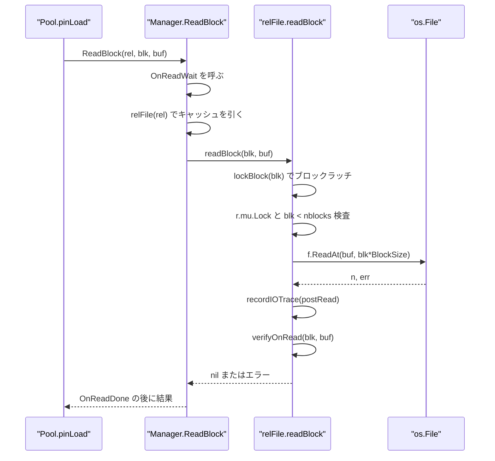
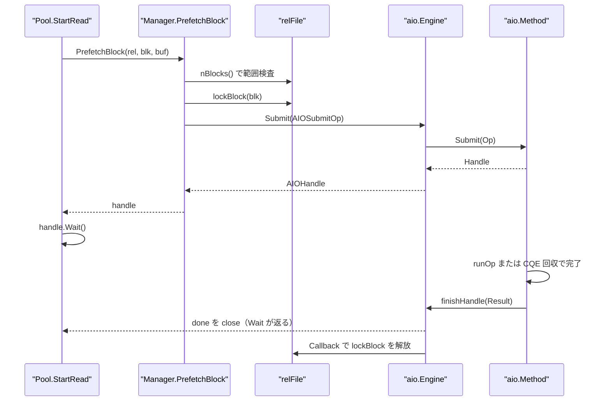
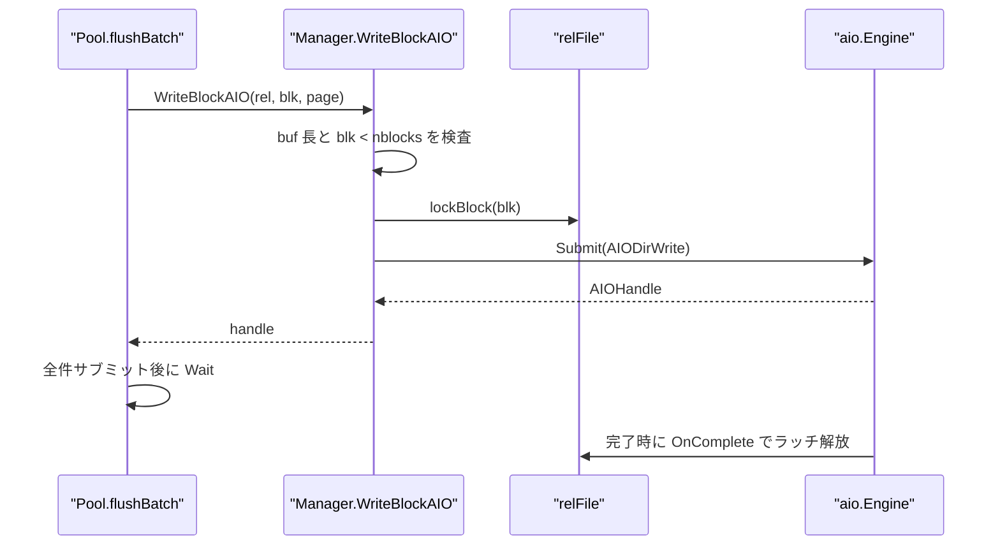
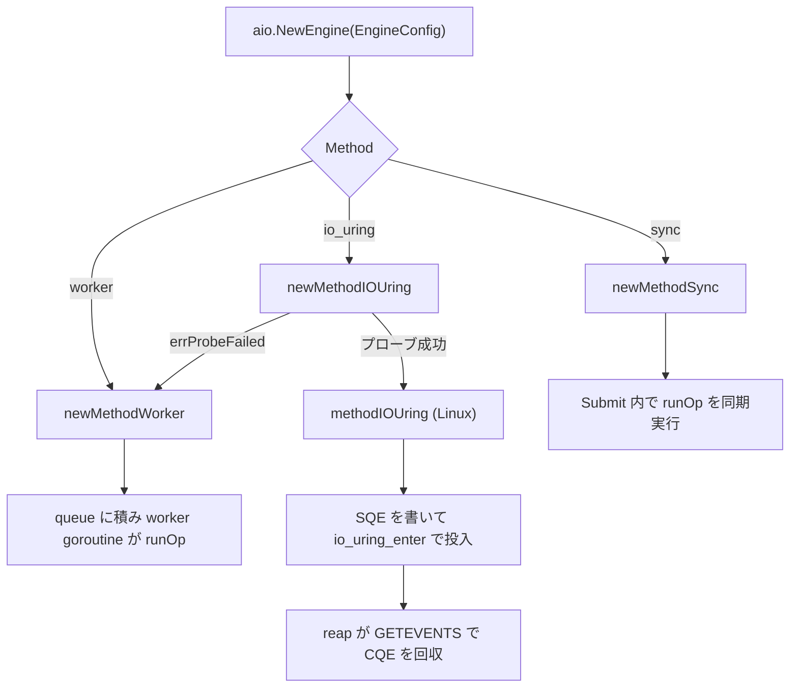
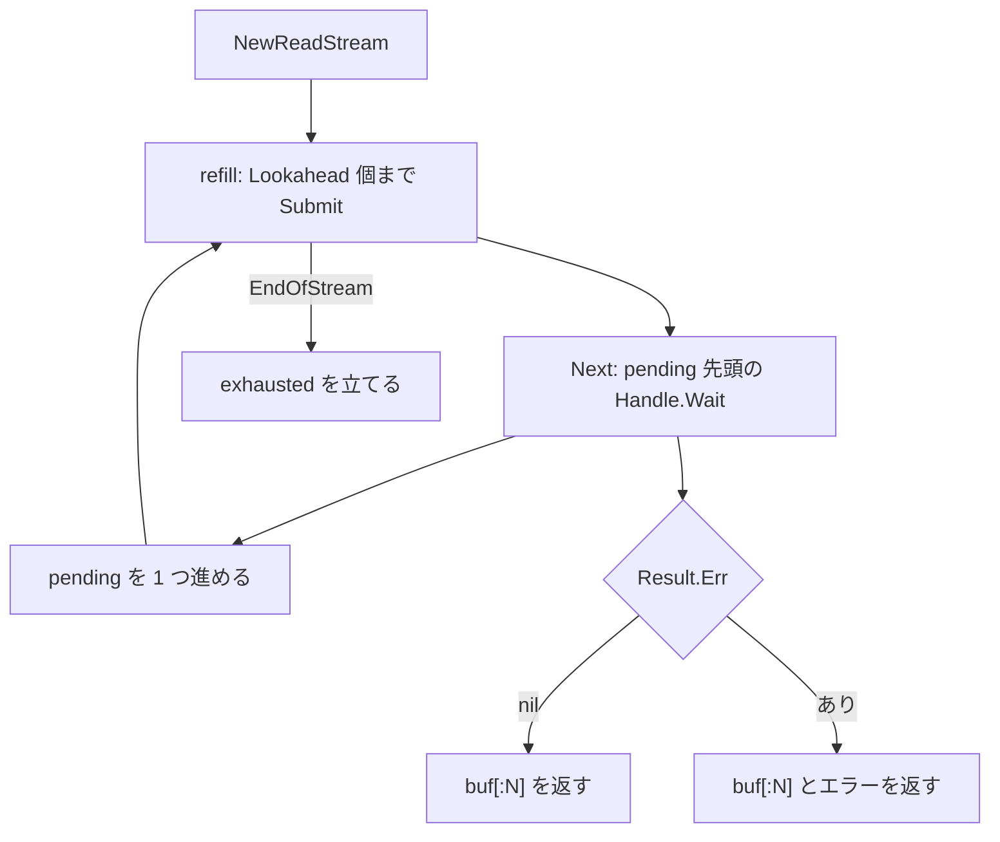

# ストレージマネージャと非同期 I/O

<details>
<summary>関連ソースファイル</summary>

- [`internal/storage/aio/aio.go`](https://github.com/ryogrid/goopg/blob/19856410e8d497d59787e1ab35a2febb3f5953d6/internal/storage/aio/aio.go)
- [`internal/storage/aio/method_iouring_linux.go`](https://github.com/ryogrid/goopg/blob/19856410e8d497d59787e1ab35a2febb3f5953d6/internal/storage/aio/method_iouring_linux.go)
- [`internal/storage/aio/method_iouring_other.go`](https://github.com/ryogrid/goopg/blob/19856410e8d497d59787e1ab35a2febb3f5953d6/internal/storage/aio/method_iouring_other.go)
- [`internal/storage/aio/method_sync.go`](https://github.com/ryogrid/goopg/blob/19856410e8d497d59787e1ab35a2febb3f5953d6/internal/storage/aio/method_sync.go)
- [`internal/storage/aio/method_worker.go`](https://github.com/ryogrid/goopg/blob/19856410e8d497d59787e1ab35a2febb3f5953d6/internal/storage/aio/method_worker.go)
- [`internal/storage/aio/read_stream.go`](https://github.com/ryogrid/goopg/blob/19856410e8d497d59787e1ab35a2febb3f5953d6/internal/storage/aio/read_stream.go)
- [`internal/storage/file/pgtemp.go`](https://github.com/ryogrid/goopg/blob/19856410e8d497d59787e1ab35a2febb3f5953d6/internal/storage/file/pgtemp.go)
- [`internal/storage/io_trace.go`](https://github.com/ryogrid/goopg/blob/19856410e8d497d59787e1ab35a2febb3f5953d6/internal/storage/io_trace.go)
- [`internal/storage/prefetch.go`](https://github.com/ryogrid/goopg/blob/19856410e8d497d59787e1ab35a2febb3f5953d6/internal/storage/prefetch.go)
- [`internal/storage/smgr.go`](https://github.com/ryogrid/goopg/blob/19856410e8d497d59787e1ab35a2febb3f5953d6/internal/storage/smgr.go)
- [`internal/storage/writeback_linux.go`](https://github.com/ryogrid/goopg/blob/19856410e8d497d59787e1ab35a2febb3f5953d6/internal/storage/writeback_linux.go)
- [`internal/initdb/open.go`](https://github.com/ryogrid/goopg/blob/19856410e8d497d59787e1ab35a2febb3f5953d6/internal/initdb/open.go)

</details>

`internal/storage` の `Manager` は、`RelFileNode`（テーブル空間・データベース・リレーション・フォーク）ごとに 1 つの `relFile` をキャッシュし、`ReadBlock` / `WriteBlock` / `Extend` / `TruncateRelationTo` / `Sync` をそのファイルへルーティングする。`internal/storage/aio` はその下に差し込める非同期 I/O 基盤で、呼び出し元は `Op`（ファイル・バッファ・オフセット・方向）を `Engine.Submit` に渡し、返る `Handle.Wait` で完了を待つ。実際の syscall は `Method` が選ぶ `sync`・`worker`（goroutine プール）・`io_uring`（Linux のみ）のいずれかが実行し、`io_uring` が使えなければ `worker` へ自動フォールバックする。`ReadStream` は `Engine` の上に先読みウィンドウを重ね、`file` パッケージはソートやハッシュ結合のスピルファイルを `<datadir>/base/pgsql_tmp` に置く。バッファプールからの利用は [7.1 バッファプール](7.1-Buffer-Pool.md)、ページの内容は [7.2 ページとヒープタプル](7.2-Page-and-Heap.md) を参照。

## 責務

- リレーションファイルの遅延オープンとキャッシュ。`Manager.relFile` が `m.files[rel]` を引き、なければ `os.MkdirAll` + `O_RDWR|O_CREATE` で開いて `nblocks` をファイルサイズから初期化する (`internal/storage/smgr.go:relFile`)。
- フォーク別パスの解決。`relDir` が `base/<dbOid>` / `global` / `pg_tblspc/<tblOid>/<version>/<dbOid>` を選び、`relPath` が `_fsm` / `_vm` / `_init` の接尾辞を付ける (`internal/storage/smgr.go:relPath`)。
- ブロック境界の検査。読み書き前に `blk < nblocks` を検査し、`ReadBlock` の範囲外は `ErrShortRead`、`WriteBlock` の範囲外は `out of range` エラーにする (`internal/storage/smgr.go:readBlock`)。
- ページチェックサムの付与と検証。`relFile.checksummedForWrite` が `PageSetChecksumCopy` を呼び、`verifyOnRead` が `VerifyPage` で照合する。`IgnoreChecksumFailure` は不一致を警告に降格する (`internal/storage/smgr.go:verifyOnRead`)。
- ブロック単位の直列化。`relFile.lockBlock` が `(rel, block)` ごとのラッチを取得し、同期 I/O と AIO が同じブロックで混ざらないようにする (`internal/storage/smgr.go:lockBlock`)。
- ベクトル読み込み。`readBlocks` が隣接ブロック列を 1 回の `preadv(2)` で読み、昇順にラッチを取ってデッドロックを避ける (`internal/storage/smgr.go:readBlocks`)。
- 非同期 I/O の受け渡し。`Manager.PrefetchBlock` と `Manager.WriteBlockAIO` が `AIOEngine.Submit` に `AIOSubmitOp` を渡し、`OnComplete` でブロックラッチを解放する (`internal/storage/smgr.go:PrefetchBlock`)。
- I/O 方式の選択とフォールバック。`aio.NewEngine` が `sync` / `worker` / `io_uring` を構築し、`io_uring` のプローブ失敗時は `worker` に切り替えて `FallbackFrom` に理由を残す (`internal/storage/aio/aio.go:NewEngine`)。
- 先読みウィンドウ。`aio.ReadStream` が `Lookahead` 個まで `Engine.Submit` を先行発行し、`Next` で先頭の完了を待つ (`internal/storage/aio/read_stream.go:ReadStream`)。
- 耐久性操作。`Manager.Sync` / `SyncAll` が `fdatasync(2)` を発行し、`SyncFileRangeHint` が `sync_file_range(2)` の書き戻しヒントを出す (`internal/storage/smgr.go:Sync`)。
- 一時ファイルの配置と掃除。`file.Dir` が `base/pgsql_tmp` を返し、`RemoveStrayFiles` が `pgsql_tmp` 接頭辞の残骸だけを消す (`internal/storage/file/pgtemp.go:RemoveStrayFiles`)。

## 処理フロー

### 同期読み込み

`Manager.ReadBlock` は待機フックを出し入れし、`relFile` を解決して `readBlock` に渡す。`readBlock` はブロックラッチ → ファイル全体の `r.mu` → 範囲検査 → `ReadAt` → I/O トレース → チェックサム検証、の順で進む。



`readBlock` は `io.EOF` を「短い読み」として扱い、`n != BlockSize` なら `short N of 8192` のエラーにする。チェックサム検証は `r.mu` の内側で行われるため、呼び出し元が迂回できない (`internal/storage/smgr.go:readBlock`)。

### 非同期読み込み（Prefetch）

`Manager.PrefetchBlock` は `lockBlock` を先に取り、その解放を AIO の `OnComplete` に委ねる。呼び出し元が `Wait` を呼ぶタイミングではなく、カーネル側の I/O が実際に完了した時点でラッチが外れるのが要点である。



AIO エンジンが未接続なら `PrefetchBlock` は同期 `readBlock` を実行し、`preCompletedHandle` を返す。呼び出し側の `Submit`/`Wait` の形はエンジンの有無で変わらない (`internal/storage/smgr.go:PrefetchBlock`)。

### 非同期書き込み

`Manager.WriteBlockAIO` も同じ形だが、`buf` の所有者は呼び出し元であり、`Wait` が返るまで生存させなければならない。`flushBatch` は全スロットを `WriteBlockAIO` にサブミットしてから `Wait` をまとめて回す。



エンジンがない場合、`WriteBlockAIO` は `f.writeBlock` を同期実行し、`preCompletedHandle{n: BlockSize}` を返す (`internal/storage/smgr.go:WriteBlockAIO`)。

### エンジン方式の選択



`io_uring` 以外のプラットフォームでは `method_iouring_other.go` の `newMethodIOUring` が常に `errProbeFailed` を返すため、`worker` へのフォールバックが必ず起きる (`internal/storage/aio/method_iouring_other.go:newMethodIOUring`)。

### ReadStream の先読み



`refill` は `NextBlock` が `EndOfStream`（`-1`）を返すまで `BlockSize` のバッファを確保して `Engine.Submit` する。`Next` は先頭の `Handle.Wait` が返った後に `pending` を進め、次の `Next` のために即座に `refill` する (`internal/storage/aio/read_stream.go:Next`)。`pending` が空なら `Next` は `io.EOF` を返し、`NextBlock` が `EndOfStream` を返した後は `exhausted` が立って以後の `refill` はコールバックを呼ばない。

## 主要ファイル

| ファイル | 役割 |
| --- | --- |
| `internal/storage/smgr.go` | `Manager`・`ManagerConfig`・`relFile`。読み書き・延伸・切り詰め・同期・AIO シーム・チェックサム (`internal/storage/smgr.go:Manager`) |
| `internal/storage/aio/aio.go` | `Engine`・`Op`・`Handle`・`Result`・`Method` と統計、`NewEngine`、`runOp` (`internal/storage/aio/aio.go:Engine`) |
| `internal/storage/aio/method_sync.go` | 同期メソッド。`Submit` 内で `runOp` を実行し、`MaxConcurrency` をセマフォで制限 (`internal/storage/aio/method_sync.go:methodSync`) |
| `internal/storage/aio/method_worker.go` | 固定 goroutine プール。チャネルをキュー兼バックプレッシャに使う (`internal/storage/aio/method_worker.go:methodWorker`) |
| `internal/storage/aio/method_iouring_linux.go` | io_uring の SQ/CQ mmap、SQE 発行、CQE 回収、`ChecksumFile` フック (`internal/storage/aio/method_iouring_linux.go:methodIOUring`) |
| `internal/storage/aio/method_iouring_other.go` | 非 Linux のスタブ。必ず `errProbeFailed` を返す (`internal/storage/aio/method_iouring_other.go:newMethodIOUring`) |
| `internal/storage/aio/read_stream.go` | `ReadStream` と `ReadStreamConfig`。先読みウィンドウと `Next`/`Close` (`internal/storage/aio/read_stream.go:ReadStream`) |
| `internal/storage/prefetch.go` | バッファプール側の設置型先読み。`StartRead` / `ReadOp.Finish` / `Abort` / `publishValid` |
| `internal/storage/io_trace.go` | `GOOPG_IO_TRACE=1` 時のページ内容ハッシュ記録。`recordIOTrace`、`HashPage` |
| `internal/storage/file/pgtemp.go` | スピルファイル用の `base/pgsql_tmp` と `pgsql_tmp` 接頭辞、起動時の掃除 (`internal/storage/file/pgtemp.go:RemoveStrayFiles`) |
| `internal/storage/writeback_linux.go` | `sync_file_range(2)` による非同期書き戻しヒント (`internal/storage/writeback_linux.go:syncFileRangeHint`) |
| `internal/initdb/open.go` | `aio.NewEngine` の構築と `mgr.SetAIO` の配線、`aioEngineAdapter` (`internal/initdb/open.go:aioEngineAdapter`) |

## 公開 API / エントリポイント

- `Manager` の生成: `NewManager(cfg ManagerConfig) *Manager`、`SetAIO(eng AIOEngine)`、`Close() error`、`DataDir() string`。
- 読み込み: `ReadBlock(rel, blk, buf) error`、`ReadBlocks(rel, first, bufs) (int, error)`、`PrefetchBlock(rel, blk, buf) (AIOHandle, error)`。
- 書き込み・延伸: `WriteBlock(rel, blk, buf) error`、`WriteBlockAIO(rel, blk, buf) (AIOHandle, error)`、`Extend(rel, buf) (BlockNumber, error)`、`ExtendBatch(rel, buf, n) (BlockNumber, error)`。
- サイズ・存在: `NBlocks(rel) (BlockNumber, error)`、`CachedNBlocks(rel) (BlockNumber, bool)`、`Exists(rel) bool`、`RelPath(rel) string`、`RelMainPath(rel) string`、`CreateFile(rel) error`。
- 耐久性: `Sync(rel) error`、`SyncAll() error`、`SyncFileRangeHint(rel) error`。
- 保守: `DropRelation(rel) error`、`CloseRelation(rel)`、`TruncateRelation(rel) error`、`TruncateRelationTo(rel, n) error`、`ReleaseForgotten() int`。
- AIO シーム: `AIOEngine.Submit(AIOSubmitOp) AIOHandle`、`AIOHandle.Wait() (int, error)`。`AIOSubmitOp` の `OnComplete` は完了時に 1 回だけ呼ばれる。
- aio パッケージ: `NewEngine(EngineConfig) (*Engine, error)`、`(*Engine).Submit(Op) *Handle`、`(*Handle).Wait() Result`、`SetWaitEvent(type, name)`、`(*Engine).Close() error`、`Method() string`、`Stats() Stats`、`PerTarget() []TargetStats`、`InFlight() []InFlightInfo`、`FallbackFrom() (requested, reason string)`。
- 先読み: `NewReadStream(ReadStreamConfig) (*ReadStream, error)`、`(*ReadStream).Next() ([]byte, error)`、`Close() error`。
- 一時ファイル: `file.Dir(dataDir) string`、`file.EnsureDir(dataDir) (string, error)`、`file.FilePattern(pid int) string`、`file.RemoveStrayFiles(dataDir) (int, error)`。

## 主要データ構造

### Manager — ファイルハンドルのキャッシュ

```go
// Manager provides synchronous file I/O for relation data files.
// Each method blocks until the I/O completes.
type Manager struct {
	cfg ManagerConfig

	mu    sync.Mutex
	files map[RelFileNode]*relFile

	aio AIOEngine

	// OnReadWait / OnWriteWait / OnExtendWait / OnSyncWait are optional
	// hooks called before blocking I/O operations.  The server sets them
	// from initdb.Open so the activity package can record DataFileRead /
	// DataFileWrite / DataFileExtend / DataFileSync wait events.
	OnReadWait   func()
	OnWriteWait  func()
	OnExtendWait func()
	OnSyncWait   func()

	// OnReadDone / OnWriteDone / OnExtendDone / OnSyncDone are
	// optional hooks called immediately after the corresponding I/O
	// operation completes (including on error). Paired with the
	// `*Wait` hooks so observability code can balance every
	// WaitEventStart with a WaitEventEnd. (M0058-0006.)
	OnReadDone   func()
	OnWriteDone  func()
	OnExtendDone func()
	OnSyncDone   func()

	// OnBlockWritten invalidates any external page cache that shadows
	// data-file writes done directly through smgr (for example WAL replay).
	OnBlockWritten func(rel RelFileNode, blk BlockNumber)
}
```

`internal/storage/smgr.go:Manager`（89〜121 行）。

- `mu` は `files` マップと `aio` ポインタだけを守る。ファイルの中身に対する I/O は各 `relFile` の `mu` が直列化するので、別リレーション同士は並行に進める。
- `files` は `RelFileNode` ごとに 1 つの `*relFile` を保持する。同じリレーションのフォーク違い（`MainFork` / `FSMFork` / `VisibilityMapFork`）は別キーなので、それぞれ独立したファイルハンドルになる。
- `aio` が nil のとき、`PrefetchBlock` は同期読み込みにフォールバックする。`SetAIO` はこのフィールドを差し替えるだけで、既存の `relFile` ハンドルには影響しない。
- `On*Wait` と `On*Done` は対で呼ばれ、待機イベントの開始と終了を釣り合わせる。`OnBlockWritten` は WAL リプレイなど smgr を直接通る書き込みの後に外部キャッシュを無効化する。

### ManagerConfig — ファイルの開き方と完全性

```go
// ManagerConfig controls how files are opened.
type ManagerConfig struct {
	// DataDir is the root data directory. Files live at
	// <DataDir>/base/<dbOid>/<relOid>[<fork-suffix>].
	DataDir string

	// ChecksumsEnabled turns on PG-compatible data-page checksums for
	// every block this Manager reads and writes. When false (the
	// default) the read/write path is byte-identical to a checksum-less
	// cluster — no copy, no verification, no overhead. The runtime sets
	// this from pg_control's data_checksum_version (1 ⇒ enabled), which
	// initdb writes from the --data-checksums option. See
	// docs/design/0102-0019-initdb-data-checksums.md.
	ChecksumsEnabled bool

	// IgnoreChecksumFailure, when true, downgrades a checksum mismatch on
	// read from a hard error to a non-fatal event: the page is returned
	// as read and OnChecksumFailure (if set) is invoked. Mirrors the
	// ignore_checksum_failure GUC. Has no effect unless ChecksumsEnabled.
	IgnoreChecksumFailure bool

	// OnChecksumFailure, if set, is invoked when a block fails checksum
	// verification on read (whether or not the failure is fatal). The
	// server wires this to its log / pg_stat checksum-failure counters.
	OnChecksumFailure func(rel RelFileNode, blk BlockNumber)

	// FsyncDisabled mirrors `fsync = off` (inverted so the zero value keeps
	// the durable default): Sync/SyncAll become no-ops. Writes are
	// unchanged; only host-crash durability is forfeit. Test harnesses
	// only. See ci/design/test-gate-speedups/02.
	FsyncDisabled bool
}
```

`internal/storage/smgr.go:ManagerConfig`（123〜154 行）。`ChecksumsEnabled` が偽なら `checksummedForWrite` はコピーせず元のスライスを返し、読み込み側も検証しない。`FsyncDisabled` は書き込みを変えず `Sync`/`SyncAll` だけを no-op にするので、クラッシュ耐久性だけが失われる。

### relFile — 1 ファイル分の状態

```go
type relFile struct {
	mu      sync.Mutex
	f       *os.File
	path    string
	nblocks BlockNumber

	// rel identifies this file for OnChecksumFailure callbacks.
	rel RelFileNode
	// checksums mirrors ManagerConfig.ChecksumsEnabled: when set, every
	// block written through this file carries a fresh pd_checksum and
	// every block read is verified. When clear the I/O path is
	// byte-identical to a checksum-less cluster.
	checksums      bool
	ignoreChecksum bool
	onChecksumFail func(rel RelFileNode, blk BlockNumber)

	// blockMu guards blockBusy, the per-(rel,block) in-flight
	// registry that serializes an AIO op (which bypasses mu
	// entirely on methodIOUring's raw-fd path — see
	// docs/design/0009-0006-aio-io-uring.md) against a
	// concurrent synchronous readBlock/writeBlock, or another
	// AIO op, on the SAME block. Deliberately separate from mu
	// (which still serializes the whole file's synchronous ops
	// among themselves) so cross-block AIO parallelism is never
	// reduced to file-wide serialization.
	blockMu   sync.Mutex
	blockBusy map[BlockNumber]chan struct{}
}
```

`internal/storage/smgr.go:relFile`（870〜897 行）。

- `mu` は同期 I/O の全体を直列化する。`readBlock`/`writeBlock`/`extend`/`sync`/`truncateTo` はこのロックの下で `nblocks` とファイル位置を一貫させる。
- `nblocks` はブロック単位の現在長。`extend` は書き込み成功後にだけ +1 し、`truncateTo` は切り詰め成功後に `n` を代入する。読み書きは `blk < nblocks` をこのロックの下で検査する。
- `blockMu` と `blockBusy` は `(rel, block)` 単位のラッチを実装する。`lockBlock` は `blockBusy[blk]` にチャネルを登録し、既にビジーならそのチャネルが閉じるまで待つ。返る解放関数は `sync.Once` で二重解放を防ぐ (`internal/storage/smgr.go:lockBlock`)。
- `checksums` が真のとき、`WriteAt`/`writeBlock` は `checksummedForWrite` でコピーに checksum を付けてから書き、`ReadAt`/`readBlock` は `verifyOnRead` で照合する。`PrepareWrite`/`VerifyRead` は io_uring の raw-fd 経路用の同じ処理である。

### AIOSubmitOp — ストレージから AIO への依頼

```go
// AIOSubmitOp mirrors aio.Op's submit shape. Direction picks
// pread vs pwrite on the underlying File. Keeping this type
// local keeps storage independent of internal/aio.
type AIOSubmitOp struct {
	File   AIOFile
	Buffer []byte
	Offset int64
	// Direction controls read vs write. The zero value
	// (AIODirRead) preserves the original prefetch-only
	// semantics so callers that don't set it explicitly
	// continue to issue reads.
	Direction AIODirection
	// Target is a free-form descriptor (typically the relfile
	// path) the engine surfaces through pg_aios.target_desc.
	// Empty leaves the column blank.
	Target string
	// OnComplete, if set, is called exactly once when this op's
	// I/O actually finishes — on the engine's completion path,
	// independent of whether/when the caller invokes the
	// returned AIOHandle's Wait. Manager.PrefetchBlock and
	// Manager.WriteBlockAIO set this to release the per-(rel,
	// block) latch relFile.lockBlock acquired before Submit, so
	// a concurrent synchronous readBlock/writeBlock (or another
	// AIO op) on the SAME block waits for the real completion,
	// not just until the caller gets around to Wait. See
	// docs/design/0009-0006-aio-io-uring.md.
	OnComplete func()
}
```

`internal/storage/smgr.go:AIOSubmitOp`（36〜63 行）。`OnComplete` が `Wait` の呼び出しと独立している点が重要で、ブロックラッチの解放タイミングをカーネル側の実際の完了に合わせる。`File` は `ReadAt`/`WriteAt` を持つ `AIOFile` で、`relFile` 自身がこれを満たす。

### aio.Op と aio.Handle — 非同期 I/O の契約

```go
// Op describes one I/O the caller wants the engine to perform.
// Buffer is the destination for reads / source for writes. The
// caller owns the buffer's memory: it must remain valid until
// Wait returns. Direction selects pread vs pwrite.
type Op struct {
	File      File
	Buffer    []byte
	Offset    int64
	Direction Direction

	// Target is a free-form descriptor identifying what this
	// I/O is reading from / writing to (typically the relfile
	// path for storage Ops or the segment path for WAL Ops).
	// Surfaced through `pg_aios.target_desc`. Empty when the
	// caller doesn't supply one — the view renders blank in
	// that case. Mirrors upstream's `pgaio_target_desc`.
	Target string

	// Callback, if non-nil, fires on the engine's completion
	// goroutine after the I/O lands. Mirrors upstream's
	// `pgaio_io_register_callbacks`. Nil is fine — Wait
	// always sees the same Result.
	Callback func(Result)
}
```

`internal/storage/aio/aio.go:Op`（114〜137 行）。

```go
// Handle is the caller's reference to one in-flight (or already
// completed) Op. Wait blocks until the I/O finishes; subsequent
// Wait calls return the same Result without blocking.
type Handle struct {
	op   Op
	done chan struct{}
	mu   sync.Mutex
	res  Result

	// id is the engine-assigned monotonic identifier. Used by
	// the in-flight tracking map (and the future pg_aios view)
	// to key off a stable, lookup-friendly value.
	id uint64
	// submittedAt records when Submit registered the handle.
	// Powers the elapsed-time column in pg_aios.
	submittedAt time.Time

	// waitEventType and waitEventName are set via SetWaitEvent
	// and used by the engine's OnWaitStart/OnWaitEnd hooks for
	// pg_stat_activity wait-event reporting.
	waitEventType string
	waitEventName string

	engine *Engine
}
```

`internal/storage/aio/aio.go:Handle`（148〜172 行）。

- `Op.Buffer` は読み込みの書き込み先、書き込みの読み込み元であり、`Wait` が返るまで呼び出し元が所有し続ける。
- `Handle.done` は完了時に `close` され、`Wait` はこのチャネルだけを待つ。`res` は `mu` で保護され、`finish` が結果を書いてから `done` を閉じる。
- `Callback` は `done` を閉じた後に同じ完了経路で呼ばれる。`Wait` の呼び出し有無に依存しない。
- `id` と `submittedAt` は `Engine` のインフライト・マップと `pg_aios` 用のメタデータで、`Stats` のレイテンシ計算にも使われる。

### aio.Engine — 方式と統計の前景

```go
// Engine is the front door for callers. Wraps one Method plus
// process-wide bookkeeping (in-flight counter, total submitted
// counter) so the future observability slice has counters to
// surface without touching every method.
type Engine struct {
	method Method
	// inFlight is the current count of outstanding I/Os —
	// incremented in each Method's Submit (`+1`) and decremented
	// in finishHandle (`-1`). It is the only stats.Counter consumer
	// in this engine that takes signed deltas; the cross-shard sum
	// still equals (#submits − #completions) at any consistent point,
	// matching the gauge value previously held in a single
	// `atomic.Int64`. The hot path is identical to the per-direction
	// completion counters migrated in
	// `0107-0008j`/`0107-0008i`: every Submit and every completion
	// pays a previously-shared cache-line hop on this field; per-P
	// sharding via stats.Counter scatters those bumps across 256
	// shards. Reader is `Stats()` (cold path); the sharded Sum
	// reading is eventual-consistent which matches the observability
	// contract documented at line 632 below.
	inFlight  stats.Counter
	submitted stats.Counter
	completed stats.Counter
	errored   stats.Counter

	// Per-direction breakdown of the same counters above.
	// `submitted` / `completed` / `errored` are the totals;
	// these are the read / write split. Mirrors upstream's
	// pg_stat_io row shape, which splits by operation.
	//
	// Per-P sharded via stats.Counter so the four read/write
	// submit/complete bumps in the I/O hot path don't bounce
	// a shared cache line across cores. See
	// docs/design/0107-0008j-aio-per-direction-stats-counter-wiring.md.
	readSubmitted  stats.Counter
	readCompleted  stats.Counter
	readErrored    stats.Counter
	writeSubmitted stats.Counter
	writeCompleted stats.Counter
	writeErrored   stats.Counter

	// Per-direction latency observability. SumMicros tracks
	// the cumulative observed latency (now - submittedAt at
	// completion time) so consumers can compute the average
	// latency as SumMicros/Completed. MaxMicros tracks the
	// worst-case sample observed so far, CAS-clamped to
	// monotonic-forward. Both are micros (not nanos) to
	// fit comfortably in uint64 even at high I/O rates.
	//
	// SumMicros sharded via stats.Counter (same hot-path
	// completion bump as the per-direction completed counters).
	// MaxMicros stays atomic.Uint64 because advanceMax requires
	// CompareAndSwap semantics that stats.Counter doesn't model.
	readLatencySumMicros  stats.Counter
	readLatencyMaxMicros  atomic.Uint64
	writeLatencySumMicros stats.Counter
	writeLatencyMaxMicros atomic.Uint64

	// Per-target breakdown: maps Op.Target → *targetStats.
	// Sync.Map fits this access pattern — most ops on existing
	// keys take only an atomic Load; only the first I/O for a
	// new target pays the LoadOrStore allocation. Counters
	// inside *targetStats are atomic so bumps don't take a
	// lock. Scales to thousands of distinct targets without
	// contention.
	targets sync.Map

	// nextID hands out per-Submit identifiers. Monotonic.
	nextID atomic.Uint64

	// inflightMu guards the inflight map. Acquired only on
	// Submit (insert) and on completion (delete) — never on
	// the I/O hot path, which uses atomic counters above.
	inflightMu sync.RWMutex
	inflight   map[uint64]inFlightEntry

	// requestedMethod records the io_method the caller asked
	// for, even when the engine fell back to a different
	// method (io_uring → workers on ENOSYS). Surfaces in the
	// startup log line and in pg_aios for operator triage.
	requestedMethod string
	fallbackReason  string

	// OnWaitStart and OnWaitEnd are optional hooks called by
	// Handle.Wait before blocking on I/O completion and after
	// the I/O completes, respectively. The activity package
	// sets these from initdb.Open so pg_stat_activity can
	// report "AIO" wait events. Both are called from the
	// goroutine that calls Handle.Wait and must not block.
	OnWaitStart func()
	OnWaitEnd   func()
}
```

`internal/storage/aio/aio.go:Engine`（231〜322 行）。

- `method` は実際の I/O 方式。`Engine` 自身は方式を知らず、`Submit` を委譲するだけである。
- `inFlight` は提出済みで未完了の数、`submitted`/`completed`/`errored` は総量、`read*`/`write*` は方向別の内訳。`finishHandle` が完了時にすべてを更新する。
- `targets` は `Op.Target` ごとの `targetStats` を `sync.Map` に保持する。空文字のターゲットは追跡しない。
- `inflight` は `id → inFlightEntry` のマップで、`Submit` の登録と `finishHandle` の削除だけが `inflightMu` を取る。I/O のホットパスはロックを取らない。
- `requestedMethod`/`fallbackReason` はフォールバックの監査用で、`FallbackFrom` が返す。
- `OnWaitStart`/`OnWaitEnd` は `Handle.Wait` の前後に呼ばれ、`pg_stat_activity` の wait event になる。

### ReadStream — 先読みウィンドウ

```go
// ReadStream issues prefetch reads ahead of the consumer.
// Not goroutine-safe — one goroutine per stream.
type ReadStream struct {
	cfg     ReadStreamConfig
	pending []*pendingRead

	// exhausted is set the first time NextBlock returns
	// EndOfStream so the refill path doesn't keep calling it.
	exhausted bool
	closed    bool
}
```

`internal/storage/aio/read_stream.go:ReadStream`（85〜95 行）。

- `cfg.Lookahead` は `[1, MaxReadStreamLookahead=256]` にクランプされ、0 は `DefaultReadStreamLookahead=4` になる。
- `pending` は提出順のスライスで、先頭が次に消費するブロック。`Next` は先頭を `Wait` してからスライスを進め、すぐ `refill` する。
- `pendingRead.buf` は `Next` が返すスライスの実体で、次の `Next` または `Close` まで有効である。
- `exhausted` は `NextBlock` が `EndOfStream` を返した後、`refill` がコールバックを繰り返さないためのフラグ。`closed` は `Close` 後の `Next` を `ErrReadStreamClosed` にする。

## 内部構造

### 3 層の直列化

`Manager` には用途の異なる 3 つのロックがある。

1. `Manager.mu` はファイルキャッシュ（`files`）と `aio` の差し替えだけを守る。読み書きの間は保持されない。
2. `relFile.mu` は 1 ファイル内の同期 I/O を直列化し、`nblocks` とファイルオフセットの整合性を保つ。
3. `relFile.blockMu` / `blockBusy` はブロック単位のラッチで、同一ブロックへの同期 I/O と AIO の混在を防ぐ。`readBlocks` は複数ブロックを**昇順**に取得するので、別の昇順ベクトル読みと交差してもデッドロックしない (`internal/storage/smgr.go:readBlocks`)。

`lockBlock` は AIO では `Submit` の直前に取得され、`OnComplete` が呼ばれるまで保持される。したがって呼び出し元が `Wait` を忘れても、カーネル側の完了までは同じブロックへの別 I/O が待たされる。解放関数は `sync.Once` で包まれており、二重呼び出しでもチャネルを二度閉じない (`internal/storage/smgr.go:lockBlock`)。

### 短読みと EOF の扱い

`readBlock` は `ReadAt` の `io.EOF` を許容しつつ、`n != BlockSize` をエラーにする。`readBlocks` は `preadvAt` の戻り値を `n / BlockSize` で丸め、完全に埋まったブロックだけを検証対象にする。途中でチェックサム不一致が出たら「検証に成功したブロック数」だけを返し、破損ブロックを成功として数えない (`internal/storage/smgr.go:readBlocks`)。`MaxIOCombineLimit = 128` を超えるバッチは `ReadBlocks` が拒否する。

### チェックサムと raw-fd 経路

`sync` と `worker` は `runOp` から `File.ReadAt`/`WriteAt` を呼ぶため、`relFile` の checksum 処理が自動的に効く。一方、io_uring は `fdHaver` から fd を取り、カーネルにバッファのポインタを直接渡すので `ReadAt`/`WriteAt` を通らない。この抜けを埋めるのが `aio.ChecksumFile` で、io_uring の `Submit` は書き込み時に `PrepareWrite` を、完了時に `VerifyRead` を呼ぶ (`internal/storage/aio/method_iouring_linux.go:Submit`)。`relFile.PrepareWrite` は checksum 付きのコピーを返し、元の `buf` は変更しない。返したスライスはカーネルが書き終えるまで生存させる必要がある。

### io_uring のリング管理

`newMethodIOUring` は `io_uring_setup`（syscall 425）でリングを作り、SQ リング・CQ リング・SQE 配列の 3 つを `mmap` する。深さは既定 32、`MaxConcurrency > 0` なら次の 2 冪、最低 4 である。`submitMu` は SQ の単一プロデューサ規約を守るために SQE の書き込みと tail の更新を直列化し、`io_uring_enter`（syscall 426）で投入する。完了側は専用の `reap` goroutine が `io_uring_enter(0, 1, GETEVENTS)` で待ち、CQE の `user_data` から `pending` の `Handle` を引いて `finishHandle` する (`internal/storage/aio/method_iouring_linux.go:reap`)。

`cqe.Res < 0` は `-errno` として `syscall.Errno` に変換され、読み込みで `Res < want` なら `io.EOF` が付く。書き込みの短書きは Linux ではエラーになる前提である。`Close` は NOP SQE を `closeWakeUserData = 0xFFFFFFFFFFFFFFFF` で投入して `reap` を起こし、リング fd を閉じて `munmap` した後、残っている `pending` を `errEngineClosed` で完了させる。SQ が満杯のときは NOP を投入せずスキップする（既存の I/O の完了が reaper を起こすため） (`internal/storage/aio/method_iouring_linux.go:pokeWake`)。

### 方式ごとのバックプレッシャ

- `sync`: `MaxConcurrency > 0` のとき容量 `MaxConcurrency` のチャネルをセマフォとして使い、`Submit` は空きができるまでブロックする。`Close` との競合に負けた `Submit` は `errEngineClosed` で完了する (`internal/storage/aio/method_sync.go:Submit`)。
- `worker`: キューの容量は `MaxConcurrency`、未指定なら `workers * 4`。既定ワーカー数は `defaultWorkerCount = 3`。`Submit` はキューが満杯ならブロックし、`Close` との競合では `errEngineClosed` を返す。`Close` はキューを閉じて全ワーカーの終了を待つ (`internal/storage/aio/method_worker.go:newMethodWorker`)。
- `io_uring`: `slots` の容量は `min(MaxConcurrency, sqEntries)`、未指定なら `sqEntries`。`Submit` はスロットを取れなければブロックし、`Close` で `errEngineClosed` になる。fd を持たない `File` はスロットを即返してインライン `runOp` にフォールバックする (`internal/storage/aio/method_iouring_linux.go:Submit`)。

### 完了処理の一貫性

全メソッドは完了時に `Engine.finishHandle` を 1 回だけ呼ぶ。ここで `completed`/`errored`、方向別カウンタ、レイテンシ、ターゲット別統計、`inFlight`、`inflight` マップを更新し、最後に `Handle.finish` が `res` を書いて `done` を閉じ、`Callback` を呼ぶ。`Wait` は複数回呼んでも同じ `Result` を返し、`OnWaitStart`/`OnWaitEnd` は待つたびに呼ばれる (`internal/storage/aio/aio.go:finishHandle`)。

`io.EOF` はエラー統計に含めない（`isErr := r.Err != nil && !errors.Is(r.Err, io.EOF)`）。短読みの EOF は正常な終端として扱われる。

### 先読みの設置とキャンセル

バッファプール側の `Pool.StartRead` は `startReadPrologue` で victim を確保し、`pinMu` を解放してから `Manager.PrefetchBlock` を呼ぶ。AIO ワーカーが `pinMu` を要求する経路とのデッドロックを避けるためである。同じブロックの読み込みが既に in flight なら `ErrReadInFlight` を返し、待たない。`ReadOp.Finish` は `Wait` の後に `readFault` と `BlockSize` 検査を行い、成功なら `publishValid` でスロットを公開する。`Abort` はカーネルがまだバッファを書いている可能性があるため `Wait` してからスロットを片付ける (`internal/storage/prefetch.go:Finish`)。

### 書き戻しヒントと耐久性

`Manager.SyncFileRangeHint` は `sync_file_range(2)` をファイル全体（offset 0, nbytes 0）に `SYNC_FILE_RANGE_WRITE` だけで発行する。書き戻しを開始するが待たず、耐久性も保証しない。`ENOSYS`/`EINVAL` は `ErrWritebackUnsupported` になり、呼び出し元は「実際には書き戻していない」のでカウンタを増やさない (`internal/storage/writeback_linux.go:syncFileRangeHint`)。

`Manager.Sync`/`SyncAll` は `fdatasync(2)` を発行する。`SyncAll` は `m.mu` の下で開いているファイルのスナップショットを取り、ロックを離してから各 `relFile.sync` を呼ぶ。`FsyncDisabled` のときはどちらも即座に nil を返す (`internal/storage/smgr.go:SyncAll`)。

### 一時ファイルと I/O トレース

`file.Dir` は `<dataDir>/base/pgsql_tmp` を返し、`file.FilePattern(pid)` は `pgsql_tmp<pid>.*` を作る。`RemoveStrayFiles` は接頭辞 `pgsql_tmp` を持つエントリだけを削除し、ディレクトリなら `RemoveAll` する。接頭辞のないファイルは他のサブシステムのものとして残す (`internal/storage/file/pgtemp.go:RemoveStrayFiles`)。

`io_trace.go` は `GOOPG_IO_TRACE=1` のときだけ `recordIOTrace` が動き、`HashPage` の FNV-64a ハッシュとライン・ポインタ数を記録する。呼び出し点は `readBlock` の `postRead`、`writeBlock` の `postWrite`、`extend` の `postExtend`、`extendBatch` の `postExtendBatch`、ベクトル読みの各ブロック、そしてバッファプールの `preFlush` である。上限は `ioTraceMaxEvents = 4_000_000` 件 (`internal/storage/io_trace.go:ioTraceMaxEvents`)。

### AIO の配線

`initdb.Open` は `opts.AIOMethod` が空ならエンジンを作らず、非空なら `aio.NewEngine` を呼んで `mgr.SetAIO(aioEngineAdapter{eng: eng})` する。アダプタは `storage.AIOSubmitOp` を `aio.Op` に変換し、`OnComplete` を `aio.Op.Callback` に橋渡しする。`aioFileAdapter` は `storage.AIOFile` の `ReadAt`/`WriteAt` と、あれば `Fd()` を転送する。`Fd()` が `^uintptr(0)` を返すファイルは io_uring の raw-fd 経路に入らず、インライン I/O になる (`internal/initdb/open.go:aioEngineAdapter`)。

## エッジケースと不変条件

- **バッファ長は常に `BlockSize`**: `ReadBlock`、`WriteBlock`、`Extend`、`PrefetchBlock`、`WriteBlockAIO` は長さが 8192 でなければエラーにする。`ReadBlocks` は各バッファを個別に検査し、128 ブロック超の要求を拒否する。
- **範囲外読み**: `readBlock` は `blk >= nblocks` で `ErrShortRead` を返す。`PrefetchBlock` は範囲外なら `preCompletedHandle{err: ErrShortRead}` を返し、`ReadBlocks` は開始ブロックが範囲外なら `ErrShortRead`、途中で終端に達したら埋まった完全ブロック数と nil を返す。
- **範囲外書き**: `writeBlock` は `blk >= nblocks` を `write ... out of range (nblocks=N)` にする。`WriteBlockAIO` は同じ検査をサブミット前に行い、範囲外なら完了済みハンドルにエラーを載せる。
- **短書き**: `writeBlock`、`extend`、`extendBatch` はいずれも `n != BlockSize` / `w != len(big)` をエラーにし、`nblocks` を進めない。`extendBatch` は全ブロックを 1 回の `WriteAt` で書くため、途中失敗時も部分的に伸びたとは記録しない。
- **切り詰めはファイルを作らない**: `TruncateRelation` / `TruncateRelationTo` は `relFileForTruncate` を使い、`O_CREATE` なしで開く。存在しなければ no-op、既に `n` 以下なら no-op である。`MkdirAll` も呼ばない (`internal/storage/smgr.go:relFileForTruncate`)。
- **ブロックラッチの解放**: `lockBlock` の戻り値は `sync.Once` で保護されている。二重解放はチャネルの二重 close にならず、待機者も 1 回だけ起こされる (`internal/storage/smgr.go:lockBlock`)。
- **AIO のクローズ競合**: 各方式の `Submit` は `closed` との `select` で競合し、負けたら `errEngineClosed` で完了する。`Handle.Wait` が永久にブロックすることはない。io_uring の `Close` は残った `pending` も `errEngineClosed` で完了させる。
- **`Handle.Wait` の冪等性**: `done` チャネルは 1 回だけ閉じられ、2 回目以降の `Wait` はロック下の `res` をそのまま返す。`Callback` は完了経路で 1 回だけ呼ばれ、`Wait` の回数とは無関係である。
- **io_uring の短読み**: `cqe.Res < want` の読み込みは `io.EOF` になる。負の `cqe.Res` は `-errno` として `syscall.Errno` になる。`Close` の NOP は SQ が満杯なら投入されない（既存 I/O の完了が reaper を起こすため）。
- **チェックサムフックの適用範囲**: `PrepareWrite`/`VerifyRead` は `len(buf) == BlockSize && off%BlockSize == 0` のときだけ checksum を扱う。それ以外は素通しする。io_uring の書き込みでは `PrepareWrite` の戻り値（コピー）がカーネルに渡され、元の `buf` は変更されない。
- **`IgnoreChecksumFailure`**: 不一致でも `onChecksumFail` を呼んだうえでページをそのまま返す。nil のフックは許容され、その場合はログもカウンタも増えない。
- **ReadStream の境界**: `Lookahead` は 1 未満なら 1、256 超なら 256。`EndOfStream = -1` は「これ以上ブロックがない」の sentinel。`pending` が空で `exhausted` なら `Next` は `io.EOF`、`Close` 後の `Next` は `ErrReadStreamClosed`。`Close` は残りの `Handle` をすべて `Wait` してインフライト数を戻す。
- **一時ファイルの掃除範囲**: `RemoveStrayFiles` は `pgsql_tmp` 接頭辞のエントリだけを消し、接頭辞のないファイルには触れない。ディレクトリは `RemoveAll`、ファイルは `Remove`。ディレクトリ自体が存在しない場合は `(0, nil)` を返す。
- **`FsyncDisabled`**: `Sync`/`SyncAll` だけを no-op にし、書き込み経路は変えない。ホストクラッシュ時の耐久性だけが失われる (`internal/storage/smgr.go:Sync`)。

Sources:

- `internal/storage/aio/aio.go`
- `internal/storage/aio/method_iouring_linux.go`
- `internal/storage/aio/method_iouring_other.go`
- `internal/storage/aio/method_sync.go`
- `internal/storage/aio/method_worker.go`
- `internal/storage/aio/read_stream.go`
- `internal/storage/file/pgtemp.go`
- `internal/storage/io_trace.go`
- `internal/storage/prefetch.go`
- `internal/storage/smgr.go`
- `internal/storage/writeback_linux.go`
- `internal/initdb/open.go`

<sub>Generated by deepwiki-4myself from `goopg` @ `19856410e`</sub>
