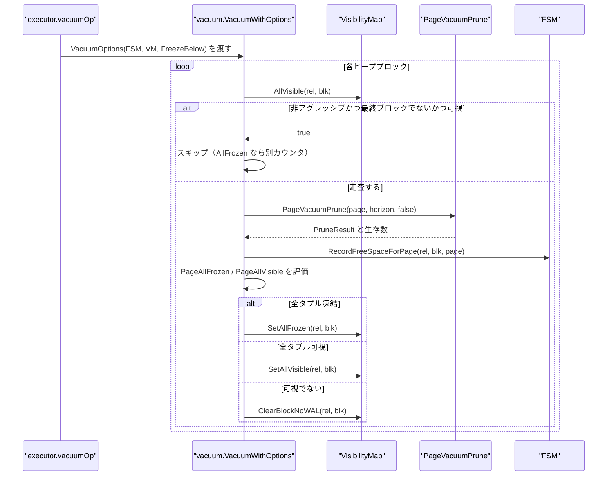
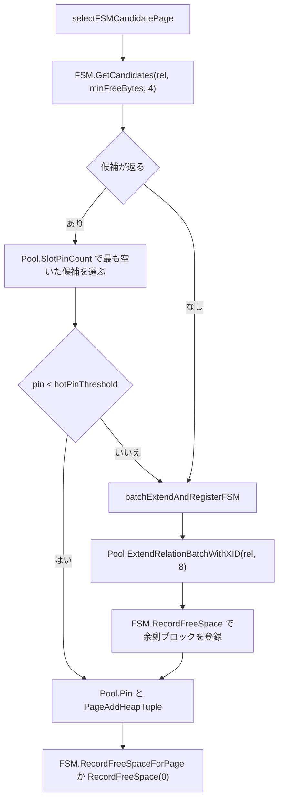
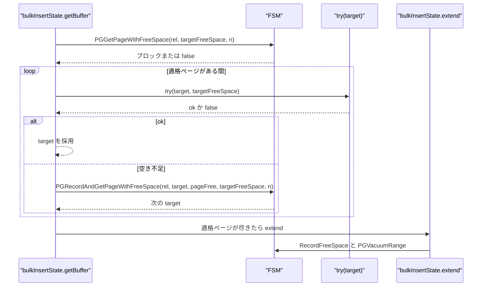
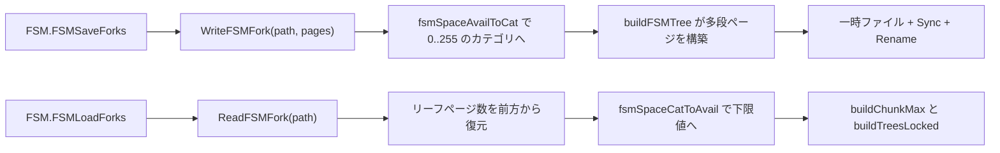
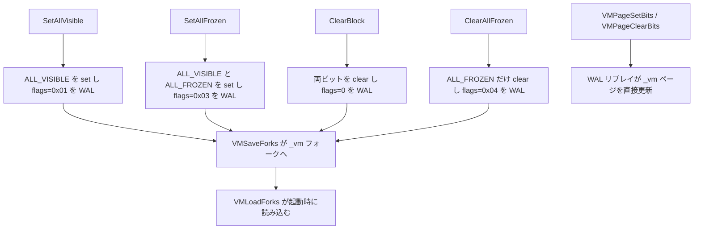

# 空き領域マップと可視性マップ

<details>
<summary>関連ソースファイル</summary>

- [`internal/storage/fsm.go`](https://github.com/ryogrid/goopg/blob/19856410e8d497d59787e1ab35a2febb3f5953d6/internal/storage/fsm.go)
- [`internal/storage/fsm_fork.go`](https://github.com/ryogrid/goopg/blob/19856410e8d497d59787e1ab35a2febb3f5953d6/internal/storage/fsm_fork.go)
- [`internal/storage/fsm_pgtree.go`](https://github.com/ryogrid/goopg/blob/19856410e8d497d59787e1ab35a2febb3f5953d6/internal/storage/fsm_pgtree.go)
- [`internal/storage/vm.go`](https://github.com/ryogrid/goopg/blob/19856410e8d497d59787e1ab35a2febb3f5953d6/internal/storage/vm.go)
- [`internal/storage/vm_fork.go`](https://github.com/ryogrid/goopg/blob/19856410e8d497d59787e1ab35a2febb3f5953d6/internal/storage/vm_fork.go)
- [`internal/storage/vm_redo.go`](https://github.com/ryogrid/goopg/blob/19856410e8d497d59787e1ab35a2febb3f5953d6/internal/storage/vm_redo.go)
- [`internal/storage/freeze.go`](https://github.com/ryogrid/goopg/blob/19856410e8d497d59787e1ab35a2febb3f5953d6/internal/storage/freeze.go)
- [`internal/storage/heap.go`](https://github.com/ryogrid/goopg/blob/19856410e8d497d59787e1ab35a2febb3f5953d6/internal/storage/heap.go)
- [`internal/storage/prune.go`](https://github.com/ryogrid/goopg/blob/19856410e8d497d59787e1ab35a2febb3f5953d6/internal/storage/prune.go)
- [`internal/executor/operators_vacuum.go`](https://github.com/ryogrid/goopg/blob/19856410e8d497d59787e1ab35a2febb3f5953d6/internal/executor/operators_vacuum.go)
- [`internal/commands/vacuum/vacuum.go`](https://github.com/ryogrid/goopg/blob/19856410e8d497d59787e1ab35a2febb3f5953d6/internal/commands/vacuum/vacuum.go)
- [`internal/executor/bulk_insert.go`](https://github.com/ryogrid/goopg/blob/19856410e8d497d59787e1ab35a2febb3f5953d6/internal/executor/bulk_insert.go)
- [`internal/executor/heap_insert_select.go`](https://github.com/ryogrid/goopg/blob/19856410e8d497d59787e1ab35a2febb3f5953d6/internal/executor/heap_insert_select.go)
- [`internal/executor/operators_indexonly.go`](https://github.com/ryogrid/goopg/blob/19856410e8d497d59787e1ab35a2febb3f5953d6/internal/executor/operators_indexonly.go)

</details>

`FSM` は各ヒープページの空きバイト数の近似を `(DBOid, RelOid)` ごとのフラット配列に保持し、挿入先ページを「関係を延伸する前に」見つけられるようにする。同時に PostgreSQL の FSM ツリー（3 段のページ、各ページは 1 バイトのカテゴリを葉に持つ max-tree）を別に持ち、`PGGetPageWithFreeSpace` / `PGRecordAndGetPageWithFreeSpace` という PG 互換の検索に使う。`VisibilityMap` は各ヒープページに `ALL_VISIBLE` と `ALL_FROZEN` の 2 ビットを持ち、VACUUM が全タプル可視・全タプル凍結を証明したページを記録して、index-only スキャンがヒープを読まずに済むようにする。両マップとも `_fsm` / `_vm` フォークとして PG 互換形式で永続化され、変更は WAL（可視性マップ）またはチェックポイント保存（FSM）で再構築される。ページの内容は [7.2 ページとヒープタプル](7.2-Page-and-Heap.md)、VACUUM の全体像は [7.6 VACUUM と ANALYZE](7.6-Vacuum-and-Analyze.md) を参照。

## 責務

- 挿入先候補の記録と検索。`FSM.RecordFreeSpace` が `pages[blk]` を更新し、`GetPageWithFreeSpace` / `GetCandidates` が `minFreeBytes` 以上のページを返す (`internal/storage/fsm.go:FSM`)。
- 大規模リレーション向けのチャンク要約。`chunkMax` が 512 ブロックごとの最大空きを保持し、関係全体の走査をチャンク単位の枝刈りに変える (`internal/storage/fsm.go:fsmChunkBlocks`)。
- PG 互換 FSM ツリー。`fsmTree` が `fp_next_slot` のヒント付きで葉を右回りに探索し、`RecordAndGetPageWithFreeSpace` は旧ページの葉を先に試す (`internal/storage/fsm_pgtree.go:fsmTree`)。
- FSM フォークの読み書き。`WriteFSMFork` がカテゴリ化 → 多段ページ構築 → 一時ファイル + `Sync` + `Rename` を行い、`ReadFSMFork` がページ数からリーフ枚数を復元する (`internal/storage/fsm_fork.go:WriteFSMFork`)。
- 全可視・全凍結のビット管理。`VisibilityMap.SetAllVisible` / `SetAllFrozen` / `ClearBlock` / `ClearAllFrozen` が 2 ビットを更新し、`walHook` で変更を WAL に記録する (`internal/storage/vm.go:VisibilityMap`)。
- 可視性判定。`PageAllVisible` と `PageAllFrozen` が `LP_NORMAL` タプルの xmin/xmax を走査し、VACUUM がビットを立ててよいか決める (`internal/storage/vm.go:PageAllVisible`)。
- VM フォークの永続化。`WriteVMFork` / `ReadVMFork` が 2 ビット/ページの PG 互換レイアウトを扱い、`VMSaveForks` / `VMLoadForks` がチェックポイントと起動時に全リレーションを同期する (`internal/storage/vm_fork.go:WriteVMFork`)。
- VM の WAL 再適用。`VMPageSetBits` / `VMPageClearBits` / `VMTruncateForkForHeap` が `_vm` ページを直接書き換える (`internal/storage/vm_redo.go:VMPageSetBits`)。
- VACUUM との統合。`operators_vacuum.go` が `VacuumOptions{FSM, VM, FreezeBelow}` を組み立て、`vacuum.VacuumWithOptions` がページごとに FSM/VM を更新する (`internal/executor/operators_vacuum.go:vacuumOp`)。

## 処理フロー

### VACUUM のページ走査とマップ更新

VACUUM は非アグレッシブ実行のとき、`ALL_VISIBLE` のページを（最終ブロックを除いて）丸ごとスキップする。走査したページでは prune → FSM 記録 → 可視性判定 → VM ビット更新、の順で進む。



`AllVisible` でスキップしたブロックは「検査していない」ので、末尾切り詰めのために `lastNonEmpty = blk` として非空扱いにする。これを怠ると、末尾に並ぶ全可視ブロックが空と誤認されて生データが切り捨てられる (`internal/commands/vacuum/vacuum.go:170`)。`SetAllVisible` / `SetAllFrozen` は WAL 記録を伴い、可視でないページは `ClearBlockNoWAL` でビットだけ落とす（ヒープ変更の WAL が既にクリアを説明しているため） (`internal/commands/vacuum/vacuum.go:332`)。

### 通常挿入の候補選択

`selectFSMCandidatePage` は FSM から最大 4 候補を取り、バッファプールのピン数が最も少ないページを選ぶ。ピン数が `hotPinThreshold = 4` 以上なら候補を諦め、バッチ延伸にフォールバックする。



`GetCandidates` は空きの降順で最大 `n` 件を返し、同値ならブロック番号の小さい方を優先する。返るブロックは記録時点の推定であり、別のライターが既に埋めている可能性がある。呼び出し側は挿入失敗時に FSM エントリを無効化して再試行する (`internal/storage/fsm.go:GetCandidates`)。`batchExtendAndRegisterFSM` は `ExtendRelationBatchWithXID(rel, extendBatchSize=8)` で 8 ページを一度に伸ばし、先頭以外の 7 ページを空きページとして FSM に登録する (`internal/executor/heap_insert_select.go:batchExtendAndRegisterFSM`)。

### バルク挿入の PG 互換探索

`bulkInsertState.getBuffer` は `RelationGetBufferForTuple` の順序を踏む。現在ページ → 延伸バッチの余剰ページ → FSM ツリー → 関係の延伸、である。



`extend` は `maxBuffersToExtendBy = 64` を上限に延伸し、今回の必要数を超えた余剰ページを `emptyFree = BlockSize - SizeOfPageHeaderData` で FSM に登録する。その後 `PGVacuumRange` で、新規ページを含む範囲の上位レベルを葉に合わせて再計算する (`internal/executor/bulk_insert.go:extend`)。

### FSM フォークの保存と読み込み



`FSMSaveForks` は `f.mu.RLock` を保持したまま全リレーションのファイルを書く。`WriteFSMFork` は `os.CreateTemp` → 全ページ書き込み → `Sync` → `Close` → `Rename` の順で原子的に置き換える。読み込み側はファイルサイズがページサイズの倍数であることを検査し、リーフ枚数を「その枚数から作られる木の総ページ数がファイルのページ数に一致する」ことで前方から求める (`internal/storage/fsm_fork.go:ReadFSMFork`)。

### 可視性ビットの状態遷移



`SetAllFrozen` は `ALL_VISIBLE` も同時に立てる（全凍結なら全可視でもある）。`ClearBlock` は両方を消し、`ClearAllFrozen` は `ALL_FROZEN` だけを消す。行ロックは `ALL_VISIBLE` を保ったまま `ALL_FROZEN` だけを落とすため、後者が必要になる (`internal/storage/vm.go:ClearAllFrozen`)。

## 主要ファイル

| ファイル | 役割 |
| --- | --- |
| `internal/storage/fsm.go` | フラット FSM 配列、`chunkMax`、`GetPageWithFreeSpace` / `GetCandidates` / `RecordFreeSpace` / `TruncateRel` / `DropRelation` (`internal/storage/fsm.go:FSM`) |
| `internal/storage/fsm_pgtree.go` | PG 互換の 3 段 FSM ツリー。`fsmTree.record` / `recordAndGet` / `search` / `vacuumRange` / `truncate` (`internal/storage/fsm_pgtree.go:fsmTree`) |
| `internal/storage/fsm_fork.go` | `_fsm` フォークの PG 形式読み書き。`WriteFSMFork` / `ReadFSMFork` / `FSMSaveForks` / `FSMLoadForks`、カテゴリ変換 (`internal/storage/fsm_fork.go:WriteFSMFork`) |
| `internal/storage/vm.go` | インメモリ可視性マップ。`VisibilityMap`、`PageAllVisible` / `PageAllFrozen`、WAL フック (`internal/storage/vm.go:VisibilityMap`) |
| `internal/storage/vm_fork.go` | `_vm` フォークの読み書き。2 ビット/ページのレイアウト、`WriteVMFork` / `ReadVMFork` / `VMSaveForks` / `VMLoadForks` / `DiscardVMForks` (`internal/storage/vm_fork.go:WriteVMFork`) |
| `internal/storage/vm_redo.go` | WAL 再適用用のページ操作。`VMPageSetBits` / `VMPageClearBits` / `VMTruncateForkForHeap` (`internal/storage/vm_redo.go:VMPageSetBits`) |
| `internal/storage/prune.go` | `PageVacuumPrune` と `TupleDeadToAll`。prune 後の FSM/VM 更新の前提を作る (`internal/storage/prune.go:PageVacuumPrune`) |
| `internal/storage/freeze.go` | `PageFreezeOldTuples`。`ALL_FROZEN` 判定に使う `freezeBelow` と `FrozenSlots` を返す (`internal/storage/freeze.go:PageFreezeOldTuples`) |
| `internal/storage/heap.go` | `PageGetHeapFreeSpace` / `PageLinePointerCount`。FSM の値を読む基礎関数 (`internal/storage/heap.go:PageGetHeapFreeSpace`) |
| `internal/executor/operators_vacuum.go` | `vacuumOp` が `VacuumOptions` に FSM/VM を渡し、`relallvisible` を反映する (`internal/executor/operators_vacuum.go:vacuumOp`) |
| `internal/commands/vacuum/vacuum.go` | ページごとの VM スキップ、FSM 記録、VM ビット設定 (`internal/commands/vacuum/vacuum.go:setPageAllVisible`) |
| `internal/executor/bulk_insert.go` | `getBuffer` が `PGGetPageWithFreeSpace` / `PGRecordAndGetPageWithFreeSpace` を使う (`internal/executor/bulk_insert.go:getBuffer`) |
| `internal/executor/heap_insert_select.go` | `selectFSMCandidatePage` と `batchExtendAndRegisterFSM` (`internal/executor/heap_insert_select.go:selectFSMCandidatePage`) |
| `internal/executor/operators_indexonly.go` | `AllVisible` が真なら索引キーから行を復元し、ヒープを読まない (`internal/executor/operators_indexonly.go:Next`) |

## 公開 API / エントリポイント

- FSM 構築: `NewFSM() *FSM`。
- FSM 検索（goopg 独自）: `GetPageWithFreeSpace(rel, minFreeBytes uint16) (BlockNumber, bool)`、`GetCandidates(rel, minFreeBytes uint16, n int) []BlockNumber`。
- FSM 検索（PG 互換）: `PGGetPageWithFreeSpace(rel, spaceNeeded int, relBlocks BlockNumber)`、`PGRecordAndGetPageWithFreeSpace(rel, oldPage, oldSpaceAvail, spaceNeeded, relBlocks)`、`PGVacuumRange(rel, start, end BlockNumber)`。
- FSM 更新: `RecordFreeSpace(rel, blk, freeBytes uint16)`、`RecordFreeSpaceForPage(rel, blk, p Page)`、`TruncateRel(rel, nblocks)`、`DropRelation(rel)`。
- FSM 永続化: `WriteFSMFork(path string, freeSpace []uint16) error`、`ReadFSMFork(path string) ([]uint16, error)`、`DeleteFSMFork(path string) error`、`FSMSaveForks(dataDir string, prevKeys map[fsmKey]bool) error`、`FSMLoadForks(dataDir string) error`、`FSMRelations() map[fsmKey]bool`。
- VM 構築・設定: `NewVisibilityMap() *VisibilityMap`、`SetWALHook(fn VMWALHook)`。
- VM 読み取り: `AllVisible(rel, blk) bool`、`AllFrozen(rel, blk) bool`、`CountAllVisible(rel) int32`。
- VM 更新: `SetAllVisible(rel, blk)`、`SetAllFrozen(rel, blk)`、`ClearBlock(rel, blk)`、`ClearBlockNoWAL(rel, blk)`、`ClearAllFrozen(rel, blk)`、`TruncateRel(rel, nblocks)`、`DropRelation(rel)`。
- VM 判定: `PageAllVisible(p Page, horizon TransactionID) bool`、`PageAllFrozen(p Page, freezeBelow TransactionID) bool`。
- VM 永続化: `WriteVMFork(path string, masks []uint8) error`、`ReadVMFork(path string) ([]uint8, error)`、`DeleteVMFork(path string) error`、`VMSaveForks(dataDir string, prevKeys map[vmKey]bool) error`、`VMLoadForks(dataDir string) error`、`DiscardVMForks(dataDir string) (int, error)`、`VMRelations() map[vmKey]bool`。
- VM 再適用: `VMBlockForHeapBlock(heapBlk)`、`VMPageBits(p, heapBlk)`、`VMPageSetBits(p, heapBlk, bits)`、`VMPageClearBits(p, heapBlk, bits)`、`VMTruncateForkForHeap(m, rel, nblocks)`。
- 共通: `RelForkPath(dataDir string, rfn RelFileNode) string`（`_fsm` / `_vm` の絶対パス）。

## 主要データ構造

### FSM — フラット配列とチャンク要約

```go
// FSM is the in-memory free-space map for heap relations (M0046-0003).
//
// For each heap page it records an approximate count of free bytes,
// allowing writeHeapRow to find an existing page with enough room before
// extending the relation. Entries are populated by VACUUM after reclaiming
// dead tuples, and updated (decremented) after each successful tuple insert.
//
// Thread-safe: all methods serialise through a RWMutex.
type FSM struct {
	mu    sync.RWMutex
	pages map[fsmKey][]uint16 // indexed by BlockNumber
	// chunkMax[key][c] is the exact maximum of
	// pages[key][c*fsmChunkBlocks : (c+1)*fsmChunkBlocks], maintained by
	// RecordFreeSpace. It is kept only for relations larger than one chunk:
	// below that the plain scan is already cheaper than any bookkeeping, so
	// single-chunk relations keep exactly their previous behaviour. review/260831 ST-5/ST-6: the lookups used to scan every
	// registered page of the relation, so choosing an insert target cost
	// O(relation size) — 22 µs per insert on a 100k-page (800 MB) table, and
	// growing. A chunk whose maximum is below what the caller needs cannot
	// contain an answer, so the scan skips it wholesale; on an append-heavy
	// relation (every page but the tail full) that leaves one chunk to look at.
	// This is the same idea as PG's FSM tree, flattened to one level because
	// the reader only ever asks "is there anything here at all".
	chunkMax map[fsmKey][]uint16
	// trees is PG's FSM tree per relation (fsm_pgtree.go, M0146-0216): the
	// structure PG's own page searches walk. Every record below sets its
	// leaf; only the PG* lookups read it.
	trees map[fsmKey]*fsmTree
}
```

`internal/storage/fsm.go:FSM`（10〜38 行）。

- `mu` は 3 つのマップすべてを守る。読み取り系は `RLock`、更新系は `Lock` を取る。
- `pages[key][blk]` は `pd_upper - pd_lower`（ページヘッダの `FreeSpace()`）の近似値。0 は「満杯」を意味し、正の値が記録されるまで検索対象にならない。
- `chunkMax[key][c]` は `pages[key][c*512 : (c+1)*512]` の厳密な最大値。リレーションが 1 チャンク以下なら存在しない（読み手は全走査にフォールバックする）。
- `trees[key]` は PG 互換の `fsmTree`。`RecordFreeSpace` はフラット配列と同時にこの葉も更新するが、上位レベルは `PGVacuumRange` まで動かさない。
- キーは `fsmKey{DBOid, RelOid}` で、フォークは含まない。`FSMFork` のファイル名はこのキーから `RelForkPath` が組み立てる。

### fsmTree — PG 互換の 3 段探索木

```go
// fsmTree is PostgreSQL's free space map as a search structure: the
// three-level tree of FSM pages, each page a binary max-tree of one-byte
// categories with a fp_next_slot search hint (freespace.c, fsmpage.c;
// M0146-0216). The flat FSM.pages array answers goopg's own first-fit
// lookups; this tree answers the lookups that must choose the same page PG
// chooses — RelationGetBufferForTuple's GetPageWithFreeSpace and
// RecordAndGetPageWithFreeSpace — because which qualifying page PG returns
// depends on state the flat array does not keep:
//
//   - a leaf page searches from its fp_next_slot, rightwards with wraparound,
//     and leaves the hint just past the slot it returned;
//   - RecordAndGetPageWithFreeSpace looks on the old page's own leaf first;
//   - the upper levels are NOT maintained by RecordPageWithFreeSpace: they move
//     only when FreeSpaceMapVacuumRange recomputes them (and fsm_vacuum_page
//     resets the hint of every page it visits to 0), or when fsm_search finds a
//     stale upper slot and corrects it.
//
// Pages are addressed logically (level, logpageno) as in freespace.c. A page
// "exists" when its physical block is below the fork's size, which grows only
// through fsm_readbuf(extend=true) — fsm_set_and_search — so a search sees the
// same missing pages PG's would.
type fsmTree struct {
	pages map[fsmAddr]*fsmTreePage
	// nblocks is the FSM fork's size in physical pages (smgrnblocks).
	nblocks uint32
}

type fsmAddr struct {
	level    int
	logpageno uint32
}

type fsmTreePage struct {
	nextSlot int
	nodes    [fsmNodesPerPage]uint8
}
```

`internal/storage/fsm_pgtree.go:fsmTree`（3〜38 行）。

- `pages` は論理アドレス `fsmAddr{level, logpageno}` から `fsmTreePage` へのマップ。物理ブロック番号は `fsmLogicalToPhysical` が計算する。
- `nblocks` は FSM フォークの物理ページ数。`readbuf(addr, extend=false)` は物理位置が `nblocks` 以上なら nil を返し、`extend=true` なら `nblocks` を伸ばして空ページを作る。
- `fsmTreePage.nextSlot` は `fp_next_slot`。葉ページの探索開始位置であり、`searchAvail` が結果を返した後に「見つけたスロットの次」へ進める。
- `nodes` は `fsmNodesPerPage = 8192 - 24 - 4 = 8164` バイトの max-tree。内部ノードが 4095 個、葉が 4069 個で、葉 1 個が 1 ヒープページのカテゴリを持つ。`nodes[0]` がページ全体の最大カテゴリである。
- `fsmTreeDepth = 3`、`fsmRootLevel = 2`、`fsmBottomLevel = 0`。3 段で 4069³ 個のヒープブロックをアドレスでき、これは 32 bit のブロック番号空間を十分に覆う。

### FSM ページのカテゴリ定数

```go
const (
	// FSM_CATEGORIES is the number of free-space categories.
	FSM_CATEGORIES = 256
	// FSM_CAT_STEP is the byte range each category covers.
	FSM_CAT_STEP = BlockSize / FSM_CATEGORIES // 32 for 8k pages

	fsmPageHeaderSize = SizeOfPageHeaderData // 24
	fsmNextSlotSize   = 4                    // int32 fp_next_slot
	fsmNodesPerPage   = BlockSize - fsmPageHeaderSize - fsmNextSlotSize
	fsmNonLeafNodes   = BlockSize/2 - 1
	fsmLeafNodes      = fsmNodesPerPage - fsmNonLeafNodes
	fsmSlotsPerPage   = fsmLeafNodes

	// MaxFSMRequestSize is the maximum heap tuple size — the largest free-space
	// request the FSM can satisfy. Category 255 represents >= this value.
	// PG: MaxHeapTupleSize = BLCKSZ - MAXALIGN(SizeOfPageHeaderData +
	// sizeof(ItemIdData)) (htup_details.h) — 8160, not 8164: the header and
	// line pointer are MAXALIGNed together (M0146-0216).
	MaxFSMRequestSize = pgMaxFSMRequestSize
)
```

`internal/storage/fsm_fork.go:FSM_CATEGORIES`（35〜54 行）。

`fsmSpaceAvailToCat` は空きバイトを 32 バイト刻みのカテゴリに落とし、`8160` 以上を 255、254 超を 254 に飽和させる。`fsmSpaceCatToAvail` はカテゴリ 255 を `MaxFSMRequestSize`、それ以外を `cat * 32` の下限値に戻す。したがって FSM の値は「そのカテゴリに属する空きの下限」であり、実際の空きはそれ以上あり得る (`internal/storage/fsm_fork.go:fsmSpaceAvailToCat`)。

### VisibilityMap — 2 ビットのインメモリマップ

```go
// VisibilityMap is the in-memory visibility map for heap relations (M0046-0004).
//
// Each heap page carries two bits (VMAllVisible / VMAllFrozen). VACUUM sets
// ALL_VISIBLE after verifying that all remaining tuples on a page have
// committed xmin < OldestXmin and no un-resolved xmax, and ALL_FROZEN when in
// addition every tuple is at-or-below the pass's freeze cutoff. Any insert,
// delete, or update on a page clears both bits.
//
// Thread-safe. All methods are nil-safe.
type VisibilityMap struct {
	mu    sync.RWMutex
	pages map[vmKey][]uint8 // indexed by BlockNumber; bitmask of VM* flags
	// dropped holds relations DropRelation forgot since the last
	// VMSaveForks; the save removes their fork files (a TRUNCATE keeps the
	// relfilenode, so a fork left on disk would hand the new rows the old
	// bits on the next start). M0146-0063.
	dropped map[vmKey]bool
	// walHook, when set, WAL-logs every change of the map (M0146-0063): PG's
	// visibilitymap_set / visibilitymap_clear are WAL-logged, which is what
	// makes the map trustworthy after a crash. Called under mu, so the WAL
	// order of changes to one block matches the order they were applied.
	walHook VMWALHook
}
```

`internal/storage/vm.go:VisibilityMap`（23〜45 行）。

- `pages[key][blk]` は `VMAllVisible | VMAllFrozen` のビットマスク。配列はブロック番号で直接引ける。
- `mu` は `pages` と `dropped`、`walHook` の呼び出し順を守る。WAL フックは `mu` の下で呼ばれるため、同一ブロックへの変更順と WAL の順序が一致する。
- `dropped` は `DropRelation` で消したキーを `VMSaveForks` まで保持する。TRUNCATE は relfilenode を保つので、古いフォークを残すと新しい行が古いビットを継承する。
- `walHook` が nil の間（起動時のリプレイ前・フォーク読み込み前）の変更は WAL に記録されない。`SetWALHook` はリプレイとロードの後に 1 回だけ呼ぶ契約である。

### VM フォークのレイアウト定数

```go
const (
	// VMBitsPerHeapPage is the number of VM bits per heap page.
	VMBitsPerHeapPage = 2
	// VMPagesPerByte is the number of heap pages tracked per byte in the VM.
	VMPagesPerByte = 8 / VMBitsPerHeapPage // 4
	// VMAllVisible is the mask for the ALL_VISIBLE bit (bit 0).
	VMAllVisible = 0x01
	// VMAllFrozen is the mask for the ALL_FROZEN bit (bit 1).
	VMAllFrozen = 0x02

	// vmDataOffset is where visibility data starts within a VM page.
	vmDataOffset = SizeOfPageHeaderData
	// vmDataSize is the number of bytes available for visibility data per page.
	vmDataSize = BlockSize - vmDataOffset
	// vmMaxHeapPagesPerPage is the max number of heap pages one VM page covers.
	vmMaxHeapPagesPerPage = vmDataSize * VMPagesPerByte
)
```

`internal/storage/vm_fork.go:VMBitsPerHeapPage`（21〜37 行）。

1 バイトに 4 ヒープページ分（各 2 ビット）が入り、データは 24 バイト目から始まる。1 VM ページは `(8192-24) * 4 = 32672` ヒープページを覆う。同一バイト内では下位ビットが若いヒープページに対応する。`buildVMPage` は `mask << bitShift` で書き、`appendVMPage` は `(byte >> bitShift) & 0x03` で読む (`internal/storage/vm_fork.go:buildVMPage`)。

### VM 変更レコードのフラグ

```go
// VM change-record flags (the native RecordKindHeapVisible flags byte). A
// record with none of them clears both bits of the block.
const (
	VMWALSetAllVisible   uint8 = 0x01
	VMWALSetAllFrozen    uint8 = 0x02
	VMWALClearFrozenOnly uint8 = 0x04
	VMWALDropRelation    uint8 = 0x08
)
```

`internal/storage/vm.go:VMWALSetAllVisible`（50〜57 行）。`logChange` は呼び出し元の `RelFileNode` からフォークを落として本体リレーションだけを渡す。再適用側は `_vm` フォークを解決する。フックがエラーを返してもメモリ上の変更は適用済みのまま、`slog.Error` で記録される (`internal/storage/vm.go:logChange`)。

## 内部構造

### フラット FSM と PG ツリーの二重管理

`RecordFreeSpace` は 1 回の呼び出しで 2 つの構造を更新する。フラット配列には `freeBytes`（`pd_upper - pd_lower`）を、PG ツリーの葉には `heapFree`（`PageGetHeapFreeSpace`、ライン・ポインタ 1 本分を引いた値）を記録する。`RecordFreeSpace` は `int(freeBytes) - itemIDSize` を渡し、`RecordFreeSpaceForPage` は実際の `PageGetHeapFreeSpace(p)` を渡す (`internal/storage/fsm.go:recordFreeSpace`)。

検索も 2 系統ある。`GetPageWithFreeSpace` / `GetCandidates` はフラット配列（と `chunkMax`）を走査する goopg 独自の first-fit / top-K で、`PGGetPageWithFreeSpace` / `PGRecordAndGetPageWithFreeSpace` は `fp_next_slot` を持つ PG ツリーを辿る。後者は「PG と同じページを選ぶ」ことが目的で、前者は安価な候補列挙が目的である。

### チャンク要約の不変条件

`chunkMax[c]` は常にチャンク `c` の厳密な最大値でなければならない。`recordFreeSpace` は次の 3 分岐でこれを保つ。

1. `freeBytes >= cm[c]` なら新しい最大値として代入する。
2. `old == cm[c]`（最大値を持っていたページが縮んだ）ならチャンク内を走査して再計算する。
3. それ以外は変更しない（最大値は別のページにある）。

読み手は要約を決して構築しない。`chunkMax` が存在しないリレーション（1 チャンク以下、または未要約）は全ページ走査にフォールバックする。要約は書き手だけが作り、`FSMLoadForks` はロード時に全キー分を再構築する (`internal/storage/fsm_fork.go:FSMLoadForks`)。これにより RLock 中の読み手がマップを書き換える競合を避けている。

### PG ツリーの探索と修復

`fsmTree.search` はルートから降りる。葉ページで `searchAvail` が返したスロットのヒープブロックが `relBlocks` 以上なら、そのスロットを 0 に落としてルートからやり直す。子ページが要求カテゴリを持たないのに親が約束している（stale な上位スロット）場合は、親スロットを子の最大値に修正してやり直す。再起動回数は `fsmTreeMaxRestarts = 10000` で上限を設ける (`internal/storage/fsm_pgtree.go:search`)。

`searchAvail` は `nextSlot` から右隣へラップしながら親を登り、`minValue` 以上のノードを見つけたら左の子を優先して降りる。葉ページでは見つけたスロットの次を `nextSlot` に残す。親が約束した値をどの子も持たない場合は `rebuild()` して再試行する（torn page の修復） (`internal/storage/fsm_pgtree.go:searchAvail`)。

`record` は葉だけを更新し、上位レベルは触らない。上位は `vacuumRange` が `[start, end)` を覆う範囲で子の最大値を再計算し、訪れたページの `nextSlot` を 0 に戻す。`truncate` は `nblocks` 以降の葉を消し、必要なら最後のページの末尾スロットを切り詰めてから `vacuumRange` を呼ぶ (`internal/storage/fsm_pgtree.go:vacuumPage`)。

### FSM フォークのカテゴリ復元

`ReadFSMFork` は最初のページから順にリーフページとして読む。ファイルの総ページ数 `numPages` に対し、リーフ枚数 `l` を 1 から試し、`l + ceil(l/4069) + ...` が `numPages` に一致する `l` を採用する。これは「リーフ枚数 → 総ページ数」が狭義単調増加であることを利用した前方復元で、以前の後方計算（常に 1 になる）が 4069 ブロック以降の空きを落としていた不具合の修正である (`internal/storage/fsm_fork.go:ReadFSMFork`)。各リーフページの 4069 スロットを `fsmSpaceCatToAvail` で下限値に戻し、末尾の未使用スロットも 0 として読み込む。

### VM の保存はスナップショット、FSM の保存は RLock 保持

`VMSaveForks` は `mu` の下で `pages` をディープコピーし、`dropped` を取り出してからロックを離す。ファイルの書き込みと `fsync` はロック外で行うので、挿入の `ClearBlock` がフォークの `fsync` を待たない。失敗した削除は `redrop` で `dropped` に戻す (`internal/storage/vm_fork.go:VMSaveForks`)。

対照的に `FSMSaveForks` は `RLock` を保持したまま `WriteFSMFork` を呼ぶ。FSM は WAL を持たず、チェックポイント時点の配列をそのまま書き出すので、書き込み中に `RecordFreeSpace` が配列を変えないよう読みロックで止める必要がある (`internal/storage/fsm_fork.go:FSMSaveForks`)。

### VM のクラッシュ安全性

`VMSaveForks` はチェックポイントごとに動く。可視性マップの変更自体は `walHook` が WAL に記録するため、クラッシュ後は WAL リプレイが `_vm` ページを更新し、その後の `VMLoadForks` が最新状態を読む。この能力は `visibility_map_wal_logged` として `global/pg_goopg_features` に記録される。能力のないクラスタ（古いバイナリで initdb / 前回起動されたもの）では、クラッシュ後に `DiscardVMForks` が全 `_vm` ファイルを削除する。古いフォークは「最後のクリーンシャットダウン時点」を表しており、それ以降に変更されたページを all-visible と誤報して index-only スキャンが削除済み行を返すためである (`internal/storage/vm_fork.go:DiscardVMForks`)。

### VM ページの再適用

`VMPageSetBits` は `bits` が `VMValidBits` の外に出ていないことを検査し、現在値と一致すれば `(false, nil)` を返す。`VMPageClearBits` は `ALL_VISIBLE` だけを消して `ALL_FROZEN` を残す操作を明示的に拒否する（全凍結なのに全可視でないページは破損状態）。`VMTruncateForkForHeap` はヒープの `nblocks` に対応する VM ページを残し、末尾バイトをゼロ化し、部分バイトを `(1 << truncOff) - 1` でマスクしてからフォークを切り詰める。フォークが既に小さい場合は何もしない（再適用の冪等性） (`internal/storage/vm_redo.go:VMTruncateForkForHeap`)。

### 可視性判定の実際の条件

`PageAllVisible(p, horizon)` は `LP_NORMAL` の各タプルについて、`Xmin != InvalidTransactionID` かつ `XIDPrecedes(Xmin, horizon)`、そして `Xmax == InvalidTransactionID` または `IsHeapTupleLockOnly(Infomask)` を要求する。パースエラーや範囲外は false に倒す。`PageAllFrozen(p, freezeBelow)` は同じ形で `XIDPrecedes(Xmin, freezeBelow)` を要求し、`freezeBelow == 0` または `InvalidTransactionID` なら false を返す。生存タプルが 0 個のページは両方とも真になる (`internal/storage/vm.go:PageAllFrozen`)。どちらも `XIDPrecedes` のモジュロ比較を使うため、XID がラップしても「古い」を誤判定しない。

### index-only スキャンの使い方

`operators_indexonly.go` は索引エントリの `ItemPointer` を受け取り、`ctx.VM.AllVisible(heapRel, ptr.Block)` が真なら索引キーから行を復元してヒープを読まない。偽なら `Pool.Pin` でヒープページを読み、HOT 鎖と MVCC を適用する。したがって VM の偽陽性は「遅くなる」だけだが、偽陰性（実際は全可視なのにビットが立っていない）も「遅くなる」だけで正しさは失わない。危険なのは「可視でないのにビットが立っている」方向であり、これを防ぐのが VACUUM の `PageAllVisible` と DML の `ClearBlock` である (`internal/executor/operators_indexonly.go:362`)。

## エッジケースと不変条件

- **nil レシーバ**: `FSM` の検索系は nil で `(0, false)` / nil を返し、`RecordFreeSpace` / `TruncateRel` / `DropRelation` は nil で何もしない。`VisibilityMap` の全メソッドも nil 安全で、`AllVisible`/`AllFrozen` は false、`CountAllVisible` は 0 を返す。
- **`minFreeBytes == 0`**: `GetPageWithFreeSpace` は常に false、`GetCandidates` は nil を返す。0 バイト要求は「どこでもよい」ではなく「候補なし」として扱う。
- **0 は満杯**: `RecordFreeSpace(rel, blk, 0)` はそのページを検索対象から外す。`pages` の成長は `blk+1` まで一度に確保し、ブロック番号の飛びで O(n) の追記を繰り返さない (`internal/storage/fsm.go:recordFreeSpace`)。
- **チャンク要約の再計算**: 最大値を持っていたページが縮んだ場合だけチャンク全体を再走査する。それ以外の縮小では `cm[c]` は古い最大値のまま残り、検索が余分なチャンクを走査する（正しさには影響しない）。
- **カテゴリの飽和**: 空き `>= 8160` はカテゴリ 255。要求は切り上げで、`needed <= 0` はカテゴリ 1、`needed > 8160` は 8160 にクランプされる (`internal/storage/fsm_pgtree.go:fsmNeededToCat`)。
- **ツリー探索の上限**: stale な上位スロットの修正と範囲外葉のゼロ化を含め、再起動は `fsmTreeMaxRestarts = 10000` 回で打ち切られ、その場合は `(0, false)` を返す。
- **FSM フォークの不正サイズ**: `ReadFSMFork` はサイズが `BlockSize` の倍数でない場合と、どのリーフ枚数でも総ページ数に一致しない場合にエラーを返す。存在しないファイルは `(nil, nil)` で、空の FSM として扱う。
- **FSM の保存失敗**: `FSMSaveForks` は 1 リレーションでも `WriteFSMFork` が失敗すると即座にエラーを返す。一時ファイルは defer で削除され、既存のフォークは `Rename` まで置き換わらない。
- **`WriteVMFork` の空入力**: `len(masks) == 0` のときはファイルを作らず nil を返す。1 ページもない VM フォークは存在しない状態と同じに扱う。
- **VM フォークの長さ**: `ReadVMFork` は各 VM ページから `vmMaxHeapPagesPerPage` 個のマスクを無条件に展開するため、返るスライス長は常に `ページ数 * 32672` で、実際のヒープブロック数より長いことがある。範囲外アクセスは `bitsFor` が 0 を返す。
- **VM ビットの整合性**: `SetAllFrozen` は `ALL_VISIBLE|ALL_FROZEN` を同時に立てる。`VMPageSetBits` は `VMValidBits` 外のビットを拒否し、`VMPageClearBits` は `ALL_VISIBLE` 単独クリアを拒否する。`ClearBlock` は両ビットを消し、`ClearAllFrozen` は `ALL_FROZEN` だけを消して `ALL_VISIBLE` を保つ。
- **WAL フックの失敗**: `logChange` のフックがエラーを返してもメモリ上の変更は残り、`slog.Error` が記録される。クラッシュ時に古いビットへ戻る可能性があるが、処理は継続する。
- **WAL フック未設定**: `SetWALHook` 前の変更は WAL に載らない。起動時のリプレイとフォークロードが終わるまでフックを設置しない契約であり、その間の変更はクリーンシャットダウン時のフォーク保存にのみ依存する。
- **`DiscardVMForks` の対象**: `base/<db>/` と `global/` の直下で、名前が `_vm` で終わり、接尾辞を除いた部分が 10 進数のファイルだけを削除する。それ以外のファイルやサブディレクトリには触れない。
- **VACUUM の最終ブロック**: 非アグレッシブでも最後のブロックは `AllVisible` でもスキップしない。末尾切り詰めの判断に必要だからである。スキップしたブロックは `lastNonEmpty` を更新し、空と誤認しない (`internal/commands/vacuum/vacuum.go:169`)。
- **VM スキップと relfrozenxid**: `ALL_FROZEN` のスキップは `SkippedAllFrozen`、`ALL_VISIBLE` のみのスキップは `SkippedAllVisible` として別に数える。前者は `relfrozenxid` の前進を妨げないが、後者は妨げ得るため区別が必要である (`internal/commands/vacuum/vacuum.go:172`)。

Sources:

- `internal/storage/fsm.go`
- `internal/storage/fsm_fork.go`
- `internal/storage/fsm_pgtree.go`
- `internal/storage/vm.go`
- `internal/storage/vm_fork.go`
- `internal/storage/vm_redo.go`
- `internal/storage/freeze.go`
- `internal/storage/heap.go`
- `internal/storage/prune.go`
- `internal/executor/operators_vacuum.go`
- `internal/commands/vacuum/vacuum.go`
- `internal/executor/bulk_insert.go`
- `internal/executor/heap_insert_select.go`
- `internal/executor/operators_indexonly.go`

<sub>Generated by deepwiki-4myself from `goopg` @ `19856410e`</sub>
