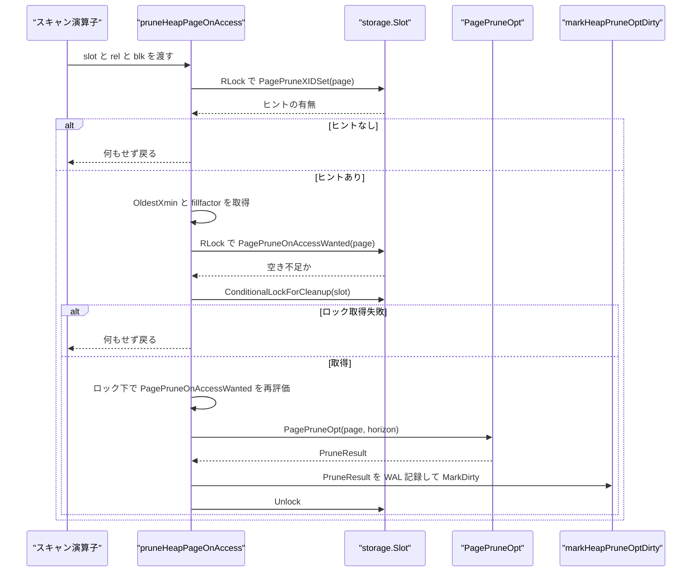
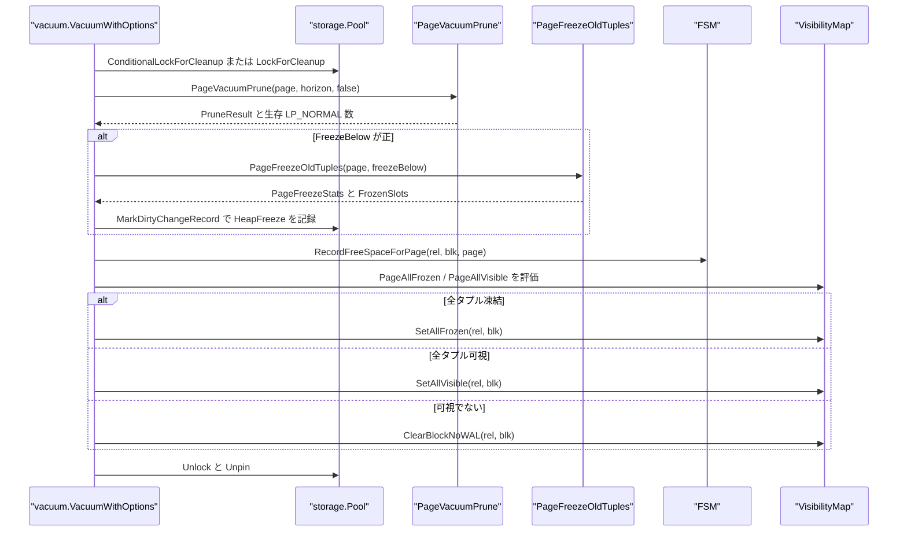
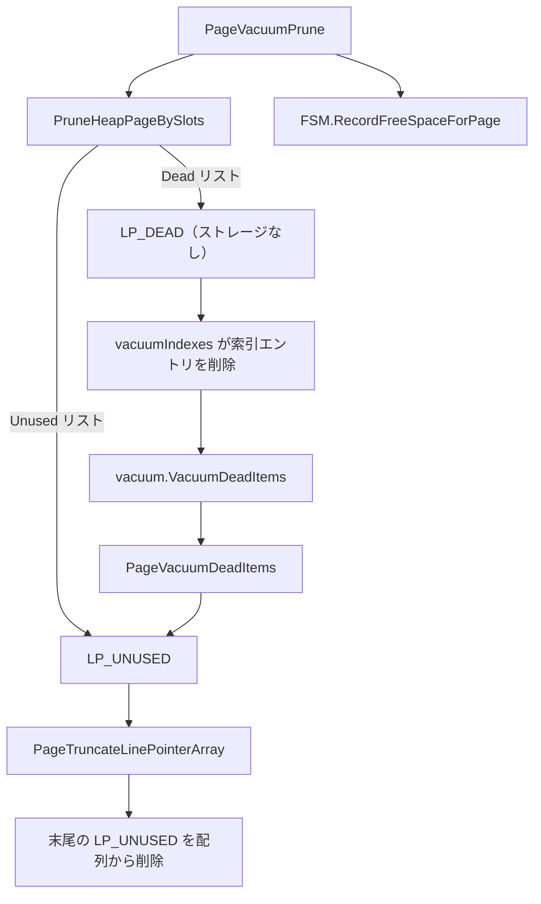
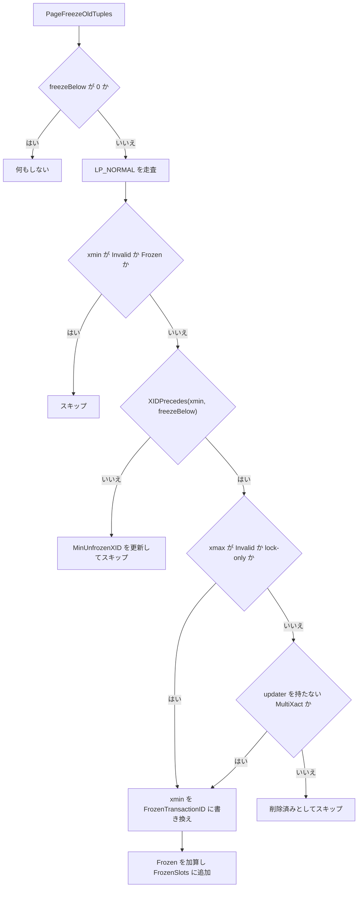

# ページプルーニングとフリーズ

<details>
<summary>関連ソースファイル</summary>

- [`internal/storage/prune.go`](https://github.com/ryogrid/goopg/blob/19856410e8d497d59787e1ab35a2febb3f5953d6/internal/storage/prune.go)
- [`internal/storage/freeze.go`](https://github.com/ryogrid/goopg/blob/19856410e8d497d59787e1ab35a2febb3f5953d6/internal/storage/freeze.go)
- [`internal/storage/heap.go`](https://github.com/ryogrid/goopg/blob/19856410e8d497d59787e1ab35a2febb3f5953d6/internal/storage/heap.go)
- [`internal/storage/linepointer.go`](https://github.com/ryogrid/goopg/blob/19856410e8d497d59787e1ab35a2febb3f5953d6/internal/storage/linepointer.go)
- [`internal/storage/lp_lifecycle.go`](https://github.com/ryogrid/goopg/blob/19856410e8d497d59787e1ab35a2febb3f5953d6/internal/storage/lp_lifecycle.go)
- [`internal/storage/bufpool.go`](https://github.com/ryogrid/goopg/blob/19856410e8d497d59787e1ab35a2febb3f5953d6/internal/storage/bufpool.go)
- [`internal/storage/vm.go`](https://github.com/ryogrid/goopg/blob/19856410e8d497d59787e1ab35a2febb3f5953d6/internal/storage/vm.go)
- [`internal/storage/fsm.go`](https://github.com/ryogrid/goopg/blob/19856410e8d497d59787e1ab35a2febb3f5953d6/internal/storage/fsm.go)
- [`internal/executor/prune_on_access.go`](https://github.com/ryogrid/goopg/blob/19856410e8d497d59787e1ab35a2febb3f5953d6/internal/executor/prune_on_access.go)
- [`internal/executor/operators_vacuum.go`](https://github.com/ryogrid/goopg/blob/19856410e8d497d59787e1ab35a2febb3f5953d6/internal/executor/operators_vacuum.go)
- [`internal/commands/vacuum/vacuum.go`](https://github.com/ryogrid/goopg/blob/19856410e8d497d59787e1ab35a2febb3f5953d6/internal/commands/vacuum/vacuum.go)
- [`internal/executor/operators_storage.go`](https://github.com/ryogrid/goopg/blob/19856410e8d497d59787e1ab35a2febb3f5953d6/internal/executor/operators_storage.go)

</details>

ページプルーニングは、ヒープページ上の死んだタプルを `LP_REDIRECT`・`LP_DEAD`・`LP_UNUSED` に振り分け、生き残ったタプルをページ後方へ再パックして空き領域を連続させる。フリーズは、十分に古い `xmin` を `FrozenTransactionID`（= 2）に書き換え、XID のラップアラウンド後もその行が全スナップショットに可視であり続けるようにする。どちらもページの排他内容ロック（プルーニングはさらに「自分だけがピンしている」クリーンアップロック）を前提とし、結果は WAL の論理レコード（プルーニングの `Redirects`/`Dead`/`Unused`、フリーズの `FrozenSlots`）として再適用できる形で返される。ページとタプルのバイト配置は [7.2 ページとヒープタプル](7.2-Page-and-Heap.md)、FSM/VM への反映は [7.4 空き領域マップと可視性マップ](7.4-FSM-and-Visibility-Map.md)、VACUUM 全体の駆動は [7.6 VACUUM と ANALYZE](7.6-Vacuum-and-Analyze.md) を参照。

## 責務

- 死んだタプルの判定。`TupleDeadToAll` が xmax の有無、lock-only、MultiXact の updater 解決、`XIDPrecedes` によるモジュロ比較、`XidCommitted` によるコミット確認を行う (`internal/storage/prune.go:TupleDeadToAll`)。
- HOT 鎖の追跡と振り分け。`pruneChainTip` が CTID をたどって生きた先端を探し、死んだ根を `LP_REDIRECT`、索引から参照され得る死んだ項目を `LP_DEAD`、HOT-only を `LP_UNUSED` にする (`internal/storage/prune.go:pagePruneCore`)。
- ページの再パック。`PruneHeapPageBySlots` が生存タプルを `pd_special` から 8 バイト境界で再配置し、`pd_upper` と `PD_HAS_FREE_LINES` を更新する (`internal/storage/heap.go:PruneHeapPageBySlots`)。
- 日和見プルーニング。`PagePruneOpt` が `pd_prune_xid` をゲートにし、`pruneHeapPageOnAccess` がスキャン中のページをクリーンアップロック付きでその場で刈る (`internal/executor/prune_on_access.go:pruneHeapPageOnAccess`)。
- VACUUM プルーニング。`PageVacuumPrune` がヒントに関係なく `pagePruneCore` を呼び、VACUUM の最初のヒープパスで死んだタプルを回収する (`internal/storage/prune.go:PageVacuumPrune`)。
- 2 段目のスロット回収。インデックス側の削除が終わった `LP_DEAD` を `PageVacuumDeadItems` が `LP_UNUSED` にし、`PageTruncateLinePointerArray` が配列末尾を切り詰める (`internal/storage/lp_lifecycle.go:PageVacuumDeadItems`)。
- タプルの凍結。`PageFreezeOldTuples` が `freezeBelow` より古い生きた `xmin` を `FrozenTransactionID` に書き換え、`FrozenSlots` と `MinUnfrozenXID` を返す (`internal/storage/freeze.go:PageFreezeOldTuples`)。
- フリーズの再適用。`PageFreezeBySlots` が WAL のスロット列をそのまま適用する。VACUUM が先にスロットを消していても、非 `LP_NORMAL` は読み飛ばして冪等に振る舞う (`internal/storage/freeze.go:PageFreezeBySlots`)。
- クリーンアップロックの提供。`ConditionalLockForCleanup` / `LockForCleanup` / `IsCleanupOK` が「排他内容ロック + ピンが 1 本だけ」を保証する (`internal/storage/bufpool.go:ConditionalLockForCleanup`)。

## 処理フロー

### 日和見プルーニング（スキャン中の回収）

スキャン演算子はページを 1 本だけピンした状態で `pruneHeapPageOnAccess` を呼ぶ。まず `pd_prune_xid` の有無を共有ロックで見て、次に `PagePruneOnAccessWanted` で「horizon より古い死の候補があり、ページが満杯か空き不足」を確認する。実際に刈るのは、待たずに取れるクリーンアップロックが取れた場合だけである。



`pruneHeapPageOnAccess` はスタンバイ、`enable_opportunistic_prune` が無効なセッション、OID が `pruneOnAccessFirstOID = 16384` 未満のカタログを除外する。エラーは握りつぶされ、スキャンはそのままページを読む。ロック取得後にもう一度 `PagePruneOnAccessWanted` を評価するのは、1 回目と 2 回目の間に別バックエンドがプルーニングしたり、ページを埋めたりし得るためである (`internal/executor/prune_on_access.go:pruneHeapPageOnAccess`)。

### VACUUM のプルーニングとフリーズ

VACUUM はページごとにクリーンアップロックを取り、最初のヒープパスでプルーニング、続いてフリーズ、最後に FSM と VM を更新する。クリーンアップロックが取れない非アグレッシブ実行では、`PageCountVacuumLive` で生存数だけを数えてページを変更しない。



プルーニングの WAL は、`PageVacuumPrune` が返した `Redirects`/`Dead`/`Unused` を `pool.MarkDirtyChangeRecord` で `LogHeapPruneOpt` に渡す。フリーズは `PageFreezeStats.FrozenSlots` を `LogHeapFreeze` に渡す。どちらもフックが nil なら `MarkDirty`（次回チェックポイントで FPI）にフォールバックする (`internal/commands/vacuum/vacuum.go:238`)。

### 死んだスロットの 2 段階回収

プルーニングが作る `LP_DEAD` は、索引エントリがまだ指しているため即座には再利用できない。VACUUM が全インデックスから該当 TID を消した後、2 段目の `VacuumDeadItems` が `LP_UNUSED` に変える。



`LP_DEAD` は索引が指している間はオフセット番号を保つ必要がある。`PruneHeapPageBySlots` は `Dead` リストの項目を `ItemID{Flags: ItemIDDead}`（Offset=0, Length=0）にするが、スロット番号自体は保持する。2 段目は「全スロットがストレージを持たない `LP_DEAD` である」ことを検証してから `LP_UNUSED` にし、末尾を切り詰める (`internal/storage/lp_lifecycle.go:PageVacuumDeadItems`)。

### フリーズ対象の判定



`freezeBelow` は `vacuumOp` が `nextXID - min(vacuum_freeze_min_age, autovacuum_freeze_max_age/2)` として計算し、必ず `OldestXmin` 以下にクランプする。`VACUUM (FREEZE)` は `freezeMinAge = 1` にする (`internal/executor/operators_vacuum.go:91`)。フリーズ対象は「実在の XID」「`freezeBelow` より古い」「行が生きている」の 3 条件を満たす必要がある。

## 主要ファイル

| ファイル | 役割 |
| --- | --- |
| `internal/storage/prune.go` | `PruneResult`、`PagePruneOpt`、`PageVacuumPrune`、`pagePruneCore`、`TupleDeadToAll`、`pruneChainTip` (`internal/storage/prune.go:pagePruneCore`) |
| `internal/storage/heap.go` | `PruneHeapPageBySlots` による再パック、`CollectDeadHeapSlots`、`PageSetItemIDRedirect` / `PageSetItemIDDead`、`XIDPrecedes` (`internal/storage/heap.go:PruneHeapPageBySlots`) |
| `internal/storage/freeze.go` | `PageFreezeStats`、`PageFreezeOldTuples`、`PageFreezeBySlots` (`internal/storage/freeze.go:PageFreezeOldTuples`) |
| `internal/storage/lp_lifecycle.go` | `PageVacuumDeadItems`、`PageTruncateLinePointerArray`、`heap_lp_lifecycle` 能力 (`internal/storage/lp_lifecycle.go:PageVacuumDeadItems`) |
| `internal/storage/linepointer.go` | ペイロードを持たないライン・ポインタの予約・削除・`LP_NORMAL` 化 (`internal/storage/linepointer.go:PageReserveLinePointer`) |
| `internal/storage/bufpool.go` | `IsCleanupOK`、`ConditionalLockForCleanup`、`LockForCleanup`、`MarkDirtyChangeRecord` (`internal/storage/bufpool.go:ConditionalLockForCleanup`) |
| `internal/storage/vm.go` | `PageAllVisible` / `PageAllFrozen` と VM ビット更新 (`internal/storage/vm.go:PageAllFrozen`) |
| `internal/storage/fsm.go` | `RecordFreeSpaceForPage` によるプルーニング後の空き領域記録 (`internal/storage/fsm.go:RecordFreeSpaceForPage`) |
| `internal/executor/prune_on_access.go` | スキャン時の日和見プルーニングのゲートとクリーンアップロック (`internal/executor/prune_on_access.go:pruneHeapPageOnAccess`) |
| `internal/commands/vacuum/vacuum.go` | VACUUM のページ走査、`PageVacuumPrune` / `PageFreezeOldTuples` の呼び出し、FSM/VM 更新 (`internal/commands/vacuum/vacuum.go:238`) |
| `internal/executor/operators_vacuum.go` | `VacuumOptions` の組み立て、フリーズ horizon の計算、2 段目パスの起動 (`internal/executor/operators_vacuum.go:vacuumOp`) |
| `internal/executor/operators_storage.go` | `markHeapPruneOptDirty`（日和見プルーニングの WAL 記録と MarkDirty） (`internal/executor/operators_storage.go:markHeapPruneOptDirty`) |

## 公開 API / エントリポイント

- 日和見プルーニング: `PagePruneOpt(p Page, oldestXmin TransactionID) (PruneResult, error)`、`PagePruneXIDSet(p Page) bool`、`PagePruneOnAccessWanted(p Page, oldestXmin TransactionID, fillfactor int) bool`。
- VACUUM プルーニング: `PageVacuumPrune(p Page, oldestXmin TransactionID, markUnusedNow bool) (PruneResult, int, error)`、`PageCountVacuumLive(p Page, oldestXmin TransactionID) (int, error)`、`PageDeadItems(p Page) ([]uint16, error)`。
- 判定・列挙: `TupleDeadToAll(hdr HeapTupleHeader, oldestXmin TransactionID) bool`、`CollectDeadHeapSlots(p Page, isDead func(HeapTupleHeader) bool) ([]uint16, error)`、`VacuumHeapPage(p Page, isDead func(HeapTupleHeader) bool)`、`VacuumHeapPageBySlots`、`PruneHeapPageBySlots`。
- ライン・ポインタ: `PageSetItemIDRedirect(p, slot, targetSlot)`、`PageSetItemIDDead(p, slot)`、`PageVacuumDeadItems(p, slots) (int, error)`、`PageTruncateLinePointerArray(p) error`。
- フリーズ: `PageFreezeOldTuples(p Page, freezeBelow TransactionID) (PageFreezeStats, error)`、`PageFreezeBySlots(p Page, frozenSlots []uint16) error`。
- クリーンアップロック: `IsCleanupOK(s *Slot) bool`、`ConditionalLockForCleanup(s *Slot) bool`、`LockForCleanup(s *Slot)`。
- 可視性・空き領域: `PageAllVisible(p, horizon)`、`PageAllFrozen(p, freezeBelow)`、`FSM.RecordFreeSpaceForPage(rel, blk, p)`。

## 主要データ構造

### PruneResult — プルーニングが行った操作

```go
// PruneResult carries the actions taken by PagePruneOpt so the caller can
// emit a WAL record with sufficient information for crash-safe replay.
type PruneResult struct {
	// Redirects is a list of (oldSlot, newSlot) pairs: line pointers that
	// were converted from ItemIDNormal to ItemIDRedirect. The index still
	// points to oldSlot; the redirect leads to the live chain tip newSlot.
	Redirects [][2]uint16
	// Unused is the list of 1-based slot numbers marked ItemIDUnused: dead
	// HEAP_ONLY tuples, which no index entry points at. Under
	// markUnusedNow (VACUUM of a relation with no indexes) the Dead items
	// below land here instead.
	Unused []uint16
	// Dead is the list of 1-based slot numbers marked ItemIDDead with no
	// storage: dead non-HOT tuples and dead chain roots with no live tip.
	// Index entries still point at them, so they stay LP_DEAD until VACUUM
	// has removed those entries (heap_prune_record_dead, pruneheap.c;
	// M0145-0008v).
	Dead []uint16
}
```

`internal/storage/prune.go:PruneResult`（3〜21 行）。`Reclaimed()` は 3 つのリスト長の合計を返す (`internal/storage/prune.go:Reclaimed`)。

- `Redirects[oldSlot, newSlot]` は同じページ内の転送。`oldSlot` は索引が指す根、`newSlot` は生きた鎖の先端である。両者が同じ、または先端が 0 の場合は redirect を作らず `Dead` に入る。
- `Unused` は索引から参照されないスロットだけを含む。`markUnusedNow == true`（索引のないリレーションの VACUUM）では、本来 `Dead` に行く項目もここへ移る。
- `Dead` は索引がまだ参照しているため `LP_DEAD` として残す。スロット番号は保持されるが、タプル本体は再パックで回収される。
- 3 つのリストは同一スロットに重複して現れない。WAL はこの 3 リストをそのまま記録し、再適用側は `PruneHeapPageBySlots` に同じリストを渡す。

### PageFreezeStats — 凍結結果

```go
// PageFreezeStats summarises one tuple-freeze pass over a heap page.
type PageFreezeStats struct {
	Frozen         int           // number of xmin values rewritten
	MinUnfrozenXID TransactionID // lowest xmin NOT frozen (0 = all frozen / none present)
	// FrozenSlots is the 1-based slot list of LP_NORMAL line pointers
	// whose tuple xmin was rewritten to FrozenTransactionID. Captured
	// for the M0080-0001 `RecordKindHeapFreeze` WAL record so replay
	// can reapply the same transformation deterministically. Always
	// in ascending order. (M0080-0001.)
	FrozenSlots []uint16
}
```

`internal/storage/freeze.go:PageFreezeStats`（5〜15 行）。

- `Frozen` は書き換えた `xmin` の個数。`FrozenSlots` はスロット走査順の 1 始まりリストで、常に昇順になる。
- `MinUnfrozenXID` は「古いが凍結条件を満たさなかった `xmin`」の最小値。ページ上に若い `xmin` が残っていれば `relfrozenxid` の前進を止める材料になる。
- 削除済み（lock-only でない `xmax` を持つ）タプルは、たとえ `xmin` が古くても凍結せず、`MinUnfrozenXID` の計算にも入らない。VACUUM が別途回収する対象だからである。

### HeapPageVacuumStats — 再パック結果

```go
// HeapPageVacuumStats reports the outcome of a single-page vacuum.
type HeapPageVacuumStats struct {
	Dead int // line pointers transitioned LP_NORMAL -> LP_UNUSED
	Live int // tuples that survived this pass
}
```

`internal/storage/heap.go:HeapPageVacuumStats`（1160〜1164 行）。`Dead` は `PruneHeapPageBySlots` が `Unused` または `Dead` のリストで処理したライン・ポインタ数、`Live` は再パック後も `LP_NORMAL` として残ったタプル数である。`PageVacuumPrune` はこの `Live` を VACUUM の `reltuples` 計算に返す (`internal/storage/prune.go:pagePruneCore`)。

## 内部構造

### 死んだタプルの 3 分類

`pagePruneCore` は各ライン・ポインタを次のように分類する。

1. **`ItemIDRedirect`** — 以前のプルーニングが作った根。`pruneChainTip` で先端を探し、生きていれば redirect を張り直し、鎖全体が死んでいれば `Dead` に入れる。redirect を単なる「読み飛ばし対象」にすると、同じパスで転送先の `LP_UNUSED` が確定し、索引エントリが消えた行を指したままになる。
2. **`LP_NORMAL` で死んでいる HOT-only** — 索引から参照されないので `Unused`。
3. **`LP_NORMAL` で死んでいる HOT 根** — `CTID.Offset` から生きている先端を探し、見つかれば `Redirects`、見つからなければ `Dead`。
4. **`LP_NORMAL` で死んでいる非 HOT タプル** — 索引が直接指しているので `Dead`。

死んでいない `LP_NORMAL` は `liveNormals` に数えるだけである。`Reclaimed() == 0` ならページは一切変更されず、`pd_prune_xid` もクリアされない (`internal/storage/prune.go:pagePruneCore`)。

### 死判定の条件と MultiXact

`TupleDeadToAll` は次の順で判定する。

1. `Xmax == InvalidTransactionID` なら偽（削除されていない）。
2. `HEAP_XMAX_LOCK_ONLY` が立っていれば偽（行ロックであって削除ではない）。
3. `HEAP_XMAX_IS_MULTI` なら `ResolveMultiUpdater` で updater を取り出す。フックが nil、未解決、updater なしのいずれかなら偽（保守的）。
4. 実効 xmax が `oldestXmin` より前でなければ偽。比較は `XIDPrecedes` の符号付き 32 bit 差で行い、ラップアラウンド後も「円環上で前」を正しく判定する。
5. `XidCommitted != nil && XidCommitted(effXmax)` が真のときだけ死と判定する。アボートした削除者の xmax は物理的に残るため、コミット確認なしに回収すると生きた行を破壊する。

`ResolveMultiUpdater` と `XidCommitted` はストレージが `internal/multixact` や CLOG を import しないための注入フックで、起動時に配線される (`internal/storage/prune.go:TupleDeadToAll`)。

### HOT 鎖の終端条件

`pruneChainTip` は `MaxHeapTuplesPerPage = 291` を歩数上限とする。1 ページ上の相異なるスロット数を超えて歩いた時点で循環と断定できるためで、以前の固定 64 歩では 65 版目以降の行が索引から到達不能になった。次のいずれかで 0（鎖全体が死んでいる）を返す。

- スロットが `LP_NORMAL` でない、または範囲外・パース不能。
- タプルが `HEAP_HOT_UPDATED` でない（`CTID` が別ブロックを指し得るため、このページの鎖はここで終わる）。
- `CTID.Offset == cur` の自己参照。
- 291 歩を超えた。

`pruneChainTip` は「死んでいる」タプルだけをたどり、最初の生きたタプルを見つけたらそのスロットを返す (`internal/storage/prune.go:pruneChainTip`)。

### 再パックの手順

`PruneHeapPageBySlots` はまず `Unused` と `Dead` の全要素を範囲検査し、1 つでも不正ならページを変更せずエラーを返す。次に生存タプル（`LP_NORMAL`）の本体を別スライスへコピーし、タプル領域 `[lineEnd, special)` をゼロ化し、`pd_special` から `maxAlign8(len(body))` ずつ下げながら再配置する。各生存ライン・ポインタの `Offset` を新しい位置に更新し、`pd_upper` を最終位置に設定する。`Dead` リストの項目は `ItemIDDead`（ストレージなし）、`Unused` は `ItemIDUnused` になる。最後に `LP_UNUSED` が残っていれば `PD_HAS_FREE_LINES` を立て、なければ落とす (`internal/storage/heap.go:PruneHeapPageBySlots`)。

再パックは `pd_special` を上限にするため、special 領域を持つページ（B-tree など）でもタプル領域だけを動かす。ただしこの関数はヒープページ専用で、`lineEnd = SizeOfPageHeaderData + count*itemIDSize` をタプル領域の下端として扱う。

### クリーンアップロックの意味

プルーニングはタプル本体を移動するため、他のバックエンドがページをピンしたままタプルを読んでいると、その読み取りが壊れる。`Pool` のクリーンアップロックは「排他内容ロックを保持し、かつ自分を含むピン数がちょうど 1」という状態を要求する。

- `ConditionalLockForCleanup` は `contentMu.TryLock` を取り、`IsCleanupOK`（`statePin == 1`）でなければ即座に解放して false を返す。
- `LockForCleanup` は 50 マイクロ秒から倍々にバックオフし、`cleanupLockMaxBackoff = 10ms` で頭打ちにして再試行する。他のピンが外れるまで排他ロックを離すので、待機中に他者がページを読める。
- 呼び出し元が同じページに 2 本目のピンを持っていると `IsCleanupOK` が永久に偽になり、`LockForCleanup` は戻らない。これは PG の `LockBufferForCleanup` と同じ前提である。

日和見プルーニングは `ConditionalLockForCleanup` だけを使い、取れなければ諦める。VACUUM は非アグレッシブなら条件付き、アグレッシブなら `LockForCleanup` で待つ (`internal/commands/vacuum/vacuum.go:209`)。

### pd_prune_xid と日和見ゲート

`pd_prune_xid` は「このページで最初にプルーニング可能になった xid」を保持する。`pageSetPrunablePG` は既存値より古い xid のときだけ更新するため、フィールドは単調に減少する。新しい値で上書きすると、horizon がその値を追い越せず、日和見プルーニングも HOT 経路の `PagePruneOpt` も永久に走らない。

`PagePruneOnAccessWanted` は次の両方を要求する。

- `pd_prune_xid != InvalidTransactionID` かつ `XIDPrecedes(pd_prune_xid, oldestXmin)`。
- `PDPageFull` が立っている、または `PageGetHeapFreeSpace(p) < max(fillfactor 予約, BlockSize/10)`。

`fillfactor <= 0` または `> 100` は `HeapDefaultFillfactor = 100` とみなす。`BlockSize/10 = 819` バイトが下限なので、fillfactor が高くても 819 バイト未満の空きしかないページは日和見プルーニングの対象になる (`internal/storage/prune.go:PagePruneOnAccessWanted`)。

### フリーズと XID のモジュロ順序

フリーズは `xmin` を `FrozenTransactionID = 2` に置き換える。`FrozenTransactionID < FirstNormalTransactionID(3) <= すべてのスナップショットの Xmin` なので、既存の可視性判定は特別扱いなしに凍結タプルを可視と判定できる。`PageFreezeOldTuples` は `XIDPrecedes(xmin, freezeBelow)` で古さを判定し、単純な `>=` を使わない。ラップアラウンド後は数値の大小が逆転するためである (`internal/storage/freeze.go:PageFreezeOldTuples`)。

フリーズ対象は「行が生きている」ことも要求する。`xmax` が無効、または lock-only なら生きている。`HEAP_XMAX_IS_MULTI` の場合は `ResolveMultiUpdater` を呼び、updater を持たない（全員ロッカー）と解決できた場合だけ生きているとみなす。未解決の MultiXact は「削除された」側に倒し、凍結しない。

### 2 段目パスと能力ゲート

`PageVacuumDeadItems` は全スロットを先に検証する。各スロットが `ItemIDDead` で `Length == 0` でなければ `ErrUnsupportedItem` を返し、ページを一切変更しない。検証後に一括で `LP_UNUSED` にし、`PageTruncateLinePointerArray` を呼ぶ。`PageTruncateLinePointerArray` は末尾から `LP_UNUSED` を数え、最初の項目は必ず残し、`pd_lower` を縮めて該当バイトをゼロ化し、`PD_HAS_FREE_LINES` を更新する (`internal/storage/lp_lifecycle.go:PageTruncateLinePointerArray`)。

2 段目自体は `heap_lp_lifecycle` 能力が有効なクラスタでだけ動く。能力のないクラスタの `LP_UNUSED` は索引が参照している可能性があり、再利用すると索引が別の行を指す。`VacuumDeadItems` は能力が偽なら 0 を返して何もしない (`internal/executor/operators_vacuum.go:335`)。

### WAL との関係

日和見プルーニングは `markHeapPruneOptDirty` が `LogHeapPruneOpt` に `Redirects`/`Dead`/`Unused` を渡し、フックが nil なら `MarkDirty` にフォールバックする。VACUUM のプルーニングも同じ `LogHeapPruneOpt` を使い、フリーズは `LogHeapFreeze` に `FrozenSlots` を渡す。再適用は `PruneHeapPageBySlots` と `PageFreezeBySlots` が担い、どちらも元のスロット列をそのまま適用するため、元の実行とリプレイでページがビット単位に一致する (`internal/executor/operators_storage.go:markHeapPruneOptDirty`)。

### プルーニング後の FSM/VM

VACUUM はプルーニングとフリーズの後に `FSM.RecordFreeSpaceForPage(rel, blk, page)` を呼び、再パック後の `pd_upper - pd_lower` を FSM に記録する。可視性は `PageAllFrozen` → `SetAllFrozen`、`PageAllVisible` → `SetAllVisible`、どちらでもない → `PageClearAllVisible` + `ClearBlockNoWAL` の順で決まる。日和見プルーニングは FSM/VM を直接更新しない。ページを刈った結果は次にそのページを通る VACUUM か、`markHeapPruneOptDirty` の WAL 再適用後の再評価で反映される (`internal/commands/vacuum/vacuum.go:316`)。

## エッジケースと不変条件

- **`oldestXmin` が無効**: `PagePruneOpt` と `PageVacuumPrune` は `InvalidTransactionID` を渡されると何も変更せず空の結果を返す。horizon を計算できない呼び出し元が全タプルを死と判定しないためのガードである。
- **ヒントなし・古くない**: `PagePruneOpt` は `pd_prune_xid` が未設定、または `oldestXmin` 以上なら `pagePruneCore` を呼ばずに戻る。`PageVacuumPrune` はヒントを見ずに必ず `pagePruneCore` を呼ぶ。
- **回収 0 件**: `pagePruneCore` は `Reclaimed() == 0` のときページを変更せず、`pd_prune_xid` もクリアしない。次回の日和見プルーニングで再度試される。
- **原子性**: `PruneHeapPageBySlots` と `PageVacuumDeadItems` は全スロットを先に検証し、1 つでも不正ならページを変更しない。エラー時に部分適用されたページは残らない。
- **壊れた項目**: `pagePruneCore` は範囲外・パース不能な `LP_NORMAL` を黙ってスキップする。`PageCountVacuumLive` も同じ扱いで、VACUUM を止めない。
- **redirect の再訪**: 以前のプルーニングが作った `ItemIDRedirect` も鎖の根として再評価する。これを飛ばすと、転送先が同じパスで `LP_UNUSED` になり、索引エントリが消えた行を指す。
- **HOT 以外の CTID**: `pruneChainTip` は `HEAP_HOT_UPDATED` でないタプルの `CTID.Offset` を追わない。非 HOT 更新の CTID は別ブロックを指し得るため、このページのスロットを追うと無関係な行へ redirect を張ってしまう。
- **鎖の上限**: `MaxHeapTuplesPerPage = 291` 歩を超えた鎖は 0（全滅）として扱う。自己参照も 0。
- **クリーンアップロック**: プルーニングは必ずクリーンアップロックの下で行う。日和見は `ConditionalLockForCleanup` で取れなければ諦め、VACUUM は非アグレッシブなら条件付き、アグレッシブなら最大 10 ms のバックオフで待つ。自分で 2 本目のピンを持つと `LockForCleanup` は永久に戻らない。
- **`LP_DEAD` の形**: ヒープのプルーニングが作る `LP_DEAD` はストレージを持たない（`Offset=0, Length=0`）。`PageVacuumDeadItems` は `Length != 0` の `LP_DEAD` を拒否する。B-tree の `PageSetItemIDDead` は逆に `Offset`/`Length` を保存するが、これは索引ページの二分探索用であり、ヒープの 2 段目とは別物である。
- **能力ゲート**: `heap_lp_lifecycle` が無効なクラスタでは 2 段目を実行せず、`PageAddHeapTuple` も `LP_UNUSED` を再利用しない。古いクラスタの `LP_UNUSED` を索引が参照している可能性があるためである。
- **フリーズの no-op**: `freezeBelow == 0` は何もしない。`InvalidTransactionID` や `FrozenTransactionID` の `xmin` はスキップする。
- **フリーズと削除**: `xmax` が非 Invalid かつ lock-only でないタプルは、`xmin` が古くても凍結しない。updater を持たない MultiXact だけは「全員ロッカー」として生きたまま凍結できる。
- **フリーズの再適用**: `PageFreezeBySlots` は範囲外スロットで `ErrInvalidSlot` を返すが、非 `LP_NORMAL` と壊れた項目は読み飛ばす。WAL 記録後に VACUUM がスロットを消したケースでも失敗しない。`xmin` が既に `FrozenTransactionID` なら書き換えは no-op で冪等である。
- **`pd_prune_xid` の単調性**: `pageSetPrunablePG` は既存値より古い xid のときだけ更新する。新しい値で上書きすると、horizon が追い越せずプルーニングのきっかけが永久に失われる。
- **VM との整合**: プルーニングはページの `PD_ALL_VISIBLE` を直接操作しない。VACUUM が `PageAllVisible` / `PageAllFrozen` を再評価し、可視でなくなったページは `PageClearAllVisible` と `ClearBlockNoWAL` でビットを落とす。日和見プルーニングは VM を更新しないため、次回の VACUUM まで古いビットが残り得るが、可視性の偽陽性を避ける方向（ビットを落とす）にだけ働く。

Sources:

- `internal/storage/prune.go`
- `internal/storage/freeze.go`
- `internal/storage/heap.go`
- `internal/storage/linepointer.go`
- `internal/storage/lp_lifecycle.go`
- `internal/storage/bufpool.go`
- `internal/storage/vm.go`
- `internal/storage/fsm.go`
- `internal/executor/prune_on_access.go`
- `internal/executor/operators_vacuum.go`
- `internal/commands/vacuum/vacuum.go`
- `internal/executor/operators_storage.go`

<sub>Generated by deepwiki-4myself from `goopg` @ `19856410e`</sub>
