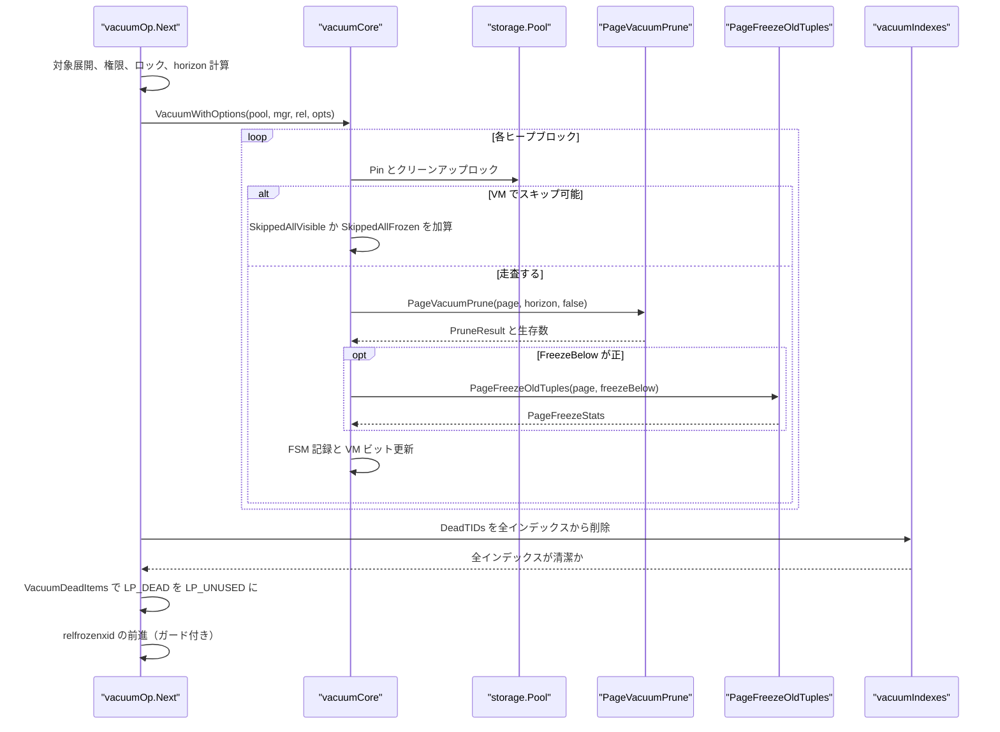
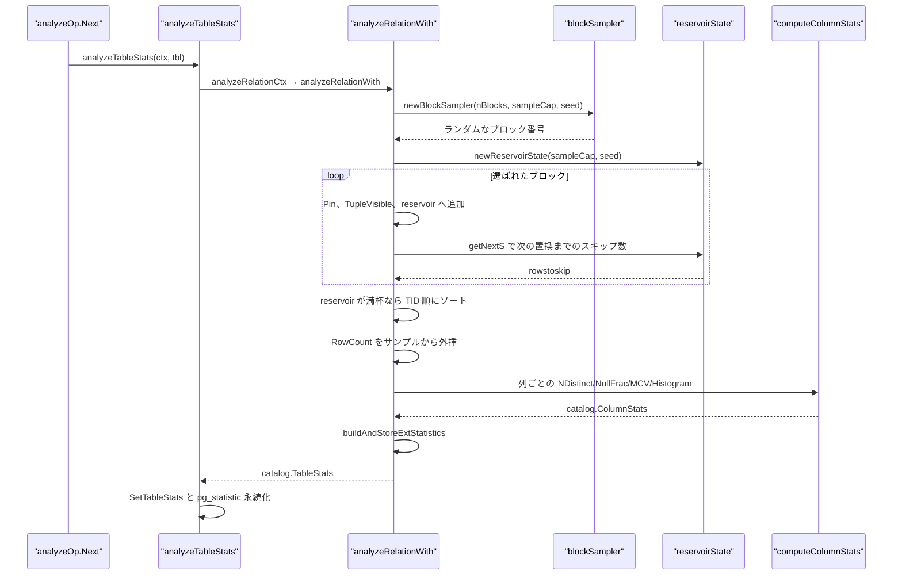
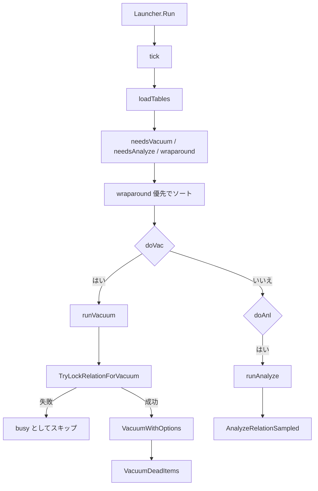
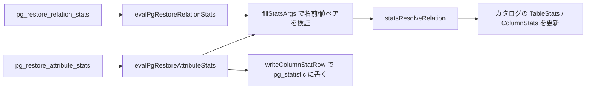

# VACUUM と ANALYZE

<details>
<summary>関連ソースファイル</summary>

- [`internal/commands/vacuum/vacuum.go`](https://github.com/ryogrid/goopg/blob/19856410e8d497d59787e1ab35a2febb3f5953d6/internal/commands/vacuum/vacuum.go)
- [`internal/commands/vacuum/dead_items_pass.go`](https://github.com/ryogrid/goopg/blob/19856410e8d497d59787e1ab35a2febb3f5953d6/internal/commands/vacuum/dead_items_pass.go)
- [`internal/commands/vacuum/relation_gate.go`](https://github.com/ryogrid/goopg/blob/19856410e8d497d59787e1ab35a2febb3f5953d6/internal/commands/vacuum/relation_gate.go)
- [`internal/executor/operators_vacuum.go`](https://github.com/ryogrid/goopg/blob/19856410e8d497d59787e1ab35a2febb3f5953d6/internal/executor/operators_vacuum.go)
- [`internal/executor/operators_analyze.go`](https://github.com/ryogrid/goopg/blob/19856410e8d497d59787e1ab35a2febb3f5953d6/internal/executor/operators_analyze.go)
- [`internal/executor/analyze_block_sampler.go`](https://github.com/ryogrid/goopg/blob/19856410e8d497d59787e1ab35a2febb3f5953d6/internal/executor/analyze_block_sampler.go)
- [`internal/executor/extstats_build.go`](https://github.com/ryogrid/goopg/blob/19856410e8d497d59787e1ab35a2febb3f5953d6/internal/executor/extstats_build.go)
- [`internal/executor/extstats_dependencies.go`](https://github.com/ryogrid/goopg/blob/19856410e8d497d59787e1ab35a2febb3f5953d6/internal/executor/extstats_dependencies.go)
- [`internal/executor/extstats_ndistinct.go`](https://github.com/ryogrid/goopg/blob/19856410e8d497d59787e1ab35a2febb3f5953d6/internal/executor/extstats_ndistinct.go)
- [`internal/executor/stats_import.go`](https://github.com/ryogrid/goopg/blob/19856410e8d497d59787e1ab35a2febb3f5953d6/internal/executor/stats_import.go)
- [`internal/postmaster/autovacuum/launcher.go`](https://github.com/ryogrid/goopg/blob/19856410e8d497d59787e1ab35a2febb3f5953d6/internal/postmaster/autovacuum/launcher.go)
- [`internal/storage/freeze.go`](https://github.com/ryogrid/goopg/blob/19856410e8d497d59787e1ab35a2febb3f5953d6/internal/storage/freeze.go)
- [`internal/storage/prune.go`](https://github.com/ryogrid/goopg/blob/19856410e8d497d59787e1ab35a2febb3f5953d6/internal/storage/prune.go)

</details>

`internal/commands/vacuum` は、リレーションの全ヒープブロックを走査して死んだタプルを回収し、必要なら凍結・FSM/VM 更新・末尾切り詰めまで行う VACUUM の本体を持つ。`internal/executor` 側の `vacuumOp` が SQL の `VACUUM` を、`analyzeOp` が `ANALYZE` を駆動し、ANALYZE は PostgreSQL と同じ 2 段サンプリング（ブロックを Knuth の Algorithm S で選び、その中で Vitter の Algorithm Z により行を reservoir サンプルする）で `pg_statistic` と拡張統計を更新する。`internal/postmaster/autovacuum` の `Launcher` は一定間隔でカタログを走査し、しきい値と XID のラップアラウンド危険度から VACUUM/ANALYZE を自動起動する。ページの回収アルゴリズム自体は [7.5 ページプルーニングとフリーズ](7.5-Pruning-and-Freeze.md)、FSM/VM の詳細は [7.4 空き領域マップと可視性マップ](7.4-FSM-and-Visibility-Map.md) を参照。

## 責務

- リレーション全体の死んだタプル回収。`vacuumCore` がブロックごとに `Pool.Pin` → クリーンアップロック → `PageVacuumPrune` → WAL 記録、を繰り返す (`internal/commands/vacuum/vacuum.go:vacuumCore`)。
- VM スキップと最終ブロック。非アグレッシブ実行では `VM.AllVisible` のページを飛ばし、最後のブロックだけは末尾切り詰めの判断のために必ず走査する (`internal/commands/vacuum/vacuum.go:169`)。
- フリーズの適用。`FreezeBelow` が正なら `PageFreezeOldTuples` を呼び、`FrozenSlots` を `LogHeapFreeze` の論理レコードにする (`internal/commands/vacuum/vacuum.go:286`)。
- 2 段目のヒープパス。全インデックスから死んだ TID を消した後、`VacuumDeadItems` が `LP_DEAD` を `LP_UNUSED` にし、末尾を切り詰める (`internal/commands/vacuum/dead_items_pass.go:VacuumDeadItems`)。
- VACUUM の相互排他。`relationVacuumGate` がリレーションごとに 1 つの VACUUM だけを最初のヒープパスから 2 段目まで通す (`internal/commands/vacuum/relation_gate.go:LockRelationForVacuum`)。
- SQL `VACUUM` の駆動。`vacuumOp.Next` が対象の展開、権限・ロック・存在確認、フリーズ horizon の計算、`VacuumWithOptions` の呼び出し、`relfrozenxid` の更新、インデックス掃除、`VACUUM ANALYZE` を行う (`internal/executor/operators_vacuum.go:vacuumOp`)。
- SQL `ANALYZE` の駆動。`analyzeOp.Next` が対象を展開し、`analyzeTableStats` → `analyzeRelationCtx` → `analyzeRelationWith` でサンプルと統計を計算する (`internal/executor/operators_analyze.go:analyzeOp`)。
- PG 互換の 2 段サンプリング。`blockSampler`（Algorithm S）と `reservoirState`（Algorithm Z）を pg_prng の xoroshiro128** で駆動する (`internal/executor/analyze_block_sampler.go:blockSampler`)。
- 拡張統計の構築。`buildAndStoreExtStatistics` が ndistinct と functional dependencies を構築し、`pg_statistic_ext_data` に書く (`internal/executor/extstats_build.go:buildAndStoreExtStatistics`)。
- 統計のインポート。`pg_restore_relation_stats` / `pg_restore_attribute_stats` の引数を `fillStatsArgs` で検証し、カタログと `pg_statistic` に反映する (`internal/executor/stats_import.go:evalPgRestoreRelationStats`)。
- 自動 VACUUM/ANALYZE。`Launcher.tick` が `needsVacuum` / `needsAnalyze` / `wraparound` を評価し、ラップアラウンド危険のある表を優先して `runVacuum` / `runAnalyze` する (`internal/postmaster/autovacuum/launcher.go:tick`)。

## 処理フロー

### VACUUM の全体経路

手動 VACUUM は `vacuumOp.Next` から `vacuum.VacuumWithOptions` に入り、ページごとの回収・凍結・FSM/VM 更新を経て、最後にインデックス掃除と 2 段目パスへ進む。



`vacuumCore` はページの WAL を `LogHeapPruneOpt`、フリーズを `LogHeapFreeze` に渡す。フックが nil のテストプールでは `MarkDirty` にフォールバックし、次回チェックポイントの FPI で永続化する (`internal/commands/vacuum/vacuum.go:252`)。`VacuumWithOptions` のエラーは `vacuumOp.Next` ではセッションを中断させず、`vacuumed = err == nil` として後続の `VACUUM ANALYZE` の ANALYZE だけを抑止する (`internal/executor/operators_vacuum.go:279`)。

### ANALYZE の 2 段サンプリング

`analyzeRelationWith` はまず `sampleCap = target * 300`（既定 target 100 なら 30,000 行）を決め、ブロックサンプラと行 reservoir をそれぞれ別のシードで初期化する。ブロックは `blockSampler` が Algorithm S で選び、選ばれたブロック内の可視行だけを `reservoirState` の Algorithm Z で間引く。



`RowCount` は `floor((liverows / sampledBlocks) * nBlocks + 0.5)` で外挿され、全ブロックをサンプルした小さいリレーションでは厳密値に退化する。`reservoir` が満杯になった場合だけ `reservoirTID` で物理順にソートし直す。これは相関（correlation）の計算が reservoir の添字順を物理順として使うためで、PG の `compare_rows` に相当する (`internal/executor/operators_analyze.go:1051`)。

### オートバキュームのディスパッチ



`tick` は候補ごとに `wrap`（ラップアラウンド危険）、`doVac`、`doAnl` を計算し、`wrap` を先、次に `RelFrozenXID` の小さい順で安定ソートする。`wrap` の表は `MinVacuumAge` の壁時計制限を無視して毎回実行される (`internal/postmaster/autovacuum/launcher.go:159`)。

### 統計インポート



`fillStatsArgs` は引数が偶数個の名前/値ペアであること、名前が `text` であること、既知の引数名であること、値の型が仕様と一致することを検査する。未知の名前は WARNING を出して `ok=false` を返す (`internal/executor/stats_import.go:fillStatsArgs`)。

## 主要ファイル

| ファイル | 役割 |
| --- | --- |
| `internal/commands/vacuum/vacuum.go` | `Stats`、`VacuumOptions`、`vacuumCore`、`VacuumWithOptions`、末尾切り詰め、旧 `Analyze` (`internal/commands/vacuum/vacuum.go:vacuumCore`) |
| `internal/commands/vacuum/dead_items_pass.go` | VACUUM 2 段目。`VacuumDeadItems` と `vacuumDeadItemsOnPage` (`internal/commands/vacuum/dead_items_pass.go:VacuumDeadItems`) |
| `internal/commands/vacuum/relation_gate.go` | リレーション単位の VACUUM ゲート。`LockRelationForVacuum` / `TryLockRelationForVacuum` (`internal/commands/vacuum/relation_gate.go:LockRelationForVacuum`) |
| `internal/executor/operators_vacuum.go` | `vacuumOp` の対象展開・ロック・フリーズ horizon・`VACUUM ANALYZE`・インデックス掃除 (`internal/executor/operators_vacuum.go:vacuumOp`) |
| `internal/executor/operators_analyze.go` | `analyzeOp`、`analyzeTableStats`、`analyzeRelationWith`、列統計計算、`pg_statistic` 永続化 (`internal/executor/operators_analyze.go:analyzeRelationWith`) |
| `internal/executor/analyze_block_sampler.go` | `blockSampler`（Algorithm S）と `reservoirState`（Algorithm Z） (`internal/executor/analyze_block_sampler.go:blockSampler`) |
| `internal/executor/extstats_build.go` | 拡張統計の対象解決と `pg_statistic_ext_data` 書き込み (`internal/executor/extstats_build.go:buildAndStoreExtStatistics`) |
| `internal/executor/extstats_ndistinct.go` | 多変量 ndistinct の構築・シリアライズ (`internal/executor/extstats_ndistinct.go:buildExtNDistinct`) |
| `internal/executor/extstats_dependencies.go` | functional dependency の構築・シリアライズ (`internal/executor/extstats_dependencies.go:buildExtDependencies`) |
| `internal/executor/stats_import.go` | PG18 統計インポート関数の引数処理とカタログ反映 (`internal/executor/stats_import.go:evalPgRestoreRelationStats`) |
| `internal/postmaster/autovacuum/launcher.go` | `Launcher` の tick、しきい値、フリーズ cutoff、`runVacuum` / `runAnalyze` (`internal/postmaster/autovacuum/launcher.go:Launcher`) |
| `internal/storage/freeze.go` | `PageFreezeOldTuples` と `PageFreezeBySlots` (`internal/storage/freeze.go:PageFreezeOldTuples`) |
| `internal/storage/prune.go` | `PageVacuumPrune`、`TupleDeadToAll`、`pruneChainTip` (`internal/storage/prune.go:PageVacuumPrune`) |

## 公開 API / エントリポイント

- VACUUM: `Vacuum(pool, mgr, rel) (Stats, error)`、`VacuumWithOptions(pool, mgr, rel, opts) (Stats, error)`、`VacuumWithFSM(...)`、`VacuumWithFSMAndVM(...)`。
- VACUUM 結果: `Stats.RelfrozenxidGuarded(aggressive bool) bool`。非アグレッシブで `SkippedAllVisible` または `SkippedPinned` があれば true。
- 2 段目: `VacuumDeadItems(pool *storage.Pool, rel storage.RelFileNode, deadTIDs []storage.ItemPointer) (int, error)`。
- 排他: `LockRelationForVacuum(rel) func()`、`TryLockRelationForVacuum(rel) (func(), bool)`。
- ANALYZE: `AnalyzeRelationSampled(pool, mgr, cat, tbl) (*catalog.TableStats, error)`。SQL 経路は `analyzeTableStats(ctx, tbl)` と `analyzeRelationCtx`。
- オートバキューム: `NewLauncher(pool, txnMgr, cat) *Launcher`、`(*Launcher).Run(ctx) error`、`SetLogger`、`TriggerSnapshot` / `ResetVacuumTriggers` / `ResetAnalyzeTriggers`。
- 統計インポート: SQL 関数 `pg_restore_relation_stats` と `pg_restore_attribute_stats` を `evalPgRestoreRelationStats` / `evalPgRestoreAttributeStats` が処理する。
- 拡張統計: `buildAndStoreExtStatistics(ctx, tbl, target, reservoir, totalRows) error`、`buildExtNDistinct`、`buildExtDependencies`、`serializeExtNDistinct`、`serializeExtDependencies`。

## 主要データ構造

### Stats — VACUUM の結果

```go
// Stats summarises the outcome of one Vacuum invocation across every
// block in the relation.
type Stats struct {
	Pages  int // blocks visited
	Live   int // tuples that survived this pass
	Dead   int // tuples reclaimed (LP_NORMAL -> LP_UNUSED)
	Frozen int // tuples whose xmin was rewritten to FrozenTransactionID
	// SkippedAllVisible / SkippedAllFrozen count blocks jumped by the VM
	// skip. Callers must not advance relfrozenxid when SkippedAllVisible > 0
	// on a non-aggressive pass (vacuumlazy.c skippedallvis guard); all-frozen
	// skips never stall advancement.
	SkippedAllVisible int
	SkippedAllFrozen  int
	// SkippedPinned counts blocks a non-aggressive pass left unpruned
	// because another backend held a pin (no cleanup lock without
	// waiting; M0145-0008q). Their unfrozen xmins were not examined, so
	// callers must not advance relfrozenxid when it is > 0, as for
	// SkippedAllVisible (RelfrozenxidGuarded).
	SkippedPinned int
	OldestXmin        storage.TransactionID
	NewFrozenXID      storage.TransactionID // lowest unfrozen xmin after this pass (0 if all frozen)
	// DeadTIDs is the list of heap (block, offset) pointers that were
	// reclaimed in this pass. Index vacuum uses these to remove stale
	// index entries (M0047-0002).
	DeadTIDs []storage.ItemPointer
}
```

`internal/commands/vacuum/vacuum.go:Stats`（21〜44 行）。

- `Pages` は走査したブロック数、`Live` は最終的に残った `LP_NORMAL` 数、`Dead` は `Reclaimed()` の累計、`Frozen` は凍結した `xmin` 数。
- `SkippedAllVisible` / `SkippedAllFrozen` / `SkippedPinned` は「検査せずに飛ばした」ページ数。前者 2 つは VM スキップ、最後はクリーンアップロックが取れなかったピン中ページである。
- `NewFrozenXID` は凍結後に残った最小の未凍結 `xmin`。全タプル凍結なら 0 で、呼び出し元は `FreezeBelow` を新しい `relfrozenxid` に使う。
- `DeadTIDs` は索引掃除に渡す `(Block, Offset)` の列。ここに載るのは `LP_DEAD` だけで、`LP_UNUSED` や redirect された根は含まない。
- `RelfrozenxidGuarded` が true のとき、`relfrozenxid` を前進させてはならない。スキップしたページの未凍結 xmin を検査していないためである。

### VacuumOptions — 1 回の VACUUM の設定

```go
type VacuumOptions struct {
	// FSM, when non-nil, receives updated free-space entries after each page
	// prune so subsequent INSERTs can reuse freed space (M0046-0003).
	FSM *storage.FSM
	// VM, when non-nil, gets ALL_VISIBLE bits set per page after the prune
	// so index-only scans can skip heap fetches (M0046-0004).
	VM *storage.VisibilityMap
	// Cost-based throttling (upstream vacuum_cost_* family). Zero delay
	// disables pacing entirely (PG default for manual VACUUM).
	CostDelayMS   int64
	CostLimit     int64
	CostPageHit   int64
	CostPageMiss  int64
	CostPageDirty int64
	// Truncate drops trailing all-empty blocks after the scan
	// (vacuum_truncate GUC / reloption / statement param).
	Truncate bool
	// FailsafeAge, when > 0 and the horizon's XID age reaches it, disables
	// skipping AND cost delays for this pass (upstream failsafe,
	// vacuumlazy.c:793–800 analog; GUC vacuum_failsafe_age).
	FailsafeAge int64
	// Aggressive forces a full scan of every block, ignoring VM skips —
	// upstream's cutoff-driven escalation / DISABLE_PAGE_SKIPPING
	// (vacuumlazy.c:793–800). Anti-wraparound autovacuum and VACUUM (FREEZE)
	// set this.
	Aggressive bool
	// FreezeBelow, when > 0, activates tuple freezing (M0046-0005).
	// Any tuple with xmin < FreezeBelow is rewritten to FrozenTransactionID
	// so XID wraparound cannot make it invisible.
	FreezeBelow storage.TransactionID
	// Horizon, when > 0, overrides the dead-tuple reclamation cutoff that
	// vacuumCore otherwise derives from mgr.OldestXmin(). The VACUUM operator
	// passes the session-local horizon (mgr.OldestXminForProc) for TEMPORARY
	// relations so a concurrent session's older snapshot does not pin reclamation
	// of temp-table rows it cannot see (horizons.spec, M0118-0009).
	Horizon storage.TransactionID
}
```

`internal/commands/vacuum/vacuum.go:VacuumOptions`（56〜92 行）。`FSM`/`VM` が nil ならその更新をスキップし、`FreezeBelow == 0` なら凍結しない。`Horizon` が `InvalidTransactionID` なら `mgr.OldestXmin()` を使う。`Aggressive` は VM スキップを止め、`FailsafeAge` は horizon の年齢がしきい値以上なら自動的に `Aggressive` とコスト遅延 0 を強制する。

### AnalyzeStats — VACUUM 経路の簡易統計

```go
// AnalyzeStats is the v0 ANALYZE output. Sampling and per-column
// histograms are deferred — see the design doc.
type AnalyzeStats struct {
	Pages    int
	Rows     int     // visible (not just live-on-page) tuples
	AvgWidth float64 // average bytes-per-tuple including header
}
```

`internal/commands/vacuum/vacuum.go:AnalyzeStats`（428〜434 行）。`vacuum.Analyze` が返す全ブロック走査の結果で、`vacuumOp` は VACUUM 後の `reltuples` 更新に使う。行の可視性は `TupleVisible` で判定し、`LP_UNUSED`/`LP_DEAD`/`LP_REDIRECT` は `ErrUnsupportedItem` として読み飛ばす。

### Launcher — オートバキュームの状態

```go
// Launcher dispatches autovacuum and autoanalyze workers at a
// configurable interval.
type Launcher struct {
	Pool   *storage.Pool
	TxnMgr *transam.Manager
	Cat    catalog.Catalog
	// FSM, when non-nil, is updated by each autovacuum pass so
	// subsequent INSERT operations can reuse freed pages (M0046-0003).
	FSM *storage.FSM
	// VM, when non-nil, gets ALL_VISIBLE bits set per page after
	// autovacuum so index-only scans can skip heap fetches (M0046-0004).
	VM *storage.VisibilityMap

	// MultiXact is the process-shared MultiXact member store, passed to
	// vacuum.Analyze so its live-row count resolves an updater-bearing multi
	// xmax to its updater rather than undercounting an only-row-locked tuple.
	// nil disables the multi path (single-holder behaviour). M0118-0003.
	MultiXact *multixact.Store

	// NapInterval is the time between launcher wakeups.
	NapInterval time.Duration

	// MinVacuumAge is the minimum time between vacuums of the same table.
	MinVacuumAge time.Duration

	// MinAnalyzeAge is the minimum time between analyzes of the same table.
	MinAnalyzeAge time.Duration

	// WorkerLimit caps the number of concurrent vacuum/analyze workers.
	WorkerLimit int

	// GUCs, when non-nil, supplies autovacuum_* / vacuum_freeze_* values;
	// nil falls back to upstream boot defaults.
	GUCs *misc.Registry

	// OnRunStart / OnRunEnd are optional hooks called at the start
	// and end of Run(), so the caller can register the autovacuum
	// launcher goroutine in the activity registry.
	OnRunStart func()
	OnRunEnd   func()

	lastVacuum  map[string]time.Time // key: qualified table name
	lastAnalyze map[string]time.Time

	logger *slog.Logger
}
```

`internal/postmaster/autovacuum/launcher.go:Launcher`（25〜70 行）。

- `lastVacuum` / `lastAnalyze` はテーブルごとの最終実行時刻で、`MinVacuumAge` / `MinAnalyzeAge` による壁時計スロットルに使う。ラップアラウンド危険のある VACUUM だけはこの制限を無視する。
- `WorkerLimit` は起動ログに出すが、現在の `tick` は候補を順に処理する（同時ワーカーは起動しない）。
- `FSM` / `VM` が nil でも VACUUM 自体は動くが、空き領域と可視性ビットは更新されない。
- `GUCs` が nil なら `params` の上流既定値（vacuum 50 + 0.2、analyze 50 + 0.1、freeze_max_age 200M など）を使う。

### blockSampler と reservoirState — 2 段サンプリングの状態

```go
// blockSampler mirrors sampling.c's BlockSamplerData / BlockSampler_Init /
// BlockSampler_HasMore / BlockSampler_Next — Knuth's Algorithm S (TAOCP
// 3.4.2), selecting up to `n` block numbers uniformly at random out of `N`
// without replacement, in increasing physical order.
type blockSampler struct {
	N    uint32 // total blocks in the relation (BlockSampler.N)
	n    int    // blocks wanted (BlockSampler.n == targrows/sampleCap)
	t    uint32 // blocks scanned so far (BlockSampler.t)
	m    int    // blocks selected so far (BlockSampler.m)
	rand pgPRNGState
}
```

`internal/executor/analyze_block_sampler.go:blockSampler`（63〜73 行）。

```go
type reservoirState struct {
	rand pgPRNGState
	W    float64
}
```

`internal/executor/analyze_block_sampler.go:reservoirState`（113〜120 行）。

- `blockSampler.N` はリレーションの総ブロック数、`n` は目標サンプル行数 `sampleCap`、`t` は走査済みブロック、`m` は選択済みブロック。`hasMore()` は `t < N && m < n` の間だけ真を返す。
- `next()` は残りブロック数 `K` と残り選択数 `k` から `p = 1 - k/K` を計算し、`V < p` の間はブロックを飛ばす。`k >= K` になったら残り全部を選ぶ。
- `reservoirState` は Vitter の Algorithm Z の状態 `W` を持つ。`getNextS` は `t <= 22n` の間 Algorithm X、それ以降 Algorithm Z を使い、次に置換するまでの行数 `S` を返す。
- 両者とも `pgprng.State`（PG の xoroshiro128**）で駆動され、シードは呼び出し元の `rng` から 2 回だけ引かれる。`GOOPG_ANALYZE_SEED` を固定すれば同じサンプル TID 列が再現する。

### 拡張統計の型

```go
// ExtNDistinctItem is one MVNDistinctItem: the estimated distinct count for
// one combination of columns. Attrs holds 1-based attnums in ascending order
// (the oracle stores data->attnums[combination[j]], i.e. real attnums, for a
// combinations of column INDEXES walked in lexicographic order).
type ExtNDistinctItem struct {
	NDistinct float64
	Attrs     []int16
}

// ExtNDistinct is one MVNDistinct: every k-combination (k = 2..n) of the
// object's columns. Items are ordered k=2 first, lexicographic within a k —
// exactly statext_ndistinct_build's emission order.
type ExtNDistinct struct {
	Items []ExtNDistinctItem
}
```

`internal/executor/extstats_ndistinct.go:ExtNDistinctItem`（42〜56 行）。

```go
// ExtDependency is one MVDependency: Attrs[0:len-1] functionally determine
// Attrs[len-1] with the given degree of validity in [0, 1].
type ExtDependency struct {
	Degree float64
	Attrs  []int16
}

// ExtDependencies is one MVDependencies, in build order: k=2 variations
// first through k=n, generator order within a k (see generateExtVariations).
// Only dependencies with degree > 0 are stored — a zero degree means every
// group is contradicted, i.e. no information at all.
type ExtDependencies struct {
	Deps []ExtDependency
}
```

`internal/executor/extstats_dependencies.go:ExtDependency`（35〜48 行）。

`ExtNDistinct.Items` は k=2 から n までの全組み合わせを辞書順に並べ、`Attrs` は 1 始まりの属性番号を昇順に持つ。`ExtDependencies.Deps` は k=2..n の variation を生成順に並べ、`Degree > 0` のものだけを残す。どちらも 8 列（`extStatsMaxDimensions`）で打ち切られ、ndistinct の最大項目数は `2^8 - 9 = 247` である。

## 内部構造

### VACUUM のページ順序とスキップ規則

`vacuumCore` はブロック 0 から `nBlocks-1` まで順に進む。非アグレッシブ実行では、最終ブロックを除いて `VM.AllVisible` のページを丸ごと飛ばす。飛ばしたページは `SkippedAllVisible` または `SkippedAllFrozen` に数え、`lastNonEmpty` をそのブロックに更新する。全可視ページは生存タプルを持つため、これを非空扱いにしないと末尾切り詰めが生データを落とす。

`IsNew`（`pd_upper == 0`）の未初期化ページは Pin だけして `Pages++` で次へ進む。通常ページは `ConditionalLockForCleanup` を試し、取れなければ非アグレッシブなら `PageCountVacuumLive` で生存数だけ数えて `SkippedPinned++`、アグレッシブなら `LockForCleanup` で待つ (`internal/commands/vacuum/vacuum.go:209`)。

### 1 ページ内の処理順

クリーンアップロックを取ったページでは、次の順で処理する。

1. `PageVacuumPrune(page, horizon, false)`。`markUnusedNow` は常に false で、死んだ非 HOT タプルは `LP_DEAD` として残す。
2. `PageUsedLinePointerCount` と `liveOnPage` から `lastNonEmpty` を更新。
3. `Reclaimed() > 0` なら `LogHeapPruneOpt` の論理レコードで `MarkDirtyChangeRecord`。
4. `PageDeadItems` で `LP_DEAD` を集め、`DeadTIDs` に追加。
5. `FreezeBelow > 0` なら `PageFreezeOldTuples` と `LogHeapFreeze`。
6. `FSM.RecordFreeSpaceForPage`。
7. `PageAllFrozen` / `PageAllVisible` を評価して VM ビットを設定またはクリア。
8. コスト Delay があればページコストを加算し、`CostLimit` を超えたら `CostDelayMS * balance / limit` ミリ秒（最大 4 倍）スリープ。

FSM の更新はページごとの `RecordFreeSpaceForPage` だけでは検索から見えない。最後に `PGVacuumRange(rel, 0, nBlocks)` を呼び、上位レベルを葉に合わせる (`internal/commands/vacuum/vacuum.go:384`)。

### 末尾切り詰めの条件

`Truncate` が真なら `keep = lastNonEmpty + 1` を求め、`shouldAttemptTruncation(nBlocks, keep)` が真のときだけ `Pool.TruncateRelationTail` を呼ぶ。条件は「解放可能ページ数が `relTruncateMinimum = 1000` 以上、または `nBlocks / relTruncateFraction(16)` 以上」である。切り詰め後は FSM と VM も同じ `keep` で切り詰める。これを怠ると、消えたブロックの空き領域エントリが次の挿入を EOF の先へ送る (`internal/commands/vacuum/vacuum.go:392`)。

### フリーズ horizon と relfrozenxid のガード

手動 VACUUM の `freezeBelow` は `nextXID - min(vacuum_freeze_min_age, autovacuum_freeze_max_age/2)` を `OldestXmin` 以下にクランプした値である。`VACUUM (FREEZE)` は min age を 1 にし、`VACUUM FULL` / `DISABLE_PAGE_SKIPPING` / `freeze_table_age` 超過はアグレッシブにする (`internal/executor/operators_vacuum.go:91`)。

オートバキュームの `freezeCutoff` は符号付き 64 bit で `nextXID - eff` を計算し、`FrozenTransactionID + 1` 未満なら 0（凍結しない）を返す。若いクラスタで `nextXID - eff` が uint32 の下でラップし、`OldestXmin` へのクランプが全タプル凍結に化けるのを防ぐためである (`internal/postmaster/autovacuum/launcher.go:420`)。

`relfrozenxid` の前進は `RelfrozenxidGuarded` で止められる。非アグレッシブで全可視スキップまたはピン中スキップがあった場合、未検査の `xmin` が残っている可能性があるため、`NewFrozenXID` を使わない (`internal/commands/vacuum/vacuum.go:50`)。

### 2 段目パスの冪等性

`VacuumDeadItems` は `deadTIDs` をコピーしてブロック順・オフセット順にソートし、ブロックごとにまとめる。ページを Pin して排他内容ロックを取り、`PageItemIsDead` で「まだ `LP_DEAD` か」を再確認してから `PageVacuumDeadItems` に渡す。1 段目と 2 段目の間に別の VACUUM や on-access prune が状態を変えていても、もはや `LP_DEAD` でないスロットはスキップされる。WAL には実際に変更したスロット列だけが `LogHeapVacuumCleanup` で載る (`internal/commands/vacuum/dead_items_pass.go:vacuumDeadItemsOnPage`)。

### リレーションゲート

`relationVacuumGates` は `RelFileNode` ごとに `sync.Mutex` を持つ。手動 VACUUM は `LockRelationForVacuum` でブロックし、オートバキュームと `SKIP_LOCKED` は `TryLockRelationForVacuum` で取れなければ表をスキップする。ゲートがないと、A が集めた死んだ TID を B の 2 段目が解放し、挿入がそのオフセットを再利用した後で A のインデックス掃除が新しい行の索引エントリを消す (`internal/commands/vacuum/relation_gate.go:relationVacuumGate`)。

### ANALYZE のサンプル計算

`analyzeRelationWith` は `sampleCap = target * upstreamSampleMultiplier(300)` を確保し、`blockSampler` が `nBlocks` から `sampleCap` 個のブロックを選ぶ。各ブロック内の可視タプルについて、reservoir が満杯になるまではそのまま追加し、満杯後は `getNextS` が返す `rowstoskip` を減算して置換間隔を決める。置換先は `samplerRandomFract` で選ぶ。デコードは reservoir に入る行だけ行い、捨てる行の `Row` 割り当てを避ける (`internal/executor/operators_analyze.go:1005`)。

サンプル後、`reservoir` が満杯なら `analyzeSampleByTID` で物理順にソートし、`RowCount` を外挿する。列ごとの `NDistinct` / `NullFrac` / MCV / histogram は `computeColumnStats` が計算し、`columnStatsTarget` が 0 を返す列（`SET STATISTICS 0`）は行を作らない。`n_distinct` の手動指定は `columnNDistinctOverride` が絶対値または負の割合として解釈し、`NDistinctFrac` を 0 にクリアして優先させる (`internal/executor/operators_analyze.go:1087`)。

### 拡張統計の構築

`buildAndStoreExtStatistics` は `statistics` オブジェクトごとに次を行う。

- 式統計（`HasExpr`）はサンプルが基底列しか持たないため、オブジェクト全体を警告付きでスキップする。
- 列名が削除済みなどで解決できなければ警告してスキップする。
- `extStatsTarget` が 0 なら既存の行をそのまま残す。
- `ndistinct` は `buildExtNDistinct` が k=2..n の全組み合わせを Duj1 推定し、`serializeExtNDistinct` で varlena にする。
- `dependencies` は `buildExtDependencies` が k=2..n の variation を列挙し、degree > 0 のものだけを `serializeExtDependencies` で保存する。
- 8 列上限（`extStatsMaxDimensions = 8`）を超えるオブジェクトは先頭 8 列に切り詰める。
- 生成した blob が `MaxHeapTupleSize` に収まらない場合は、dependencies → ndistinct の順に NULL にして行全体を落とさない (`internal/executor/extstats_build.go:fitExtStatsBlobs`)。

### ANALYZE の永続化とインポート

`analyzeTableStats` は `Catalog.SetTableStats` でメモリ上の統計を更新し、`snapshotRelAllVisible` で `relallvisible` を反映し、`persistStatsToPGStatistic` で `pg_statistic` に列ごとの行を書く。行がページに収まらない場合は `truncateColumnStatsToFit` で境界や MCV を削って書き、失敗しても ANALYZE 自体は成功扱いにする (`internal/executor/operators_analyze.go:395`)。

統計インポートは `fillStatsArgs` で名前/値ペアを検証し、`statsResolveRelation` でスキーマとリレーションを解決する。`pg_restore_attribute_stats` は `writeColumnStatRow` を ANALYZE と同じ writer として使い、`pg_statistic` の行をバイト互換で作る。`pg_restore_relation_stats` は `relpages` / `reltuples` / `relallvisible` をカタログ側に反映する。`relallfrozen` は引数としては受理するが、goopg に消費者がいないため保持しない (`internal/executor/stats_import.go:evalPgRestoreRelationStats`)。

### オートバキュームの判断式

`params` の既定値は vacuum しきい値 50・scale 0.2、analyze しきい値 50・scale 0.1、insert しきい値 1000・scale 0.2、freeze_max_age 200,000,000、freeze_min_age 50,000,000、freeze_table_age 150,000,000、failsafe_age 1,600,000,000 である。`needsVacuum` は「dead > threshold + scale*reltuples（上限 `autovacuum_vacuum_max_threshold`）」または「insert-only 成長が同様の式を超える」で真になる。`needsAnalyze` は変更行数が analyze の式を超えたとき真になる。

`wraparound` は `nextXID - relfrozenxid > autovacuum_freeze_max_age` のとき真で、`relfrozenxid` が未設定（0 / Invalid）なら偽である。`aggressiveByAge` は `freeze_table_age` 以上なら真、未設定の `relfrozenxid` は無限齢として真にする。`tick` はラップアラウンド候補を先にソートし、その VACUUM だけは `MinVacuumAge` を無視する。

## エッジケースと不変条件

- **VACUUM のエラーはセッションを止めない**: `vacuumOp.Next` は `VacuumWithOptions` のエラーを返さず、`vacuumed = err == nil` として `VACUUM ANALYZE` の ANALYZE だけを抑止する。インデックス掃除や 2 段目の失敗もログに留める (`internal/executor/operators_vacuum.go:279`)。
- **ANALYZE の前提不足**: `Pool` / `Catalog` / `TxnMgr` のいずれかが nil なら `0A000` で失敗する。ANALYZE は VACUUM と違い、対象の解決エラーを呼び出し元へ返す (`internal/executor/operators_analyze.go:70`)。
- **VM スキップの最終ブロック**: 最終ブロックは全可視でもスキップしない。末尾切り詰めの `lastNonEmpty` を正確に決めるためである。
- **ピン中ページ**: 非アグレッシブ VACUUM はクリーンアップロックが取れないページを変更せず、`SkippedPinned` を増やす。アグレッシブ VACUUM だけが `LockForCleanup` で待つ。
- **全可視・全凍結スキップ**: `SkippedAllVisible > 0` は `relfrozenxid` の前進を止める。`SkippedAllFrozen` は止めない。全凍結ページは未凍結 xmin を持たないからである。
- **凍結の無効化**: `FreezeBelow == 0` は凍結しない。オートバキュームの `freezeCutoff` は `nextXID - eff` が `FrozenTransactionID + 1` 未満なら 0 を返し、若いクラスタで誤って全タプルを凍結しない。
- **切り詰めの下限**: 解放可能ページが 1000 未満かつ全体の 1/16 未満なら切り詰めない。COPY の末尾バッチ延伸で生じた小さな空き末尾を残すためである (`internal/commands/vacuum/vacuum.go:411`)。
- **FSM/VM の同時切り詰め**: ヒープを切り詰めたら `FSM.TruncateRel` と `VM.TruncateRel` も同じ `keep` で呼ぶ。残したエントリは存在しないブロックを指し、次の挿入や index-only スキャンを誤導する。
- **2 段目の能力ゲート**: `heap_lp_lifecycle` 能力がないクラスタでは `VacuumDeadItems` は 0 を返して何もしない。古いクラスタの `LP_UNUSED` を索引が参照している可能性があるためである。
- **2 段目の再確認**: 1 段目で集めた `deadTIDs` のうち、2 段目の時点で `LP_DEAD` でないスロットはスキップする。WAL にも実際に変更したスロットだけを記録する。
- **VACUUM の排他**: 同じリレーションの VACUUM は `relationVacuumGate` で直列化される。オートバキュームと `SKIP_LOCKED` は `TryLock` で取れなければ表をスキップする。
- **ANALYZE のサンプル境界**: `sampleCap` は最低 1。ブロック数が `sampleCap` 以下なら全ブロックが選ばれ、`RowCount` は厳密値に退化する。空のリレーションは `RowCount = 0`、`AvgWidth = 0` になる。
- **相関のためのソート**: reservoir が満杯のときだけ `analyzeSampleByTID` で物理順にソートする。満杯でなければ元から物理順なのでソートしない（PG と同じ）。
- **拡張統計の上限**: statistics object は最大 8 列。ndistinct は最大 247 項目、dependencies は最悪約 11k の variation ソートになり得る。式統計と MCV は現状未実装で、`stxdexpr` / `stxdmcv` は NULL のままになる。
- **統計インポートの引数**: 名前/値ペアが奇数個なら `XX000`、名前が `text` でないなら `XX000`、未知の名前は WARNING を出して `ok=false`。`version` は受け取るが無視する (`internal/executor/stats_import.go:fillStatsArgs`)。
- **オートバキュームの同時実行数**: `WorkerLimit` は現状ログに出すだけで、`tick` は候補を逐次処理する。複数ワーカーの並列起動は未実装である。

Sources:

- `internal/commands/vacuum/vacuum.go`
- `internal/commands/vacuum/dead_items_pass.go`
- `internal/commands/vacuum/relation_gate.go`
- `internal/executor/operators_vacuum.go`
- `internal/executor/operators_analyze.go`
- `internal/executor/analyze_block_sampler.go`
- `internal/executor/extstats_build.go`
- `internal/executor/extstats_dependencies.go`
- `internal/executor/extstats_ndistinct.go`
- `internal/executor/stats_import.go`
- `internal/postmaster/autovacuum/launcher.go`
- `internal/storage/freeze.go`
- `internal/storage/prune.go`

<sub>Generated by deepwiki-4myself from `goopg` @ `19856410e`</sub>
