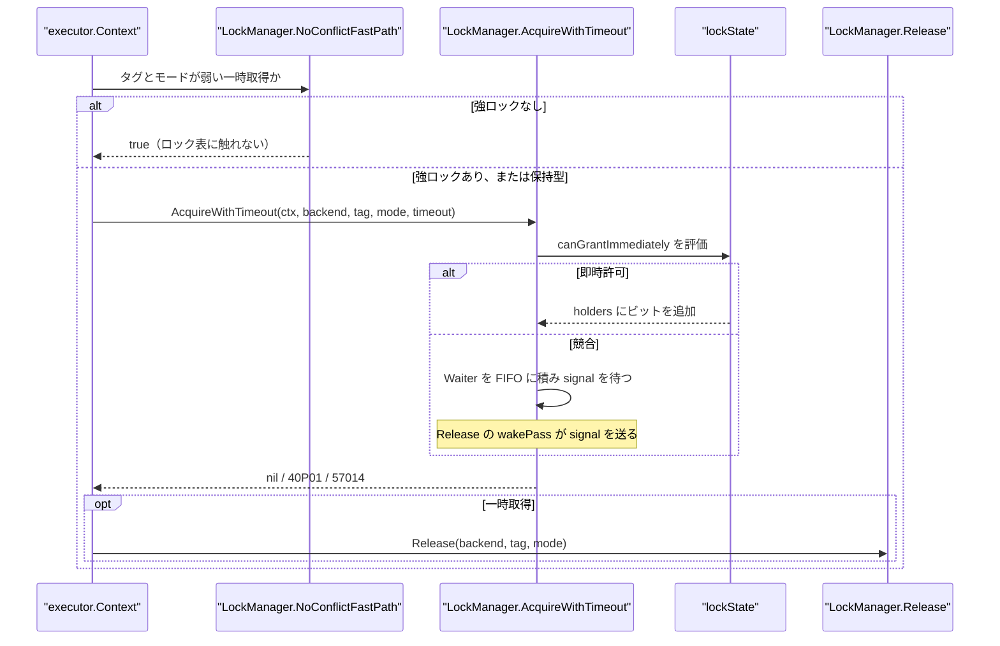
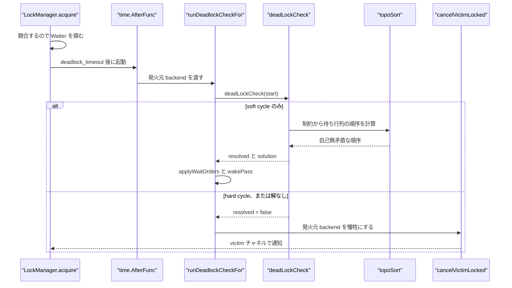
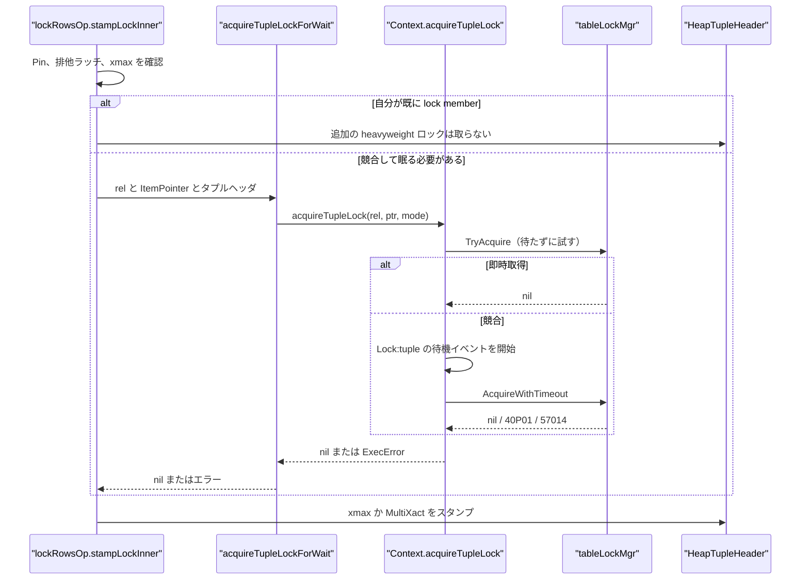
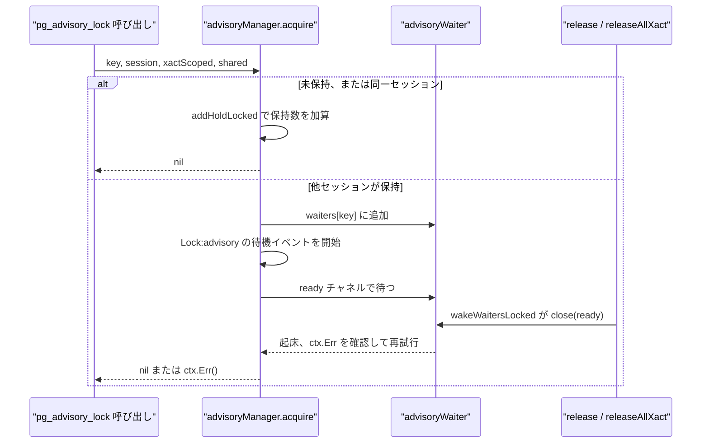

# ロックマネージャ

<details>
<summary>関連ソースファイル</summary>

- [`internal/storage/lmgr/lockmgr.go`](https://github.com/ryogrid/goopg/blob/19856410e8d497d59787e1ab35a2febb3f5953d6/internal/storage/lmgr/lockmgr.go)
- [`internal/storage/lmgr/deadlock.go`](https://github.com/ryogrid/goopg/blob/19856410e8d497d59787e1ab35a2febb3f5953d6/internal/storage/lmgr/deadlock.go)
- [`internal/storage/lmgr/fastpath.go`](https://github.com/ryogrid/goopg/blob/19856410e8d497d59787e1ab35a2febb3f5953d6/internal/storage/lmgr/fastpath.go)
- [`internal/storage/lmgr/lockwait/lockwait.go`](https://github.com/ryogrid/goopg/blob/19856410e8d497d59787e1ab35a2febb3f5953d6/internal/storage/lmgr/lockwait/lockwait.go)
- [`internal/executor/context.go`](https://github.com/ryogrid/goopg/blob/19856410e8d497d59787e1ab35a2febb3f5953d6/internal/executor/context.go)
- [`internal/executor/relation_locks.go`](https://github.com/ryogrid/goopg/blob/19856410e8d497d59787e1ab35a2febb3f5953d6/internal/executor/relation_locks.go)
- [`internal/executor/operators_lockrows.go`](https://github.com/ryogrid/goopg/blob/19856410e8d497d59787e1ab35a2febb3f5953d6/internal/executor/operators_lockrows.go)
- [`internal/executor/advisory.go`](https://github.com/ryogrid/goopg/blob/19856410e8d497d59787e1ab35a2febb3f5953d6/internal/executor/advisory.go)
- [`internal/postmaster/cancel.go`](https://github.com/ryogrid/goopg/blob/19856410e8d497d59787e1ab35a2febb3f5953d6/internal/postmaster/cancel.go)
- [`internal/storage/heap.go`](https://github.com/ryogrid/goopg/blob/19856410e8d497d59787e1ab35a2febb3f5953d6/internal/storage/heap.go)
- [`internal/utils/activity/activity.go`](https://github.com/ryogrid/goopg/blob/19856410e8d497d59787e1ab35a2febb3f5953d6/internal/utils/activity/activity.go)

</details>

`internal/storage/lmgr` は PostgreSQL の heavyweight lock manager を Go に写したもので、リレーション単位とタプル単位の `LockTag` に対して、8 種類のロックモードの互換性判定・待ち行列・デッドロック検出・解除を行う。`LockManager` は 1 本の coarse mutex でロックテーブルを守り、競合時は FIFO の `Waiter` を積んで `signal` チャネルで起床させる。`internal/executor` 側は `tableLockMgr` を通じて `LOCK TABLE`・スキャンの ACCESS SHARE・`SELECT FOR UPDATE` のタプルロックを取得し、`lockRowsOp` が実際の行ロックを `xmax`/MultiXact としてページに刻む。advisory lock は別のプロセス全体マネージャで、セッション／トランザクションの 2 スコープを持つ。待機中は `internal/utils/activity` の待機イベントに `Lock:relation` / `Lock:tuple` / `Lock:advisory` が記録され、`internal/postmaster` のキャンセルレジストリがクエリ／接続の中断を伝える。

## 責務

- モード互換性の判定。`conflictTab` が上流 `LockConflicts[]` を写し、`ConflictsWith` が「保持モード集合 `held` に対して要求 `m` が待つか」を返す (`internal/storage/lmgr/lockmgr.go:ConflictsWith`)。
- リレーション／タプルのロック表。`LockTag` をキーに `lockState` の保持者マップと待ち行列を管理し、空になったエントリを `gcLocked` で消す (`internal/storage/lmgr/lockmgr.go:LockManager`)。
- 即時許可と FIFO。`canGrantImmediately` が「競合なし」と「既保持者が競合待ちの先頭を飛び越える特殊ケース」を判定し、それ以外は待ち行列の末尾に積む (`internal/storage/lmgr/lockmgr.go:canGrantImmediately`)。
- 解除と起床。`Release` / `ReleaseAll` が `wakePassLocked` を呼び、先頭から競合しなくなった `Waiter` を保持者へ昇格させる (`internal/storage/lmgr/lockmgr.go:wakePassLocked`)。
- デッドロック検出。`Acquire` の `deadlock_timeout` 後に `runDeadlockCheckFor` が走り、soft edge は待ち行列の再配列で解消し、hard cycle だけ発火元バックエンドを犠牲にする (`internal/storage/lmgr/deadlock.go:checkDeadlockLockedFor`)。
- 高速パス。`NoConflictFastPath` が弱いモードの一時取得をロック表に触れず許可する。強ロックの有無は 1024 バケットの `strongCounts` で判定する (`internal/storage/lmgr/fastpath.go:NoConflictFastPath`)。
- 待ち時間の制御。`deadlock_timeout` は検出タイマー、`lock_timeout` は `lockwait.WithTimeout` で運ばれる別の予算で、期限切れは `ErrLockTimeout` になる (`internal/storage/lmgr/lockwait/lockwait.go:WithTimeout`)。
- エグゼキュータ統合。`acquireRelLockTxn` / `acquireRelLockMaybeTransient` がリレーションロックを、`acquireTupleLock` がタプルロックを取得し、SQLSTATE 40P01/55P03/57014 に変換する (`internal/executor/context.go:acquireTupleLock`)。
- 行ロックの永続化。`lockRowsOp.stampLockInner` が競合時に `acquireTupleLockForWait` で重いロックを取り、その後 `xmax` または MultiXact をページに刻む (`internal/executor/operators_lockrows.go:acquireTupleLockForWait`)。
- advisory lock。`advisoryManager` がキーごとの所有者・セッション保持数・トランザクション保持数・待機チャネルを管理する (`internal/executor/advisory.go:advisoryManager`)。
- キャンセルと待機イベント。`backendCancelRegistry` がクエリキャンセルと接続終了を仲介し、`activity.Registry` が待機イベントを `pg_stat_activity` に出す (`internal/postmaster/cancel.go:backendCancelRegistry`)。

## 処理フロー

### リレーションロックの取得

明示トランザクション内の `LOCK TABLE` はトランザクション ID、通常のスキャンは文ごとの一時 ID で `tableLockMgr` を叩く。`LOCK TABLE` はコミットまで保持し、スキャンの ACCESS SHARE はオートコミットなら取得直後に解放する。



`canGrantImmediately` は 2 つのケースを許可する。1 つは他バックエンドの保持と競合せず待ち行列も空の場合。もう 1 つは、自分が既にタグを保持していて、自分の保持モードと競合する先頭待機者の前に挿入できる場合である。後者は PostgreSQL の `JoinWaitQueue` の early-grant 特殊ケースで、強いロックを持つセッションが弱い互換モードをすぐ取れるようにする (`internal/storage/lmgr/lockmgr.go:canGrantImmediately`)。

### デッドロック検出

待機が `deadlock_timeout` を超えると、`Acquire` が仕掛けた `time.AfterFunc` が `runDeadlockCheckFor(backend)` を呼ぶ。soft edge（待ち行列内の順序に由来する辺）は待ち行列の再配列で解消でき、hard edge（実際の保持ロックに由来する辺）だけが犠牲者を要求する。



`CheckDeadlocksNow`（テスト用の同期経路）は soft edge を考えず、hard edge のみのグラフを作って閉路内で最大の `BackendID` を犠牲にする。タイマー経路は「発火したバックエンド」を優先 victim にし、PostgreSQL の `DeadLockCheck` 実行者がロールバックされる挙動に合わせる (`internal/storage/lmgr/deadlock.go:checkDeadlockLockedFor`)。

### タプルロック（SELECT FOR UPDATE / FOR SHARE）

行ロックは、競合が実際に存在してこれから眠る直前にだけ heavyweight のタプルタグを取る。競合しない `FOR KEY SHARE` はタグに触れず、`xmax` のスタンプだけで完了する。



`tupleLockHwMode` は要求強度を上流の `tupleLockExtraInfo[].hwlock` に写す。`FOR KEY SHARE` は `AccessShareLock`、`FOR SHARE` は `RowShareLock`、`FOR NO KEY UPDATE` は `ExclusiveLock`、`FOR UPDATE` / DELETE / キー変更 UPDATE は `AccessExclusiveLock` である。`Context.acquireTupleLock` はまず `TryAcquire` で待たずに試し、失敗したときだけ `Lock:tuple` の待機イベントを出して `AcquireWithTimeout` する (`internal/executor/context.go:acquireTupleLock`)。

### advisory lock

advisory lock は `advisoryManager` の独立したマップで管理する。キーは bigint 形式と `(classid, objid)` 形式を同じ `advisoryKey{hi, lo}` に畳み、セッションスコープとトランザクションスコープの保持数を別々に数える。



同一セッションによる再取得は保持数を増やすだけでブロックしない。解放はセッションスコープとトランザクションスコープで別々に行い、両方のカウントが 0 になったときだけキーを削除して待機者を起こす (`internal/executor/advisory.go:advisoryManager`)。

## 主要ファイル

| ファイル | 役割 |
| --- | --- |
| `internal/storage/lmgr/lockmgr.go` | `Mode`、`LockTag`、`Waiter`、`lockState`、`LockManager`、Acquire/TryAcquire/Release/ReleaseAll、wake-pass、pg_locks 用 `AllLocks` (`internal/storage/lmgr/lockmgr.go:LockManager`) |
| `internal/storage/lmgr/deadlock.go` | hard/soft edge の deadlock search、`findLockCycle`、`deadLockCheck`、`topoSort`、`cancelVictimLocked` (`internal/storage/lmgr/deadlock.go:deadLockCheck`) |
| `internal/storage/lmgr/fastpath.go` | `strongCounts` による弱ロックの高速パス。`EligibleForFastPath` / `NoConflictFastPath` (`internal/storage/lmgr/fastpath.go:NoConflictFastPath`) |
| `internal/storage/lmgr/lockwait/lockwait.go` | `lock_timeout` 予算の context 伝搬と `ErrLockTimeout` (`internal/storage/lmgr/lockwait/lockwait.go:WithTimeout`) |
| `internal/executor/context.go` | `tableLockMgr`、`acquireRelLockTxn`、`acquireRelLockMaybeTransient`、`acquireTupleLock`、`ReleaseTableLocks` / `ReleaseTupleLocks` (`internal/executor/context.go:acquireTupleLock`) |
| `internal/executor/relation_locks.go` | `LOCK TABLE` の表示用レジストリと、`tableLockMgr` を pg_locks 行へ変換するブリッジ (`internal/executor/relation_locks.go:tableLockMgrPgLockRows`) |
| `internal/executor/operators_lockrows.go` | `lockRowsOp` の行ロック取得・待機・xmax/MultiXact スタンプ (`internal/executor/operators_lockrows.go:stampLockInner`) |
| `internal/executor/advisory.go` | advisory lock の取得・解放・スコープ管理・pg_locks 行 (`internal/executor/advisory.go:advisoryManager`) |
| `internal/postmaster/cancel.go` | バックエンドごとのクエリキャンセル／接続終了レジストリ (`internal/postmaster/cancel.go:backendCancelRegistry`) |
| `internal/storage/heap.go` | ロックの永続化先となる `HeapTupleHeader` の xmax/infomask 操作 |
| `internal/utils/activity/activity.go` | `WaitTypeLock` と `WaitRelationLock` / `WaitTupleLock` / `WaitAdvisoryLock` の定義 (`internal/utils/activity/activity.go:WaitRelationLock`) |

## 公開 API / エントリポイント

- 構築・設定: `lmgr.New() *LockManager`、`SetDeadlockTimeout(d time.Duration)`。
- 取得: `Acquire(ctx, b, t, m) error`、`AcquireWithTimeout(ctx, b, t, m, timeout) error`、`TryAcquire(b, t, m) error`。
- 解放: `Release(b, t, m)`、`ReleaseAll(b)`。
- 観測: `Holders(t) map[BackendID]Mask`、`Waiters(t) []Waiter`、`AllLocks() []LockHolding`。
- デッドロック: `CheckDeadlocksNow() bool`。
- 高速パス: `EligibleForFastPath(m Mode) bool`、`NoConflictFastPath(t LockTag, m Mode) bool`。
- モード: `ParseMode(name string) (Mode, bool)`、`ConflictsWith(m Mode, held Mask) bool`。
- 待ち時間: `lockwait.WithTimeout(ctx, d)`、`lockwait.Timeout(ctx)`、`lockwait.ErrLockTimeout`。
- エグゼキュータ: `Context.acquireRelLockTxn`、`Context.acquireRelLockMaybeTransient`、`Context.tryAcquireRelLock`、`Context.acquireTupleLock`、`ReleaseTableLocks(b)`、`ReleaseTupleLocks(b)`。
- 行ロック: `lockRowsOp.stampLock` / `stampLockInner`、`acquireTupleLockForWait`、`tupleLockHwMode`。
- advisory: `ReleaseAdvisoryTransactionLocks(identity)`、`ReleaseAllAdvisoryLocks(identity)`、SQL 関数 `pg_advisory_lock` / `pg_advisory_unlock` ほか。
- キャンセル: `backendCancelRegistry.register` / `unregister` / `cancelQuery` / `cancelByPID` / `terminateByPID`。

## 主要データ構造

### Mode と Mask

```go
type Mode int

const (
	// 0 is unused so Mode-1 indexing matches upstream's 1-based
	// numbering in the conflict matrix.
	NoLock Mode = iota
	AccessShareLock
	RowShareLock
	RowExclusiveLock
	ShareUpdateExclusiveLock
	ShareLock
	ShareRowExclusiveLock
	ExclusiveLock
	AccessExclusiveLock

	maxMode = AccessExclusiveLock
)

// Mask is a bitmask over Mode values. Mask[i] (i ∈ 1..8) corresponds
// to mode i. Wider than uint8 so the conflict-tab loop is straight
// `mask & (1 << mode)`.
type Mask uint16
```

`internal/storage/lmgr/lockmgr.go:Mode`（41〜62 行）。`NoLock` は 0 で、`bit(0)` は常に 0 を返すため競合判定に寄与しない。`bit(m)` は `1 << m` で、`Mask` の 8〜15 bit は未使用である。`conflictTab[m]` は上流の `LockConflicts[]` をそのまま持ち、`ConflictsWith` は `conflictTab[m] & held != 0` で判定する。

### LockTag — リレーションとタプルの同一キー空間

```go
// LockTag identifies a relation-level lock target. Forks are
// intentionally collapsed: a relation lock covers heap and indexes
// alike, matching upstream.
type LockTag struct {
	DB  uint32
	Rel uint32
	// Block + Offset extend a relation lock tag down to a specific
	// heap tuple (M0021 tuple-level locking step 2b). Both zero
	// → relation-level lock (the historic default; every existing
	// caller continues to work because Go's struct-literal
	// zero-initialises unset fields). Both non-zero → tuple-level
	// lock; the (DB, Rel) tag and the (DB, Rel, Block, Offset)
	// tag are independent map keys, so a relation-level holder
	// doesn't accidentally block tuple-level acquirers and
	// vice-versa. Mirrors upstream's separation between
	// `LOCKTAG_RELATION` and `LOCKTAG_TUPLE`.
	Block  uint32
	Offset uint32
}
```

`internal/storage/lmgr/lockmgr.go:LockTag`（155〜173 行）。

`Block` と `Offset` が両方 0 ならリレーションロック、両方非 0 ならタプルロックである。タプルタグは `Context.tupleLockTag` が `Block = ptr.Block + 1`、`Offset = ptr.Offset + 1` と +1 バイアスをかけて作る。これによりブロック 0・オフセット 0 のタプルがリレーションタグと衝突しない (`internal/executor/context.go:tupleLockTag`)。

### Waiter と lockState

```go
// Waiter is one queued lock request. Stored by *Waiter so cancel
// can splice it out of the slice by pointer identity.
//
// `signal` fires when the wake-pass promotes this waiter to a
// holder. `victim` fires when the deadlock detector selects this
// waiter as the cycle victim — distinct from `signal` so the
// Acquire goroutine can return ErrDeadlockDetected instead of
// silently succeeding.
type Waiter struct {
	Backend BackendID
	Mode    Mode
	tag     LockTag
	signal  chan struct{}
	victim  chan struct{}
}
```

`internal/storage/lmgr/lockmgr.go:Waiter`（180〜194 行）。

```go
type lockState struct {
	holders map[BackendID]Mask
	waiters []*Waiter
	granted Mask // OR of all holder masks; cached for fast conflict checks
	// strongCounted records whether this tag currently contributes to
	// lm.strongCounts, so syncStrongLocked can pair its increments exactly.
	strongCounted bool
}
```

`internal/storage/lmgr/lockmgr.go:lockState`（196〜206 行）。

- `holders` はバックエンドごとのモードビット集合。1 つのバックエンドが複数の自己互換モードを持てる。
- `waiters` は FIFO の待ち行列。`Release` の wake-pass は先頭から順に昇格させ、競合する先頭に当たったら止まる（head-of-line FIFO）。これが starvation を防ぐ v0 の規則である。
- `granted` は全保持モードの OR。`grantedExcept(b)` は自分を除いた OR を返し、自分が唯一の保持者なら 0 を返す。自己競合は存在しない。
- `strongCounted` は高速パスの強ロックカウンタへの寄与を 1 回だけ数えるためのフラグ。`syncStrongLocked` が `granted & strongModeMask` の変化に応じて増減する。

### LockManager

```go
// LockManager is the lock table. Use New to construct.
type LockManager struct {
	mu              sync.Mutex
	states          map[LockTag]*lockState
	deadlockTimeout time.Duration

	// strongCounts is the FastPathStrongRelationLocks->count[] analogue; see
	// fastpath.go. Read without lm.mu, mutated only under it.
	strongCounts [fastPathStrongBuckets]atomic.Int32
}
```

`internal/storage/lmgr/lockmgr.go:LockManager`（324〜333 行）。

- `mu` はロック表全体を守る coarse mutex。`states` の検索・挿入・削除、待ち行列の操作、`strongCounts` の更新がすべてこの下で行われる。
- 死んだ `lockState` は `gcLocked` が保持者も待機者も 0 のときに削除する。`syncStrongLocked` は削除より先に呼ばれ、強ロックのバケットカウンタを漏らさない。
- `deadlockTimeout` は `Acquire` の既定値。`AcquireWithTimeout` の呼び出しごとの値が優先される。
- `strongCounts` は 1024 バケットの FNV-1a ハッシュで、`NoConflictFastPath` が `mu` を取らずに読む。

### LockHolding — pg_locks の 1 行

```go
type LockHolding struct {
	Tag     LockTag
	Backend BackendID
	Mode    Mode
	Granted bool
}
```

`internal/storage/lmgr/lockmgr.go:LockHolding`（683〜688 行）。`AllLocks` は保持者をモードごとに 1 行へ展開し（`Granted=true`）、待機者を `Granted=false` で返す。タプルタグも含まれるため、呼び出し側が `Tag.Block == 0 && Tag.Offset == 0` でリレーションだけに絞る (`internal/executor/relation_locks.go:tableLockMgrPgLockRows`)。

### advisoryManager と advisoryHold

```go
type advisoryHold struct {
	owner        uintptr
	sessionCount int
	xactCount    int
	shared       bool // true = ShareLock, false = ExclusiveLock (for pg_locks reporting)
	twoArg       bool // true = int4+int4 form (objsubid=2), false = bigint form (objsubid=1)
}
```

`internal/executor/advisory.go:advisoryHold`（51〜57 行）。

```go
type advisoryManager struct {
	mu        sync.Mutex
	held      map[advisoryKey]advisoryHold       // key → hold counts for one owner
	waiters   map[advisoryKey][]*advisoryWaiter  // key → pending waiters
	bySession map[uintptr]*advisorySessionHolds  // session → held keys by scope
}
```

`internal/executor/advisory.go:advisoryManager`（64〜70 行）。

- `held` のキーは `advisoryKey{hi, lo}`。bigint 形式と `(classid, objid)` 形式を同じキー空間に畳む。
- `owner` は 1 つのキーの現在の所有者。同じセッションの再取得は `sessionCount` / `xactCount` を増やすだけで、`owner` は変えない。
- `waiters` はキーごとの待機チャネル。解放時に全員の `ready` を close し、各待機者は起床後に再帰的に取得を試す。競合が残っていれば再び待つ。
- `bySession` はセッションごとのスコープ別保持数で、トランザクション終了時に `xact` だけを、接続終了時に両方を解放するために使う。

## 内部構造

### 競合判定と自己競合の排除

`ConflictsWith(m, held)` は `conflictTab[m]&held` を見るだけである。`lockState.grantedExcept(b)` が自分以外の保持モードを返すため、同じバックエンドが複数のモードを重ねても自己競合しない。`canGrantImmediately` は待ち行列が空なら `!ConflictsWith(m, others)`、待ち行列がある場合は「自分が既にタグを保持している」ことと「自分の保持モードと競合する先頭待機者の前に挿入できる」ことを要求する。

### FIFO と wake-pass

`wakePassLocked` は待ち行列の先頭だけを見る。先頭の要求が現在の `grantedExcept` と競合しなくなったら保持者に昇格し、`signal` に非ブロッキング送信して次へ進む。競合する先頭に当たった時点で停止するので、後続の弱い要求が先頭の強い要求を追い越すことはない。`signal` は容量 1 のバッファ付きチャネルで、待機 goroutine がまだ `select` に到達していなくても送信が失われない (`internal/storage/lmgr/lockmgr.go:wakePassLocked`)。

### 取り消しと lock_timeout

`Acquire` の `select` は `signal`、`victim`、`lockTimeoutCh`、`ctx.Done()` の 4 系統を待つ。`ctx.Done()` と `lock_timeout` は `unparkWaiter` で待ち行列から自分を抜き、競合する `Release` が同時に自分を昇格させていた場合は、その保持ビットを落として `wakePassLocked` を再実行する。`lock_timeout` は `lockwait.WithTimeout` が文脈に積んだ duration で、待機を始めるたびにタイマーを張り直す。`statement_timeout` は `ctx.Done()` として別経路で届く (`internal/storage/lmgr/lockmgr.go:unparkWaiter`)。

### 単純デッドロックの即時解決

`s.hasSimpleDeadlock(b, m)` は、`b` が既にタグを保持し、先頭待機者 `w` の要求が `b` の保持と競合し、さらに `b` の要求 `m` が `w` の保持と競合する場合に真を返す。`acquire` はこの場合、`b` の他の保持を `ReleaseAll` で落として `ErrDeadlockDetected` を返す。PostgreSQL の `JoinWaitQueue` が同期的に解決するケースを写したもので、`deadlock_timeout` を待たない (`internal/storage/lmgr/lockmgr.go:hasSimpleDeadlock`)。

### soft edge の再配列

タイマー経路の `deadLockCheck` は、まず `testConfiguration(nil)` で現状を評価する。hard cycle なら解なし、cycle がなければ空の解、soft cycle だけなら `soft` の各辺を制約として追加して再帰する。制約は `expandConstraints` → `topoSort` でタグごとの待ち行列順序に変換される。`topoSort` は「後ろから、制約のない最も後ろの要素を選ぶ」ことで既存 FIFO からの変更を最小化する。解が見つかると `applyWaitOrders` が `*Waiter` ポインタを保ったままスライスを並べ替え、`wakePassLocked` で昇格可能な待機者を起こす (`internal/storage/lmgr/deadlock.go:deadLockCheck`)。

### hard cycle の犠牲者

タイマー経路で解なしなら `cancelVictimLocked(prefer)` が発火元バックエンドの `Waiter` を待ち行列から抜き、`victim` チャネルに送る。`Acquire` 側は `victim` を受けると `ReleaseAll(b)` を呼び、他のタグの保持も落として生存者を前進させる。同期経路 `checkDeadlockHardOnlyLocked` は全待機者から hard edge のグラフを作り、閉路内で最大の `BackendID` を選ぶ。`findCycle` は 3 色 DFS で閉路を検出する (`internal/storage/lmgr/deadlock.go:findCycle`)。

### 高速パスの不変条件

`strongCounts` は「そのバケットに強いロック（ShareUpdateExclusiveLock 以上）が存在するか」を数える。`syncStrongLocked` は `lockState.granted` の変化に応じて +1/-1 し、`strongCounted` で二重計上を防ぐ。`NoConflictFastPath` は弱いモード（`EligibleForFastPath`）かつバケットが 0 のときだけ true を返す。弱いモード同士は相互に互換なので、強ロックがなければ競合は証明できない。

この高速パスは「取得してすぐ解放する一時ロック」にだけ使う。トランザクション終了まで保持するロックは必ず `LockManager` の表に載り、他のバックエンドから見える。高速パスの偽陽性は起きない（強ロックは付与前にカウンタを上げ、消滅後に下げるため）が、偽陰性は単に遅い経路に落ちるだけである (`internal/storage/lmgr/fastpath.go:NoConflictFastPath`)。

### タプルロックと xmax の役割分担

heavyweight のタプルタグは「同時に待っている競合者を FIFO で並べる」ためだけに存在し、文末に `ReleaseTupleLocks` で解放される。文をまたいだ「保持者のトランザクションが終わるまで待つ」責務は、ページに刻まれた `xmax` と `mvcc.WaitForXID` が担う。`lockRowsOp` は競合しない行ではタプルタグを取らず、`xmax` のスタンプだけで済ませる。これは PostgreSQL の `heap_lock_tuple` が `heap_acquire_tuplock` を呼ぶのは実際に眠る直前だけ、という配置の写しである (`internal/executor/operators_lockrows.go:stampLock`)。

### リレーションロックの pg_locks 表現

明示トランザクション内の `LOCK TABLE` のトランザクションロックは `tableLockMgr` に載り、`tableLockMgrPgLockRows` が `LockBackendID` から PID を引いて pg_locks 行にする。`lockBackendPID` は接続ごとに `RegisterLockBackendPID` で登録され、切断時に `UnregisterLockBackendPID` で消える。PID が引けない一時ロックは `"0"` を出す。`pg_locks` と `pg_stat_activity` の結合では pid 0 の行が落ちるため、一瞬だけ存在する文スコープのロックは表示されない。古い表示専用レジストリ `globalRelLockMgr` は実ロックを取らない `LOCK TABLE`（オートコミットなど）用で、両者は `catalog.RelationLockRowsFunc` で合成される (`internal/executor/relation_locks.go:init`)。

### advisory lock の所有権

advisory lock の所有者は `ctx.AdvisorySessionIdentity`（接続全体で安定な SessionRegistry）を優先し、なければ `ctx.Session`、最後に per-statement の `BackendID` を使う。`BackendID` は文ごとに変わるため、これを使うと次の文で自分のロックが他人のものに見えて自己デッドロックする。`AdvisorySessionIdentity` は autocommit から最初の BEGIN までの間も安定なので、その窓で取ったロックを BEGIN 後の `pg_advisory_unlock` が正しく解放できる (`internal/executor/advisory.go:advisorySessionIDFromContext`)。

### キャンセルと待機イベント

`backendCancelRegistry` は PID ごとに `cancelEntry` を持ち、`cancelQuery(pid, secret)` は秘密鍵が一致するときだけ実行中クエリの `context.CancelFunc` を呼ぶ。`cancelByPID` / `terminateByPID` はサーバー内の特権経路で、秘密鍵なしのクエリキャンセルと接続ルートコンテキストのキャンセルを行う。ロック待ちの `Acquire` は `ctx.Done()` でこれを受け取り、`unparkWaiter` して `ctx.Err()` を返す。

`activity.Registry` の待機イベントは、リレーションロックなら `Lock:relation`、タプルなら `Lock:tuple`、advisory なら `Lock:advisory` である。`acquireTupleLock` は `TryAcquire` が成功したときはイベントを出さず、実際に `AcquireWithTimeout` で待つときだけ `WaitEventStart` / `WaitEventEnd` を対で呼ぶ。高速パスのリレーションロックも、待たない場合はイベントを出さない (`internal/executor/context.go:acquireTupleLock`)。

## エッジケースと不変条件

- **不正なモード**: `Acquire` / `TryAcquire` は `m <= NoLock` または `m > AccessExclusiveLock` をエラーにする。`Release` は不正モードを黙って無視する。
- **冪等な取得**: すでに同じモードを保持しているバックエンドの再取得は、ビットを重複させず即座に nil を返す。参照カウントは呼び出し側の責務である。
- **二重解放**: `Release` は保持していないモードを無視する。`ReleaseAll` は全タグを走査して保持者エントリを消す。
- **自己競合なし**: `grantedExcept` は自分を除外する。1 つのバックエンドが同じタグに複数の自己互換モードを持てる。
- **待ち行列の取り消し**: `unparkWaiter` は待機者をポインタ同一性で抜く。競合する `Release` が先に昇格させていた場合は、その保持ビットを落として wake-pass を再実行する。抜いた後に待機者も保持者もいなければ `gcLocked` が状態を消す。
- **単純デッドロック**: 既保持者が競合待機者の後ろに並ぶ形は、`deadlock_timeout` を待たずに即座に `ErrDeadlockDetected` となり、`ReleaseAll` で自分の保持を落とす。
- **hard cycle の victim**: タイマー経路では発火元バックエンド、同期経路では閉路内の最大 `BackendID`。victim の待機者は待ち行列から抜かれ、`victim` チャネルで起こされる。
- **タイマーの競合**: `runDeadlockCheckFor` は発火時に `waiterInfo(prefer)` を確認し、既に起床・キャンセル済みなら何もしない。
- **timeout の分離**: `deadlock_timeout <= 0` は検出タイマーを張らない。`lock_timeout` は `lockwait` の別予算で、期限切れは `ErrLockTimeout`（57014）になり、`ctx` の期限（statement_timeout）とは区別される。
- **高速パスの適用範囲**: `EligibleForFastPath` は `ShareUpdateExclusiveLock` 未満のモードだけを許可する。保持型のロックは必ずロック表を通る。バケットカウンタは `gcLocked` より前に同期される。
- **タプルタグの +1 バイアス**: `tupleLockTag` は `Block` と `Offset` に +1 する。これがないと `(Block=0, Offset=0)` のタプルがリレーションタグと同一キーになる。
- **タプルロックの寿命**: heavyweight タプルタグは文末の `ReleaseTupleLocks` まで。トランザクションをまたぐ待機は `xmax` と `WaitForXID` が担う。`BackendID == 0` の経路ではタプルロックは no-op になる。
- **保存済みロックの確認**: `lockRowsOp` は自分が既に lock member（トップレベル XID またはサブ XID）なら `acquireTupleLockForWait` を no-op にする。待機者自身がタプルタグを取ると、自分を待つ別の待機者とデッドロックするためである。
- **advisory の所有者**: 所有権は接続全体で安定な `AdvisorySessionIdentity` を使う。`BackendID` を使うと文をまたいで所有者が変わり、自己デッドロックや解放漏れが起きる。
- **advisory の再取得**: 同一セッションの再取得は保持数を増やすだけでブロックしない。解放はスコープごとにカウントを減らし、両方 0 でキーを消して待機者を全員起こす。
- **キャンセルの秘密鍵**: `cancelQuery` は秘密鍵が一致しなければ何もしない。`cancelByPID` / `terminateByPID` は認証済みバックエンドの特権経路で、鍵なしに動作する。`terminateByPID` は登録済み PID なら true を返す。
- **待機イベントの対称性**: `WaitEventStart` は実際に待つ直前にだけ呼び、`WaitEventEnd` と必ず対にする。`TryAcquire` の成功パスや高速パスではイベントを出さないため、`pg_stat_activity` に不要な `Lock:relation` が出ない。

Sources:

- `internal/storage/lmgr/lockmgr.go`
- `internal/storage/lmgr/deadlock.go`
- `internal/storage/lmgr/fastpath.go`
- `internal/storage/lmgr/lockwait/lockwait.go`
- `internal/executor/context.go`
- `internal/executor/relation_locks.go`
- `internal/executor/operators_lockrows.go`
- `internal/executor/advisory.go`
- `internal/postmaster/cancel.go`
- `internal/storage/heap.go`
- `internal/utils/activity/activity.go`

<sub>Generated by deepwiki-4myself from `goopg` @ `19856410e`</sub>
