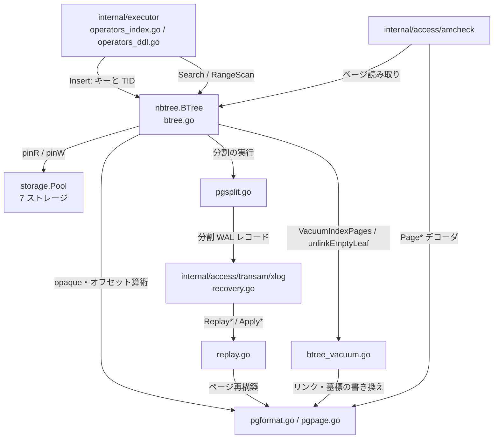

# B-tree インデックス

<details>
<summary>関連ソースファイル</summary>

- [`internal/access/nbtree/btree.go`](https://github.com/ryogrid/goopg/blob/19856410e8d497d59787e1ab35a2febb3f5953d6/internal/access/nbtree/btree.go)
- [`internal/access/nbtree/btree_vacuum.go`](https://github.com/ryogrid/goopg/blob/19856410e8d497d59787e1ab35a2febb3f5953d6/internal/access/nbtree/btree_vacuum.go)
- [`internal/access/nbtree/endpoint_scan.go`](https://github.com/ryogrid/goopg/blob/19856410e8d497d59787e1ab35a2febb3f5953d6/internal/access/nbtree/endpoint_scan.go)
- [`internal/access/nbtree/pgformat.go`](https://github.com/ryogrid/goopg/blob/19856410e8d497d59787e1ab35a2febb3f5953d6/internal/access/nbtree/pgformat.go)
- [`internal/access/nbtree/pgpage.go`](https://github.com/ryogrid/goopg/blob/19856410e8d497d59787e1ab35a2febb3f5953d6/internal/access/nbtree/pgpage.go)
- [`internal/access/nbtree/pgpagedel.go`](https://github.com/ryogrid/goopg/blob/19856410e8d497d59787e1ab35a2febb3f5953d6/internal/access/nbtree/pgpagedel.go)
- [`internal/access/nbtree/pgsplit.go`](https://github.com/ryogrid/goopg/blob/19856410e8d497d59787e1ab35a2febb3f5953d6/internal/access/nbtree/pgsplit.go)
- [`internal/access/nbtree/replay.go`](https://github.com/ryogrid/goopg/blob/19856410e8d497d59787e1ab35a2febb3f5953d6/internal/access/nbtree/replay.go)
- [`internal/access/transam/xlog/recovery.go`](https://github.com/ryogrid/goopg/blob/19856410e8d497d59787e1ab35a2febb3f5953d6/internal/access/transam/xlog/recovery.go)
- [`internal/access/amcheck/verify_nbtree.go`](https://github.com/ryogrid/goopg/blob/19856410e8d497d59787e1ab35a2febb3f5953d6/internal/access/amcheck/verify_nbtree.go)

</details>

`internal/access/nbtree` は goopg の B-tree インデックスアクセスメソッドで、PostgreSQL 18 の nbtree とバイト互換な 8 KiB ページを読み書きする。上位の実行エンジンは「エンコード済みキー + ヒープ TID」を `Insert` / `Search` / `RangeScan` に渡し、下位の `storage.Pool` からページを受け取る。ブロック 0 はルートとレベルを持つメタページ、それ以外は 16 バイトの special area（`BTPageOpaqueData`）を持つリーフまたは内部ページである。

書き込みは「ページ内の二分探索 → 収まらなければ重複排除 → ページ分割 → 親へのセパレータ伝播」の順に進み、分割・ページ削除・ルート変更は WAL レコードとして記録される。リカバリは同じページ変更関数を再実行してページを組み直し、amcheck は同じデコーダでページを読んで構造・キー順・一意性・索引漏れを検証する。キーの符号化と比較の規則はインデックス層と実行エンジンの両方に関わるため、別の子ページで扱う。

## コンポーネント

- [8.1 B-tree の構造と検索](8-Btree/8.1-Btree-Structure.md) — ページ形状、メタページ、`descendMode` による降下、`Search` / `RangeScan` / `ScanCursor` / `ScanFromEnd`、比較の 3 つの問い。中心型 `BTree` の定義とフィールドの不変条件はこのページにある。
- [8.2 挿入・分割・重複排除](8-Btree/8.2-Insert-and-Split.md) — `Insert` の高速路と分割路、`dedupConsolidate` / `refillDeduplicated`、分割点の選択、`truncateSeparator`、posting リスト、バルク構築、分割 WAL の生成側。
- [8.3 B-tree のバキュームと WAL リプレイ](8-Btree/8.3-Btree-Vacuum-and-Replay.md) — `VacuumIndexPages` による死エントリ除去、空ページの 2 段階削除と `safexid` のリサイクル地平線、`replay.go` / `pgdelete.go` によるレコード再適用。
- [8.4 キー符号化と比較](8-Btree/8.4-Key-Encoding.md) — `EncodeInt4` / `EncodeNumericKey` / `EncodeVarchar` などの blob キー、`FormPGIndexTuple` のタプル形式、型別比較器、`compare` / `compareKeyAttrs` / `compareHigh`、skip scan の境界生成。
- [8.5 amcheck による検証](8-Btree/8.5-amcheck.md) — B-tree のページ構造・キー順・兄弟リンク・親子ダウンリンク・一意性・索引漏れと、ヒープページ検査の各ティア、および SQL への結線。

## サブシステム図



`btree.go` が公開する `BTree` は実行エンジンとバキュームの入口であり、ページの読み書きは `storage.Pool` のスロット ラッチ越しに行う。`pgformat.go` はオンディスクの opaque とメタページを定義し、`pgpage.go` は `P_HIKEY` / `P_FIRSTDATAKEY` に依存するデータスロット変換を担う。`pgsplit.go` は分割 WAL レコードの右ページ再構築と兄弟リンク更新を提供し、`replay.go` は同じレコードをリカバリ時にページへ適用する。

## データフロー

1. **インデックスへの書き込み** — 実行エンジンがキーを符号化して `Insert(key, ptr)` を呼ぶ。`Insert` は `CheckPGBTThirdPage` でアイテム単体の上限を検査し、`tryInsertNoSplit` → `insertItemSorted` の高速路を試す。収まらなければ `descendForInsert` でリーフを選び直し、`insertIntoBlock` が重複排除・分割・親伝播を行う (`internal/access/nbtree/btree.go:Insert`、`internal/access/nbtree/btree.go:insertIntoBlock`)。
2. **降下とページ内位置決め** — `descendMode` がメタページの root から `findChildBlockDirect` で内部ページを二分探索し、リーフに着く。ページ上のデータアイテム番号は `pgDataSlot` / `PGFirstDataKey` が物理オフセットへ変換する (`internal/access/nbtree/btree.go:descendMode`、`internal/access/nbtree/pgpage.go:pgDataSlot`)。
3. **分割と WAL** — `insertIntoBlock` は右ページを確保し、`SplitRightPageOpaque` でヘッダを決め、`resetPageItems` の後に新しいハイキーを `pgSetHighKeyRaw` で設置してから左右を `refillDeduplicated` で埋める。旧右兄弟の `btpo_prev` を更新し、`logSplit` が配線されていれば左ページ・右ページ・旧兄弟・子を 1 本のレコードにまとめる (`internal/access/nbtree/btree.go:insertIntoBlock`、`internal/access/nbtree/pgsplit.go:SplitRightPageOpaque`)。
4. **検索と範囲走査** — `Search` は降下後にリーフを読み直してキーを二分探索する。`RangeScan` 系は `descendToLowerBound` → `scanLeafItems` の順で下限から右へ進み、`ScanCursor` は葉ページ単位で再開できる。`ScanFromEnd` は右端へ降りて左方向に辿る (`internal/access/nbtree/btree.go:Search`、`internal/access/nbtree/btree.go:rangeScanPosLeaf`、`internal/access/nbtree/endpoint_scan.go:ScanFromEnd`)。
5. **メタページの更新** — ルートが変わると `createNewRoot` / `updateRootMeta` がブロック 0 の `Root` / `Level` / `FastRoot` / `FastLevel` を書き換える。読み手は `readMeta` が `CheckPGBTPage` を通してから `ReadPGMetaPage` で復号する (`internal/access/nbtree/btree.go:readMeta`、`internal/access/nbtree/pgformat.go:ReadPGMetaPage`)。
6. **バキュームとページ削除** — `VacuumIndexPages` が死 TID を除去し、空になったリーフをフェーズ 1（`BTDeleted|BTHalfDead`）とフェーズ 2（unlink・墓標化・`recycleBlock`）で木から外す。墓標には削除時点の `safexid` が入り、`PGPageIsRecyclable` が地平線を越えるまで再利用を待つ (`internal/access/nbtree/btree_vacuum.go:VacuumIndexPages`、`internal/access/nbtree/pgpagedel.go:PGPageIsRecyclable`)。
7. **クラッシュリカバリ** — `internal/access/transam/xlog` がレコード種別を分岐し、`replayBtreeVacuum` / `replayBtreeUnlinkPage` / `replayBtreeMarkPageHalfDead` などが `nbtree.Replay*` / `Apply*` を呼ぶ。各ページは `pd_lsn >= EndLSN` で冪等にスキップされ、適用後に `pd_lsn` が更新される (`internal/access/transam/xlog/recovery.go:ReplayRecords`、`internal/access/nbtree/replay.go:ReplayVacuumPage`)。
8. **構造検証** — amcheck は `PageSource` 経由でページ コピーを読み、`VerifyBtreePage` / `VerifyBtreeItemOrderCmp` / `VerifyBtreeLevelSiblingLinks` / `VerifyBtreeParentDownlinks` を実行する。キーのデコードには nbtree の `PageItemKeys` / `PageHighKey` / `PageDownlinks` を使い、レイアウトの第二実装を持たない (`internal/access/amcheck/verify_nbtree.go:VerifyBtreePage`、`internal/access/nbtree/btree.go:PageItemKeys`)。

## 共有データ型

### `PGBTPageOpaque` — オンディスクの special area

```go
type PGBTPageOpaque struct {
	Prev    storage.BlockNumber
	Next    storage.BlockNumber
	Level   uint32
	Flags   uint16
	CycleID uint16
}
```

`internal/access/nbtree/pgformat.go:PGBTPageOpaque` (84 行)

`Prev` / `Next` が兄弟リンク、`Level` がリーフ 0 から数えた高さ、`Flags` が `BTP_*`、`CycleID` が VACUUM サイクル ID である（goopg は常に 0 を書く）。`Next == PNone (0)` が右端、`Prev == PNone` が左端を意味し、ハイキーの有無は `Next` から導出される（専用のフラグビットは無い）。`P_NONE` が `InvalidBlockNumber` ではなく 0 なのは、ブロック 0 がメタページで兄弟になりえないためである (`internal/access/nbtree/pgformat.go:81`)。

### `PGBTMetaPage` — ブロック 0 のルート情報

```go
type PGBTMetaPage struct {
	Magic                    uint32
	Version                  uint32
	Root                     storage.BlockNumber
	Level                    uint32
	FastRoot                 storage.BlockNumber
	FastLevel                uint32
	LastCleanupNumDelpages   uint32
	LastCleanupNumHeapTuples float64
	AllEqualImage            bool
}
```

`internal/access/nbtree/pgformat.go:PGBTMetaPage` (159 行)

`Root` / `Level` が現在のルート、`FastRoot` / `FastLevel` が上流の fast root である。`Open` の受理条件は `Magic = 0x053162` と `Version` が `[2, 4]` の範囲にあることで、goopg 自身は常に 4 を書く。`LastCleanupNumHeapTuples` は初期値 `-1.0`（上流の「不明」）で、`AllEqualImage` は goopg が無条件に重複排除するため常に true で書かれる (`internal/access/nbtree/pgformat.go:228`、`internal/access/nbtree/btree.go:1984`)。

### `BTPageOpaque` — エンジン内部の綴り

```go
type BTPageOpaque struct {
	Prev  storage.BlockNumber
	Next  storage.BlockNumber
	Level uint32
	Flags uint16
}
```

`internal/access/nbtree/btree.go:BTPageOpaque` (128 行)

オンディスクの `PGBTPageOpaque` と 1 対 1 だが、値の意味が 2 点異なる。`Prev` / `Next` は `storage.InvalidBlockNumber` を「兄弟なし」に使い、`Flags` は旧 goopg の `BT*` ビットを持つ。`readOpaque` / `writeOpaque` が `legacySibling` / `pgSibling` と `legacyFlags` / `pgFlags` で相互変換する。ハイキーはこの構造体には含まれず、`P_HIKEY` の通常アイテムとしてページ上にある (`internal/access/nbtree/btree.go:194`)。

### `item` — メモリ上の 1 アイテム

```go
type item struct {
	ptr storage.ItemPointer
	key []byte
	// pivot marks the item as an nbtree PIVOT tuple — every internal-page
	// downlink and every P_HIKEY separator (M0130-S11.4 slice 3a). It is an
	// IN-MEMORY flag only: on disk the fact lives in INDEX_ALT_TID_MASK plus
	// t_tid's offset half (BTreeTupleIsPivot), and parseItemBody reads it back
	// off the tuple. It exists because several paths parse an item and
	// re-marshal it (the vacuum/LP_DEAD page rewrites, split redistribution);
	// without carrying the flag through, a round trip would silently demote a
	// pivot to a plain tuple and hand a real PG nbtree status bits as a heap
	// TID.
	pivot bool
}
```

`internal/access/nbtree/btree.go:item` (352 行)

`ptr` はリーフではヒープ TID、内部ページでは子ブロック番号である。`pivot` はメモリ上だけのフラグで、オンディスクでは `INDEX_ALT_TID_MASK` と `t_tid` のオフセット半身（属性数）が同じ事実を表す。パース → 再マーシャルでこのフラグを落とすと、pivot が通常タプルに降格し、実 PG には nbtree のステータスビットがヒープ TID として渡ってしまう (`internal/access/nbtree/btree.go:348`)。

ページ → `item` → ページの往復は `pgpage.go` のデータスロット変換と `pgitemcodec.go` の `indexFormat.marshal` / `parse` を経由する。`BTree` 自体（プール、キー形式、右端キャッシュ、リサイクル フリーリスト）の定義は 8.1 を参照。

## 主要な設計判断

- **上流 PG 18 のオンディスク形式を採用する**。ページ末尾の 16 バイト opaque、ブロック 0 の 48 バイト `BTMetaPageData`、アイテムの `IndexTupleData` は実 PG がそのまま読める。旧 goopg の 272 バイト opaque（ハイキーを special area に格納）は廃止され、`CheckPGBTPage` が `8192 - pd_special == 16` を強制する (`internal/access/nbtree/pgformat.go:CheckPGBTPage`)。
- **ハイキーはフラグではなく兄弟リンクから導出する**。`P_HIKEY`（物理オフセット 1）の通常アイテムとして置かれ、右端ページだけが持たない。`pgWriteNextSibling` は右端 → 非右端の遷移をスプリット以外で拒否し、非右端 → 右端では `pgSlideLeft` でセパレータを落とす (`internal/access/nbtree/pgpage.go:pgWriteNextSibling`)。
- **キーは 2 形式を切り替えられる**。ゼロ値の blob 形式（不透明な順序保存バイト列、`CompareKeys`）と、`PGIndexKeyDesc` を持つタプル形式（`IndexTupleData` 全体、`ComparePGIndexTuples`）。`indexFormat` が比較とレイアウトの両方を決めるため、片方だけを切り替えると木は静かに誤順序になる。現状は通常の索引がタプル形式、式キーなどが blob 形式になる（8.4）。
- **ツリー全体のロックを持たない**。読み取りはページの共有ラッチと Lehman-Yao の右リンク回復、書き込みはページの排他ラッチと子 → 親のラッチ順で直列化する。スプリットは左ページに `BTIncompleteSplit` を立ててから親へ伝播し、途中で失敗しても次の書き手が `finishSplit` で完遂する (`internal/access/nbtree/btree.go:insertIntoBlock`)。
- **分割 WAL は 1 レコードで複数ページを覆う**。左ページ・新しい右ページ・旧右兄弟・（内部ページなら）子をまとめて記録し、右ページは `ReplaySplitRightPage` がレコードのアイテム列からゼロ構築する。左ページは内容記述が再現できれば増分形、できなければフルページ イメージになる (`internal/access/nbtree/pgsplit.go:ReplaySplitRightPage`、`internal/access/nbtree/pgsplit.go:SplitLeftIsIncremental`)。
- **バキュームは 2 段階でページを削除する**。フェーズ 1 の `BTDeleted|BTHalfDead` は「まだキー範囲を所有している」状態で、並行挿入はここへ着地しうる。フェーズ 2 で unlink・墓標化・`recycleBlock` を行い、墓標の `safexid` が地平線を越えるまで再利用しない（8.3）。
- **リプレイは形式非依存**。`replay.go` の関数はアイテムを生バイトとして扱い、キーのデコードも比較も行わない。リカバリは relfilenode しか持たず、`PGIndexKeyDesc` を解決するカタログ自体がリプレイ中だからである (`internal/access/nbtree/replay.go:ApplyInsertRecordAt`)。
- **amcheck はエンジンと SQL アダプタを分離する**。検証ロジックは `internal/access/amcheck` がページ バイト列と `PageSource` だけで動き、カタログ・スナップショット・バッファプールの結線は `internal/executor` が担う。これにより同じ検証をテストからも実サーバーからも同じ関数で呼べる（8.5）。

Sources:
- `internal/access/nbtree/btree.go`
- `internal/access/nbtree/btree_vacuum.go`
- `internal/access/nbtree/endpoint_scan.go`
- `internal/access/nbtree/pgformat.go`
- `internal/access/nbtree/pgpage.go`
- `internal/access/nbtree/pgpagedel.go`
- `internal/access/nbtree/pgsplit.go`
- `internal/access/nbtree/replay.go`
- `internal/access/transam/xlog/recovery.go`
- `internal/access/amcheck/verify_nbtree.go`

<sub>Generated by deepwiki-4myself from `goopg` @ `19856410e`</sub>
