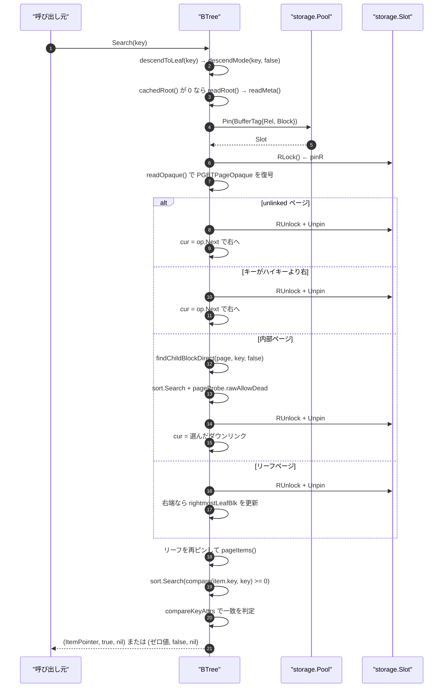
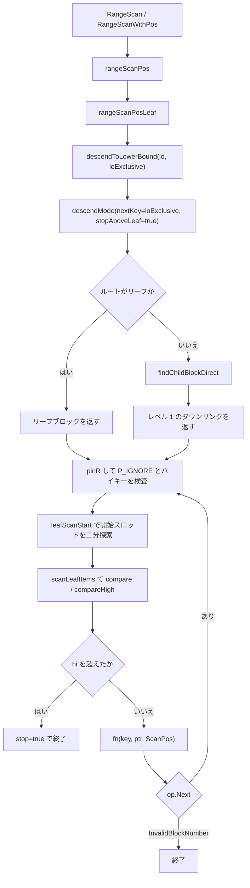

# B-tree の構造と検索

<details>
<summary>関連ソースファイル</summary>

- [`internal/access/nbtree/btree.go`](https://github.com/ryogrid/goopg/blob/19856410e8d497d59787e1ab35a2febb3f5953d6/internal/access/nbtree/btree.go)
- [`internal/access/nbtree/endpoint_scan.go`](https://github.com/ryogrid/goopg/blob/19856410e8d497d59787e1ab35a2febb3f5953d6/internal/access/nbtree/endpoint_scan.go)
- [`internal/access/nbtree/latch_release.go`](https://github.com/ryogrid/goopg/blob/19856410e8d497d59787e1ab35a2febb3f5953d6/internal/access/nbtree/latch_release.go)
- [`internal/access/nbtree/pgcompare.go`](https://github.com/ryogrid/goopg/blob/19856410e8d497d59787e1ab35a2febb3f5953d6/internal/access/nbtree/pgcompare.go)
- [`internal/access/nbtree/pgcompare_types.go`](https://github.com/ryogrid/goopg/blob/19856410e8d497d59787e1ab35a2febb3f5953d6/internal/access/nbtree/pgcompare_types.go)
- [`internal/access/nbtree/pgformat.go`](https://github.com/ryogrid/goopg/blob/19856410e8d497d59787e1ab35a2febb3f5953d6/internal/access/nbtree/pgformat.go)
- [`internal/access/nbtree/pgitemcodec.go`](https://github.com/ryogrid/goopg/blob/19856410e8d497d59787e1ab35a2febb3f5953d6/internal/access/nbtree/pgitemcodec.go)
- [`internal/access/nbtree/pgkeycmp.go`](https://github.com/ryogrid/goopg/blob/19856410e8d497d59787e1ab35a2febb3f5953d6/internal/access/nbtree/pgkeycmp.go)
- [`internal/access/nbtree/pgpage.go`](https://github.com/ryogrid/goopg/blob/19856410e8d497d59787e1ab35a2febb3f5953d6/internal/access/nbtree/pgpage.go)
- [`internal/access/nbtree/pgtuple.go`](https://github.com/ryogrid/goopg/blob/19856410e8d497d59787e1ab35a2febb3f5953d6/internal/access/nbtree/pgtuple.go)
- [`internal/storage/page.go`](https://github.com/ryogrid/goopg/blob/19856410e8d497d59787e1ab35a2febb3f5953d6/internal/storage/page.go)

</details>

`internal/access/nbtree` は、PostgreSQL 18 の nbtree とバイト互換な B-tree インデックスアクセスメソッドである。8 KiB のページを単位とし、ブロック 0 のメタページ (`PGBTMetaPage`) からルートブロックを読み、内部ページのダウンリンクを二分探索してリーフへ降り、リーフ上ではキー順の二分探索で目的のエントリを特定する。ページ末尾の 16 バイトは上流の `BTPageOpaqueData` を写した `PGBTPageOpaque` で、`btpo_prev` / `btpo_next` の兄弟リンクが木の形状そのものを表す。ハイキーは上流どおり `P_HIKEY` (物理オフセット 1) の通常アイテムとしてページ上に置かれ、その存在はフラグではなく兄弟リンクから導出される。キーは現時点では goopg の順序保存バイト列 (blob 形式) で、`CompareKeys` = `bytes.Compare` が順序を与える。`PGIndexKeyDesc` を渡すと `_bt_compare` 相当の属性単位比較に切り替わるが、本ページの範囲ではライタはまだその形式を書き出さない。

## 責務

- **ページ形状の維持**: ページ末尾 16 バイトに上流の `BTPageOpaqueData` (`SizeOfBTPageOpaquePG = 16`) を置き、`_bt_checkpage` が要求する条件 (`BlockSize - pd_special == 16`) を満たす。旧 goopg の 272 バイト opaque は廃止され、`BTPageOpaque` はメモリ上の綴りにすぎない (`internal/access/nbtree/pgformat.go:46`、`internal/access/nbtree/btree.go:128`)。
- **オフセット番号の付け替え**: 非右端ページでは物理ライン ポインタ番号とデータアイテム番号が 1 だけずれる。`PHiKey = 1` / `PFirstKey = 2` を定義し、`pgDataSlot` / `pgPhysOffnum` で両者を変換する (`internal/access/nbtree/pgpage.go:52`、`internal/access/nbtree/pgpage.go:84`)。
- **メタページの符号化・検証**: ブロック 0 に 48 バイトの `BTMetaPageData` (`PGBTMetaPage`) を置き、`BTREE_MAGIC = 0x053162` / `BTREE_VERSION = 4` を検証する。`Open` はバージョン範囲 `[2, 4]` を受け付ける (`internal/access/nbtree/pgformat.go:159`、`internal/access/nbtree/btree.go:1984`)。
- **索引タプルの符号化・復号**: `IndexTupleData` (8 バイト) のヘッダを軸に、リーフのヒープ TID、内部ページのダウンリンク、pivot の属性数、posting リストの TID 配列を 1 つのレイアウトで表現する (`internal/access/nbtree/pgtuple.go:511`、`internal/access/nbtree/pgtuple.go:350`)。
- **降下 (descent)**: ルートのキャッシュ、右リンク回復 (Lehman-Yao)、削除済みページの読み飛ばし、未完了スプリットの後始末を伴う `descendMode` を提供する (`internal/access/nbtree/btree.go:2670`)。
- **点検索と範囲検索**: `Search`、`RangeScan` 系、葉ページ単位で再開可能な `ScanCursor`、右端から左へ辿る `ScanFromEnd` を提供する (`internal/access/nbtree/btree.go:4623`、`internal/access/nbtree/btree.go:5185`、`internal/access/nbtree/endpoint_scan.go:21`)。
- **キー順序の一元化**: すべての順序判断を `indexFormat.compare` / `compareKeyAttrs` / `compareHigh` に集約し、記述子がある場合は `ComparePGIndexTuples` と型別比較器 (`PGCompareInt4` など) に委譲する (`internal/access/nbtree/pgkeycmp.go:78`、`internal/access/nbtree/pgcompare.go:184`)。
- **ページラッチ**: 読み取りは `pinR` (共有)、書き込みは `pinW` (排他) で行い、パニックで排他ラッチが取り残されないよう `wlatch` を用意する (`internal/access/nbtree/btree.go:2133`、`internal/access/nbtree/latch_release.go:63`)。

## 処理フロー

`Search` の実行経路を追う。降下は `descendToLeaf` → `descend(key, false)` → `descendMode(key, forUpdate=false, nextKey=false, needPath=true, stopAboveLeaf=false)` の順に到達し、リーフに着いてからもう一度ピンし直してページ内を二分探索する。



1. **ルートの解決** — `descendMode` はまず `cachedRoot` を読む。`rootCache` は `level<<32 | block` の 64 ビット値で、0 は「未キャッシュ」を意味する (ブロック 0 はメタページなので実ページと衝突しない)。ミス時は `readRoot` → `readMeta` がブロック 0 を `pool.Pin` し、`RLock` の下で `CheckPGBTPage` を通してから `ReadPGMetaPage` で復号する (`internal/access/nbtree/btree.go:2111`、`internal/access/nbtree/btree.go:2773`)。キャッシュヒットでも、ピンしたページが `rootCacheValid` (`BTRoot` フラグ、レベル一致、左右の兄弟がともに `InvalidBlockNumber`) を満たさなければ捨ててメタページから読み直す (`internal/access/nbtree/btree.go:2801`)。
2. **ページのピンと opaque の復号** — 各ページは `pinR` で `pool.Pin` + `Slot.RLock` される。`readOpaque` は `ReadPGOpaque` で 16 バイトを読み、`legacySibling` で `P_NONE` を `storage.InvalidBlockNumber` に、`legacyFlags` で `BTP_*` を goopg の `BT*` に翻訳する (`internal/access/nbtree/btree.go:194`、`internal/access/nbtree/pgpage.go:374`)。
3. **右へ移動する 3 つの理由** — (a) `op.isUnlinked()` は「削除が完了したページ」で、キー範囲は右隣にあるので `op.Next` へ進む。右隣が無ければ `errFellOffEnd` を返す。(b) `lowerBoundPastPage` はハイキーとの比較で、探索キーがページ範囲を越えていれば右へ進む。包括下限は `compare(key, highkey) > 0`、排他下限は `compareHigh(highkey, key) <= 0` を使う (`internal/access/nbtree/btree.go:289`、`internal/access/nbtree/btree.go:300`)。(c) 書き込み時のみ、`HasIncompleteSplit()` のページに当たれば `finishSplit` してから再試行する (`internal/access/nbtree/btree.go:2708`)。
4. **内部ページの二分探索** — `findChildBlockDirect` は `PGDataItemCount` で件数を取り、`sort.Search` で「キーが探索キーより大きい最初のアイテム」を探し、`idx == n` なら `n-1`、`idx > 0` なら 1 つ戻した位置のダウンリンクを選ぶ。比較は `pageProbe.rawAllowDead(i+1)` が返すページ内バイトをその場で比較する (コピーなし)。探索キーが空 (下限なし = 負の無限大) のときは `searchN = 0` として二分探索自体を省き、先頭ダウンリンクを返す (`internal/access/nbtree/btree.go:2537`)。
5. **リーフページ内の二分探索** — `Search` は降下で得たリーフを再び `pinR` し、`pageItems` で全アイテムをデコードする。`posting` タプルは TID ごとに展開され、`LP_DEAD` のライン ポインタは読み飛ばされる。`sort.Search` で `compare(item.key, key) >= 0` となる最初の位置を求め、その位置のキーを `compareKeyAttrs` で比較して 0 なら成功、非 0 なら「存在しない」を返す (`internal/access/nbtree/btree.go:4651`、`internal/access/nbtree/btree.go:2278`)。タプル形式では探索キーのヒープ TID がゼロ (タイブレークで負の無限大) になるため、キーグループがページ境界から始まる場合に `idx >= len(items)` となりうる。その場合は `_bt_first` の `_bt_stepright` と同じく右隣へ 1 ページ進む (`internal/access/nbtree/btree.go:4659`)。
6. **範囲検索** — `RangeScan` → `rangeScanPos` → `rangeScanPosLeaf` の順で、`descendToLowerBound` が排他下限なら `nextKey=true` で「等キーグループの後ろ」まで降りる。`scanLeafItems` はページ内を走査し、包括下限は `compare(key, lo) >= 0`、排他下限は `compareHigh(key, lo) > 0`、上端は `compareHigh(key, hi) > 0` (排他なら `>= 0`) で判定する。`lo` を最初の 1 件で満たした後は `lo = nil` として以降の比較を省く (単調性の利用)。開始位置は `leafScanStart` が同じ述語で二分探索する (`internal/access/nbtree/btree.go:4775`、`internal/access/nbtree/btree.go:4996`)。
7. **右端からの走査** — `ScanFromEnd` はメタページからルートを取り、`op.Next` が無くなるまで右へ進んで右端リーフに着き、`scanLeafItemsBackward` で最大オフセットから降順に返し、以降は `op.Prev` を辿る。posting タプルは TID を降順に列挙する (`internal/access/nbtree/endpoint_scan.go:21`、`internal/access/nbtree/endpoint_scan.go:90`)。



`ScanCursor` はこの範囲検索を葉ページ単位に分割したもので、`NewScanCursor` の 1 回の降下で得たブロックを `next` に保持し、`Next` が 1 ページ分だけ `scanLeafItems` を回して次のブロック番号を返す。ピンやラッチを呼び出し間に保持しないため、葉境界でのスプリット遭遇は eager な走査と同一の規則 (`op.Next` を毎回読み直す) で処理される (`internal/access/nbtree/btree.go:5063`、`internal/access/nbtree/btree.go:5185`)。

## 主要ファイル

| ファイル | 役割 |
| --- | --- |
| `internal/access/nbtree/btree.go` | `BTree` ハンドル、`descendMode`、`Search`、`RangeScan`、`ScanCursor`、`pageItems` / `PageItemKeys` / `PageLeafItems` / `PageDownlinks`、`item` の marshal / parse、`Insert` (`internal/access/nbtree/btree.go:BTree`、`internal/access/nbtree/btree.go:Search`、`internal/access/nbtree/btree.go:insertItemSorted`) |
| `internal/access/nbtree/pgformat.go` | 上流 opaque の 16 バイト定義と `PGBTPageOpaque`、`PGBTMetaPage`、`ReadPGOpaque` / `WritePGOpaque`、`InitPGBTPage`、`CheckPGBTPage` (`internal/access/nbtree/pgformat.go:PGBTPageOpaque`、`internal/access/nbtree/pgformat.go:CheckPGBTPage`) |
| `internal/access/nbtree/pgpage.go` | `P_HIKEY` / `P_FIRSTKEY` のオフセット算術、データスロット変換、ハイキー設置と兄弟リンク更新、`pageProbe` (`internal/access/nbtree/pgpage.go:PGFirstDataKey`、`internal/access/nbtree/pgpage.go:pgWriteNextSibling`、`internal/access/nbtree/pgpage.go:pageProbe`) |
| `internal/access/nbtree/pgtuple.go` | `IndexTupleData` のヘッダ、pivot / posting の alternative-TID 表現、`FormPGIndexTuple` / `DeformPGIndexTuple`、`CheckPGBTThirdPage` (`internal/access/nbtree/pgtuple.go:SizeOfIndexTupleData`、`internal/access/nbtree/pgtuple.go:CheckPGBTThirdPage`) |
| `internal/access/nbtree/pgkeycmp.go` | `indexFormat` と `compare` / `compareKeyAttrs` / `compareHigh`、範囲境界の公開 API (`internal/access/nbtree/pgkeycmp.go:indexFormat`、`internal/access/nbtree/pgkeycmp.go:compareHigh`) |
| `internal/access/nbtree/pgcompare.go` | `PGKeyAttr` / `PGIndexKeyDesc`、`ComparePGIndexTuples`、NULL 順序とヒープ TID タイブレーク (`internal/access/nbtree/pgcompare.go:PGKeyAttr`、`internal/access/nbtree/pgcompare.go:ComparePGIndexTuples`) |
| `internal/access/nbtree/pgcompare_types.go` | 型別比較器 (`PGCompareInt4`、`PGCompareFloat8`、`PGCompareNumeric`、`PGCompareTextC` など) と varlena ペイロード抽出 (`internal/access/nbtree/pgcompare_types.go:PGCompareInt4`、`internal/access/nbtree/pgcompare_types.go:PGCompareNumeric`) |
| `internal/access/nbtree/pgitemcodec.go` | blob 形式とタプル形式を切り替える `indexFormat.marshal` / `parseAliasing`、ページ収容判定 `itemEncodedSize` / `pageHasSpaceFor` (`internal/access/nbtree/pgitemcodec.go:marshal`、`internal/access/nbtree/pgitemcodec.go:itemEncodedSize`) |
| `internal/access/nbtree/endpoint_scan.go` | 右端リーフへの降下と左方向走査 `ScanFromEnd` / `scanLeafItemsBackward` (`internal/access/nbtree/endpoint_scan.go:ScanFromEnd`) |
| `internal/access/nbtree/latch_release.go` | 排他ページラッチのパニック安全な解放ホルダ `wlatch` (`internal/access/nbtree/latch_release.go:wlatch`) |
| `internal/storage/page.go` | `BlockSize = 8192`、`SizeOfPageHeaderData = 24`、`BlockNumber` と `InvalidBlockNumber` (`internal/storage/page.go:BlockSize`) |

## 公開 API / エントリポイント

```go
func Open(pool *storage.Pool, rel storage.RelFileNode) (*BTree, error)
func OpenWithOptions(pool *storage.Pool, rel storage.RelFileNode, opts Options) (*BTree, error)
func Create(pool *storage.Pool, rel storage.RelFileNode) (*BTree, error)

func (bt *BTree) Insert(key []byte, ptr storage.ItemPointer) error
func (bt *BTree) Search(key []byte) (storage.ItemPointer, bool, error)

func (bt *BTree) RangeScan(lo, hi []byte, fn func(key []byte, ptr storage.ItemPointer) (bool, error)) error
func (bt *BTree) RangeScanWithPos(lo, hi []byte, loExclusive, hiExclusive bool,
	fn func(key []byte, ptr storage.ItemPointer, pos ScanPos) (bool, error)) error
func (bt *BTree) RangeScanWithPosLeafFilter(lo, hi []byte, loExclusive, hiExclusive bool,
	leafFilter func(storage.BlockNumber) bool,
	fn func(key []byte, ptr storage.ItemPointer, pos ScanPos) (bool, error)) error
func (bt *BTree) NewScanCursor(lo, hi []byte, loExclusive, hiExclusive bool,
	leafFilter func(storage.BlockNumber) bool) (*ScanCursor, error)
func (c *ScanCursor) Next(fn func(key []byte, ptr storage.ItemPointer, pos ScanPos) (bool, error)) (bool, error)
func (bt *BTree) ScanFromEnd(fn func(key []byte, ptr storage.ItemPointer) (bool, error)) error

func (bt *BTree) CompareLowBound(key, lo []byte) int
func (bt *BTree) CompareHighBound(key, hi []byte) int
func (bt *BTree) CompareBoundAttrs(key, bound []byte) (res, at, nKey, nBound int, ok bool)

func IndexFormatFor(desc *PGIndexKeyDesc) IndexFormat
func (bt *BTree) Format() IndexFormat
func (bt *BTree) KeyDesc() *PGIndexKeyDesc

func (fm IndexFormat) PageItemKeys(p storage.Page) ([][]byte, error)
func (fm IndexFormat) PageLeafItems(p storage.Page) ([]LeafItem, error)
func (fm IndexFormat) PageDownlinks(p storage.Page) ([]Downlink, error)
func (fm IndexFormat) PageHighKey(p storage.Page) (key []byte, ok bool, err error)

func PGDataItemCount(p storage.Page) (int, error)
func PGHighKeyRaw(p storage.Page) ([]byte, bool, error)
func ParseOpaque(p storage.Page) BTPageOpaque
func ParseMeta(p storage.Page) PGBTMetaPage
func CheckPGBTPage(p storage.Page, block storage.BlockNumber) error
```

`RangeScan` の `fn` に渡る `key` は **ピンされたリーフページを指す別名スライス** である。`fn` の戻り値より後まで保持してはならず、同じ `BTree` を再入してもならない (保持中の共有ラッチとデッドロックする)。保持が必要なら `append([]byte(nil), key...)` で複製する。この契約は `RangeScan` / `RangeScanWithPos` / `ScanFromEnd` / `ScanCursor.Next` で共通である (`internal/access/nbtree/btree.go:4730`)。

## 主要データ構造

### `BTree` — インデックス 1 本分のハンドル

```go
type BTree struct {
	pool     *storage.Pool
	rel      storage.RelFileNode
	logSplit LogSplitFunc

	// deadTIDs, when non-nil, lets the split path reclaim index entries whose
	// heap tuple is dead to all (dead_purge.go). nil = disabled, no behaviour
	// change.
	deadTIDs DeadTIDFilter

	// keyFmt is the index's key FORMAT (M0130-S11.4 slices 3b-2c-i and
	// 3b-2c-ii-B1) — the one place every ordering AND item-layout decision in
	// this package resolves. Its zero value is the blob format: the bytewise
	// order goopg's key encodings are built for, over header-less key
	// payloads. A non-nil descriptor switches the whole tree to `_bt_compare`
	// over PG binary datums, with whole index tuples as its key operands. See
	// pgkeycmp.go and pgitemcodec.go.
	keyFmt indexFormat

	// (No structural mutex: a per-handle splitMu and then a pool-owned,
	// relation-scoped one serialised every split and page deletion until
	// M0122-0010 replaced them with PG's lock coupling — see design
	// 0055-0002 §4.2. The 2026-05 attempt to drop splitMu hit "unpin
	// underflow" panics under 32-writer stress; that was the evictVictim
	// race, fixed since.)

	// M0055-0001: write-path counters used by the baseline
	// harness and Phase A/B regression tests. Backed by per-P
	// sharded counters (M0107-0008 loop 7) so the Insert/Split
	// hot path does not contend on a single cache line; Stats
	// reads them via Counter.Sum, ResetStats via Counter.Reset.
	stats btreeStatsCounters

	// M0055-0002-followup-rightmost-cache: cached rightmost leaf
	// pointer for append-shaped workloads. Written by the insert
	// path's slow-path descent; read by the fast path to skip
	// re-descent when the next insert's key is ≥ the highest key
	// observed at the cache's leaf. atomic so concurrent readers
	// don't tear the value. Zero (BlockNumber 0) means "uncached"
	// — block 0 is the metapage so no real leaf has block 0.
	rightmostLeafBlk atomic.Uint64

	// rootCache is the metapage's root as of the last read, packed as
	// level<<32 | block (0 = uncached: block 0 is the metapage) — PG's
	// rd_amcache copy of the metapage that _bt_getroot descends from
	// instead of reading the metapage (M0122-0012 slice 61). A descent
	// trusts it only after pinning the page and finding it still the
	// live root at that level (rootCacheValid); otherwise it re-reads the
	// metapage, as _bt_getroot does when its cached root went stale.
	rootCache atomic.Uint64

	// M0055-0005 Phase D: recycled-page free list. Pages that
	// were unlinked by vacuum get pushed here; future
	// allocations (PinNew calls) check this list first before
	// extending the file. Guarded by `freeListMu` to keep the
	// pop/push atomic.
	freeListMu sync.Mutex
	freeList   []storage.BlockNumber

	// Test-only fault injection for the stranded-latch guard: fires inside
	// insertIntoBlock's leaf-write window, where insertItemSorted really
	// panicked. See latch_release.go.
	panicBeforeLeafWrite func(storage.BlockNumber) // test-only fault injection
	// beforeUnlinkPins is test-only: it runs in unlinkEmptyLeaf after the
	// unlatched emptiness recheck and before the deletion latches its pages,
	// the window an insert into the phase-1 page can fall into.
	beforeUnlinkPins func(storage.BlockNumber)

	// DebugTraceInserts (M-NIGHTLY AI-20260708-064334-001 investigation
	// aid, 5th loop): when true, every insertItemSorted call anywhere in
	// this BTree (fast-path, cached-rightmost, split-left-refill,
	// split-right-fill, dedup-recovery-rebuild) appends a record to
	// insertLog: which block the item physically landed on, at which
	// 0-based line-pointer slot, with the item's key/TID. Off by default,
	// a single bool check when unset — same zero-cost-when-off pattern as
	// storage.Pool.DebugTraceSlotEvents. Lets a caller cross-reference
	// "was this (key,TID) ever actually written, and where" against the
	// final on-disk leaf walk to localize a lost entry to an exact
	// (block, slot) instead of only knowing it vanished somewhere.
	DebugTraceInserts bool
	insertLogMu       sync.Mutex
	insertLog         []btreeInsertLogEvent
	// rewriteLog records insertIntoBlock's page-rewrite checkpoints (see
	// RewriteLogEvent); guarded by insertLogMu alongside insertLog.
	rewriteLog []RewriteLogEvent
	// DebugVerifyFastPathInserts (M-NIGHTLY AI-20260708-064334-001
	// investigation aid, 7th loop): when true, every single-item fast-path
	// insertItemSorted call (tryInsertNoSplit, insertIntoBlock's own
	// no-split branch, tryInsertOnCachedRightmost -- deliberately NOT the
	// split/dedup-rewrite path's insertItemSorted calls, which resetPageItems
	// first and are already covered by RewriteLogEvent) snapshots
	// pageItems() immediately before and after the call and verifies every
	// pre-existing (key,TID) pair is still present afterward -- a plain
	// insert only ever adds a line pointer, so any pre-existing entry that
	// vanishes is captured as a FastPathViolation with the exact call site,
	// block, and the item that was inserted alongside it. Off by default,
	// zero cost when unset -- same pattern as DebugTraceInserts.
	DebugVerifyFastPathInserts bool
	fastPathViolations         []FastPathViolation
	// DebugTraceFlushes (M-NIGHTLY AI-20260708-064334-001 investigation
	// aid, 8th loop): when true, arms RecordFlushSnapshot as the target for
	// storage.Pool.OnFlushSnapshot — every dirty-page flush of a block
	// belonging to this BTree's relation (evictVictim's wasDirty branch,
	// via flushSlot) is decoded with pageItems() and appended to flushLog,
	// sharing insertLog/rewriteLog's Seq counter. The 7th loop isolated the
	// loss window to an unpin/re-pin gap on the same block — a flush is the
	// only thing that touches a page's bytes while nobody holds a pin on
	// it, so this lets a caller directly compare "what a flush wrote to
	// disk" against the last known-good insert/rewrite/fast-path snapshot
	// for the same block. Off by default, zero cost when unset — same
	// pattern as DebugTraceInserts.
	DebugTraceFlushes bool
	flushLog          []FlushSnapshotEvent
	// DebugTraceReloads (M-NIGHTLY AI-20260708-064334-001 investigation
	// aid, 9th loop): when true, arms RecordReloadSnapshot as the target
	// for storage.Pool.OnBlockReload — every disk reload of a block
	// belonging to this BTree's relation (pinLoad's cache-miss branch,
	// right after Manager.ReadBlock, before the slot is published for Pin)
	// is decoded with pageItems() and appended to reloadLog, sharing
	// insertLog/rewriteLog/flushLog's Seq counter. The 8th loop proved the
	// dirty-flush WRITE side always faithfully writes whatever bytes are
	// in memory (18/18), narrowing the loss window to the READ side: does
	// a reload ever serve stale or wrong bytes for a block that was just
	// correctly flushed? This lets a caller compare "what a reload
	// actually read" against the immediately preceding FlushSnapshotEvent
	// for the same block. Off by default, zero cost when unset — same
	// pattern as DebugTraceFlushes.
	DebugTraceReloads bool
	reloadLog         []ReloadSnapshotEvent
	// DebugTraceContentMu (M-NIGHTLY AI-20260708-064334-001 investigation
	// aid, 11th loop): when true, arms pinW/unpinW to snapshot pageItems()
	// for the block being locked, bracketing the FULL contentMu hold (the
	// "before" snapshot is taken right after s.Lock(), the "after"
	// snapshot right before s.Unlock()) rather than any one caller's
	// fast-path/split/dedup call. pinW/unpinW is every CALLER-SIDE
	// mutation's choke point, but NOT the only code that takes
	// storage.Slot.contentMu — storage.Pool.pinLoad (bufpool.go
	// ~1561-1572) independently Lock()s/Unlock()s the same mutex around
	// its own ReadBlock call during a cache-miss reload, so a hold
	// recorded here can show a page's content valid at Unlock and already
	// different at the very next traced Lock with nothing in between at
	// THIS layer — that gap is real and lives inside pinLoad's reload
	// hold, observable via DebugTraceReloads/OnBlockReload instead (see
	// the 11th loop's writeup in
	// TestVerifyBtreeEngineSilentOnRealConcurrentContended's skip message
	// for how this was used to narrow the loss window further). Shares
	// insertLog/rewriteLog/flushLog/reloadLog's Seq counter. Off by
	// default, zero cost when unset — same pattern as DebugTraceFlushes/
	// DebugTraceReloads.
	DebugTraceContentMu bool
	contentMuLog        []ContentMuEvent
	// contentMuBefore holds, per in-flight pinW hold, the pageItems()
	// snapshot taken right after acquiring the exclusive content latch, so
	// unpinW can pair it with a post-mutation snapshot into one
	// ContentMuEvent. Keyed by block number: safe without extra
	// synchronization beyond insertLogMu because storage.Slot.contentMu is
	// itself exclusive per block, so only one goroutine can hold a pinW on
	// a given block at a time — no two concurrent holds for the same key
	// can race this map.
	contentMuBefore map[storage.BlockNumber][]InsertLogRecord
	// DebugTraceBufmap (M-NIGHTLY AI-20260708-064334-001 investigation aid,
	// 14th loop): when true, arms RecordBufmapInsert/RecordBufmapDelete as
	// the target for storage.Pool.OnBufmapInsert/OnBufmapDelete — every
	// bufmap mutation (Insert success/failure, Delete) for a block
	// belonging to this BTree's relation is appended to bufmapLog, sharing
	// insertLog/rewriteLog/flushLog/reloadLog/contentMuLog's Seq counter.
	// Unlike those other logs, the hook fires synchronously INSIDE
	// storage.Pool.bmInsert/bmDelete while bufmap's own internal mu is
	// still held, so bufmapLog's recorded order is bufmap's TRUE
	// serialization order for the tag — not subject to the Seq-vs-real-
	// completion-order drift the 11th loop found in the flush/reload hooks
	// (those stamp Seq from a later, separately-locked call). This is the
	// only way, after 13 loops of hypothesis-refinement without ever
	// directly instrumenting bufmap itself, to prove or refute whether two
	// different slots simultaneously believe they own the same tag — scan
	// bufmapLog for a tag whose Insert(slotA) has no intervening Delete
	// before a LATER Insert(slotB) for the same tag succeeds. Off by
	// default, zero cost when unset — same pattern as DebugTraceFlushes/
	// DebugTraceReloads/DebugTraceContentMu.
	DebugTraceBufmap bool
	bufmapLog        []BufmapEvent
	// logSeqNext is a single monotonic counter shared by insertLog and
	// rewriteLog (instead of each using its own len()-based sequence) so a
	// caller can compare Seq values ACROSS the two logs to establish
	// temporal ordering — e.g. "did any rewrite event on this block happen
	// after this specific insert". Guarded by insertLogMu.
	logSeqNext uint64
}
```

`internal/access/nbtree/btree.go:BTree` (989 行)

- `pool` / `rel` が対象リレーションのバッファプールと物理ファイルを決める。すべてのページアクセスは `storage.BufferTag{Rel: bt.rel, Block: blk}` をキーにする。
- `keyFmt` は「順序」と「オンページ レイアウト」の両方を決める唯一の場所である。ゼロ値は blob 形式 (バイト順) で、`desc != nil` のときだけ `_bt_compare` 相当へ切り替わる。したがって `keyFmt` が空のまま組み立てられた `BTree` は、以前とまったく同じ挙動になる。
- `rightmostLeafBlk` は追加型ワークロード用の右端リーフキャッシュ。0 は未キャッシュ (ブロック 0 はメタページなので実リーフと衝突しない)。`rootCache` はメタページの root を `level<<32 | block` で保持する。
- `freeList` は VACUUM が unlink したページの再利用リストで、`freeListMu` が pop/push を直列化する。
- `deadTIDs` が非 nil のときだけスプリット経路の死エントリ回収が有効になる。
- 残りの `Debug*` フィールドは既定で無効の調査用計装で、無効時は 1 回の bool 判定だけのコストで済む。`insertLogMu` が `insertLog` / `rewriteLog` / `flushLog` / `reloadLog` / `bufmapLog` / `contentMuLog` と単調増加の `logSeqNext` を保護する。

### `PGBTPageOpaque` — オンディスクの special area

```go
type PGBTPageOpaque struct {
	Prev    storage.BlockNumber
	Next    storage.BlockNumber
	Level   uint32
	Flags   uint16
	CycleID uint16
}
```

`internal/access/nbtree/pgformat.go:PGBTPageOpaque` (84 行)

`Prev` / `Next` が兄弟リンク、`Level` がリーフ 0 から数えた高さ、`Flags` が `BTP_*`、`CycleID` が VACUUM サイクル ID である。不変条件は次の 3 つ。

- `Next == PNone (0)` が右端、`Prev == PNone` が左端を意味する。`P_NONE` は `InvalidBlockNumber` (0xFFFFFFFF) ではなく 0 で、ブロック 0 がメタページであるため兄弟にはなりえない。
- ハイキーの有無は `Next` から導出される (`IsRightmost`)。専用のフラグビットは存在しない。上流の `0x0008` は `BTP_META` であり、goopg の旧 `BTHasHighKey` とは衝突する。
- `Flags` のビットは `BTPLeaf=1<<0`、`BTPRoot=1<<1`、`BTPDeleted=1<<2`、`BTPMeta=1<<3`、`BTPHalfDead=1<<4`、`BTPSplitEnd=1<<5`、`BTPHasGarbage=1<<6`、`BTPIncompleteSplit=1<<7`、`BTPHasFullXID=1<<8` で、旧 `BT*` とは 3 ビットの位置が異なる (`internal/access/nbtree/pgformat.go:64`)。`readOpaque` / `writeOpaque` の翻訳表 `flagTranslation` が両方向の唯一の定義であり、`BTHasHighKey` は落とされ、`BTIncompleteSplit` は `0x0080`、`BTHalfDead` は `0x0010` に対応する (`internal/access/nbtree/pgpage.go:360`)。

### `BTPageOpaque` — エンジン内部の綴り

```go
type BTPageOpaque struct {
	Prev  storage.BlockNumber
	Next  storage.BlockNumber
	Level uint32
	Flags uint16
}
```

`internal/access/nbtree/btree.go:BTPageOpaque` (128 行)

フィールドは上流と 1 対 1 だが、値の意味が 2 点だけ異なる。`Prev` / `Next` は `storage.InvalidBlockNumber` を「兄弟なし」に使い、`Flags` は旧 `BT*` ビットを持つ。`HasHighKey()` は `Next != InvalidBlockNumber` として計算されるメソッドであり、ストアされたビットではない (`internal/access/nbtree/btree.go:177`)。

### `PGBTMetaPage` — ブロック 0 の 48 バイト

```go
type PGBTMetaPage struct {
	Magic                    uint32
	Version                  uint32
	Root                     storage.BlockNumber
	Level                    uint32
	FastRoot                 storage.BlockNumber
	FastLevel                uint32
	LastCleanupNumDelpages   uint32
	LastCleanupNumHeapTuples float64
	AllEqualImage            bool
}
```

`internal/access/nbtree/pgformat.go:PGBTMetaPage` (159 行)

`Root` / `Level` が現在のルート、`FastRoot` / `FastLevel` が上流の fast root、`LastCleanupNumHeapTuples` は float8 で、初期値は 0 ではなく **-1.0** (上流の「不明」センチネル) である。`AllEqualImage` は goopg がビルド時・挿入時に無条件で重複排除するため常に true で書かれる。`WritePGMetaPage` は構造体内のアラインメント穴 (offset 28..32) と末尾パディング (41..48) を明示的にゼロ埋めするので、実 PG が書いたメタページとのバイト比較が成立する (`internal/access/nbtree/pgformat.go:205`)。

### `item` — メモリ上の 1 アイテム

```go
type item struct {
	ptr storage.ItemPointer
	key []byte
	// pivot marks the item as an nbtree PIVOT tuple — every internal-page
	// downlink and every P_HIKEY separator (M0130-S11.4 slice 3a). It is an
	// IN-MEMORY flag only: on disk the fact lives in INDEX_ALT_TID_MASK plus
	// t_tid's offset half (BTreeTupleIsPivot), and parseItemBody reads it back
	// off the tuple. It exists because several paths parse an item and
	// re-marshal it (the vacuum/LP_DEAD page rewrites, split redistribution);
	// without carrying the flag through, a round trip would silently demote a
	// pivot to a plain tuple and hand a real PG nbtree status bits as a heap
	// TID.
	pivot bool
}
```

`internal/access/nbtree/btree.go:item` (352 行)

`ptr` はリーフではヒープ TID、内部ページでは子ブロック番号である。`pivot` はメモリ上だけのフラグで、オンディスクでは `INDEX_ALT_TID_MASK` と `t_tid` のオフセット半身 (属性数) が同じ事実を表す。パース → 再マーシャルする経路 (VACUUM のページ書き換え、スプリットの再配分) でこのフラグを落とすと、pivot が通常タプルに降格し、実 PG には nbtree のステータスビットがヒープ TID として渡ってしまう。

### `pageProbe` — 二分探索 1 ページ分の不変量

```go
type pageProbe struct {
	p       storage.Page
	lpCount int
	first   uint16
}
```

`internal/access/nbtree/pgpage.go:pageProbe` (144 行)

`lpCount` と `first` (`P_FIRSTDATAKEY`) をページごとに 1 回だけ求め、`rawAllowDead(slot)` が `storage.PageGetItemRawAllowDeadNoCopyN(p, slot+first-1, lpCount)` へ渡す。以前はプローブごとにヘッダと special area から両方を再導出しており、TPC-DS Q72 の約 5% を占めていた。有効期間は「ページがラッチされたまま」に限られる。

### `indexFormat` — 順序とレイアウトの単一決定点

```go
type indexFormat struct {
	// desc is the index's key descriptor, or nil for bytewise ordering.
	desc *PGIndexKeyDesc
}
```

`internal/access/nbtree/pgkeycmp.go:indexFormat` (60 行)

`desc` が nil ならキーは順序保存バイト列で `CompareKeys`、非 nil ならキーは `FormPGIndexTuple` の出力そのもので `ComparePGIndexTuples` が順序を与える。この 1 フィールドが「比較方法」と「`item.key` が何であるか」の両方を決めるため、順序オブジェクトとレイアウト オブジェクトを別々に持つと片方だけ更新されて木が静かに誤順序になる、というのが統合の理由である (`internal/access/nbtree/pgitemcodec.go:162`)。

### `PGIndexKeyDesc` / `PGKeyAttr` — 索引記述子

```go
type PGIndexKeyDesc struct {
	// Attrs are the KEY attributes only. An index with INCLUDE columns
	// describes just its key prefix here, matching
	// IndexRelationGetNumberOfKeyAttributes.
	Attrs []PGKeyAttr
}
```

`internal/access/nbtree/pgcompare.go:PGIndexKeyDesc` (100 行)

```go
type PGKeyAttr struct {
	// PGIndexAttr is the physical layout FormPGIndexTuple /
	// DeformPGIndexTuple consult.
	PGIndexAttr
	// Compare is the attribute's opclass comparator. A nil Compare means
	// "bytewise", i.e. CompareKeys — the honest description of goopg's
	// current order-preserving key encodings (EncodeInt4, EncodeNumericKey,
	// EncodeVarchar, …), all of which are built so that lexicographic byte
	// order IS the type's order. Keeping nil meaningful is what lets 3b-2
	// migrate one type at a time instead of in a flag day.
	Compare PGAttrComparator
	// Desc is SK_BT_DESC: the column is indexed in descending order.
	Desc bool
	// NullsFirst is SK_BT_NULLS_FIRST. PG's default for an ASC column is
	// NULLS LAST (this field false); for DESC the catalog records NULLS
	// FIRST, so a caller building a descriptor from pg_index.indoption must
	// carry both bits across rather than deriving one from the other.
	NullsFirst bool
	// IntWidth, when non-zero, says Compare is the signed little-endian
	// integer comparison of an IntWidth-byte image (PGCompareInt2/4/8 —
	// btint2cmp/btint4cmp/btint8cmp, which date/time/timestamp share), so
	// compareFixedPrefix may compare the bytes inline (M0122-0012 C37). The
	// descriptor builder stamps it beside Compare; 0 means "call Compare".
	IntWidth uint8
}
```

`internal/access/nbtree/pgcompare.go:PGKeyAttr` (70 行)

`Attrs` は KEY 属性だけを持ち、INCLUDE 列は含まない。各 `PGKeyAttr` は物理レイアウト (`PGIndexAttr`: `Len`、`ByVal`、`AlignBy`、`Storage`) と順序規則 (`Compare`、`Desc`、`NullsFirst`) を束ねる。`compareAttr` は NULL を最初に処理し (`anull && bnull` は 0、`NullsFirst == anull` なら -1)、比較器が nil なら `CompareKeys`、`Desc` なら結果を符号反転する。引数を入れ替えず反転するのは、非対称な比較器でも左辺がどちらかで答えが変わらないようにするためである (`internal/access/nbtree/pgcompare.go:131`)。`IntWidth` が 2/4/8 のときは符号付きリトルエンディアン整数として `compareFixedPrefix` がインライン比較する。

### `PGIndexAttr` — タプル コーデックが見る物理属性

```go
type PGIndexAttr struct {
	// Len is attlen: > 0 fixed width, -1 varlena, -2 cstring.
	Len int16
	// ByVal is attbyval.
	ByVal bool
	// AlignBy is attalignby: 1, 2, 4 or 8 (the decoded form of attalign).
	AlignBy uint8
	// Storage is attstorage: 'p' plain, 'e' external, 'm' main, 'x' extended.
	Storage byte
}
```

`internal/access/nbtree/pgtuple.go:PGIndexAttr` (123 行)

`Len` は `attlen` (正: 固定長、-1: varlena、-2: cstring)、`AlignBy` は `attalign` を 1/2/4/8 に復号した値、`Storage` は `attstorage` である。`packable()` は `Len == -1 && Storage != 'p'` のときだけ真になり、短縮 varlena ヘッダへの付け替えを許す (`internal/access/nbtree/pgtuple.go:137`)。

### `LeafItem` / `Downlink` — ページ読み取りの結果型

```go
type LeafItem struct {
	Key          []byte
	TID          storage.ItemPointer
	Slot         uint16
	PostingIndex int
}
```

`internal/access/nbtree/btree.go:LeafItem` (2412 行)

```go
type Downlink struct {
	Key   []byte
	Child storage.BlockNumber
}
```

`internal/access/nbtree/btree.go:Downlink` (2468 行)

`LeafItem.Slot` は **物理** ライン ポインタ番号であり、データアイテム番号ではない (`PostingIndex` は posting 内の位置、通常アイテムは -1)。`Downlink.Child` は内部ページの `t_tid` ブロック半身から取り出した子ブロックで、左端アイテムのキーは空 (負の無限大) という規約を持つ。

### `ScanCursor` — 葉ページ単位の再開可能な走査

```go
type ScanCursor struct {
	bt *BTree
	// lo/hi are the same encoded bounds the eager scans take; both are
	// retained (not copied — callers pass scan-key bytes that outlive the
	// scan) for the per-item bound checks on every leaf.
	lo, hi                   []byte
	loExclusive, hiExclusive bool
	leafFilter               func(storage.BlockNumber) bool
	next                     storage.BlockNumber // InvalidBlockNumber once exhausted
	// page is the leaf Next is walking, set only while fn runs (LeafLastKey).
	page storage.Page
	// skip is the within-page jump fn requested (SkipTo); 0 = none.
	skip uint16
}
```

`internal/access/nbtree/btree.go:ScanCursor` (5063 行)

`next` が次に読むリーフで、`InvalidBlockNumber` になったら枯渇を意味する。`page` は `Next` の実行中だけ設定され、`LeafLastKey` / `LeafItemCount` / `LeafKeyAt` / `SkipTo` はその間だけ有効である。`skip` はページ内の前方ジャンプで、`hi` 境界があるときは無視される (`scanLeafItems` が `skip = nil` にする) ため、hi を飛び越えることはない。

### `wlatch` — 排他ラッチの所有者

```go
type wlatch struct {
	bt *BTree
	s  *storage.Slot
}
```

`internal/access/nbtree/latch_release.go:wlatch` (63 行)

`hold` でピン済み・排他ラッチ済みのスロットを受け取り、`take` で所有者ごと呼び出し元へ渡し、`release` は自分がまだ持っているときだけ `unpinW` する。`release` は冪等なので、通常の return 経路と `defer` のパニック経路の両方から呼んでも二重解放にならない。

## 内部構造

### データスロットと物理オフセットのずれ

上流の非右端ページはオフセット 1 をハイキーに予約するため、最初のデータアイテムはオフセット 2 にある。goopg は約 45 か所のアクセサを書き換える代わりに、`pgDataSlot` / `pgGetItemRaw` などのラッパーに「1 始まりのデータスロット」を渡させ、内部で `P_FIRSTDATAKEY` のバイアスを足す。`pgFirstDataSlot` は 16 バイト opaque 全体を復号せず、`btpo_next` の 4 バイトだけを読んで右端判定する。これはページ内ループからアイテムごとに呼ばれるためである (`internal/access/nbtree/pgpage.go:71`)。

WAL が運ぶ座標は物理オフセット番号なので、`insertItemSorted` が返す 0 始まりのデータインデックスは `pgPhysOffnum` で変換してから `xl_btree_insert` 相当のレコードに載せる。挿入は `btpo_next` を変えないため、挿入後に右端ビットを読んでも値は前後で同じである (`internal/access/nbtree/pgpage.go:96`)。

### ハイキーと兄弟リンクは同時にしか動かせない

ハイキーの存在がフラグではなく `Next` から導出される以上、「右隣を失ったのにセパレータが残る」ページは、その瞬間から全データスロットを 1 つずつずらして解釈される。`pgWriteNextSibling` はこの不変条件を 1 か所に閉じ込める。

- 右端 → 非右端への遷移は **拒否** する。これを正当に行えるのはスプリットだけで、そこには実在のセパレータがあり `pgSetHighKeyRaw` 経由で設置される。
- 非右端 → 右端への遷移では `pgSlideLeft` が `P_HIKEY` のライン ポインタを削除し、データアイテムを 1 スロット左へ詰める。セパレータを残すと `P_FIRSTDATAKEY` だけが動いてアイテムが動かない。
- `pgPromoteToNonRightmost` は逆方向で、呼び出し元が **すでに `btpo_next` を新しい右隣へ向けた後** に `P_HIKEY` へアイテムを挿入する。`pgDataSlot` が opaque を読むため、シフトとリンク更新は同じクリティカル セクションで完了していなければならない (`internal/access/nbtree/pgpage.go:266`、`internal/access/nbtree/pgpage.go:317`)。
- バルク ロードは `pgReserveHiKeySlot` で空ページの `P_HIKEY` を予約しておき、右端になることが確定したページでは `pgSlideLeft` で予約を捨てる。上流の `_bt_blnewpage` / `_bt_slideleft` に対応する (`internal/access/nbtree/pgpage.go:278`、`internal/access/nbtree/pgpage.go:293`)。

`pgSetHighKeyRaw` は右端ページへの設置を明示的に拒否し、ライン ポインタ数が 0 なら単に追加、そうでなければ `PageReplaceItemRaw` + `PageSetLinePointerNormal` で上書きする。後者が要るのは、バルク ロードのプレースホルダが `LP_UNUSED` のままだと読めないためである (`internal/access/nbtree/pgpage.go:237`)。

### タプル レイアウト

オンページ タプルは上流の `IndexTupleData` そのもので、`t_tid` (6 バイト) + `t_info` (2 バイト)、サイズは `t_info` の下位 13 ビット (`IndexSizeMask = 0x1FFF`) にある。`t_info` の上位ビットは `IndexNullMask = 0x8000`、`IndexVarMask = 0x4000`、AM 予約ビット `IndexAMReservedBit = 0x2000` である (`internal/access/nbtree/pgtuple.go:70`)。

- **ブロック番号は平坦な uint32 ではない**。`BlockIdData` は `(bi_hi, bi_lo)` の 2 つの uint16 なので、ブロック 3 は `{0,0,3,0}` と書く。逆に書くと PG はブロック 196608 を読む (`internal/access/nbtree/pgtuple.go:276`)。
- **pivot** は `INDEX_ALT_TID_MASK` を立て、`t_tid` のブロック半身にダウンリンク、オフセット半身に属性数と `BT_PIVOT_HEAP_TID_ATTR` / `BT_IS_POSTING` を置く。属性数 0 の pivot が負の無限大のダウンリンクである (`internal/access/nbtree/pgtuple.go:350`、`internal/access/nbtree/pgtuple.go:382`)。
- **posting** は `nhtids | BT_IS_POSTING` をオフセット半身に、TID 配列のバイト オフセットをブロック半身に置く。`BTreeTupleSetPosting` は 2 件未満や `BT_OFFSET_MASK` 超過をエラーにする (`internal/access/nbtree/pgtuple.go:403`)。
- キーは blob 形式では `keyLen` のようなフィールドを持たず、`t_info` のサイズから `size - SizeOfIndexTupleData` として復元される。タプル形式では `item.key` がヘッダ込みのタプル全体なので、マーシャルはほぼ恒等変換になる (`internal/access/nbtree/pgitemcodec.go:173`)。

### 比較の 3 つの問い

同じ「比較」でも用途が 3 つあり、`indexFormat` はそれぞれ別メソッドを持つ。

| メソッド | 問い | 使い所 |
| --- | --- | --- |
| `compare` | どちらが先か (全順序) | 降下、挿入位置、スプリット点、包括下限 |
| `compareKeyAttrs` | キー属性が同じか (TID を無視) | `Search` の一致判定、UNIQUE ビルド |
| `compareHigh` | 上端を越えたか (接頭辞は +∞) | 範囲検索の hi、排他下限 |

タプル形式ではヒープ TID が暗黙の最終キー属性なので、`compare` は 2 つの別エントリが等しくなることを決して報告しない。`compareKeyAttrs` はそのタイブレークを外し、`ComparePGIndexTupleKeyAttrs` に委譲する。blob 形式ではどれも `CompareKeys` に退化するため、この区別は形式の切り替えまで見えなかった (`internal/access/nbtree/pgkeycmp.go:89`)。

`compareHigh` が上端でだけ振る舞いを変えるのは、接頭辞だけを指定した bound を「その接頭辞を持つすべて」と解釈するためである。`hi` が `entry` より少ない属性しか持たず、共有属性がすべて等しい場合、`compare` は「entry > hi」と言うが `compareHigh` は 0 (範囲内) を返す。さらに `compareHigh` はヒープ TID を意図的に無視する。範囲 bound は式から作られ、常にゼロ TID を持つため、TID を比較すると完全一致の等値スキャンが最初の行を返す前に止まってしまう (`internal/access/nbtree/pgkeycmp.go:170`)。

型別比較器はすべて「壊れたオペランドは `bytes.Compare` にフォールバック」という規則を持つ。比較器は降下の最内ループにありエラーを返せないため、順序が全順序で決定的であることを優先し、破損の検出は amcheck に任せる。たとえば `PGCompareFloat8` は NaN を非 NaN より大きく、NaN 同士を等しいとし、`-0.0` と `+0.0` を等しくする。`PGCompareNumeric` は base-10000 の桁配列・符号・重みを復号し、`-Infinity < 有限 < +Infinity < NaN` の順に並べる (`internal/access/nbtree/pgcompare_types.go:186`、`internal/access/nbtree/pgcompare_types.go:370`)。

### ページ読み取りのゼロコピー経路

読み取りホットパスは 3 層でコピーを避ける。

1. `pgGetItemRawNoCopy` / `pgGetItemRawAllowDeadNoCopy` はページを指す別名スライスを返す。有効期間は「ページがピンされ、変更されていない間」に限る。
2. `parseNoCopy` / `parseAliasing` はキーをコピーしない。`RangeScan` の `fn` に渡る `key` が別名である理由がこれである。
3. `findChildBlockDirect` と `leafScanStart` はタプル形式のとき `probeTupleOK(raw)` の検査だけで生バイトを直接比較する。バイナリサーチの各プローブは 1 回の比較で捨てられるため、パースして `item` を組み立てる必要がない (`internal/access/nbtree/btree.go:508`)。

`pageItems` はこれとは別に、posting を TID ごとに展開し、`LP_DEAD` を読み飛ばす。一方、二分探索は `LP_DEAD` のキーも順序を保つため `AllowDead` で読む。VACUUM だけは `pageItemsWithDead` を使い、死マーク付きのアイテムも見る。ここで死んだエントリを落とすと kept-items の WAL 書き換えから漏れ、クラッシュ リプレイで再利用済みヒープ スロットを指すエントリが復活する (`internal/access/nbtree/btree.go:2239`)。

### ラッチとパニック

`pinR` / `pinW` は `pool.Pin` の後に `Slot.RLock` / `Slot.Lock` を取る。`insertIntoBlock` はスプリット中にラッチをフレーム間で受け渡すため `defer unpinW` を使わず、代わりに `wlatch` を持つ。パニックは回復せずそのまま伝播させるが、`defer held.release()` が排他ラッチだけは落とす。これが無いと、ある 1 文のパニックで `sync.RWMutex` の所有者が消え、以降そのページに触るすべての文とチェックポインタが永久にブロックする (`internal/access/nbtree/latch_release.go:5`)。

## エッジケースと不変条件

- **1 アイテムはページの 1/3 まで**。`btThirdPageBudget = (8192 - 40 - 16) / 3 = 2712`、`BTMaxItemSizeNoHeapTid = 2712`、`BTMaxItemSize = 2704` (タイブレーク用ヒープ TID の 8 バイトを引いた値)。`CheckPGBTThirdPage(leaf, size)` はリーフに厳しい 2704 を、内部ページに緩い 2712 を適用する。内部ページで超過した場合のメッセージは「先行するリーフ挿入が失敗すべきだった」という goopg のバグを示す (`internal/access/nbtree/pgtuple.go:113`、`internal/access/nbtree/pgtuple.go:487`)。
- **収容判定と書き込みは同じ式を使う**。`itemEncodedSize` は `4 + MaxAlign(bodySize(key))` で、4 バイトのライン ポインタと MAXALIGN された配置の両方を課金する。`pageHasSpaceFor` は `pd_upper - pd_lower` と比較する。かつてこの 2 つが別式で、ほぼ満杯のリーフで「not enough free space in page」パニックを起こした (root-0040)。`insertIntoBlock` は不一致でもパニックせずスプリット経路へ落ちる (`internal/access/nbtree/pgitemcodec.go:271`、`internal/access/nbtree/btree.go:3014`)。
- **ライン ポインタ数の上限**は `MaxItemsPerPage = (8192 - 24) / (4 + 8) = 680`。最小アイテムはキー長 0 の `IndexTupleData` 8 バイトで、上流の 16 バイト除数より緩い。あえて緩くすることで、正当なゼロキー ページを破損と誤判定しない (`internal/access/nbtree/btree.go:385`)。
- **空の内部ページ**は `findChildBlockDirect` がエラーにする。空キー (負の無限大) は `searchN = 0` で先頭ダウンリンクを選ぶため、短すぎるタプルに対する比較器のエラーを毎プローブ生成しない (`internal/access/nbtree/btree.go:2542`)。
- **非右端ページにハイキーが無い**場合、`pgHighKeyRawNoCopy` は `count < PHiKey` をエラーにする。逆にライン ポインタ数がバイアスより少ないページは `PGDataItemCount` が負値を 0 に丸め、`make([]T, n)` に負値が渡らないようにする (`internal/access/nbtree/pgpage.go:104`、`internal/access/nbtree/pgpage.go:222`)。
- **右端 → 非右端の遷移はスプリット以外で拒否**される。`pgWriteNextSibling` はセパレータなしで右隣を得ようとする呼び出しをエラーにし、ページ削除が左兄弟を右端に昇格させる場合は `pgSlideLeft` を同時に行う (`internal/access/nbtree/pgpage.go:317`)。
- **削除の 2 段階**。`isUnlinked()` は `BTDeleted` かつ `BTHalfDead` でないページで、unlink 済みの墓標である。読み手も書き手も右へ飛ぶ。一方 `BTDeleted|BTHalfDead` のページはまだキー範囲を所有しており、挿入で再び埋まれば `unlinkEmptyLeaf` がマークを取り消す。両者を混同すると safexid バイトをライン ポインタとして解釈してしまう (`internal/access/nbtree/btree.go:156`)。
- **削除済みページの行き止まり**。右へ飛ぼうとして `Next == InvalidBlockNumber` なら `errFellOffEnd` を返す。削除規則はそのようなページを残さないので、これは構造破損のシグナルである (`internal/access/nbtree/btree.go:171`)。
- **ルート キャッシュの妥当性**は「`BTRoot` フラグ、キャッシュされたレベルと一致、左右の兄弟がともに無い、削除・half-dead でない」の 5 条件である。ルートがスプリットすれば右兄弟ができ `BTRoot` も落ちるため、条件のいずれかで必ず無効化される。キャッシュしたブロックが読めない場合もキャッシュを捨ててメタページからやり直す (`internal/access/nbtree/btree.go:2801`)。
- **`Open` の受理条件**は magic が `0x053162` に完全一致し、version が `[BTREE_MIN_VERSION=2, BTREE_VERSION=4]` に入ること。goopg 自身は 4 しか書かないが、実 PG が作った古い索引を拒否しないために範囲で受ける (`internal/access/nbtree/btree.go:1984`)。
- **`CheckPGBTPage` は `_bt_checkpage` の写し**で、長さ 8192、ゼロ ページでないこと、`8192 - pd_special == 16` を検査する。旧 272 バイト opaque の索引はここで「corrupted page」として弾かれ、メタページの magic/version が偶然一致していても誤った `Root` / `Level` を読むことはない (`internal/access/nbtree/pgformat.go:252`)。
- **上端と下端の非対称**。包括下限は `compare` (TID タイブレーク込み) を使う。ゼロ TID の bound は重複グループ内で負の無限大となり、グループの先頭から読むという正しい意味になる。上端は `compareHigh` で TID を無視する。ここを `compare` にすると、完全キーの等値スキャンが最初の行を返す前に止まる (`internal/access/nbtree/pgkeycmp.go:174`)。
- **posting タプルは `ComparePGIndexTuples` が拒否**する。キー自体は 1 つの値だが、ヒープ TID タイブレークにどの TID を使うかを呼び出し元しか知らないため、推測せずエラーにする (`internal/access/nbtree/pgcompare.go:250`)。
- **葉内二分探索の下限**は `leafScanStartMinItems = 8`。8 件未満では線形走査の方が安い。読み取れないアイテムやパースできないアイテムに当たった場合はスロット 1 からやり直す (`internal/access/nbtree/btree.go:4981`、`internal/access/nbtree/btree.go:4996`)。
- **`ScanCursor.SkipTo` は hi 無しのときだけ効く**。`scanLeafItems` は `hi != nil` なら `skip` を捨てるので、ジャンプが上端を飛び越えることはない。また `ScanPos` はリーフのブロック、データスロット番号、読み取り時の `pd_lsn` を運び、後段の遅延 kill が LSN の変化で同一性を判定できるようにする (`internal/access/nbtree/btree.go:4854`、`internal/access/nbtree/btree.go:4701`)。

## 関連ページ

- 挿入・ページ分割・重複排除の詳細は [8.2 挿入・分割・重複排除](8.2-Insert-and-Split.md)
- VACUUM と WAL リプレイは [8.3 B-tree のバキュームと WAL リプレイ](8.3-Btree-Vacuum-and-Replay.md)
- キー符号化と比較器の全体像は [8.4 キー符号化と比較](8.4-Key-Encoding.md)
- 構造検証は [8.5 amcheck による検証](8.5-amcheck.md)
- 上位の文脈は [8 B-tree インデックス](../8-Btree.md)、記憶域は [7 ストレージ](../7-Storage.md)

Sources:
- `internal/access/nbtree/btree.go`
- `internal/access/nbtree/endpoint_scan.go`
- `internal/access/nbtree/latch_release.go`
- `internal/access/nbtree/pgcompare.go`
- `internal/access/nbtree/pgcompare_types.go`
- `internal/access/nbtree/pgformat.go`
- `internal/access/nbtree/pgitemcodec.go`
- `internal/access/nbtree/pgkeycmp.go`
- `internal/access/nbtree/pgpage.go`
- `internal/access/nbtree/pgtuple.go`
- `internal/storage/page.go`

<sub>Generated by deepwiki-4myself from `goopg` @ `19856410e`</sub>
