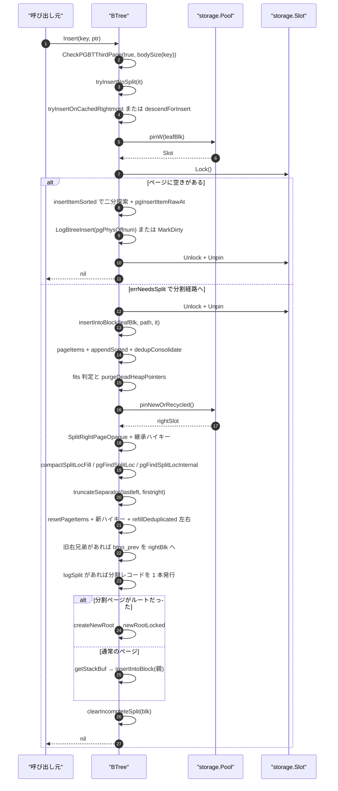
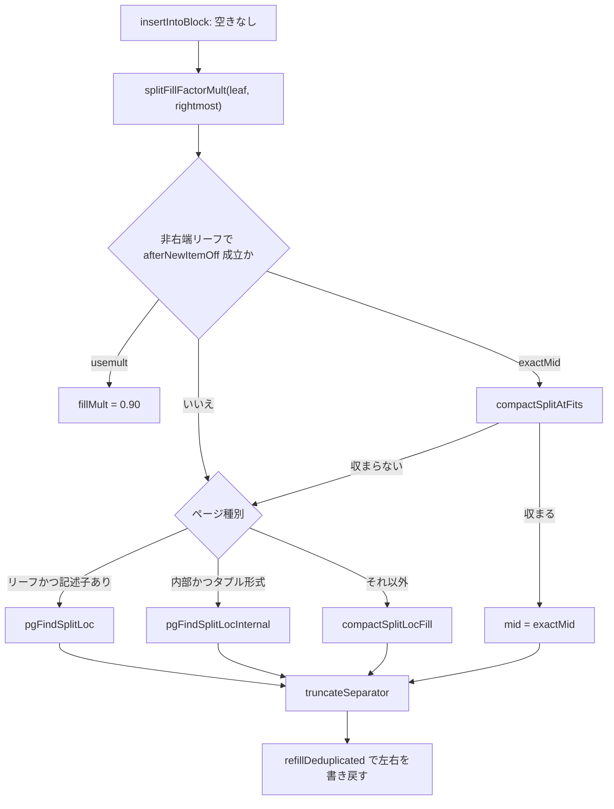

# 挿入・分割・重複排除

<details>
<summary>関連ソースファイル</summary>

- [`internal/access/nbtree/btree.go`](https://github.com/ryogrid/goopg/blob/19856410e8d497d59787e1ab35a2febb3f5953d6/internal/access/nbtree/btree.go)
- [`internal/access/nbtree/bulkload.go`](https://github.com/ryogrid/goopg/blob/19856410e8d497d59787e1ab35a2febb3f5953d6/internal/access/nbtree/bulkload.go)
- [`internal/access/nbtree/latch_release.go`](https://github.com/ryogrid/goopg/blob/19856410e8d497d59787e1ab35a2febb3f5953d6/internal/access/nbtree/latch_release.go)
- [`internal/access/nbtree/pgnewroot.go`](https://github.com/ryogrid/goopg/blob/19856410e8d497d59787e1ab35a2febb3f5953d6/internal/access/nbtree/pgnewroot.go)
- [`internal/access/nbtree/pgsplit.go`](https://github.com/ryogrid/goopg/blob/19856410e8d497d59787e1ab35a2febb3f5953d6/internal/access/nbtree/pgsplit.go)
- [`internal/access/nbtree/pgsplitleft.go`](https://github.com/ryogrid/goopg/blob/19856410e8d497d59787e1ab35a2febb3f5953d6/internal/access/nbtree/pgsplitleft.go)
- [`internal/access/nbtree/pgtruncate.go`](https://github.com/ryogrid/goopg/blob/19856410e8d497d59787e1ab35a2febb3f5953d6/internal/access/nbtree/pgtruncate.go)
- [`internal/access/nbtree/pgtuple.go`](https://github.com/ryogrid/goopg/blob/19856410e8d497d59787e1ab35a2febb3f5953d6/internal/access/nbtree/pgtuple.go)
- [`internal/access/nbtree/posting.go`](https://github.com/ryogrid/goopg/blob/19856410e8d497d59787e1ab35a2febb3f5953d6/internal/access/nbtree/posting.go)
- [`internal/access/nbtree/splitloc.go`](https://github.com/ryogrid/goopg/blob/19856410e8d497d59787e1ab35a2febb3f5953d6/internal/access/nbtree/splitloc.go)

</details>

`internal/access/nbtree` の書き込み側は、`Insert` で受け取った 1 件のインデックスエントリを、まず対象リーフのページ内二分探索で所定の位置に差し込み、収まらなければ同じキーの連続を posting リストへ畳んでから、それでも収まらない場合にページを 2 枚へ分割する。分割では上流 `_bt_findsplitloc` / `_bt_split` と同じ規則で分割点を選び、`_bt_truncate` 相当の接尾辞切り詰めでセパレータを最短化し、左ページのハイキーと右リンクを同じクリティカル セクションで確定させてから親へダウンリンクを押し上げる。ルートが分割された場合は両半分をラッチしたまま新しいルートを持ち上げる。加えて、ソート済み入力を一括でページへ詰めるバルク構築 (`BulkCreate`) と、上流のスプリット WAL レコードを左右ページの内容から再構築するためのプリミティブを持つ。

## 責務

- **ページ内挿入**: `Insert` が `CheckPGBTThirdPage` でアイテム単体の上限を検査したあと `tryInsertNoSplit` → `insertItemSorted` を呼ぶ。`insertItemSorted` はライン ポインタを二分探索し、`pgInsertItemRawAt` で 1 本だけ差し込む。ページ全体のデコードと再エンコードは行わない (`internal/access/nbtree/btree.go:2808`、`internal/access/nbtree/btree.go:3966`)。
- **追記型ワークロードの高速路**: `rightmostLeafBlk` にキャッシュされた右端リーフへ直接挿入する `tryInsertOnCachedRightmost` を持ち、キャッシュが古い・キーが左隣に属する・ページが満杯、のいずれかなら降下へフォールバックする (`internal/access/nbtree/btree.go:4067`)。
- **分割前の重複排除**: `dedupConsolidate` が展開済みアイテム列から完全重複 (キーと TID が一致) を落とし、`refillDeduplicated` が同一キーの連続を `postingChunkLens` の規則で posting タプルに再形成する (`internal/access/nbtree/btree.go:4162`、`internal/access/nbtree/btree.go:4016`)。
- **死エントリ回収**: 重複排除でも収まらない場合に限り `purgeDeadHeapPointers` を呼び、ヒープ側で死んだと確認できた TID を落としてから再判定する (`internal/access/nbtree/btree.go:3117`)。
- **分割点の選択**: `splitFillFactorMult` が右端ページの充填率 (リーフ 90%、内部 70%) を選び、`afterNewItemOff` が非右端リーフの「新規アイテムの直後で分割」を判定し、`pgFindSplitLoc` / `pgFindSplitLocInternal` が上流の区間と接尾辞切り詰めペナルティで最終候補を選ぶ (`internal/access/nbtree/btree.go:4292`、`internal/access/nbtree/btree.go:4331`、`internal/access/nbtree/splitloc.go:51`)。
- **セパレータの生成**: `truncateSeparator` が `_bt_truncate` として、左右で異なる最初の属性までを残し、全属性が等しい場合は左ページ末尾の最大ヒープ TID を `BT_PIVOT_HEAP_TID_ATTR` 付きで追加する (`internal/access/nbtree/pgtruncate.go:59`)。
- **分割の実行**: `insertIntoBlock` が右ページを確保し、`SplitRightPageOpaque` で上流の再構築と同一のヘッダを与え、左右を `refillDeduplicated` で書き直し、旧右兄弟の `btpo_prev` を張り替え、1 本の分割 WAL レコードを発行する (`internal/access/nbtree/btree.go:2933`、`internal/access/nbtree/pgsplit.go:47`)。
- **ルート分割と親への伝播**: 分割されたページがルートなら `createNewRoot` → `newRootLocked` が新ルートを公開し、そうでなければ `getStackBuf` で親をダウンリンクから再発見して `insertIntoBlock` を再帰呼び出しする (`internal/access/nbtree/btree.go:3874`、`internal/access/nbtree/btree.go:3624`)。
- **未完了スプリットの完遂**: `BTIncompleteSplit` が立つページに書き手が触れると `finishSplit` が親ステップを代行する。起動時・VACUUM 時には `CompleteDeferredSplits` が全ブロックを走査する (`internal/access/nbtree/btree.go:3808`、`internal/access/nbtree/btree.go:3767`)。
- **バルク構築**: `BulkCreateWithOptions` が入力を `indexFormat.compare` で安定ソートし、葉レベルを重複排除しながら `buildLevelRaw` で、上位レベルを `buildLevel` で構築する (`internal/access/nbtree/bulkload.go:193`)。
- **WAL 再生用のページ再構築**: `ReplaySplitRightPage` / `ReplaySplitLeftPage` / `ReplayRestoreMetaPage` / `ReplayClearIncompleteSplit` が、ページ イメージではなくレコード内のアイテム列からページを組み直す (`internal/access/nbtree/pgsplit.go:86`、`internal/access/nbtree/pgsplitleft.go:302`、`internal/access/nbtree/pgnewroot.go:112`)。

## 処理フロー

`Insert` から分割・親伝播までの実経路を追う。高速路で収まればそこで終わり、収まらなければ `errNeedsSplit` を合図に `insertIntoBlock` が重複排除と分割を行う。



1. **入口の上限検査** — `Insert` はまず `CheckPGBTThirdPage(true, MaxAlign(bt.format().bodySize(it.key)))` を呼ぶ。リーフ用の厳しい上限 (`BTMaxItemSize = 2704`) をここで課すことで、後段のスプリットでセパレータにタイブレーク TID を足しても内部ページの緩い上限 (`BTMaxItemSizeNoHeapTid = 2712`) に収まる (`internal/access/nbtree/btree.go:2821`、`internal/access/nbtree/pgtuple.go:487`)。
2. **高速路** — `tryInsertNoSplit` は右端キャッシュを試し、外れたら `descendForInsert` でリーフを決めて `pinW` する。ピン後に unlinked・未完了スプリット・ハイキー越えのいずれかなら `errNeedsSplit`、`pageHasSpaceFor` が偽でも `errNeedsSplit` を返す。空きがあれば `insertItemSortedVerified` → `insertItemSorted` が `readPageItem` で 1 件ずつキーを読みながら挿入位置を二分探索し、`pgInsertItemRawAt` でライン ポインタを差し込む。WAL には `pgPhysOffnum` で物理オフセット番号へ変換した座標を渡す (`internal/access/nbtree/btree.go:2873`、`internal/access/nbtree/btree.go:3974`)。
3. **分割経路の再降下** — `errNeedsSplit` を受けると `Insert` は `stats.splits` を数え、`descendForInsert` で**新しく**降下し直す。この降下は `forUpdate=true` なので、途中で `BTIncompleteSplit` のページに当たれば `finishSplit` してから進む。得られたリーフを `insertIntoBlock` に渡す (`internal/access/nbtree/btree.go:2841`)。
4. **挿入先ページの再検査** — `insertIntoBlock` は `pinW` のループで、unlinked なら `op.Next` へ、未完了スプリットなら `finishSplit` して再試行、キーがハイキーを越えるなら右へ、という 3 つの移動を繰り返す。内部ページでは `itemOvershootsHighKey` が「等しいキーも右」と判定する点がリーフと異なる (`internal/access/nbtree/btree.go:2956`、`internal/access/nbtree/btree.go:2985`)。
5. **重複排除で済む場合** — 空きが無いと `pageItems` でページを展開し、`appendSorted` で新規アイテムをキー順 (同一キー内はヒープ TID 順) に混ぜ、`dedupConsolidate` で完全重複を落とす。`compactFootprint + pageHighKeyFootprint < pageFreeBudget + pageOccupied` を満たせば、`resetPageItems` の後に `refillDeduplicated` で書き戻し、VACUUM と同じ kept-items レコードで WAL に残して終了する。ページは 1 枚も増えない (`internal/access/nbtree/btree.go:3070`、`internal/access/nbtree/btree.go:3125`)。
6. **分割点の決定** — 右ページは `pinNewOrRecycled` で確保する (ファイル延長より先に再利用リストを見る)。左ページから継承ハイキーを読み、`SplitRightPageOpaque(op.Level, blk, op.Next)` と `initPage` で右ページを初期化し、継承ハイキーを**データアイテムより先に**設置する。予算は `pageDataBudget()` から始め、右ページは継承ハイキーの実サイズ (`4 + MaxAlign(len(hk))`) を差し引く。分割点は右端リーフなら充填率 90%、右端内部ページなら 70%、非右端リーフで `afterNewItemOff` が成立すれば「新規アイテムの直後」または 90% となり、それ以外は 50:50 の平衡となる (`internal/access/nbtree/btree.go:3186`、`internal/access/nbtree/btree.go:3241`、`internal/access/nbtree/btree.go:4292`)。
7. **セパレータと左右の書き戻し** — `truncateSeparator` が `lastleft` と `firstright` から最短のセパレータを作る。内部ページの場合は右半分の先頭を「キーなし・ダウンリンクのみ」の負の無限大 pivot に置き換える。続いて左ページを `resetPageItems` し、`op.Next = rightBlk`、`BTRoot` を落とし、`BTIncompleteSplit` を立て、新しいハイキーを設置してから `refillDeduplicated` で左右を埋める。順序が重要なのは、データスロットのラッパーがページ自身の `btpo_next` から `P_FIRSTDATAKEY` を導出するためである (`internal/access/nbtree/btree.go:3314`、`internal/access/nbtree/btree.go:3356`)。
8. **兄弟リンクと WAL** — 非右端分割では旧右兄弟を `pinW` し、`btpo_prev` を新しい右ページへ向ける。内部ページ分割では 1 レベル下の子の `BTIncompleteSplit` も同じクリティカル セクションで落とす。その後 `logSplit` が配線されていれば、左ページ・右ページ・旧兄弟・子を 1 本のレコードにまとめ、ページごとに適切な stamp (`MarkDirtyWithLSNLocked` / `MarkDirtyCoveredByRecordLocked`) を打つ。フックが無い場合はページごとの `MarkDirty` にフォールバックし、分割の原子性は失うがインメモリの木は正しいままである (`internal/access/nbtree/btree.go:3402`、`internal/access/nbtree/btree.go:3497`)。
9. **上へ** — 押し上げるセパレータは**左ページに設置したハイキーそのもの**で、右ページの先頭キーを再掲しない。ルート分割なら `createNewRoot` が両半分をラッチしたまま新ルートを作り、メタページを更新し、左半分のフラグを 1 本の NEWROOT レコードで落とす。通常は `getStackBuf` が `childBlk` のダウンリンクを持つ親を再発見し、`insertIntoBlock(parent, ..., sepItem, blk, 左スロット)` を呼ぶ。親の挿入が成功したら `clearIncompleteSplit` で左ページのフラグを落とす (`internal/access/nbtree/btree.go:3532`、`internal/access/nbtree/btree.go:3545`、`internal/access/nbtree/btree.go:3565`)。

分割点の選択だけを抜き出すと次のようになる。



## 主要ファイル

| ファイル | 役割 |
| --- | --- |
| `internal/access/nbtree/btree.go` | `Insert`、`tryInsertNoSplit`、`insertIntoBlock`、`insertItemSorted`、`refillDeduplicated`、`dedupConsolidate`、`getStackBuf`、`finishSplit`、`createNewRoot`、分割候補の列挙 (`internal/access/nbtree/btree.go:Insert`、`internal/access/nbtree/btree.go:insertIntoBlock`、`internal/access/nbtree/btree.go:dedupConsolidate`) |
| `internal/access/nbtree/splitloc.go` | 上流 `_bt_findsplitloc` の葉レベル移植: 区間 `splitInterval`、`deltaSort`、`pgFindSplitLoc`、内部ページ用 `pgFindSplitLocInternal` (`internal/access/nbtree/splitloc.go:pgFindSplitLoc`) |
| `internal/access/nbtree/pgtruncate.go` | `_bt_truncate` 相当の `truncateSeparator`、`keepNAtts`、`formTruncated`、`maxHeapTIDOf` (`internal/access/nbtree/pgtruncate.go:truncateSeparator`) |
| `internal/access/nbtree/posting.go` | posting リストの符号化・復号・チャンク規則 (`postingChunkLens`)、`SwapPosting`、`appendTIDToPosting` (`internal/access/nbtree/posting.go:postingChunkLens`) |
| `internal/access/nbtree/bulkload.go` | `BulkCreateWithOptions`、`deduplicateToRawItems`、`buildLevelRaw`、`buildLevel`、充填率予約 (`internal/access/nbtree/bulkload.go:BulkCreateWithOptions`) |
| `internal/access/nbtree/pgsplit.go` | 分割レコードの右ページ再構築 `ReplaySplitRightPage` と兄弟の back-link 更新 (`internal/access/nbtree/pgsplit.go:SplitRightPageOpaque`) |
| `internal/access/nbtree/pgsplitleft.go` | 左半分の記述子 `SplitLeftDescription`、`DescribeSplitLeft`、`ReplaySplitLeftPage` (`internal/access/nbtree/pgsplitleft.go:DescribeSplitLeft`) |
| `internal/access/nbtree/pgnewroot.go` | アイテム領域の直列化 `PGRestorePageData`、メタページ再構築、未完了スプリットのクリア (`internal/access/nbtree/pgnewroot.go:PGRestorePageData`) |
| `internal/access/nbtree/pgtuple.go` | `CheckPGBTThirdPage`、pivot / posting の alternative-TID 表現、`BTMaxItemSize` (`internal/access/nbtree/pgtuple.go:CheckPGBTThirdPage`) |
| `internal/access/nbtree/latch_release.go` | 分割中にフレーム間を受け渡す排他ラッチの所有者 `wlatch` (`internal/access/nbtree/latch_release.go:wlatch`) |

## 公開 API / エントリポイント

```go
func (bt *BTree) Insert(key []byte, ptr storage.ItemPointer) error
func (bt *BTree) CompleteDeferredSplits() (int, error)

func BulkCreate(pool *storage.Pool, rel storage.RelFileNode, entries []BulkEntry) (*BTree, error)
func BulkCreateWithXID(pool *storage.Pool, rel storage.RelFileNode, entries []BulkEntry, xid storage.TransactionID) (*BTree, error)
func BulkCreateWithOptions(pool *storage.Pool, rel storage.RelFileNode, entries []BulkEntry, opts Options) (*BTree, error)
func BulkCreateNoDedup(pool *storage.Pool, rel storage.RelFileNode, entries []BulkEntry) (*BTree, error)

func SplitRightPageOpaque(level uint32, leftBlk, sibBlk storage.BlockNumber) BTPageOpaque
func CheckSplitRightPageOpaque(page storage.Page, leftBlk, sibBlk storage.BlockNumber) (uint32, error)
func ReplaySplitRightPage(page storage.Page, level uint32, leftBlk, sibBlk storage.BlockNumber, items [][]byte) error
func ReplaySplitSiblingPrev(page storage.Page, rightBlk storage.BlockNumber) error
func DescribeSplitLeft(prePage, leftPage, rightPage storage.Page, newItem []byte) (SplitLeftDescription, error)
func SplitLeftIsIncremental(prePage, leftPage, rightPage storage.Page, newItem []byte, level uint32, rightBlk storage.BlockNumber) (SplitLeftDescription, bool)
func SplitLeftBlockData(d SplitLeftDescription) []byte
func ParseSplitLeftBlockData(data []byte, newItemOnLeft bool) (newItem, highKey []byte, err error)
func ReplaySplitLeftPage(page storage.Page, level uint32, rightBlk storage.BlockNumber, d SplitLeftDescription) error

func PGRestorePageData(page storage.Page) ([]byte, error)
func PGParseRestorePageData(data []byte) ([][]byte, error)
func ReplayRestoreMetaPage(page storage.Page, m PGBTMetaPage) error
func ReplayClearIncompleteSplit(page storage.Page) error

func PGBTPostingRaw(base []byte, tids []storage.ItemPointer) []byte
func SwapPosting(newitem, oposting []byte, postingoff int) (nposting, finalNewitem []byte, err error)
```

`BulkCreate` は空でないリレーションを `TruncateRelation` してからブロック 0 を作り直すため、既存索引への追記には使えない。既存索引への挿入は必ず `Insert` を使う (`internal/access/nbtree/bulkload.go:202`)。

## 主要データ構造

### `SplitLeftDescription` — 分割レコードの左半分

```go
type SplitLeftDescription struct {
	// FirstRightOff is the first pre-split offset number that moved to the new
	// right page. The items copied to the left half are exactly
	// [P_FIRSTDATAKEY, FirstRightOff).
	FirstRightOff uint16
	// NewItemOff is the offset the newly inserted item would have occupied on
	// the pre-split page. It is meaningful on both sides: when the item landed
	// on the right half it is >= FirstRightOff and redo ignores it, exactly as
	// upstream's does.
	NewItemOff uint16
	// NewItemOnLeft selects XLOG_BTREE_SPLIT_L over _SPLIT_R and decides
	// whether the new item is carried in the block data at all — upstream
	// registers it only under `newitemonleft || postingoff != 0`.
	NewItemOnLeft bool
	// NewItem is the raw inserted tuple (carried only when NewItemOnLeft).
	NewItem []byte
	// HighKey is the left page's new high key — the separator the split just
	// installed. Always carried: it is the one item on the rebuilt page that
	// does not come from the pre-split page.
	HighKey []byte
}
```

`internal/access/nbtree/pgsplitleft.go:SplitLeftDescription` (50 行)

`FirstRightOff` と `NewItemOff` は**分割前ページの物理オフセット番号**であり、データスロット番号ではない。左半分は `[P_FIRSTDATAKEY, FirstRightOff)` のアイテムと、`NewItemOnLeft` のときだけ `NewItemOff` に差し込まれる新規アイテム、そして必ず `HighKey` から再構築される。`NewItem` と `HighKey` は MAXALIGN でパディングされた 1 本のバイト列として `SplitLeftBlockData` に並ぶため、両者の整合が崩れるとパースではなく**ページの誤構築**になる。`DescribeSplitLeft` は「半分のアイテム列 = 分割前のアイテム列 + 新規 1 件」という三者照合でこの記述子を導出し、照合できなければエラーを返して呼び出し元にフルページ イメージへフォールバックさせる (`internal/access/nbtree/pgsplitleft.go:87`、`internal/access/nbtree/pgsplitleft.go:222`)。

### `findSplitStrat` — 分割戦略

```go
type findSplitStrat int

const (
	splitDefault findSplitStrat = iota
	splitManyDuplicates
	splitSingleValue
)
```

`internal/access/nbtree/splitloc.go:findSplitStrat` (34 行)

`splitDefault` は通常の区間選択、`splitManyDuplicates` は重複が多い索引で区間を全候補へ広げる戦略、`splitSingleValue` は単一値だけの索引で `bTreeSingleValFillFactor = 96` により再重み付けし区間を 1 にする戦略である。戦略は `pgFindSplitLoc` が「区間の両端で `keepNAttsFast` が `nkeyatts` を超えるか」で決める。`splitManyDuplicates` では、新規アイテムの直後で切る候補が 50:50 に補正される特別扱いがある (`internal/access/nbtree/splitloc.go:79`、`internal/access/nbtree/splitloc.go:125`)。

### `splitCand` — 1 つの分割候補

```go
type splitCand struct {
	m                   int
	left, right         int
	leftfree, rightfree int
	curdelta            int16
}
```

`internal/access/nbtree/btree.go:splitCand` (4455 行)

`m` は「`items[:m]` を左、`items[m:]` を右」にする 0 始まりの切断位置。`left` / `right` は `compactFootprint` による各半分の実占有バイトで、同一キーの連続は posting として価格付けされる。`leftfree` / `rightfree` は予算から実占有とセパレータ課金を引いた残りで、`left` 側は常に「右半分の先頭タプル + タイブレーク用ヒープ TID」をセパレータとして負担する。`curdelta` は `_bt_deltasortsplits` の距離 (int16 に切り詰め) で、`deltaSort` がこれを昇順に並べる (`internal/access/nbtree/btree.go:4455`、`internal/access/nbtree/btree.go:4467`)。

### `BulkEntry` — バルク構築の入力

```go
type BulkEntry struct {
	Key []byte
	Ptr storage.ItemPointer
	// KeyDesc is the rendered "Key (cols)=(vals)" description for this
	// entry's key values, captured at entry-construction time so the
	// executor's post-sort duplicate walk can build PG's
	// `Key (…)=(…) is duplicated.` DETAIL (BuildIndexValueDescription,
	// postgres/src/backend/access/index/genam.c:178-276) without the
	// source heap row. Empty for non-unique builds (never read).
	KeyDesc string
}
```

`internal/access/nbtree/bulkload.go:BulkEntry` (58 行)

`Key` は通常の `Insert` と同じ `EncodeXxx` で符号化済みでなければならない。`BulkCreate` はキーを不透明バイト列として扱い、`indexFormat.compare` でしか比較しない。`Ptr` はリーフに書かれるヒープ TID、`KeyDesc` は UNIQUE ビルドの重複 DETAIL 用で、非 UNIQUE では読まれない (`internal/access/nbtree/bulkload.go:53`)。

### `rawItem` / `bulkLink` — バルク構築の中間表現

```go
type rawItem struct {
	raw []byte // bytes written into the page via PageAddItemRaw
	key []byte // key used for highKey / boundary comparisons
}
```

`internal/access/nbtree/bulkload.go:rawItem` (536 行)

```go
type bulkLink struct {
	blk     storage.BlockNumber
	highKey []byte
}
```

`internal/access/nbtree/bulkload.go:bulkLink` (339 行)

`rawItem` は「すでにマーシャル済みのページ バイト」と「境界比較用のキー」を分けて持つ。posting を含む葉レベルでは `raw` が posting タプル、`key` がその代表キーになる。`bulkLink.highKey` は「同じレベルの次の兄弟の先頭キー」であり、`nil` は右端を意味する。この値がそのまま親レベルのセパレータになるため、`linksToInternalItems` は左端に負の無限大のダウンリンクを、以降に**直前の兄弟の `highKey`** を置く (`internal/access/nbtree/bulkload.go:348`)。

## 内部構造

### 挿入は「1 本だけ差す」— ページ全体を書き直さない

`insertItemSorted` は `readPageItem` で 1 件ずつキーを読みながら `[0, count)` を二分探索し、`f.compare(midItem.key, it.key) < 0` で右へ進む。blob 形式では同じキーの既存エントリの**先頭**に挿入される。タプル形式では `compare` がヒープ TID でタイブレークするため、同一キー属性のランの中でも TID 順の位置に入る。その後 `pgInsertItemRawAt` がライン ポインタ配列を memmove し、タプル本体を `pd_upper` から確保する。ページ全体のデコードと再エンコードを行わないのが M0055-0002 Phase A の変更点で、以前のホットスポットを除去している (`internal/access/nbtree/btree.go:3948`)。

分割経路だけは話が別で、`pageItems` が posting を 1 TID ずつに展開するため、その表現のままでは元のページに戻せない。そこで `refillDeduplicated` が `deduplicateToRawItemsWithSpans` を通して posting を再形成してから、`pgInsertItemRawAt(p, i+1, raw)` で昇順に追記する。つまり分割経路のページ書き込みは「展開 → 再圧縮 → 追記」であり、`compactFootprint` はこの再圧縮後のサイズを見積もる (`internal/access/nbtree/btree.go:4016`、`internal/access/nbtree/btree.go:4235`)。

### 2 種類の「重複排除」を混同しない

名前は似ているが役割が違う。

- `dedupConsolidate` は `items[:0]` への in-place 圧縮で、`f.compare(prev.key, it.key) == 0 && prev.ptr == it.ptr` の**完全重複だけ**を落とす。posting バイトは作らない。ページ分割前に「同じ (キー, TID) が二重に現れた」場合の防御である (`internal/access/nbtree/btree.go:4162`)。
- `deduplicateToRawItemsWithSpans` は同一キー属性の連続を `compareKeyAttrs` で閉じ、`postingChunkLens` が返すチャンク長ごとに posting タプルを組み立てる。`refillDeduplicated` とバルク構築の両方がこれを使う (`internal/access/nbtree/bulkload.go:621`)。

グループ化の判定に `compareKeyAttrs` を使うのが要点である。タプル形式の `compare` はヒープ TID でタイブレークするため、隣接する 2 件は決して等しくならず、`compare` でランを閉じると全ランが長さ 1 になり重複排除が静かに無効化される。上流も `_bt_load` と `_bt_dedup_pass` では `_bt_keep_natts_fast` を使い、`_bt_compare` は使わない (`internal/access/nbtree/bulkload.go:577`)。

### posting のチャンク規則は 1 か所だけ

`postingChunkLens(key, n)` が「n 件の同一キーを何本のライン ポインタに分けるか」を決める。`maxTIDsPerChunk = (maxRawItemSize - postingOffsetFor(key)) / 6` で、`maxRawItemSize = 7800`、TID は 6 バイトである。`n <= 1` はそのまま 1 本、1 チャンクに収まらなければ `maxTIDsPerChunk` ずつに切り、末尾が 1 件だけ残る場合も通常アイテム (count 1) として書く。上流が posting を最低 2 TID と定義しているためで、1 TID の「posting」は書かない (`internal/access/nbtree/posting.go:76`、`internal/access/nbtree/bulkload.go:559`)。

この関数を `runFootprint` と `deduplicateToRawItems` の両方が呼ぶことが重要である。かつてチャンク規則が 2 か所に別々に書かれていた頃、分割のバイト予算と実際に書かれるバイト数が食い違い、`mustInsertItemSorted` から「not enough free space in page」でバックエンドが落ちた (M0134-0177)。現在は `compactFootprint` → `runFootprint` → `postingChunkLens` の 1 本道で、予算と書き込みが同じ関数を共有する (`internal/access/nbtree/posting.go:107`)。

`SwapPosting` は上流 `_bt_swap_posting` の移植で、既存 posting の途中に新しい TID を差し込む。**長さは変えない**: `[postingoff, nhtids-1)` を 1 つ右へずらし、あふれた最大 TID を新しいアイテムの `t_tid` にして返す。呼び出し元が書き込むアイテムは、渡した `newitem` ではなく返り値の `finalNewitem` である。goopg の現行の挿入経路は posting をその場で伸ばさず、posting は分割前の書き戻し (`refillDeduplicated`) とバルク構築でしか形成しないため、これは実 PG の `XLOG_BTREE_INSERT_POST` を再生するための経路である。`appendTIDToPosting` と `promoteSingleToPosting` はこのパッケージ内に本番呼び出し元を持たない (`internal/access/nbtree/posting.go:333`)。

### 分割点の価格付け

`splitCandidates` は全候補 `m` を昇順に列挙し、各候補について次を検査する。

- `left + sepCharge <= leftBudget` かつ `right <= rightBudget`。
- `sepCharge = 4 + MaxAlign(bodySize(items[m].key)) + MaxAlign(SizeOfItemPointerData)`。セパレータは「右半分の先頭タプル + タイブレーク用ヒープ TID」を最悪ケースとして左半分に課金される。上流 `_bt_recsplitloc` が「接尾辞切り詰めで小さくなることを当てにしない」のと同じで、さらに goopg は `truncateSeparator` が実際に TID を追加しうる分を上乗せする (`internal/access/nbtree/btree.go:4509`)。

`pgFindSplitLoc` は上流の 3 段構えをそのまま写す。

1. `deltaSort` で「空間最適からの距離」の昇順に並べる。距離は `fillFactorMult` が指定されていれば `fillMult*leftfree - (1-fillMult)*rightfree`、なければ `leftfree - rightfree` の絶対値。
2. `splitInterval` が `LEAF_SPLIT_DISTANCE = 0.050` (内部は `0.075`) を許容幅として、先頭から連続して収まる候補数 `interval` を返す。
3. `intervalEdges` で区間の左端・右端を取り、`keepNAttsFast` の最小ペナルティ候補を選ぶ。途中で `perfect` 以下になったら打ち切る。

`splitManyDuplicates` では `interval = len(cands)` に広げ、`splitSingleValue` では `bTreeSingleValFillFactor/100 = 0.96` で再ソートして `interval = 1` にする (`internal/access/nbtree/splitloc.go:99`、`internal/access/nbtree/splitloc.go:236`)。

内部ページは `pgFindSplitLocInternal` が別の価格付けを使う。右半分の先頭は負の無限大 pivot (`SizeOfIndexTupleData + 4 = 12` バイト) に縮むため、右ページにはその分の返却がある。左ページの新高キーにはヒープ TID の余裕を課さず、右端なら `BTREE_NONLEAF_FILLFACTOR = 70`、そうでなければ 50:50 で並べ、区間内で「右半分の先頭タプルが最小」の候補を選ぶ (`internal/access/nbtree/splitloc.go:171`)。

### セパレータの切り詰めとタイブレーク TID

`truncateSeparator` は `keepNAtts` で「左右で最初に異なる属性の 1 始まり位置」を求め、`keep <= nkeyatts` なら `formTruncated` が先頭 `keep` 属性だけを `FormPGIndexTuple` で組み直し、`BTreeTupleSetNAtts(keep, false)` を打つ。単に属性数を書き換えるのではなくバイト列を作り直すのは、切り詰めた属性のバイトを実際にページから消すためである (`internal/access/nbtree/pgtruncate.go:79`、`internal/access/nbtree/pgtruncate.go:161`)。

`keep == nkeyatts+1`、つまり全キー属性が等しい場合は、キーでは左右を分けられない。ここで `maxHeapTIDOf(lastleft)` を取り、`BT_PIVOT_HEAP_TID_ATTR` を立てた pivot の末尾へ 6 バイトの TID として追加する。posting の場合は昇順配列の最後 (最大 TID) を使う。これを省くとセパレータは「ヒープ TID なし = 負の無限大」となり、左ページ上の同じキーを持つ全エントリが自分のページのハイキーより大きくなって、降下がその行を飛ばして右へ進んでしまう (`internal/access/nbtree/pgtruncate.go:92`)。

### 未完了スプリットのプロトコル

分割は「左ページに `BTIncompleteSplit` を立て、右リンクとハイキーを確定する」→「親へダウンリンクを挿入する」→「左ページのフラグを落とす」の 3 段である。途中で失敗しても、次にそのページへ降りる書き手が `finishSplit` で残りを代行できる。

- `finishSplit` はフラグを再確認し、左ページのハイキーをセパレータとして右兄弟 (`op.Next`) をラッチし、メタページの `Root` が自分なら `createNewRoot`、そうでなければ `getStackBuf` → 親への `insertIntoBlock` を行う (`internal/access/nbtree/btree.go:3808`)。
- `getStackBuf` はダウンリンク `childBlk` を持つ親ページを、下降時のパスをヒントにしつつ右方向へ探す。ヒントが親レベルでない、または子自身を指している (ブロック再利用後の誤ヒント) 場合は `leftmostAtLevel` からやり直す (`internal/access/nbtree/btree.go:3624`)。
- `insertUpperFinishChild` は「親へのダウンリンク挿入が分割なしで済んだ」場合に、親の挿入と子のフラグ解除を 1 本の `XLOG_BTREE_INSERT_UPPER` にまとめる。以前は 2 レコードに分かれ、その間のクラッシュが「完了済みなのにフラグが立ったまま」のページを残した (`internal/access/nbtree/btree.go:3588`)。
- `clearIncompleteSplit` はフラグが既に落ちていれば何も書かない。親が分割された場合、その分割が同じクリティカル セクションで子のフラグを落としているため、この呼び出しは no-op になる (`internal/access/nbtree/btree.go:3741`)。

ラッチ順序は常に**子 → 親**である。分割は左ページ (と内部ページなら子) をラッチしたまま親をラッチし、`getStackBuf` は子をラッチしたまま親を探す。下降方向にしかラッチを増やさないので、逆向きの降下とデッドロックしない (`internal/access/nbtree/btree.go:3557`)。

### バルク構築

`BulkCreateWithOptions` は `TruncateRelation` + `InvalidateRel` でファイルを空にし、ブロック 0 をメタページとして確保してから、`sort.SliceStable` で `indexFormat.compare` 順に並べる。葉レベルは `deduplicateToRawItems` で posting を作り、`buildLevelRaw` が `pgReserveHiKeySlot` で `P_HIKEY` のライン ポインタだけ先に予約してデータを `P_FIRSTKEY` から詰める。ページを閉じるとき、次ページがあれば `pgSetHighKeyRaw` でセパレータを入れ、右端なら `pgSlideLeft` で予約を捨てる (`internal/access/nbtree/bulkload.go:273`、`internal/access/nbtree/bulkload.go:693`)。

容量判定は通常挿入より厳しい。`separatorReserve(sep)` が**次ページの先頭キーから作った実セパレータ**のサイズを確保するため、次ページ境界が決まる前に埋め切ってセパレータが入らない事態を防ぐ。上流 `_bt_buildadd` はストリーミングのため最悪ケース (`MAXALIGN(6)`) しか確保できず、最後のタプルを次ページへ移すことで埋め合わせるが、goopg は全入力を持っているので実サイズを確保できる (`internal/access/nbtree/bulkload.go:32`)。

さらに葉レベルだけは `leafFillFactorReserve` が使用可能領域の 10% (`100 - BTreeDefaultFillFactor`) を空けておく。満杯に詰めると最初の後続挿入が必ず分割を起こし、`CREATE INDEX` 直後の索引が更新で倍に膨らむためである。上流の `BTGetTargetPageFreeSpace` に対応する (`internal/access/nbtree/bulkload.go:600`、`internal/access/nbtree/bulkload.go:787`)。

内部レベルは `linksToInternalItems` が子ページの `highKey` をセパレータに変換し、`buildLevel` が同じ手順で 1 枚のルートになるまで繰り返す。最後にルートへ `BTRoot` を立て、メタページへ root と level を書く (`internal/access/nbtree/bulkload.go:285`)。

### 分割 WAL は左右で形が違う

右ページは上流の redo が毎回ゼロから再構築するため、レコードに**全アイテム列**が入る。`ReplaySplitRightPage` は `InitPGBTPage` → `SplitRightPageOpaque` → `PageAddItemRaw` の順で、`PGParseRestorePageData` が返す昇順アイテムをそのまま追記する。ハイキーも特別扱いせず「最初のアイテム」として復元される (`internal/access/nbtree/pgsplit.go:86`)。

左ページは 2 形態ある。`SplitLeftIsIncremental` が `DescribeSplitLeft` と `CheckSplitLeft` の両方を通った場合だけ、`FirstRightOff` / `NewItemOff` / 新高キー / (必要なら) 新規アイテムという記述子でログする。通らなければフルページ イメージにフォールバックする。これは上流の redo が `BLK_RESTORED` のとき増分再構築を飛ばすため、どちらでも合法である (`internal/access/nbtree/pgsplitleft.go:222`、`internal/access/nbtree/btree.go:3497`)。

この判定はプライマリ側の `pd_lsn` の付け方にも使われる。増分形では左ページのフルページ イメージが WAL に存在しないので `MarkDirtyCoveredByRecordLocked` を使い、イメージ形では `MarkDirtyWithLSNLocked` で「この LSN にイメージがある」と主張できる。右ページは常に全内容がレコードにあるので `MarkDirtyWithLSNLocked`、旧兄弟と子は画像を持たないので `MarkDirtyCoveredByRecordLocked` である (`internal/access/nbtree/btree.go:3481`)。

## エッジケースと不変条件

- **`errNeedsSplit` は 5 つの理由で返る**。ピン後のページが unlinked、`BTIncompleteSplit` が立っている、キーがハイキーを越えている、`pageHasSpaceFor` が偽、`insertItemSortedVerified` がエラー、のいずれか。`insertItemSortedVerified` のエラーも `errNeedsSplit` に丸め、パニックさせず分割経路へ落とす。かつて収容判定と実書き込みが食い違って「not enough free space in page」で落ちた root-0040 の再発防止である (`internal/access/nbtree/btree.go:2885`、`internal/access/nbtree/btree.go:3014`)。
- **右端キャッシュのミス条件**は、ピンできない、`Level != 0`、`Next != InvalidBlockNumber`、削除済み / half-dead / 未完了スプリット、先頭キーより小さい、空きがない、`insertItemSortedVerified` がエラー、の各ケース。ミスはエラーではなく「降下へフォールバック」であり、キャッシュは 0 に戻される (`internal/access/nbtree/btree.go:4067`)。
- **分割候補が 1 つも無い**場合は `btree: no split point fits N entries (M bytes compacted) into two pages` を返して挿入を失敗させる。左右どちらかの予算をセパレータ込みで満たす切断位置が存在しないということで、これはデータではなくサイズ計算の異常を示す (`internal/access/nbtree/btree.go:3293`)。
- **内部ページの右半分の先頭はキーを失う**。`downlinkItem(nil, rightItems[0].ptr.Block)` に置き換えられ、`PGBTPivotRaw` が属性数 0 の pivot を書く。この負の無限大 pivot は上流の `_bt_pgaddtup` と同じ表現で、親のダウンリンクも同じセパレータを運ぶ (`internal/access/nbtree/btree.go:3315`)。
- **セパレータは内部ページ用の緩い上限で検査される**。`CheckPGBTThirdPage(false, ...)` は `BTMaxItemSizeNoHeapTid = 2712` を使う。リーフ用の 2704 で検査すると、`truncateSeparator` がタイブレーク TID を足した正当な pivot を拒否してしまう (`internal/access/nbtree/btree.go:3329`)。
- **分割中のラッチは `wlatch` が所有する**。`insertIntoBlock` はスプリットでラッチをフレーム間 (子 → 親) に渡すため `defer unpinW` を使わず、`held` と `child` の 2 つの `wlatch` を持つ。パニック時も `defer` が排他ラッチだけは解放し、`take()` で所有者を移した後は二重解放しない (`internal/access/nbtree/latch_release.go:63`、`internal/access/nbtree/btree.go:2934`)。
- **`BTRoot` は分割の瞬間に落ちる**。左半分は `op.Flags &^= BTRoot` され、新しいルートは `createNewRoot` が両半分をラッチしたまま公開する。`newRootLocked` はメタページの `Root` が `leftBlk` のままであることを確認し、違えば `btree: index %d: metapage root is %d, not the split root %d` で失敗する。これにより、別のライターが先にルートを動かした状態で古い分割を持ち上げることを防ぐ (`internal/access/nbtree/btree.go:3358`、`internal/access/nbtree/btree.go:3890`)。
- **読み手は未完了スプリットを完遂しない**。読み手はハイキーと右リンクだけを頼りに右へ進めるため、親ダウンリンクが未挿入でも正しいリーフに到達できる。フラグを落とすのは書き手・VACUUM・起動時の `CompleteDeferredSplits` だけである (`internal/access/nbtree/btree.go:3767`)。
- **`fits` は厳密な不等号**。`compactFootprint(items) + pageHighKeyFootprint < pageFreeBudget + pageOccupied` を満たさなければ、たとえ等しくても分割へ進む。`resetPageItems` がハイキーを再設置するため、ハイキーの実占有をデータ予算から先に引いておく必要がある (`internal/access/nbtree/btree.go:3103`)。
- **バルク構築では posting が 1/3 制限の検査を免除される**。`buildLevelRaw` は `BTreeTupleIsPosting(ri.raw)` のとき `CheckPGBTThirdPage` を呼ばない。goopg の `deduplicateToRawItems` には上流 `_bt_dedup_pass` の `maxpostingsize` に相当する上限が無く、数千バイトの posting を平気で作るため、ここで拒否すると重複の多い列の索引構築が失敗する。この免除は設計上の意図ではなく記録済みの欠落である (`internal/access/nbtree/bulkload.go:751`)。
- **`maxRawItemSize = 7800`** はライン ポインタの 15 ビット長と 8 KiB ページへの物理的な収まりの両方から来る上限で、posting のチャンク長を決める。コメントに残る「272 B opaque」は旧レイアウト時代の説明だが、値そのものは現行の `maxTIDsPerChunk` 計算に使われている (`internal/access/nbtree/bulkload.go:551`、`internal/access/nbtree/posting.go:83`)。
- **`postingBounds` は末尾パディングを許容する**。`body = postingOffset + n*6` が `size` を超えず、かつ `size - body < 8` であることを要求する。タプル形式の posting は `MAXALIGN` されるため最大 7 バイトのパディングが付き、これを「カウント不一致」として拒否すると実 PG が書いた posting を読めなくなる (`internal/access/nbtree/posting.go:276`)。
- **`SwapPosting` の前提**は「`0 < postingoff < nhtids`」「既存が posting」「新規が posting でも pivot でもない」で、呼び出し元は TID 順を保つ位置を渡す契約である。`postingoff == 0` は同一タプルが既にある破損状態を意味するため、書かずにエラーにする (`internal/access/nbtree/posting.go:369`)。
- **`BTPostingMaxTIDs = 0x0FFF`** は `t_tid` のオフセット半身に TID 数を刻むフィールドの上限。1 ページに物理的に載る 6 バイト TID は約 1350 本なので、これは方針上の上限ではなく構造上のガードである (`internal/access/nbtree/posting.go:43`)。
- **分割記述子の三者照合**。`DescribeSplitLeft` は「左右のアイテム列を連結したもの = 分割前のアイテム列 + 新規 1 件」でなければエラーを返す。dedup が posting を新たに作った、`LP_DEAD` のアイテムを落とした、順序が変わった、といった上流の 3 オフセットでは表現できない分割はすべてここで検出され、フルページ イメージにフォールバックする (`internal/access/nbtree/pgsplitleft.go:107`)。
- **`ParseSplitLeftBlockData` は余りバイトを拒否する**。新規アイテムは `newItemOnLeft` が真のときだけ先頭にあり、その後ろがハイキーである。`off != len(data)` は producer と consumer のフレーミング不一致なので、黙って捨てずにエラーにする (`internal/access/nbtree/pgsplitleft.go:281`)。
- **`ReplaySplitLeftPage` の境界検査**。`FirstRightOff` は `[P_FIRSTDATAKEY, P_FIRSTDATAKEY+count]` に入っていなければならない。新規アイテムが左半分にある場合は `NewItemOff` も `[P_FIRSTDATAKEY, FirstRightOff]` に収まる必要があり、右半分に行った場合は `NewItemOff` を無視する。上流の「newitem が末尾に来る」ケースも明示的に処理する (`internal/access/nbtree/pgsplitleft.go:314`)。
- **`ReplayRestoreMetaPage` は読み書きではなく再初期化**。`btm_magic` を再設定し、ログに載らない `btm_last_cleanup_num_heap_tuples` を `-1.0` に戻し、`pd_lower` を `24 + 48` まで進める。`btm_version` は `[BTREE_NOVAC_VERSION=3, BTREE_VERSION=4]` の範囲を検査する (`internal/access/nbtree/pgnewroot.go:112`)。
- **`ReplayClearIncompleteSplit` は冪等**。フラグが既に無ければ何も書かない。goopg のプライマリは別ステップでフラグを落とすため通常は no-op だが、実 PG のスタンバイは同じレコードで必ず落とすので、どの LSN でも両者のページ状態を一致させるために適用する (`internal/access/nbtree/pgnewroot.go:136`)。

## 関連ページ

- ページ形状・タプル レイアウト・降下と検索は [8.1 B-tree の構造と検索](8.1-Btree-Structure.md)
- VACUUM・ページ削除・WAL リプレイの全体は [8.3 B-tree のバキュームと WAL リプレイ](8.3-Btree-Vacuum-and-Replay.md)
- キー符号化と比較器の詳細は [8.4 キー符号化と比較](8.4-Key-Encoding.md)
- 分割後の構造検証は [8.5 amcheck による検証](8.5-amcheck.md)
- 上位の文脈は [8 B-tree インデックス](../8-Btree.md)、WAL の全体像は [10 WAL と耐久性](../10-WAL.md)

Sources:
- `internal/access/nbtree/btree.go`
- `internal/access/nbtree/bulkload.go`
- `internal/access/nbtree/latch_release.go`
- `internal/access/nbtree/pgnewroot.go`
- `internal/access/nbtree/pgsplit.go`
- `internal/access/nbtree/pgsplitleft.go`
- `internal/access/nbtree/pgtruncate.go`
- `internal/access/nbtree/pgtuple.go`
- `internal/access/nbtree/posting.go`
- `internal/access/nbtree/splitloc.go`

<sub>Generated by deepwiki-4myself from `goopg` @ `19856410e`</sub>
