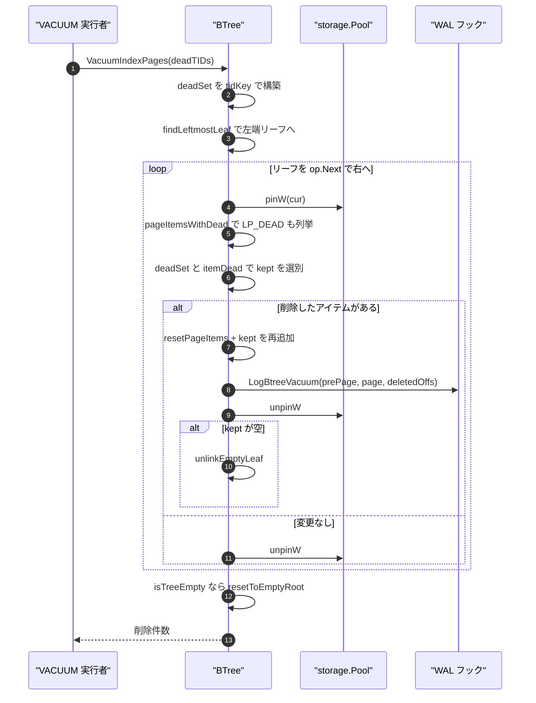
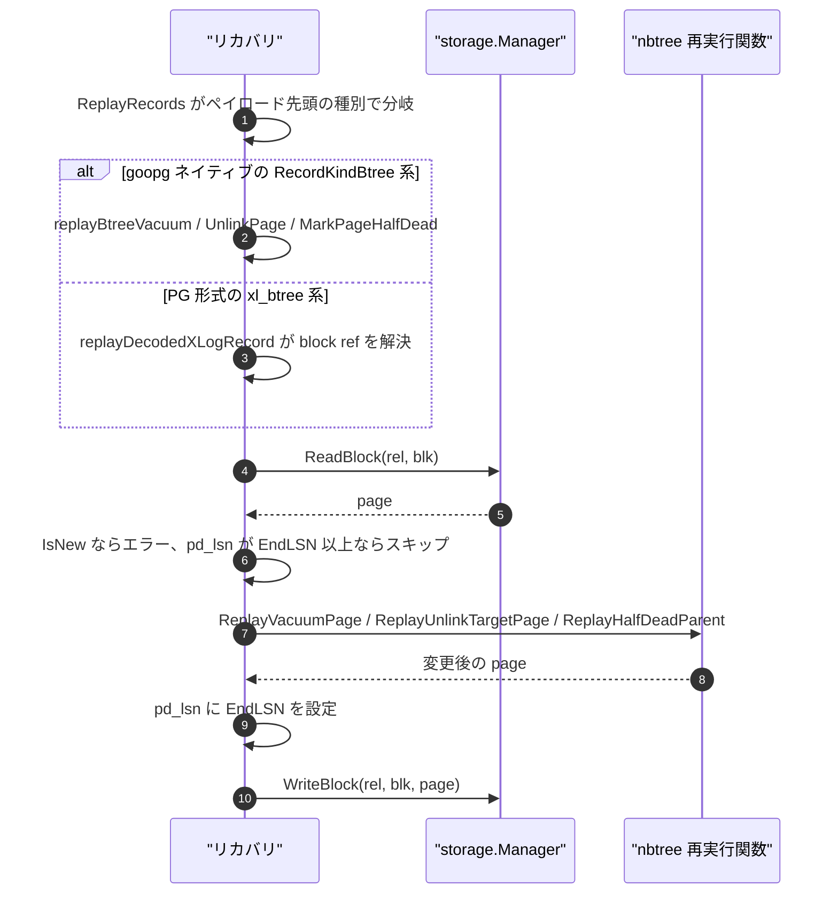
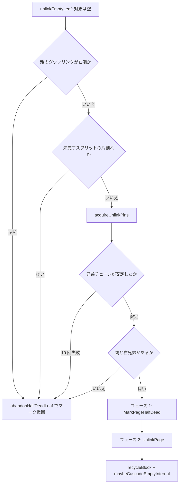

# B-tree のバキュームと WAL リプレイ

<details>
<summary>関連ソースファイル</summary>

- [`internal/access/nbtree/btree.go`](https://github.com/ryogrid/goopg/blob/19856410e8d497d59787e1ab35a2febb3f5953d6/internal/access/nbtree/btree.go)
- [`internal/access/nbtree/btree_vacuum.go`](https://github.com/ryogrid/goopg/blob/19856410e8d497d59787e1ab35a2febb3f5953d6/internal/access/nbtree/btree_vacuum.go)
- [`internal/access/nbtree/dead_purge.go`](https://github.com/ryogrid/goopg/blob/19856410e8d497d59787e1ab35a2febb3f5953d6/internal/access/nbtree/dead_purge.go)
- [`internal/access/nbtree/lpdead_kill.go`](https://github.com/ryogrid/goopg/blob/19856410e8d497d59787e1ab35a2febb3f5953d6/internal/access/nbtree/lpdead_kill.go)
- [`internal/access/nbtree/parse_err_dump.go`](https://github.com/ryogrid/goopg/blob/19856410e8d497d59787e1ab35a2febb3f5953d6/internal/access/nbtree/parse_err_dump.go)
- [`internal/access/nbtree/pgdelete.go`](https://github.com/ryogrid/goopg/blob/19856410e8d497d59787e1ab35a2febb3f5953d6/internal/access/nbtree/pgdelete.go)
- [`internal/access/nbtree/pgpagedel.go`](https://github.com/ryogrid/goopg/blob/19856410e8d497d59787e1ab35a2febb3f5953d6/internal/access/nbtree/pgpagedel.go)
- [`internal/access/nbtree/replay.go`](https://github.com/ryogrid/goopg/blob/19856410e8d497d59787e1ab35a2febb3f5953d6/internal/access/nbtree/replay.go)
- [`internal/access/transam/xlog/recovery.go`](https://github.com/ryogrid/goopg/blob/19856410e8d497d59787e1ab35a2febb3f5953d6/internal/access/transam/xlog/recovery.go)
- [`internal/storage/heap.go`](https://github.com/ryogrid/goopg/blob/19856410e8d497d59787e1ab35a2febb3f5953d6/internal/storage/heap.go)
- [`internal/storage/prune.go`](https://github.com/ryogrid/goopg/blob/19856410e8d497d59787e1ab35a2febb3f5953d6/internal/storage/prune.go)

</details>

B-tree のバキュームは、ヒープ側の VACUUM が確定した「死んでいるヒープ TID」を受け取り、`VacuumIndexPages` でリーフのインデックスエントリを物理的に削除し、空になったリーフを 2 段階のページ削除プロトコルで兄弟チェーンと親から外してリサイクル待ちにする。ヒープ側では `PageVacuumPrune` が HOT チェーンとマルチトランザクションを考慮して `PruneResult`（redirect / unused / dead）を返し、LP_DEAD になったスロットだけが `PageDeadItems` を通じてインデックス掃除の入力になる。並行して、削除・分割・vacuum の各変更は `pd_lsn` で冪等な WAL レコードとして記録され、クラッシュ後の `internal/access/transam/xlog` のリプレイが同じページ変更関数を再実行する。

## 責務

- **死エントリの除去**: `VacuumIndexPages` が `deadTIDs` から `tidKey`（`block<<16 | offset`）の集合を作り、リーフを左から右へ走査して一致するアイテムを落とす (`internal/access/nbtree/btree_vacuum.go:VacuumIndexPages`)。
- **LP_DEAD の可視化**: 通常の読み取りは LP_DEAD を飛ばすが、VACUUM は `pageItemsWithDead` で死マーク付きも列挙し、kept-items 書き換えから漏らさない (`internal/access/nbtree/btree_vacuum.go:76`、`internal/access/nbtree/btree.go:2239`)。
- **空リーフの 2 段階削除**: フェーズ 1 で `BTDeleted|BTHalfDead` を立て、フェーズ 2 で兄弟の付け替え・親ダウンリンクの retarget-and-delete・墓標化・リサイクルを行う (`internal/access/nbtree/btree_vacuum.go:unlinkEmptyLeaf`)。
- **削除プロトコルの直列化**: 左兄弟 → 対象 → 右兄弟 → 親の順に排他ラッチを取り、ラッチ下でリンクを再検証してから WAL を発行する。10 回試行しても安定しなければ削除を諦める (`internal/access/nbtree/btree_vacuum.go:acquireUnlinkPins`、`unlinkPinAttempts = 10`)。
- **リサイクル地平線**: 削除時に `safexid` を刻み、`PGPageIsRecyclable` が「そのページへ降下した可能性のあるスキャンがすべて終わったか」を判定するまでブロックを再利用しない (`internal/access/nbtree/pgpagedel.go:PGPageIsRecyclable`)。
- **LP_DEAD マーキング**: スキャン時に見つけた死エントリを、後から `KillItems` がページ LSN 一致の下で `ItemIDDead` にする。ヒントなので FPI も `pd_lsn` 更新も行わない (`internal/access/nbtree/lpdead_kill.go:KillItems`)。
- **ヒープ検証パージ**: `DeadTIDFilter` と `purgeDeadHeapPointers` が、分割前にヒープを実際に見て死んだ TID を落とす。LP_DEAD ヒントとは別系統で、posting リストとも共存できる (`internal/access/nbtree/dead_purge.go:purgeDeadHeapPointers`)。
- **ヒープ側の prune**: `PageVacuumPrune` が `TupleDeadToAll` で死を判定し、HOT チェーン根を `ItemIDRedirect`、HOT-only や非 HOT の死を `ItemIDDead`/`ItemIDUnused` に振り分ける (`internal/storage/prune.go:PageVacuumPrune`、`internal/storage/prune.go:TupleDeadToAll`)。
- **WAL リプレイ**: `recovery.go` のレコード種別ディスパッチが、goopg ネイティブの `RecordKindBtree*` と PG 形式の `xl_btree_*` の双方を `nbtree.Replay*` / `Apply*` に振り分け、`pd_lsn >= EndLSN` で冪等に適用する (`internal/access/transam/xlog/recovery.go:ReplayRecords`)。
- **障害調査**: `maybeDumpPageOnParseErr` が `GOOPG_BTREE_PARSE_ERR_DUMP=1` のときだけ、opaque・ライン ポインタ表・ページ全 hex・I/O トレースを `/tmp` に書き出す (`internal/access/nbtree/parse_err_dump.go:maybeDumpPageOnParseErr`)。

## 処理フロー

まず VACUUM が 1 パスでリーフを掃除し、空になったページをその場で unlink する流れを追う。



1. **入口** — `VacuumIndexPages` は `deadTIDs` が空なら即座に 0 を返す。LP_DEAD マークが残っていても安全である理由は、マークされた TID のヒープ側再利用が「ヒープ VACUUM が死を発見した」ときにしか起きず、そのときは `deadTIDs` が非空になるためである (`internal/access/nbtree/btree_vacuum.go:32`)。
2. **左端リーフの決定** — `findLeftmostLeaf` がメタページの root から最初のダウンリンクだけを辿る。空の内部ページに当たった場合は `InvalidBlockNumber` を返して走査を止める (`internal/access/nbtree/btree_vacuum.go:229`)。
3. **リーフの展開** — 各リーフは `pinW` され、`pageItemsWithDead` が posting を TID ごとに展開しつつ、各要素に死マークの並行フラグを付けて返す。ここで `firstKey` をコピーしておくのは、ページを空にした後で親を再探索する手がかりになるためである (`internal/access/nbtree/btree_vacuum.go:76`、`internal/access/nbtree/btree_vacuum.go:83`)。
4. **削除対象の判定** — `itemDead[i] || deadSet[tidKey(it.ptr)]` のどちらかで削除する。削除が 1 件でもあれば、`PGDataItemCount` と展開後の件数が一致する場合に限り `deletedOffs`（`pgPhysOffnum` の物理オフセット）と分割前ページのコピーを集める。posting を展開したページは 1 対 1 対応が崩れるため、オフセットでは記述できない (`internal/access/nbtree/btree_vacuum.go:97`)。
5. **kept-items 書き換え** — `resetPageItems` の後、生存アイテムを `marshal` して 1 本ずつ追加する。`BTHasGarbage` は無条件に落とす。`LogBtreeVacuum` が配線されていれば、分割前ページ・書き換え後ページ・削除オフセットを渡し、エンコーダが増分形 (`xl_btree_vacuum`) かフルページ イメージかを選ぶ。フックが無ければ `markDirtyWithPageRecord` にフォールバックする (`internal/access/nbtree/btree_vacuum.go:166`)。
6. **空リーフのフェーズ 1** — kept が 0 件になると、その場で `BTDeleted|BTHalfDead` を立て、`emptyLeafInfo{blk, firstKey, prev, next}` を作る。ラッチを離した後、同じ反復の中で `unlinkEmptyLeaf` を呼ぶ。旧設計のように一括スキャン後まで待つと、フェーズ 1 のページに並行挿入が着地する窓が広がる (`internal/access/nbtree/btree_vacuum.go:134`、`internal/access/nbtree/btree_vacuum.go:200`)。
7. **空リーフのフェーズ 2** — `unlinkEmptyLeaf` はまず対象を `pinW` し、`PGDataItemCount > 0` ならフェーズ 1 のマークを取り消して終了する（競合挿入の救済）。空のままなら親を解決し、右端の子・未完了スプリット・親なし・右兄弟なしのいずれかを拒否した後、`LogBtreeUnlinkPage` と `LogBtreeMarkPageHalfDead` の両方が配線されていれば `acquireUnlinkPins` で左・対象・右・親をラッチして 2 本のレコードを発行する。どちらか欠ける場合は、リンクを書き込み直前に再導出する従来の FPI フォールバック (`unlinkEmptyLeafFPI`) に落ちる (`internal/access/nbtree/btree_vacuum.go:565`、`internal/access/nbtree/btree_vacuum.go:614`)。
8. **木全体が空になった場合** — 1 ページでも unlink した後、`isTreeEmpty` が全リーフのデータ件数を確認し、0 なら `resetToEmptyRoot` がブロック 1（存在しなければ新規ブロック）を新しい空リーフルートとして初期化し、メタページを同じ NEWROOT レコードで更新する。他のブロックは未参照の孤児になる (`internal/access/nbtree/btree_vacuum.go:212`、`internal/access/nbtree/btree_vacuum.go:1538`)。

次に、クラッシュ後の WAL リプレイ経路を示す。



9. **ネイティブ レコードの分岐** — `ReplayRecords` は `r.Payload[0]` を見て `replayBtreeVacuum` / `replayBtreeUnlinkPage` / `replayBtreeNewRoot` / `replayBtreeMarkPageHalfDead` などへ振り分ける。ヘッダが goopg の発行種別と一致しないレコードは `replayDecodedXLogRecord` に回り、PG 形式のブロック参照付きレコードとして処理される (`internal/access/transam/xlog/recovery.go:2279`)。
10. **冪等性** — 各ハンドラは対象ブロックを `ReadBlock` し、`storage.IsNew` なら「未初期化」エラー、`pd_lsn >= EndLSN` なら適用済みとしてスキップする。適用後は `pd_lsn` に `EndLSN` を書き、`WriteBlock` する。部分適用（root は書けたがメタページが未更新など）は、ページごとの `pd_lsn` チェックで再開できる (`internal/access/transam/xlog/recovery.go:5788`)。
11. **ページ変更関数の共有** — `ReplayVacuumPage` は kept アイテム列でページを作り直し、`ReplayUnlinkTargetPage` は空の削除済みページを再構築し、`ReplayMarkHalfDeadLeaf` はダミー ハイキー 1 本だけの half-dead ページを作る。いずれも「レコードが運ぶ内容からページ全体を組み直す」形で、プライマリ側の対応関数（`ReplayMarkHalfDeadLeaf` は `unlinkEmptyLeaf` からも直接呼ばれる）とバイト単位で一致する (`internal/access/nbtree/replay.go:38`、`internal/access/nbtree/pgpagedel.go:47`、`internal/access/nbtree/replay.go:160`)。

## 主要ファイル

| ファイル | 役割 |
| --- | --- |
| `internal/access/nbtree/btree_vacuum.go` | `VacuumIndexPages`、左端リーフ探索、`unlinkEmptyLeaf`、`acquireUnlinkPins`、未完了削除の完遂、空ルートへのリセット (`internal/access/nbtree/btree_vacuum.go:VacuumIndexPages`) |
| `internal/access/nbtree/lpdead_kill.go` | スキャン後の遅延 `ItemIDDead` マーキング `KillItems` と `KillItem` (`internal/access/nbtree/lpdead_kill.go:KillItems`) |
| `internal/access/nbtree/dead_purge.go` | ヒープ検証付きの分割前パージ `DeadTIDFilter` / `purgeDeadHeapPointers` (`internal/access/nbtree/dead_purge.go:purgeDeadHeapPointers`) |
| `internal/access/nbtree/replay.go` | ネイティブ WAL のページ再構築、親ダウンリンク削除、half-dead 化、insert / posting / dedup / newroot の再適用 (`internal/access/nbtree/replay.go:ReplayVacuumPage`) |
| `internal/access/nbtree/pgdelete.go` | PG `XLOG_BTREE_DELETE` の再適用（posting 更新 → アイテム削除の順） (`internal/access/nbtree/pgdelete.go:ReplayDeletePage`) |
| `internal/access/nbtree/pgpagedel.go` | 削除済みページの墓標再構築、`safexid` 読み出し、`PGPageIsRecyclable` (`internal/access/nbtree/pgpagedel.go:ReplayUnlinkTargetPage`) |
| `internal/access/nbtree/btree.go` | `pinNewOrRecycled`、フリーリスト、`recycleBlock`、`nextSafeXid`、`BTree.deadTIDs` の保持 (`internal/access/nbtree/btree.go:pinNewOrRecycled`) |
| `internal/access/transam/xlog/recovery.go` | レコード種別ディスパッチ、`ReadBlock`→`pd_lsn` 判定→`WriteBlock` の共通形、PG 形式の block ref 解決 (`internal/access/transam/xlog/recovery.go:ReplayRecords`) |
| `internal/storage/prune.go` | `PageVacuumPrune`、`PruneResult`、HOT チェーン / マルチトランザクション考慮の `TupleDeadToAll` (`internal/storage/prune.go:PageVacuumPrune`) |
| `internal/storage/heap.go` | `VacuumHeapPageBySlots` / `PruneHeapPageBySlots`、`ItemID` の 4 状態、`HeapPageVacuumStats` (`internal/storage/heap.go:PruneHeapPageBySlots`) |
| `internal/access/nbtree/parse_err_dump.go` | パース失敗時のページ ダンプ（環境変数でゲート） (`internal/access/nbtree/parse_err_dump.go:maybeDumpPageOnParseErr`) |

## 公開 API / エントリポイント

```go
func (bt *BTree) VacuumIndexPages(deadTIDs []storage.ItemPointer) (int, error)
func (bt *BTree) CompleteDeferredDeletions() (int, error)
func (bt *BTree) KillItems(kills []KillItem)

func ReplayVacuumPage(page storage.Page, keptItems [][]byte, opaqueFlagsAfter uint16) error
func ReplaySetSiblingNext(page storage.Page, newNext storage.BlockNumber) error
func ReplaySetSiblingPrev(page storage.Page, newPrev storage.BlockNumber) error
func ReplaySetOpaqueFlags(page storage.Page, flagsAfter uint16) error
func ReplayRemoveParentDownlink(page storage.Page, removeSlot uint16) error
func ReplayParentRetargetByChild(page storage.Page, childBlk storage.BlockNumber) error
func PGFindDownlinkOffset(page storage.Page, childBlk storage.BlockNumber) (poffset uint16, isLast bool, ok bool, err error)

func ReplayMarkHalfDeadLeaf(page storage.Page, leftblk, rightblk, topparent storage.BlockNumber) error
func ReplayHalfDeadParent(page storage.Page, poffset uint16) error
func ReplayUnlinkTargetPage(page storage.Page, leftsib, rightsib storage.BlockNumber, level uint32, safexid uint64) error
func PGDeletedPageSafeXid(page storage.Page) (safexid uint64, ok bool)
func PGPageIsRecyclable(page storage.Page, oldestVisible uint64) bool
func ReplayUnlinkLeftSibling(page storage.Page, rightsib storage.BlockNumber) error
func ReplayUnlinkRightSibling(page storage.Page, leftsib storage.BlockNumber) error

func ReplayDeletePage(page storage.Page, deleted []uint16, updates []PostingUpdate) error
func ReplayPostingUpdates(page storage.Page, updates []PostingUpdate) error
func ReplayDedupPage(page storage.Page, intervals []DedupInterval) error
func ApplyInsertRecordAt(page storage.Page, raw []byte, offnum uint16) error
func ApplyInsertPostingRecordAt(page storage.Page, data []byte, offnum uint16) error
func ReplayNewRootPage(page storage.Page, level uint32, items [][]byte) error
func ReplayMetaSetRoot(page storage.Page, root storage.BlockNumber, level uint32) error

func PageVacuumPrune(p Page, oldestXmin TransactionID, markUnusedNow bool) (PruneResult, int, error)
func TupleDeadToAll(hdr HeapTupleHeader, oldestXmin TransactionID) bool
func PageDeadItems(p Page) ([]uint16, error)
func VacuumHeapPageBySlots(p Page, deadSlots []uint16) (HeapPageVacuumStats, error)
```

`VacuumIndexPages` は死 TID の一覧だけを受け取り、インデックスのオープンやカタログ解決は呼び出し側の責任である。対象はリレーションごとの `*BTree` であり、ヒープ側のページ走査とは独立している (`internal/access/nbtree/btree_vacuum.go:32`)。

## 主要データ構造

### `emptyLeafInfo` — 空リーフ削除の申し送り

```go
type emptyLeafInfo struct {
	blk      storage.BlockNumber
	firstKey []byte              // key saved before leaf was emptied (for parent descent)
	prev     storage.BlockNumber // Prev from opaque
	next     storage.BlockNumber // Next from opaque
}
```

`internal/access/nbtree/btree_vacuum.go:emptyLeafInfo` (16 行)

`firstKey` はページを空にする**前**の先頭キーで、親を降下で再発見するための唯一の手がかりである（空になったページ自身はキーを持たない）。`prev` / `next` はフェーズ 1 時点の兄弟リンクで、後の `liveSibling` 探索の起点になる。左端リーフのように `firstKey` が nil の場合は、`findParentDownlinkByBlock` がツリー全体を歩いて親を探す (`internal/access/nbtree/btree_vacuum.go:961`)。

### `unlinkPins` — 削除プロトコルが保持するラッチ集合

```go
type unlinkPins struct {
	// parent is latched LAST and, unlike the three level-siblings, is one
	// level UP: a split keeps its child latched while it inserts the
	// downlink, so every latch order is lower level before upper
	// (M0122-0010); taking the parent first could deadlock against it.
	parent *storage.Slot
	// parentBlk is parent's block: the page latchParentOf found holding the
	// downlink, which is right of the caller's hint when the parent split.
	parentBlk storage.BlockNumber
	// left, target, right are latched in that order — strictly left→right
	// along the sibling chain, the same direction `_bt_split` takes
	// (blk → rightBlk → oldNext), so the two cannot deadlock either.
	left, target, right *storage.Slot
	leftBlk, rightBlk   storage.BlockNumber
}
```

`internal/access/nbtree/btree_vacuum.go:unlinkPins` (287 行)

この構造体が存在する理由は「レコードのリンク フィールドを advisory にしない」ことにある。左・対象・右をラッチしたまま近傍の live 兄弟を確定し、その値をそのまま WAL に書き、同じラッチ下でページへ適用する。`releaseSiblings` は対象レベルだけを逆順に離し、親ラッチを保ったまま再試行できる。`release` はすべてを離すが、呼び出し元は「ページを再ピンする前に必ず release する」契約である（content latch は再入不可） (`internal/access/nbtree/btree_vacuum.go:303`)。

### `PruneResult` — ヒープ prune の出力

```go
type PruneResult struct {
	// Redirects is a list of (oldSlot, newSlot) pairs: line pointers that
	// were converted from ItemIDNormal to ItemIDRedirect. The index still
	// points to oldSlot; the redirect leads to the live chain tip newSlot.
	Redirects [][2]uint16
	// Unused is the list of 1-based slot numbers marked ItemIDUnused: dead
	// HEAP_ONLY tuples, which no index entry points at. Under
	// markUnusedNow (VACUUM of a relation with no indexes) the Dead items
	// below land here instead.
	Unused []uint16
	// Dead is the list of 1-based slot numbers marked ItemIDDead with no
	// storage: dead non-HOT tuples and dead chain roots with no live tip.
	// Index entries still point at them, so they stay LP_DEAD until VACUUM
	// has removed those entries (heap_prune_record_dead, pruneheap.c;
	// M0145-0008v).
	Dead []uint16
}
```

`internal/storage/prune.go:PruneResult` (5 行)

`Redirects` はインデックス エントリを壊さずに HOT チェーンを畳むためのもので、インデックス側は古いスロットを指したまま生き続ける。`Unused` はインデックスから参照されないスロットなので即座に再利用できる。`Dead` だけが「インデックス エントリはまだ存在するが、ヒープ実体はもう無い」状態で、これが `PageDeadItems` を経て `VacuumIndexPages` の入力になる (`internal/storage/prune.go:120`、`internal/storage/prune.go:132`)。

### `HeapPageVacuumStats` — ページ再パックの結果

```go
type HeapPageVacuumStats struct {
	Dead int // line pointers transitioned LP_NORMAL -> LP_UNUSED
	Live int // tuples that survived this pass
}
```

`internal/storage/heap.go:HeapPageVacuumStats` (1161 行)

`Dead` は行ポインタを回収した本数（LP_UNUSED または LP_DEAD への遷移）、`Live` は再パック後に残った LP_NORMAL の本数である。`PruneHeapPageBySlots` は `unusedSlots` を LP_UNUSED、`lpDead` を LP_DEAD にし、どちらの本文もページから回収する。LP_DEAD は**ライン ポインタのスロット番号を保持したまま**、タプル実体への offset/length を失うので、インデックス エントリの参照先が `ErrUnsupportedItem` ではなく「死んだスロット」として観測できる (`internal/storage/heap.go:1260`)。

### `KillItem` — 遅延マーキングの要求

```go
type KillItem struct {
	Pos ScanPos
	Ptr storage.ItemPointer
}
```

`internal/access/nbtree/lpdead_kill.go:KillItem` (10 行)

`Pos` はスキャン時の物理位置（ブロック、スロット、`pd_lsn`）で、`Ptr` は TID の安価な事前フィルタにすぎない。`KillItems` は `Pos.PageLSN` の**等値**を要求するため、WAL でログされた変更・スプリット・vacuum の書き換え・リサイクルのいずれかが起きていればマークを捨てる（ヒント消失であって破損ではない） (`internal/access/nbtree/lpdead_kill.go:15`)。

### `DeadTIDFilter` — ヒープ検証の関数型

```go
type DeadTIDFilter func(tids []storage.ItemPointer) []bool
```

`internal/access/nbtree/dead_purge.go:DeadTIDFilter` (49 行)

結果は入力と並行でなければならない。nil・短い・全 false のいずれも「何も回収しない」として安全に扱われる。呼び出し時はリーフの排他ラッチ保持中なので、実装はヒープ ページをピンしても索引ラッチを取ってはならない（index→heap の一方向だけが許される）。誤って生きた TID を true にすると行が静かに失われるため、HOT チェーン全体が `OldestXmin` 未満で死んでいる場合に限る (`internal/access/nbtree/dead_purge.go:36`)。

### `PostingUpdate` / `DedupInterval` — PG レコードの再適用単位

```go
type PostingUpdate struct {
	Offset     uint16
	DeleteTIDs []uint16
}
```

`internal/access/nbtree/pgdelete.go:PostingUpdate` (48 行)

```go
type DedupInterval struct {
	BaseOff uint16
	NItems  uint16
}
```

`internal/access/nbtree/replay.go:DedupInterval` (402 行)

`PostingUpdate.DeleteTIDs` は posting 自身の TID 配列への 0 始まりの添字であり、ページのオフセット番号ではない。`Offset` だけがページ座標である。`DedupInterval` の `NItems` は「何本のアイテムを 1 本の posting に畳んだか」で、posting が最終的に持つ TID 数ではない（元アイテムが posting なら複数 TID を寄与する） (`internal/access/nbtree/replay.go:396`)。

## 内部構造

### LP_DEAD ヒントとヒープ検証パージは共存しない

goopg には 2 つの死エントリ回収機構があるが、同じページで混ぜる設計ではない。

- `KillItems` はスキャン中に見つけた死エントリを `ItemIDDead` にする。posting リストは「全 TID が死んだときだけ」マークできるが、goopg は posting の kill を延期しているため、posting の TID は 1 本も回収できない (`internal/access/nbtree/lpdead_kill.go:25`)。
- `purgeDeadHeapPointers` は分割前にヒープを実際に見て死 TID を落とす。こちらは投稿を展開した**後**のリストに作用するので、posting を壊さず、むしろ生き残った TID だけで posting を作り直せる (`internal/access/nbtree/dead_purge.go:29`)。

かつて「スキャン時に LP_DEAD を付け、dedup がそれを無視する」組み合わせを試したが、一様な pgbench では再訪されず回収ゼロ、逆に再プローブの多いワークロードでは posting を触れない分だけ空間が悪化した。現在は上流と同じく「ヒープ検証 → 重複排除 → 分割」の順に並べ、両者を混ぜない (`internal/access/nbtree/dead_purge.go:12`)。

`purgeDeadHeapPointers` には 2 つの安全弁がある。フィルタの返却長が入力と違えば全件を生きたまま扱うこと、全件が死んでいても最後の 1 件は残すことである。空リーフはページ削除機構の仕事であり、この経路はそれを駆動できない (`internal/access/nbtree/dead_purge.go:68`、`internal/access/nbtree/dead_purge.go:83`)。

### VACUUM のページ書き換えがオフセットで記述できる条件

`VacuumIndexPages` は「ライン ポインタ数 = 展開後アイテム数」のときだけ `deletedOffs` を集める。posting を 1 TID ずつに展開したページは、書き戻しで再び posting に畳まれるとは限らず、アイテム数そのものが変わる。この場合は `prePage` も `deletedOffs` も nil のままエンコーダに渡り、エンコーダはフルページ イメージを選ぶ。上流の `xl_btree_vacuum` はオフセット番号で削除対象を指定する形式なので、goopg の「posting を展開して別アイテムとして書き戻す」変更はその形式では表現できない (`internal/access/nbtree/btree_vacuum.go:88`)。

同じ理由で、`BTHasGarbage` は書き換え時に無条件で落とす。書き換え後のページには LP_DEAD が 1 本も残らないため、ヒントを残す意味がない (`internal/access/nbtree/btree_vacuum.go:159`)。

### ページ削除の拒否条件

ページ削除は「空である」だけでは実行できない。上流と同じく、構造的に表現できない形は削除を諦め、空だが生きているページとして木に残す。



拒否の理由はそれぞれ実在する。

- **右端の子**: 親のダウンリンクを削除すると、削除された部分木のキー範囲を吸収する右隣が存在しない。`ReplayParentRetargetByChild` は右隣の子へ retarget するので、右端では成立しない (`internal/access/nbtree/replay.go:290`)。
- **未完了スプリットの片割れ**: 左半分は親ダウンリンク未挿入、右半分は自分のダウンリンクを持たない。どちらも `incompleteSplitBlocksDeletion` が検出する (`internal/access/nbtree/btree_vacuum.go:493`)。
- **親なし / 右兄弟なし**: 上流の `xl_btree_mark_page_halfdead` は親ブロックを、`xl_btree_unlink_page` は右兄弟ブロックを無条件に参照する。goopg のレコードも同じ形なので、この 2 つが無い削除は記録できない (`internal/access/nbtree/btree_vacuum.go:693`)。
- **チェーン不安定**: 左・対象・右をラッチした後にリンクを再検証し、`target.prev/next` と両端の facing link が一致しなければやり直す。10 回で諦める (`internal/access/nbtree/btree_vacuum.go:348`、`internal/access/nbtree/btree_vacuum.go:405`)。

`abandonHalfDeadLeaf` は `BTDeleted|BTHalfDead` を落とすだけで、ページは空のまま木に残る。マークを残すと `liveSibling` から見えなくなり、親ダウンリンクが生きているのに `recycleBlock` の対象になりうる (`internal/access/nbtree/btree_vacuum.go:1063`)。

### フェーズ 1 とフェーズ 2 が触るページ

フェーズ 1 (`xl_btree_mark_page_halfdead`) は 2 ページを変える。

1. 対象リーフを `ReplayMarkHalfDeadLeaf` で作り直す。opaque は `BTHalfDead|BTLeaf`、アイテムは `PGBTPivotRaw(nil, topparent)` の 1 本だけ。このダミー ハイキーの downlink フィールドが「部分木の次のページ」を指し、単一ページ削除では `InvalidBlockNumber` になる (`internal/access/nbtree/replay.go:160`)。
2. 親を `ReplayParentRetargetByChild` で書き換える。対象のダウンリンクを**右隣の子**へ向け、右隣のアイテムを削除する。単純に poffset のアイテムを消すとキー範囲が左へ吸収され、上流の redo と別ページになる (`internal/access/nbtree/replay.go:202`)。

フェーズ 2 (`xl_btree_unlink_page`) は左兄弟・対象・右兄弟（内部ページなら half-dead リーフも）を変える。対象は `ReplayUnlinkTargetPage` で `BTPDeleted|BTPHasFullXID` の墓標になり、`pd_lower = 24 + 8`、`pd_upper = pd_special`、内容は 8 バイトの `safexid` だけになる。ライン ポインタは 1 本も無い (`internal/access/nbtree/pgpagedel.go:47`)。

### 墓標とリサイクル地平線

削除済みページは 2 種類ある。混同すると読み手が safexid をライン ポインタとして解釈する。

- `BTDeleted|BTHalfDead`: フェーズ 1 の途中。キー範囲はまだ自分にあり、インデックス挿入はここへ着地しうる。`unlinkEmptyLeaf` の再チェックで非空ならマークを撤回する (`internal/access/nbtree/btree_vacuum.go:575`)。
- `BTDeleted` のみ（`BTPHasFullXID` 付き）: フェーズ 2 完了後の墓標。`isUnlinked()` が真になり、読み手も書き手も右へ飛ぶ (`internal/access/nbtree/btree.go:156`)。

`ReplayUnlinkTargetPage` は `safexid` を削除時点の XID カウンタから取る。`bt.nextSafeXid()` は地平線ソースが無ければ 0 を返し、その場合は「即リサイクル可」として従来挙動を再現する。`PGPageIsRecyclable` は `safexid < oldestVisible` を素の unsigned 比較で判定する。goopg は 32 ビット XID 空間で epoch を 0 に固定しているため、上流の `FullTransactionIdPrecedes` のラップ比較は不要である (`internal/access/nbtree/btree.go:1854`、`internal/access/nbtree/pgpagedel.go:108`)。

`popRecyclableBlock` はフリーリストからブロックを取り、`PGPageIsRecyclable` を通らないものを**リストへ戻す**。これはゴミではなく墓標であり、地平線が進んだ後の割り当てで再利用される。地平線ソース自体が未配線ならフリーリストをそのまま信じる (`internal/access/nbtree/btree.go:1806`)。

### ヒープ側の prune とインデックスの接点

`PageVacuumPrune` は `pd_prune_xid` のヒントに依存せず必ず実行される。判定は `TupleDeadToAll` に集約されている。

- `xmax` が無効、または lock-only なら死ではない。
- `xmax` が MultiXactId なら updater メンバーを解決し、その XID で判定する。解決できなければ「死ではない」に倒す。
- `XIDPrecedes(effXmax, oldestXmin)` のモジュロ比較を使う。素の `<` はラップ後に新しい削除者を古いと誤判定する。
- 最後に `XidCommitted(effXmax)` を要求する。アボートした削除の痕跡を回収すると生きた行が消える。

HOT チェーン根は `pruneChainTip` で生きた先端を探し、見つかれば `ItemIDRedirect`、見つからなければ `ItemIDDead` にする。HOT-only はインデックスから参照されないので `ItemIDUnused` になる (`internal/storage/prune.go:199`、`internal/storage/prune.go:278`)。

`PageVacuumPrune` の戻り値 `PruneResult` は WAL の prune レコードにそのまま載り、その後 `PageDeadItems` がページ上の LP_DEAD スロットを列挙して `{Block, Offset}` の形の死 TID 一覧を作る。この一覧が `VacuumIndexPages` の入力になる。この 2 段階により、ヒープの再パックとインデックスの削除が別々のレコードとして冪等に replay できる (`internal/storage/prune.go:120`、`internal/storage/prune.go:132`、`internal/access/nbtree/btree_vacuum.go:32`)。

### WAL リプレイはキー形式を知らない

`nbtree` のリプレイ関数はすべてアイテムを生バイトとして扱う。リカバリは relfilenode しか持たず、`PGIndexKeyDesc` を解決するカタログ自体がリプレイ中だからである。この設計を支える具体的な性質は次のとおり。

- `ApplyInsertRecordAt` は記録された**物理オフセット番号**に `PageInsertItemRawAt` するだけ。キー比較もパースも不要で、`offnum == 0` の旧形式レコードは明示的に拒否する (`internal/access/nbtree/replay.go:333`)。
- `ApplyInsertPostingRecordAt` は `orignewitem` と直前の posting を `SwapPosting` に通してから、更新後の posting を同じ位置に上書きし、新しいアイテムを記録オフセットへ挿入する。記録されたアイテムをそのまま置くと TID がずれる (`internal/access/nbtree/replay.go:366`)。
- `ReplayDedupPage` は interval の `{BaseOff, NItems}` だけを頼りにページを再構築する。`NItems < 2`、ページ範囲を越える interval、境界に一致しない `BaseOff` はすべてエラーにする。`BTP_HAS_GARBAGE` は落とす (`internal/access/nbtree/replay.go:437`)。
- `ReplayDeletePage` は posting 更新を**先に**適用し、その後にアイテム削除を行う。両方のオフセット配列が削除前座標で書かれているため、順序を逆にすると後続のオフセットがずれて別のタプルを書き換える (`internal/access/nbtree/pgdelete.go:9`)。
- `ReplayPostingUpdates` は全更新をメモリ上で検証してから書き始める。途中まで適用されたページはプライマリが一度も書いていない形になるためである (`internal/access/nbtree/pgdelete.go:95`)。

### 診断ダンプ

`maybeDumpPageOnParseErr` は通常運用では完全に不活性で、`GOOPG_BTREE_PARSE_ERR_DUMP=1` のときだけ動く。opaque（Prev/Next/Level/Flags/ハイキー）、ページ内容ハッシュ、ライン ポインタごとの offset/length/flags と生バイト、ページ全体の hex を 1 ファイルに残す。`GOOPG_IO_TRACE=1` も併用すると、同じ内容ハッシュの I/O ライフサイクルと直近 2 秒の I/O トレースも含まれる (`internal/access/nbtree/parse_err_dump.go:25`)。

## エッジケースと不変条件

- **`VacuumIndexPages` は空入力で即 return**。LP_DEAD マークが残っていても、ヒープ側が TID を再利用していなければ安全である。再利用はヒープ VACUUM が死を見つけたときにしか起きず、そのときは必ず `deadTIDs` が非空になる (`internal/access/nbtree/btree_vacuum.go:33`)。
- **空リーフの再チェック**。フェーズ 1 の後、`unlinkEmptyLeaf` は対象を `pinW` し直し、`PGDataItemCount > 0` ならマークを撤回して戻る。fast-path の挿入は `BTHalfDead`/`BTDeleted` を見ないため、この競合は実在する (`internal/access/nbtree/btree_vacuum.go:565`、`internal/access/nbtree/btree.go:2885`)。
- **右端の子は削除しない**。`PGFindDownlinkOffset` の `isLast` が真なら `abandonHalfDeadLeaf`。親の最後のダウンリンクを消すと、上流の retarget が吸収先を見つけられない (`internal/access/nbtree/btree_vacuum.go:718`、`internal/access/nbtree/replay.go:301`)。
- **未完了スプリットは削除しない**。`incompleteSplitBlocksDeletion` が対象自身のフラグと、左兄弟が対象を指したままフラグを持つ場合の両方を見る (`internal/access/nbtree/btree_vacuum.go:493`)。
- **親・右兄弟が無い削除は記録できない**。フェーズ 1 は親ブロックを、フェーズ 2 は右兄弟ブロックを無条件に参照するため、どちらか欠ける形は `abandonHalfDeadLeaf` に落ちる (`internal/access/nbtree/btree_vacuum.go:731`、`internal/access/nbtree/btree_vacuum.go:697`)。
- **チェーン検証は両端を見る**。対象の `prev/next` がスナップショットと一致し、かつ左の `next` が歩いた隣接値、右の `prev` が歩いた隣接値と一致することを要求する。途中の死ページは split が隣接して挿入しないため、両端の検査で足りる (`internal/access/nbtree/btree_vacuum.go:412`)。
- **`unlinkPinAttempts = 10`** を超えると `errUnlinkChainUnstable`。呼び出し元は削除を諦め、空だが生きているページを残す。上流 `_bt_unlink_halfdead_page` の再試行と同じ (`internal/access/nbtree/btree_vacuum.go:271`)。
- **兄弟チェーン歩行の上限は `1<<24`**。壊れた循環チェーンで無限ループしないための構造ガード (`internal/access/nbtree/btree_vacuum.go:941`)。
- **空リーフにしない**。`purgeDeadHeapPointers` は全件死でも 1 件を残す。空ページの削除は別機構（`unlinkEmptyLeaf`）の仕事であり、分割前パージからは駆動しない (`internal/access/nbtree/dead_purge.go:83`)。
- **フィルタの誤長は「全員生存」**。`DeadTIDFilter` の結果が入力と違う長さなら位置対応が保証できないため、何も落とさない (`internal/access/nbtree/dead_purge.go:68`)。
- **`KillItems` は WAL 配線が揃わなければ no-op**。`LogBtreeVacuum`、`LogPageImage`、`HasWALFrontier` のすべてが必要で、欠けると LSN トークンが空虚になり、座標を再利用した生きたエントリを誤ってマークしうる (`internal/access/nbtree/lpdead_kill.go:35`)。
- **`KillItems` は posting を飛ばす**。posting は 1 本のライン ポインタに多数の TID を持ち、TID ごとの dead ビットが無い。全 TID が死んだときだけマークする最適化は後続スライスに延期されている (`internal/access/nbtree/lpdead_kill.go:25`、`internal/access/nbtree/lpdead_kill.go:75`)。
- **`KillItems` は `MarkDirtyHint`**。FPI も `pd_lsn` 更新も行わない。ここで LSN を動かすと自分の D7 検証が自分のマークで無効化される (`internal/access/nbtree/lpdead_kill.go:91`)。
- **`safexid` の 2 形態**。`BTP_HAS_FULLXID` が無い削除済みページは safexid を持たず、`PGPageIsRecyclable` は常に true を返す。これは pre-S11.5d の非 WAL 削除経路が即時リサイクルしていた挙動の互換である (`internal/access/nbtree/pgpagedel.go:113`)。
- **リプレイの `pd_lsn` は `>=` でスキップ**。同一 LSN の再適用も飛ばす。`IsNew` のページは「未初期化」エラーであり、WILL_INIT ブロックだけが `replayInitedXLogBlock` で拡張・初期化される (`internal/access/transam/xlog/recovery.go:5797`、`internal/access/transam/xlog/recovery.go:6215`)。
- **`ApplyInsertRecordAt` の offnum 0 は拒否**。B2-b-ii 以前のレコードはキーでスロットを再導出していたため 0 を許していたが、現在は記録された物理オフセットしか正しい座標にならない (`internal/access/nbtree/replay.go:334`)。
- **posting 更新の削除 TID は厳密昇順**。`updatePostingRaw` は範囲外・重複・非昇順をすべてエラーにし、全 TID を消す更新も拒否する（その場合はアイテム全体の削除として記録されるべき） (`internal/access/nbtree/pgdelete.go:163`)。
- **`ReplayDedupPage` の interval 検証**。`NItems < 2` は正規のレコードでは起こらない。`BaseOff` がラン境界に一致しない場合も、ページが記録と違うとして拒否する (`internal/access/nbtree/replay.go:469`、`internal/access/nbtree/replay.go:492`)。
- **`ReplayHalfDeadParent` は右隣へ吸収**。poffset の downlink を右隣の子へ書き換え、右隣のアイテムを削除する。poffset が最後のアイテムなら `ErrParentRightmostChild`、範囲外なら no-op（適用済み）である (`internal/access/nbtree/replay.go:202`、`internal/access/nbtree/replay.go:293`)。
- **`ReplayRemoveParentDownlink` の左端昇格**。スロット削除後の先頭アイテムがキーを持つ場合、`PGBTPivotRaw(nil, downlink)` の負の無限大 pivot に置き換える。生のリテラルで書くと通常タプルになり、内部ページの規約が壊れる (`internal/access/nbtree/replay.go:132`)。
- **`ReplayVacuumPage` は opaque の他フィールドを保つ**。`prev` / `next` / `level` / フラグ以外はディスク上の値をそのまま使い、`Flags` だけを `opaqueFlagsAfter` で置き換える。VACUUM は兄弟リンクもレベルも変えない (`internal/access/nbtree/replay.go:38`)。
- **`ReplaySetSiblingNext` はハイキーも落とす**。`pgWriteNextSibling` を通すので、左兄弟が右端になった場合は `P_HIKEY` のセパレータも削除される。生の `writeOpaque` で `Next` だけ変えると、データスロットの番号が 1 つずれたままになる (`internal/access/nbtree/replay.go:55`)。
- **`ReplayUnlinkTargetPage` の形状**。`pd_lower = 24 + 8`、`pd_upper = pd_special` に閉じ、空きを 0 にする。`BTP_LEAF` は `level == 0` から導出し、`BTP_HALF_DEAD` は必ず落とす (`internal/access/nbtree/pgpagedel.go:51`、`internal/access/nbtree/pgpagedel.go:64`)。
- **`maybeCascadeEmptyInternal` は空の非ルート内部ページを上へ伝播**するが、WAL エミッタがある場合は単独の内部ページ削除レコードを発行できないため、`unlinkEmptyInternalPage` は何もせず戻る。上流にその形のレコードが無く、block 3 を欠いた unlink レコードはスタンバイを panic させるためである (`internal/access/nbtree/btree_vacuum.go:1297`)。
- **`resetToEmptyRoot` はブロック 1 を再利用**する（存在しなければ新規確保）。メタページの `Root`/`Level`/`FastRoot`/`FastLevel` を同じ NEWROOT レコードで更新し、他のブロックは孤児として残す (`internal/access/nbtree/btree_vacuum.go:1538`)。

## 関連ページ

- ページ形状・ハイキー・降下と検索は [8.1 B-tree の構造と検索](8.1-Btree-Structure.md)
- 挿入・ページ分割・重複排除は [8.2 挿入・分割・重複排除](8.2-Insert-and-Split.md)
- キー符号化と比較器は [8.4 キー符号化と比較](8.4-Key-Encoding.md)
- 構造検証は [8.5 amcheck による検証](8.5-amcheck.md)
- 上位の文脈は [8 B-tree インデックス](../8-Btree.md)、WAL の全体像は [10 WAL と耐久性](../10-WAL.md)、ヒープの記憶域は [7 ストレージ](../7-Storage.md)

Sources:
- `internal/access/nbtree/btree.go`
- `internal/access/nbtree/btree_vacuum.go`
- `internal/access/nbtree/dead_purge.go`
- `internal/access/nbtree/lpdead_kill.go`
- `internal/access/nbtree/parse_err_dump.go`
- `internal/access/nbtree/pgdelete.go`
- `internal/access/nbtree/pgpagedel.go`
- `internal/access/nbtree/replay.go`
- `internal/access/transam/xlog/recovery.go`
- `internal/storage/heap.go`
- `internal/storage/prune.go`

<sub>Generated by deepwiki-4myself from `goopg` @ `19856410e`</sub>
