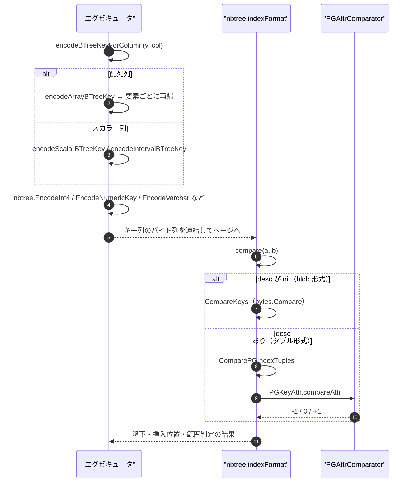
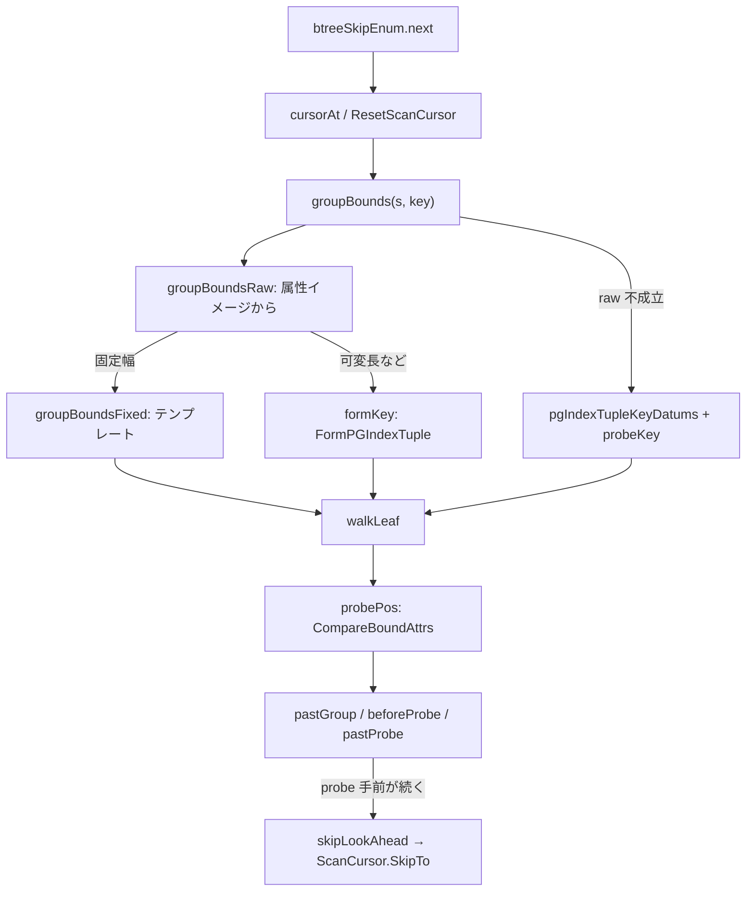

# キー符号化と比較

<details>
<summary>関連ソースファイル</summary>

- [`internal/access/nbtree/btree.go`](https://github.com/ryogrid/goopg/blob/19856410e8d497d59787e1ab35a2febb3f5953d6/internal/access/nbtree/btree.go)
- [`internal/access/nbtree/pgcompare.go`](https://github.com/ryogrid/goopg/blob/19856410e8d497d59787e1ab35a2febb3f5953d6/internal/access/nbtree/pgcompare.go)
- [`internal/access/nbtree/pgcompare_types.go`](https://github.com/ryogrid/goopg/blob/19856410e8d497d59787e1ab35a2febb3f5953d6/internal/access/nbtree/pgcompare_types.go)
- [`internal/access/nbtree/pgformat.go`](https://github.com/ryogrid/goopg/blob/19856410e8d497d59787e1ab35a2febb3f5953d6/internal/access/nbtree/pgformat.go)
- [`internal/access/nbtree/pgitemcodec.go`](https://github.com/ryogrid/goopg/blob/19856410e8d497d59787e1ab35a2febb3f5953d6/internal/access/nbtree/pgitemcodec.go)
- [`internal/access/nbtree/pgkeycmp.go`](https://github.com/ryogrid/goopg/blob/19856410e8d497d59787e1ab35a2febb3f5953d6/internal/access/nbtree/pgkeycmp.go)
- [`internal/access/nbtree/pgtuple.go`](https://github.com/ryogrid/goopg/blob/19856410e8d497d59787e1ab35a2febb3f5953d6/internal/access/nbtree/pgtuple.go)
- [`internal/executor/btree_array_key.go`](https://github.com/ryogrid/goopg/blob/19856410e8d497d59787e1ab35a2febb3f5953d6/internal/executor/btree_array_key.go)
- [`internal/executor/btree_interval_key.go`](https://github.com/ryogrid/goopg/blob/19856410e8d497d59787e1ab35a2febb3f5953d6/internal/executor/btree_interval_key.go)
- [`internal/executor/btree_key_decodable.go`](https://github.com/ryogrid/goopg/blob/19856410e8d497d59787e1ab35a2febb3f5953d6/internal/executor/btree_key_decodable.go)
- [`internal/executor/btree_scalar_keys.go`](https://github.com/ryogrid/goopg/blob/19856410e8d497d59787e1ab35a2febb3f5953d6/internal/executor/btree_scalar_keys.go)
- [`internal/executor/btree_skip.go`](https://github.com/ryogrid/goopg/blob/19856410e8d497d59787e1ab35a2febb3f5953d6/internal/executor/btree_skip.go)

</details>

B-tree のキー層は、SQL の値を「バイト列の辞書順がそのまま型の順序になる」形に符号化し、そのバイト列だけを比較して降下・挿入位置・範囲境界を決める。goopg には 2 つの形式がある。現在の全インデックスが使う **blob 形式** は、型ごとの順序保存エンコーディング（`EncodeInt4`、`EncodeNumericKey`、`EncodeVarchar` など）を 1 本の不透明キーとしてページに置き、`CompareKeys` = `bytes.Compare` で比較する。記述子 `PGIndexKeyDesc` を持つ **タプル形式** は、キーを `IndexTupleData` そのもの（属性のバイナリ・イメージ + NULL ビットマップ）として持ち、`ComparePGIndexTuples` が属性ごとに型別比較器 (`PGAttrComparator`) を呼ぶ。executor 側は型ごとのエンコーダ（スカラー、配列、interval）と、キーから値を復元できるかの判定、skip scan の境界生成を持つ。

## 責務

- **blob キーの符号化**: `EncodeInt4` / `EncodeInt8` / `EncodeInt128` はビッグエンディアン + 符号ビット反転、`EncodeNumericKey` は符号 + バイアス指数 + 数字 + 終端、`EncodeVarchar` は 0x00/0x01 のエスケープ + 0x00 終端で、いずれもバイト順 = 型の順序になる (`internal/access/nbtree/btree.go:EncodeInt4`、`internal/access/nbtree/btree.go:EncodeNumericKey`、`internal/access/nbtree/btree.go:EncodeVarchar`)。
- **スカラー特殊型**: `encodeScalarBTreeKey` が int2（int4 へ拡張）、oid（符号なし 8 バイト）、bool、bytea、time、timetz（12 バイト）、interval（16 バイト）を処理する (`internal/executor/btree_scalar_keys.go:encodeScalarBTreeKey`)。
- **配列キー**: `encodeArrayBTreeKey` が要素タグ 0x01 / NULL 0xFF / 終端 0x00 の列を作り、要素はスカラー経路へ再帰して `array_cmp` と同じ順序にする (`internal/executor/btree_array_key.go:encodeArrayBTreeKey`)。
- **interval キー**: `encodeIntervalBTreeKey` が `interval_cmp_value` と同じ 128 ビットのspan を `EncodeInt128` で符号化する。月/日/時刻への逆変換は原理的に不能である (`internal/executor/btree_interval_key.go:encodeIntervalBTreeKey`)。
- **タプル形式**: `FormPGIndexTuple` / `DeformPGIndexTuple` が `IndexTupleData` のヘッダ、NULL ビットマップ、属性のアラインメント、短縮 varlena を扱う (`internal/access/nbtree/pgtuple.go:FormPGIndexTuple`)。
- **比較の一元化**: すべての順序判断が `indexFormat.compare` / `compareKeyAttrs` / `compareHigh` を通る。記述子が nil なら `CompareKeys`、非 nil なら `ComparePGIndexTuples` に委譲する (`internal/access/nbtree/pgkeycmp.go:indexFormat`、`internal/access/nbtree/pgkeycmp.go:compare`)。
- **型別比較器**: `PGCompareInt4` / `PGCompareFloat8` / `PGCompareNumeric` / `PGCompareTextC` などが、PG のバイナリ・ダータム・イメージを直接比較する (`internal/access/nbtree/pgcompare_types.go:PGCompareInt4`)。
- **キー復元可否の事前判定**: `indexKeyColumnIsDecodable` が「この列のキーは値に戻せるか」、`indexKeyColumnRendersHeapText` が「戻した値をヒープと同じ綴りで出力できるか」を答える (`internal/executor/btree_key_decodable.go:indexKeyColumnIsDecodable`)。
- **skip scan の境界**: `btreeSkipEnum` が前置きグループの probe（前置き + 束縛列）と pivot（前置きのみ）を組み立て、`CompareBoundAttrs` で 1 エントリを 3 つの問い（グループの外・probe の手前・probe の後ろ）に同時に答える (`internal/executor/btree_skip.go:btreeSkipEnum`、`internal/executor/btree_skip.go:groupBounds`)。

## 処理フロー

書き込み側の符号化から、B-tree 内での比較、読み出し側の復元までを追う。



1. **ディスパッチ** — executor の `encodeBTreeKeyForColumn` は、まず `col.Type.IsArray` を見て配列をスカラー分岐より前にルーティングする。配列の `Type.Name` は**要素型**の名前なので、これを先に見ないと `int4[]` が int4 のスカラー分岐に吸われ、`"{1,2}"` を整数としてパースしてしまう (`internal/executor/btree_array_key.go:6`、`internal/executor/btree_array_key.go:114`)。
2. **スカラー特殊型** — 配列でない列は `encodeScalarBTreeKey` に渡される。int2 / oid / bool / bytea / time / timetz / interval のいずれでもなければ `handled=false` を返し、呼び出し元の型スイッチが int4・int8・numeric・文字列・timestamp・float8 などを処理する (`internal/executor/btree_scalar_keys.go:232`)。
3. **配列の要素** — `encodeArrayBTreeKey` は正規化された配列テキストを走査し、非 NULL 要素には `0x01` を置いてから `encodeBTreeKeyForColumn` の結果を続け、NULL 要素には `0xFF`、配列全体の終端に `0x00` を置く。要素の符号化をスカラー経路と共有するため、`int4[]` の各要素は `int4` 列のキーとバイト単位で一致する (`internal/executor/btree_array_key.go:116`、`internal/executor/btree_array_key.go:134`)。
4. **キーの連結** — 複合キーは列ごとの符号化をそのまま連結する。可変長の `EncodeVarchar` は 0x00 終端で自己区切りになり、`EncodeNumericKey` は符号 + 4 バイト指数 + 数字列 + 終端で自己区切りになるため、列境界を別途記録する必要がない (`internal/access/nbtree/btree.go:714`、`internal/access/nbtree/btree.go:897`)。
5. **比較** — B-tree の降下・挿入・分割は `indexFormat.compare` を呼ぶ。`desc == nil` なら `CompareKeys`（`bytes.Compare`）で終わり、`desc != nil` なら `ComparePGIndexTuples` が両方のタプルを `pgIndexTupleWalk` で先頭属性から歩き、`PGKeyAttr.compareAttr` で最初に差が付いた属性の結果を返す (`internal/access/nbtree/pgkeycmp.go:78`、`internal/access/nbtree/pgcompare.go:224`)。
6. **比較器** — `PGKeyAttr.compareAttr` は NULL を先に処理し、`Desc` なら結果を符号反転し、それ以外は `PGAttrComparator` を呼ぶ。比較器が nil なら `CompareKeys` が使われる。型別比較器は PG のダータム・イメージ（固定長は `attlen` バイト、varlena はヘッダ込み）を受け取り、壊れた長さなら `bytes.Compare` にフォールバックする (`internal/access/nbtree/pgcompare.go:131`、`internal/access/nbtree/pgcompare_types.go:53`)。
7. **キーからの復元** — index-only scan は `indexKeyColumnIsDecodable` を先に問い、false ならヒープを読む。true でも `indexKeyColumnRendersHeapText` が false（numeric）なら、キーには表示スケールが無いためヒープを読む。復元自体は `decodeScalarBTreeKey` / `decodeArrayBTreeKey` が行い、消費バイト数を返すので複合キーの次の列へ進める (`internal/executor/btree_key_decodable.go:46`、`internal/executor/btree_scalar_keys.go:303`、`internal/executor/btree_array_key.go:168`)。

skip scan は、この比較層を「前置きグループ」の境界生成に使う。



8. **グループ境界** — `btreeSkipEnum.init` が束縛列を Rescan ごとに 1 回評価し、NULL なら走査全体を空にする。各グループでは `groupBounds` が「前置き属性 + 束縛列」の probe と「前置き属性のみ」の pivot を作る。pivot は「このエントリがまだグループ内か」を `CompareHighBound(entry, pivot) <= 0` で判定するための境界である (`internal/executor/btree_skip.go:73`、`internal/executor/btree_skip.go:223`)。
9. **高速な境界生成** — `groupBoundsRaw` はエントリのタプルから前置き属性のイメージを 1 回だけ deform し、束縛列のイメージと合わせて `FormPGIndexTuple` で probe / pivot を組み直す。全属性が固定幅なら `groupBoundsFixed` がテンプレートを使い、グループごとの deform と 2 回の汎用タプル形成を省く。`ok=false` のときは値をデコードして `probeKey` で組み直す経路に落ちる (`internal/executor/btree_skip.go:265`、`internal/executor/btree_skip.go:331`)。
10. **1 エントリ 3 判定** — `probePos` が `CompareBoundAttrs` を 1 回呼び、`res`（最初に差が付いた属性の比較）、`at`（その属性番号）、`nKey` / `nProbe`（両者が保存する属性数）を得る。`pastGroup` は「最初の s 属性が pivot より後ろ」、`beforeProbe` は「probe の属性で負、または全属性一致でエントリが probe より短い」、`pastProbe` は「probe より後ろ」を、追加の比較なしで導く（全属性一致でエントリが長い場合は `beforeProbe` ではなく、個別比較に委ねる） (`internal/executor/btree_skip.go:414`、`internal/executor/btree_skip.go:430`)。
11. **先読み** — `walkLeaf` は probe より手前のエントリが 3 回続くと `skipLookAhead` を呼び、`targetDistance` 先の 1 件だけを検査する。そこも probe より手前なら、その間の全エントリも手前（リーフ内は順序付き）なので `ScanCursor.SkipTo` でまとめて飛ばす。距離は 5 から始まり、成功ごとに倍、失敗で 1/8 に縮み、上限は `408 / 2 = 204` (`internal/executor/btree_skip.go:473`、`internal/executor/btree_skip.go:494`)。

## 主要ファイル

| ファイル | 役割 |
| --- | --- |
| `internal/access/nbtree/btree.go` | blob キーの符号化・復号 (`EncodeInt4` / `EncodeInt8` / `EncodeInt128` / `EncodeNumericKey` / `EncodeVarchar` / `EncodeChar` / `EncodeTimestamp` / `EncodeFloat8`) と `CompareKeys` (`internal/access/nbtree/btree.go:EncodeNumericKey`) |
| `internal/access/nbtree/pgkeycmp.go` | `indexFormat` と `compare` / `compareKeyAttrs` / `compareHigh`、境界比較の公開 API (`internal/access/nbtree/pgkeycmp.go:compare`) |
| `internal/access/nbtree/pgcompare.go` | `PGKeyAttr` / `PGIndexKeyDesc`、`ComparePGIndexTuples`、NULL 順序・切り詰め属性・ヒープ TID タイブレーク (`internal/access/nbtree/pgcompare.go:ComparePGIndexTuples`) |
| `internal/access/nbtree/pgcompare_types.go` | 型別比較器と varlena ペイロード抽出 (`internal/access/nbtree/pgcompare_types.go:PGCompareNumeric`) |
| `internal/access/nbtree/pgtuple.go` | `PGIndexAttr`、`FormPGIndexTuple` / `DeformPGIndexTuple`、`PGIndexFixedAttrOffsets`、`PGIndexImageInline`、アイテムサイズ上限 (`internal/access/nbtree/pgtuple.go:FormPGIndexTuple`) |
| `internal/access/nbtree/pgitemcodec.go` | `IndexFormat`（外部署向けの形式ビュー）と `bodySize` / `itemEncodedSize` (`internal/access/nbtree/pgitemcodec.go:IndexFormat`) |
| `internal/access/nbtree/pgformat.go` | 16 バイト opaque とページ予算の前提になる `SizeOfBTPageOpaquePG`、`BTP_*` 語彙 (`internal/access/nbtree/pgformat.go:SizeOfBTPageOpaquePG`) |
| `internal/executor/btree_scalar_keys.go` | int2 / oid / reg* / bool / bytea / time / timetz の符号化と復号 (`internal/executor/btree_scalar_keys.go:encodeScalarBTreeKey`) |
| `internal/executor/btree_interval_key.go` | `interval_cmp_value` の 128 ビット span 符号化と「復号不能」の明示 (`internal/executor/btree_interval_key.go:encodeIntervalBTreeKey`) |
| `internal/executor/btree_array_key.go` | 配列キーのタグ付き符号化・復号・要素レンダラ (`internal/executor/btree_array_key.go:encodeArrayBTreeKey`) |
| `internal/executor/btree_key_decodable.go` | キー復元可否とヒープ綴り可否の判定 (`internal/executor/btree_key_decodable.go:indexKeyColumnIsDecodable`) |
| `internal/executor/btree_skip.go` | skip scan のグループ境界生成と先読み (`internal/executor/btree_skip.go:groupBounds`) |

## 公開 API / エントリポイント

```go
func EncodeInt4(key int32) []byte
func DecodeInt4(b []byte) (int32, error)
func EncodeInt8(key int64) []byte
func DecodeInt8(b []byte) (int64, error)
func EncodeInt128(hi int64, lo uint64) []byte
func EncodeNumericKey(mantissa *big.Int, scale int16) []byte
func DecodeNumericKey(b []byte) (mantissa *big.Int, scale int16, n int, err error)
func EncodeVarchar(payload []byte) []byte
func DecodeVarchar(b []byte) ([]byte, error)
func DecodeVarcharLen(b []byte) ([]byte, int, error)
func EncodeChar(payload []byte) []byte
func EncodeTimestamp(microsSince2000 int64) []byte
func DecodeTimestamp(b []byte) (int64, error)
func EncodeFloat8(key float64) []byte
func DecodeFloat8(b []byte) (float64, error)
func CompareKeys(a, b []byte) int

func FormPGIndexTuple(attrs []PGIndexAttr, values [][]byte, isnull []bool, tid storage.ItemPointer) ([]byte, error)
func DeformPGIndexTuple(raw []byte, attrs []PGIndexAttr, natts int) ([][]byte, []bool, error)
func PGIndexFixedAttrOffsets(attrs []PGIndexAttr) (offs []int, ok bool)
func PGIndexImageInline(att PGIndexAttr, img []byte) bool
func CheckPGBTItemSize(size int, needHeapTID bool) error
func ComparePGIndexTuples(desc *PGIndexKeyDesc, a, b []byte) (int, error)
func ComparePGIndexTupleKeyAttrs(desc *PGIndexKeyDesc, a, b []byte) (int, error)
func PGCompareInt4(a, b []byte) int
func PGCompareFloat8(a, b []byte) int
func PGCompareNumeric(a, b []byte) int
func PGCompareTextC(a, b []byte) int

func (fm IndexFormat) Compare(a, b []byte) int
func (fm IndexFormat) CompareKeyAttrs(a, b []byte) int
func (bt *BTree) CompareLowBound(key, lo []byte) int
func (bt *BTree) CompareHighBound(key, hi []byte) int
func (bt *BTree) CompareBoundAttrs(key, bound []byte) (res, at, nKey, nBound int, ok bool)

func encodeScalarBTreeKey(v Datum, col *catalog.Column, pos int) (key []byte, handled bool, encErr *ExecError)
func decodeScalarBTreeKey(key []byte, typeName string) (d Datum, n int, handled bool, err error)
func encodeArrayBTreeKey(ctx *Context, v Datum, col *catalog.Column, pos int) ([]byte, *ExecError)
func decodeArrayBTreeKey(key []byte, col catalog.Column, st array.OutputStyle) (Datum, int, error)
func encodeIntervalBTreeKey(v Datum, colName string, pos int) ([]byte, *ExecError)
func indexKeyColumnIsDecodable(col catalog.Column) bool
func indexKeyColumnRendersHeapText(col catalog.Column) bool
```

`EncodeVarchar` の逆変換は「B-tree のためだけ」ではなく、index-only scan と amcheck の比較器が使う。`DecodeVarcharLen` は終端を含む消費バイト数を返すので、複合キーの列送りに使える (`internal/access/nbtree/btree.go:897`)。

## 主要データ構造

### `indexFormat` — 順序とレイアウトの単一決定点

```go
type indexFormat struct {
	// desc is the index's key descriptor, or nil for bytewise ordering.
	desc *PGIndexKeyDesc
}
```

`internal/access/nbtree/pgkeycmp.go:indexFormat` (60 行)

`desc == nil` は blob 形式（`item.key` は不透明な順序保存バイト列、比較は `CompareKeys`）、`desc != nil` はタプル形式（`item.key` はヘッダ込みの `FormPGIndexTuple` イメージ、比較は `ComparePGIndexTuples`）を意味する。この 1 フィールドが「比較方法」と「`item.key` が何であるか」の両方を決めるため、片方だけを切り替えると木は静かに誤順序になる。ゼロ値が blob 形式なので、記述子を設定し忘れた `BTree` は従来どおりに動く (`internal/access/nbtree/pgitemcodec.go:60`)。

### `IndexFormat` — 外部署向けの形式ビュー

```go
type IndexFormat struct{ f indexFormat }
```

`internal/access/nbtree/pgitemcodec.go:IndexFormat` (96 行)

パッケージ外（amcheck、executor）は `keyFmt` に直接触れず、`IndexFormatFor(desc)` か `(*BTree).Format()` でこの値を得る。`Compare` / `CompareKeyAttrs` / `PGBTPostingRaw` を公開するが、内部の `indexFormat` をそのまま見せないのは、外部署が順序とレイアウトの整合を壊せないようにするためである (`internal/access/nbtree/pgitemcodec.go:101`)。

### `PGAttrComparator`

```go
type PGAttrComparator func(a, b []byte) int
```

`internal/access/nbtree/pgcompare.go:PGAttrComparator` (66 行)

1 属性分の比較器で、両辺ともインデックス内のダータム・イメージである。PG の `sk_func` は「スキャンキー vs アイテム」の向きで呼ばれて ASC で符号反転されるが、ここにはスキャンキーが無いので**反転しない**。`Desc` の適用は `PGKeyAttr.compareAttr` が 1 回だけ行う。nil は「バイト順」を意味し、blob 形式のキー（`EncodeInt4` など）をそのまま比較できる (`internal/access/nbtree/pgcompare.go:53`)。

### `PGKeyAttr` / `PGIndexKeyDesc`

```go
type PGKeyAttr struct {
	// PGIndexAttr is the physical layout FormPGIndexTuple /
	// DeformPGIndexTuple consult.
	PGIndexAttr
	// Compare is the attribute's opclass comparator. A nil Compare means
	// "bytewise", i.e. CompareKeys — the honest description of goopg's
	// current order-preserving key encodings (EncodeInt4, EncodeNumericKey,
	// EncodeVarchar, …), all of which are built so that lexicographic byte
	// order IS the type's order. Keeping nil meaningful is what lets 3b-2
	// migrate one type at a time instead of in a flag day.
	Compare PGAttrComparator
	// Desc is SK_BT_DESC: the column is indexed in descending order.
	Desc bool
	// NullsFirst is SK_BT_NULLS_FIRST. PG's default for an ASC column is
	// NULLS LAST (this field false); for DESC the catalog records NULLS
	// FIRST, so a caller building a descriptor from pg_index.indoption must
	// carry both bits across rather than deriving one from the other.
	NullsFirst bool
	// IntWidth, when non-zero, says Compare is the signed little-endian
	// integer comparison of an IntWidth-byte image (PGCompareInt2/4/8 —
	// btint2cmp/btint4cmp/btint8cmp, which date/time/timestamp share), so
	// compareFixedPrefix may compare the bytes inline (M0122-0012 C37). The
	// descriptor builder stamps it beside Compare; 0 means "call Compare".
	IntWidth uint8
}
```

`internal/access/nbtree/pgcompare.go:PGKeyAttr` (70 行)

```go
type PGIndexKeyDesc struct {
	// Attrs are the KEY attributes only. An index with INCLUDE columns
	// describes just its key prefix here, matching
	// IndexRelationGetNumberOfKeyAttributes.
	Attrs []PGKeyAttr
}
```

`internal/access/nbtree/pgcompare.go:PGIndexKeyDesc` (100 行)

`Attrs` は KEY 属性だけを持ち、INCLUDE 列は含まない。各属性は物理レイアウト（`PGIndexAttr`）と順序規則（`Compare` / `Desc` / `NullsFirst`）を束ねる。`Desc` と `NullsFirst` は独立であり、DESC から NULLS FIRST を導出してはならない（PG の既定は ASC なら NULLS LAST、DESC なら NULLS FIRST で、カタログは両ビットを別々に持つ）。`IntWidth` は固定幅整数のインライン比較用で、`compareFixedPrefix` が `Compare` の関数呼び出しを省く (`internal/access/nbtree/pgcompare.go:107`)。

### `PGIndexAttr` — タプル コーデックの物理属性

```go
type PGIndexAttr struct {
	// Len is attlen: > 0 fixed width, -1 varlena, -2 cstring.
	Len int16
	// ByVal is attbyval.
	ByVal bool
	// AlignBy is attalignby: 1, 2, 4 or 8 (the decoded form of attalign).
	AlignBy uint8
	// Storage is attstorage: 'p' plain, 'e' external, 'm' main, 'x' extended.
	Storage byte
}
```

`internal/access/nbtree/pgtuple.go:PGIndexAttr` (123 行)

`Len` は `attlen`（正: 固定長、-1: varlena、-2: cstring）、`AlignBy` は `attalign` を 1/2/4/8 に復号した値、`Storage` は `attstorage` である。`packable()`（`Len == -1 && Storage != 'p'`）の属性だけが短縮 varlena ヘッダへ付け替えられる。この 4 フィールドが `FormPGIndexTuple` の配置と `DeformPGIndexTuple` の読み進め方を決める (`internal/access/nbtree/pgtuple.go:137`)。

### `skipPos` — 1 エントリ 3 判定の結果

```go
type skipPos struct {
	res, at, nKey, nProbe int
	ok                    bool
}
```

`internal/executor/btree_skip.go:skipPos` (425 行)

`res` は最初に差が付いた属性の比較結果、`at` はその属性番号、`nKey` / `nProbe` はエントリと probe が保存する属性数である。`ok` は `CompareBoundAttrs` が使えたことを示す。`ok=false`（probe 未設定、比較エラー、エントリの属性数が probe 未満）のときは `CompareHighBound` / `CompareLowBound` の個別呼び出しにフォールバックする (`internal/executor/btree_skip.go:430`)。

## 内部構造

### blob 形式のキーは「型の順序をバイト順に写したもの」

executor が使う符号化をまとめると次のようになる。いずれも「SQL の型の順序」を「バイト列の辞書順」に写すことが目的で、テキスト表現の順序ではない。

| 型ファミリ | キー | 順序の根拠 |
| --- | --- | --- |
| int4 / int8 | ビッグエンディアン + 符号ビット反転 | `EncodeInt4` / `EncodeInt8` |
| int2 | int32 に拡張して int4 キー | 全 int2 が int32 で単調に表せる |
| oid / reg* | 0..2^32-1 を int8 キーで符号化 | `oidcmp` は符号なし比較 |
| bool | int4 の 0 / 1 | `btboolcmp` の false < true |
| bytea | `EncodeVarchar` | エスケープ + 0x00 終端が `byteacmp` の順序になる |
| numeric | 符号 + バイアス指数 + 数字 + 終端 | `EncodeNumericKey` |
| 文字列（text/varchar/char/name/uuid） | `EncodeVarchar`（char は末尾空白を除去） | C ロケールのバイト順 / bpchar の空白パディング |
| timestamp | int8 の µs（2000 年起点） | `EncodeTimestamp` = `EncodeInt8` |
| float8 | IEEE-754 ビットの符号反転 / 全反転 | 正負の順序を保つ |
| time | int8 の µs（午前 0 時起点） | `bttimecmp` |
| timetz | int8 の GMT 相当 µs + int4 のゾーン | `timetz_cmp_internal` の 2 段比較 |
| interval | int128 の span | `interval_cmp_value`（意図的に非可逆） |
| 配列 | 要素タグ + 要素キー + 終端 | `array_cmp` |

**数値** — `EncodeNumericKey` は末尾の 0 を落として正規化するので、`1.0` と `1.00` は同じバイト列になる。これは UNIQUE 制約の等値判定に必要である。ゼロは 1 バイト `[0x01]`、正数は `0x02` + 指数 `E+0x80000000` + 数字 + `0x00`、負数は `0x00` + 指数 `0x7FFFFFFF-E` + 反転数字 + `0xFF` で、終端が数字バイトと衝突しないため自己区切りになる (`internal/access/nbtree/btree.go:628`)。`DecodeNumericKey` は正規化された `(mantissa, scale)` を返し、`1.50` は `(15, 1)` に戻る。スケールが負になる場合は仮数を `-s` 桁だけ 10 倍し、スケールを 0 に丸める (`internal/access/nbtree/btree.go:728`)。

**文字列** — `EncodeVarchar` は 0x00 を `[0x01,0x01]`、0x01 を `[0x01,0x02]` にエスケープし、末尾に 0x00 を置く。したがって 0x00 は終端にしか現れず、複合キーの列境界が一意に決まる。`EncodeChar` は末尾の 0x20 を落としてから同じ処理をするので、`'A'` と `'A   '` は同じキーになる (`internal/access/nbtree/btree.go:798`、`internal/access/nbtree/btree.go:834`)。

**浮動小数** — `EncodeFloat8` は正数の符号ビットを反転し、負数は全ビットを反転する。これで負数 < 正数のバイト順になる。`NaN` は `+Inf` より上に並ぶとコメントされている。ビット列をそのまま写すので、`-0.0` と `+0.0` は異なるキーになる (`internal/access/nbtree/btree.go:867`)。

**interval** — `intervalSpan128` は `(months*30 + days) * 86_400_000_000 + micros` を 128 ビットで計算し、`EncodeInt128` で 16 バイトにする。月を 30 日として畳むのは上流 `interval_cmp_value` と同じで、`'1 mon'` と `'30 days'` が等しいという PG の意味論をそのまま写している。したがってキーから月/日/時刻を復元することはできず、`intervalKeyNotDecodable` が明示的にエラーを返す (`internal/executor/btree_interval_key.go:16`、`internal/executor/btree_interval_key.go:82`)。

**timetz** — キーは `EncodeInt8(gmtMicros) || EncodeInt4(pgZone)` の 12 バイト。`gmtMicros = local + pgZone*1_000_000`、`pgZone = -v.TimeTZOffsetSecs()` で、UTC より**西**への秒数（PG の `TimeTzADT.zone` の符号）である。goopg の `Datum.Scale` は東向きの分なので、符号を反転して PG の向きに合わせる。ゾーンの向きを間違えると、同じ時刻を表す `13:00+01` / `12:00+00` / `11:00-01` のタイブレークが逆になる (`internal/executor/btree_scalar_keys.go:134`)。

**配列** — 各要素は `0x01` + スカラーキー、NULL は `0xFF`、配列の終端は `0x00`。`0xFF` は非 NULL タグ `0x01` より大きいので NULL は後ろ、終端 `0x00` はどちらより小さいので短い配列が先に来る。終端があるため空配列は 1 バイトのキーになり、ゼロ長キー（「キーなし」と解釈される）にはならない。多次元配列は `0A000` で拒否し、平坦化して誤ったキーを作らない (`internal/executor/btree_array_key.go:77`、`internal/executor/btree_array_key.go:99`)。

### タプル形式の比較は属性ごとの型付き比較

`ComparePGIndexTuples` は `_bt_compare` のタプル同士の本体を写したもので、次の順に判定する。

1. 両者が保存する属性のうち `min(nattsA, nattsB)` 個を先頭から比較し、最初に差が付いた属性で決める。`pgIndexTupleWalk` を使うので、差が付いた後ろの属性は deform しない。
2. 全共有属性が等しく、属性数が違う場合は**少ない方**が負の無限大として先に来る（切り詰められた pivot は、落とした属性で負の無限大）。
3. 属性数も同じなら、ヒープ TID を暗黙の最終キー属性として比較する。TID を持たない pivot は負の無限大。`ComparePGIndexTupleKeyAttrs` はこの 3 番目を省き、UNIQUE ビルドや dedup のグルーピングに使う (`internal/access/nbtree/pgcompare.go:164`、`internal/access/nbtree/pgcompare.go:362`)。

NULL の順序は属性ごとで、`a.NullsFirst == anull` なら a が先、そうでなければ b が先。両方 NULL は等しい (`internal/access/nbtree/pgcompare.go:136`)。`compareFixedPrefix` は NULL ビットマップが無く、比較対象がすべて固定幅で、両タプルの `t_info` サイズがオフセットを包含する場合に、属性をスライスして直接比較する。`IntWidth` が 2/4/8 なら符号付きリトルエンディアン整数としてインライン比較し、`Desc` なら符号反転する。varlena・cstring・ビットマップ・オーバーランでは汚い最適化をせず、通常の walk に戻る (`internal/access/nbtree/pgcompare.go:305`)。

タプル形式のキーは `FormPGIndexTuple` が作る。ヘッダは 8 バイト（`t_tid` 6 + `t_info` 2）、NULL がある場合は `(32+8-1)/8 = 4` バイトの固定長ビットマップがヘッダ直後に付き、値は `MAXALIGN(8)` = 8、NULL ビットマップ付きなら `MAXALIGN(12)` = 16 から始まる。各値は属性の `AlignBy` に合わせて配置され、短縮可能な varlena は 1 バイトヘッダへ付け替えられる。TOAST ポインタ（外部ダータム）は索引タプルに格納できないのでエラーになる (`internal/access/nbtree/pgtuple.go:511`、`internal/access/nbtree/pgtuple.go:620`)。

### 型別比較器は PG のダータム・イメージを読む

`PGCompareInt4` などは、`DeformPGIndexTuple` が返す「by-value なら `attlen` バイト、varlena ならヘッダ込み」のイメージを直接読む。x86-64 の PG 18.3 を互換対象にしているので、整数はリトルエンディアンである。`PGCompareInt4` は int32 として、`PGCompareOID` は uint32 として読む。この違いは実在し、2^31 以上の OID は符号付きだと負になる (`internal/access/nbtree/pgcompare_types.go:72`、`internal/access/nbtree/pgcompare_types.go:93`)。

- `PGCompareFloat8` は NaN を非 NaN より大きく、NaN 同士を等しいとし、`-0.0` と `+0.0` を等しくする（値として比較するため）。これはタプル形式の比較器の話であり、blob 形式の `EncodeFloat8` のビット列とは別である (`internal/access/nbtree/pgcompare_types.go:177`)。
- `PGCompareTextC` は C ロケールの `memcmp` 相当。非 C ロケールの照合はモデル化していない。`PGCompareBpcharC` は比較前に末尾空白を落とすので、`'ab   '` と `'ab'` が等しくなる (`internal/access/nbtree/pgcompare_types.go:221`)。
- `PGCompareNumeric` は base-10000 の符号・重み・桁配列を復号し、`-Infinity < 有限 < +Infinity < NaN` の順に並べる。short form の重みは 7 ビットの符号拡張が必要で、単純なマスクでは 1 未満の値が正の重みになる (`internal/access/nbtree/pgcompare_types.go:359`、`internal/access/nbtree/pgcompare_types.go:480`)。
- `PGCompareTimeTZ` は GMT 相当時刻 → ローカル時刻 → ゾーンの順に比較する。`PGCompareName` は最初の NUL までを値とし、`PGCompareUUID` は 16 バイトの `memcmp` である (`internal/access/nbtree/pgcompare_types.go:289`、`internal/access/nbtree/pgcompare_types.go:260`、`internal/access/nbtree/pgcompare_types.go:274`)。

比較器はエラーを返せない。壊れたオペランド（長さが `attlen` と違う、varlena ヘッダが不正、圧縮・外部ダータム）はすべて `bytes.Compare` にフォールバックし、順序が全順序で決定的であることを優先する。破損の検出は amcheck の仕事である (`internal/access/nbtree/pgcompare_types.go:36`)。

### `compareHigh` だけが上端で振る舞いを変える

`compare` は全順序（タプル形式ではヒープ TID でタイブレーク）を与え、`compareKeyAttrs` は TID を無視してグルーピングの問いに答える。`compareHigh` は上端専用で、`hi` が `entry` より少ない属性しか持たず、共有属性がすべて等しい場合に「entry は hi 以下」と答える。接頭辞 bound は「その接頭辞を持つすべて」を意味するからである。また、ヒープ TID を意図的に無視する。範囲 bound は式から作られ常にゼロ TID を持ち、これを比較すると完全一致の等値スキャンが最初の行で止まる (`internal/access/nbtree/pgkeycmp.go:114`、`internal/access/nbtree/pgkeycmp.go:155`)。

### 復元できないキーは事前に拒否する

index-only scan はキーだけから行を返すため、復元できないキーを途中で見つけると `XX000` でクエリ全体が落ちる。そこでスキャン開始前に 2 つの質問をする。

- `indexKeyColumnIsDecodable`: 値に戻せるか。interval は span が非可逆なので false。配列は要素型に再帰し、要素の値と綴りの両方が可能な場合だけ true (`internal/executor/btree_key_decodable.go:46`)。
- `indexKeyColumnRendersHeapText`: ヒープから読んだときと同じ文字列になるか。numeric はキーが表示スケール（`1.50` の末尾 0）を落としているため false。値としては復元できても、ヒープの綴りと一致しない (`internal/executor/btree_key_decodable.go:91`)。

`decodeScalarBTreeKey` は自前の型スイッチを持ち、`decodeIndexKeyColumn` の共有 `default:` アーム（先頭 8 バイトを enum の float8 として読む）に落ちないようにしている。この default はエラーを返さないため、ルーティングを誤ると「間違った値」が静かに返る (`internal/executor/btree_scalar_keys.go:294`)。

### skip scan の probe と pivot

skip scan は「前置き列に条件が無い」等値スキャンを、前置きの異なる値ごとの小さなスキャンに分解する。`groupBounds` が作る 2 つのキーがその境界である。

- probe = 前置き属性 + 束縛列の値。グループ内で条件に一致する範囲の開始点になる。
- pivot = 前置き属性のみ。`CompareHighBound(entry, pivot) <= 0` である限り、そのエントリは同じ前置きグループに属する。

`groupBoundsRaw` はエントリの属性イメージを直接使い、`PGIndexImageInline` で「4 バイトヘッダを短縮形に再ヘッダしても同じバイトになる」ことを確認する。圧縮 varlena・外部ダータム・完全長でないタプル・TOAST ポインタの束縛値では `ok=false` を返し、値デコード経路に落ちる。`groupBoundsFixed` は全属性固定幅のとき、probe / pivot のテンプレートを Rescan ごとに 1 回だけ `FormPGIndexTuple` で作り、グループごとには前置き属性のバイトをコピーするだけで済ませる (`internal/executor/btree_skip.go:254`、`internal/executor/btree_skip.go:317`)。

`skipPos` の 3 判定は `CompareBoundAttrs` の 1 パスから導かれる。`pastGroup` は `at < s && res > 0`、`beforeProbe` は `res < 0` で真、全属性一致なら「エントリが probe より長い」場合を除いて `CompareLowBound` に委ねる（短いエントリは負の無限大として手前）、`pastProbe` は `res > 0`。属性だけでは決まらない「フル arity の probe と全属性一致したエントリ」はヒープ TID のタイブレークだけが順序を決めるため、個別の bound 呼び出しに委ねる (`internal/executor/btree_skip.go:438`)。

## エッジケースと不変条件

- **numeric のゼロは 1 バイト** `[0x01]`。符号バイト 0x00/0x02 のどちらでもないので、`DecodeNumericKey` は最初にこの 1 バイトだけを特別扱いする (`internal/access/nbtree/btree.go:657`、`internal/access/nbtree/btree.go:732`)。
- **numeric の末尾 0 はキーから消える**。`1.0` と `1.00` は同一キー、`DecodeNumericKey(1.50)` は `(15, 1)` を返す。表示スケールが必要な index-only scan はキーではなくヒープを読む (`internal/access/nbtree/btree.go:663`、`internal/executor/btree_key_decodable.go:69`)。
- **numeric の不正キーは明示的にエラー**。符号バイトが 0x00/0x01/0x02 以外、終端が無い、数字以外のバイト、スケールが int16 を超える、のいずれも拒否する (`internal/access/nbtree/btree.go:728`)。
- **varchar のエスケープは 0x01 の後続が 0x01/0x02 のみ**。それ以外は `invalid escape`、終端が無ければ `missing 0x00 terminator` になる。`DecodeVarcharLen` は終端を含む消費長を返す (`internal/access/nbtree/btree.go:900`、`internal/access/nbtree/btree.go:924`)。
- **`EncodeChar` は末尾空白を落とす**。`'A'` と宣言長までパディングされた `'A   '` が同じキーになるので、ヒープがパディング形、プローブが非パディング形でも一致する (`internal/access/nbtree/btree.go:834`)。
- **`EncodeFloat8` の `-0.0` と `+0.0` は別キー**。ビット列を変換するためで、値比較の `PGCompareFloat8` が両者を等しいと扱うのとは異なる。blob 形式の UNIQUE 等値判定はバイト一致なので、この差が現れる (`internal/access/nbtree/btree.go:867`、`internal/access/nbtree/pgcompare_types.go:186`)。
- **int2 は範囲検査付き**。`-32768..32767` の外は `22003`、実行時 Kind が整数でなければ `42804` (`internal/executor/btree_scalar_keys.go:234`)。
- **oid は符号なし 32 ビット**。`0..4294967295` の外は `22003`。int4 キーで符号化すると 2^31 以上の OID が 0 より前に来るため、int8 キーに拡張している (`internal/executor/btree_scalar_keys.go:244`)。
- **reg\* は oid と同じ 8 バイトキーだが、エンコード時に名前解決する**。`regclass` などの名前は `regIdentifierInput` を通して OID になり、復号は生の OID を返す。名前のレンダリングは配列要素のレンダラ側の責務である (`internal/executor/btree_scalar_keys.go:81`、`internal/executor/btree_scalar_keys.go:316`)。
- **bytea は `EncodeVarchar` で `byteacmp` の順序になる**。エスケープされた 0x00 終端は任意のバイトより小さく、埋め込みの 0x00/0x01 が終端を偽装できない。共通接頭辞の次は短い方が先、という `byteacmp` の規則がそのまま出る (`internal/executor/btree_scalar_keys.go:32`)。
- **timetz のゾーンは「西への秒」**。`pgZone = -v.TimeTZOffsetSecs()`（goopg の `Datum.Scale` は東向きの分）で、`gmt = local + pgZone*1e6`。この符号を逆にすると同一時刻のタイブレークが逆転する (`internal/executor/btree_scalar_keys.go:134`)。
- **interval のキーは復号不能**。`intervalKeyNotDecodable` は「比較用 span であって月/日/時刻ではない」と明示的にエラーを返す。IOS はヒープを読み、amcheck の比較器はバイト順（= interval 順）にフォールバックする。前者は性能低下、後者は検出漏れであり、偽陽性にはならない (`internal/executor/btree_interval_key.go:125`)。
- **interval の無限大は特別扱いしない**。PG の `INTERVAL_NOEND` は 3 フィールドの符号付き最大値なので、span も自動的に最大・最小になり、通常の順序で端に来る (`internal/executor/btree_interval_key.go:38`)。
- **配列の多次元は拒否**。`arrayLiteralHasNestedBrace` は引用符とバックスラッシュを尊重するので、`{"a{b"}` のような 1 次元配列を多次元と誤判定しない (`internal/executor/btree_array_key.go:374`、`internal/executor/btree_array_key.go:381`)。
- **配列の NULL と文字列 "NULL" は別物**。`{NULL}` はタグ 0xFF、`{"NULL"}` は 0x01 + 文字列キー。引用符の有無だけが違いで、`array_cmp` では正反対の位置に来る (`internal/executor/btree_array_key.go:122`)。
- **配列の空配列は 1 バイト**。終端 0x00 だけのキーになり、ゼロ長キー（`encodeIndexKeyFromCols` が nil と解釈して行を落とす）を避ける (`internal/executor/btree_array_key.go:48`)。
- **配列要素に復号不能型は置けない**。`arrayKeyElemRenderer` が nil を返す要素型（interval / timetz / enum など）は `indexKeyColumnIsDecodable` が false になり、IOS はヒープを読む。判定と実際のデコーダが同じ表を参照するので、mid-scan の XX000 にならない (`internal/executor/btree_array_key.go:273`、`internal/executor/btree_key_decodable.go:46`)。
- **タプル形式の空オペランドは負の無限大**。`ComparePGIndexTuples` は 8 バイト未満のオペランドをエラーにし、`indexFormat.compare` が `bytes.Compare` に落ちる。空キーはすべてのタプルより小さいので、下限なしの降下は左端リーフに着く (`internal/access/nbtree/pgcompare.go:238`、`internal/access/nbtree/pgkeycmp.go:78`)。
- **posting タプルは比較器が拒否**。キーは 1 つの値だが、ヒープ TID タイブレークにどの TID を使うかを呼び出し元しか知らないため、推測せずエラーにする (`internal/access/nbtree/pgcompare.go:250`)。
- **壊れたオペランドはバイト順にフォールバック**。比較器はエラーを返せないため、順序の全域性と決定性を優先する。破損の検出は amcheck が行う (`internal/access/nbtree/pgcompare_types.go:36`、`internal/access/nbtree/pgkeycmp.go:65`)。
- **`compareHigh` はヒープ TID を見ない**。範囲 bound は常にゼロ TID なので、TID を比較すると完全一致の等値スキャンが 1 行も返さずに止まる (`internal/access/nbtree/pgkeycmp.go:174`)。
- **skip scan の先読み上限は 204**。`skipLookAheadMaxDistance = 408 / 2` で、`MaxIndexTuplesPerPage` の半分。距離は 5 から倍々に増え、失敗すると 1/8 に縮む。ページ末尾の 5 スロット手前では先読みしない (`internal/executor/btree_skip.go:473`、`internal/executor/btree_skip.go:497`)。
- **skip scan の NULL 束縛は走査全体を空にする**。`col = NULL` はどの前置きグループでも一致しないので、`init` が `done=true` を立てて終わる (`internal/executor/btree_skip.go:89`)。

## 関連ページ

- ページ形状・タプル配置・降下と検索は [8.1 B-tree の構造と検索](8.1-Btree-Structure.md)
- 挿入・分割時のセパレータ切り詰めは [8.2 挿入・分割・重複排除](8.2-Insert-and-Split.md)
- バキュームと WAL リプレイは [8.3 B-tree のバキュームと WAL リプレイ](8.3-Btree-Vacuum-and-Replay.md)
- キー順序の構造検証は [8.5 amcheck による検証](8.5-amcheck.md)
- 上位の文脈は [8 B-tree インデックス](../8-Btree.md)、式の評価は [6 実行エンジン](../6-Executor.md)

Sources:
- `internal/access/nbtree/btree.go`
- `internal/access/nbtree/pgcompare.go`
- `internal/access/nbtree/pgcompare_types.go`
- `internal/access/nbtree/pgformat.go`
- `internal/access/nbtree/pgitemcodec.go`
- `internal/access/nbtree/pgkeycmp.go`
- `internal/access/nbtree/pgtuple.go`
- `internal/executor/btree_array_key.go`
- `internal/executor/btree_interval_key.go`
- `internal/executor/btree_key_decodable.go`
- `internal/executor/btree_scalar_keys.go`
- `internal/executor/btree_skip.go`

<sub>Generated by deepwiki-4myself from `goopg` @ `19856410e`</sub>
