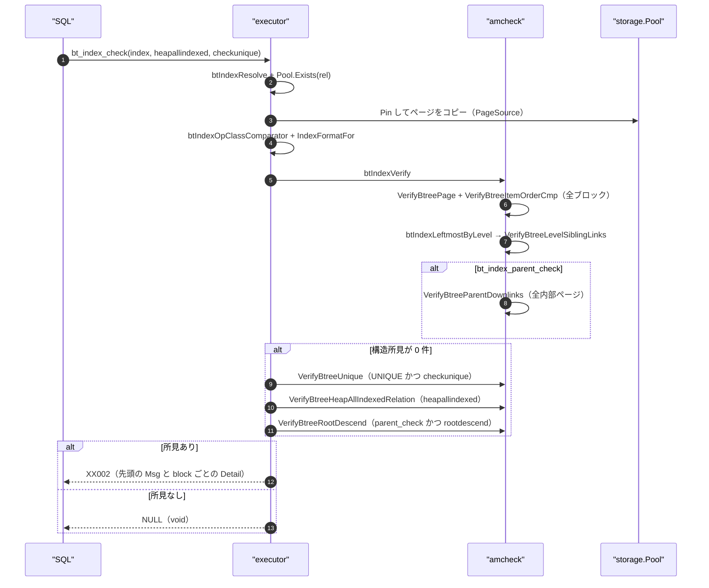
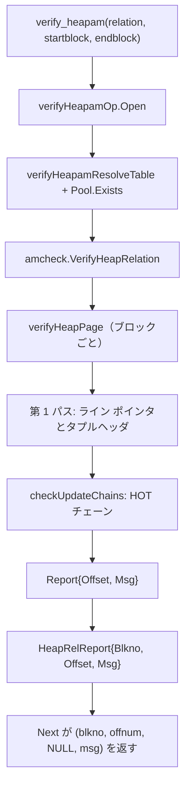
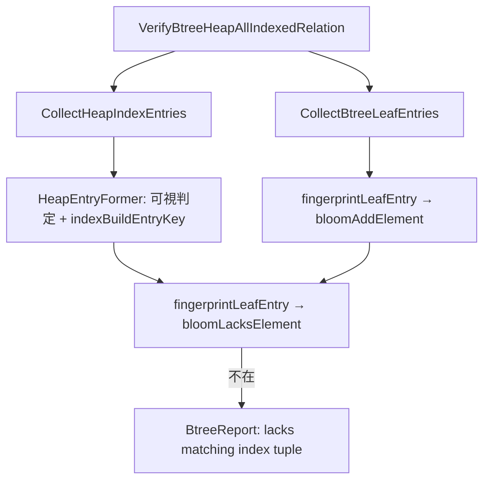

# amcheck による検証

<details>
<summary>関連ソースファイル</summary>

- [`internal/access/amcheck/bloomfilter.go`](https://github.com/ryogrid/goopg/blob/19856410e8d497d59787e1ab35a2febb3f5953d6/internal/access/amcheck/bloomfilter.go)
- [`internal/access/amcheck/heapallindexed.go`](https://github.com/ryogrid/goopg/blob/19856410e8d497d59787e1ab35a2febb3f5953d6/internal/access/amcheck/heapallindexed.go)
- [`internal/access/amcheck/heapallindexed_heapscan.go`](https://github.com/ryogrid/goopg/blob/19856410e8d497d59787e1ab35a2febb3f5953d6/internal/access/amcheck/heapallindexed_heapscan.go)
- [`internal/access/amcheck/heapallindexed_relation.go`](https://github.com/ryogrid/goopg/blob/19856410e8d497d59787e1ab35a2febb3f5953d6/internal/access/amcheck/heapallindexed_relation.go)
- [`internal/access/amcheck/verify_heapam.go`](https://github.com/ryogrid/goopg/blob/19856410e8d497d59787e1ab35a2febb3f5953d6/internal/access/amcheck/verify_heapam.go)
- [`internal/access/amcheck/verify_heapam_relation.go`](https://github.com/ryogrid/goopg/blob/19856410e8d497d59787e1ab35a2febb3f5953d6/internal/access/amcheck/verify_heapam_relation.go)
- [`internal/access/amcheck/verify_nbtree.go`](https://github.com/ryogrid/goopg/blob/19856410e8d497d59787e1ab35a2febb3f5953d6/internal/access/amcheck/verify_nbtree.go)
- [`internal/access/amcheck/verify_nbtree_rootdescend.go`](https://github.com/ryogrid/goopg/blob/19856410e8d497d59787e1ab35a2febb3f5953d6/internal/access/amcheck/verify_nbtree_rootdescend.go)
- [`internal/access/amcheck/verify_nbtree_unique.go`](https://github.com/ryogrid/goopg/blob/19856410e8d497d59787e1ab35a2febb3f5953d6/internal/access/amcheck/verify_nbtree_unique.go)
- [`internal/access/nbtree/btree.go`](https://github.com/ryogrid/goopg/blob/19856410e8d497d59787e1ab35a2febb3f5953d6/internal/access/nbtree/btree.go)
- [`internal/executor/operators_bt_index_check.go`](https://github.com/ryogrid/goopg/blob/19856410e8d497d59787e1ab35a2febb3f5953d6/internal/executor/operators_bt_index_check.go)
- [`internal/executor/operators_verify_heapam.go`](https://github.com/ryogrid/goopg/blob/19856410e8d497d59787e1ab35a2febb3f5953d6/internal/executor/operators_verify_heapam.go)

</details>

`internal/access/amcheck` は PostgreSQL の contrib/amcheck に対応する構造検証エンジンで、B-tree インデックスの物理構造・キー順序・兄弟リンク・親子ダウンリンク・一意性・索引漏れを検査する `bt_index_check` / `bt_index_parent_check` と、ヒープページの行ポインタ・タプルヘッダ・HOT チェーン・xid 範囲を検査する `verify_heapam` を提供する。エンジン本体はページ バイト列とコールバック (`PageSource`、`XidStatusFunc`、`HeapVisibilityFunc`、`HeapEntryFormer`) だけに依存し、カタログ・バッファプール・MVCC の結線は `internal/executor` の薄いアダプタが担う。発見は Go のエラーではなく `BtreeReport` / `Report` として返り、SQL 側が最初の所見を `XX002` などのエラーに変換する。

## 責務

- **B-tree のページ構造検査**: メタページの magic/version、リーフのレベル 0、内部ページの非 0 レベル、ライン ポインタ数の上限を `VerifyBtreePage` が検査する (`internal/access/amcheck/verify_nbtree.go:VerifyBtreePage`)。
- **キー順序とハイキー**: `VerifyBtreeItemOrderCmp` が各ページのデータアイテムについて、リーフは `key <= high key`、内部は `key < high key` を要求し、隣接キーの単調非減少を検査する (`internal/access/amcheck/verify_nbtree.go:VerifyBtreeItemOrderCmp`)。
- **兄弟リンク**: `VerifyBtreeLevelSiblingLinks` が左端から `btpo_next` を辿り、`btpo_prev` の一致・レベル一致・循環・削除済みページへの到達を検査する (`internal/access/amcheck/verify_nbtree.go:VerifyBtreeLevelSiblingLinks`)。
- **親子ダウンリンク**: `VerifyBtreeParentDownlinks` が内部ページの各ダウンリンクについて、子が削除済みでないこと、レベルが 1 つ下であること、親のセパレータが子キーの下限になっていることを検査する (`internal/access/amcheck/verify_nbtree.go:VerifyBtreeParentDownlinks`)。
- **一意性**: `VerifyBtreeUnique` が UNIQUE 索引の葉を走査し、キー属性が等しく、かつ両方のヒープタプルが可視である組を重複として報告する (`internal/access/amcheck/verify_nbtree_unique.go:VerifyBtreeUnique`)。
- **索引漏れ**: `VerifyBtreeHeapAllIndexed` が索引の全葉エントリを Bloom フィルタに登録し、ヒープの可視タプルから形成した「本来あるべきエントリ」を突き合わせる (`internal/access/amcheck/heapallindexed.go:VerifyBtreeHeapAllIndexed`)。
- **ルートからの到達性**: `VerifyBtreeRootDescend` が各葉エントリについてルートから独立に降下し、そのエントリに到達できるかを検査する (`internal/access/amcheck/verify_nbtree_rootdescend.go:VerifyBtreeRootDescend`)。
- **ヒープページ検査**: `verifyHeapPage` がライン ポインタの整合、タプルヘッダ、xmin/xmax の範囲、属性数、HOT チェーンを検査する (`internal/access/amcheck/verify_heapam.go:verifyHeapPage`)。
- **関係全体の走査**: `VerifyHeapRelation` がブロック範囲を解決して各ページを検査し、`(blkno, offset, msg)` の行を返す (`internal/access/amcheck/verify_heapam_relation.go:VerifyHeapRelation`)。
- **SQL 結線**: `evalBtIndexCheck` と `verifyHeapamOp.Open` がカタログ解決・ページのコピー・MVCC スナップショットの提供を行い、エンジンの所見を SQLSTATE に変換する (`internal/executor/operators_bt_index_check.go:evalBtIndexCheck`、`internal/executor/operators_verify_heapam.go:Open`)。

## 処理フロー

`bt_index_check(regclass, heapallindexed, checkunique)` の実行経路を追う。構造チェックが 1 件でも所見を返した時点で後続のティアは実行されない（上流が最初の `ereport(ERROR)` で止まるのと同じ）。



1. **引数と対象の解決** — `evalBtIndexCheck` は第 1 引数の regclass を評価し、NULL なら void を返す。OID / 名前は `btIndexResolve` が現在のデータベース名前空間（`catalog.NamespaceDBOid`）で解決する。索引が見つからなければ `42P01`、B-tree 以外なら `0A000` を返す (`internal/executor/operators_bt_index_check.go:60`、`internal/executor/operators_bt_index_check.go:815`)。
2. **ファイル存在の確認** — `ctx.Pool.Exists(rel)` を `NBlocks` より先に呼ぶ。`NBlocks` は `O_CREATE` で開くため、ファイルが削除されていても空の索引として再作成してしまい、「クリーン」と誤報告する。欠落は `XX002` の `index "%s" lacks a main relation fork` になる (`internal/executor/operators_bt_index_check.go:121`)。
3. **ページのコピー** — `PageSource` はブロックごとに `Pin` → ページをコピー → `Unpin` する。検査中にピンを保持しないので、同時挿入や分割が起きても各ページは読み取り時点のスナップショットとして扱える (`internal/executor/operators_bt_index_check.go:132`、`internal/access/amcheck/verify_nbtree.go:PageSource`)。
4. **比較器とキー形式** — `btIndexOpClassComparator` が索引の各キー列について opclass のサポート関数 1 を引き、いずれかのキー列にユーザー定義のものがあれば、列ごとにそれを呼ぶ比較器を返す。どの列にも無ければ nil（エンジンのバイト順）。キー形式は `IndexFormatFor(ctx.pgIndexKeyDesc(idx))` で、通常の索引はタプル形式、式キー・明示的 opclass・非 bytewise 照合などは blob 形式になる (`internal/executor/operators_bt_index_check.go:630`、`internal/executor/operators_bt_index_check.go:157`)。
5. **ページ構造とキー順序** — `btIndexVerify` は全ブロック（メタページを含む）に対して `VerifyBtreePage` と `VerifyBtreeItemOrderCmp` を呼ぶ。前者は最初の構造問題だけを返し、後者はハイキー違反または厳密な減少を見つけた時点で 1 件を返す (`internal/executor/operators_bt_index_check.go:208`、`internal/access/amcheck/verify_nbtree.go:249`)。
6. **兄弟リンク** — `btIndexLeftmostByLevel` がルートから各レベルの左端ページを集め（第 1 ダウンリンクを辿る）、各左端から `VerifyBtreeLevelSiblingLinks` が右へ歩く。`btpo_prev` の不一致、レベル混在、循環、削除済みページへの到達を検出する (`internal/executor/operators_bt_index_check.go:782`、`internal/access/amcheck/verify_nbtree.go:359`)。
7. **親子ダウンリンク** — `bt_index_parent_check` のときだけ、メタページ以外の全内部・非削除ページに対して `VerifyBtreeParentDownlinks` を呼ぶ。子の読み取り失敗は damaged page、子が削除済みなら `downlink to deleted page found`、レベル不一致なら `downlink points to block ... whose level is not one level down`、子キーがセパレータ未満なら `down-link lower bound invariant violated` を返す (`internal/executor/operators_bt_index_check.go:242`、`internal/access/amcheck/verify_nbtree.go:481`)。
8. **一意性** — 構造所見が 0 件のとき、`checkunique` が真かつ索引が UNIQUE なら `VerifyBtreeUnique` を実行する。位置引数は `bt_index_check` では 3 番目、`bt_index_parent_check` では 4 番目である。ヒープ可視性は `transam.TupleVisible` を呼ぶコールバックで供給し、スナップショットが無ければ（`ctx.Snap.Xmax == 0`）ティア自体をスキップする (`internal/executor/operators_bt_index_check.go:276`、`internal/access/amcheck/verify_nbtree_unique.go:84`)。
9. **索引漏れ** — 続いて `heapallindexed` が真なら、索引の葉エントリを Bloom フィルタに登録し、ヒープ走査で形成したエントリを突き合わせる。ヒープ側の可視判定・部分索引述語・HOT チェーン根の TID 解決・キー再形成は `btIndexHeapAllIndexed` の `form` コールバックが行う (`internal/executor/operators_bt_index_check.go:407`、`internal/access/amcheck/heapallindexed_relation.go:160`)。
10. **ルート降下** — `bt_index_parent_check` の `rootdescend` が真なら、各葉エントリについてルートから独立に検索する。キー記述子を持たない blob 形式では「どの重複か」を識別できないため、実行せず `0A000` を返す (`internal/executor/operators_bt_index_check.go:350`、`internal/access/amcheck/verify_nbtree_rootdescend.go:69`)。
11. **結果の変換** — 所見があれば先頭の `Msg` を `XX002` のメッセージにし、`block N: msg` の行を Detail にまとめる。一意性ティアの `Detail`（`Index tid=...`）はそのまま付加する。所見が無ければ void（NULL）を返す (`internal/executor/operators_bt_index_check.go:195`、`internal/executor/operators_bt_index_check.go:832`)。

`verify_heapam(relation, startblock, endblock)` は集合返し関数で、行ごとに 1 件の所見を返す。



12. **関係の解決** — `verifyHeapamOp.Open` は regclass を `verifyHeapamResolveTable` で解決する。ビュー、仮想テーブル、未 populate のマテリアライズドビューは検査対象外として 0 行を返す。合成 TOAST リレーション OID も 0 行（goopg は実体を持たない） (`internal/executor/operators_verify_heapam.go:89`、`internal/executor/operators_verify_heapam.go:112`)。
13. **ファイル存在と範囲** — ヒープでも `Pool.Exists` を `NBlocks` より先に確認し、欠落は `58030`（`could not open file ...: No such file or directory`）にする。`startblock` / `endblock` は NULL なら 0 / nblocks-1、範囲外は `22023` になる (`internal/executor/operators_verify_heapam.go:151`、`internal/access/amcheck/verify_heapam_relation.go:88`)。
14. **ページ検査** — `VerifyHeapRelation` は各ブロックを `verifyHeapPage` に渡す。第 1 パスでライン ポインタとタプルヘッダを検査し、`lpEntry` に successor と xmin 状態を記録、その後 `checkUpdateChains` が HOT チェーンの交差・フラグ整合・clog 依存の xmin 整合を検査する (`internal/access/amcheck/verify_heapam.go:258`、`internal/access/amcheck/verify_heapam.go:431`)。
15. **行の生成** — 所見は `HeapRelReport` に平坦化され、`Next` が `blkno`（int8）、`offnum`（int8）、`attnum`（NULL）、`msg`（text）の行として返す。ページ／ヘッダ単位の所見は属性番号を持たないため `attnum` は常に NULL である (`internal/executor/operators_verify_heapam.go:180`)。

## 主要ファイル

| ファイル | 役割 |
| --- | --- |
| `internal/access/amcheck/verify_nbtree.go` | ページ構造、キー順序・ハイキー、兄弟リンク、親子ダウンリンクの各ティアと `BtreeReport` (`internal/access/amcheck/verify_nbtree.go:VerifyBtreePage`) |
| `internal/access/amcheck/verify_nbtree_rootdescend.go` | ルートから独立に各葉エントリへ到達できるかの検査 (`internal/access/amcheck/verify_nbtree_rootdescend.go:VerifyBtreeRootDescend`) |
| `internal/access/amcheck/verify_nbtree_unique.go` | UNIQUE 索引の重複（キー属性一致かつ両方可視）検査と `bt_report_duplicate` 形式の詳細 (`internal/access/amcheck/verify_nbtree_unique.go:VerifyBtreeUnique`) |
| `internal/access/amcheck/heapallindexed.go` | `(key, TID)` の指紋と Bloom フィルタによる索引漏れ検査 (`internal/access/amcheck/heapallindexed.go:VerifyBtreeHeapAllIndexed`) |
| `internal/access/amcheck/heapallindexed_relation.go` | 索引の葉レベル走査と `heapallindexed` の関係単位ドライバ (`internal/access/amcheck/heapallindexed_relation.go:CollectBtreeLeafEntries`) |
| `internal/access/amcheck/heapallindexed_heapscan.go` | ヒープの LP_NORMAL 走査と `HeapEntryFormer` 呼び出し (`internal/access/amcheck/heapallindexed_heapscan.go:CollectHeapIndexEntries`) |
| `internal/access/amcheck/bloomfilter.go` | PG 互換の Bloom フィルタ（ビットセット、最適 k、enhanced double hashing） (`internal/access/amcheck/bloomfilter.go:bloomCreate`) |
| `internal/access/amcheck/verify_heapam.go` | ヒープページのライン ポインタ・ヘッダ・xid 範囲・HOT チェーン検査 (`internal/access/amcheck/verify_heapam.go:verifyHeapPage`) |
| `internal/access/amcheck/verify_heapam_relation.go` | ヒープ関係のブロック走査と `HeapRelReport` 生成 (`internal/access/amcheck/verify_heapam_relation.go:VerifyHeapRelation`) |
| `internal/executor/operators_bt_index_check.go` | `bt_index_check` / `bt_index_parent_check` の SQL 結線、opclass 比較器、各ティアの順序制御 (`internal/executor/operators_bt_index_check.go:evalBtIndexCheck`) |
| `internal/executor/operators_verify_heapam.go` | `verify_heapam` SRF の結線、clog ベースの `XidStatusFunc`、行のストリーム (`internal/executor/operators_verify_heapam.go:Open`) |

## 公開 API / エントリポイント

```go
func VerifyBtreePage(p storage.Page, blkno storage.BlockNumber, indexName string) []BtreeReport
func VerifyBtreeItemOrder(p storage.Page, blkno storage.BlockNumber, indexName string) []BtreeReport
func VerifyBtreeItemOrderCmp(p storage.Page, blkno storage.BlockNumber, indexName string,
	keyFmt nbtree.IndexFormat, cmpKeys KeyComparator) []BtreeReport
func VerifyBtreeLevelSiblingLinks(src PageSource, leftmost storage.BlockNumber, indexName string) []BtreeReport
func VerifyBtreeParentDownlinks(src PageSource, parentBlk storage.BlockNumber, indexName string,
	keyFmt nbtree.IndexFormat, cmpKeys KeyComparator) []BtreeReport

func VerifyBtreeRootDescend(src PageSource, root storage.BlockNumber, indexName string,
	keyFmt nbtree.IndexFormat) ([]BtreeReport, error)
func RootDescendSupported(keyFmt nbtree.IndexFormat) bool

func VerifyBtreeUnique(src PageSource, indexName string, keyFmt nbtree.IndexFormat,
	cmpKeys KeyComparator, visible HeapVisibilityFunc) ([]BtreeReport, error)

func VerifyBtreeHeapAllIndexed(indexLeafEntries, heapEntries []nbtree.LeafEntry,
	indexName, tableName string, seed uint64) []BtreeReport
func CollectBtreeLeafEntries(src PageSource, keyFmt nbtree.IndexFormat) ([]nbtree.LeafEntry, error)
func VerifyBtreeHeapAllIndexedRelation(idxSrc PageSource, keyFmt nbtree.IndexFormat,
	heapEntries []nbtree.LeafEntry, indexName, tableName string, seed uint64) ([]BtreeReport, error)
func CollectHeapIndexEntries(src PageSource, nblocks storage.BlockNumber,
	form HeapEntryFormer) ([]nbtree.LeafEntry, error)

func VerifyHeapPage(p storage.Page, blkno storage.BlockNumber) ([]Report, error)
func VerifyHeapPageWithRel(p storage.Page, blkno storage.BlockNumber, rel RelDesc) ([]Report, error)
func VerifyHeapPageWithXminStatus(p storage.Page, blkno storage.BlockNumber,
	rel RelDesc, xidStatus XidStatusFunc) ([]Report, error)
func VerifyHeapRelation(src PageSource, nblocks storage.BlockNumber,
	opts HeapRelOptions) ([]HeapRelReport, error)
```

SQL 側の `bt_index_check` / `bt_index_parent_check` は void を返し、所見があれば `XX002`（`ERRCODE_INDEX_CORRUPTED`）を送出する。`verify_heapam` は `(blkno, offnum, attnum, msg)` の SRF である (`internal/executor/operators_bt_index_check.go:57`、`internal/executor/operators_verify_heapam.go:3`)。

## 主要データ構造

### `BtreeReport` — B-tree の 1 所見

```go
type BtreeReport struct {
	Block  storage.BlockNumber
	Msg    string
	Detail string
}
```

`internal/access/amcheck/verify_nbtree.go:BtreeReport` (84 行)

`Block` は 0 始まりのブロック番号、`Msg` は上流のメッセージ（索引名を含む）、`Detail` は上流の `errdetail_internal` に対応する。`Detail` を使うのは現状 `VerifyBtreeUnique` の `Index tid=...` と `VerifyBtreeRootDescend` の `Index tid points to heap tid=...` で、ブロック番号から自明な他のティアでは空である。SQL 側は先頭の `Msg` をエラーにし、全所見の `block N: msg` を Detail に連結する (`internal/access/amcheck/verify_nbtree.go:74`、`internal/access/amcheck/verify_nbtree_rootdescend.go:49`)。

### `KeyComparator` / `PageSource` — エンジンの 2 つの結線点

```go
type KeyComparator func(a, b []byte) int
```

`internal/access/amcheck/verify_nbtree.go:KeyComparator` (241 行)

```go
type PageSource func(storage.BlockNumber) (storage.Page, error)
```

`internal/access/amcheck/verify_nbtree.go:PageSource` (312 行)

`KeyComparator` は索引の opclass 比較器を注入するための型で、nil は「エンジンの既定順序」を意味する。上流 amcheck はすべての比較を索引のサポート関数 1 に通すため、`pg_amproc` を差し替える `005_opclass_damage` が同じ無傷の索引を `item order invariant violated` にできる。goopg はこの比較器を引数として受け取ることで同じ性質を再現する。`PageSource` はブロック番号からページ バイト列を返すだけで、バッファプールにも smgr にも依存しない。読み取りエラーは panic にはせず、`VerifyBtreeLevelSiblingLinks` / `VerifyBtreeParentDownlinks` は「damaged page」の所見に変換する。葉エントリ収集や `VerifyBtreeRootDescend` は Go エラーとして返し、SQL 層が `XX000` にする (`internal/access/amcheck/verify_nbtree.go:224`、`internal/access/amcheck/verify_nbtree.go:306`)。

### `lastVisibleEntry` — 一意性検査の持ち越し状態

```go
type lastVisibleEntry struct {
	valid   bool
	key     []byte
	blk     storage.BlockNumber
	slot    uint16
	posting int
	tid     storage.ItemPointer
	lsn     storage.LSN
}
```

`internal/access/amcheck/verify_nbtree_unique.go:lastVisibleEntry` (63 行)

直前に見た「ヒープタプルが可視であったエントリ」を保持する。`key` はキー属性のみの比較に使うキー、`blk` / `slot` / `posting` / `tid` / `lsn` は重複詳細の `Index tid=...` を組み立てるための位置情報である。この構造体はページ境界をまたいで持ち越されるため、あるリーフの最後のエントリと次のリーフの最初のエントリが同じキーでも重複として検出できる (`internal/access/amcheck/verify_nbtree_unique.go:39`)。

### `Report` / `RelDesc` / `lpEntry` — ヒープ検査の型

```go
type Report struct {
	Offset uint16
	Msg    string
}
```

`internal/access/amcheck/verify_heapam.go:Report` (110 行)

```go
type RelDesc struct {
	// Natts is the relation's column count (RelationGetDescr(rel)->natts). A
	// visible tuple may carry fewer attributes than the table (trailing columns
	// added later), but never more — a stored count above Natts is corruption
	// (verify_heapam.c:1942). Zero (the unset value used by VerifyHeapPage)
	// means "unknown", which skips this check.
	Natts int

	// NextXid, OldestXid and RelFrozenXid bound the valid transaction-id range
	// for the xmin numeric-bounds tier (verify_heapam.c:check_tuple_visibility's
	// get_xid_status). The SQL surface (the verify_heapam SRF) supplies them:
	// NextXid is the cluster's next-to-assign xid (TransamVariables->nextXid;
	// goopg mvcc.Manager.NextXID), OldestXid is the cluster freeze horizon
	// (oldestXid), and RelFrozenXid is this relation's pg_class.relfrozenxid.
	//
	// A normal tuple's xmin must satisfy OldestXid <= xmin < NextXid and
	// xmin >= RelFrozenXid; an xmin outside that range is corruption (see
	// checkXminBounds).
	// NextXid == 0 is the unset sentinel (a live cluster's nextXid is always
	// >= FirstNormalTransactionID = 3): it disables the whole tier, so the
	// page-bytes-only and natts-only callers see no behaviour change.
	//
	// Divergence from upstream: PG works in FullTransactionId (epoch:xid) space
	// and compares with modulo-2^32 (wraparound-aware) FullTransactionIdPrecedes.
	// goopg has no on-disk xid epoch — nextXid is a monotonic uint32 that, for a
	// goopg cluster, has not wrapped — so the comparisons here are plain unsigned,
	// exactly equivalent to upstream within epoch 0, and the corruption messages
	// embed the epoch as a literal 0 (EpochFromFullTransactionId is always 0).
	NextXid      uint32
	OldestXid    uint32
	RelFrozenXid uint32
}
```

`internal/access/amcheck/verify_heapam.go:RelDesc` (125 行)

`Report.Offset` は 1 始まりのライン ポインタ番号で、ページ内の位置を指す。`RelDesc` は関係依存の検査を有効にする。`Natts == 0` は「不明」で属性数検査を無効化し、`NextXid == 0` は xid 範囲検査全体を無効化する。`OldestXid` / `RelFrozenXid` が 0 のときはそれぞれの下限アームだけが無効になる。goopg にはオンディスクの xid epoch が無いため、比較は符号なしの 32 ビットで行い、メッセージの epoch は常に 0 である (`internal/access/amcheck/verify_heapam.go:153`)。

```go
type lpEntry struct {
	flags     storage.ItemIDFlags
	valid     bool
	lpOff     int // tuple-body offset, for LP_NORMAL
	successor uint16
	// xminStatus / xminStatusOK mirror upstream's xmin_commit_status[] /
	// xmin_commit_status_ok[]: the commit status of this tuple's xmin, set in
	// the first pass for valid LP_NORMAL tuples when an XidStatusFunc was
	// supplied. xminStatusOK stays false for redirect/unused/dead pointers, for
	// header-corrupt tuples, and whenever no callback was given, which disables
	// the clog-dependent HOT-chain checks for that tuple — exactly as upstream
	// gates those checks on xmin_commit_status_ok.
	xminStatus   XidCommitStatus
	xminStatusOK bool
}
```

`internal/access/amcheck/verify_heapam.go:lpEntry` (203 行)

第 1 パスが各ライン ポインタについて「参照してよいか」（`valid`）と「同じページ内のどこを successor とするか」（`successor`）を記録し、第 2 パスの HOT チェーン検査が再デコードなしでリンクを辿れるようにする。`xminStatusOK` が偽のポインタは、clog 依存の検査（in-progress/aborted の整合、チェーン根の heap-only 検査）から除外される (`internal/access/amcheck/verify_heapam.go:196`)。

### `HeapRelReport` — 関係走査の 1 行

```go
type HeapRelReport struct {
	Blkno  storage.BlockNumber
	Offset uint16
	Msg    string
}
```

`internal/access/amcheck/verify_heapam_relation.go:HeapRelReport` (42 行)

`Report` にブロック番号を付けたもので、`verify_heapam` SRF の 1 出力行に対応する。ページ／ヘッダ単位の所見は属性番号を持たないため、SRF の `attnum` は常に NULL になる。発見ごとに 1 行へ平坦化しておくことで、SRF はブロック単位に再グループ化せずストリームできる (`internal/access/amcheck/verify_heapam_relation.go:35`)。

### `bloomFilter` — 索引漏れ検査の確率的集合

```go
type bloomFilter struct {
	// kHashFuncs is the number of hash functions used, seeded by the caller's
	// seed (upstream k_hash_funcs).
	kHashFuncs int
	// seed is the caller-provided hash seed. Distinct seeds across runs make it
	// unlikely the same false positives recur when a set is fingerprinted twice.
	seed uint64
	// m is the bitset size in bits; always a power of two, at most 2^32.
	m uint64
	// bitset is the underlying bit array (m/8 bytes).
	bitset []byte
}
```

`internal/access/amcheck/bloomfilter.go:bloomFilter` (56 行)

`m` が 2 の冪であることが `modM` のビットマスクを成立させ、`kHashFuncs` は `optimalK` が `round(ln2 * m / n)` を `[1, maxHashFuncs=10]` に丸めた値である。`bitset` は `bloomCreate` がゼロ初期化し、`bloomAddElement` が k 個のビットを立て、`bloomLacksElement` が 1 つでも立っていなければ「確実に不在」と答える。偽陰性が無いことが検査の健全性の根拠で、偽陽性は「見逃し」にしかならない (`internal/access/amcheck/bloomfilter.go:69`、`internal/access/amcheck/bloomfilter.go:104`)。

## 内部構造

### B-tree の検査順序と「最初の 1 件で止まる」規則

上流 amcheck はページを読むたびに最初の違反で `ereport(ERROR)` する。goopg の各ティアも同じく「0 件または 1 件」を返し、`btIndexVerify` は全ブロックを回って所見を集めるが、SQL 層は先頭の所見だけをメッセージにし、残りを Detail に回す。ティアの順序は上流の実行順に対応する。

1. `VerifyBtreePage`（全ブロック、メタページ含む）
2. `VerifyBtreeItemOrderCmp`（全ブロック）
3. レベルごとの `VerifyBtreeLevelSiblingLinks`
4. `VerifyBtreeParentDownlinks`（parent_check のみ）
5. `VerifyBtreeUnique`（checkunique かつ UNIQUE、構造所見 0 件のとき）
6. `VerifyBtreeHeapAllIndexedRelation`（heapallindexed、所見 0 件のとき）
7. `VerifyBtreeRootDescend`（parent_check かつ rootdescend、所見 0 件のとき）

`evalBtIndexCheck` が各ティアの後に `len(reports) == 0` を確認するのは、上流の `ereport(ERROR)` が後続ティアを実行させないことの再現である (`internal/executor/operators_bt_index_check.go:159`)。

### キー順序検査が「等しい隣接キー」を許す理由

`VerifyBtreeItemOrderCmp` の違反条件は `cmpKeys(key, keys[i+1]) > 0`、つまり**厳密な減少**だけである。上流の heapkeyspace 索引は `_bt_compare` がヒープ TID でタイブレークするため、2 つのオンディスクアイテムが完全に等しくなることはなく、厳密増加を要求できる。goopg の blob キーは TID を含まないため、同じキーの複数エントリ（非 HOT UPDATE のたびに増える）が任意の TID 順で並ぶ。ここで厳密増加を要求すると健全な索引を大量に誤検出するため、上流の非 heapkeyspace 索引（pre-v4）と同じ `cmp <= 0` の規則を採る (`internal/access/amcheck/verify_nbtree.go:178`)。

ハイキー検査はリーフと内部で非対称である。リーフは接尾辞切り詰めによりハイキーが最後のデータアイテムの無切り詰めコピーになりうるので `<=`、内部ページのハイキーは「もう 1 つのセパレータ」でレベル内で一意なので `<` を要求する (`internal/access/amcheck/verify_nbtree.go:286`)。`PageItemKeys` はデータアイテムだけを返すので、ハイキー自身と比較することはない。

### 兄弟リンクと親子ダウンリンクの境界

`VerifyBtreeLevelSiblingLinks` は左端ページの `Prev` を検査しない（`leftcurrent == InvalidBlockNumber` のとき免除）。左兄弟が half-dead のとき、左端ページの `Prev` が実際の左隣を指さないことがあるためで、上流の `leftcurrent != P_NONE` ゲートと同じである。循環は訪問済み集合で検出する。これは上流の「直前のページへの逆リンク」検査を包含し、より長い循環も有限時間で止める (`internal/access/amcheck/verify_nbtree.go:366`)。

`VerifyBtreeParentDownlinks` の下限検査は**包含的**である。goopg の降下は「探索キー以下の最後のダウンリンク」を選ぶので、子 C_i の範囲は `[K_i, K_{i+1})` であり、`K_i` は子の先頭キーと等しくてもよい。上流の厳密な下限（`childKey > K_i`）をそのまま使うと、セパレータが子の先頭キーと一致する健全な索引を誤検出する。内部ページの子の先頭アイテムは負の無限大（空キー）なので、上流と同じく検査から除外する (`internal/access/amcheck/verify_nbtree.go:444`、`internal/access/amcheck/verify_nbtree.go:542`)。

### 一意性検査は「可視の重複」だけを報告する

`VerifyBtreeUnique` は、同じキー属性を持つ 2 つのエントリのうち、両方のヒープタプルがチェッカーのスナップショットで可視である場合だけを違反とする。UNIQUE 索引には更新前の死んだバージョンが残るのが正常であり、「重複キーが存在する」こと自体は違反ではない。`HeapVisibilityFunc` が false を返すエントリは読み飛ばし、`lVis` を更新しない。キーが変わった時点で `lVis` をリセットするので、比較は常に「同じキーの連続した可視エントリ」の中だけで行われる (`internal/access/amcheck/verify_nbtree_unique.go:145`)。

`cmpKeys` の既定は `keyFmt.CompareKeyAttrs` である。タプル形式ではキーにヒープ TID が含まれるため、`Compare` や `CompareKeys` で比較すると同じキー属性の 2 エントリが決して等しくならず、重複検出が静かに無効化される。`CompareKeyAttrs` は TID を無視するので、UNIQUE 制約が問う「キーが同じか」に正しく答える (`internal/access/amcheck/verify_nbtree_unique.go:93`)。

### heapallindexed は指紋の一致だけを保証する

`VerifyBtreeHeapAllIndexed` の指紋は `fingerprintLeafEntry` が作る `block(4, big-endian) || offset(2, big-endian) || key` である。索引側とヒープ側が同じ `nbtree.LeafEntry` を同じ関数に通すことが唯一の不変条件で、これが崩れると「存在するのに不在」という偽の所見が出る。Bloom フィルタは偽陰性を持たないので、報告された欠落は本物である。一方、偽陽性（本来欠落しているのに「存在する」と答える）は最大 2% 程度あり、検査は「見逃すことはあるが、無いものを有ると捏造しない」という非対称な保証になる (`internal/access/amcheck/heapallindexed.go:84`、`internal/access/amcheck/heapallindexed.go:33`)。



ヒープ側の `CollectHeapIndexEntries` は LP_NORMAL のライン ポインタだけを走査する。LP_UNUSED / LP_DEAD はタプル実体を持たず、LP_REDIRECT の指す先は別の LP_NORMAL として独立に訪れるため、リダイレクトを辿ると同じタプルを二重に数えてしまう。ライン ポインタの offset/length がページ外を指す場合や、`HeapEntryFormer` がエラーを返す場合は、途中までの集合を返さずエラーにする。途中までの集合は「調べていないエントリ」を無言で作るため、検査の健全性を壊す (`internal/access/amcheck/heapallindexed_heapscan.go:129`、`internal/access/amcheck/heapallindexed_heapscan.go:72`)。

### ルート降下は「検索構造」としての正しさを見る

構造ティアは各ページを隣接ページと比較するが、`VerifyBtreeRootDescend` はルートから実際に検索してエントリに到達できるかを見る。キー順序・兄弟リンク・親ダウンリンクがすべて正しくても、途中のセパレータが誤った部分木へ誘導すれば、そのエントリは到達不能になる。降下は `keyFmt.Compare`（TID タイブレーク込み）で行い、内部ページでは「キーが探索キー以下の最後のダウンリンク」を選ぶ。葉ではキーと TID の両方が一致するエントリを探す。ポスティング リストは TID ごとに展開されるが格納キーは共有なので、キーだけの比較では 1 つ見つかった時点で全 TID が見つかったことになってしまう (`internal/access/amcheck/verify_nbtree_rootdescend.go:10`、`internal/access/amcheck/verify_nbtree_rootdescend.go:125`)。

### ヒープ検査の 2 パス

`verifyHeapPage` はまずライン ポインタごとに次を検査する。

- LP_UNUSED / LP_DEAD は本体を持たないのでスキップ。
- LP_REDIRECT は転送先が 1..maxoff の範囲にあり、LP_UNUSED / LP_DEAD / 別の LP_REDIRECT でないことを要求する。
- LP_NORMAL は `lp_off` が 8 バイト境界、`lp_len >= MAXALIGN(23) = 24`、`lp_off + lp_len <= 8192` を要求する。
- タプルヘッダは `t_hoff` が `lp_len` を超えないこと、`HEAP_XMAX_COMMITTED` と `HEAP_XMAX_IS_MULTI` が同時に立たないこと、HOT updated なら xmax が 0 でないこと、`t_hoff` が NULL ビットマップと属性数から期待される値と一致することを要求する。
- `rel.Natts > 0` なら、タプルの属性数がそれを超えないこと。
- CTID が同じページの別オフセットを指すなら、それを successor として記録する。

その後 `checkUpdateChains` が successor を使って HOT チェーンを組み、リダイレクト先が heap-only であること、2 つのポインタが同じ successor を指さないこと、`xmax == 次の xmin` のリンクで HOT フラグと heap-only フラグが一致することを検査する。clog コールバックがある場合は、in-progress → committed、aborted → in-progress、aborted → committed の遷移を違反とし、最後に「チェーン根なのに heap-only」を検査する (`internal/access/amcheck/verify_heapam.go:282`、`internal/access/amcheck/verify_heapam.go:431`)。

### opclass 比較器の注入

`btIndexOpClassComparator` は索引の各キー列について `pg_amproc` のサポート関数 1 を引き、ユーザー定義のものがあれば `executeStoredRoutine` で呼ぶ比較器を返す。組み込み型だけなら nil を返し、エンジンのバイト順（エンコーディング自体が opclass の順序）を使う。比較時は各列を `decodeIndexKeyColumn` でデコードし、列ごとのバイト幅だけ進める。デコードできない列（負の無限大の pivot、切り詰められたセパレータ）では残りのバイトを `CompareKeys` で比較する。全列が等しければ末尾のバイトで決める (`internal/executor/operators_bt_index_check.go:696`、`internal/executor/operators_bt_index_check.go:754`)。

式キー列はカタログ列を持たないため、式の静的な結果型を `exprKeyColumnType` で解決し、その型のデコーダで「エンコーダが書いたバイト」を消費する。解決できなければ比較器全体が nil になり、キー全体のバイト順にフォールバックする (`internal/executor/operators_bt_index_check.go:736`)。

## エッジケースと不変条件

- **メタページは magic と version の完全一致**。goopg は 1 つのバージョンしか書かないため、上流の範囲判定ではなく等値判定で、メッセージの「minimum supported version」も現在のバージョンになる (`internal/access/amcheck/verify_nbtree.go:101`)。
- **削除済みページは構造検査から除外**。レベル フィールドが型 pun されており、アイテムも持たない。兄弟リンク経由で削除済みページに到達すること自体は corruption である (`internal/access/amcheck/verify_nbtree.go:120`、`internal/access/amcheck/verify_nbtree.go:390`)。
- **ライン ポインタ数の上限は `btree.MaxItemsPerPage`**。PG の `MaxIndexTuplesPerPage` ではなく goopg の 1 アイテムあたりの実サイズから計算した値を使うが、メッセージは上流のまま (`internal/access/amcheck/verify_nbtree.go:156`、`internal/access/nbtree/btree.go:385`)。
- **ハイキーは内部ページで厳密、リーフで包含的**。リーフのハイキーは接尾辞切り詰めで最終データアイテムのコピーになりうるため、`key == high key` は合法である (`internal/access/amcheck/verify_nbtree.go:288`)。
- **等しい隣接キーは違反ではない**。goopg の比較器に TID タイブレークが無いため、同じキーの複数エントリは任意の順序で並ぶ。違反は厳密な減少だけ (`internal/access/amcheck/verify_nbtree.go:298`)。
- **`KeyComparator` が nil なら `keyFmt.Compare`**。blob 形式では `CompareKeys`、タプル形式では `ComparePGIndexTuples` になり、タプルのヘッダ（ヒープ TID）で順序付けしてしまう事故を防ぐ (`internal/access/amcheck/verify_nbtree.go:250`)。
- **兄弟リンクの左端 `Prev` は免除**。half-dead の左兄弟がある場合、左端ページの `Prev` は実際の左隣を指さないことがある (`internal/access/amcheck/verify_nbtree.go:397`)。
- **循環は訪問済み集合で検出**。上流の即時自己ループ検査を包含し、長い循環でも停止する。ルート降下のダウンリンク循環も同様に「到達不能」として扱う (`internal/access/amcheck/verify_nbtree.go:377`、`internal/access/amcheck/verify_nbtree_rootdescend.go:93`)。
- **親の下限は包含的**。goopg の降下が `[K_i, K_{i+1})` を担当するため、`childKey == K_i` は合法。厳密比較にすると健全な索引を誤検出する (`internal/access/amcheck/verify_nbtree.go:548`)。
- **内部ページの子の先頭は負の無限大**。空キーなので下限検査から除外する。除外しないと `CompareKeys("", K_i) < 0` で必ず違反になる (`internal/access/amcheck/verify_nbtree.go:543`)。
- **UNIQUE 検査は可視性必須**。`visible == nil` は「全エントリ不可視」で真空的に通ってしまうため、エラーにする。スナップショットが無い SQL 呼び出しではティアごとスキップする (`internal/access/amcheck/verify_nbtree_unique.go:88`、`internal/executor/operators_bt_index_check.go:303`)。
- **一意性の比較はキー属性のみ**。タプル形式で `Compare` を使うと TID の違いで全エントリが異なり、重複を 1 件も検出できない。既定は `CompareKeyAttrs` (`internal/access/amcheck/verify_nbtree_unique.go:101`)。
- **`rootdescend` は blob 形式で拒否**。キーに TID が無いため、重複グループの中の 1 件を検索で特定できない。黙って「クリーン」を返すと、実行していない検査が成功したように見える (`internal/access/amcheck/verify_nbtree_rootdescend.go:59`、`internal/executor/operators_bt_index_check.go:363`)。
- **`heapallindexed` の指紋は両側で同一関数**。`(block, offset, key)` の big-endian 連結。索引側とヒープ側で異なるエンコードを使うと「存在するのに不在」の偽所見になる (`internal/access/amcheck/heapallindexed.go:93`)。
- **Bloom の偽陰性は無い**。`bloomAddElement` が立てたビットは `bloomLacksElement` が必ず見る。偽陽性（見逃し）は 2 バイト/要素の設計で 1〜2% 程度 (`internal/access/amcheck/bloomfilter.go:105`)。
- **Bloom のビットセットは 1 MB 以上、2^32 ビット以下**。`bloomCreate` は `min(workMem*1024, totalElems*2)` を 1 MB に切り上げ、2 の冪に切り下げる。`maxHashFuncs = 10` を超える k は使わない (`internal/access/amcheck/bloomfilter.go:88`、`internal/access/amcheck/bloomfilter.go:49`)。
- **ヒープ走査は LP_NORMAL のみ**。LP_REDIRECT を辿ると対象の LP_NORMAL を二重に数える。LP_UNUSED / LP_DEAD は本体を持たない (`internal/access/amcheck/heapallindexed_heapscan.go:139`)。
- **ヒープ走査のエラーは握りつぶさない**。読み取り失敗、ライン ポインタの範囲外、`HeapEntryFormer` のエラーは、途中までの集合ではなくエラーとして返す。部分集合は「調べていない行」を無言で作る (`internal/access/amcheck/heapallindexed_heapscan.go:149`)。
- **`verify_heapam` の範囲引数**。`startblock` / `endblock` は `[0, nblocks-1]` に入る必要があり、外れると `starting/ending block number must be between 0 and n-1` になる。NULL は全範囲 (`internal/access/amcheck/verify_heapam_relation.go:90`)。
- **ヒープのファイル欠落は `58030`**。`NBlocks` の前に `Pool.Exists` を見ないと、`O_CREATE` で空ファイルが再作成されて「クリーン」と誤報告する (`internal/executor/operators_verify_heapam.go:151`)。
- **xid の範囲検査は符号なし比較**。goopg にはオンディスクの epoch が無いので、`xmin < NextXid` などの比較は素の uint32 で行い、メッセージの epoch は 0 固定。`OldestXid` / `RelFrozenXid` が 0 のときはそのアームだけ無効 (`internal/access/amcheck/verify_heapam.go:609`、`internal/access/amcheck/verify_heapam.go:667`)。
- **xmax の範囲検査はフラグで早期 return**。`HEAP_XMAX_IS_MULTI`、`HEAP_XMAX_INVALID`、lock-only、raw xmax が 0/1/2 のいずれかなら検査しない。goopg はマルチトランザクションをディスクに持たないため、multi ビットは健全なページには現れない (`internal/access/amcheck/verify_heapam.go:667`)。
- **HOT チェーンの xmin 状態**。`resolveXminStatus` は xmin 0 を不明、1 と 2 を committed、それ以外をコールバックに委ねる。`XidStatusUnknown` は `ok=false` になり、そのタプルは clog 依存の検査から外れる (`internal/access/amcheck/verify_heapam.go:566`)。
- **タプルヘッダの `t_hoff`**。NULL ビットマップがある場合は `MAXALIGN(23 + BITMAPLEN(natts))`、無い場合は `MAXALIGN(23)` と一致しなければならない。一致しない場合は属性数検査に進まず `false` を返す (`internal/access/amcheck/verify_heapam.go:747`)。
- **チェーン根の heap-only 検査は committed/in-progress のみ**。`xminStatusOK` が真で、状態が committed か in-progress で、predecessor を持たず、リダイレクトでないタプルだけを対象にする (`internal/access/amcheck/verify_heapam.go:538`)。
- **SQL 側は最初の所見だけをメッセージにする**。`XX002` の `Message` は `reports[0].Msg`、`Detail` は全所見の `block N: msg` 行。一意性の `Detail` はそのまま後ろに付く (`internal/executor/operators_bt_index_check.go:195`)。
- **ティアが返した `ExecError` は再ラップしない**。`rootdescend` の `0A000` を `XX000` で包むと SQLSTATE が失われる。`evalBtIndexCheck` は `*ExecError` をそのまま返す (`internal/executor/operators_bt_index_check.go:183`)。

## 関連ページ

- ページ形状・ハイキー・降下と検索は [8.1 B-tree の構造と検索](8.1-Btree-Structure.md)
- 挿入・分割・重複排除は [8.2 挿入・分割・重複排除](8.2-Insert-and-Split.md)
- バキュームと WAL リプレイは [8.3 B-tree のバキュームと WAL リプレイ](8.3-Btree-Vacuum-and-Replay.md)
- キー符号化と比較器は [8.4 キー符号化と比較](8.4-Key-Encoding.md)
- 上位の文脈は [8 B-tree インデックス](../8-Btree.md)、ヒープの記憶域は [7 ストレージ](../7-Storage.md)

Sources:
- `internal/access/amcheck/bloomfilter.go`
- `internal/access/amcheck/heapallindexed.go`
- `internal/access/amcheck/heapallindexed_heapscan.go`
- `internal/access/amcheck/heapallindexed_relation.go`
- `internal/access/amcheck/verify_heapam.go`
- `internal/access/amcheck/verify_heapam_relation.go`
- `internal/access/amcheck/verify_nbtree.go`
- `internal/access/amcheck/verify_nbtree_rootdescend.go`
- `internal/access/amcheck/verify_nbtree_unique.go`
- `internal/access/nbtree/btree.go`
- `internal/executor/operators_bt_index_check.go`
- `internal/executor/operators_verify_heapam.go`

<sub>Generated by deepwiki-4myself from `goopg` @ `19856410e`</sub>
