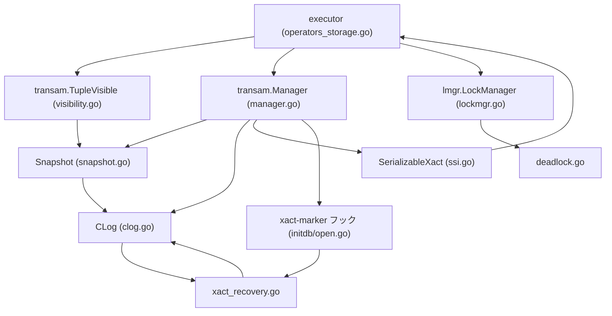
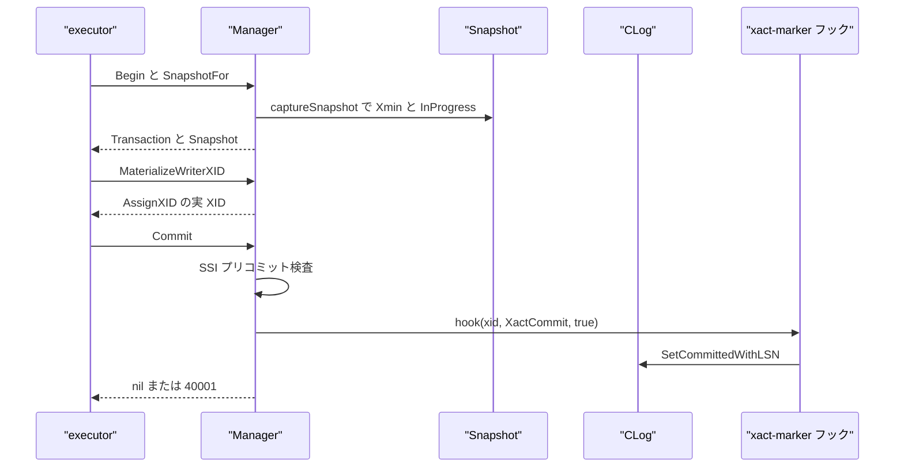

# トランザクションと MVCC

<details>
<summary>関連ソースファイル</summary>

- [`internal/access/transam/manager.go`](https://github.com/ryogrid/goopg/blob/19856410e8d497d59787e1ab35a2febb3f5953d6/internal/access/transam/manager.go)
- [`internal/access/transam/snapshot.go`](https://github.com/ryogrid/goopg/blob/19856410e8d497d59787e1ab35a2febb3f5953d6/internal/access/transam/snapshot.go)
- [`internal/access/transam/visibility.go`](https://github.com/ryogrid/goopg/blob/19856410e8d497d59787e1ab35a2febb3f5953d6/internal/access/transam/visibility.go)
- [`internal/access/transam/clog.go`](https://github.com/ryogrid/goopg/blob/19856410e8d497d59787e1ab35a2febb3f5953d6/internal/access/transam/clog.go)
- [`internal/access/transam/ssi.go`](https://github.com/ryogrid/goopg/blob/19856410e8d497d59787e1ab35a2febb3f5953d6/internal/access/transam/ssi.go)
- [`internal/storage/lmgr/deadlock.go`](https://github.com/ryogrid/goopg/blob/19856410e8d497d59787e1ab35a2febb3f5953d6/internal/storage/lmgr/deadlock.go)
- [`internal/storage/lmgr/lockmgr.go`](https://github.com/ryogrid/goopg/blob/19856410e8d497d59787e1ab35a2febb3f5953d6/internal/storage/lmgr/lockmgr.go)
- [`internal/initdb/open.go`](https://github.com/ryogrid/goopg/blob/19856410e8d497d59787e1ab35a2febb3f5953d6/internal/initdb/open.go)
- [`internal/initdb/xact_recovery.go`](https://github.com/ryogrid/goopg/blob/19856410e8d497d59787e1ab35a2febb3f5953d6/internal/initdb/xact_recovery.go)
- [`internal/utils/errcodes/codes.go`](https://github.com/ryogrid/goopg/blob/19856410e8d497d59787e1ab35a2febb3f5953d6/internal/utils/errcodes/codes.go)

</details>

このセクションは、goopg が「どのトランザクションがどの行のどの版を見てよいか」を決め、複数トランザクションが同じ行や同じリレーションに触れたときに何を待ち、いつ abort するかを扱う。中心にあるのは `internal/access/transam` の `Manager` で、接続ごとの `ProcArray` スロット、XID の遅延採番、文ごとの `Snapshot`、コミット/アボートの終端処理、`OldestXmin`、SSI の台帳を 1 つにまとめている。[7 ストレージ](7-Storage.md) のヒープタプルには `xmin` / `xmax` / ヒントビットが刻まれ、読み取りは `TupleVisible` がスナップショットとヒントビットから可視性を決める。決着しない XID は `pg_xact/` の CLOG を引き、SERIALIZABLE では述語ロックと rw 競合グラフが危険構造を検査する。行やリレーションの待機は `internal/storage/lmgr` のロックマネージャが FIFO キューとタイマーで管理し、サイクルはデッドロックとして被害者を 1 つ abort する。

データの入口は 2 つある。SQL の実行経路（[6 実行エンジン](6-Executor.md)）は `Manager.Begin` / `SnapshotFor` / `MaterializeWriterXID` / `Commit` / `Rollback` を呼び、タプルを読むたびに可視性判定を、書くたびに xmin/xmax の stamp を行う。もう 1 つはトランザクション終了時の xact-marker フックで、`Commit` / `Rollback` が [10 WAL と耐久性](10-WAL.md) の commit/abort レコードと CLOG のレーンを更新する。出口はクライアントへの可視行と、`40001`（直列化失敗）/ `40P01`（デッドロック）のエラー、そしてクラッシュリカバリ時に WAL から再構築される CLOG の状態である。

## コンポーネント

- [9.1 トランザクションマネージャ](9-Transactions/9.1-Transaction-Manager.md) — `Manager` が接続スロットと `ProcArray` を管理し、`Begin` / `AssignXID` / `SnapshotFor` / `finish` でトランザクションのライフサイクルを駆動する。`path:internal/access/transam/manager.go:Manager`
- [9.2 スナップショットと可視性](9-Transactions/9.2-Snapshot-and-Visibility.md) — `Snapshot` の `Xmin` / `Xmax` / `InProgress` / `Aborted` と、`TupleVisible` のヒントビット・cmin/cmax・MultiXact 判定。`path:internal/access/transam/visibility.go:TupleVisible`
- [9.3 CLOG とサブトランザクション](9-Transactions/9.3-CLOG-and-Subtransactions.md) — `pg_xact/` の 2 ビット CLOG と `pg_subtrans/` の親リンク。コミット状態の永続化、切り詰め、WAL からの再構築。`path:internal/access/transam/clog.go:CLog`
- [9.4 マルチックスアクションと行ロック](9-Transactions/9.4-Multixact-and-Row-Locks.md) — `FOR KEY SHARE` 〜 `FOR UPDATE` の 4 値の行ロック、`MultiXactId` による複数保持者、EPQ のチェーン追跡。`path:internal/storage/lmgr/lockmgr.go:LockManager`
- [9.5 直列化可能スナップショット分離](9-Transactions/9.5-SSI.md) — SERIALIZABLE の `SerializableXact`、SIREAD 述語ロック、rw 競合の危険構造検出と COMMIT 時の検査。`path:internal/access/transam/ssi.go:SerializableXact`
- [9.6 デッドロック検出](9-Transactions/9.6-Deadlock-Detection.md) — heavyweight ロックの待機キュー、`deadlock_timeout` のタイマー、hard/soft edge のサイクル解決と被害者の abort。`path:internal/storage/lmgr/deadlock.go:LockManager.deadLockCheck`

## サブシステム図



`Manager` はスナップショットの生成元であり、CLOG への書き込みと SSI 台帳の所有者でもある。executor は `Manager` から `Transaction` と `Snapshot` を受け取り、可視性判定を `TupleVisible` に委ね、行ロックは `lmgr.LockManager` に取る。CLOG は xact-marker フック（`initdb/open.go` が `SetXactMarkerLogger` で設置）から書かれ、クラッシュリカバリでは `internal/initdb/xact_recovery.go` の `replayCLogFromWAL` が WAL の commit/abort レコードから再スタンプする。

## データフロー

1. **接続とトランザクション開始。** 接続は `Manager.AcquireConnSlot` で `ProcArray` のスロットを確保し、文ごとに `Begin` が `inTxn` を立てる。読み取り専用トランザクションは XID を持たない。`path:internal/access/transam/manager.go:Manager.Begin`
2. **スナップショット取得。** `SnapshotFor` が READ COMMITTED では毎文、REPEATABLE READ / SERIALIZABLE では初回だけ `captureSnapshot` を呼ぶ。`captureSnapshot` は `Xmax = XidGen.Peek()` と全スロットの `xid` から `Xmin` / `InProgress` を作り、アボート集合と CLOG ポインタを添える。`path:internal/access/transam/manager.go:Manager.captureSnapshot`
3. **タプルの可視性判定。** スキャンは `TupleVisibleSubxactPtr` を呼び、自トランザクションの書き込み、ヒントビット、`xmin` のスナップショット判定、`xmax` の削除判定、MultiXact 解決を順に行う。不可視なら行を捨て、可視ならスキャン側が `SetXminHintBit` で `HeapXminCommitted` を刻む。`path:internal/access/transam/visibility.go:TupleVisible`
4. **CLOG の参照。** スナップショットで決着しない XID は `Snapshot.SeesCommittedXID` が `OldestClogXid` と `CLog.GetStatus` を引く。`Aborted` だけが「不可視」を確定し、Unknown は「アボートでなければ可視」として扱う。`path:internal/access/transam/clog.go:CLog.GetStatus`
5. **書き込みと XID の実体化。** 最初のヒープ変更で `MaterializeWriterXID` → `AssignXID` が実 XID を採番し、`xmin` / `xmax` に stamp する。サブトランザクションは `AllocateSubXid` で別 XID を取り、親リンクを `SubxactMap` に登録する。`path:internal/access/transam/manager.go:Manager.AssignXID`
6. **コミット。** `finish` が SERIALIZABLE のプリコミット検査を通し、xact-marker フックに `XactCommit` を渡す。フックは WAL に commit レコードを書き、CLOG に `Committed` を刻み、成功後にスロットをクリアして待機者を起こす。`path:internal/access/transam/manager.go:Manager.finish`
7. **ロック待機とデッドロック。** 行ロックは `lmgr.LockManager.Acquire` が FIFO キューに積み、`deadlock_timeout` 後に `runDeadlockCheckFor` がサイクルを調べる。被害者は `ErrDeadlockDetected` で戻り、`40P01` になる。`path:internal/storage/lmgr/deadlock.go:LockManager.runDeadlockCheckFor`
8. **クラッシュリカバリ。** WAL リプレイの後に `replayCLogFromWAL` が commit/abort を再スタンプし、`MarkUnknownAsAborted` が残りの Unknown を Aborted に塗る。`nextXid` は `pg_control` と WAL の両方から引き上げられる。`path:internal/initdb/xact_recovery.go:replayCLogFromWAL`

主要な呼び出し順は次のとおりである。



## 共有データ型

子ページを読む前に知っておくべき「語彙」は 4 つある。`Transaction` はマネージャと executor の間で受け渡されるハンドル、`Snapshot` は文の可視性の窓、`TxnStatus` は CLOG の状態、`IsolationLevel` は分離レベルの選択である。

```go
// Transaction is one open transaction handle.
type Transaction struct {
	// Handle is the manager-internal identity of this transaction,
	// always non-zero for a tx returned by Begin. Used as the
	// active-set key. Survives lazy XID assignment.
	Handle TxnHandle

	// XID is the assigned transaction ID. Zero
	// (storage.InvalidTransactionID) until the first write-path
	// operation calls Manager.AssignXID — this is the M0093 lazy
	// allocation mirroring PostgreSQL's RecordTransactionCommit
	// fast-path for read-only transactions.
	XID storage.TransactionID

	Isolation IsolationLevel
}
```

`path:internal/access/transam/manager.go:Transaction`

`Handle` は `procNum + 1` で必ず非 0、`XID` は書き込みが始まるまで 0 である。読み取り専用トランザクションは `XID=0` のままコミットでき、その場合は WAL も CLOG も触らない。`Isolation` はスロットに保存された値との照合キーでもある。

```go
type Snapshot struct {
	Xmin       storage.TransactionID
	Xmax       storage.TransactionID
	InProgress []storage.TransactionID
	Aborted    []storage.TransactionID

	// PartitionDetachEpoch is the value of the global partition-detach epoch
	// (CurrentPartitionDetachEpoch) at the moment this snapshot was captured.
	// catalog.VisiblePartitionChildren omits a partition child whose
	// DetachPendingEpoch is <= this value, so a snapshot taken before a
	// concurrent DETACH PARTITION CONCURRENTLY still scans the partition while
	// later snapshots do not. Zero for snapshots captured outside the manager
	// (e.g. in unit tests). Design 0118-0058 (M0118-0008).
	PartitionDetachEpoch uint64

	// clog, when non-nil, is the durable commit log consulted as a fallback
	// for in-window XIDs the in-memory InProgress/Aborted arrays cannot
	// classify (gap G4 / M0117-0002). It mirrors PostgreSQL's
	// TransactionIdDidCommit/DidAbort consult after the running-array check in
	// HeapTupleSatisfiesMVCC. nil (the default) preserves the pre-M0117-0002
	// v0 behaviour exactly. Set via WithCLog / Manager.SetCLog.
	clog *CLog
}
```

`path:internal/access/transam/snapshot.go:Snapshot`

`Xmin` 未満は取得前に決着済み、`Xmax` 以上は未来、その間は `InProgress` に載る場合だけ進行中である。`Aborted` は窓の外でも不可視を強制する。`InProgress` / `Aborted` は取得後に変更してはならず、`Clone` はスライスを共有する。`clog` は非公開で、`SetCLog` によって全スナップショットに同じポインタが配られる。

```go
// TxnStatus is the commit-log status for a single transaction ID.
type TxnStatus byte

const (
	// TxnStatusUnknown means no COMMIT or ROLLBACK record was written for this
	// XID. After a crash, any XID with this status is treated as aborted.
	TxnStatusUnknown TxnStatus = 0
	// TxnStatusCommitted records a successful COMMIT.
	TxnStatusCommitted TxnStatus = 1
	// TxnStatusAborted records a ROLLBACK or crash-implied abort.
	TxnStatusAborted TxnStatus = 2
	// TxnStatusSubCommitted records a subtransaction that has committed while its
	// parent (top-level) transaction is still in progress. It is NOT a terminal
	// answer: a reader must resolve it by consulting the parent's status (see
	// DidCommit), mirroring PG's TRANSACTION_STATUS_SUB_COMMITTED
	// (postgres/src/include/access/clog.h:30 and transam.c TransactionIdDidCommit).
	// The raw byte value (3) is chosen to equal the on-disk SLRU 2-bit lane
	// (0x03) so the flat-file and SLRU encodings agree. M0117-0004.
	TxnStatusSubCommitted TxnStatus = 3
)
```

`path:internal/access/transam/clog.go:TxnStatus`

値はそのまま `pg_xact/` の 2 ビットレーンになる。0 は「決着していない」で、クラッシュ後はアボート扱い、1 と 2 は終端状態、3 はサブトランザクションがコミットしたが親が進行中であることを表し、`DidCommit` が親へ再帰して最終状態を決める。

```go
// IsolationLevel is the SQL transaction isolation level used for
// snapshot acquisition.
type IsolationLevel int

const (
	IsolationReadCommitted IsolationLevel = iota
	IsolationRepeatableRead
	// IsolationSerializable marks transactions that must satisfy
	// PostgreSQL SERIALIZABLE semantics. M0104-0001 surfaces the level
	// as a distinct enum value so downstream SSI hooks (M0104-0002+)
	// can branch on it; snapshot acquisition currently matches
	// REPEATABLE READ until the predicate-lock substrate lands.
	IsolationSerializable
)
```

`path:internal/access/transam/snapshot.go:IsolationLevel`

`READ UNCOMMITTED` は `ParseIsolationLevel` で `IsolationReadCommitted` に畳まれる。`IsolationSerializable` はスナップショット取得だけを見れば REPEATABLE READ と同じで、SSI のフックが有効になる点が異なる。

## 主要な設計判断

- **XID は書き込み時に遅延採番する。** `Begin` は XID を取らず、最初の書き込みが `AssignXID` を呼ぶ。読み取り専用トランザクションは WAL も CLOG も書かずに終わる。`path:internal/access/transam/manager.go:Manager.Begin`
- **スナップショットは不変で、複製は浅い。** `captureSnapshot` だけが配列を作り、`insertSortedXID` は copy-on-write、`Clone` は値コピーである。取得後に `InProgress` / `Aborted` を書き換えてはならない。`path:internal/access/transam/snapshot.go:Snapshot.Clone`
- **可視性の第一判定はヒントビット、最終判定はスナップショットと CLOG。** ヒントビットは「コミットしたか」しか覚えないので、「自分のスナップショットより前か」は必ずスナップショットで再確認する。`path:internal/access/transam/visibility.go:TupleVisible`
- **CLOG は WAL の write-behind キャッシュである。** コミットは WAL レコードが正であり、CLOG はページを dirty にするだけで即時 fsync しない。クラッシュ時は `replayCLogFromWAL` が WAL から再構築する。`path:internal/access/transam/clog.go:CLog.setStatusWithLSN`
- **サブ XID は `ProcArray` に載せない。** 可視性は `SubxactMap` の親チェーンと個別アボートで解決する。親がコミットしても、`ROLLBACK TO` されたサブ XID の行は不可視のままである。`path:internal/access/transam/manager.go:Manager.AllocateSubXid`
- **SERIALIZABLE は楽観的に検出し、被害者だけを abort する。** 述語ロックと rw 辺で危険構造を検出し、多くの場合は COMMIT のプリコミット検査で `40001` を返す。コミット済みの相手に対して文の途中で危険構造を閉じた場合だけ、その場で `40001` になる。`path:internal/access/transam/ssi.go:SerializableXact`
- **ロック待機は FIFO で、柔らかいデッドロックは並べ替えで解く。** heavyweight ロックは待機キューを持ち、`deadlock_timeout` 後にサイクルを探す。保持者を待つ hard edge のサイクルだけが被害者を出し、待機者同士の soft edge はキュー再配列で解消する。`path:internal/storage/lmgr/deadlock.go:LockManager.deadLockCheck`
- **エラーコードを 2 つに分ける。** heavyweight ロックのデッドロックは `40P01`、SSI と XID 待機グラフの直列化失敗は `40001` である。クライアントの再試行判断が変わるため、混同してはならない。`path:internal/utils/errcodes/codes.go:TRDeadlockDetected`

Sources:

- internal/access/transam/manager.go
- internal/access/transam/snapshot.go
- internal/access/transam/visibility.go
- internal/access/transam/clog.go
- internal/access/transam/ssi.go
- internal/storage/lmgr/deadlock.go
- internal/storage/lmgr/lockmgr.go
- internal/initdb/open.go
- internal/initdb/xact_recovery.go
- internal/utils/errcodes/codes.go

<sub>Generated by deepwiki-4myself from `goopg` @ `19856410e`</sub>
