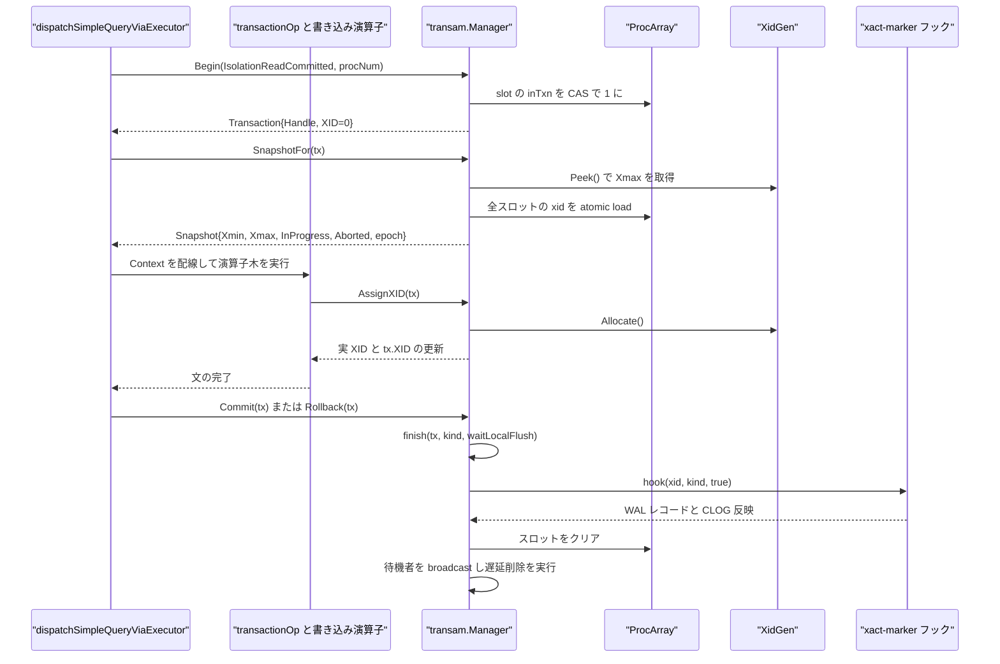
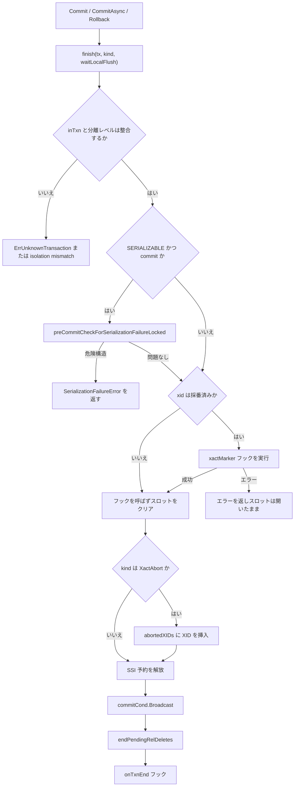

# トランザクションマネージャ

<details>
<summary>関連ソースファイル</summary>

- [`internal/access/transam/manager.go`](https://github.com/ryogrid/goopg/blob/19856410e8d497d59787e1ab35a2febb3f5953d6/internal/access/transam/manager.go)
- [`internal/access/transam/snapshot.go`](https://github.com/ryogrid/goopg/blob/19856410e8d497d59787e1ab35a2febb3f5953d6/internal/access/transam/snapshot.go)
- [`internal/access/transam/procarray.go`](https://github.com/ryogrid/goopg/blob/19856410e8d497d59787e1ab35a2febb3f5953d6/internal/access/transam/procarray.go)
- [`internal/access/transam/xidgen.go`](https://github.com/ryogrid/goopg/blob/19856410e8d497d59787e1ab35a2febb3f5953d6/internal/access/transam/xidgen.go)
- [`internal/access/transam/partition_detach_epoch.go`](https://github.com/ryogrid/goopg/blob/19856410e8d497d59787e1ab35a2febb3f5953d6/internal/access/transam/partition_detach_epoch.go)
- [`internal/access/transam/pending_rel_delete.go`](https://github.com/ryogrid/goopg/blob/19856410e8d497d59787e1ab35a2febb3f5953d6/internal/access/transam/pending_rel_delete.go)
- [`internal/access/transam/predlock.go`](https://github.com/ryogrid/goopg/blob/19856410e8d497d59787e1ab35a2febb3f5953d6/internal/access/transam/predlock.go)
- [`internal/access/transam/control/control.go`](https://github.com/ryogrid/goopg/blob/19856410e8d497d59787e1ab35a2febb3f5953d6/internal/access/transam/control/control.go)
- [`internal/access/transam/control/pgcontrol.go`](https://github.com/ryogrid/goopg/blob/19856410e8d497d59787e1ab35a2febb3f5953d6/internal/access/transam/control/pgcontrol.go)
- [`internal/executor/context.go`](https://github.com/ryogrid/goopg/blob/19856410e8d497d59787e1ab35a2febb3f5953d6/internal/executor/context.go)
- [`internal/executor/operators_tx.go`](https://github.com/ryogrid/goopg/blob/19856410e8d497d59787e1ab35a2febb3f5953d6/internal/executor/operators_tx.go)
- [`internal/executor/session.go`](https://github.com/ryogrid/goopg/blob/19856410e8d497d59787e1ab35a2febb3f5953d6/internal/executor/session.go)
- [`internal/postmaster/dispatch.go`](https://github.com/ryogrid/goopg/blob/19856410e8d497d59787e1ab35a2febb3f5953d6/internal/postmaster/dispatch.go)
- [`internal/postmaster/server.go`](https://github.com/ryogrid/goopg/blob/19856410e8d497d59787e1ab35a2febb3f5953d6/internal/postmaster/server.go)
- [`internal/initdb/open.go`](https://github.com/ryogrid/goopg/blob/19856410e8d497d59787e1ab35a2febb3f5953d6/internal/initdb/open.go)
- [`internal/initdb/xact_recovery.go`](https://github.com/ryogrid/goopg/blob/19856410e8d497d59787e1ab35a2febb3f5953d6/internal/initdb/xact_recovery.go)
- [`internal/access/transam/xlog/checkpointer.go`](https://github.com/ryogrid/goopg/blob/19856410e8d497d59787e1ab35a2febb3f5953d6/internal/access/transam/xlog/checkpointer.go)

</details>

`internal/access/transam` の `Manager` は、goopg のプロセス内で動くすべてのトランザクションの台帳である。各接続は `ProcArray` の 1 スロットを所有し、そのスロットの `xid` / `xmin` / 固定スナップショット / 分離レベルが、他のバックエンドから見た「このトランザクションはまだ進行中か、どこまで見えているか」を決める。`Manager` は XID を遅延採番し（読み取り専用トランザクションは XID を持たない）、文ごとの `Snapshot` をロックフリーに構築し、コミット/アボートの終端処理、待機者の起床、VACUUM 用の `OldestXmin`、SERIALIZABLE の述語ロックと危険構造検査までを 1 つの構造体にまとめている。`control` サブパッケージは同じディレクトリに置かれているが MVCC のホットパスには現れず、`pg_control` の `checkPointCopy.nextXid` や DB 状態、停止/チェックポイント/昇格コマンドを介してトランザクション系の永続状態と接する。可視性判定そのものは [9.2 スナップショットと可視性](9.2-Snapshot-and-Visibility.md)、CLOG とサブトランザクションは [9.3 CLOG とサブトランザクション](9.3-CLOG-and-Subtransactions.md)、行ロックとの連携は [9.4 マルチックスアクションと行ロック](9.4-Multixact-and-Row-Locks.md)、SSI の詳細は [9.5 直列化可能スナップショット分離](9.5-SSI.md)、待機のデッドロック検出側は [9.6 デッドロック検出](9.6-Deadlock-Detection.md) を参照。

## 責務

- 接続スロットの割り当てと解放。`AcquireConnSlot` が低領域 `[1, ConnSlotCount)` を回転カーソルで走査し `connHeld` を CAS する。`ReleaseConnSlot` が接続終了時に返却する。`path:internal/access/transam/manager.go:Manager.AcquireConnSlot`
- トランザクションの開始とスロット初期化。`Begin` が分離レベルを検証し、`inTxn` を立て、`xid=0`・`xmin=^uint64(0)`・`pinnedSnap=false` に初期化する。`path:internal/access/transam/manager.go:Manager.Begin`
- XID の遅延採番。`AssignXID` が初回の書き込み経路で `XidGen.Allocate` を呼び、上限検査のうえスロットと SSI 予約に反映する。読み取り専用トランザクションは XID を持たないまま終了できる。`path:internal/access/transam/manager.go:Manager.AssignXID`
- 文スナップショットの構築。`SnapshotFor` が READ COMMITTED では毎回、REPEATABLE READ / SERIALIZABLE では最初の 1 回だけ `captureSnapshot` を呼び、以降は固定スナップショットを複製して返す。`path:internal/access/transam/manager.go:Manager.SnapshotFor`
- 可視性判定。`Snapshot.SeesCommittedXID` が `Xmin`/`Xmax`/`InProgress`/`Aborted` と CLOG で XID の可視性を決める。`ClassifyXID` はスナップショットに依存しない粗い分類（未知/進行中/コミット/アボート）を返す。`path:internal/access/transam/snapshot.go:Snapshot.SeesCommittedXID`
- トランザクション終端の一元化。`Commit` / `CommitAsync` / `Rollback` はすべて `finish` に集約され、SSI プリコミット検査、xact-marker フック（WAL と CLOG）、スロット解放、アボート記録、待機者への broadcast、遅延リレーション削除、`onTxnEnd` 通知を順に行う。`path:internal/access/transam/manager.go:Manager.finish`
- 待機と起床。`WaitForXID` は特定 XID の終了を、`WaitForSlotsToCommit` / `WaitForPinnedSnapshotsReleased` はスロット集合の終了/スナップショット解放を `commitCond` で待つ。`lockwait.Timeout` が ctx に載っていれば `lock_timeout` として期限を切る。`path:internal/access/transam/manager.go:Manager.WaitForXID`
- VACUUM/プルーニングの地平線。`OldestXmin` が全スロットの `xid` と `xmin` の最小値、および論理レプリケーションスロットが固定する `catalog_xmin` を畳み込む。`OldestXminForProc` は一時リレーション用に単一スロットだけを見る。`path:internal/access/transam/manager.go:Manager.OldestXmin`
- DROP されたリレーションの遅延削除。`AddPendingRelDelete` がトップレベル XID ごとに登録し、コミット時は drop を、アボート時は create を `endPendingRelDeletes` が実行する。`path:internal/access/transam/pending_rel_delete.go:Manager.AddPendingRelDelete`
- SERIALIZABLE の述語ロック管理。`AcquirePredicateLock` がタプル→ページ→リレーションの順に粗粒化し、`finish` の `releaseSerializableLocked` が終了時に解放する。`path:internal/access/transam/predlock.go:Manager.AcquirePredicateLock`
- PREPARE TRANSACTION 用のスロット移設。`DetachToDedicatedSlot` が予約高領域へ状態を丸ごと写し、元スロットを解放する。`path:internal/access/transam/manager.go:Manager.DetachToDedicatedSlot`
- パーティション DETACH の順序付け。`NextPartitionDetachEpoch` が進めるプロセスグローバル epoch を、`captureSnapshot` が全スナップショットに刻む。`path:internal/access/transam/partition_detach_epoch.go:CurrentPartitionDetachEpoch`

## 処理フロー

サーバーの単文実行経路では、`internal/postmaster/dispatch.go` の `dispatchSimpleQueryViaExecutor` が明示トランザクションの有無を見て、無ければ `TxnMgr.Begin(transam.IsolationReadCommitted, procNum)` でその文だけのトランザクションを開く。続いて `TxnMgr.SnapshotFor(tx)` が文スナップショットを取得し、`executor.Context` に `TxnMgr` / `Tx` / `Snap` / `ProcNum` を配線してから演算子木を実行する。書き込み演算子は最初のヒープ変更の直前に `Context.MaterializeWriterXID` を呼び、そこで初めて XID が採番される。文が成功すれば `Commit`、失敗すれば `Rollback` が `finish` に入る。`path:internal/postmaster/dispatch.go:dispatchSimpleQueryViaExecutor` `path:internal/executor/context.go:Context.MaterializeWriterXID`



`finish` の内部は、失敗時にどの状態が残るかまで含めて 1 本の決定木になっている。SSI の危険構造検出や xact-marker フックの失敗ではスロットを**消さずに**エラーを返すため、呼び出し側は同じ `Transaction` で `Rollback` をやり直せる。



明示トランザクションでは経路が 2 つに分かれる。`BEGIN` は `transactionOp.execBegin` が `TxnMgr.Begin` を呼び、READ COMMITTED のときだけその場で `SnapshotFor` まで実行する。REPEATABLE READ / SERIALIZABLE はスナップショットを取らず、最初の実文の dispatch が `SnapshotFor` を呼んだ時点で `firstSnap` が固定される（PostgreSQL の first-statement snapshot 準拠）。`COMMIT` は `transactionOp.execCommit` が遅延 FK/UNIQUE/EXCLUDE 検査、ON COMMIT アクション、SSI プリコミット検査、遅延 DDL の適用をすべて済ませてから `Context.CommitTransaction` を呼ぶ。`Context.CommitTransaction` はセッションの `synchronous_commit` に応じて `Commit` と `CommitAsync` を選び分ける。`path:internal/executor/operators_tx.go:transactionOp.execBegin` `path:internal/executor/operators_tx.go:transactionOp.execCommit` `path:internal/executor/context.go:Context.CommitTransaction`

コミット時の xact-marker フックは `initdb.Open` が `SetXactMarkerLogger` で設置する。フックは `commitStampMu` の読み取りロックの下で、`PendingRelDeletes(xid)` を集めて `EncodeXactCommitPGWithRelsAt` を組み立て、WAL に追記し、`waitLocalFlush=true` ならローカル flush まで待ってから CLOG のレーンを stamp する。`TakeRelcacheInvalPending()` が真なら `EncodeXactCommitPGWithRelsAt(..., true)` と `pg_internal.init` の unlink を行う。`Rollback` 側は逆に `PendingAbortRelDeletes(xid)` を abort レコードに載せる。`path:internal/initdb/open.go:Open` `path:internal/access/transam/manager.go:Manager.SetXactMarkerLogger`

## 主要ファイル

| ファイル | 役割 |
| --- | --- |
| `internal/access/transam/manager.go` | `Manager`、`TxnHandle`、`Transaction`、`Begin`/`AssignXID`/`SnapshotFor`/`Commit`/`Rollback`/`finish`、待機機構、`OldestXmin`、`ClassifyXID`、`captureSnapshot`。`path:internal/access/transam/manager.go:Manager` |
| `internal/access/transam/snapshot.go` | `IsolationLevel` と `ParseIsolationLevel`、`Snapshot` と可視性判定（`SeesCommittedXID` / `SeesCommittedXIDHinted` / `XidIsConcurrent`）。`path:internal/access/transam/snapshot.go:Snapshot` |
| `internal/access/transam/procarray.go` | `procSlot`（64 バイト固定レイアウト）と `ProcArray`、`DefaultProcArraySize` / `ReservedPreparedSlots` / `ConnSlotCount`。`path:internal/access/transam/procarray.go:procSlot` |
| `internal/access/transam/xidgen.go` | `XidGen`。`Allocate` は `next.Add(1)-1`、`SetNext` は単調増加の CAS。`path:internal/access/transam/xidgen.go:XidGen` |
| `internal/access/transam/partition_detach_epoch.go` | プロセスグローバルな `partitionDetachEpoch` と `NextPartitionDetachEpoch` / `CurrentPartitionDetachEpoch`。`path:internal/access/transam/partition_detach_epoch.go:NextPartitionDetachEpoch` |
| `internal/access/transam/pending_rel_delete.go` | `PendingRelDelete` と `pendingRelDeletes`。DROP/CREATE したリレーションの実体削除をコミット/アボートまで遅延する。`path:internal/access/transam/pending_rel_delete.go:PendingRelDelete` |
| `internal/access/transam/predlock.go` | `PredicateLockTag`、`PredicateLockLimits`、`predicateLocksRegistry`、粗粒化と SIREAD の取得/解放。`path:internal/access/transam/predlock.go:PredicateLockTag` |
| `internal/access/transam/control/control.go` | `PIDFile`、`CreateDataDirLockFile`、`Listener`、`Send`。停止/再読み込み/チェックポイント/昇格の制御ソケット。`path:internal/access/transam/control/control.go:Listener` |
| `internal/access/transam/control/pgcontrol.go` | `ControlFileData` と `ReadControlFile` / `UpdateControlFile` / `BuildUpdatedControlImage`。`global/pg_control` の読み書きと CRC32C 検証。`path:internal/access/transam/control/pgcontrol.go:UpdateControlFile` |
| `internal/executor/context.go` | `Context.TxnMgr`/`Tx`/`Snap`/`ProcNum` の保持、`MaterializeWriterXID`、`CommitTransaction` の同期/非同期選択。`path:internal/executor/context.go:Context.MaterializeWriterXID` |
| `internal/executor/operators_tx.go` | `transactionOp` による BEGIN/COMMIT/ROLLBACK/SAVEPOINT/RELEASE/ROLLBACK TO の実行と、`setTransactionOp`。`path:internal/executor/operators_tx.go:transactionOp` |
| `internal/executor/session.go` | `Session` インタフェースと `BasicSession`。`tx`/`snap`/`inTx`/`currentSubXid`/遅延制約台帳を保持する。`path:internal/executor/session.go:BasicSession` |

## 公開 API / エントリポイント

```go
func NewManager() *Manager

func (m *Manager) Begin(iso IsolationLevel, procNums ...int32) (Transaction, error)
func (m *Manager) AssignXID(tx Transaction) (storage.TransactionID, error)
func (m *Manager) AllocateSubXid(parentXid storage.TransactionID) (storage.TransactionID, error)
func (m *Manager) SnapshotFor(tx Transaction) (Snapshot, error)
func (m *Manager) FreshSnapshot() Snapshot
func (m *Manager) Commit(tx Transaction) error
func (m *Manager) CommitAsync(tx Transaction) error
func (m *Manager) Rollback(tx Transaction) error
func (m *Manager) DetachToDedicatedSlot(tx Transaction) (Transaction, error)

func (m *Manager) OldestXmin() storage.TransactionID
func (m *Manager) OldestXminForProc(procNum int32) storage.TransactionID
func (m *Manager) IsXIDActive(xid storage.TransactionID) bool
func (m *Manager) HasAbortedXID(xid storage.TransactionID) bool
func (m *Manager) ClassifyXID(xid storage.TransactionID) XidVisibilityStatus

func (m *Manager) WaitForXID(ctx context.Context, xid storage.TransactionID) error
func (m *Manager) WaitForSlotsToCommit(ctx context.Context, active []int) error
func (m *Manager) WaitForPinnedSnapshotsReleased(ctx context.Context, active []int) error

func (m *Manager) AcquireConnSlot() (int32, error)
func (m *Manager) ReleaseConnSlot(procNum int32)

func (m *Manager) SetCLog(c *CLog)
func (m *Manager) SetXactMarkerLogger(fn func(storage.TransactionID, XactMarker, bool) error)
func (m *Manager) SetOnTxnEnd(fn func(xid storage.TransactionID))
func (m *Manager) SetCatalogXminSource(fn func() uint64)
func (m *Manager) SetPredicateLockLimits(limits PredicateLockLimits)
func (m *Manager) AcquirePredicateLock(handle TxnHandle, tag PredicateLockTag) bool
```

`Begin` は `procNums` を省略すると `[1, ConnSlotCount)` を CAS で走査して空きスロットを自動確保する。本番の接続は `AcquireConnSlot` で接続寿命のスロットを取り、その `procNum` を `Begin` に明示的に渡す。スロット 0 は明示指定用に予約され、自動確保の走査対象から外れている。`path:internal/access/transam/manager.go:Manager.Begin` `path:internal/postmaster/server.go:serveConn`

`Context` 側のトランザクション関連エントリポイントは次の 2 つである。`MaterializeWriterXID` は `c.Tx.XID` が 0 のときだけ `AssignXID` を呼び、返った XID を `c.Tx` と `*BasicSession` の両方に反映する。`CommitTransaction` は `c.AsyncCommit` を見て `CommitAsync` と `Commit` を切り替える。`path:internal/executor/context.go:Context.MaterializeWriterXID` `path:internal/executor/context.go:Context.CommitTransaction`

## 主要データ構造

### `TxnHandle` と `Transaction` — XID と独立した台帳キー

```go
type TxnHandle uint64

// Transaction is one open transaction handle.
type Transaction struct {
	// Handle is the manager-internal identity of this transaction,
	// always non-zero for a tx returned by Begin. Used as the
	// active-set key. Survives lazy XID assignment.
	Handle TxnHandle

	// XID is the assigned transaction ID. Zero
	// (storage.InvalidTransactionID) until the first write-path
	// operation calls Manager.AssignXID — this is the M0093 lazy
	// allocation mirroring PostgreSQL's RecordTransactionCommit
	// fast-path for read-only transactions.
	XID storage.TransactionID

	Isolation IsolationLevel
}
```

`path:internal/access/transam/manager.go:Transaction`（`TxnHandle` は 40 行、`Transaction` は 43 行）

`Handle` は `procNum + 1` で作られるため必ず 1 以上になり、0 は「未設定」を意味する。`Begin` が返した直後の `XID` は `storage.InvalidTransactionID`（0）であり、これは「まだ XID を持たない」であって「無効なトランザクション」ではない。読み取り専用トランザクションはこのまま `Commit` でき、その場合 xact-marker フックも WAL も CLOG も触らない。`Isolation` はスロットに保存された値と突き合わせる照合キーでもあり、`SnapshotFor` と `finish` の両方が不一致をエラーにする。

### `Manager` — 全バックエンド共有の台帳

```go
type Manager struct {
	xidgen    XidGen
	procArray ProcArray

	abortedMu   sync.RWMutex
	abortedXIDs []storage.TransactionID

	// releasedWaiterXIDs holds top-level XIDs whose transaction block is still
	// open in its proc-array slot but whose statement-level abort (a deadlock
	// victim, mirroring PostgreSQL's AbortTransaction) has already released the
	// XID for the purpose of WaitForXID / IsXIDActive. A peer blocked on this
	// XID's catalog-tuple xmax (the intra-grant-inplace pg_class in-place wait)
	// then unblocks at the abort rather than at the victim's later explicit
	// ROLLBACK/COMMIT, while the slot itself stays active so that explicit
	// COMMIT/ROLLBACK still finalises the (write-less) transaction normally —
	// the victim never recorded any heap write to make visible. Snapshot
	// visibility is intentionally NOT consulted against this set (it reads the
	// slot/CLOG as before). Cleared when the slot is finished. Design 0118-0115
	// (intra-grant-inplace perm 8).
	releasedWaiterMu   sync.RWMutex
	releasedWaiterXIDs map[storage.TransactionID]struct{}

	// clog, when non-nil, is the durable commit log attached to every snapshot
	// this Manager captures (M0117-0002). It lets Snapshot.SeesCommittedXID fall
	// back to the persistent CLOG for in-window XIDs the in-memory arrays cannot
	// classify (recovered aborts the rebuilt-empty abortedXIDs list has
	// forgotten). nil (the default) keeps the pure in-memory v0 behaviour;
	// installed by the server/initdb.Open recovery wiring via SetCLog. Read under
	// abortedMu (cheap, already taken in captureSnapshot's neighbourhood).
	clog *CLog

	xactMarkerMu sync.RWMutex
	// The bool parameter is waitLocalFlush: true (every existing caller —
	// Commit/Rollback) requires the hook to durably flush the commit WAL
	// record before returning; false (CommitAsync, synchronous_commit=off)
	// lets the hook return without waiting for that flush, relying on the
	// CLOG async-commit write barrier (M0117-0007) instead. M0117-0007 Part B.
	xactMarker func(storage.TransactionID, XactMarker, bool) error

	// onTxnEnd is called after every transaction commit or abort, once the
	// XID slot has been cleared and commitCond has been broadcast. Use case:
	// cleaning up cross-session registries (e.g. spec insert registry for
	// pg_locks). The callback must be non-blocking and short.
	onTxnEndMu sync.RWMutex
	onTxnEnd   func(xid storage.TransactionID)

	// relcacheInvalPending is set by DDL that writes to nailed catalog
	// relations (pg_class, pg_attribute, pg_proc, pg_type) so the
	// xact-marker hook emits the commit record with the HAS_INVALS chunk
	// (EncodeXactCommitPG(xid, true)) and unlinks both pg_internal.init
	// files at commit time.
	relcacheInvalPending atomic.Bool

	// pendingRelDel holds the relation storage each transaction dropped,
	// removed only once it commits (pending_rel_delete.go).
	pendingRelDel pendingRelDeletes

	// catalogXminSource, when installed, returns the smallest catalog_xmin
	// pinned by any active logical replication slot (0 = nothing pinned).
	// OldestXmin folds it into the global pruning/truncation horizon so the
	// heap-prune, VACUUM and CLOG-truncation paths never reclaim catalog (or,
	// conservatively in v0, any permanent-relation) tuple versions a logical
	// decoder may still need. Installed once during startup wiring
	// (initdb.Open) via SetCatalogXminSource; nil keeps the pure in-memory v0
	// behaviour. Read lock-free via atomic.Pointer on the hot prune path.
	catalogXminSource atomic.Pointer[func() uint64]

	// WaitForXID uses waitMu + commitCond only.
	waitMu     sync.Mutex
	commitCond *sync.Cond

	// autoProcNum is an atomic counter for callers (mostly tests) that do
	// not supply an explicit procNum. Auto-assigned slots are never recycled
	// within a Manager lifetime, so the counter wraps modulo procArray size.
	autoProcNum atomic.Int32

	// connSlotCursor rotates AcquireConnSlot's scan start (see its doc).
	connSlotCursor atomic.Int32

	// Cold path: SSI + predicate locks share ssiMu.
	ssiMu          sync.Mutex
	ssiState       ssiState
	predicateLocks predicateLocksRegistry
	// ssiCond signals when a SERIALIZABLE xact finishes (commit or abort),
	// so a READ ONLY DEFERRABLE xact blocked in waitForSafeSnapshot can re-check
	// whether its safe-snapshot condition is now met. Bound to ssiMu; created
	// lazily under ssiMu (ssiCondLocked) so Managers built as a bare struct
	// literal in tests work without NewManager. M0118-0001.
	ssiCond *sync.Cond

	// subxact tracking (M0050-0002): maps subxact XIDs to their parent
	// XIDs, and records individually-aborted subxact XIDs. Lazily
	// initialised on first use. Protected by subxactMu.
	subxactFields
}
```

`path:internal/access/transam/manager.go:61`

この構造体のフィールドは 3 つのロック群に分かれている。`abortedMu` は「アボート済み XID の集合」と CLOG ポインタを守り、`captureSnapshot` がこのロック下でスライスの先頭を読み取る。`waitMu` と `commitCond` は待機/起床専用で、スロットのクリアとは独立している。`ssiMu` は SSI の `ssiState` と述語ロック registry を守り、ホットパスからは触らない。`xactMarkerMu` と `onTxnEndMu` はフック関数自体の差し替えだけを守り、呼び出しはロックを取ってから関数を取り出し、ロック外で実行する。`relcacheInvalPending` はトランザクション単位ではなく Manager 単位のフラグで、xact-marker フックが `TakeRelcacheInvalPending()` で読み取りつつクリアする。

`releasedWaiterXIDs` は「スロットはまだ `inTxn=1` だが、待機者の目的では終了済みとみなす XID」の集合である。デッドロック被害者の文アボートで `ReleaseXIDWaiters` が登録し、`finish` がスロットを閉じるときに削除する。これにより、被害者が後で明示的に `ROLLBACK` するまで待ち続ける peer を解放しつつ、スナップショット可視性は従来どおりスロットと CLOG だけを見る、という分離が成立している。

### `Snapshot` — 文の可視性の窓

```go
type Snapshot struct {
	Xmin       storage.TransactionID
	Xmax       storage.TransactionID
	InProgress []storage.TransactionID
	Aborted    []storage.TransactionID

	// PartitionDetachEpoch is the value of the global partition-detach epoch
	// (CurrentPartitionDetachEpoch) at the moment this snapshot was captured.
	// catalog.VisiblePartitionChildren omits a partition child whose
	// DetachPendingEpoch is <= this value, so a snapshot taken before a
	// concurrent DETACH PARTITION CONCURRENTLY still scans the partition while
	// later snapshots do not. Zero for snapshots captured outside the manager
	// (e.g. in unit tests). Design 0118-0058 (M0118-0008).
	PartitionDetachEpoch uint64

	// clog, when non-nil, is the durable commit log consulted as a fallback
	// for in-window XIDs the in-memory InProgress/Aborted arrays cannot
	// classify (gap G4 / M0117-0002). It mirrors PostgreSQL's
	// TransactionIdDidCommit/DidAbort consult after the running-array check in
	// HeapTupleSatisfiesMVCC. nil (the default) preserves the pre-M0117-0002
	// v0 behaviour exactly. Set via WithCLog / Manager.SetCLog.
	clog *CLog
}
```

`path:internal/access/transam/snapshot.go:Snapshot`（69 行）

`Xmin` 未満の XID は「スナップショット取得前に決着済み」、`Xmax` 以上の XID は「取得後に始まった（未来）」、その間は `InProgress` に載っている場合だけ進行中とみなす。ただし `Aborted` はこの窓の外側でも効く。`Xmin` より古い XID でもアボート済みなら不可視にするためで、これは in-memory の軽量 CLOG 代替である。`InProgress` は `captureSnapshot` が昇順にソートして構築し、`HasInProgress` / `HasAborted` は長さ 16 以下なら線形走査、超えると `sort.Search` に切り替える。`Clone` は値コピーだけで、`InProgress` / `Aborted` のスライスは共有する。したがって**取得後にこれらの配列を in-place で変更してはならない**というのがスナップショット全体の不変条件であり、`insertSortedXID` が copy-on-write で新しいスライスを返すのはこのためである。`path:internal/access/transam/snapshot.go:Snapshot.Clone` `path:internal/access/transam/manager.go:insertSortedXID`

### `procSlot` と `ProcArray` — 64 バイトに収めた共有状態

```go
type procSlot struct {
	xid          atomic.Uint64 // write-XID; 0 = no active write-xact
	xmin         atomic.Uint64 // lowest Xmin seen; ^uint64(0) = none
	firstSnap    *Snapshot     // RR/SSI pinned snapshot; nil = RC
	snapshotXmin uint32        // running min Xmin for OldestXmin
	isolation    int32         // IsolationLevel stored as int32
	inTxn        atomic.Uint32 // 1 = active txn; 0 = idle
	pinnedSnap   atomic.Bool   // true once an RR/SSI snapshot is pinned for the txn
	connHeld     atomic.Uint32 // 1 = a live CONNECTION owns this slot (spans txns)
	_pad         [20]byte      // explicit pad to 64 B
}

// ProcArray is the shared array of per-backend transaction slots.
type ProcArray struct {
	slots []procSlot
}
```

`path:internal/access/transam/procarray.go:procSlot`（`procSlot` は 39 行、`ProcArray` は 52 行）

`xid` は「書き込み XID」であり、読み取り専用トランザクションでは 0 のままである。`xmin` はそのスロットが取得したスナップショットの最小 `Xmin` を CAS ループ（RR/SSI は初回の `Store`）で切り下げたもので、`^uint64(0)` は「まだスナップショットを取っていない」。`firstSnap` は REPEATABLE READ / SERIALIZABLE の固定スナップショット、`pinnedSnap` はその存在を示す atomic フラグで、DETACH PARTITION CONCURRENTLY の待機条件に使われる。`connHeld` はトランザクションの `inTxn` とは別物で、接続がアイドル状態でもスロットを保持し続けることを表す。この 2 つを分けたことで、接続の入れ替わりが進行中トランザクションのスロットを奪う事故を防いでいる。

## 内部構造

**スロットの空間分割。** `DefaultProcArraySize` は 1024、`ReservedPreparedSlots` は 64、`ConnSlotCount` は 960 である。接続と内部トランザクションは `[0, 960)` だけを使い、`DetachToDedicatedSlot` された prepared transaction は `[960, 1024)` の高領域に隔離される。これにより、接続が procNum を再利用しても prepared transaction のスロットを踏まない。`path:internal/access/transam/procarray.go:ConnSlotCount`

**スナップショット構築のロックフリー性。** `captureSnapshot` は `Xmax = xidgen.Peek()` を取り、全スロットの `xid` を atomic load して `0 < xid < Xmax` のものだけを `InProgress` に集める。1 つも無ければ `Xmin = Xmax` とし、最後に昇順ソートする。`xmin` フィールド（スロット側）はここでは読まず、`OldestXmin` が別途読む。取得中に新しいトランザクションが始まっても、その XID は `Xmax` 以上なので窓の外（未来）に落ち、不整合にはならない。`path:internal/access/transam/manager.go:Manager.captureSnapshot`

**アボート集合の copy-on-write。** `abortedXIDs` は `insertSortedXID` が毎回新しいスライスを作って昇順挿入する。スナップショットは `abortedMu` の読み取りロック下でスライスのヘッダだけを共有するため、アボートが起きても既存スナップショットの見え方は変わらない。再起動後はこの配列が空から再構築されるので、`SetCLog` で取り付けた CLOG が「窓内だが in-memory 配列では分類できない XID」の最終判定を担う。`path:internal/access/transam/manager.go:insertSortedXID`

**可視性判定の順序。** `SeesCommittedXID` は `HasAborted` → `clogSaysNotAborted` → `xid < Xmin` → `xid >= Xmax` → `HasInProgress` の順で判定する。CLOG 参照を `Xmin` ショートカットより**前**に置いているのは、クラッシュリカバリ直後の最初のスナップショットが、CLOG で Aborted と刻まれた XID 群より上に `Xmin` を持つためである。`SeesCommittedXIDHinted` はヒントビット（`HEAP_XMIN_COMMITTED`）が立っているタプル用で、CLOG を引かずに同じ窓判定だけを行う。`path:internal/access/transam/snapshot.go:Snapshot.SeesCommittedXID` `path:internal/access/transam/snapshot.go:Snapshot.SeesCommittedXIDHinted`

**待機と起床。** `WaitForXID` は `xidActiveWithSubxact(xid)` が偽になるまで `commitCond.Wait()` を繰り返す。ctx のキャンセルと `lock_timeout` は別ゴルーチンで `Broadcast` を送って待機を起こす。`xidActiveWithSubxact` はまず `releasedWaiterXIDs` を見て、次にプロセス配列、最後にサブトランザクションの親をたどって「親が進行中かつ子が個別アボートされていない」場合だけ真を返す。`WaitForSlotsToCommit` は呼び出し側が事前に取ったスロット集合を待つ。集合の取得（`SnapshotActiveOtherSlots`）と待機を分離しているのは、2 つの CREATE INDEX CONCURRENTLY が互いを待つ相互待機を避けるためである。`path:internal/access/transam/manager.go:Manager.WaitForXID` `path:internal/access/transam/manager.go:Manager.xidActiveWithSubxact`

**SERIALIZABLE のプリコミット検査と述語ロック。** SERIALIZABLE は `Begin` 時に `registerSerializableLocked` で予約を作り、`AssignXID` で実 XID を刻む。`finish` はコミット時に `preCommitCheckForSerializationFailureLocked` を実行し、危険構造があれば `*SerializationFailureError` を返してスロットを残す。述語ロックは `PredicateLockTag` の sentinel フィールドで粒度を表し（`Rel==0` 無効、`Page==InvalidBlockNumber` リレーション、`Offset==0` ページ、それ以外タプル）、`AcquirePredicateLock` はより粗いロックで覆われるなら追加せず、逆に新しいロックが既存の細かいロックを覆うならそれらを detach する。`DefaultPredicateLockLimits` は `PerXact=64`、`PerRelation=32`、`PerPage=2` で、タプルが 2 個を超えるとページへ、ページが 32 個を超えるとリレーションへ昇格する。`path:internal/access/transam/predlock.go:PredicateLockTag.Granularity` `path:internal/access/transam/predlock.go:DefaultPredicateLockLimits`

**遅延リレーション削除。** `PendingRelDelete` は `Rel`、`Xid`（実行したサブトランザクション）、`AtCommit`（drop なら true、create なら false）、`Drop` 関数を持つ。`endPendingRelDeletes` はトップレベル XID のエントリを map から取り出したうえで、`AtCommit == commit` のものだけ `Drop()` を呼ぶ。コミット時には `subxactTreeAborted(e.Xid)` が真のエントリ（ROLLBACK TO SAVEPOINT で捨てられたサブトランザクションの drop）をスキップする。`path:internal/access/transam/pending_rel_delete.go:PendingRelDelete`

**prepared transaction の移設。** `DetachToDedicatedSlot` は SERIALIZABLE を `ErrUnsupportedDetach` で拒否する（SSI の予約が `Handle` をキーにしており、再キーなしでは移せないため）。それ以外は高領域の空きスロットを CAS で確保し、`xid` → `xmin` → `firstSnap` → `snapshotXmin` → `isolation` → `pinnedSnap` の順に新スロットへ写してから旧スロットをクリアする。この順序により、`OldestXmin` やスナップショット読取が「どのスロットにも存在しない瞬間」を観測しない（一瞬両方に見えるのは無害）。`path:internal/access/transam/manager.go:Manager.DetachToDedicatedSlot`

**制御プレーンとの接点。** `control.CreateDataDirLockFile` は `postmaster.pid` を `O_EXCL` で作り、既存ファイルの PID が自分・親・`PG_GRANDPARENT_PID` 以外で `kill(pid, 0)` が成功するなら `LockFileError` を返す。死んだ PID のファイルは削除して再試行する。`control.Listener` は `PING` / `STOP` / `STOPIMMEDIATE` / `RELOAD` / `CHECKPOINT` / `PROMOTE` の 6 コマンドを 1 行プロトコルで処理し、`CHECKPOINT` と `PROMOTE` では読み取り期限を外して長時間処理を許す。`pgcontrol.UpdateControlFile` は `global/pg_control` を読み、可変フィールドだけをデコード・変更・再エンコードし、先頭 292 バイトの CRC32C を計算し直して 8192 バイトを `O_RDWR` で上書きし `fsync` する。`truncate` しないのは、書き込み途中でクラッシュしても「0 バイトの pg_control」ではなく CRC 不一致という回復可能な状態に留めるためである。`path:internal/access/transam/control/control.go:CreateDataDirLockFile` `path:internal/access/transam/control/pgcontrol.go:UpdateControlFile`

**checkpoint と `nextXid` の往復。** checkpointer は `Config.NextXIDFn`（`initdb.Open` が `func() uint64 { return uint64(txnMgr.NextXID()) }` で配線する）を呼び、`cd.CheckPointCopyNextXid` を単調増加でのみ更新する。起動時は `ReadControlFile` の `CheckPointCopyNextXid` の下位 32 ビットを `SetNextXID` に渡し、さらに WAL の xact レコードと CLOG の最高 XID で押し上げる。`SetNextXID` は小さい値を受け付けないため、これらの経路は順序に依存しない。`path:internal/access/transam/xlog/checkpointer.go:Checkpointer.runCheckpointOpts` `path:internal/initdb/open.go:Open`

## エッジケースと不変条件

- **分離レベルの検証はスロット確保より前。** `Begin` は `IsolationReadCommitted` / `IsolationRepeatableRead` / `IsolationSerializable` 以外を即座に拒否する。自動確保経路でも CAS でスロットを掴んだ後にエラーで放棄する、ということが起きない。`path:internal/access/transam/manager.go:Manager.Begin`
- **スロットの取り違え検出。** `SnapshotFor` と `finish` はどちらも `IsolationLevel(s.isolation) != tx.Isolation` を検査し、`mvcc: transaction isolation mismatch handle=%d` を返す。`Handle` から `procNum` を引く方式なので、別接続のスロットを指した `Transaction` はここで止まる。
- **XID ラップアラウンド。** `XidGen.Allocate` が `^TransactionID(0)` を返したら `ErrXIDWraparound`。`xidStopAge = 3_000_000`、`xidMaxSafe = ^TransactionID(0) - xidStopAge` を超えたら「あと N トランザクションで VACUUM が必要」というエラーになる。`xidWarnAge = 40_000_000` は警告用として宣言されているが、`AssignXID` / `AllocateSubXid` の判定に実際に使われるのは `xidStopAge` と `xidMaxSafe` だけである。`path:internal/access/transam/manager.go:xidMaxSafe`
- **読み取り専用コミットはフックを呼ばない。** `xid == storage.InvalidTransactionID` のとき、`finish` は xact-marker フックもアボート集合への挿入も `endPendingRelDeletes` も `onTxnEnd` もスキップする。WAL レコードも CLOG 書き込みも発生しない。`path:internal/access/transam/manager.go:Manager.finish`
- **フック失敗時はトランザクションが残る。** WAL 追記や CLOG stamp が失敗すると `finish` は `mvcc: xact-marker hook (xid=%d, kind=%v): %w` を返し、スロットのクリアより前で止まる。呼び出し側が再度 `Commit` / `Rollback` を呼べる。`path:internal/access/transam/manager.go:Manager.finish`
- **アボートは Xmin より下でも効く。** `Commit` を経ずに `Rollback` した XID は `abortedXIDs` に残り、将来のスナップショットの `Xmin` がその上に進んでも、その XID が書いた行は不可視のままになる。`ClassifyXID` も `HasAbortedXID` を CLOG より先に評価する。`path:internal/access/transam/manager.go:Manager.HasAbortedXID`
- **`OldestXmin` は idle スロットを無視する。** `inTxn == 0` のスロットを飛ばさないと、初期値の `xmin=0` が VACUUM の地平線を 0 まで引き下げてしまう。`xid` も `xmin` も `^uint64(0)` / 0 の sentinel を除外して比較する。`path:internal/access/transam/manager.go:Manager.OldestXmin`
- **`OldestXminForProc` のフォールバック。** procNum が範囲外、またはスロットが idle のときはグローバル `OldestXmin` を返す。これは「グローバルより小さい値を返さない」という安全側の縮退であり、一時リレーションの削除が他のバックエンドの古いスナップショットを壊さない。`path:internal/access/transam/manager.go:Manager.OldestXminForProc`
- **`WaitForXID` の戻り値。** 正常終了時はループを抜けて `ctx.Err()` を返す。ctx がまだ生きていれば nil であり、待機中にキャンセルされた場合だけ非 nil になる。`lock_timeout` が発火した場合は `lockwait.ErrLockTimeout` を返し、`statement_timeout` によるキャンセルと区別される。`path:internal/access/transam/manager.go:Manager.WaitForXID`
- **デッドロック被害者の「半分だけ終わった」状態。** `ReleaseXIDWaiters` は `releasedWaiterXIDs` に XID を足して broadcast するが、スロットの `xid` も `inTxn` も変更しない。`finish` が実際にスロットを閉じたときにこのマーカーを削除する。スナップショット可視性はこの集合を参照しないため、被害者が書き込みを持たない限り可視性は変わらない。`path:internal/access/transam/manager.go:Manager.ReleaseXIDWaiters`
- **固定スナップショットの早期解放。** トップレベルの文がエラーになった時点で `ReleasePinnedSnapshot` が `pinnedSnap` を false にし、`inTxn` は 1 のまま残す。DETACH PARTITION CONCURRENTLY はこれで「ROLLBACK を待たずに」進める。`path:internal/access/transam/manager.go:Manager.ReleasePinnedSnapshot`
- **同時実行インデックス構築の相互待機回避。** `WaitForOlderSlotsToCommit` は `SnapshotActiveOtherSlots` で待機対象を先に確定してから `WaitForSlotsToCommit` に渡す。待機時点で再スキャンすると、後から始まった別の CONCURRENTLY 構築を互いに待つ可能性がある。`path:internal/access/transam/manager.go:Manager.WaitForOlderSlotsToCommit`
- **接続スロットのカーソルは負にならない。** `AcquireConnSlot` は `uint32(start+off) % uint32(sz-1)` で剰余を取る。int32 のカーソルが 2^31 を超えて負に折り返しても、予約スロット 0 を配ったり負のインデックスで panic したりしない。`path:internal/access/transam/manager.go:Manager.AcquireConnSlot`
- **パーティション DETACH の epoch 0。** `partitionDetachEpoch` は 0 から始まり、0 は「まだ何も DETACH していない」を意味する。`NextPartitionDetachEpoch` は必ず 1 以上を返すため、`DetachPendingEpoch` が 0 の子とスナップショットの 0 が誤って一致することはない。`path:internal/access/transam/partition_detach_epoch.go:partitionDetachEpoch`
- **`pg_control` の書き込み不変条件。** `writeControlFileDurably` は長さがちょうど 8192 でなければ書き込みを拒否し、`O_TRUNC` を使わない。`ReadControlFile` は CRC32C を検証し、不一致ならエラーを返す（呼び出し側がバックアップコピーへフォールバックできる）。`DBState` は 1〜6 の値で、`DBStateInProduction=6` のまま停止したクラスタは「クリーンでない」と判定される。`path:internal/access/transam/control/pgcontrol.go:writeControlFileDurably` `path:internal/access/transam/control/pgcontrol.go:DBStateInProduction`
- **サブトランザクションはプロセス配列に載らない。** `AllocateSubXid` は XID を採番して親を `RegisterSubXid` で登録するだけで、スロットには書かない。したがって `xidInProgress` はサブ XID を「死んでいる」と答えるため、`IsXIDActive` / `WaitForXID` は `TopLevelXid` と `IsAborted` を組み合わせた `xidActiveWithSubxact` を使う必要がある。`path:internal/access/transam/manager.go:Manager.AllocateSubXid`

Sources:

- internal/access/transam/manager.go
- internal/access/transam/snapshot.go
- internal/access/transam/procarray.go
- internal/access/transam/xidgen.go
- internal/access/transam/partition_detach_epoch.go
- internal/access/transam/pending_rel_delete.go
- internal/access/transam/predlock.go
- internal/access/transam/control/control.go
- internal/access/transam/control/pgcontrol.go
- internal/executor/context.go
- internal/executor/operators_tx.go
- internal/executor/session.go
- internal/postmaster/dispatch.go
- internal/postmaster/server.go
- internal/initdb/open.go
- internal/initdb/xact_recovery.go
- internal/access/transam/xlog/checkpointer.go

<sub>Generated by deepwiki-4myself from `goopg` @ `19856410e`</sub>
