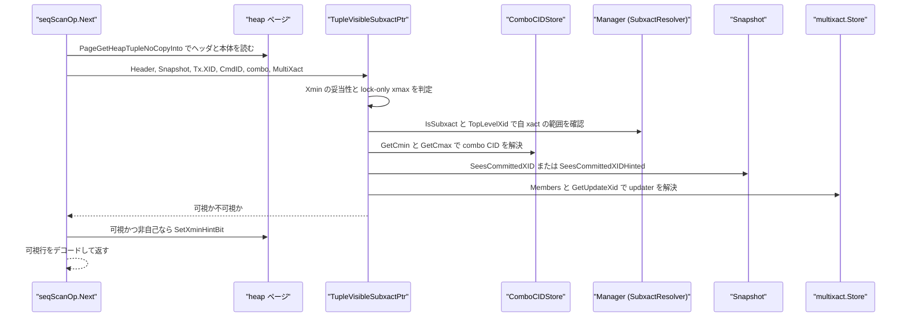
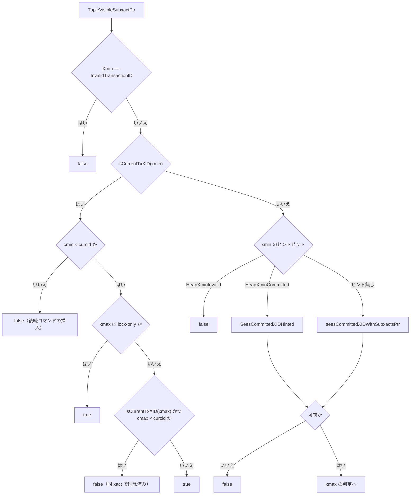
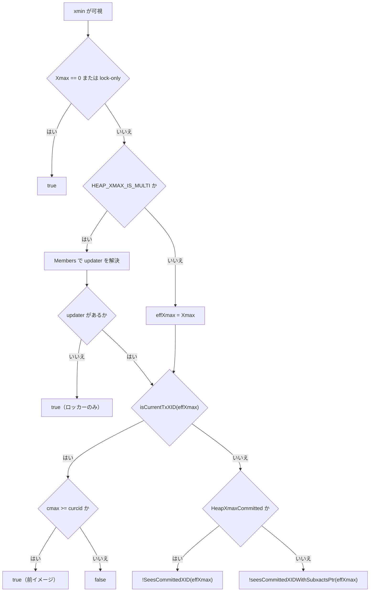

# スナップショットと可視性

<details>
<summary>関連ソースファイル</summary>

- [`internal/access/transam/snapshot.go`](https://github.com/ryogrid/goopg/blob/19856410e8d497d59787e1ab35a2febb3f5953d6/internal/access/transam/snapshot.go)
- [`internal/access/transam/visibility.go`](https://github.com/ryogrid/goopg/blob/19856410e8d497d59787e1ab35a2febb3f5953d6/internal/access/transam/visibility.go)
- [`internal/access/transam/subxact_visibility.go`](https://github.com/ryogrid/goopg/blob/19856410e8d497d59787e1ab35a2febb3f5953d6/internal/access/transam/subxact_visibility.go)
- [`internal/access/transam/subxact.go`](https://github.com/ryogrid/goopg/blob/19856410e8d497d59787e1ab35a2febb3f5953d6/internal/access/transam/subxact.go)
- [`internal/access/transam/combocid.go`](https://github.com/ryogrid/goopg/blob/19856410e8d497d59787e1ab35a2febb3f5953d6/internal/access/transam/combocid.go)
- [`internal/access/transam/manager.go`](https://github.com/ryogrid/goopg/blob/19856410e8d497d59787e1ab35a2febb3f5953d6/internal/access/transam/manager.go)
- [`internal/access/transam/procarray.go`](https://github.com/ryogrid/goopg/blob/19856410e8d497d59787e1ab35a2febb3f5953d6/internal/access/transam/procarray.go)
- [`internal/executor/operators_storage.go`](https://github.com/ryogrid/goopg/blob/19856410e8d497d59787e1ab35a2febb3f5953d6/internal/executor/operators_storage.go)
- [`internal/executor/operators_indexonly.go`](https://github.com/ryogrid/goopg/blob/19856410e8d497d59787e1ab35a2febb3f5953d6/internal/executor/operators_indexonly.go)
- [`internal/storage/heap.go`](https://github.com/ryogrid/goopg/blob/19856410e8d497d59787e1ab35a2febb3f5953d6/internal/storage/heap.go)
- [`internal/storage/command_id.go`](https://github.com/ryogrid/goopg/blob/19856410e8d497d59787e1ab35a2febb3f5953d6/internal/storage/command_id.go)
- [`internal/storage/vm.go`](https://github.com/ryogrid/goopg/blob/19856410e8d497d59787e1ab35a2febb3f5953d6/internal/storage/vm.go)
- [`internal/commands/vacuum/vacuum.go`](https://github.com/ryogrid/goopg/blob/19856410e8d497d59787e1ab35a2febb3f5953d6/internal/commands/vacuum/vacuum.go)

</details>

このページは「あるヒープタプルが、いま実行中の文から見えるか」を決める層を扱う。判定の入力はタプルヘッダの `xmin` / `xmax` / `infomask` と、[9.1 トランザクションマネージャ](9.1-Transaction-Manager.md) で構築された `transam.Snapshot` であり、出力は真偽値 1 つである。goopg は PostgreSQL と同じく、まずタプルに刻まれたヒントビット（`HeapXminCommitted` / `HeapXminInvalid` / `HeapXmaxCommitted` / `HeapXmaxInvalid`）で決着を試み、決着しなければスナップショットの `Xmin` / `Xmax` / `InProgress` / `Aborted` と CLOG を引く。加えて、自トランザクションが同一トランザクション内で挿入・削除したタプルをコマンド ID（`cmin` / `cmax`）で判定する経路、サブトランザクション XID を親 XID に解決する経路、`HEAP_XMAX_IS_MULTI` の xmax を MultiXact メンバーに解決する経路、そして VACUUM が設定する可視性マップ（ALL_VISIBLE / ALL_FROZEN）によるページ単位のショートカットがある。CLOG の永続化とサブトランザクションの詳細は [9.3 CLOG とサブトランザクション](9.3-CLOG-and-Subtransactions.md)、MultiXact のメンバー管理は [9.4 マルチックスアクションと行ロック](9.4-Multixact-and-Row-Locks.md)、SSI の判定は [9.5 直列化可能スナップショット分離](9.5-SSI.md) を参照。

## 責務

- スナップショット単体の可視性判定。`Snapshot.SeesCommittedXID` が「アボート済み → 不可視、CLOG が Aborted → 不可視、`Xmin` 未満 → 可視、`Xmax` 以上 → 不可視、`InProgress` に載る → 不可視、残りは可視」の順で答える。`XidIsConcurrent` は SSI 用に「このスナップショット取得と並行だったか」だけを返す。`path:internal/access/transam/snapshot.go:Snapshot.SeesCommittedXID`
- タプル単位の可視性判定。`TupleVisible` が自トランザクションの書き込み、ヒントビット、`xmin` のスナップショット判定、`xmax` の自己削除判定、ロック専用 xmax、MultiXact 解決を 1 関数にまとめる。`path:internal/access/transam/visibility.go:TupleVisible`
- サブトランザクション対応の可視性判定。`TupleVisibleSubxactPtr` が `SubxactResolver` を受け取り、`xmin` / `xmax` がサブ XID のときに親まで解決してからスナップショットを引く。`path:internal/access/transam/subxact_visibility.go:TupleVisibleSubxactPtr`
- 自トランザクション判定の拡張。`isCurrentTxXID` が「自分自身の XID」「自分のトップレベル祖先」「自分の未アボートの子孫サブ XID」を自己書き込みとして扱う。`path:internal/access/transam/subxact_visibility.go:isCurrentTxXID`
- サブ XID の親子関係とアボート状態の管理。`SubxactMap.Register` / `MarkAborted` / `TopLevelXid` / `IsSubxact` が親リンクと個別アボートを保持し、`EnablePersistence` で親リンクだけを `pg_subtrans` SLRU に書き出す。`path:internal/access/transam/subxact_visibility.go:SubxactMap`
- 同一トランザクション内の cmin/cmax 表現。`ComboCIDStore` が「異なるコマンドで挿入・削除されたタプル」の (cmin, cmax) を 1 個の合成 ID に畳み、`GetCmin` / `GetCmax` が元の値に戻す。`path:internal/access/transam/combocid.go:ComboCIDStore`
- ヒントビットの書き込み。可視と確定したタプルに対して `seqScanOp.Next` が `storage.SetXminHintBit(page, slot, true)` を呼び、`HeapXminCommitted` を on-page infomask に OR する。読み側はこのビットで `SeesCommittedXID` の呼び出しを省く。`path:internal/executor/operators_storage.go:seqScanOp.Next`
- ロック専用 xmax の除外。`storage.IsHeapTupleLockOnly` が `HEAP_XMAX_LOCK_ONLY` を検査し、`TupleVisible` はロック保持者の xmax を「削除なし」として扱う。`path:internal/storage/heap.go:IsHeapTupleLockOnly`
- MultiXact xmax の解決。`HEAP_XMAX_IS_MULTI` が立つ xmax は TransactionID ではなく MultiXactId なので、`multixact.Store.Members` と `GetUpdateXid` で実 updater を取り出す。`path:internal/access/transam/visibility.go:TupleVisible`
- 可視性マップの維持。`VisibilityMap` がページごとに ALL_VISIBLE / ALL_FROZEN の 2 ビットを持ち、`PageAllVisible` / `PageAllFrozen` が VACUUM の判定材料を提供する。`path:internal/storage/vm.go:VisibilityMap`
- ラップアラウンド安全な XID 比較。`storage.XIDPrecedes` が `int32(a-b) < 0` で半円上の前後を判定する。可視性マップと VACUUM の地平線比較はすべてこれを使う。`path:internal/storage/heap.go:XIDPrecedes`

## 処理フロー

通常の逐次スキャンでは、`seqScanOp.Next` がページをピンして `PageGetHeapTupleNoCopyInto` でタプルを読み、`transam.TupleVisibleSubxactPtr(&tuple.Header, &o.ctx.Snap, o.ctx.Tx.XID, o.ctx.TxnMgr, o.ctx.CmdID, o.ctx.comboStore(), o.ctx.MultiXact)` を呼ぶ。第 4 引数の `o.ctx.TxnMgr` は `SubxactResolver` としてそのまま渡り、サブ XID の解決が必要になったときだけ `SubxactMap` を引く。可視なら行をデコードし、自分自身の書き込みでなければ `SetXminHintBit` で `HeapXminCommitted` を刻む。不可視なら SSI の conflict-out を記録して次スロットへ進む。`path:internal/executor/operators_storage.go:seqScanOp.Next`



判定本体は 2 段に分かれている。前半は「作成者（xmin）が見えるか」、後半は「削除者（xmax）が見えないか」である。前半で不可視になれば後半は実行されない。





インデックスオンリースキャンはこの判定を毎回は行わない。`indexOnlyScanOp` はまず `ctx.VM.AllVisible(heapRel, ptr.Block)` を見て、ページが ALL_VISIBLE ならインデックスキーから行を復元し、ヒープを読まない。ALL_VISIBLE でなければヒープをピンして HOT チェーンをたどり、通常の MVCC 判定に落ちる。`path:internal/executor/operators_indexonly.go:indexOnlyScanOp`

VACUUM 側は逆向きに可視性マップを作る。ページを走査して `PageAllVisible(page, horizon)` が真なら `SetAllVisible`、さらに `PageAllFrozen(page, freezeBelow)` が真なら `SetAllFrozen` を呼ぶ。挿入・削除・更新は `PageClearAllVisible` と `VisibilityMap.ClearBlock` の両方でビットを落とす。`path:internal/storage/vm.go:PageAllVisible`

## 主要ファイル

| ファイル | 役割 |
| --- | --- |
| `internal/access/transam/snapshot.go` | `Snapshot` と `SeesCommittedXID` / `SeesCommittedXIDHinted` / `XidIsConcurrent` / `HasInProgress` / `HasAborted`。可視性判定の最終根拠。`path:internal/access/transam/snapshot.go:Snapshot` |
| `internal/access/transam/visibility.go` | `TupleVisible`。ヒントビット、自 xact、lock-only xmax、MultiXact xmax を扱う基本の判定関数。`path:internal/access/transam/visibility.go:TupleVisible` |
| `internal/access/transam/subxact_visibility.go` | `SubxactMap`、`SubxactResolver`、`TupleVisibleSubxactPtr`、`SeesCommittedXIDWithSubxacts`、`isCurrentTxXID`。サブ XID 対応。`path:internal/access/transam/subxact_visibility.go:SubxactMap` |
| `internal/access/transam/subxact.go` | `SubTxnId`、`SubXactStatus`、`SubTransactionState`、`SubxactStack`。セーブポイントのスタックと状態遷移。`path:internal/access/transam/subxact.go:SubTransactionState` |
| `internal/access/transam/combocid.go` | `ComboCIDKey`、`ComboCIDStore`、`GetCmin` / `GetCmax` / `AdjustCmax`。同一 xact 内の cmin/cmax 合成。`path:internal/access/transam/combocid.go:ComboCIDStore` |
| `internal/access/transam/manager.go` | `Manager` が `SubxactResolver` を実装し、`TopLevelXid` / `IsAborted` / `IsSubxact` を提供する。`captureSnapshot` が判定対象の `Snapshot` を作る。`path:internal/access/transam/manager.go:Manager` |
| `internal/access/transam/procarray.go` | `procSlot` の `xid` / `xmin` / `firstSnap` / `pinnedSnap`。スナップショット構築の入力になる共有状態。`path:internal/access/transam/procarray.go:procSlot` |
| `internal/executor/operators_storage.go` | `seqScanOp.Next` が可視性判定を呼び、可視タプルに `HeapXminCommitted` を書き、不可視タプルで SSI conflict-out を記録する。`path:internal/executor/operators_storage.go:seqScanOp.Next` |
| `internal/executor/operators_indexonly.go` | `indexOnlyScanOp` が `ctx.VM.AllVisible` でヒープフェッチを省略する。`path:internal/executor/operators_indexonly.go:indexOnlyScanOp` |
| `internal/storage/heap.go` | `HeapTupleHeader`、`TransactionID`、`XIDPrecedes`、infomask 定数、`IsHeapTupleLockOnly` / `IsHeapTupleXmaxMulti` / `IsHeapComboCID`、`SetXminHintBit`。`path:internal/storage/heap.go:HeapTupleHeader` |
| `internal/storage/command_id.go` | `CommandId`、`FirstCommandId=0`、`InvalidCommandId=^uint32(0)`。cmin/cmax の型と sentinel。`path:internal/storage/command_id.go:CommandId` |
| `internal/storage/vm.go` | `VisibilityMap`、`VMWALHook`、`PageAllVisible` / `PageAllFrozen`、ページビットの set/clear と WAL 記録。`path:internal/storage/vm.go:VisibilityMap` |

## 公開 API / エントリポイント

```go
func TupleVisible(h storage.HeapTupleHeader, snap Snapshot, currentXID storage.TransactionID, curcid storage.CommandId, combo *ComboCIDStore, mxs *multixact.Store) bool
func TupleVisibleSubxact(h storage.HeapTupleHeader, snap Snapshot, currentXID storage.TransactionID, r SubxactResolver, curcid storage.CommandId, combo *ComboCIDStore, mxs *multixact.Store) bool
func TupleVisibleSubxactPtr(h *storage.HeapTupleHeader, snap *Snapshot, currentXID storage.TransactionID, r SubxactResolver, curcid storage.CommandId, combo *ComboCIDStore, mxs *multixact.Store) bool
func SeesCommittedXIDWithSubxacts(snap Snapshot, xid storage.TransactionID, r SubxactResolver) bool
func IsSelfXID(xid, currentXID storage.TransactionID, r SubxactResolver) bool

func (s *Snapshot) HasInProgress(xid storage.TransactionID) bool
func (s *Snapshot) HasAborted(xid storage.TransactionID) bool
func (s *Snapshot) XidIsConcurrent(xid storage.TransactionID) bool
func (s *Snapshot) SeesCommittedXID(xid storage.TransactionID) bool
func (s *Snapshot) SeesCommittedXIDHinted(xid storage.TransactionID) bool

func GetCmin(h storage.HeapTupleHeader, cs *ComboCIDStore) storage.CommandId
func GetCmax(h storage.HeapTupleHeader, cs *ComboCIDStore) storage.CommandId
func AdjustCmax(h *storage.HeapTupleHeader, deletingCID storage.CommandId, cs *ComboCIDStore)
func (cs *ComboCIDStore) GetComboCommandId(cmin, cmax storage.CommandId) storage.CommandId
func (cs *ComboCIDStore) GetRealCmin(comboCID storage.CommandId) storage.CommandId
func (cs *ComboCIDStore) GetRealCmax(comboCID storage.CommandId) storage.CommandId
func (cs *ComboCIDStore) Reset()

func (m *SubxactMap) Register(subxid, parentXid storage.TransactionID)
func (m *SubxactMap) MarkAborted(subxid storage.TransactionID)
func (m *SubxactMap) IsAborted(subxid storage.TransactionID) bool
func (m *SubxactMap) IsSubxact(xid storage.TransactionID) bool
func (m *SubxactMap) Parent(subxid storage.TransactionID) storage.TransactionID
func (m *SubxactMap) TopLevelXid(xid storage.TransactionID) storage.TransactionID
func (m *SubxactMap) Truncate(oldestXact storage.TransactionID) error

func (v *VisibilityMap) AllVisible(rel RelFileNode, blk BlockNumber) bool
func (v *VisibilityMap) AllFrozen(rel RelFileNode, blk BlockNumber) bool
func (v *VisibilityMap) SetAllVisible(rel RelFileNode, blk BlockNumber)
func (v *VisibilityMap) SetAllFrozen(rel RelFileNode, blk BlockNumber)
func (v *VisibilityMap) ClearBlock(rel RelFileNode, blk BlockNumber)
func (v *VisibilityMap) ClearBlockNoWAL(rel RelFileNode, blk BlockNumber)
func (v *VisibilityMap) ClearAllFrozen(rel RelFileNode, blk BlockNumber)
func PageAllVisible(p Page, horizon TransactionID) bool
func PageAllFrozen(p Page, freezeBelow TransactionID) bool
```

`TupleVisible` と `TupleVisibleSubxactPtr` は同じ判定規則を共有する。呼び出し側が `SubxactResolver` を持たない（VACUUM、単体実行）なら `TupleVisible` を、サーバーのスキャン経路なら `TupleVisibleSubxactPtr` を選ぶ。`SeesCommittedXIDWithSubxacts` は `r == nil` のとき `snap.SeesCommittedXID` にそのまま委譲するため、リゾルバ無しでも動く。`path:internal/access/transam/subxact_visibility.go:seesCommittedXIDWithSubxactsPtr`

## 主要データ構造

### `Snapshot` — 可視性の窓

```go
type Snapshot struct {
	Xmin       storage.TransactionID
	Xmax       storage.TransactionID
	InProgress []storage.TransactionID
	Aborted    []storage.TransactionID

	// PartitionDetachEpoch is the value of the global partition-detach epoch
	// (CurrentPartitionDetachEpoch) at the moment this snapshot was captured.
	// catalog.VisiblePartitionChildren omits a partition child whose
	// DetachPendingEpoch is <= this value, so a snapshot taken before a
	// concurrent DETACH PARTITION CONCURRENTLY still scans the partition while
	// later snapshots do not. Zero for snapshots captured outside the manager
	// (e.g. in unit tests). Design 0118-0058 (M0118-0008).
	PartitionDetachEpoch uint64

	// clog, when non-nil, is the durable commit log consulted as a fallback
	// for in-window XIDs the in-memory InProgress/Aborted arrays cannot
	// classify (gap G4 / M0117-0002). It mirrors PostgreSQL's
	// TransactionIdDidCommit/DidAbort consult after the running-array check in
	// HeapTupleSatisfiesMVCC. nil (the default) preserves the pre-M0117-0002
	// v0 behaviour exactly. Set via WithCLog / Manager.SetCLog.
	clog *CLog
}
```

`path:internal/access/transam/snapshot.go:Snapshot`

`Xmin` は「これ未満は取得前に決着済み」、`Xmax` は「これ以上は取得後に始まった」を表す。`InProgress` は `Xmin <= xid < Xmax` の範囲で進行中だった XID の昇順リスト、`Aborted` は窓の外でも不可視にすべきアボート済み XID の昇順リストである。`PartitionDetachEpoch` は可視性とは別のカタログ順序付けに使うが、スナップショットの同一性の一部として一緒に複製される。`clog` は非公開フィールドで、`WithCLog` または `Manager.SetCLog` でのみ設定される。不変条件は「取得後に `InProgress` / `Aborted` を in-place で変更しない」ことで、`Clone` がスライスを共有できるのはこのためである。`path:internal/access/transam/snapshot.go:Snapshot.Clone`

### `ComboCIDKey` と `ComboCIDStore` — 1 フィールドに 2 つのコマンド ID

```go
type ComboCIDKey struct {
	Cmin storage.CommandId
	Cmax storage.CommandId
}

// ComboCIDStore maps (cmin, cmax) pairs to synthetic combo CID numbers and
// back, mirroring PostgreSQL's comboCids hash table and array
// (postgres/src/backend/utils/time/combocid.c). It is owned by the
// transaction (or per-backend) and cleared at transaction end.
//
// When a tuple is both inserted and deleted within the same transaction at
// DIFFERENT command ids, the 4-byte t_field3 union can only hold one
// CommandId, but the tuple must record BOTH the inserting cmin and the
// deleting cmax. PG maps the pair to a surrogate "combo CID" number and
// sets HEAP_COMBOCID in infomask. Later, GetCmin/GetCmax resolve the combo
// CID back to the real cmin or cmax.
//
// The store is nil-safe: all methods on a nil store return sensible
// defaults (GetCmin/GetCmax return the raw t_cid as a plain command id).
type ComboCIDStore struct {
	hash  map[ComboCIDKey]storage.CommandId // (cmin, cmax) → combo CID
	array []ComboCIDKey                     // indexed by combo CID → (cmin, cmax)
}
```

`path:internal/access/transam/combocid.go:ComboCIDStore`

`hash` は (cmin, cmax) から合成 ID への写像、`array` は合成 ID から元ペアへの逆引きである。`GetComboCommandId` は `len(array)+1` を新しい ID として採番するので、**合成 ID 0 は予約**され、配列は 1 始まりで引かれる。`GetRealCmin` / `GetRealCmax` は nil ストア、ID 0、範囲外 ID のいずれでも引数をそのまま返すため、`HEAP_COMBOCID` が立っていないタプルや VACUUM 経路でも安全に呼べる。`Reset` はトランザクション終了時に `hash` と `array` を nil に戻す。`path:internal/access/transam/combocid.go:ComboCIDStore.GetComboCommandId`

### `HeapTupleHeader` — 判定対象の実体

```go
// HeapTupleHeader is the fixed tuple header subset used in milestone 5.
// It carries xmin/xmax visibility metadata and ctid linkage.
type HeapTupleHeader struct {
	Xmin      TransactionID
	Xmax      TransactionID
	Xvac      TransactionID
	CTID      ItemPointer
	Infomask  uint16
	Infomask2 uint16
	Hoff      uint8
}
```

`path:internal/storage/heap.go:HeapTupleHeader`

`Xmin` は作成者、`Xmax` は削除者（またはロック保持者、または MultiXactId）である。`Xvac` は PostgreSQL の `t_field3` ユニオンに相当し、`HEAP_COMBOCID` が立っていなければ cmin と cmax の共有値、立っていれば `ComboCIDStore` の合成 ID が入る。`Infomask` はヒントビット・ロック種別・`HeapComboCID` を、`Infomask2` は属性数と HOT フラグを持つ。`CTID` は HOT チェーンの次バージョンやパーティション移動 sentinel を指す。可視性判定が読むのは `Xmin` / `Xmax` / `Xvac` / `Infomask` の 4 つで、`CTID` は HOT チェーン追跡側が使う。

### `SubTransactionState` — セーブポイント 1 段分

```go
type SubTransactionState struct {
	// Id is a monotonic counter scoped to the top-level transaction.
	// It resets to 1 for the first savepoint of each transaction.
	// The lock manager uses this to identify the lock owner.
	Id SubTxnId

	// Name is the SAVEPOINT name, or "" for an implicit subtransaction.
	Name string

	// SubXid is the XID assigned to this subtransaction, or 0 when no
	// write has been performed yet (lazy allocation — mirrors upstream's
	// AssignTransactionId behaviour). The SubXid is allocated by the
	// surrounding Manager when the first heap mutation occurs inside the
	// subtransaction.
	SubXid storage.TransactionID

	// Snap is the snapshot captured at SAVEPOINT push time. On
	// ROLLBACK TO this snapshot is restored as the effective snapshot
	// for the fresh re-pushed entry so that reads after the rollback
	// are consistent with the savepoint's visibility.
	Snap *Snapshot

	// Status transitions: active → committed (RELEASE) or aborted
	// (ROLLBACK TO or top-level abort).
	Status SubXactStatus

	// Parent points to the enclosing SubTransactionState, or nil when
	// this entry is a direct child of the top-level transaction.
	Parent *SubTransactionState
}
```

`path:internal/access/transam/subxact.go:SubTransactionState`

`Id` はトップレベルトランザクション内で単調増加し、ロックマネージャの所有者識別子になる。`SubXid` は遅延採番なので、セーブポイントを切っただけでは 0 のままである。`Snap` は `Push` 時に値コピーされてポインタで保持され、`ROLLBACK TO` の後に積み直される新しいエントリの初期スナップショットになる。`Status` は `SubXactActive` → `SubXactCommitted`（RELEASE）または `SubXactAborted`（ROLLBACK TO / トップレベルアボート）の一方向遷移だけを許す。`Parent` は外側のセーブポイントを指し、トップレベル直下なら nil である。

### `SubxactMap` — サブ XID から親への写像

```go
type SubxactMap struct {
	mu      sync.RWMutex
	parents map[storage.TransactionID]storage.TransactionID // subxid → parent xid
	aborted map[storage.TransactionID]bool                  // aborted subxids

	// nParents mirrors len(parents) so IsSubxact can answer the overwhelmingly
	// common "no subtransactions at all" case without taking mu.
	//
	// IsSubxact is called ONCE PER TUPLE on the visibility path
	// (TupleVisibleSubxact -> isCurrentTxXID). Under a 4-worker parallel scan
	// that RLock/RUnlock pair was 50 % of all atomic RMW traffic and ~5 % of
	// total CPU on TPC-H Q14, to probe a map that an OLAP query never populates.
	// (docs/design/not_ralph/perf-optimize-take6/README.md candidate B.)
	//
	// Kept in step with parents under mu; read without it. A zero count means
	// the map is empty, so the guarded lookup could only have returned false.
	nParents atomic.Int64

	// slru, when non-nil, is the persistent pg_subtrans mirror that parent
	// links are written through to. nil = persistence disabled (default).
	slru *SubtransSLRU
}
```

`path:internal/access/transam/subxact_visibility.go:SubxactMap`

`parents` はサブ XID → 親 XID の写像で、`TopLevelXid` が最大 64 ホップまでたどる（循環防御）。`aborted` は個別に `ROLLBACK TO` されたサブ XID の集合で、親がコミットしてもそのサブ XID が書いた行を不可視に保つ。`nParents` は `len(parents)` のミラーで、サブトランザクションを一切使わない OLAP ワークロードで `IsSubxact` のたびに RWMutex を取らないための高速パスである。`slru` は親リンクだけを永続化する。アボート状態は永続化されず、CLOG と in-memory が正である。`path:internal/access/transam/subxact_visibility.go:SubxactMap.TopLevelXid`

### `SubxactResolver` — 可視性判定が要求する最小インタフェース

```go
type SubxactResolver interface {
	// TopLevelXid walks the parent chain from xid to its top-level ancestor.
	TopLevelXid(xid storage.TransactionID) storage.TransactionID
	// IsAborted reports whether xid was individually rolled back.
	IsAborted(xid storage.TransactionID) bool
	// IsSubxact reports whether xid is a subtransaction XID.
	IsSubxact(xid storage.TransactionID) bool
}
```

`path:internal/access/transam/subxact_visibility.go:SubxactResolver`

`Manager` はこのインタフェースを満たす。`TupleVisibleSubxactPtr` は毎タプル `IsSubxact` を呼ぶため、`Manager` 側は `attachedSubxactMap()` の atomic load 1 回で永続マップの有無を判定し、マップが空なら `nParents==0` で即座に false を返す。この 2 段の高速化が、サブトランザクションを使わないクエリの可視性コストをほぼゼロにしている。

### `VisibilityMap` — ページ単位の可視性キャッシュ

```go
type VisibilityMap struct {
	mu    sync.RWMutex
	pages map[vmKey][]uint8 // indexed by BlockNumber; bitmask of VM* flags
	// dropped holds relations DropRelation forgot since the last
	// VMSaveForks; the save removes their fork files (a TRUNCATE keeps the
	// relfilenode, so a fork left on disk would hand the new rows the old
	// bits on the next start). M0146-0063.
	dropped map[vmKey]bool
	// walHook, when set, WAL-logs every change of the map (M0146-0063): PG's
	// visibilitymap_set / visibilitymap_clear are WAL-logged, which is what
	// makes the map trustworthy after a crash. Called under mu, so the WAL
	// order of changes to one block matches the order they were applied.
	walHook VMWALHook
}
```

`path:internal/storage/vm.go:VisibilityMap`

`pages` は `(DBOid, RelOid)` ごとにブロック番号で引く `uint8` のビットマスクで、`VMAllVisible=0x01` と `VMAllFrozen=0x02` を持つ。`AllVisible` / `AllFrozen` は nil レシーバや未知ブロックに対して false を返す。`SetAllFrozen` は ALL_VISIBLE も同時に立てるため、**ALL_FROZEN は ALL_VISIBLE を含意する**。`dropped` は DROP されたリレーションの fork を次の保存で消すための待ち行列、`walHook` は変更を WAL に記録する関数で、`mu` の下で呼ばれるため 1 ブロックへの変更順と WAL の順序が一致する。`path:internal/storage/vm.go:VisibilityMap.SetAllFrozen`

## 内部構造

**2 段階の判定。** ヒントビットは「その XID がコミットしたか」をキャッシュするが、「自分のスナップショットより前にコミットしたか」は表現しない。したがって `TupleVisible` は `HeapXminCommitted` が立っていても `SeesCommittedXIDHinted` で窓を再確認し、`HeapXmaxCommitted` が立っていても `!snap.SeesCommittedXID(effXmax)` を返す。ヒントビットだけで可視と決めると、xmin が進行中だった時点で取得した RR/SSI スナップショットが、後からコミットした行を見てしまう。`path:internal/access/transam/visibility.go:TupleVisible`

**CLOG を `Xmin` ショートカットより先に引く理由。** `SeesCommittedXID` は `HasAborted` の次に `clogSaysNotAborted` を呼び、その後に `xid < Xmin` を判定する。クラッシュリカバリでは、被災時に進行中だった XID が `MarkUnknownAsAborted` で Aborted に刻まれ、その後 `NextXID` がそれらより上へ進む。この順序なら、再起動後最初のスナップショットの `Xmin` がアボート済み範囲より上でも、CLOG が Aborted と言う限り不可視にできる。`path:internal/access/transam/snapshot.go:Snapshot.SeesCommittedXID`

**自トランザクションの 2 方向解決。** `isCurrentTxXID` は「`xid == currentXID`」に加えて、`currentXID` がサブ XID のときに `xid == TopLevelXid(currentXID)` を真とする（先祖方向）。さらに `xid` が未アボートのサブ XID で、そのトップレベルが `currentXID` または `currentXID` のトップレベルと一致する場合も真とする（子孫方向）。これがないと、セーブポイント内で書いたタプルが自分のスキャンから見えなくなる。逆に個別アボート済みのサブ XID は除外され、通常の可視性判定に落ちて不可視になる。`path:internal/access/transam/subxact_visibility.go:isCurrentTxXID`

**コマンド ID の比較。** 自トランザクションが挿入したタプルは `cmin >= curcid` なら不可視、`cmin < curcid` なら可視である。自トランザクションが削除した場合は `cmax >= curcid` なら前イメージが可視、`cmax < curcid` なら不可視になる。`curcid` に `InvalidCommandId`（`^uint32(0)`）を渡す VACUUM や単体実行では、実コマンド ID に対する `cmin >= curcid` が成立しないため、自己挿入タプルは常に可視側に倒れる。`path:internal/storage/command_id.go:InvalidCommandId`

**コンボ CID の不変条件。** 同一トランザクションで「コマンド 1 で挿入、コマンド 2 で削除」したタプルは cmin と cmax が異なるが、`t_field3` は 4 バイトしかない。`AdjustCmax` はこのとき `(cmin, deletingCID)` を `GetComboCommandId` に登録し、`HEAP_COMBOCID` を立てて合成 ID を書き込む。既にコンボ ID が立っているタプルを再度削除する場合は、`GetRealCmin` で元の cmin を取り出してから新しいペアを登録し直す。cmin と削除コマンドが一致する場合はコンボを解除して素の値を書く。`path:internal/access/transam/combocid.go:AdjustCmax`

**MultiXact xmax の解決方向。** `HEAP_XMAX_IS_MULTI` かつ LOCK_ONLY でない xmax は、共有ロックの下で更新された行を表す。`TupleVisible` は `mxs.Members` でメンバーを引き、`multixact.GetUpdateXid` で updater を 1 つ取り出す。updater が無ければ「ロッカーだけ」なので可視、ストアが nil またはメンバーが見つからなければ**不可視**にする。後者は「コミット済みの後継バージョンがあるかもしれない版を露出しない」という安全側の選択であり、再起動後にメンバー集合が失われた場合にも同じ経路に落ちる。`path:internal/access/transam/visibility.go:TupleVisible`

**可視性マップと PD_ALL_VISIBLE の二重管理。** `VisibilityMap` はリレーション単位のビットマップだが、各ヒープページ自身も `PD_ALL_VISIBLE` フラグを持つ。`PageAddHeapTuple` と `PageSetHeapTupleXmax` はページ側のフラグを落とし、行ロックを刻む `PageSetHeapTupleLockOnly` は落とさない。VACUUM はページ内容から `PageAllVisible` / `PageAllFrozen` を計算し、真なら `VisibilityMap.SetAllVisible` / `SetAllFrozen` を呼ぶ。挿入・削除・更新の経路は `ClearBlock`（WAL 記録あり）または `ClearBlockNoWAL`（ヒープ変更レコードが既に cleared を運ぶ場合）でビットを落とす。`path:internal/storage/heap.go:PageSetHeapTupleXmax`

**XID の環状比較。** 可視性マップの `PageAllVisible` は `t.Header.Xmin` と `horizon` を `XIDPrecedes` で比較する。素の `<` だと、ラップアラウンド後の新しい XID が古い XID より数値的に小さくなり、すべてのページが「all-visible でない」と誤判定され続ける。`XIDPrecedes` は `int32(a-b) < 0` で 2^31 未満の距離にある 2 つの XID を正しく順序付ける。`path:internal/storage/heap.go:XIDPrecedes`

## エッジケースと不変条件

- **`Xmin == InvalidTransactionID` は常に不可視。** 作成者が 0 のタプルは「作成者なし」であり、`TupleVisible` も `TupleVisibleSubxactPtr` も最初に false を返す。`path:internal/access/transam/visibility.go:TupleVisible`
- **凍結 XID はスナップショットを引かない。** `FrozenTransactionID=2` のタプルは `FirstNormalTransactionID=3` より小さく、どのスナップショットの `Xmin` よりも前にあるため、`SeesCommittedXID` を通さず可視になる。これは VACUUM FREEZE 後のタプルが永久に可視であることの根拠である。`path:internal/storage/heap.go:FrozenTransactionID`
- **`HeapXminInvalid` は即不可視。** アボート済み・無効と分かっている xmin のタプルは、スナップショットを引くまでもなく不可視である。`path:internal/access/transam/visibility.go:TupleVisible`
- **ヒントビットはスナップショットの代わりにならない。** `HeapXmaxCommitted` が立っていても、そのコミットがスナップショット取得より後なら行はまだ可視でなければならない。`TupleVisible` は `!snap.SeesCommittedXID(effXmax)` を返し、`TupleVisibleSubxactPtr` も同じ規則を守る。`path:internal/access/transam/subxact_visibility.go:TupleVisibleSubxactPtr`
- **ロック専用 xmax は削除ではない。** `HEAP_XMAX_LOCK_ONLY` が立つ xmax は、保持者がコミット・アボート・進行中のいずれでも可視性に影響しない。`SELECT FOR UPDATE` した行が、ロックした本人の再スキャンからも他者の読み取りからも消えないための不変条件である。行ロックの取得と待機は [9.4 マルチックスアクションと行ロック](9.4-Multixact-and-Row-Locks.md)、待機時のデッドロック検出は [9.6 デッドロック検出](9.6-Deadlock-Detection.md) を参照。`path:internal/access/transam/visibility.go:TupleVisible`
- **解決不能な MultiXact は不可視。** `mxs == nil` または `Members` が見つからない場合は false を返す。MultiXactId を生の TransactionID として比較すると、存在しない削除者をでっち上げることになるため、隠す方を選ぶ。`path:internal/access/transam/visibility.go:TupleVisible`
- **ロッカーだけの MultiXact は可視。** `GetUpdateXid` が updater なしを返した場合は、その MultiXact は行ロックの集合にすぎないので可視とする。`path:internal/access/transam/visibility.go:TupleVisible`
- **個別アボートされたサブ XID の行は親コミット後も不可視。** `SeesCommittedXIDWithSubxacts` は `IsSubxact` が真なら最初に `IsAborted` を見て false を返す。`ROLLBACK TO SAVEPOINT` で捨てられた INSERT/UPDATE の後継バージョンが、外側の COMMIT で復活しないための規則である。`path:internal/access/transam/subxact_visibility.go:SeesCommittedXIDWithSubxacts`
- **サブ XID の解決は 64 ホップで打ち切る。** `SubxactMap.TopLevelXid` も `Manager.TopLevelXid` もループ上限 64 を持ち、循環した壊れた親リンクでも無限ループしない。`path:internal/access/transam/subxact_visibility.go:SubxactMap.TopLevelXid`
- **`SubxactMap` の空判定はロックを取らない。** `nParents` が 0 なら `IsSubxact` は即 false を返す。可視性ホットパスで毎タプル RWMutex を取らないための最適化であり、`Register` / `Truncate` / `RestoreFromSLRU` が `parents` を更新するたびにミラーを更新する。`path:internal/access/transam/subxact_visibility.go:SubxactMap.IsSubxact`
- **永続化されるのは親リンクだけ。** `SubxactMap.MarkAborted` は in-memory の `aborted` にしか書かず、`pg_subtrans` SLRU には書かない。PostgreSQL の `pg_subtrans` が親 TransactionId だけを保持するのと同じ設計で、アボート状態は CLOG と in-memory が正となる。`path:internal/access/transam/subxact_visibility.go:SubxactMap.MarkAborted`
- **可視性マップの nil は「不明」ではなく「未設定」。** `VisibilityMap.AllVisible` / `AllFrozen` は nil レシーバで false を返す。インデックスオンリースキャンはこれを受けてヒープフェッチへフォールバックするため、マップを配線し忘れても結果は遅くなるだけで誤らない。`path:internal/storage/vm.go:VisibilityMap.AllVisible`
- **ALL_FROZEN は ALL_VISIBLE を含む。** `SetAllFrozen` は `VMAllVisible|VMAllFrozen` を同時に立て、`ClearAllFrozen` は ALL_VISIBLE を残したまま ALL_FROZEN だけを落とす。行ロックは ALL_FROZEN だけを落とす（ページは依然すべてのスナップショットに可視だが、ロック保持者の xmax を VACUUM が凍結する必要があるため）。`path:internal/storage/vm.go:VisibilityMap.ClearAllFrozen`
- **`PageAllVisible` は失敗時に false。** 地平線が `InvalidTransactionID`、line pointer の解析失敗、タプル長の破損、`Xmin` が 0、`Xmax` がロック専用でない、のいずれでも false を返す。「all-visible と言い切れないページは all-visible にしない」という保守側の契約である。`path:internal/storage/vm.go:PageAllVisible`
- **DROP されたリレーションのビットは残さない。** `DropRelation` は `pages` からエントリを消し、`dropped` に記録し、`VMWALDropRelation` を WAL に流す。OID が再利用されたときに古い可視性ビットが新しいリレーションに漏れるのを防ぐ。`path:internal/storage/vm.go:VisibilityMap.DropRelation`

Sources:

- internal/access/transam/snapshot.go
- internal/access/transam/visibility.go
- internal/access/transam/subxact_visibility.go
- internal/access/transam/subxact.go
- internal/access/transam/combocid.go
- internal/access/transam/manager.go
- internal/access/transam/procarray.go
- internal/executor/operators_storage.go
- internal/executor/operators_indexonly.go
- internal/storage/heap.go
- internal/storage/command_id.go
- internal/storage/vm.go
- internal/commands/vacuum/vacuum.go

<sub>Generated by deepwiki-4myself from `goopg` @ `19856410e`</sub>
