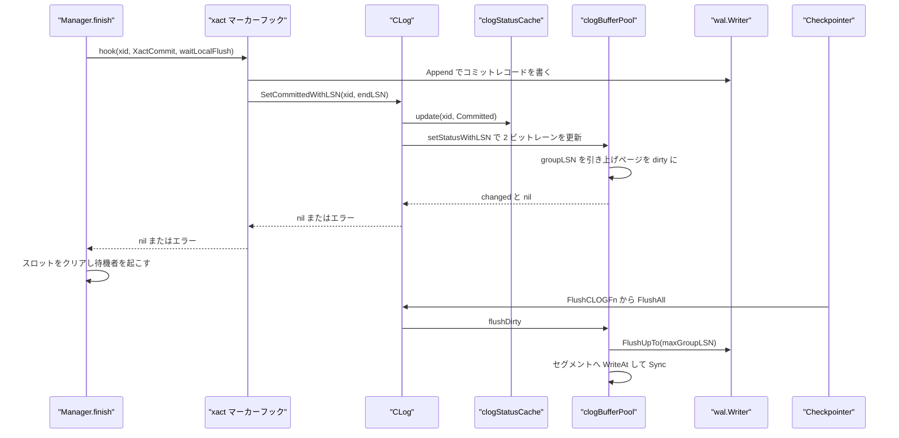
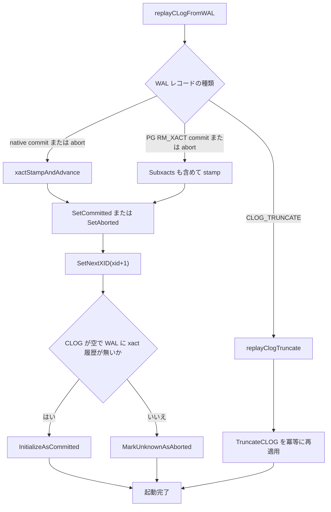
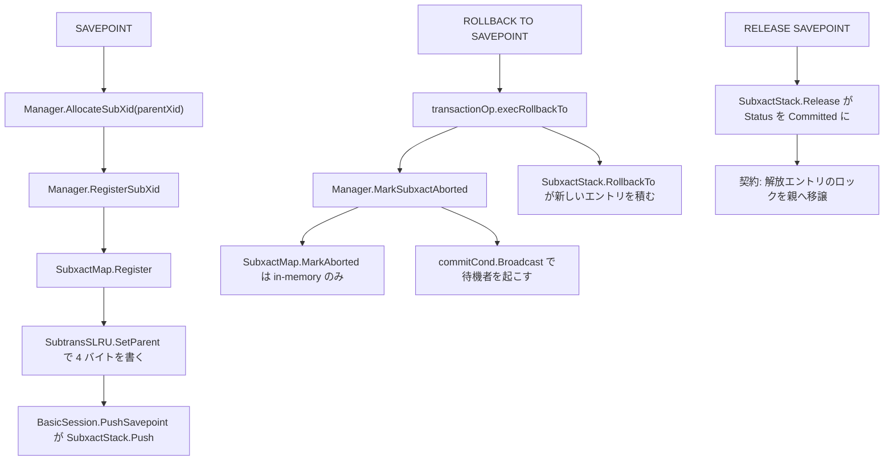

# CLOG とサブトランザクション

<details>
<summary>関連ソースファイル</summary>

- [`internal/access/transam/clog.go`](https://github.com/ryogrid/goopg/blob/19856410e8d497d59787e1ab35a2febb3f5953d6/internal/access/transam/clog.go)
- [`internal/access/transam/clog_bufferpool.go`](https://github.com/ryogrid/goopg/blob/19856410e8d497d59787e1ab35a2febb3f5953d6/internal/access/transam/clog_bufferpool.go)
- [`internal/access/transam/clog_statuscache.go`](https://github.com/ryogrid/goopg/blob/19856410e8d497d59787e1ab35a2febb3f5953d6/internal/access/transam/clog_statuscache.go)
- [`internal/access/transam/subxact.go`](https://github.com/ryogrid/goopg/blob/19856410e8d497d59787e1ab35a2febb3f5953d6/internal/access/transam/subxact.go)
- [`internal/access/transam/subxact_slru.go`](https://github.com/ryogrid/goopg/blob/19856410e8d497d59787e1ab35a2febb3f5953d6/internal/access/transam/subxact_slru.go)
- [`internal/access/transam/subxact_visibility.go`](https://github.com/ryogrid/goopg/blob/19856410e8d497d59787e1ab35a2febb3f5953d6/internal/access/transam/subxact_visibility.go)
- [`internal/access/transam/visibility.go`](https://github.com/ryogrid/goopg/blob/19856410e8d497d59787e1ab35a2febb3f5953d6/internal/access/transam/visibility.go)
- [`internal/access/transam/manager.go`](https://github.com/ryogrid/goopg/blob/19856410e8d497d59787e1ab35a2febb3f5953d6/internal/access/transam/manager.go)
- [`internal/access/transam/control/pgcontrol.go`](https://github.com/ryogrid/goopg/blob/19856410e8d497d59787e1ab35a2febb3f5953d6/internal/access/transam/control/pgcontrol.go)
- [`internal/initdb/xact_recovery.go`](https://github.com/ryogrid/goopg/blob/19856410e8d497d59787e1ab35a2febb3f5953d6/internal/initdb/xact_recovery.go)
- [`internal/initdb/open.go`](https://github.com/ryogrid/goopg/blob/19856410e8d497d59787e1ab35a2febb3f5953d6/internal/initdb/open.go)
- [`internal/executor/operators_tx.go`](https://github.com/ryogrid/goopg/blob/19856410e8d497d59787e1ab35a2febb3f5953d6/internal/executor/operators_tx.go)
- [`internal/executor/session.go`](https://github.com/ryogrid/goopg/blob/19856410e8d497d59787e1ab35a2febb3f5953d6/internal/executor/session.go)

</details>

CLOG（commit log）は、XID ごとに「コミット済み / アボート済み / 進行中」を 2 ビットで記録する `pg_xact/` の SLRU であり、goopg では `CLog` がその読み書きを担う。可視性判定（[9.2 スナップショットと可視性](9.2-Snapshot-and-Visibility.md)）は、スナップショットの `Xmin` / `Xmax` で決着しない XID について `Snapshot.clogSaysNotAborted` からこの CLOG を引き、アボート済みの行だけを確実に隠す。書き込み側はコミット/アボートの xact-marker フック（[9.1 トランザクションマネージャ](9.1-Transaction-Manager.md)）から `SetCommitted` / `SetCommittedWithLSN` / `SetAborted` を呼び、ページを dirty にするだけで即時 fsync はしない。実際の書き戻しは LRU 追い出し或いはチェックポイントの `FlushAll` が行い、非同期コミットではページ書き戻し直前に WAL を LSN まで flush するバリアが入る。サブトランザクション側は、セーブポイントごとに採番したサブ XID の親リンクを in-memory の `SubxactMap` と `pg_subtrans/` の `SubtransSLRU` に記録し、可視性判定がサブ XID をトップレベル XID に解決できるようにする。アボート状態は `pg_subtrans` には書かず、プロセス内の `aborted` マップだけに残す。

## 責務

- XID → 状態の永続マッピング。`CLog.GetStatus` が 2 ビットレーンを読み、`SetCommitted` / `SetAborted` / `SetSubCommitted` が書き込む。レーンは XID の下位 2 ビットでバイト内の位置が決まる。`path:internal/access/transam/clog.go:CLog.GetStatus`
- 非同期コミットの耐久性バリア。`SetCommittedWithLSN` がコミットレコードの LSN を XID の group LSN に記録し、`clogBufferPool.flushWALBeforeWriteLocked` がページ書き戻し前に `wal.Writer.FlushUpTo` を呼ぶ。`path:internal/access/transam/clog.go:CLog.SetCommittedWithLSN`
- メモリ上限付きページキャッシュ。`clogBufferPool` が `pg_xact/` のセグメントを BLCKSZ ページ単位で LRU 管理し、`transaction_buffers` から `EffectiveCLOGBuffers` でページ数を決める。`path:internal/access/transam/clog_bufferpool.go:clogBufferPool`
- 終端状態の読み取りキャッシュ。`clogStatusCache` が Committed / Aborted だけを 4096 スロットに memoise し、可視性ホットパスからページプールの mutex を遠ざける。`path:internal/access/transam/clog_statuscache.go:clogStatusCache`
- クラッシュリカバリ時の状態再構築。WAL の commit/abort レコードから `replayCLogFromWAL` が `SetCommitted` / `SetAborted` を再適用し、`MarkUnknownAsAborted` が「記録の無い XID はアボート」を実現する。`path:internal/initdb/xact_recovery.go:replayCLogFromWAL`
- CLOG の切り詰め。`TruncateCLOG` が `OldestClogXid` を先に進め、`CLOG_TRUNCATE` を WAL に流し、カットオフページより前のセグメントを削除する。`path:internal/access/transam/clog.go:CLog.TruncateCLOG`
- サブ XID → 親 XID の解決。`SubxactMap.TopLevelXid` が最大 64 ホップで親チェーンをたどり、`IsSubxact` が `nParents==0` の高速パスで「サブトランザクション無し」を返す。`path:internal/access/transam/subxact_visibility.go:SubxactMap.TopLevelXid`
- 親リンクの永続化。`SubtransSLRU.SetParent` が `pg_subtrans/<segno>` の 4 バイトスロットに親 TransactionId を little-endian で書き、`ScanParents` が起動時に全リンクを読み戻す。`path:internal/access/transam/subxact_slru.go:SubtransSLRU.SetParent`
- セーブポイントのスタック管理。`SubxactStack` が `Push` / `Release` / `RollbackTo` / `AbortAll` で `SubTransactionState` の状態遷移と親子関係を保持する。`path:internal/access/transam/subxact.go:SubxactStack`
- サブ XID のアボート伝播。`Manager.MarkSubxactAborted` が状態を記録したうえで `commitCond.Broadcast` を送り、そのサブ XID の行ロックを待っていたセッションを起こす（行ロックの詳細は [9.4 マルチックスアクションと行ロック](9.4-Multixact-and-Row-Locks.md)）。`path:internal/access/transam/subxact_visibility.go:Manager.MarkSubxactAborted`
- `nextXid` の checkpoint 永続化。`ControlFileData.CheckPointCopyNextXid` を `UpdateControlFile` が 8192 バイトの `pg_control` に書き、起動時に `SetNextXID` のシードとして読み戻す。`path:internal/access/transam/control/pgcontrol.go:ControlFileData`

## 処理フロー

コミット時の CLOG 更新は「メモリ上のレーンを書き換える」「終端状態キャッシュを更新する」「ページを dirty にする」の 3 つで終わる。ディスクへの書き戻しはその後、LRU 追い出し或いはチェックポイントの `FlushAll` で起きる。非同期コミット（`synchronous_commit=off`）では、ページに group LSN が紐づいており、書き戻しの直前に WAL がその LSN まで flush されるため、「CLOG がコミットと言うのに WAL がdiskに無い」状態は作られない。`path:internal/access/transam/clog.go:CLog.setStatusWithLSN` `path:internal/access/transam/clog_bufferpool.go:clogBufferPool.flushDirty`



読み取り側は 3 段のフォールバックである。まず `clogStatusCache.lookup` がヒットすれば 1 回の atomic load で終わる。ミスすれば `clogBufferPool.getStatus` がページをフォールトインし、それでも読めなければ `TxnStatusUnknown` を返す。`Snapshot.clogSaysNotAborted` は「`OldestClogXid` より古い → 切り詰め済みなのでコミット扱い」「それ以外は `GetStatus` が Aborted でない限りコミット扱い」という保守的な規則で答える。`path:internal/access/transam/snapshot.go:Snapshot.clogSaysNotAborted`

クラッシュリカバリでは、物理 WAL リプレイの後に `replayCLogFromWAL` が同じ WAL をもう一度走査する。ここで重要なのは、commit/abort レコードだけでなく **すべての** レコードの `xl_xid` を見て `txnMgr.SetNextXID(xid+1)` を進める点である。クラッシュ時に進行中だった XID を新しいトランザクションに再利用させないための措置で、その後に `MarkUnknownAsAborted` が残りの Unknown を Aborted に塗る。`path:internal/initdb/xact_recovery.go:replayCLogFromWAL`



サブトランザクションは SAVEPOINT で親リンクを書き、ROLLBACK TO でアボートを記録する。親リンクは永続化されるが、アボート状態は in-memory だけである。現在の `RELEASE SAVEPOINT` 経路は `CLog.SetSubCommitted` を呼ばず、`SubxactStack.Release` で状態を Committed にするだけである（`SetSubCommitted` と `DidCommit` の親再帰は PG 形式 WAL の sub-committed レーンを読むための実装として存在する）。`path:internal/access/transam/subxact_visibility.go:Manager.RegisterSubXid`



`SubxactStack.Release` の呼び出し側は、返されたエントリが保持していたロックを親へ移譲する契約になっている（同関数の doc コメント）。`SubxactStack.RollbackTo` も、アボート対象が専有していたロックを解放する責任を呼び出し側に負わせる。`path:internal/access/transam/subxact.go:SubxactStack.Release`

## 主要ファイル

| ファイル | 役割 |
| --- | --- |
| `internal/access/transam/clog.go` | `TxnStatus`、`CLog`、`GetStatus` / `SetCommitted` / `SetCommittedWithLSN` / `SetAborted` / `SetSubCommitted` / `DidCommit`、`InitializeAsCommitted` / `MarkUnknownAsAborted`、`TruncateCLOG`、SLRU レイアウト定数。`path:internal/access/transam/clog.go:CLog` |
| `internal/access/transam/clog_bufferpool.go` | `clogPageSlot`、`clogBufferPool`、LRU フォールトイン、`flushDirty`、`invalidateBelow`、`EffectiveCLOGBuffers`、group LSN バリア。`path:internal/access/transam/clog_bufferpool.go:clogBufferPool` |
| `internal/access/transam/clog_statuscache.go` | `clogStatusCache`。XID と状態を 1 個の `atomic.Uint64` に詰めた 4096 スロットの読み取りキャッシュ。`path:internal/access/transam/clog_statuscache.go:clogStatusCache` |
| `internal/access/transam/subxact.go` | `SubTxnId`、`SubXactStatus`、`SubTransactionState`、`SubxactStack`。セーブポイントの状態遷移。`path:internal/access/transam/subxact.go:SubTransactionState` |
| `internal/access/transam/subxact_slru.go` | `SubtransSLRU`。`pg_subtrans` の 4 バイト/ XID レイアウト、`SetParent` / `GetParent` / `ScanParents` / `TruncateBefore`。`path:internal/access/transam/subxact_slru.go:SubtransSLRU` |
| `internal/access/transam/subxact_visibility.go` | `SubxactMap`、`SubxactResolver`、`Manager.RegisterSubXid` / `MarkSubxactAborted` / `TopLevelXid` / `IsAborted`、`SetSubxactMap`。`path:internal/access/transam/subxact_visibility.go:SubxactMap` |
| `internal/access/transam/visibility.go` | `TupleVisible`。CLOG の Aborted 判定は `Snapshot.SeesCommittedXID` 経由で間接的に使う。`path:internal/access/transam/visibility.go:TupleVisible` |
| `internal/access/transam/manager.go` | `SetCLog` / `HasCLog`、`ClassifyXID`、`finish` からの xact-marker 呼び出し、`AllocateSubXid` / `RegisterSubXid`。`path:internal/access/transam/manager.go:Manager.SetCLog` |
| `internal/access/transam/control/pgcontrol.go` | `ControlFileData.CheckPointCopyNextXid`、`ReadControlFile` / `UpdateControlFile`。CLOG 切り詰めと `nextXid` の永続化点。`path:internal/access/transam/control/pgcontrol.go:UpdateControlFile` |
| `internal/initdb/xact_recovery.go` | `replayCLogFromWAL`、`replayClogTruncate`、`xactStampAndAdvance`。クラッシュリカバリで CLOG を WAL から再構築する。`path:internal/initdb/xact_recovery.go:replayCLogFromWAL` |
| `internal/initdb/open.go` | `SetCLog` / `SetFlushWALHook` / `SetTruncateLogger` の配線、`InitializeAsCommitted` と `MarkUnknownAsAborted` の分岐、`pg_control` からの `SetNextXID`。`path:internal/initdb/open.go:Open` |
| `internal/executor/operators_tx.go` | `execSavepoint` / `execRollbackTo` / `execRelease`。サブ XID の採番とスタック操作の呼び出し元。`path:internal/executor/operators_tx.go:transactionOp.execSavepoint` |
| `internal/executor/session.go` | `BasicSession.PushSavepoint` / `ReleaseSavepoint` / `RollbackToSavepoint`。`SubxactStack` のラッパー。`path:internal/executor/session.go:BasicSession.PushSavepoint` |

## 公開 API / エントリポイント

```go
func OpenCLog(path string) (*CLog, error)
func (c *CLog) EnablePGSLRUMirror(dir string) error
func (c *CLog) SetCLOGBuffers(n int)
func (c *CLog) SetFlushWALHook(fn func(lsn uint64) error)
func (c *CLog) SetFsyncDisabled(disabled bool)
func (c *CLog) SetTruncateLogger(fn func(oldestXid storage.TransactionID) error)

func (c *CLog) GetStatus(xid storage.TransactionID) TxnStatus
func (c *CLog) SetCommitted(xid storage.TransactionID) error
func (c *CLog) SetCommittedWithLSN(xid storage.TransactionID, lsn uint64) error
func (c *CLog) SetAborted(xid storage.TransactionID) error
func (c *CLog) SetSubCommitted(xid storage.TransactionID) error
func (c *CLog) DidCommit(xid storage.TransactionID, parentOf func(storage.TransactionID) storage.TransactionID) bool

func (c *CLog) InitializeAsCommitted(highXID storage.TransactionID) error
func (c *CLog) MarkUnknownAsAborted(highXID storage.TransactionID) error
func (c *CLog) TruncateCLOG(oldestXid storage.TransactionID) error
func (c *CLog) FlushAll() error
func (c *CLog) IsEmpty() bool
func (c *CLog) HighestKnownXID() storage.TransactionID
func (c *CLog) OldestClogXid() storage.TransactionID
func (c *CLog) AdvanceOldestClogXid(xid storage.TransactionID)

func EffectiveCLOGBuffers(transactionBuffers, sharedBuffers int) int
func CLOGPagePrecedes(page1, page2 int64) bool

func NewSubxactMap() *SubxactMap
func (m *SubxactMap) EnablePersistence(dir string) error
func (m *SubxactMap) RestoreFromSLRU() (int, error)
func (m *SubxactMap) Register(subxid, parentXid storage.TransactionID)
func (m *SubxactMap) MarkAborted(subxid storage.TransactionID)
func (m *SubxactMap) IsAborted(subxid storage.TransactionID) bool
func (m *SubxactMap) IsSubxact(xid storage.TransactionID) bool
func (m *SubxactMap) TopLevelXid(xid storage.TransactionID) storage.TransactionID
func (m *SubxactMap) Truncate(oldestXact storage.TransactionID) error

func (s *SubxactStack) Push(name string, snap Snapshot) *SubTransactionState
func (s *SubxactStack) Release(name string) ([]*SubTransactionState, error)
func (s *SubxactStack) RollbackTo(name string, newSnap Snapshot) ([]*SubTransactionState, *SubTransactionState, error)
func (s *SubxactStack) AbortAll() []*SubTransactionState
func (s *SubtransSLRU) SetParent(xid, parent storage.TransactionID) error
func (s *SubtransSLRU) GetParent(xid storage.TransactionID) (storage.TransactionID, error)
func (s *SubtransSLRU) ScanParents() (map[storage.TransactionID]storage.TransactionID, error)
func (s *SubtransSLRU) TruncateBefore(oldestXact storage.TransactionID) error
```

`CLog` の初期化順序は固定である。`OpenCLog` は互換性のためにパスを受けるが読まず、`EnablePGSLRUMirror` が `pg_xact/` を作り `clogBufferPool` を生成して `pool` に格納する。以降 `GetStatus` や `setStatus` を呼ぶ前にこの呼び出しが完了している必要がある。`SetCLOGBuffers` は `EnablePGSLRUMirror` より前、`SetFlushWALHook` と `SetTruncateLogger` は後で呼ぶ。`path:internal/access/transam/clog.go:CLog.EnablePGSLRUMirror`

## 主要データ構造

### `TxnStatus` — 2 ビットに収まる 4 状態

```go
// TxnStatus is the commit-log status for a single transaction ID.
type TxnStatus byte

const (
	// TxnStatusUnknown means no COMMIT or ROLLBACK record was written for this
	// XID. After a crash, any XID with this status is treated as aborted.
	TxnStatusUnknown TxnStatus = 0
	// TxnStatusCommitted records a successful COMMIT.
	TxnStatusCommitted TxnStatus = 1
	// TxnStatusAborted records a ROLLBACK or crash-implied abort.
	TxnStatusAborted TxnStatus = 2
	// TxnStatusSubCommitted records a subtransaction that has committed while its
	// parent (top-level) transaction is still in progress. It is NOT a terminal
	// answer: a reader must resolve it by consulting the parent's status (see
	// DidCommit), mirroring PG's TRANSACTION_STATUS_SUB_COMMITTED
	// (postgres/src/include/access/clog.h:30 and transam.c TransactionIdDidCommit).
	// The raw byte value (3) is chosen to equal the on-disk SLRU 2-bit lane
	// (0x03) so the flat-file and SLRU encodings agree. M0117-0004.
	TxnStatusSubCommitted TxnStatus = 3
)
```

`path:internal/access/transam/clog.go:TxnStatus`

0 は「まだ決着していない」であり、クラッシュ後はアボート扱いになる。1 と 2 は終端状態で、読み取りキャッシュに載せてよい。3 は終端ではなく「サブトランザクションはコミットしたが親は進行中」を表し、`DidCommit` が親へ再帰して最終状態を決める。値そのものが SLRU の 2 ビットレーン（`0x00`〜`0x03`）と一致するため、`laneFromStatus` / `statusFromLane` は単純な対応表になる。`path:internal/access/transam/clog_bufferpool.go:statusFromLane`

### `CLog` — コミットログの本体

```go
type CLog struct {
	slruDirMu sync.RWMutex
	slruDir   string // PG-canonical pg_xact/ SLRU directory; set once by EnablePGSLRUMirror

	// oldestClogXid is the lowest XID whose status is still retained. Below it,
	// status has been truncated away and callers MUST treat the XID as
	// committed/frozen (it is older than every relfrozenxid). Mirrors PG's
	// TransamVariables->oldestClogXid. Zero means "no truncation has occurred".
	//
	// ATOMIC, not mutex-guarded, because it is read ONCE PER TUPLE on the
	// visibility path (Snapshot.clogSaysNotAborted). Under a 4-worker parallel
	// scan that RLock/RUnlock pair was 46 % of all atomic RMW traffic and ~5 %
	// of total CPU on TPC-H Q14 — pure lock bookkeeping on a single uint32.
	//
	// It must stay LIVE rather than being hoisted into the snapshot: TruncateCLOG
	// publishes the new horizon BEFORE deleting the SLRU bytes (see the ordering
	// note there), so a reader holding a stale, older horizon would fail the
	// XIDPrecedes short-circuit and fault in a truncated page as all-zero
	// (= Unknown), which statusCache would then memoise. An atomic load keeps the
	// value live and costs nothing.
	// (docs/design/not_ralph/perf-optimize-take6/README.md candidate B.)
	oldestClogXid atomic.Uint32

	// oldestMu now guards truncateLogger only.
	oldestMu sync.RWMutex

	// statusCache memoises TERMINAL statuses so the common visibility check
	// never reaches clogBufferPool's global mutex. See clog_statuscache.go.
	statusCache clogStatusCache

	// truncateLogger, when non-nil, is invoked by TruncateCLOG to emit a
	// CLOG_TRUNCATE WAL record (G9). Installed by initdb.Open after recovery
	// completes; nil during recovery so replay does not re-append. nil-safe.
	truncateLogger func(oldestXid storage.TransactionID) error

	// --- M0117-0006: SLRU buffer pool is the sole in-memory store (Part B/C) ---

	// pool is the bounded LRU page cache (clog_bufferpool.go) that IS the CLOG
	// store: GetStatus/setStatus and the bulk callers (InitializeAsCommitted /
	// MarkUnknownAsAborted / HighestKnownXID / TruncateCLOG / IsEmpty) all route
	// through it. Created by EnablePGSLRUMirror, which MUST run before any of
	// those methods are called (production always does this immediately after
	// OpenCLog; see initdb.Open / initdb.bootstrapCLog). M0117-0006 Part C
	// removed the legacy fully-resident per-XID "banks" store this pool used to
	// coexist with — there is exactly one live store now, so there is no
	// dual-store hazard (M0117-0004) to reconcile. atomic.Pointer so the
	// startup store and concurrent commit-path loads are race-free (the pointer
	// is set once, before the server accepts connections).
	pool atomic.Pointer[clogBufferPool]

	// fsyncDisabled mirrors `fsync = off` for mirrorToSLRUUnlocked (the
	// pool carries its own copy — see SetFsyncDisabled). Test harnesses
	// only.
	fsyncDisabled atomic.Bool

	// clogBuffers is the resident-page budget for pool (the transaction_buffers
	// GUC value; 0 ⇒ auto-tune via EffectiveCLOGBuffers at creation time). Set
	// via SetCLOGBuffers before EnablePGSLRUMirror; a no-op afterwards.
	clogBuffers int
}
```

`path:internal/access/transam/clog.go:CLog`

`oldestClogXid` が可視性のショートカットの境界であり、atomic なのは毎タプル読まれるためである。`pool` は `atomic.Pointer` で、起動時に一度だけ設定される。`statusCache` と `pool` は直列の 2 段キャッシュをなし、`statusCache` が終端状態を返せば `pool` の mutex には触れない。`truncateLogger` はリカバリ中 nil で、リカバリ完了後に `initdb.Open` が `EncodeClogTruncatePG` を呼ぶフックを設置する。`clogBuffers` は GUC `transaction_buffers` の生値で、プール生成後は変更しても効かない。

### `clogPageSlot` と `clogBufferPool` — ページキャッシュ

```go
type clogPageSlot struct {
	pageNo   int64    // SLRU page number = xid / clogXactsPerPage
	data     []byte   // BLCKSZ bytes; nil until first use
	groupLSN []uint64 // clogLSNsPerPage async-commit group LSNs; nil until first use
	valid    bool     // false for an empty/never-faulted slot
	dirty    bool     // page modified since last writeback
	lastUsed uint64   // recency stamp for LRU victim selection
}

type clogBufferPool struct {
	mu      sync.Mutex
	dir     string // pg_xact/ segment directory (the on-disk backing store)
	nslots  int    // resident-page budget (EffectiveCLOGBuffers)
	slots   []clogPageSlot
	pageMap map[int64]int // pageNo → index into slots
	clock   uint64        // monotonic recency counter

	// flushWAL is the async-commit write barrier (≙ XLogFlush in PG's
	// SlruPhysicalWritePage). When non-nil, it is invoked with a page's maximum
	// group LSN immediately BEFORE that page's bytes are written back to disk,
	// guaranteeing the commit WAL record behind every claimed commit is durable
	// before a CLOG page reaching disk can advertise it. nil (the default, and
	// every state where the pool is not the live store) ⇒ no barrier, so the
	// not-yet-live pool and all unit tests are unchanged. Wired to
	// wal.Writer.FlushUpTo by the CLog layer when the pool goes live (Part B);
	// injection keeps the mvcc package free of a wal import.
	flushWAL func(lsn uint64) error

	// fsyncDisabled mirrors `fsync = off`: write-back still happens (page
	// bytes reach the OS cache in the same order) but the per-segment
	// fsync is skipped. Test harnesses only; see
	// ci/design/test-gate-speedups/02.
	fsyncDisabled atomic.Bool
}
```

`path:internal/access/transam/clog_bufferpool.go:clogPageSlot`（`clogBufferPool` は同ファイル）

`data` は 8192 バイトで 32768 XID 分、`groupLSN` は 1024 個の非同期コミットグループ LSN を持つ。`pageMap` と `slots` は 1 つの mutex で守られ、読み取りもフォールトインのために書き込みロックを取る。`lastUsed` と `clock` による LRU で、プールが満杯なら最も古いスロットを選び、dirty なら WAL バリアの後に書き戻す。フォールトイン時は `groupLSN` を全ゼロに戻す。group LSN は on-disk に存在しない shared-memory 専用の情報で、ディスクから読んだページの WAL は既に durable だからである。

### `clogStatusCache` — 1 ワードに詰めた終端状態

```go
// clogStatusCache maps XID -> terminal status. Each slot packs the XID and its
// status into ONE uint64 so a reader gets a self-consistent pair from a single
// atomic load — a separate xid array and status array could be read torn.
//
//	bits 32..63 : xid (full uint32)
//	bit 8       : valid
//	bits 0..7   : status
type clogStatusCache struct {
	slots [clogStatusCacheSize]atomic.Uint64
}
```

`path:internal/access/transam/clog_statuscache.go:clogStatusCache`

`clogStatusCacheSize` は 4096（2 の冪）で、`uint32(xid) & clogStatusCacheMask` でスロットを選ぶ。XID を 32〜63 ビットに置くので XID 全体が保存でき、valid ビットを 8 ビット目に置くことで XID の最上位ビットと衝突しない。`store` と `update` は Committed / Aborted だけをキャッシュし、SubCommitted は `forget` で古いエントリを消す。Unknown をキャッシュしないのは、それがまさに遷移する状態だからである。

### `SubXactStatus` — セーブポイントの状態

```go
// SubXactStatus tracks the lifecycle state of a subtransaction.
type SubXactStatus int

const (
	SubXactActive    SubXactStatus = iota // currently open
	SubXactCommitted                      // RELEASE SAVEPOINT — merged into parent
	SubXactAborted                        // ROLLBACK TO or implicit abort
)
```

`path:internal/access/transam/subxact.go:SubXactStatus`

状態は `active` → `committed`（RELEASE）または `aborted`（ROLLBACK TO / トップレベルアボート）の一方向にしか進まない。`SubxactStack.Top` は末尾から `SubXactActive` のエントリを探すため、committed/aborted のエントリが残っていても最内の有効セーブポイントを正しく返す。`path:internal/access/transam/subxact.go:SubxactStack.Top`

スタックの各要素は `SubTransactionState` で、トップレベル内で単調増加する `Id`、SAVEPOINT 名 `Name`、遅延採番されたサブ XID `SubXid`、SAVEPOINT 時点のスナップショット `Snap`、上記 `Status`、外側のセーブポイントを指す `Parent` を持つ。`SubXid` は最初の書き込みまで 0 のままで、`SubxactStack.Push` はスナップショットを値コピーしてポインタで保持する。`path:internal/access/transam/subxact.go:SubTransactionState`

### `SubxactMap` — サブ XID の親とアボート状態

```go
type SubxactMap struct {
	mu      sync.RWMutex
	parents map[storage.TransactionID]storage.TransactionID // subxid → parent xid
	aborted map[storage.TransactionID]bool                  // aborted subxids

	// nParents mirrors len(parents) so IsSubxact can answer the overwhelmingly
	// common "no subtransactions at all" case without taking mu.
	//
	// IsSubxact is called ONCE PER TUPLE on the visibility path
	// (TupleVisibleSubxact -> isCurrentTxXID). Under a 4-worker parallel scan
	// that RLock/RUnlock pair was 50 % of all atomic RMW traffic and ~5 % of
	// total CPU on TPC-H Q14, to probe a map that an OLAP query never populates.
	// (docs/design/not_ralph/perf-optimize-take6/README.md candidate B.)
	//
	// Kept in step with parents under mu; read without it. A zero count means
	// the map is empty, so the guarded lookup could only have returned false.
	nParents atomic.Int64

	// slru, when non-nil, is the persistent pg_subtrans mirror that parent
	// links are written through to. nil = persistence disabled (default).
	slru *SubtransSLRU
}
```

`path:internal/access/transam/subxact_visibility.go:SubxactMap`

`parents` は「サブ XID → 直接の親 XID」であり、トップレベルまで解決するのは `TopLevelXid` の仕事である。`aborted` は個別アボートされたサブ XID の集合で、親がコミットしてもそのサブ XID の行を不可視に保つ。`slru` が非 nil なら `Register` は親リンクを `pg_subtrans` にも書き出すが、`MarkAborted` は書き出さない。`nParents` は `parents` の長さのミラーで、サブトランザクションを使わないワークロードの可視性判定を 1 atomic load で済ませる。

### `SubtransSLRU` — `pg_subtrans` のミラー

```go
type SubtransSLRU struct {
	mu  sync.Mutex
	dir string

	// fsyncDisabled mirrors `fsync = off`: SetParent's write-through still
	// happens, but its fsync is skipped. Test harnesses only; see
	// ci/design/test-gate-speedups/02.
	fsyncDisabled atomic.Bool
}
```

`path:internal/access/transam/subxact_slru.go:SubtransSLRU`

1 XID あたり 4 バイト（親 TransactionId そのもの）を使うため、1 ページ 2048 XID、1 セグメント 32 ページ = 65536 XID である。`SetParent` は `subtransLocate` でセグメント番号とバイトオフセットを計算し、ファイルを必要なページ数まで切り上げてから 4 バイトを little-endian で `WriteAt` し、`fsync` する（`fsyncDisabled` なら省略）。`GetParent` は未書き込みスロットや EOF を 0 として返し、`ScanParents` は 0 以外の親を持つスロットだけをマップに戻す。

## 内部構造

**SLRU のレイアウト。** CLOG は 1 XID 2 ビットで、`xid % 4` がバイト内レーン、`(xid % 4) * 2` がシフトになる。1 ページは `storage.BlockSize * 4 = 32768` XID、1 セグメントは 32 ページ = 1,048,576 XID で、ファイル名はセグメント番号の `%04X` である。`pg_xact/0000` は `EnablePGSLRUMirror` がゼロページとして必ず作るため、PG の `SimpleLruReadPage_ReadOnly` が欠損ページを拡張しようとしない。`path:internal/access/transam/clog.go:clogXactsPerSegment`

**書き込みは即時永続化しない。** `setStatusWithLSN` はレーンを書き換えて `dirty` を立てるだけで、fsync しない。書き戻しは (a) LRU で追い出されるとき、(b) チェックポイントで `FlushCLOGFn` → `CLog.FlushAll` → `flushDirty` が呼ばれたとき、のどちらかである。したがって `synchronous_commit=off` でも dirty ページはチェックポイント間隔で必ずディスクに落ちる。`path:internal/access/transam/clog_bufferpool.go:clogBufferPool.flushDirty`

**非同期コミットのバリア。** group LSN は `clogXactsPerLSNGroup=32` XID ごとに 1 スロットで、1 ページに 1024 スロットある。`setStatusWithLSN` はレーンが既に同じ値でも group LSN が上がれば `dirty` を立てる（同じグループの後続コミットがより大きい LSN を持ちうるため）。`flushDirty` は全 dirty ページの最大 LSN を 1 回だけ `FlushUpTo` に渡してから書き込む。ページ単位の LSN より大きい値を flush するのは保守的だが、各ページの必要 LSN を必ず満たす。`path:internal/access/transam/clog_bufferpool.go:clogBufferPool.setStatusWithLSN`

**読み取りキャッシュの整合性。** `CLog.GetStatus` はキャッシュヒットなら即返し、ミスならプールを引いて結果を `store` する。`setStatusWithLSN` は書き込み後に必ず `statusCache.update` を呼ぶ。これは「Committed と Aborted は最終状態」という前提がリカバリ中は崩れるためで、`MarkUnknownAsAborted` が Aborted に塗った XID に、後続の WAL リプレイが Committed を上書きするケースがある。キャッシュを更新しないと、その XID がアボートのまま固定されてコミット済みトランザクションが消える。`path:internal/access/transam/clog_statuscache.go:clogStatusCache.update`

**切り詰めの順序。** `TruncateCLOG` はまず `statusCache.invalidate()` を呼び、次にカットオフページを計算し、既に十分進んでいれば何もせず返す。進む場合は `AdvanceOldestClogXid` を **削除より先に** 呼び、`CLOG_TRUNCATE` を WAL に流し、最後にセグメントを unlink して `invalidateBelow` でメモリからも落とす。horizon を先に公開するのは、並行する `GetStatus` が「切り詰め済みのページを読んで Unknown を得る」ことを防ぐためである（呼び出し側は `OldestClogXid` で先に短絡する）。`path:internal/access/transam/clog.go:CLog.TruncateCLOG`

**`MarkUnknownAsAborted` の下限。** スイープは `FirstNormalTransactionID` からではなく、`firstRetainedSLRUXID` が返す「現存する最古のセグメントが覆う先頭 XID」から始める。切り詰めで消えた範囲を再び Aborted で塗ると、削除済みセグメントが復活して basebackup のバイト一致が壊れ、正当に保持されたタプルが `GetStatus` ベースのフィルタで落ちる。下限より下は Unknown のままにしておく方が安全で、可視性は `xid < Xmin` でコミット扱いになる。`path:internal/access/transam/clog.go:CLog.MarkUnknownAsAborted`

**リカバリでの `nextXid` 前進。** `replayCLogFromWAL` は commit/abort レコードだけでなく、`xl_xid` を持つすべてのレコードで `NextXID` を `xid+1` まで進める。これを怠ると、クラッシュ時に進行中だった XID が再採番され、その XID のコミットが「クラッシュしたトランザクションの途中まで書かれた行」をコミット済みに変えてしまう。PG の `AdvanceNextFullTransactionIdPastXid` と同じ規則である。`path:internal/initdb/xact_recovery.go:xactStampAndAdvance`

**サブ XID はプロセス配列に載らない。** `AllocateSubXid` は `XidGen.Allocate` で採番し、`RegisterSubXid` で親を登録するだけで、`ProcArray` のスロットには書かない。したがって可視性判定は「トップレベルが進行中か」と「サブ XID が個別アボートされていないか」の 2 つを `SubxactResolver` 経由で解決する。`path:internal/access/transam/manager.go:Manager.AllocateSubXid`

**`DidCommit` の親再帰。** `CLog.DidCommit` は XID が 3 未満なら 1（Bootstrap）と 2（Frozen）だけをコミットとして返し、0 は false にする。通常 XID は `GetStatus` を見て、Committed なら true、SubCommitted なら `parentOf` で親へ移り、Aborted/Unknown なら false を返す。訪問済み集合で循環を検出し、`parentOf` が nil 或いは親が 0/自分自身なら false にする。`path:internal/access/transam/clog.go:CLog.DidCommit`

**`pg_subtrans` は切り詰めを WAL ログしない。** `SubtransSLRU.TruncateBefore` は CLOG と違い WAL レコードを出さない。`pg_subtrans` はそもそもクラッシュ時に捨ててよい補助構造であり（goopg は G5 のために永続化している）、クラッシュで削除が途中になっても余分なセグメントが残るだけで、次回チェックポイントで再試行される。親リンクを引くのは「その XID がまだ解決されていない」範囲だけなので、切り詰めの遅れは正しさに影響しない。`path:internal/access/transam/subxact_slru.go:SubtransSLRU.TruncateBefore`

**`pg_control` との接点。** `ControlFileData.CheckPointCopyNextXid` は FullTransactionId の 64 ビットで、下位 32 ビットが生の XID である。チェックポイントは `UpdateControlFile` のコールバックで「今の値より大きいときだけ」更新し、起動時は `ReadControlFile` の値を `SetNextXID` に渡す。`UpdateControlFile` は 8192 バイトのイメージを読み・デコードし・変更し・再エンコードし、先頭 292 バイトの CRC32C を計算し直して `O_RDWR` で上書き・fsync する。`path:internal/access/transam/control/pgcontrol.go:ControlFileData`

## エッジケースと不変条件

- **XID 3 未満は書かない。** `setStatusWithLSN` は `xid < FirstNormalTransactionID` を即 no-op にする。`pg_xact/0000` の bootstrap/frozen レーンをゼロのまま保ち、PG の `TransactionLogFetch` の短絡と同じ扱いにするためである。`path:internal/access/transam/clog.go:CLog.setStatusWithLSN`
- **Unknown はキャッシュしない。** `clogStatusCache.store` は Committed / Aborted 以外を無視する。進行中を memoise すると、そのトランザクションが後でコミットしても永遠に不可視のままになる。`path:internal/access/transam/clog_statuscache.go:clogStatusCache.store`
- **プールのエラーは Unknown に縮退する。** `GetStatus` は `pool.getStatus` のエラーを握りつぶして `TxnStatusUnknown` を返す。可視性側では「アボートでなければ可視」なので、読み取り失敗は行を隠す方向に働く。`path:internal/access/transam/clog.go:CLog.GetStatus`
- **切り詰めは 2 回目以降 no-op。** `TruncateCLOG` は `cur != 0 && !txnPrecedes(cur, oldestXid)` なら何もせず返す。同じ horizon での再適用（WAL リプレイ）が安全なのはこのためである。`path:internal/access/transam/clog.go:CLog.TruncateCLOG`
- **切り詰めはページ境界単位。** カットオフページを含むセグメントは残し、その前のセグメントだけを消す。部分的に必要なページを消して `GetStatus` が Unknown を返す事故を避ける。`path:internal/access/transam/clog.go:CLog.truncateSLRUSegments`
- **`OldestClogXid` より下はコミット扱い。** ステータスバイトが消えているため、呼び出し側は `storage.XIDPrecedes(xid, oldest)` で先に短絡しなければならない。これを忘れると、存在しないレーンを読んで Unknown（＝進行中）と誤認する。`path:internal/access/transam/snapshot.go:Snapshot.clogSaysNotAborted`
- **非同期コミットでも ack 後の消失はない。** ページ書き戻しの直前に必ず `FlushUpTo(maxGroupLSN)` が走る。`FlushUpTo` が失敗すれば `flushDirty` はそのページを書かずにエラーを返し、次回に持ち越す。`path:internal/access/transam/clog_bufferpool.go:clogBufferPool.flushDirty`
- **group LSN はフォールトインで消える。** ディスクから読んだページの `groupLSN` は全ゼロにリセットされる。ディスク上の CLOG は WAL が durable であることを前提に書かれているため、再度バリアを張る必要がない。`path:internal/access/transam/clog_bufferpool.go:clogBufferPool.pinPageLocked`
- **`InitializeAsCommitted` は非ゼロを上書きしない。** 既に Committed / Aborted / SubCommitted のレーンはそのまま残し、Unknown だけを Committed にする。旧クラスタの upgrade と basebackup 接続時の前提で、WAL リプレイで確定した状態を壊さない。`path:internal/access/transam/clog.go:CLog.InitializeAsCommitted`
- **`MarkUnknownAsAborted` はキャッシュを全消しする。** スイープ対象のレーンを個別に追跡するより、4096 ワードを消す方が単純で確実である。切り詰め時も同様に全消しする。`path:internal/access/transam/clog_statuscache.go:clogStatusCache.invalidate`
- **サブ XID の親は最大 64 ホップ。** `SubxactMap.TopLevelXid` は 64 回で打ち切り、`Manager.TopLevelXid` も同じ上限を持つ。壊れた自己参照や循環があっても無限ループにならない。`path:internal/access/transam/subxact_visibility.go:SubxactMap.TopLevelXid`
- **`IsSubxact` は空マップでロックを取らない。** `nParents.Load()==0` なら即 false。`Register` / `Truncate` / `RestoreFromSLRU` が `parents` を変更するたびに `nParents.Store(len(parents))` でミラーを更新する。`path:internal/access/transam/subxact_visibility.go:SubxactMap.IsSubxact`
- **`pg_subtrans` の書き込み失敗は握りつぶす。** `SubxactMap.Register` は `slru.SetParent` のエラーを捨てる。in-memory の `parents` が実行時の正であり、永続ミラーは再起動時の復元用だからである。`path:internal/access/transam/subxact_visibility.go:SubxactMap.Register`
- **`RestoreFromSLRU` は永続化を要求する。** `EnablePersistence` 前に呼ぶとエラーになる。黙って 0 件復元するより、配線ミスを大きく失敗させる。`path:internal/access/transam/subxact_visibility.go:SubxactMap.RestoreFromSLRU`
- **サブ XID のアボートは待機者を起こす。** `Manager.MarkSubxactAborted` は状態を書いた後に `commitCond.Broadcast` を送る。状態更新（`subxactMu`）と broadcast（`waitMu`）を入れ子にしないことで、`WaitForXID` のロック順（`waitMu` → `subxactMu`）と衝突しない。`path:internal/access/transam/subxact_visibility.go:Manager.MarkSubxactAborted`
- **`SetSubCommitted` は本番経路から未使用。** 実装と `DidCommit` の親再帰は存在するが、現在の `RELEASE SAVEPOINT` は CLOG に sub-committed レーンを書かない。したがって goopg 自身が書いたサブ XID は Unknown のまま（親がコミットすれば `TopLevelXid` 経由で可視）であり、`DidCommit` の SubCommitted 分岐は PG 形式 WAL を読む場合に効く。`path:internal/access/transam/clog.go:CLog.SetSubCommitted`
- **`EffectiveCLOGBuffers` の上下限。** `transaction_buffers=0` なら `shared_buffers/512` を 16 の倍数に丸め、最低 16・最大 1024 にする。明示値は最低 16、最大 `1GiB/8192 = 131072` ページに clamp される。`path:internal/access/transam/clog_bufferpool.go:EffectiveCLOGBuffers`

Sources:

- internal/access/transam/clog.go
- internal/access/transam/clog_bufferpool.go
- internal/access/transam/clog_statuscache.go
- internal/access/transam/subxact.go
- internal/access/transam/subxact_slru.go
- internal/access/transam/subxact_visibility.go
- internal/access/transam/visibility.go
- internal/access/transam/manager.go
- internal/access/transam/control/pgcontrol.go
- internal/initdb/xact_recovery.go
- internal/initdb/open.go
- internal/executor/operators_tx.go
- internal/executor/session.go

<sub>Generated by deepwiki-4myself from `goopg` @ `19856410e`</sub>
