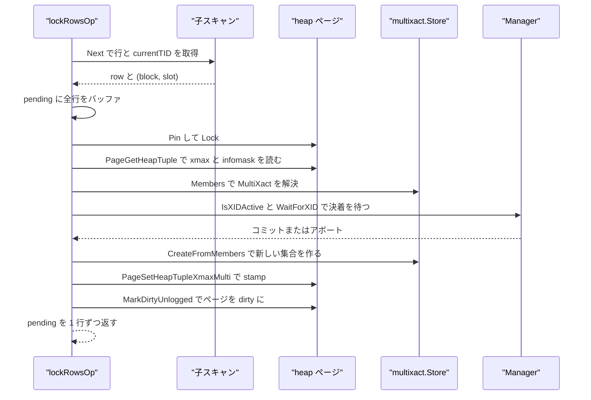
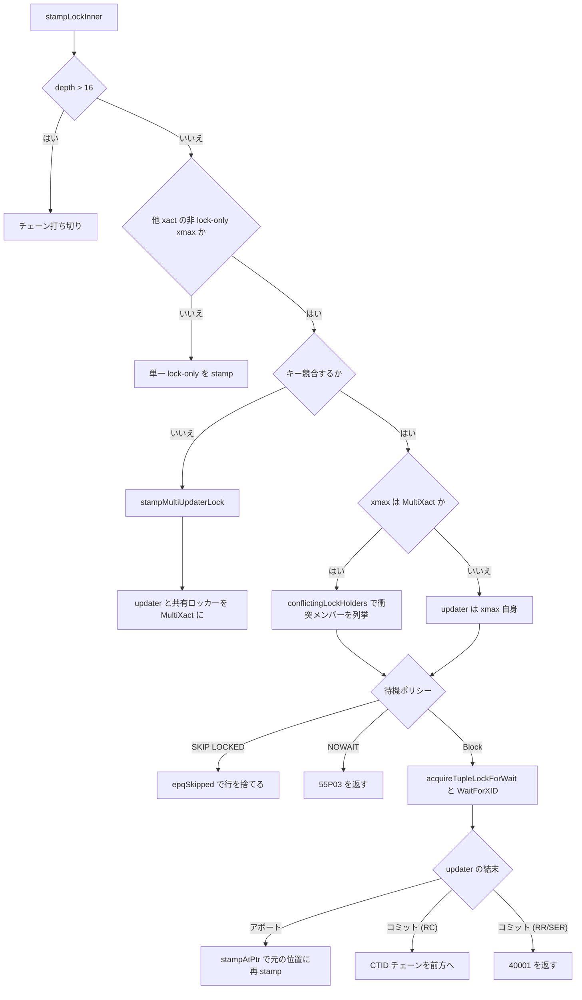

# マルチックスアクションと行ロック

<details>
<summary>関連ソースファイル</summary>

- [`internal/access/transam/multixact/multixact.go`](https://github.com/ryogrid/goopg/blob/19856410e8d497d59787e1ab35a2febb3f5953d6/internal/access/transam/multixact/multixact.go)
- [`internal/access/transam/multixact/store.go`](https://github.com/ryogrid/goopg/blob/19856410e8d497d59787e1ab35a2febb3f5953d6/internal/access/transam/multixact/store.go)
- [`internal/access/transam/manager.go`](https://github.com/ryogrid/goopg/blob/19856410e8d497d59787e1ab35a2febb3f5953d6/internal/access/transam/manager.go)
- [`internal/access/transam/combocid.go`](https://github.com/ryogrid/goopg/blob/19856410e8d497d59787e1ab35a2febb3f5953d6/internal/access/transam/combocid.go)
- [`internal/access/transam/subxact.go`](https://github.com/ryogrid/goopg/blob/19856410e8d497d59787e1ab35a2febb3f5953d6/internal/access/transam/subxact.go)
- [`internal/access/transam/visibility.go`](https://github.com/ryogrid/goopg/blob/19856410e8d497d59787e1ab35a2febb3f5953d6/internal/access/transam/visibility.go)
- [`internal/executor/operators_lockrows.go`](https://github.com/ryogrid/goopg/blob/19856410e8d497d59787e1ab35a2febb3f5953d6/internal/executor/operators_lockrows.go)
- [`internal/executor/relation_locks.go`](https://github.com/ryogrid/goopg/blob/19856410e8d497d59787e1ab35a2febb3f5953d6/internal/executor/relation_locks.go)
- [`internal/executor/deferred_unique.go`](https://github.com/ryogrid/goopg/blob/19856410e8d497d59787e1ab35a2febb3f5953d6/internal/executor/deferred_unique.go)
- [`internal/executor/operators_storage.go`](https://github.com/ryogrid/goopg/blob/19856410e8d497d59787e1ab35a2febb3f5953d6/internal/executor/operators_storage.go)
- [`internal/storage/heap.go`](https://github.com/ryogrid/goopg/blob/19856410e8d497d59787e1ab35a2febb3f5953d6/internal/storage/heap.go)

</details>

行ロックは、`SELECT ... FOR KEY SHARE / FOR SHARE / FOR NO KEY UPDATE / FOR UPDATE` および UPDATE / DELETE が、対象タプルの `xmax` に「誰がこの行をロックまたは更新しているか」を刻む仕組みである。1 行に 1 人しか書けない単一 xmax のままでは、「FOR KEY SHARE の保持者」と「キー列を変えない UPDATE」が同時に存在する状態を表現できないため、goopg は `internal/access/transam/multixact` に PostgreSQL 互換の MultiXact を実装し、`HEAP_XMAX_IS_MULTI` が立つ xmax を「メンバー集合への ID」として扱う。`multixact.Status` の 6 値は行ロックの強度と UPDATE の種別を表し、`StatusesConflict` が上流のロック競合表をそのまま写した 4 値の互換性判定を与える。実行側では `lockRowsOp` が 2 パス（全行走査 → 一括 stamp）でタプルをロックし、競合相手がいれば [9.1 トランザクションマネージャ](9.1-Transaction-Manager.md) の `Manager.WaitForXID` で待ち、NOWAIT / SKIP LOCKED を守り、コミット済み更新なら CTID チェーンをたどって EPQ 再検査する。ロック専用 xmax が可視性に与える影響は [9.2 スナップショットと可視性](9.2-Snapshot-and-Visibility.md)、SERIALIZABLE の述語ロックは [9.5 直列化可能スナップショット分離](9.5-SSI.md) を参照。テーブル単位のロックは `relLockMgr` と `tableLockMgr` が `pg_locks` に公開する。遅延 UNIQUE/PK 検査は、この可視性と行の生死判定を使って COMMIT 時点で重複を再確認する。

## 責務

- MultiXact の値域と状態の定義。`MultiXactId` は `TransactionId` と同じ 32 ビット空間の別採番で、`InvalidMultiXactId=0` と `FirstMultiXactId=1` を持つ。`path:internal/access/transam/multixact/multixact.go:MultiXactId`
- 行ロック強度の表現。`Status` の `ForKeyShare` / `ForShare` / `ForNoKeyUpdate` / `ForUpdate` と、実更新の `NoKeyUpdate` / `Update` を 0x00〜0x05 に固定する。`IsUpdate` が「純粋なロックか更新か」を判定する。`path:internal/access/transam/multixact/multixact.go:Status`
- 競合判定。`StatusesConflict` が `statusHWLock` で各 Status を heavyweight ロックモードに写し、`lockConflicts` の表で衝突を調べる。`FOR KEY SHARE` と no-key UPDATE は非衝突、`FOR SHARE` と no-key UPDATE は衝突になる。`path:internal/access/transam/multixact/multixact.go:StatusesConflict`
- メンバー集合の生成と解決。`Store.CreateFromMembers` が最大 1 個の updater を検証して不変な集合を作り、`Store.Members` がコピーを返す。同一集合は既存 ID に dedup される。`path:internal/access/transam/multixact/store.go:Store.CreateFromMembers`
- メンバーの拡張と剪定。`Store.Expand` が既存集合にメンバーを足し、進行中でないロッカーとアボート済み updater を落とし、コミット済み updater だけは残す。`path:internal/access/transam/multixact/store.go:Store.Expand`
- タプルヘッダへのエンコード。`HintBits` がメンバー集合から最強のロック強度ビットと `HEAP_XMAX_LOCK_ONLY` / `HEAP_KEYS_UPDATED` を計算する。`path:internal/access/transam/multixact/multixact.go:HintBits`
- 行ロックの取得。`lockRowsOp.stampLockInner` がページ排他ロック下で既存 xmax を分類し、単一 stamp / MultiXact 合成 / 待機 / EPQ チェーン追跡を選ぶ。`path:internal/executor/operators_lockrows.go:lockRowsOp.stampLockInner`
- 競合相手だけを待つ。`conflictingLockHolders` が MultiXact メンバーのうち、自分の要求と衝突し、かつ進行中のものだけを返す。非衝突の共保持者で待たない。`path:internal/executor/operators_lockrows.go:lockRowsOp.conflictingLockHolders`
- FIFO の待機順序。`acquireTupleLockForWait` がスリープ直前に LOCKTAG_TUPLE を取得し、同じ行の待機者が到着順に起こされるようにする。既にロックメンバーなら取得しない。`path:internal/executor/operators_lockrows.go:lockRowsOp.acquireTupleLockForWait`
- NOWAIT / SKIP LOCKED。衝突時に `55P03` を返すか、行を読み飛ばして `epqSkipped` を立てる。`path:internal/executor/operators_lockrows.go:lockRowsOp.stampLockInner`
- 監視用のリレーションロック台帳。`relLockMgr` が `LOCK TABLE` の表示用エントリを保持し、`tableLockMgrPgLockRows` が実 heavyweight ロックを `pg_locks` 行に変換する。`path:internal/executor/relation_locks.go:relLockMgr`
- 遅延 UNIQUE/PK の再検査。COMMIT 時に `runAllDeferredUniqueChecks` が新しいスナップショットを押し、BTREE の候補を CTID チェーンの末尾まで解決して live タプルを数える。`path:internal/executor/deferred_unique.go:runAllDeferredUniqueChecks`

## 処理フロー

`lockRowsOp` は `Open` で子オペレータから TID 供給元 (`currentTIDProvider`) を見つけ、`Next` の初回で `drainAndStamp` を呼ぶ。ここで子チェーンを EOF まで引き切って行と TID を `pending` に貯め、子がページの RLock を手放した後に stamp パスを回す。これは `seqScanOp` がページの RLock を複数の `Next` にまたがって保持するためで、同一ページの `Lock()` を途中で取ると自己デッドロックするからである。`path:internal/executor/operators_lockrows.go:lockRowsOp.drainAndStamp`



stamp パスの分岐は `stampLockInner` に集約されている。既存 xmax が他トランザクションの実更新（lock-only でない）で、こちらの要求がキー競合しない場合は、上書きせずに MultiXact へ合成する。キー競合する場合は updater の決着を待ち、アボートなら元の位置に stamp し直し、コミットなら RC では CTID チェーンを前方へたどり、RR/SERIALIZABLE では `40001` を返す。



コミット済み更新をたどる経路では、`propagateLockForward` がチェーン上の各版の xmax を `chainMembers` でメンバーに展開し、`classifyChainConflict` で「削除されたか」「更新されたか」「そのままか」を判定する。途中で競合する進行中 updater がいればそこで待機し、最新版が WHERE を満たさなければ `epqRecheckFilter` が行を落とす。`path:internal/executor/operators_lockrows.go:lockRowsOp.propagateLockForward`

テーブルレベルのロックは行ロックとは別の台帳である。`CONTEXT` の `acquireRelLockTxn` などが実際の heavyweight ロックを `tableLockMgr` に取り、`relation_locks.go` の `tableLockMgrPgLockRows` が RELATION タグだけを `pg_locks` 行に変換する。`globalRelLockMgr` は heavyweight ロックを取らない表示専用の `LOCK TABLE` エントリを保持する。`path:internal/executor/relation_locks.go:tableLockMgrPgLockRows`

遅延 UNIQUE/PK は、行ロックそのものではないが、行の生死と可視性に依存する。`RunDeferredUniqueChecks` は `TxnMgr.FreshSnapshot()` で最新スナップショットに差し替え、`recheckDeferredUniqueKey` がインデックスの候補ポインタを `resolveDeferredUniqueChainTail` で HOT チェーンの末尾まで進め、`isLiveForUniqueCheck` で live なタプルを数える。2 個以上なら `23505` である。`path:internal/executor/deferred_unique.go:recheckDeferredUniqueKey`

## 主要ファイル

| ファイル | 役割 |
| --- | --- |
| `internal/access/transam/multixact/multixact.go` | `MultiXactId`、`Status`、`Member`、競合表 `lockConflicts` / `statusHWLock`、`StatusesConflict`、`MembersConflict`、`GetUpdateXid`、`HintBits`。`path:internal/access/transam/multixact/multixact.go:Status` |
| `internal/access/transam/multixact/store.go` | `Store`、`Liveness`、`Create` / `CreateFromMembers` / `Expand` / `Members`、`sortedMembers` と `setKey` による集合 dedup。`path:internal/access/transam/multixact/store.go:Store` |
| `internal/access/transam/manager.go` | `WaitForXID`、`IsXIDActive`、`HasAbortedXID`、`IsAborted`、`TopLevelXid`、`MarkSubxactAborted`。ロック待機とサブ XID の生死判定。`path:internal/access/transam/manager.go:Manager.WaitForXID` |
| `internal/access/transam/combocid.go` | `GetCmin` / `GetCmax` / `AdjustCmax`。同一トランザクション内で挿入・削除された行のコマンド ID 解決。`path:internal/access/transam/combocid.go:GetCmax` |
| `internal/access/transam/subxact.go` | `SubTransactionState` と `SubxactStack`。セーブポイント内で取得したロックをサブ XID に帰属させるための状態。`path:internal/access/transam/subxact.go:SubTransactionState` |
| `internal/access/transam/visibility.go` | `TupleVisible`。lock-only xmax を「削除ではない」と扱い、MultiXact xmax を updater に解決する。`path:internal/access/transam/visibility.go:TupleVisible` |
| `internal/executor/operators_lockrows.go` | `lockRowsOp`、2 パスの `drainAndStamp`、`stampLockInner`、`stampMultiLock` / `stampMultiUpdaterLock`、`tupleLockConflicts`、`acquireTupleLockForWait`、`propagateLockForward`。`path:internal/executor/operators_lockrows.go:lockRowsOp` |
| `internal/executor/relation_locks.go` | `relLockEntry` / `relLockMgr` / `globalRelLockMgr`、`RegisterLockBackendPID`、`tableLockMgrPgLockRows`、`ReleaseRelationLocks`。`path:internal/executor/relation_locks.go:relLockMgr` |
| `internal/executor/deferred_unique.go` | `uniqueCheckDeferred` / `uniqueCheckDeferToCommit`、`queueDeferredUniqueCheck`、`RunDeferredUniqueChecks`、`recheckDeferredUniqueKey`、`resolveDeferredUniqueChainTail`。`path:internal/executor/deferred_unique.go:uniqueCheckDeferred` |
| `internal/executor/operators_storage.go` | `isLiveForUniqueCheck`。遅延 UNIQUE 再検査が行の生死を判定するときに使う可視性ヘルパー。`path:internal/executor/operators_storage.go:isLiveForUniqueCheck` |
| `internal/storage/heap.go` | `HeapXmaxLockOnly` / `HeapXmaxIsMulti` / `HeapXmaxKeyShrLock` / `HeapXmaxShrLock` / `HeapXmaxExclLock` / `HeapKeysUpdated`、`IsHeapTupleLockOnly` / `IsHeapTupleXmaxMulti`、`PageSetHeapTupleXmaxMulti`。`path:internal/storage/heap.go:HeapXmaxLockOnly` |

## 公開 API / エントリポイント

```go
func (s Status) IsUpdate() bool
func (s Status) Valid() bool
func StatusesConflict(held, req Status) bool
func MembersConflict(members []Member, reqXid storage.TransactionID, req Status, isCurrent func(storage.TransactionID) bool) bool
func GetUpdateXid(members []Member) (storage.TransactionID, bool)
func HasLockers(members []Member) bool
func HintBits(members []Member) (infomask, infomask2 uint16)

func NewStore() *Store
func NewStoreAt(next MultiXactId) *Store
func (s *Store) Next() MultiXactId
func (s *Store) Members(multi MultiXactId) (members []Member, ok bool)
func (s *Store) Create(m1, m2 Member) (MultiXactId, error)
func (s *Store) CreateFromMembers(members []Member) (MultiXactId, error)
func (s *Store) Expand(multi MultiXactId, add Member, live Liveness) (MultiXactId, error)

func (o *lockRowsOp) Next() (TupleSlot, error)
func (o *lockRowsOp) drainAndStamp() error
func (o *lockRowsOp) stampLock(rel storage.RelFileNode, ptr storage.ItemPointer) (storage.ItemPointer, bool, bool, error)
func (o *lockRowsOp) stampLockInner(rel storage.RelFileNode, ptr storage.ItemPointer, depth int) (storage.ItemPointer, bool, bool, error)
func tupleLockConflicts(reqStatus multixact.Status, heldInfomask, heldInfomask2 uint16) bool
func tupleLockHwMode(req multixact.Status) lmgr.Mode

func (m *relLockMgr) AddRelationLock(sess Session, dbOID, relOID uint32, mode string)
func (m *relLockMgr) ReleaseSession(sess Session)
func (m *relLockMgr) PgLockRows() [][]string
func RegisterLockBackendPID(b lmgr.BackendID, pid uint32)
func UnregisterLockBackendPID(b lmgr.BackendID)
func ReleaseRelationLocks(identity any)

func uniqueCheckDeferred(ctx *Context, idx *catalog.Index) bool
func uniqueCheckDeferToCommit(ctx *Context, idx *catalog.Index) bool
func queueDeferredUniqueCheck(ctx *Context, tbl *catalog.Table, idx *catalog.Index, cols []catalog.Column, row Row, key []byte)
func RunDeferredUniqueChecks(ctx *Context, sess *BasicSession) error
func RunStmtEndDeferredUniqueChecks(ctx *Context, sess *BasicSession) error
func recheckDeferredUniqueKey(ctx *Context, tbl *catalog.Table, idx *catalog.Index, key []byte, detail string) error
func resolveDeferredUniqueChainTail(ctx *Context, rel storage.RelFileNode, ptr storage.ItemPointer) (tailPtr storage.ItemPointer, tuple storage.HeapTuple, ok bool)
```

行ロックの入口は `lockRowsOp.Next` であり、`Open` で `waitPolicy`（`optimizer.LockWaitNoWait` / `LockWaitSkipLocked` / 既定の Block）と `lockStrength` を `Locks[0]` から確定する。`lockStrength` は `FOR KEY SHARE → HeapXmaxKeyShrLock`、`FOR SHARE → HeapXmaxShrLock`、`FOR NO KEY UPDATE → HeapXmaxExclLock`、`FOR UPDATE → HeapXmaxExclLock + HeapKeysUpdated` に対応する。v0 は複数の `LockedRel` をマージせず、最初の 1 個の強度を使う。`path:internal/executor/operators_lockrows.go:lockRowsOp.Open`

## 主要データ構造

### `Status` — 6 種類の行ロック/更新

```go
type Status uint8

const (
	// StatusForKeyShare is a SELECT ... FOR KEY SHARE row lock — the weakest;
	// it only blocks changes to the tuple's key columns (FK enforcement).
	StatusForKeyShare Status = 0x00
	// StatusForShare is a SELECT ... FOR SHARE row lock.
	StatusForShare Status = 0x01
	// StatusForNoKeyUpdate is a SELECT ... FOR NO KEY UPDATE row lock — the
	// lock an UPDATE that does not touch key columns takes before writing.
	StatusForNoKeyUpdate Status = 0x02
	// StatusForUpdate is a SELECT ... FOR UPDATE row lock — the strongest pure
	// lock.
	StatusForUpdate Status = 0x03
	// StatusNoKeyUpdate is an actual UPDATE that does not change key columns.
	StatusNoKeyUpdate Status = 0x04
	// StatusUpdate is an actual UPDATE that changes key columns, or a DELETE.
	StatusUpdate Status = 0x05

	// MaxStatus is the highest valid Status value (MaxMultiXactStatus).
	MaxStatus = StatusUpdate
)
```

`path:internal/access/transam/multixact/multixact.go:Status`

数値は on-disk のメンバー状態エンコードであり、`statusHWLock` と `statusTupleLock` の添字でもあるため、上流の `MultiXactStatus` から動かせない。`IsUpdate` は `Status > StatusForUpdate` で更新を判定するので、0x04 と 0x05 だけが updater 候補になる。`Valid` は 0x00〜0x05 の範囲検査だけを行う。

### `Member` — メンバー 1 個

```go
type Member struct {
	Xid    storage.TransactionID
	Status Status
}
```

`path:internal/access/transam/multixact/multixact.go:Member`

`Xid` はその行ロックまたは更新を行った（サブ）トランザクション、`Status` は何をしたかである。MultiXact 全体の不変条件は「updater（`IsUpdate()` が真）は最大 1 個、それ以外はいくつでもよい」であり、`Store.CreateFromMembers` がこれを強制する。

### `Store` — 不変なメンバー集合の台帳

```go
type Store struct {
	// mu is an RWMutex because Members and Next are pure reads on a per-row
	// path (every tuple whose xmax is a MultiXactId resolves its members),
	// while creation is rare. review/260831 TA-8: they used to take the
	// exclusive lock and serialise every backend's row-lock checks against
	// each other.
	mu    sync.RWMutex
	next  MultiXactId
	byID  map[MultiXactId][]Member
	bySet map[string]MultiXactId
}
```

`path:internal/access/transam/multixact/store.go:Store`

`byID` は ID → メンバー集合、`bySet` は正規化した集合キー → ID の逆引きである。集合は `sortedMembers` で (Xid, Status) 昇順に並べ、`setKey` が 1 メンバー 5 バイト（Xid 4 バイト LE + Status 1 バイト）で連結した文字列をキーにする。同じ集合には同じ ID を返すため、多数の行を同じトランザクション群がロックしても ID は増えない。ID は `next` から単調に採番され、既存 ID の集合を書き換えることはない（`Expand` は新しい ID を作る）。`Members` は必ずコピーを返すので、呼び出し側がスライスを変更しても store の不変性は壊れない。`path:internal/access/transam/multixact/store.go:Store.Members`

### `lockRowsOp` — 行ロック演算子

```go
type lockRowsOp struct {
	plan  *optimizer.LockRows
	ctx   *Context
	child Operator

	// scan is the underlying TID-providing leaf operator
	// resolved at Open time — found by walking the child chain
	// past Project / Filter wrappers. Each row that bubbles up
	// through child.Next() can be traced back to (block, slot)
	// via scan.currentTID. nil when the child tree has no
	// supported leaf (e.g. Values); in that case Next() falls
	// through to pass-through and only the relation-level lock
	// from Open applies. Both seqScanOp (M0021 step 2a) and
	// indexScanOp (M0021 step 2c) implement currentTIDProvider.
	scan currentTIDProvider
	// lockStrength is the HeapXmax* lock-mode infomask bit corresponding
	// to the locks slice, resolved once at Open from the four-way row-lock
	// strength (M0118-0003):
	//   FOR KEY SHARE      → HeapXmaxKeyShrLock
	//   FOR SHARE          → HeapXmaxShrLock
	//   FOR NO KEY UPDATE  → HeapXmaxExclLock              (lockKeysUpdated=false)
	//   FOR UPDATE         → HeapXmaxExclLock + KEYS_UPDATED (lockKeysUpdated=true)
	// Multiple LockedRels targeting the same scan would need merging under
	// strongest-wins; v0 keeps that deferred and uses the first
	// LockedRel's strength.
	lockStrength uint16
	// lockKeysUpdated distinguishes FOR UPDATE (true) from FOR NO KEY UPDATE
	// (false) — both stamp HeapXmaxExclLock, but FOR UPDATE additionally
	// reserves the key via HEAP_KEYS_UPDATED so a concurrent FOR KEY SHARE
	// correctly conflicts with it. Mirrors heap_lock_tuple's new_infomask2.
	lockKeysUpdated bool

	// Two-pass buffer. seqScanOp holds the page's RLock
	// across multiple Next() calls (RUnlock fires only at
	// page exhaustion / Close), so we can't grab the slot's
	// write Lock for xmax-stamping while the scan is mid-page.
	// First Next call drains the entire child chain, recording
	// (rel, ptr, row) per row, then runs the stamp pass, then
	// yields rows from the buffer. Memory cost is the result
	// set; SELECT FOR UPDATE typically targets a small range
	// so the buffering is acceptable for Stage A. Streaming
	// per-tuple stamping requires a deeper seqScan refactor
	// (one Pin/RLock per Next) and is deferred.
	pending []pendingLockedRow
	pos     int
	drained bool

	// maxDrain, when > 0, limits drainAndStamp to at most maxDrain rows.
	// Used by EXISTS (SELECT ... FOR UPDATE) to stop after the first match
	// instead of scanning the full inner table. M0100-0005.
	maxDrain int

	// junkPos is the set of resjunk (rowmark ctid) column positions in the
	// child row — stripped before a row leaves the operator. Positions are
	// read from the child schema's Resjunk marks; a ctid injected into a
	// non-rightmost leaf sits mid-row, so the trailing-NumCtidCols trim is
	// only a fallback for hand-built plans without marks. M0143-0009.
	junkPos map[int]bool

	// filterPred / filterCols: extracted from the child chain at Open time.
	// When stampLock follows a committed-update CTID chain to a live successor
	// (EPQ for SELECT FOR UPDATE), the filter predicate is re-evaluated against
	// the new row — matching PostgreSQL's EvalPlanQualFetchRowMark behaviour.
	filterPred optimizer.Expr
	filterCols []catalog.Column

	// waitPolicy is the effective NOWAIT / SKIP LOCKED / (default) blocking
	// policy for the per-tuple lock acquisition in stampLock. Resolved once at
	// Open from Locks[0].WaitPolicy (v0 assumes a single policy per LockRows;
	// multi-clause merge is deferred, consistent with lockStrength). M0118-0003.
	waitPolicy optimizer.LockWaitPolicy
	// lockRelName is the name of the first locked relation, used to format the
	// NOWAIT "could not obtain lock on row in relation \"%s\"" diagnostic with
	// the upstream-canonical relation name. Resolved at Open from Locks[0].
	lockRelName string

	// pgClassRowMarkOID / pgClassRowMarkXID record the explicit pg_class rowmark
	// this LockRows took up front in maybeRecordPgClassRowMark (so a concurrent
	// GRANT/REVOKE blocks behind it during the wait). If the post-wait scan then
	// yields no row — the relation's pg_class tuple was concurrently DELETEd and
	// committed — PG holds no tuple lock, so we retract the mark immediately
	// (ClearPgClassRowMark) and a peer waiting behind it proceeds without waiting
	// for our transaction to end. Design 0118-0117 (intra-grant-inplace perm 10).
	pgClassRowMarkOID uint32
	pgClassRowMarkXID uint32
	// pgClassRelDropped is set in Open when the pending-DROP wait released into
	// a committed drop — the pg_class tuple this rowmark locked is gone. PG
	// resolves 'rel'::regclass once into the scan key before the LockTuple
	// wait, so its scan just finds the tuple deleted and yields 0 rows; the
	// child scan's lazy re-evaluation would instead raise 42P01. drainAndStamp
	// skips the drain; the empty-pending arm retracts the mark. Sticky on
	// purpose: the OID cannot come back, matching PG's bound scan key across
	// rescans. Design 0118-0117 (intra-grant-inplace perm 10).
	pgClassRelDropped bool
}
```

`path:internal/executor/operators_lockrows.go:lockRowsOp`

`scan` が nil のときは TID が取れないため、行単位の stamp は行わず `Open` で取得したリレーションロックだけが残る。`lockStrength` と `lockKeysUpdated` は 4 通りの `FOR` 句を 2 ビットの infomask 表現に落とすための状態である。`pending` / `pos` / `drained` が 2 パスを実現し、`drained` が真になるまで `Next` は stamp を始めない。`maxDrain` は `EXISTS (SELECT ... FOR UPDATE)` の早期打ち切り、`junkPos` は resjunk の ctid 列を取り除くための位置集合である。

### `relLockEntry` と `relLockMgr` — 表示用リレーションロック

```go
type relLockEntry struct {
	sessID uint64
	dbOID  uint32
	relOID uint32
	mode   string
}

type relLockMgr struct {
	mu    sync.Mutex
	locks []relLockEntry
}
```

`path:internal/executor/relation_locks.go:relLockMgr`

`sessID` は `sessPtr` が `reflect.ValueOf(sess).Pointer()` で作るセッションの同一性で、`sessID + relOID` の組で 1 エントリに集約する。`AddRelationLock` は同じ組が既にあれば `mode` を上書き（アップグレード）し、`ReleaseSession` はそのセッションのエントリをすべて詰めて前に詰める。`PgLockRows` は `locktype=relation`、`pid=0`、`granted=t` の行を返す。実 heavyweight ロックの側は `tableLockMgrPgLockRows` が `tableLockMgr.AllLocks()` から RELATION タグ（`Block==0 && Offset==0`）だけを拾い、`lockBackendPID` で実 PID を付ける。

## 内部構造

**4 値の強度を 2 ビットに畳む。** goopg の単一 xmax は `HeapXmaxKeyShrLock`（KEY SHARE）、`HeapXmaxShrLock`（SHARE）、`HeapXmaxExclLock`（NO KEY UPDATE / UPDATE）の 3 パターンで表現し、`HeapKeysUpdated` で FOR UPDATE と UPDATE を区別する。`lockMemberStatus` が要求強度を `multixact.Status` に、`lockOnlyMemberStatus` がその逆変換を行う。両者は対になっており、片方だけ変えると MultiXact のメンバーと infomask が食い違う。`path:internal/executor/operators_lockrows.go:lockOnlyMemberStatus`

**競合は heavyweight ロック表で判定する。** `Status` 同士を直接比較せず、`statusHWLock` で `AccessShareLock` / `RowShareLock` / `ExclusiveLock` / `AccessExclusiveLock` に写してから `lockConflicts` を引く。これにより `FOR KEY SHARE`（AccessShareLock）と no-key UPDATE（ExclusiveLock）が非衝突になり、`FOR SHARE`（RowShareLock）と no-key UPDATE が衝突するという上流の非対称な関係がそのまま出る。`path:internal/access/transam/multixact/multixact.go:statusHWLock`

**MultiXact は不変で、集合 dedup を持つ。** `CreateFromMembers` は入力をコピーしてソートし、既存の `bySet` キーがあればその ID を返す。`Expand` は既存集合を書き換えず、生存メンバー + 追加メンバーから新しい ID を作る。生存判定は注入された `Liveness` に委ね、nil なら「全部進行中」「コミットしていない」という保守的な既定になる。`path:internal/access/transam/multixact/store.go:Store.Expand`

**updater-bearing multi は可視性に影響する。** `stampMultiLock` が作るのは lock-only の multi で、`HintBits` が `HEAP_XMAX_LOCK_ONLY` を立てるため、可視性から見ると「削除なし」と同じである。一方 `stampMultiUpdaterLock` は実 updater を含むため LOCK_ONLY が立たず、`TupleVisible` は `GetUpdateXid` で updater を取り出して削除判定する。したがって producer を有効にする前に、読み取り側と待機側の multixact 対応を済ませる必要がある。`path:internal/executor/operators_lockrows.go:lockRowsOp.stampMultiUpdaterLock`

**メンバーシップは WAL に永続化されない。** `stampMultiLock` と `stampMultiUpdaterLock` は `MarkDirtyUnlogged` でページを dirty にするだけで、ヒープロックの WAL レコードを書かない。WAL レコードは単一 xid + 強度しか運べず、multi を正しく記述できないためである。lock-only のメンバーは「保持トランザクションがクラッシュで消える」ので失ってよいが、updater-bearing multi をクラッシュ後に解決できない場合、`TupleVisible` はその行を不可視にする（安全側）。`path:internal/executor/operators_lockrows.go:lockRowsOp.stampMultiLock`

**待機は衝突メンバーだけに対して行う。** `conflictingLockHolders` は MultiXact の各メンバーから「自分自身」「進行中でない」「要求と衝突しない」ものを除く。たとえば `{s1 FOR KEY SHARE (active), s2 no-key UPDATE (aborted)}` に対して `FOR NO KEY UPDATE` を要求した場合、s1 は非衝突なので待たず、アボートした s2 の解決だけで grantable になる。逆に `FOR UPDATE` は s1 と衝突するので待つ。`path:internal/executor/operators_lockrows.go:lockRowsOp.conflictingLockHolders`

**FIFO のためのタグ取得。** `stampLock` は最初から LOCKTAG_TUPLE を取らない。衝突して実際にスリープする直前にだけ `acquireTupleLockForWait` がタグを取り、同じ行の待機者を到着順に並べる。自分が既にメンバー（アップグレード）の場合はタグを取らない。取ると、自分が保持するロックの解放を待っている純粋な待機者の後ろに自分が並び、デッドロックするからである。待機グラフ全体の循環検出は [9.6 デッドロック検出](9.6-Deadlock-Detection.md) を参照。`path:internal/executor/operators_lockrows.go:lockRowsOp.selfIsLockMember`

**セーブポイントとロックの帰属。** `writerXID` は開いているセーブポイントがあれば `BasicSession.EffectiveWriterXID()` のサブ XID を返し、ロックをサブ XID 名義で stamp する。`ROLLBACK TO` でそのサブ XID がアボートすると、メンバーから外れて外側の強度に戻る。`isSelfXID` はトップレベル XID 同士を比較するので、親や兄弟セーブポイントが持つロックと衝突しない。サブ XID の採番と親リンクは [9.3 CLOG とサブトランザクション](9.3-CLOG-and-Subtransactions.md) の `SubxactMap` が担う。`path:internal/executor/operators_lockrows.go:lockRowsOp.isSelfXID`

**遅延 UNIQUE は COMMIT の最新状態を見る。** `RunDeferredUniqueChecks` は `FreshSnapshot` に差し替えて再検査する。`isLiveForUniqueCheck` は自分の書き込み（トップレベル/サブ XID）を live、自 xact の削除を dead、進行中の他 xact の削除を live、コミット済み削除を dead と判定する。`resolveDeferredUniqueChainTail` は `HeapHotUpdated` が立つ間だけ CTID をたどり、非 HOT 更新の先へは進まない（別のインデックスエントリを持つため）。`path:internal/executor/operators_storage.go:isLiveForUniqueCheck`

## エッジケースと不変条件

- **updater は最大 1 個。** `CreateFromMembers` は `IsUpdate()` が真のメンバーを数え、2 個以上なら `ErrMultipleUpdaters` を返す。`Expand` がアボート済み updater を落とすのも、この不変条件を保つためである。`path:internal/access/transam/multixact/store.go:ErrMultipleUpdaters`
- **同一メンバーの再追加は no-op。** `Expand` は同じ `(Xid, Status)` が既にあれば元の ID をそのまま返す。アップグレードは Status が変わるので新しい ID になる。`path:internal/access/transam/multixact/store.go:Store.Expand`
- **空集合は作れない。** `CreateFromMembers` は空スライスをエラーにする。`Expand` は既存集合が解決できない場合、追加メンバー 1 個だけの singleton を作る。`path:internal/access/transam/multixact/store.go:Store.Expand`
- **無効 XID は拒否する。** `CreateFromMembers` と `Expand` は `InvalidTransactionID` のメンバーをエラーにする。`InvalidMultiXactId` は絶対に採番されず、`NewStoreAt` は `FirstMultiXactId` 未満を切り上げる。`path:internal/access/transam/multixact/store.go:NewStoreAt`
- **チェーン深さは 16 で打ち切る。** `stampLockInner` は `depth > 16` で何も stamp せず戻る。壊れた CTID チェーンで無限再帰しないための上限である。`path:internal/executor/operators_lockrows.go:lockRowsOp.stampLockInner`
- **NOWAIT は 55P03、SKIP LOCKED は行を捨てる。** 衝突する進行中メンバーがいる場合、`LockWaitNoWait` は `could not obtain lock on row in relation "%s"` を返し、`LockWaitSkipLocked` は `epqSkipped=true` を返して `drainAndStamp` が次の行へ進む。`path:internal/executor/operators_lockrows.go:lockRowsOp.stampLockInner`
- **アボートした updater は行を生かす。** トップレベル ROLLBACK は `HasAbortedXID`、`ROLLBACK TO SAVEPOINT` は `IsAborted` で検出し、どちらも `stampAtPtr` で元の位置にロックを刻み直す。サブ XID のアボートをトップレベル abort と同様に扱わないと、生きた行を「削除済み」と誤認して落とす。`path:internal/executor/operators_lockrows.go:lockRowsOp.stampLockInner`
- **コミット済み更新は RC と RR/SER で扱いが違う。** RC は CTID チェーンを前方へたどって最新版を返し、RR/SERIALIZABLE は `40001` を返す。チェーン先が DELETE なら行を落とし、UPDATE なら WHERE を再評価する。`path:internal/executor/operators_lockrows.go:lockRowsOp.propagateLockForward`
- **lock-only xmax は可視性を隠さない。** `TupleVisible` は `IsHeapTupleLockOnly` が真なら xmax を無視し、ロック保持者がコミット/アボート/進行中のいずれでも行を見せる。`FOR UPDATE` した行が自分や他者のスキャンから消えないための前提である。`path:internal/access/transam/visibility.go:TupleVisible`
- **解決不能な MultiXact は不可視。** `HEAP_XMAX_IS_MULTI` の xmax を `Members` で解決できない場合、`TupleVisible` は false（不可視）を返す。MultiXactId を生の XID として比較して「削除者なし」と誤判定するより、行を隠す方が安全である。`path:internal/access/transam/visibility.go:TupleVisible`
- **メンバー集合は再起動で失われ得る。** `Store` は in-memory で、`pg_multixact` SLRU への永続化は未実装である。再起動後に MultiXactId を解決できない行は上の規則で不可視になり、`stampMultiLock` も「結合相手なし」として単一 xmax にフォールバックする。`path:internal/executor/operators_lockrows.go:lockRowsOp.stampMultiLock`
- **既に自分がメンバーならタグを取らない。** `selfIsLockMember` がトップレベル/サブ XID のいずれかで自分を検出した場合、`acquireTupleLockForWait` は no-op になる。自分が保持するロックを待つ純粋な待機者の後ろに並ぶデッドロックを避ける。`path:internal/executor/operators_lockrows.go:lockRowsOp.acquireTupleLockForWait`
- **リレーションロックはセッション単位で解放される。** `relLockMgr.ReleaseSession` は `sessPtr` が一致する全エントリを削除する。`ReleaseRelationLocks` は `Session` と `*BasicSession` の両方を受け付ける。解放漏れは `pg_locks` に残り続けるため、COMMIT/ROLLBACK の `connTxState.End()` から必ず呼ばれる。`path:internal/executor/relation_locks.go:ReleaseRelationLocks`
- **遅延 UNIQUE は 2 個以上で違反。** `recheckDeferredUniqueKey` は解決済みチェーン末尾のポインタで dedup し、live が 2 個以上なら `23505` を返す。候補行自身が 1 個を占めるので、真の重複だけが 2 個になる。`path:internal/executor/deferred_unique.go:recheckDeferredUniqueKey`
- **非 HOT 更新の先へはチェーンを延ばさない。** `resolveDeferredUniqueChainTail` は `HeapHotUpdated` が立つホップだけをたどる。キー変更を伴う更新は新しいインデックスエントリを持つため、そこから先を同じキーの候補として数えると誤って重複にする。`path:internal/executor/deferred_unique.go:resolveDeferredUniqueChainTail`

Sources:

- internal/access/transam/multixact/multixact.go
- internal/access/transam/multixact/store.go
- internal/access/transam/manager.go
- internal/access/transam/combocid.go
- internal/access/transam/subxact.go
- internal/access/transam/visibility.go
- internal/executor/operators_lockrows.go
- internal/executor/relation_locks.go
- internal/executor/deferred_unique.go
- internal/executor/operators_storage.go
- internal/storage/heap.go

<sub>Generated by deepwiki-4myself from `goopg` @ `19856410e`</sub>
