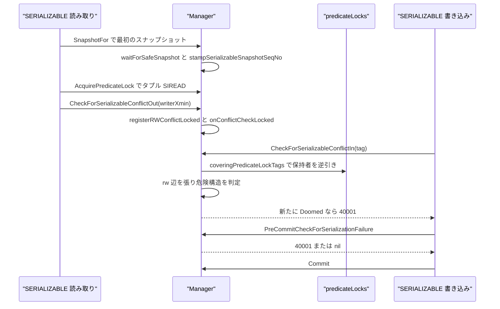
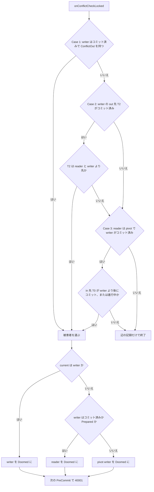

# 直列化可能スナップショット分離

<details>
<summary>関連ソースファイル</summary>

- [`internal/access/transam/ssi.go`](https://github.com/ryogrid/goopg/blob/19856410e8d497d59787e1ab35a2febb3f5953d6/internal/access/transam/ssi.go)
- [`internal/access/transam/ssi_conflict.go`](https://github.com/ryogrid/goopg/blob/19856410e8d497d59787e1ab35a2febb3f5953d6/internal/access/transam/ssi_conflict.go)
- [`internal/access/transam/ssi_precommit.go`](https://github.com/ryogrid/goopg/blob/19856410e8d497d59787e1ab35a2febb3f5953d6/internal/access/transam/ssi_precommit.go)
- [`internal/access/transam/predlock.go`](https://github.com/ryogrid/goopg/blob/19856410e8d497d59787e1ab35a2febb3f5953d6/internal/access/transam/predlock.go)
- [`internal/access/transam/manager.go`](https://github.com/ryogrid/goopg/blob/19856410e8d497d59787e1ab35a2febb3f5953d6/internal/access/transam/manager.go)
- [`internal/access/transam/snapshot.go`](https://github.com/ryogrid/goopg/blob/19856410e8d497d59787e1ab35a2febb3f5953d6/internal/access/transam/snapshot.go)
- [`internal/access/transam/visibility.go`](https://github.com/ryogrid/goopg/blob/19856410e8d497d59787e1ab35a2febb3f5953d6/internal/access/transam/visibility.go)
- [`internal/executor/ssi.go`](https://github.com/ryogrid/goopg/blob/19856410e8d497d59787e1ab35a2febb3f5953d6/internal/executor/ssi.go)
- [`internal/postmaster/txn_verb.go`](https://github.com/ryogrid/goopg/blob/19856410e8d497d59787e1ab35a2febb3f5953d6/internal/postmaster/txn_verb.go)
- [`internal/utils/errcodes/codes.go`](https://github.com/ryogrid/goopg/blob/19856410e8d497d59787e1ab35a2febb3f5953d6/internal/utils/errcodes/codes.go)

</details>

直列化可能スナップショット分離（SSI: Serializable Snapshot Isolation）は、スナップショット分離の性能を保ちながら、直列化可能な実行だけを許す仕組みである。goopg の `Manager` は、SERIALIZABLE トランザクションごとに `SerializableXact` を作り、読み取り時に SIREAD 述語ロックを取得し、読み取りが観測した書き込み者との間に rw 依存（anti-dependency）の辺を張る。書き込み側は述語ロックの保持者を逆引きして同じ辺を張り、新しい辺が 2 本連続する「危険構造（dangerous structure）」を完成させた瞬間に、上流と同じ規則で被害者を 1 つ選んで `Doomed` を立てる。実際のエラーは、文の途中（コミット済みの相手に対して読み書きが危険構造を閉じた場合）か、`PreCommitCheckForSerializationFailure` による COMMIT/PREPARE 時に `SQLSTATE 40001` として表面化する。goopg は `SerializableXact` のコミット済みインスタンスを一定期間保持し、後から別のトランザクションが危険構造を閉じるケース（`R -> W -> T2` / `T0 -> R -> W`）まで検出する。トランザクションの開始と終了は [9.1 トランザクションマネージャ](9.1-Transaction-Manager.md)、可視性と `XidIsConcurrent` は [9.2 スナップショットと可視性](9.2-Snapshot-and-Visibility.md)、行ロックと MultiXact は [9.4 マルチックスアクションと行ロック](9.4-Multixact-and-Row-Locks.md)、サブトランザクションと CLOG は [9.3 CLOG とサブトランザクション](9.3-CLOG-and-Subtransactions.md)、待機とデッドロック検出は [9.6 デッドロック検出](9.6-Deadlock-Detection.md) を参照。

## 責務

- SSI トランザクションの登録と終了。`Begin` が `registerSerializableLocked` を呼び、`finish` が `releaseSerializableLocked` で `FinishedAt` を刻む。RC/RR は登録されず、SSI のコストを払わない。`path:internal/access/transam/ssi.go:Manager.registerSerializableLocked`
- 終了順序の密な採番。`BeginAt` / `FinishedAt` / `SnapshotSeqNo` / `PrepareSeqNo` が同じ `nextCommitSeqNo` から採られ、危険構造の「どちらが先か」を数値比較で決められる。`path:internal/access/transam/ssi.go:ssiState`
- 述語ロックの取得と粗粒化。`AcquirePredicateLock` がタプル → ページ → リレーションの順にロックを管理し、`PredicateLockLimits` の閾値で粗いロックへ昇格する。`path:internal/access/transam/predlock.go:Manager.AcquirePredicateLock`
- 読み取り側の rw 辺。`CheckForSerializableConflictOut` が、読んだタプルの `xmin` / `xmax` の書き込み者が並行 SERIALIZABLE なら `reader.outConflicts` と `writer.inConflicts` に辺を追加する。`path:internal/access/transam/ssi_conflict.go:Manager.CheckForSerializableConflictOut`
- 書き込み側の rw 辺。`CheckForSerializableConflictIn` がタプル/ページ/リレーションのタグから SIREAD 保持者を上方走査し、`R -> W` を張る。`CheckTableForSerializableConflictIn` は TRUNCATE/DROP/REFRESH 用に全粒度を走査する。`path:internal/access/transam/ssi_conflict.go:Manager.CheckForSerializableConflictIn`
- 危険構造の判定と被害者選択。`onConflictCheckLocked` が Case 1〜3 を調べ、`current == writer` なら writer、writer がコミット済み/Prepared なら reader、それ以外は pivot writer を `Doomed` にする。`path:internal/access/transam/ssi_conflict.go:Manager.onConflictCheckLocked`
- コミット時の検査。`PreCommitCheckForSerializationFailure` が `me.inConflicts` の pivot とその `inConflicts` を走査し、2 サイクル/3 サイクルを検出して pivot を doom するか、自分がエラーになる。`path:internal/access/transam/ssi_precommit.go:Manager.PreCommitCheckForSerializationFailure`
- PREPARE TRANSACTION の検査。`PrepareCheckForSerializationFailure` がプリコミット検査の後に `Prepared` と `PrepareSeqNo` を設定する。Prepared の pivot は後から doom できないため、検査側が自滅する。`path:internal/access/transam/ssi_precommit.go:Manager.PrepareCheckForSerializationFailure`
- READ ONLY DEFERRABLE の安全スナップショット。`waitForSafeSnapshot` が、待機開始時に存在した宣言型の読み書き SERIALIZABLE がすべて終わるまでブロックしてからスナップショットを取る。`path:internal/access/transam/ssi.go:Manager.waitForSafeSnapshot`
- 実行演算子からのフック。`ssiRecordTupleRead` / `ssiRecordTupleWrite` / `ssiRecordTupleInsert` / `ssiRecordRelationRead` / `ssiRecordTableWrite` が、スキャンと DML の各点で述語ロックと rw 辺を記録する。`path:internal/executor/ssi.go:ssiRecordTupleRead`
- エラーの表面化。`SerializationFailureError` が upstream 互換の errmsg / DETAIL を持ち、`errcodes.TRSerializationFailure`（`40001`）として wire に送られる。`path:internal/access/transam/ssi_precommit.go:SerializationFailureError`

## 処理フロー

SERIALIZABLE の読み取りは、まず `SnapshotFor` でスナップショットを固定する。読み取り専用 DEFERRABLE なら `waitForSafeSnapshot` がここで待ち、その後 `stampSerializableSnapshotSeqNo` が「このスナップショットより前にコミットした相手」を判定するための水位を記録する。スキャンはタプルごとに `ssiRecordTupleRead` を呼び、タプル粒の SIREAD を取ってから `CheckForSerializableConflictOut` で書き込み者との辺を張る。後から同じタプル（またはページ/リレーション）を書く SERIALIZABLE トランザクションは `CheckForSerializableConflictIn` で保持者を逆引きし、辺を追加した時点で `onConflictCheckLocked` を走らせる。`path:internal/executor/ssi.go:ssiRecordTupleRead` `path:internal/access/transam/ssi_conflict.go:checkForSerializableConflictInLocked`



辺を張るたびに走る `onConflictCheckLocked` は、上流の `OnConflict_CheckForSerializationFailure` と同じ 3 つの形を調べる。Case 1 は「コミット済みの writer がすでに out-conflict を持つ」、Case 2 は「writer が pivot で、その out 先 T2 が reader と writer より先にコミットしている」、Case 3 は「reader が pivot で、in 先 T0 が未コミットか writer 以降にコミットしており、writer はコミット済み」である。検出時は上流と同じ優先順位で被害者を 1 つだけ選ぶ。



COMMIT 時は `finish` が `preCommitCheckForSerializationFailureLocked` を呼ぶ。ここでは自分の `inConflicts` が pivot 候補であり、その `inConflicts` に「自分自身（2 サイクル）」または「まだ進行中で、doom されておらず、READ ONLY でない Tin（3 サイクル）」がいれば危険構造である。pivot がまだ生きていれば pivot を doom し、pivot がすでに Prepared なら自分が `40001` で落ちる。簡易問い合わせ経路は `execCommit` を通らないため、`txn_verb.go` の COMMIT ハンドラが同じ検査を直接呼ぶ。`path:internal/access/transam/ssi_precommit.go:preCommitCheckForSerializationFailureLocked` `path:internal/postmaster/txn_verb.go:applyTransactionVerb`

## 主要ファイル

| ファイル | 役割 |
| --- | --- |
| `internal/access/transam/ssi.go` | `CommitSeqNo`、`SerializableXact`、`ssiState`、`registerSerializableLocked` / `releaseSerializableLocked` / `purgeFinishedSerializableLocked`、`MarkSerializableModes`、`waitForSafeSnapshot`、`stampSerializableSnapshotSeqNo`。`path:internal/access/transam/ssi.go:SerializableXact` |
| `internal/access/transam/ssi_conflict.go` | `CheckForSerializableConflictOut` / `In` / `CheckTableForSerializableConflictIn`、`registerRWConflictLocked`、`onConflictCheckLocked`、`committedBeforeSnapshot`、`coveringPredicateLockTags`。`path:internal/access/transam/ssi_conflict.go:Manager.onConflictCheckLocked` |
| `internal/access/transam/ssi_precommit.go` | `SerializationFailureSQLState`、`SerializationFailureError`、`PreCommitCheckForSerializationFailure`、`PrepareCheckForSerializationFailure`、被害者選択。`path:internal/access/transam/ssi_precommit.go:Manager.PreCommitCheckForSerializationFailure` |
| `internal/access/transam/predlock.go` | `PredicateLockTag`、`PredicateLockLimits`、`AcquirePredicateLock`、`Covers` による粒度階層、粗粒化、解放。`path:internal/access/transam/predlock.go:Manager.AcquirePredicateLock` |
| `internal/access/transam/manager.go` | `Begin` での SSI 登録、`SnapshotFor` での `waitForSafeSnapshot` / `stampSerializableSnapshotSeqNo`、`finish` でのプリコミット検査と解放。`path:internal/access/transam/manager.go:Manager.SnapshotFor` |
| `internal/access/transam/snapshot.go` | `Snapshot.XidIsConcurrent`。読み取りが書き込み者を「並行」と見るか（rw 辺を張るか）の判定。`path:internal/access/transam/snapshot.go:Snapshot.XidIsConcurrent` |
| `internal/access/transam/visibility.go` | `TupleVisible`。SSI フックが可視/不可視を判断する基礎。`path:internal/access/transam/visibility.go:TupleVisible` |
| `internal/executor/ssi.go` | `ssiActive`、`ssiRecordTupleRead` / `Write` / `Insert` / `RelationRead` / `InvisibleTupleRead` / `TableWrite`、hash/GiST/GIN 用の合成ページロック、`ssiPreCommitCheck`。`path:internal/executor/ssi.go:ssiRecordTupleWrite` |
| `internal/postmaster/txn_verb.go` | `BEGIN ISOLATION LEVEL SERIALIZABLE` のトランザクション差し替え、`MarkSerializableModes`、簡易問い合わせ COMMIT 経路でのプリコミット検査。`path:internal/postmaster/txn_verb.go:applyTransactionVerb` |
| `internal/utils/errcodes/codes.go` | `TRSerializationFailure = "40001"` と、そのエラークラス割り当て。`path:internal/utils/errcodes/codes.go:TRSerializationFailure` |

## 公開 API / エントリポイント

```go
func (m *Manager) MarkSerializableModes(handle TxnHandle, readOnly, deferrable bool)
func (m *Manager) SerializableXact(handle TxnHandle) *SerializableXact
func (m *Manager) SerializableXactCount() int

func (m *Manager) AcquirePredicateLock(handle TxnHandle, tag PredicateLockTag) bool
func (m *Manager) HoldsPredicateLock(handle TxnHandle, tag PredicateLockTag) bool
func (m *Manager) PredicateLockCount(handle TxnHandle) int
func (m *Manager) SetPredicateLockLimits(limits PredicateLockLimits)
func (m *Manager) PredicateLockLimits() PredicateLockLimits

func (m *Manager) CheckForSerializableConflictOut(readerHandle TxnHandle, writerXID storage.TransactionID) bool
func (m *Manager) CheckForSerializableConflictOutReportingFailure(readerHandle TxnHandle, writerXID storage.TransactionID) error
func (m *Manager) CheckForSerializableConflictIn(writerHandle TxnHandle, tag PredicateLockTag) bool
func (m *Manager) CheckForSerializableConflictInReportingFailure(writerHandle TxnHandle, tag PredicateLockTag) error
func (m *Manager) CheckTableForSerializableConflictIn(writerHandle TxnHandle, db, rel uint32) bool
func (m *Manager) CheckTableForSerializableConflictInReportingFailure(writerHandle TxnHandle, db, rel uint32) error

func (m *Manager) PreCommitCheckForSerializationFailure(handle TxnHandle) error
func (m *Manager) PrepareCheckForSerializationFailure(handle TxnHandle) error
func IsSerializationFailure(err error) bool

func (e *SerializationFailureError) PrimaryMessage() string
func (e *SerializationFailureError) Detail() string
func (e *SerializationFailureError) SQLSTATE() string

func ssiRecordTupleRead(ctx *Context, rel storage.RelFileNode, block storage.BlockNumber, slot uint16, writerXmin, writerXmax storage.TransactionID) error
func ssiRecordTupleWrite(ctx *Context, rel storage.RelFileNode, block storage.BlockNumber, slot uint16) error
func ssiRecordTupleInsert(ctx *Context, rel storage.RelFileNode, block storage.BlockNumber) error
func ssiRecordRelationRead(ctx *Context, rel storage.RelFileNode)
func ssiRecordInvisibleTupleRead(ctx *Context, rel storage.RelFileNode, xmin storage.TransactionID) error
func ssiRecordTableWrite(ctx *Context, rel storage.RelFileNode) error
func ssiPreCommitCheck(ctx *Context, tx transam.Transaction) error
```

`AcquirePredicateLock` はタグの粒度が無効（`Rel == 0`）なら false を返し、SERIALIZABLE の登録がないハンドルでも false を返す。既により粗いロックが同じ対象を覆っていれば追加せず（true）、新しいロックが既存の細かいロックを覆うならそれらを detach してから取り付ける。`SetPredicateLockLimits` は 0 以下の値をフィールド単位で無視するため、一部の次元だけを上書きできる。`path:internal/access/transam/predlock.go:Manager.AcquirePredicateLock`

## 主要データ構造

### `SerializableXact` — SSI の台帳 1 件

```go
type SerializableXact struct {
	// Handle is the owning transaction's manager-internal handle.
	// Stable for the SerializableXact's lifetime.
	Handle TxnHandle

	// XID is the assigned top-level XID, or InvalidTransactionID
	// while the SERIALIZABLE transaction is still read-only. Mirrors
	// PostgreSQL's `SERIALIZABLEXACT.topXid`; updated atomically by
	// Manager.AssignXID when the transaction first writes.
	XID storage.TransactionID

	// FinishedAt records the commit sequence number assigned when
	// the SERIALIZABLE transaction finishes. Zero (InvalidCommitSeqNo)
	// while in-flight. M0104-0006 uses the dense ordering to evaluate
	// the dangerous-structure test on the rw-conflict graph.
	FinishedAt CommitSeqNo

	// Doomed is set when M0104-0004/0005 conflict tracking detects a
	// rw-edge configuration that mandates rollback. The pre-commit
	// check (M0104-0006) consults this flag and aborts with SQLSTATE
	// 40001. M0104-0002 only allocates the field; production callers
	// never set it yet.
	Doomed bool

	// BeginAt is the dense sequence stamp assigned when the
	// SerializableXact registers (Begin). It mirrors the "snapshot
	// point" upstream tracks via SxactGlobalXmin: a committed xact C is
	// retained (M0118-0001) only while some still-active xact A began
	// before C finished (A.BeginAt < C.FinishedAt), because only such an
	// A can still form a dangerous rw-conflict with C. BeginAt and
	// FinishedAt share one monotonic counter so the two are directly
	// comparable for the overlap test in purgeFinishedSerializableLocked.
	BeginAt CommitSeqNo

	// SnapshotSeqNo is the dense counter watermark captured when this
	// SERIALIZABLE xact takes its FIRST statement snapshot (deferred to the
	// first non-BEGIN statement, NOT at Begin — see manager.SnapshotFor). It
	// mirrors PostgreSQL's SERIALIZABLEXACT.SeqNo.lastCommitBeforeSnapshot
	// (predicate.c): a peer P committed strictly before this xact's snapshot
	// iff P.FinishedAt < SnapshotSeqNo, because FinishedAt and SnapshotSeqNo
	// draw from the same monotonic nextCommitSeqNo (see committedBeforeSnapshot).
	// Used ONLY by the READ ONLY de-facto optimisation in onConflictCheckLocked
	// (a declared READ ONLY reader cannot close a dangerous structure to a T2
	// that committed after its snapshot). InvalidCommitSeqNo until the snapshot
	// is taken. M0118-0001 (receipt-report).
	SnapshotSeqNo CommitSeqNo

	// ConflictOut mirrors PostgreSQL's SXACT_FLAG_CONFLICT_OUT
	// (predicate.c). It is set at commit when this (now committed) xact
	// holds an rw-conflict OUT to an already-committed peer — i.e. it is
	// the W in `R -> W -> T2` with both W and T2 committed. A later
	// reader R that reads W's data then trips Case 1 of
	// onConflictCheckLocked. Only meaningful once FinishedAt is stamped.
	ConflictOut bool

	// inConflicts / outConflicts are the rw-edge slices that
	// M0104-0004 / M0104-0005 will populate. The lifecycle slice
	// leaves them nil — the SSI graph is empty until conflict-in /
	// conflict-out hooks land.
	//
	// Stored as []*SerializableXact (not handles or XIDs) to match
	// PostgreSQL's SHM list layout, where each edge directly
	// addresses the peer SerializableXact. Cleanup on finish() must
	// rip the dying xact out of its peers' slices to prevent
	// dangling pointers once predicate.c-style sharing lands.
	inConflicts  []*SerializableXact
	outConflicts []*SerializableXact

	// predicateLocks is the set of SIREAD predicate-lock targets
	// owned by this transaction. M0104-0003 populates it via
	// Manager.AcquirePredicateLock; entries are pruned in place when
	// coarsening promotes finer locks. Stored as a set (not a slice)
	// so coverage checks and de-duplication on acquire are O(1) per
	// owned tag, and so detachPredicateLockLocked can remove a tag in
	// place during release/coarsening without slice reshuffling. The
	// map is nil for read-only-on-this-target xacts so RC/RR /
	// non-SERIALIZABLE workloads pay no allocation; first acquire
	// initialises it.
	predicateLocks map[PredicateLockTag]struct{}

	// ReadOnly / Deferrable record the declared transaction modes (BEGIN
	// ... READ ONLY DEFERRABLE), set by Manager.MarkSerializableModes right
	// after Begin. ReadOnly mirrors PostgreSQL's SXACT_FLAG_READ_ONLY: it marks
	// the xact as a non-writer for SSI purposes regardless of whether it has
	// assigned an XID yet, so a concurrent READ ONLY DEFERRABLE peer does not
	// wait on it. Deferrable requests the GetSafeSnapshot deferral in
	// SnapshotFor — the read-only xact blocks until every concurrent
	// declared-read-write SERIALIZABLE xact has finished, then takes a safe
	// snapshot that can never form a dangerous structure (so it is never
	// aborted with 40001). M0118-0001 (read-only-anomaly-3).
	ReadOnly   bool
	Deferrable bool

	// Prepared mirrors PostgreSQL's SXACT_FLAG_PREPARED. It is set when a
	// SERIALIZABLE transaction passes its pre-commit dangerous-structure check
	// at PREPARE TRANSACTION time (same-backend 2PC, M0118-0009) and stays open
	// awaiting COMMIT/ROLLBACK PREPARED. A still-in-flight pivot that is already
	// Prepared cannot be doomed by a later committer (the pivot is durably
	// committed-to-disk in upstream and may yet COMMIT PREPARED), so that
	// committer must abort itself instead — see
	// preCommitCheckForSerializationFailureLocked (predicate.c line ~4756,
	// "Canceled on commit attempt with conflict in from prepared pivot").
	// Only set on the PREPARE path; a normal COMMIT finishes immediately and is
	// gated out by FinishedAt, so it never needs this flag.
	Prepared bool

	// PrepareSeqNo is the dense sequence stamp assigned when Prepared is set,
	// drawn from the same nextCommitSeqNo counter as FinishedAt/BeginAt/
	// SnapshotSeqNo. It mirrors PostgreSQL's SERIALIZABLEXACT.prepareSeqNo
	// (predicate.c). For a *committed* xact upstream tracks prepareSeqNo and
	// commitSeqNo separately; goopg collapses both into FinishedAt for the
	// already-passing specs, so prepareSeqNo(sx) returns FinishedAt once the xact
	// commits and PrepareSeqNo only while it is prepared-but-not-committed.
	// InvalidCommitSeqNo until PREPARE TRANSACTION. M0118-0009.
	PrepareSeqNo CommitSeqNo
}
```

`path:internal/access/transam/ssi.go:SerializableXact`

`Handle` はトランザクションの寿命中有効で、`XID` は書き込みが始まるまで 0 である。`FinishedAt` が 0 なら進行中、非 0 なら終了済みで、その値がコミット順序になる（アボートにも採番される）。`BeginAt` と `FinishedAt` が同じカウンタなので、保持期間の判定 `c.FinishedAt > minActiveBegin` が直接比較で書ける。`SnapshotSeqNo` は最初のスナップショット取得時に**消費せずに読むだけ**の水位で、READ ONLY の最適化が「相手がスナップショットより前にコミットしたか」を判定するのに使う。`inConflicts` / `outConflicts` は辺の両方向で、`Doomed` は被害者に立てる遅延アボートのフラグである。

### `ssiState` — アクティブ集合と保持済み集合

```go
type ssiState struct {
	// xacts maps the SERIALIZABLE transaction's handle to its
	// SerializableXact bookkeeping object. It holds only ACTIVE
	// (in-flight) xacts — committed xacts are moved to `finished` and
	// aborted xacts are dropped, both at release. Read-only/Read-committed
	// /Repeatable-read transactions never appear here.
	xacts map[TxnHandle]*SerializableXact

	// finished retains COMMITTED SerializableXacts (M0118-0001) past
	// their commit so the dangerous-structure check can still reach them
	// while a concurrent xact might form a new rw-conflict against them
	// (the `R -> W -> T2` / `T0 -> R -> W` pivots where a partner has
	// already committed). Mirrors upstream's deferred cleanup of finished
	// SERIALIZABLEXACTs (predicate.c ClearOldPredicateLocks /
	// SxactGlobalXmin). Stored as a pointer slice — NOT keyed by handle —
	// because proc-slot handles are reused by later Begins while a
	// committed xact is still retained; rw-edges already address peers by
	// *SerializableXact, so the pointer slice has no handle-aliasing
	// hazard. purgeFinishedSerializableLocked drops entries once no active
	// xact overlaps them. Aborted xacts are never retained here.
	finished []*SerializableXact

	// nextCommitSeqNo is the next dense sequence number stamped onto
	// BeginAt (at register) and FinishedAt (at finish). Starts at 1; 0 is
	// reserved as InvalidCommitSeqNo. A single shared counter keeps
	// BeginAt and FinishedAt comparable for the retention overlap test.
	nextCommitSeqNo CommitSeqNo

	// initOnce guards lazy allocation of the xacts map. Avoids
	// charging the map cost to RC/RR-only workloads.
	initOnce sync.Once
}
```

`path:internal/access/transam/ssi.go:ssiState`

`xacts` はハンドル引きのアクティブ集合、`finished` はハンドルをキーにしないポインタ列である。これは proc スロットのハンドルが再利用され得る一方、辺が `*SerializableXact` を直接指しているため、ハンドルの別名衝突を避ける必要があるからだ。`nextCommitSeqNo` は 1 から始まり、`BeginAt` と `FinishedAt` の両方に使われる単一のカウンタである。`purgeFinishedSerializableLocked` は「アクティブな xact が 1 つも無い」または「保持済み xact の `FinishedAt` が全アクティブの最小 `BeginAt` 以下」になったとき、その xact を peer から剥がして捨てる。

### `PredicateLockTag` — SIREAD の対象

```go
type PredicateLockTag struct {
	DB     uint32
	Rel    uint32
	Page   storage.BlockNumber
	Offset uint16
}
```

`path:internal/access/transam/predlock.go:PredicateLockTag`

sentinel フィールドで粒度を表す。`Rel == 0` は無効、`Page == InvalidBlockNumber` はリレーション粒、`Page` 有効かつ `Offset == 0` はページ粒、`Offset != 0` はタプル粒である。`Covers` は「保持しているタグが他のタグを包含するか」を返し、リレーションは同じリレーションの全ページ/タプルを、ページは同じページの全タプルを覆う。`DB` と `Rel` は完全一致が必要である。`path:internal/access/transam/predlock.go:PredicateLockTag.Covers`

### `SerializationFailureError` — 40001 の型

```go
type SerializationFailureError struct {
	// Reason is the upstream-style "Reason code" detail string. The
	// PostgreSQL message uses fixed phrases per detection site; goopg
	// reuses those phrases so test scaffolding written against upstream
	// errordetail can recognise the goopg variant verbatim.
	Reason string
}
```

`path:internal/access/transam/ssi_precommit.go:SerializationFailureError`

`PrimaryMessage` は `could not serialize access due to read/write dependencies among transactions` を返し、`Detail` は `Reason code: <Reason>.` を返す。`Error()` は Go 側のログ用に理由を括弧で付けるが、wire に出すのは `PrimaryMessage` + DETAIL である。`SQLSTATE()` は `SerializationFailureSQLState`（`"40001"`）を返す。`path:internal/access/transam/ssi_precommit.go:SerializationFailureError.Detail`

## 内部構造

**3 つの危険構造と被害者の選び方。** Case 1 は、コミット済み writer が `ConflictOut`（すでにコミットした相手への out 辺）を持つ状態で、reader がその writer のデータを読むと完成する。Case 2 は writer が pivot で、その out 先 T2 が自分より先にコミットしている場合。Case 3 は reader が pivot で、in 先 T0 とコミット済み writer が連鎖する場合である。被害者は `current == writer` なら writer、writer がコミット済みまたは Prepared なら reader、それ以外は pivot writer になる。`path:internal/access/transam/ssi_conflict.go:onConflictCheckLocked`

**保持期間の不変条件。** コミット済み `SerializableXact` は、それを観測し得るアクティブな xact が存在する間だけ `finished` に残る。判定は `c.FinishedAt <= minActiveBegin` で、これが真なら「その xact が終わった時点で、まだ始まっていない xact しかいない」ので、新しい危険構造は作れない。保持中は predicate lock の**所有タグ集合**を残し、グローバルな holder 集合からは外す。これにより、新しい Begin が同じ proc ハンドルを再利用しても、保持済み xact のロックが新しい xact に別名で紐づかない。`path:internal/access/transam/ssi.go:purgeFinishedSerializableLocked`

**READ ONLY の de-facto 最適化。** 宣言型 READ ONLY の reader がコミット済み writer のデータを読む場合、通常は rw 辺を張らない（reader は「先に走った」とみなせる）。ただし writer 自身が、reader のスナップショットより前にコミットした T2 への out 辺を持つなら、`R -> W -> T2` が完成し得るので辺を張る。この判定が `committedBeforeSnapshot` で、`FinishedAt < SnapshotSeqNo` を比較する。Case 2/3 でも READ ONLY 側の相手について同じ制約を課す。`path:internal/access/transam/ssi_conflict.go:committedBeforeSnapshot`

**2 サイクルと 3 サイクル。** プリコミット検査は、自分の in 辺の先を pivot とみなし、pivot の in 辺に「自分自身」がいれば write-skew の 2 サイクル、まだ進行中の非 READ ONLY な Tin がいれば 3 サイクルとして危険と判定する。pivot がすでに終了/doomed なら飛ばす。pivot が Prepared なら doom できず、検査している自分が `Canceled on commit attempt with conflict in from prepared pivot` で落ちる。`path:internal/access/transam/ssi_precommit.go:preCommitCheckForSerializationFailureLocked`

**読み取りフックの粒度。** 通常のタプル読み取りはタプル粒 SIREAD を取り、`xmin`（挿入者）と、異なれば `xmax`（削除/更新者）の両方に対して conflict-out を試す。不可視タプル（進行中/スナップショット後の挿入）でも、スキャンが物理的に見たなら `ssiRecordInvisibleTupleRead` が `xmin` との辺を張る。これは INSERT-before-READ のファントムを捕まえるためで、述語ロックは取らない（リレーション粒ロックが既に全体を覆っている）。`path:internal/executor/ssi.go:ssiRecordInvisibleTupleRead`

**書き込みフックの上方走査。** `CheckForSerializableConflictIn` はタプルタグから `coveringPredicateLockTags` で「タプル → ページ → リレーション」を列挙し、各タグの holder 集合を調べる。新規 INSERT はタプル粒ではなくページ粒から始める（`ssiRecordTupleInsert`）。新しい TID のタプル粒 SIREAD は、VACUUM 後にスロットを再利用した別の行の残骸であり得るため、偽の競合を避ける。TRUNCATE/DROP/REFRESH は `ssiRecordTableWrite` が全粒度を走査する。`path:internal/executor/ssi.go:ssiRecordTupleInsert`

**索引の合成ページロック。** goopg は hash/GiST/GIN を物理的には B-tree 基板で持つ（またはカタログのみ）ため、上流の索引ページ粒度をそのまま再現できない。代わりに、キーを FNV で 31 ビットの擬似ページに写し、索引 OID を述語ロックの `Rel` にしてヒープのタグと衝突させない。hash はキー、GiST は 256 単位のグリッドセル、GIN はキーごとのページ（fastupdate=on なら固定 sentinel ページ `0x7FFFFFFE`）を使う。衝突は偽陽性（安全側の過剰アボート）にしかならない。`path:internal/executor/ssi.go:ssiHashBucket`

**PREPARE の扱い。** `PrepareCheckForSerializationFailure` はプリコミット検査を通った後に `Prepared=true` と `PrepareSeqNo` を設定する。Prepared の xact は後から doom されると COMMIT PREPARED できなくなるため、上流は「Prepared の pivot を doom する代わりに、検査している側が落ちる」という規則にする。`onConflictCheckLocked` の Case 2/3 にも `t2.Prepared` / `writer.Prepared` の枝があり、`PrepareSeqNo` を比較して同じ結論を出す。`path:internal/access/transam/ssi_precommit.go:Manager.PrepareCheckForSerializationFailure`

**安全スナップショットの待機範囲。** `waitForSafeSnapshot` は自分が `ReadOnly && Deferrable` のときだけ動き、待機開始時点でアクティブな「非 READ ONLY の SERIALIZABLE」だけを `waitOn` に入れる。待機中に始まった writer は集合に加わらない（上流が登録時点の writer だけを enrollment するのと同じ）。待機中は `IPC:SafeSnapshot` を報告する。goopg は `ROSafe` にしか分岐せず、`ROUnsafe` の早期アボート/再試行は実装していない。`path:internal/access/transam/ssi.go:Manager.waitForSafeSnapshot`

**40001 の出し分け。** 文の途中で読者が危険構造を閉じた場合は `CheckForSerializableConflictOutReportingFailure` が `Reader.Doomed` の遷移を見て `SerializationFailureError` を返し、`ssiReadAbortError` が `ExecError{Code: "40001", Detail: ..., Hint: "The transaction might succeed if retried."}` に変換する。書き込み側も同様に `CheckForSerializableConflictInReportingFailure` が新たな doom を検出する。それ以外の遅延 doom は COMMIT のプリコミット検査で表面化する。`path:internal/executor/ssi.go:ssiReadAbortError`

## エッジケースと不変条件

- **自分自身との競合は作らない。** conflict-out は `reader.XID == writerXID` を、conflict-in は `holder == writerHandle` を除外する。自分が読んだ対象を自分で書いても辺にならない。`path:internal/access/transam/ssi_conflict.go:checkForSerializableConflictOutLocked`
- **システム XID は SSI に参加しない。** `InvalidTransactionID` / `BootstrapTransactionID` / `FrozenTransactionID` は conflict-out の入口で捨てられる。`path:internal/access/transam/ssi_conflict.go:checkForSerializableConflictOutLocked`
- **RC/RR の書き込み者は辺にならない。** writer が `ssiState.xacts` にも `finished` にも見つからなければ conflict-out は false を返す。RC/RR は SSI のサイクルに入れないためである。`path:internal/access/transam/ssi_conflict.go:serializableXactByXIDLocked`
- **スナップショットが既にコミットを見ている場合は辺を張らない。** `readerSnapshotSeesWriterAsConcurrentLocked` が `Snapshot.XidIsConcurrent` を呼び、false（＝取得前にコミット済み）なら wr 依存であって rw 依存ではない。スナップショットがまだ無い場合は保守的に concurrent=true とする。`path:internal/access/transam/ssi_conflict.go:readerSnapshotSeesWriterAsConcurrentLocked`
- **辺は冪等。** `registerRWConflictLocked` は `from.outConflicts` に同じポインタがあれば false を返し、追加しない。`inConflicts` への追加も同じ 1 回だけ行う。`path:internal/access/transam/ssi_conflict.go:registerRWConflictLocked`
- **既に doom 済みなら即エラー。** `CheckForSerializableConflictOutReportingFailure` は入口で `reader.Doomed` を見て `Canceled on identification as a pivot, during conflict out checking` を返す。読者は以降のタプルを読む前に死ぬ。`path:internal/access/transam/ssi_conflict.go:CheckForSerializableConflictOutReportingFailure`
- **コミット済み writer は reader を殺す。** writer がコミット済みまたは Prepared なら、その writer はもう abort できないので、危険構造を閉じた reader が `Canceled on conflict out to pivot, during read` で落ちる。`path:internal/access/transam/ssi_conflict.go:onConflictCheckLocked`
- **pivot が終了済みならスキップ。** プリコミット検査は `pivot.FinishedAt != InvalidCommitSeqNo` または `pivot.Doomed` の pivot を飛ばす。終了した xact の結末はもう変わらず、再度 doom する意味がない。`path:internal/access/transam/ssi_precommit.go:preCommitCheckForSerializationFailureLocked`
- **READ ONLY は pivot になれない。** Case 3 は `!reader.ReadOnly` でゲートされる。READ ONLY は書き込みを行わないため、他トランザクションがその xact へ rw 辺を張ることはない。`path:internal/access/transam/ssi_conflict.go:onConflictCheckLocked`
- **保持済み reader との辺も張る。** conflict-in は `ssiState.finished` のコミット済み reader も走査し、`reader.FinishedAt > writer.BeginAt`（寿命が重なる）場合だけ辺を張る。重ならない reader は直列順序と整合するので無視する。`path:internal/access/transam/ssi_conflict.go:checkForSerializableConflictInLocked`
- **リレーション全体の書き込みは全粒度を探す。** `CheckTableForSerializableConflictIn` は `tag.DB == db && tag.Rel == rel` の全タグを走査する。タプル粒 SIREAD しか持たない reader でも、REFRESH MATERIALIZED VIEW のような一括書き換えと競合できる。`path:internal/access/transam/ssi_conflict.go:CheckTableForSerializableConflictIn`
- **システムカタログはリレーション粒 SIREAD を取らない。** `ssiRecordRelationRead` は `catalog.IsSystemRelation(rel.RelOid)` を除外する。システムカタログへの読み取りがファントム競合を生まないようにするためである。`path:internal/executor/ssi.go:ssiRecordRelationRead`
- **無効タグは無視する。** `ssiRecordTupleRead` と `ssiRecordTupleWrite` は `InvalidBlockNumber` やスロット 0 を弾く。`TupleLockTag` が panic する入力を作らないためのガードである。`path:internal/executor/ssi.go:ssiRecordTupleRead`
- **述語ロックの粗粒化閾値。** `DefaultPredicateLockLimits` は `PerXact=64`、`PerRelation=32`、`PerPage=2`。同じページのタプルロックが 2 個を超えるとページへ、同じリレーションのページロックが 32 個を超えるとリレーションへ昇格し、合計が 64 を超えると最も太いリレーションを昇格させる。`path:internal/access/transam/predlock.go:DefaultPredicateLockLimits`
- **READ ONLY DEFERRABLE は待ち続けない。** 待機対象は開始時点のアクティブ writer だけで、`ssiCond` が終了ごとに broadcast する。`ROUnsafe` の早期アボートは無いため、待機が長引く可能性はあるが、安全性は `ROSafe` スナップショットで保証される。`path:internal/access/transam/ssi.go:Manager.waitForSafeSnapshot`
- **40001 の文言は 2 層。** `PrimaryMessage` は理由を含まない upstream の errmsg、`Detail` は `Reason code: ...` である。isolationtester は DETAIL を出さず、psql は出す。wire 実装は `txn_verb.go` と `ssiReadAbortError` の両方でこの形に揃えている。`path:internal/utils/errcodes/codes.go:TRSerializationFailure`

Sources:

- internal/access/transam/ssi.go
- internal/access/transam/ssi_conflict.go
- internal/access/transam/ssi_precommit.go
- internal/access/transam/predlock.go
- internal/access/transam/manager.go
- internal/access/transam/snapshot.go
- internal/access/transam/visibility.go
- internal/executor/ssi.go
- internal/postmaster/txn_verb.go
- internal/utils/errcodes/codes.go

<sub>Generated by deepwiki-4myself from `goopg` @ `19856410e`</sub>
