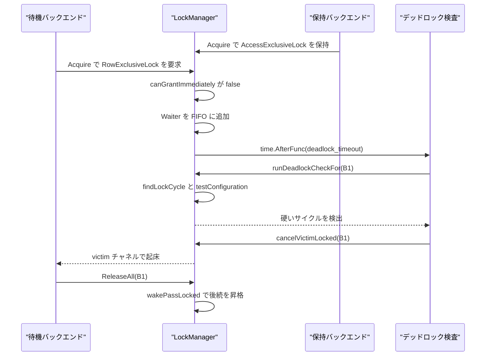
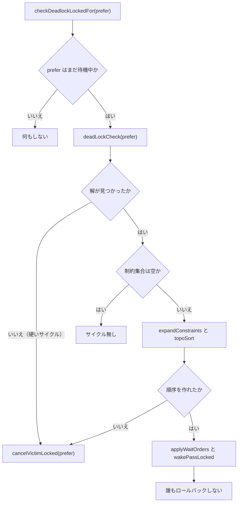
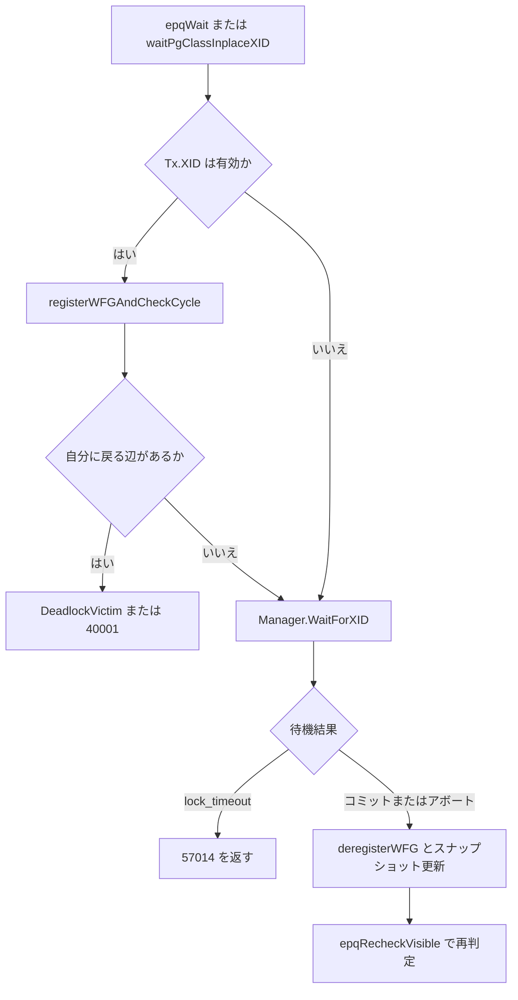

# デッドロック検出

<details>
<summary>関連ソースファイル</summary>

- [`internal/storage/lmgr/lockmgr.go`](https://github.com/ryogrid/goopg/blob/19856410e8d497d59787e1ab35a2febb3f5953d6/internal/storage/lmgr/lockmgr.go)
- [`internal/storage/lmgr/deadlock.go`](https://github.com/ryogrid/goopg/blob/19856410e8d497d59787e1ab35a2febb3f5953d6/internal/storage/lmgr/deadlock.go)
- [`internal/storage/lmgr/fastpath.go`](https://github.com/ryogrid/goopg/blob/19856410e8d497d59787e1ab35a2febb3f5953d6/internal/storage/lmgr/fastpath.go)
- [`internal/storage/lmgr/lockwait/lockwait.go`](https://github.com/ryogrid/goopg/blob/19856410e8d497d59787e1ab35a2febb3f5953d6/internal/storage/lmgr/lockwait/lockwait.go)
- [`internal/executor/operators_storage.go`](https://github.com/ryogrid/goopg/blob/19856410e8d497d59787e1ab35a2febb3f5953d6/internal/executor/operators_storage.go)
- [`internal/executor/relation_locks.go`](https://github.com/ryogrid/goopg/blob/19856410e8d497d59787e1ab35a2febb3f5953d6/internal/executor/relation_locks.go)
- [`internal/postmaster/cancel.go`](https://github.com/ryogrid/goopg/blob/19856410e8d497d59787e1ab35a2febb3f5953d6/internal/postmaster/cancel.go)
- [`internal/utils/activity/activity.go`](https://github.com/ryogrid/goopg/blob/19856410e8d497d59787e1ab35a2febb3f5953d6/internal/utils/activity/activity.go)
- [`internal/utils/activity/stats/counter.go`](https://github.com/ryogrid/goopg/blob/19856410e8d497d59787e1ab35a2febb3f5953d6/internal/utils/activity/stats/counter.go)
- [`internal/utils/errcodes/codes.go`](https://github.com/ryogrid/goopg/blob/19856410e8d497d59787e1ab35a2febb3f5953d6/internal/utils/errcodes/codes.go)

</details>

goopg のデッドロック検出は 2 層に分かれている。第 1 層は `internal/storage/lmgr` の heavyweight ロックマネージャで、待機中の `Acquire` が `deadlock_timeout` を超えるとタイマーが `runDeadlockCheckFor` を起動し、待機キューと保持者のグラフからサイクルを探す。ここでは上流と同じく「保持者を待つ硬い辺（hard edge）」と「同じキューの先行待機者を待つ柔らかい辺（soft edge）」を区別し、柔らかい辺だけのサイクルは待機キューの並べ替えで解消して誰もロールバックしない。硬いサイクルだけが被害者を 1 つ選び、`ErrDeadlockDetected` として `40P01` に写像される。第 2 層は executor の XID 待機用 wait-for graph で、EPQ の行待ちや pg_class の in-place 待ちのように heavyweight ロックを取らない待機を `registerWFGAndCheckCycle` が記録し、最大 64 ホップの探索でサイクルを見つける。待機時間の上限は別系統の `lock_timeout`（`lockwait.ErrLockTimeout`、SQLSTATE 57014）が担い、`deadlock_timeout` によるサイクル検出とは独立している。行ロックの取得は [9.4 マルチックスアクションと行ロック](9.4-Multixact-and-Row-Locks.md)、待機相手の可視性は [9.2 スナップショットと可視性](9.2-Snapshot-and-Visibility.md)、トランザクション終了とアボートは [9.1 トランザクションマネージャ](9.1-Transaction-Manager.md)、サブトランザクションは [9.3 CLOG とサブトランザクション](9.3-CLOG-and-Subtransactions.md)、SSI の危険構造検査は [9.5 直列化可能スナップショット分離](9.5-SSI.md) を参照。

## 責務

- 待機の登録と FIFO キュー。`Acquire` が即時 grant できない場合に `Waiter` を作って `lockState.waiters` の末尾に積み、`signal` / `victim` / `lock_timeout` / `ctx.Done()` の 4 択で待つ。`path:internal/storage/lmgr/lockmgr.go:LockManager.acquire`
- タイマーによる検出の起動。`Acquire` が `time.AfterFunc(timeout, func() { lm.runDeadlockCheckFor(b) })` を設定し、待機開始から `deadlock_timeout` 経過後に検出を走らせる。`path:internal/storage/lmgr/lockmgr.go:LockManager.acquire`
- 硬い辺と柔らかい辺のサイクル探索。`findLockCycle` が保持者への hard edge と、キューの先行者への soft edge を区別して探索し、サイクルに含まれる soft edge を返す。`path:internal/storage/lmgr/deadlock.go:LockManager.findLockCycle`
- 待機キュー再配列による解決。`deadLockCheck` / `testConfiguration` / `expandConstraints` / `topoSort` が soft edge を制約として取り込み、FIFO 順を最小限に崩す死鎖のない順序を探す。`path:internal/storage/lmgr/deadlock.go:LockManager.deadLockCheck`
- 被害者の選択と起床。硬いサイクルではタイマーを起動したバックエンドを `cancelVictimLocked` でキューから抜き、`victim` チャネルで起こす。同期経路（`CheckDeadlocksNow`）はサイクル内で最大の `BackendID` を選ぶ。`path:internal/storage/lmgr/deadlock.go:LockManager.cancelVictimLocked`
- 即時デッドロックの同期検出。`hasSimpleDeadlock` が「自分が保持するロックを待つ先行者がいて、その先行者が保持するロックを自分が待つ」形を `Acquire` の enqueue 前に検出し、待たずに `ErrDeadlockDetected` を返す。`path:internal/storage/lmgr/lockmgr.go:lockState.hasSimpleDeadlock`
- XID 待機の wait-for graph。`registerWFGAndCheckCycle` が `waitingXID -> blockingXID` の辺を追加し、最大 `maxWFGHops=64` ホップで自分に戻るかを調べる。`path:internal/executor/operators_storage.go:registerWFGAndCheckCycle`
- 待機上限の分離。`lockwait.Timeout` が ctx に載った `lock_timeout` を返し、`Acquire` はその期限で `ErrLockTimeout` を返す。`statement_timeout` の ctx キャンセルとは別の経路である。`path:internal/storage/lmgr/lockwait/lockwait.go:Timeout`
- 待機イベントの公開。`activity.WaitTypeLock` と `WaitRelationLock` / `WaitTupleLock` / `WaitTransactionID` などが `pg_stat_activity` の待機種別になる。`path:internal/utils/activity/activity.go:WaitRelationLock`
- バックエンドのキャンセル。`cancelEntry` がクエリ単位の `queryCancel` と接続全体の `terminate` を保持し、`CancelRequest` の secret key 検証付きキャンセルと、`pg_cancel_backend` / `pg_terminate_backend` の特権経路を提供する。`path:internal/postmaster/cancel.go:cancelEntry`
- エラーコードへの写像。`lmgr.ErrDeadlockDetected` は `errcodes.TRDeadlockDetected`（`40P01`）として表面化し、executor の WFG 検出は `40001` を返す。`path:internal/utils/errcodes/codes.go:TRDeadlockDetected`
- ロック状態の可視化。`AllLocks` が holder と waiter を `LockHolding` に展開し、`relation_locks.go` が RELATION タグだけを `pg_locks` 行に変換する。`path:internal/storage/lmgr/lockmgr.go:LockManager.AllLocks`

## 処理フロー

heavyweight ロックの待機は、`Acquire` が即時 grant を試し、失敗したら `Waiter` を FIFO に積んでタイマーを張るところから始まる。タイマーが発火すると、発火したバックエンドを起点に `deadLockCheck` が走り、柔らかい辺の反転を試す。解が見つかれば `applyWaitOrders` がキューを並べ替えて `wakePassLocked` で昇格可能な待機者を起こす。硬いサイクルなら発火したバックエンドが被害者になり、`Acquire` は `ErrDeadlockDetected` で戻る。`path:internal/storage/lmgr/lockmgr.go:LockManager.acquire` `path:internal/storage/lmgr/deadlock.go:LockManager.checkDeadlockLockedFor`



検出器の分岐は「サイクルが解けるか」の 1 点に集約される。`deadLockCheck` は解なし（硬いデッドロック）なら `resolved=false` を返し、呼び出し側が発火バックエンドを被害者にする。解ありでも制約集合が空なら「発火バックエンドを含むサイクルは無い」ので何もしない。制約がある場合は `expandConstraints` で待機キュー順に展開し、`applyWaitOrders` で並べ替える。



executor 側の XID 待機は heavyweight ロックを取らないため、別の待機グラフを使う。`epqWait` と `waitPgClassInplaceXID` は待機前に `registerWFGAndCheckCycle` で辺を登録し、サイクルが閉じたら待たずにデッドロックとして扱う。閉じなければ `Manager.WaitForXID` でコミット/アボートを待ち、終了後に `deregisterWFG` で辺を消す。`path:internal/executor/operators_storage.go:epqWait` `path:internal/executor/operators_storage.go:waitPgClassInplaceXID`



## 主要ファイル

| ファイル | 役割 |
| --- | --- |
| `internal/storage/lmgr/lockmgr.go` | `LockManager`、`lockState`、`Waiter`、`Mode` / `LockTag`、`Acquire` / `TryAcquire` / `Release` / `ReleaseAll`、`hasSimpleDeadlock`、`wakePassLocked`、`AllLocks`。`path:internal/storage/lmgr/lockmgr.go:LockManager` |
| `internal/storage/lmgr/deadlock.go` | `CheckDeadlocksNow`、`runDeadlockCheckFor`、`findLockCycle`、`testConfiguration`、`deadLockCheck`、`expandConstraints` / `topoSort`、`applyWaitOrders`、`cancelVictimLocked`。`path:internal/storage/lmgr/deadlock.go:LockManager.deadLockCheck` |
| `internal/storage/lmgr/fastpath.go` | `EligibleForFastPath`、`NoConflictFastPath`、`syncStrongLocked`。弱いリレーションロックの高速パスで、強ロックが無ければ共有表を触らない。`path:internal/storage/lmgr/fastpath.go:NoConflictFastPath` |
| `internal/storage/lmgr/lockwait/lockwait.go` | `WithTimeout` / `Timeout` / `ErrLockTimeout`。`lock_timeout` を ctx で運ぶ。`path:internal/storage/lmgr/lockwait/lockwait.go:ErrLockTimeout` |
| `internal/executor/operators_storage.go` | `registerWFGAndCheckCycle` / `deregisterWFG`、`epqWait`、`waitPgClassInplaceXID`、`ctx.DeadlockVictim`、`wfgNoteTarget` と `dumpWFGCycle`。`path:internal/executor/operators_storage.go:registerWFGAndCheckCycle` |
| `internal/executor/relation_locks.go` | `lockBackendPID` と `tableLockMgrPgLockRows`。heavyweight ロックを `pg_locks` 行にし、待機者を `granted=f` で見せる。`path:internal/executor/relation_locks.go:tableLockMgrPgLockRows` |
| `internal/postmaster/cancel.go` | `cancelEntry`、`backendCancelRegistry`、`cancelQuery`、`cancelByPID`、`terminateByPID`。クエリ/接続のキャンセル経路。`path:internal/postmaster/cancel.go:backendCancelRegistry` |
| `internal/utils/activity/activity.go` | `WaitTypeLock` と `WaitRelationLock` / `WaitTupleLock` / `WaitTransactionID` / `WaitVirtualXID` などの待機イベント名。`path:internal/utils/activity/activity.go:WaitTypeLock` |
| `internal/utils/activity/stats/counter.go` | `Counter` / `shard`。per-P に分散する 64 ビット加算カウンタ。`path:internal/utils/activity/stats/counter.go:Counter` |
| `internal/utils/errcodes/codes.go` | `TRDeadlockDetected = "40P01"` と、そのエラークラス割り当て。`path:internal/utils/errcodes/codes.go:TRDeadlockDetected` |

## 公開 API / エントリポイント

```go
const DefaultDeadlockTimeout = time.Second
var ErrDeadlockDetected = errors.New("lockmgr: deadlock detected")
var ErrLockNotAvailable = errors.New("lockmgr: could not obtain lock immediately")

func New() *LockManager
func (lm *LockManager) SetDeadlockTimeout(d time.Duration)
func (lm *LockManager) Acquire(ctx context.Context, b BackendID, t LockTag, m Mode) error
func (lm *LockManager) AcquireWithTimeout(ctx context.Context, b BackendID, t LockTag, m Mode, timeout time.Duration) error
func (lm *LockManager) TryAcquire(b BackendID, t LockTag, m Mode) error
func (lm *LockManager) Release(b BackendID, t LockTag, m Mode)
func (lm *LockManager) ReleaseAll(b BackendID)
func (lm *LockManager) CheckDeadlocksNow() bool
func (lm *LockManager) Holders(t LockTag) map[BackendID]Mask
func (lm *LockManager) Waiters(t LockTag) []Waiter
func (lm *LockManager) AllLocks() []LockHolding

func ConflictsWith(m Mode, held Mask) bool
func EligibleForFastPath(m Mode) bool
func (lm *LockManager) NoConflictFastPath(t LockTag, m Mode) bool
func ParseMode(name string) (Mode, bool)

func WithTimeout(ctx context.Context, d time.Duration) context.Context
func Timeout(ctx context.Context) (d time.Duration, ok bool)
var ErrLockTimeout = errors.New("canceling statement due to lock timeout")

func (c *Counter) Add(delta int64)
func (c *Counter) Sum() int64
func (c *Counter) Reset()
```

`AcquireWithTimeout` の `timeout` が 0 以下なら、その取得ではタイマーを張らずに待つ（`useConfiguredTimeout` はマネージャ既定値を使うための負の sentinel）。`TryAcquire` は即時 grant できなければ `ErrLockNotAvailable`（SQLSTATE 55P03）を返し、待機キューには入らない。`CheckDeadlocksNow` はテスト用の同期入口で、`prefer=0` の硬い辺のみの検出を通る。`path:internal/storage/lmgr/lockmgr.go:LockManager.AcquireWithTimeout`

## 主要データ構造

### `LockManager` — ロック表の全体

```go
type LockManager struct {
	mu              sync.Mutex
	states          map[LockTag]*lockState
	deadlockTimeout time.Duration

	// strongCounts is the FastPathStrongRelationLocks->count[] analogue; see
	// fastpath.go. Read without lm.mu, mutated only under it.
	strongCounts [fastPathStrongBuckets]atomic.Int32
}
```

`path:internal/storage/lmgr/lockmgr.go:LockManager`

`states` はタグごとの `lockState` を遅延生成する map で、`mu` が全体を保護する。`deadlockTimeout` は `Acquire` がタイマーを張るときの既定値で、`SetDeadlockTimeout` で変更できる。`strongCounts` は fastpath 用の 1024 バケットの強ロックカウンタで、`mu` の下で増減するが読み取りは atomic load で行う。空になった `lockState` は `gcLocked` が削除するが、その前に `syncStrongLocked` がカウンタを戻す必要がある。

### `lockState` と `Waiter` — タグごとの保持者と待機列

```go
type lockState struct {
	holders map[BackendID]Mask
	waiters []*Waiter
	granted Mask // OR of all holder masks; cached for fast conflict checks
	// strongCounted records whether this tag currently contributes to
	// lm.strongCounts, so syncStrongLocked can pair its increments exactly.
	strongCounted bool
}
```

`path:internal/storage/lmgr/lockmgr.go:lockState`

```go
// Waiter is one queued lock request. Stored by *Waiter so cancel
// can splice it out of the slice by pointer identity.
//
// `signal` fires when the wake-pass promotes this waiter to a
// holder. `victim` fires when the deadlock detector selects this
// waiter as the cycle victim — distinct from `signal` so the
// Acquire goroutine can return ErrDeadlockDetected instead of
// silently succeeding.
type Waiter struct {
	Backend BackendID
	Mode    Mode
	tag     LockTag
	signal  chan struct{}
	victim  chan struct{}
}
```

`path:internal/storage/lmgr/lockmgr.go:Waiter`（`lockState` は同ファイル）

`holders` はバックエンドごとのモードビットの和、`waiters` は到着順のポインタ列、`granted` は全保持者の OR をキャッシュしたものである。`Waiter` は値ではなくポインタで保持され、キャンセルや被害者除去のときにポインタ同一性でキューから抜ける。`signal` は「保持者に昇格した」、`victim` は「デッドロックの被害者に選ばれた」を伝える別チャネルで、どちらもバッファ 1 なので送信側はブロックしない。

### `Mode` と `LockTag` — ロックの種類と対象

```go
type Mode int

const (
	// 0 is unused so Mode-1 indexing matches upstream's 1-based
	// numbering in the conflict matrix.
	NoLock Mode = iota
	AccessShareLock
	RowShareLock
	RowExclusiveLock
	ShareUpdateExclusiveLock
	ShareLock
	ShareRowExclusiveLock
	ExclusiveLock
	AccessExclusiveLock

	maxMode = AccessExclusiveLock
)
```

`path:internal/storage/lmgr/lockmgr.go:Mode`

```go
type LockTag struct {
	DB  uint32
	Rel uint32
	// Block + Offset extend a relation lock tag down to a specific
	// heap tuple (M0021 tuple-level locking step 2b). Both zero
	// → relation-level lock (the historic default; every existing
	// caller continues to work because Go's struct-literal
	// zero-initialises unset fields). Both non-zero → tuple-level
	// lock; the (DB, Rel) tag and the (DB, Rel, Block, Offset)
	// tag are independent map keys, so a relation-level holder
	// doesn't accidentally block tuple-level acquirers and
	// vice-versa. Mirrors upstream's separation between
	// `LOCKTAG_RELATION` and `LOCKTAG_TUPLE`.
	Block  uint32
	Offset uint32
}
```

`path:internal/storage/lmgr/lockmgr.go:LockTag`（`Mode` は同ファイル）

`Mode` の数値は upstream の `lockdefs.h` と一致し、`Mask` は `1 << Mode` のビットマスクである。`NoLock=0` は「ビットなし」に対応し、`maxMode` を超える値は `bit` が 0 を返す。`LockTag` は `Block==0 && Offset==0` をリレーションロック、両方非 0 をタプルロックとして同じ map に同居させる。この分離により、リレーションロックの保持者がタプルロックの取得を誤って妨げることはない。

### `waitEdge` — 柔らかい辺

```go
type waitEdge struct {
	waiter  BackendID
	blocker BackendID
	tag     LockTag
}
```

`path:internal/storage/lmgr/deadlock.go:waitEdge`

`waiter` は `tag` の待機キューで `blocker` より後ろに並んでおり、`blocker` の要求モードと衝突する。したがって `waiter` を `blocker` より前に動かせば、この辺は消える。`deadLockCheck` はこの辺を制約として追加し、`expandConstraints` がタグごとのトポロジカル順序に変換する。

### `cancelEntry` — クエリ/接続のキャンセル状態

```go
type cancelEntry struct {
	mu          sync.Mutex
	secretKey   uint32
	queryCancel context.CancelFunc
	// terminate cancels the connection's ROOT context (set once at connection
	// start). Firing it makes the backend's serve loop tear the connection down
	// — the engine behind pg_terminate_backend(pid) for a peer backend. nil
	// until set by the backend goroutine. M0118-0009.
	terminate context.CancelFunc
}
```

`path:internal/postmaster/cancel.go:cancelEntry`

`secretKey` は接続時に固定され、wire の `CancelRequest` が提示する鍵と照合される。`queryCancel` は現在実行中のクエリの context キャンセル関数で、クエリ完了時に `clearQueryCancel` で nil に戻る。`terminate` は接続のルート context をキャンセルし、`pg_terminate_backend` の経路で使う。`cancel` は秘密鍵が一致し、かつクエリが実行中の場合だけ発火する。

### `Counter` — per-P 分散カウンタ（周辺統計基盤）

```go
type shard struct {
	n atomic.Int64
	_ [56]byte
}

// Counter is a 64-bit additive counter sharded across logical processors.
// The zero value is a valid empty counter. Counter MUST be passed by
// pointer once any Add has been observed; copying after the first Add
// would split the count and lose contributions from the original.
type Counter struct {
	shards [maxShards]shard
}
```

`path:internal/utils/activity/stats/counter.go:Counter`

`maxShards` は 256 で、`runtimeshim.PinP()` が返す P インデックスを `&(maxShards-1)` で折り畳む。各 `shard` は 8 バイトのカウンタ + 56 バイトのパディングで 1 キャッシュラインに収まり、異なる P の加算が同じラインを奪い合わない。`Add` は現在の P のシャードに加算し、`Sum` は全シャードを atomic load で合計する。`Reset` は全シャードを 0 にする。デッドロック検出そのものはこの型を直接呼ばず、`bufpool.go` や `aio.go` などストレージ側の犠牲者/IO 統計が同じ基盤を使う。

## 内部構造

**hard edge と soft edge。** `findLockCycle` はまず、待機タグの `holders` のうち要求モードと衝突するものを hard edge として再帰する。次に `queueOrder` で得た待機列を先頭から見て、自分の位置より前の待機者の要求モードと衝突するものを soft edge として再帰する。戻ってきた頂点が探索開始点（`visited[0]`）ならサイクル、それ以外の再訪は「開始点を含まないサイクル」なので無視する。`path:internal/storage/lmgr/deadlock.go:LockManager.findLockCycle`

**再帰の意味が反転している。** `deadLockCheck` の `recurse` は「この制約集合には解が無い」ときに true を返す。`testConfiguration` は `-1`（硬いデッドロック/矛盾）、`0`（デッドロックなし）、`>0`（残っている soft cycle の辺）を返す。`0` なら解をコピーして false を返し、`>0` なら返された soft edge を 1 つずつ追加して再帰する。既に追加済みの辺は `containsEdge` でスキップする。`path:internal/storage/lmgr/deadlock.go:LockManager.deadLockCheck`

**並べ替えは FIFO への擾乱を最小化する。** `topoSort` は制約「waiter が blocker より前」を辺として、後ろから「まだ前に出す必要のない最大インデックスの待機者」を選んで埋めていく。これにより、制約を満たす順序のうち元の FIFO に最も近いものが得られる。制約自体が循環している場合は `topoSort` が false を返し、`expandConstraints` が失敗して被害者選択にフォールバックする。`path:internal/storage/lmgr/deadlock.go:LockManager.topoSort`

**被害者は誰か。** タイマー経路では、`deadlock_timeout` が切れたバックエンド自身が被害者になる。これは上流で `DeadLockCheck` を走らせたプロセスがロールバックされるのと同じである。同期経路 `CheckDeadlocksNow`（`prefer==0`）は硬い辺だけを集めて DFS し、サイクル内で最大の `BackendID`（最も新しいバックエンド）を選ぶ。`cancelVictimLocked` は victim の `Waiter` をキューから抜き、`victim` チャネルに送ってから `wakePassLocked` と `gcLocked` を走らせる。`path:internal/storage/lmgr/deadlock.go:LockManager.checkDeadlockHardOnlyLocked`

**即時デッドロック。** `hasSimpleDeadlock` は、自分がそのタグにロックを持ち、待機列の最初の「自分を待つ」待機者 `w` がいて、自分の要求モードが `w` の保持ロックと衝突する場合に true を返す。この場合 `Acquire` はキューに積まずに `ReleaseAll(b)` して `ErrDeadlockDetected` を返す。上流の `JoinWaitQueue` が `deadlock_timeout` を待たずに解決するケースの写しである。`path:internal/storage/lmgr/lockmgr.go:lockState.hasSimpleDeadlock`

**`deadlock_timeout` と `lock_timeout` は別物。** 前者は「待機がこれだけ続いたらサイクル検査を走らせる」トリガーで、デフォルトは `DefaultDeadlockTimeout = time.Second`。後者は「待機がこれだけ続いたら諦める」上限で、`lockwait.WithTimeout` が ctx に載せ、`Acquire` が `lockwait.ErrLockTimeout` を返す。`lock_timeout` が先に切れれば、サイクルが無くても待機は終わる。`path:internal/storage/lmgr/lockwait/lockwait.go:ErrLockTimeout`

**executor の WFG は別のグラフ。** heavyweight ロックを取らない待機（EPQ の `WaitForXID`、pg_class in-place の XID 待ち）は、プロセスグローバルの `waitForGraph`（`waitingXID -> blockingXID`）に記録される。`registerWFGAndCheckCycle` は辺を追加してから `maxWFGHops=64` までたどり、自分に戻れば辺を削除して true を返す。呼び出し側は待機を諦め、EPQ なら `40001`、pg_class なら `ctx.DeadlockVictim=true` にして `40P01` 相当の失敗へ進む。`path:internal/executor/operators_storage.go:registerWFGAndCheckCycle`

**待機の取り消しは splice-and-repair。** ctx キャンセルや `lock_timeout` で待機を降りるときは `unparkWaiter` がキューから `*Waiter` を抜く。競合する `Release` がすでに自分を holder に昇格させていた場合は、そのビットを落として `recomputeGranted` と `wakePassLocked` をやり直す。これがないと、棄却された grant が次の待機者を塞いだままになる。`path:internal/storage/lmgr/lockmgr.go:LockManager.unparkWaiter`

**キャンセルレジストリの 2 経路。** `backendCancelRegistry.cancelQuery` は wire の `CancelRequest` 用で、pid と secret key の両方を照合する。`cancelByPID` は `pg_cancel_backend(pid)` 用で秘密鍵を要求せず、`terminateByPID` は接続のルート context をキャンセルする。いずれも対象が idle ならクエリには影響しない。`path:internal/postmaster/cancel.go:backendCancelRegistry`

**観測との接続。** 待機中は `pg_stat_activity` の `wait_event_type=Lock`、`wait_event=relation` / `tuple` / `transactionid` / `virtualxid` が見える。heavyweight ロックの holder/waiter は `AllLocks` が `LockHolding` に展開し、`relation_locks.go` の `tableLockMgrPgLockRows` が RELATION タグだけを `pg_locks` 行にする。`lockBackendPID` が BackendID から実 PID を引くため、`pg_locks.pid` と `pg_stat_activity.pid` が結合できる。`path:internal/storage/lmgr/lockmgr.go:LockManager.AllLocks` `path:internal/executor/relation_locks.go:tableLockMgrPgLockRows`

**fastpath は検出対象を減らす。** `AccessShareLock` / `RowShareLock` / `RowExclusiveLock` のような弱いリレーションロックは、同じバケットに強ロック（`ShareUpdateExclusiveLock` 以上）が無ければ互いに衝突しない。`NoConflictFastPath` が真なら、自動コミット文の「取得してすぐ解放」のペアは共有表を触らずに省略される。保持し続けるロックは必ず通常の表を通るため、デッドロック検出の対象から漏れることはない。`path:internal/storage/lmgr/fastpath.go:NoConflictFastPath`

## エッジケースと不変条件

- **発火時に既に起きていたら no-op。** `checkDeadlockLockedFor` は `waiterInfo(prefer)` が見つからなければ false を返す。シグナルや ctx キャンセルとタイマーは競合し得る。`path:internal/storage/lmgr/deadlock.go:LockManager.checkDeadlockLockedFor`
- **開始点を含まないサイクルは無視する。** `findLockCycle` は再訪した頂点が `visited[0]` のときだけサイクルとみなす。他の再訪は「開始点を通らない別のサイクル」であり、この検査の担当外である。`path:internal/storage/lmgr/deadlock.go:LockManager.findLockCycle`
- **矛盾した制約は解なし。** `topoSort` が循環を検出すると `expandConstraints` が false を返す。`checkDeadlockLockedFor` は「到達しないはず」としつつ、安全側で発火バックエンドを被害者にする。`path:internal/storage/lmgr/deadlock.go:LockManager.expandConstraints`
- **hard edge が優先される。** `findLockCycle` は soft edge を走査する前に hard edge を再帰する。同じ相手が保持者でも先行待機者でもある場合、hard edge として記録される。`path:internal/storage/lmgr/deadlock.go:LockManager.findLockCycle`
- **soft edge の解決では誰も死なない。** `checkDeadlockLockedFor` は解ありかつ制約が非空なら `applyWaitOrders` を呼んで false を返す。被害者チャネルは使わない。`path:internal/storage/lmgr/deadlock.go:LockManager.checkDeadlockLockedFor`
- **同期経路は最年少を選ぶ。** `checkDeadlockHardOnlyLocked` は硬い辺だけのグラフを作り、`findCycle` の返すサイクルから最大の `BackendID` を被害者にする。タイマー経路の「発火者自身」とは選択規則が異なる。`path:internal/storage/lmgr/deadlock.go:LockManager.checkDeadlockHardOnlyLocked`
- **victim チャネルは非ブロッキング。** `cancelVictimLocked` は `select { case w.victim <- struct{}{}: default: }` で送る。待機側がまだ `select` に到達していなくても、バッファ 1 なので取りこぼさない。`path:internal/storage/lmgr/deadlock.go:LockManager.cancelVictimLocked`
- **被害者は自分の保持ロックも解放する。** `Acquire` が `victim` を受けると `ReleaseAll(b)` を呼び、他のタグの保持ロックも落とす。これにより、被害者を待っていた別のバックエンドが即座に進める。`path:internal/storage/lmgr/lockmgr.go:LockManager.acquire`
- **`deadlock_timeout<=0` はタイマー無効。** `Acquire` は `timeout > 0` のときだけ `time.AfterFunc` を張る。`AcquireWithTimeout` に 0 以下を渡すと、その取得ではサイクル検査が自動では走らない。`path:internal/storage/lmgr/lockmgr.go:LockManager.acquire`
- **`lock_timeout` は 57014。** `Acquire` は `lockTimeoutCh` の発火で `unparkWaiter` の後に `lockwait.ErrLockTimeout` を返す。呼び出し側は「canceling statement due to lock timeout」として扱う。`path:internal/storage/lmgr/lockmgr.go:LockManager.acquire`
- **`TryAcquire` はキューに入らない。** 即時 grant できなければ `ErrLockNotAvailable` を返すだけで、`Waiter` を作らない。NOWAIT の `55P03` はこの経路である。`path:internal/storage/lmgr/lockmgr.go:LockManager.TryAcquire`
- **WFG の探索は 64 ホップで打ち切る。** `registerWFGAndCheckCycle` は `maxWFGHops=64` 回で諦め、サイクルなしとして待機に進む。長すぎる鎖は誤検出より待機を選ぶ。`path:internal/executor/operators_storage.go:registerWFGAndCheckCycle`
- **待機グラフへの登録条件。** `waitPgClassInplaceXID` は `blockingXID == ctx.Tx.XID` の場合に待機も登録もせず返す。`epqWait` は `ctx.Tx.XID` が有効なときだけ `registerWFGAndCheckCycle` を呼び、無効ならグラフに載せず `WaitForXID` で待つだけである。`path:internal/executor/operators_storage.go:waitPgClassInplaceXID`
- **WFG 検出時の後始末。** `registerWFGAndCheckCycle` はサイクルを検出すると自分が追加した辺を削除して true を返す。呼び出し側は `deregisterWFG` を呼んではならない（二重削除は無害だが契約違反）。`path:internal/executor/operators_storage.go:registerWFGAndCheckCycle`
- **`DeadlockVictim` は文の失敗を接続に伝える。** pg_class in-place 待ちでサイクルを検出すると `ctx.DeadlockVictim=true` を立て、dispatch 層がその XID をアボートして peer を解放する。EPQ 側は `40001` の `ExecError` を直接返す。`path:internal/executor/operators_storage.go:waitPgClassInplaceXID`
- **待機イベントは 2 種類ある。** heavyweight ロックは `Lock:relation` / `Lock:tuple`、XID 待ちは `Lock:transactionid`、仮想 XID 待ちは `Lock:virtualxid` として `pg_stat_activity` に出る。`path:internal/utils/activity/activity.go:WaitTransactionID`
- **キャンセルは秘密鍵で保護される。** `cancelEntry.cancel` は `secretKey` が一致しない限り `queryCancel` を呼ばない。`cancelNoSecret` は `pg_cancel_backend` の特権経路専用で、wire からは到達しない。`path:internal/postmaster/cancel.go:cancelEntry.cancel`
- **`40P01` と `40001` は別コード。** heavyweight ロックのデッドロックは `ErrDeadlockDetected` → `TRDeadlockDetected`（`40P01`）、executor の XID 待機/WFG 検出は `40001`（serialization_failure）として返る。`path:internal/utils/errcodes/codes.go:TRDeadlockDetected`
- **`Counter` はコピー禁止。** `stats.Counter` は `Add` 後にコピーするとシャードが分裂して寄与を失う。ゼロ値は有効で、`Sum` と `Reset` は全シャードを走査する（進行中の `Add` を厳密には反映しない）。`path:internal/utils/activity/stats/counter.go:Counter.Sum`

Sources:

- internal/storage/lmgr/lockmgr.go
- internal/storage/lmgr/deadlock.go
- internal/storage/lmgr/fastpath.go
- internal/storage/lmgr/lockwait/lockwait.go
- internal/executor/operators_storage.go
- internal/executor/relation_locks.go
- internal/postmaster/cancel.go
- internal/utils/activity/activity.go
- internal/utils/activity/stats/counter.go
- internal/utils/errcodes/codes.go

<sub>Generated by deepwiki-4myself from `goopg` @ `19856410e`</sub>
